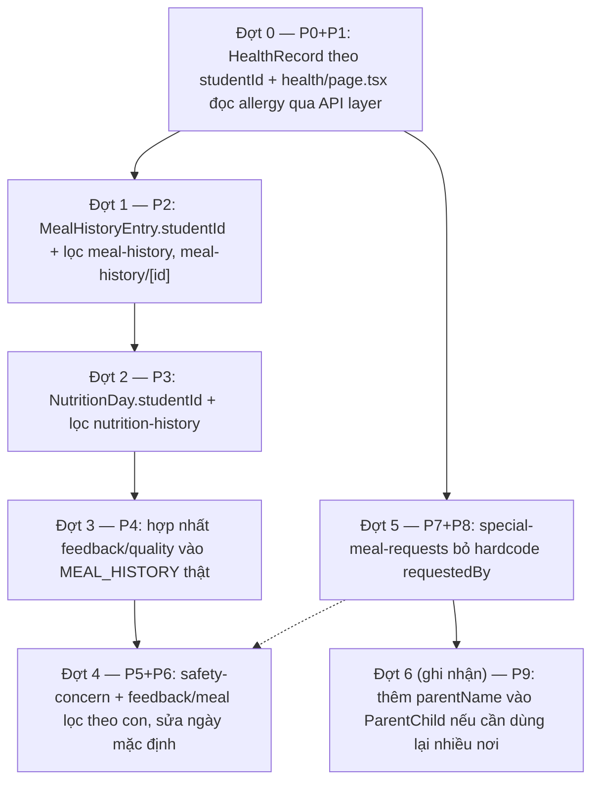

# Kế hoạch thực hiện — Nối lại hiển thị Parent (Web) đúng với `mock-data.ts` + tách dữ liệu theo từng con

**Mục đích**: rà toàn bộ 19 trang trong `03_Design/08_FrontEnd/Web/src/app/(app)/parent/` đối chiếu field-by-field với `mock-data.ts` + `lib/api/db.ts` + `lib/api/hooks.ts` + `lib/stores/child-store.ts`, liệt kê các chỗ hiển thị sai/không nối đúng nguồn dữ liệu, và xử lý dứt điểm các mảng mock **thiếu `studentId`** khiến 2 con của cùng phụ huynh (Nguyễn Minh Khang — HS-3A-001, Nguyễn Minh Anh — HS-1B-007) hiển thị **y hệt nhau** ở nhiều màn dù `useActiveChild()`/Child Switcher đã hoạt động đúng. Kế hoạch này **không phải quyết định nghiệp vụ mới** — mọi fix đều bám theo đúng comment "nguồn duy nhất"/"đã gộp" đã có sẵn trong `mock-data.ts`, và theo đúng mẫu đã áp dụng thành công cho Teacher (`review/teacher/review_teacher_data_linkage_plan.md`, hoàn tất 27/07/2026).

**Ngày lập**: 27/07/2026.

**Tài liệu nguồn đã xác minh trực tiếp trong code** (không suy đoán):
- `mock-data.ts`: `ParentChild`/`PARENT_CHILDREN` (2 dòng, không có field tên phụ huynh); `HealthRecord`/`HEALTH_RECORD` (object đơn, không có `studentId`); `NutritionDay`/`NUTRITION_HISTORY` (9 dòng, không có `studentId`); `MealHistoryEntry`/`MEAL_HISTORY` (4 dòng, không có `studentId`); `AllergyDeclaration` (comment "nguồn sự thật duy nhất... `Student.allergies` là TRƯỜNG DẪN XUẤT"); `SpecialMealRequest` (comment "MỘT nguồn duy nhất... Mảng riêng của màn Phụ huynh đã gộp vào", 21/07/2026); `Student.specialDiet` (`@deprecated` 27/07/2026); `CONCERN_SYMPTOMS`, `CONCERN_CATEGORIES`.
- `lib/api/db.ts`: registry resource → mảng seed (xác nhận `"allergy-declarations"`, `"chronic-conditions"`, `"special-meals"`, `"student-distributions"`, `"feedbacks"` đều đã có; `MEAL_HISTORY`/`NUTRITION_HISTORY`/`HEALTH_RECORD` **không** nằm trong registry — chỉ import tĩnh trực tiếp từ `mock-data.ts`, không đi qua `usePagedList`/invalidate query).
- `lib/stores/child-store.ts`: `useActiveChild()` — đọc đúng `PARENT_CHILDREN`, có default khi chưa chọn; đây là nguồn `studentId` chuẩn cần dùng để lọc mọi mảng còn thiếu liên kết.
- Đối chiếu trực tiếp từng file `page.tsx` trong `parent/` (đã đọc toàn bộ 19 file) để xác nhận trang nào dùng `usePagedList` (qua API layer, có mutate+invalidate) và trang nào import tĩnh trực tiếp từ `mock-data.ts` (snapshot cứng, không phản ánh thay đổi vừa ghi ở trang khác).
- Đối chiếu với `review/teacher/review_teacher_data_linkage_plan.md`: cùng dạng lỗi ("mảng tĩnh không lọc theo entity đang xem", "hardcode giá trị", "trộn 2 tầng đọc dữ liệu") đã được xử lý cho Teacher theo mẫu Đợt 0→6 + Nghiệm thu bằng `tsc --noEmit`; kế hoạch này tái dùng đúng mẫu đó cho Parent.

---

## 1. Phạm vi

### 1.1. Trong phạm vi (code Web — Parent)

| # | Việc | File | Vấn đề cụ thể | Ưu tiên |
| --- | --- | --- | --- | --- |
| P0 | Thêm `studentId` cho `HealthRecord`, tách theo con | `mock-data.ts`, `parent/health/page.tsx` | `HEALTH_RECORD` là **object đơn** dùng chung toàn hệ thống — chiều cao/cân nặng/BMI/nhóm máu của HS-3A-001 và HS-1B-007 hiển thị giống hệt nhau khi đổi con ở Topbar, dù đây là 2 học sinh khác lớp, khác tuổi | **P0** |
| P1 | Đọc dị ứng qua API layer thay vì hàm tĩnh, thống nhất với trang `allergies` | `parent/health/page.tsx` | Đang gọi thẳng `allergiesOfStudent(child.studentId)` (đọc mảng seed gốc), trong khi `parent/allergies/page.tsx` dùng `usePagedList("allergy-declarations")` (đã qua `useCreate`/invalidate). Kết quả: phụ huynh vừa khai báo dị ứng mới ở trang Allergies, quay lại trang Health **không thấy ngay** vì đọc 2 tầng dữ liệu khác nhau | **P0** |
| P2 | Thêm `studentId` cho `MealHistoryEntry`, lọc theo con đang chọn | `mock-data.ts`, `parent/meal-history/page.tsx`, `parent/meal-history/[id]/page.tsx` | `MEAL_HISTORY` chỉ có 4 bản ghi, không gắn học sinh nào — dùng chung cho MỌI con, đổi con ở Topbar không đổi nội dung trang | **P0** |
| P3 | Thêm `studentId` cho `NutritionDay`, lọc theo con đang chọn | `mock-data.ts`, `parent/nutrition-history/page.tsx` | `NUTRITION_HISTORY`/`NUTRITION_TARGET` dùng chung toàn hệ thống — biểu đồ dinh dưỡng giống hệt cho mọi con | **P0** |
| P4 | Hợp nhất `feedback/quality` vào cùng nguồn `MEAL_HISTORY` | `parent/feedback/quality/page.tsx` | Mảng hardcode cục bộ `MEAL_SESSIONS` (ngày `"02/07/2026"`) hoàn toàn tách rời `mock-data.ts` — không khớp bất kỳ ngày nào trong `MEAL_HISTORY` thật (01/07, 30/06, 29/06, 26/06/2026); `feedback/meal` và `feedback/quality` cho ra 2 tập ngày khác nhau cho cùng một quy trình "phản hồi bữa ăn" | **P0** |
| P5 | Đồng bộ ngày mặc định ở `safety-concern` với `MEAL_HISTORY` thật | `parent/safety-concern/page.tsx` | `useState("02/07/2026")` — giá trị khởi tạo không khớp ngày nào trong `MEAL_HISTORY`, khiến dropdown "món nghi vấn" (`suspectedDishes`, dòng 45) rỗng cho tới khi người dùng tự đổi ngày | **P1** |
| P6 | Lọc `MEAL_HISTORY`/`suspectedDishes` theo con đang chọn | `parent/safety-concern/page.tsx`, `parent/feedback/meal/page.tsx` | Sau khi P2 thêm `studentId` vào `MealHistoryEntry`, 2 trang này cần lọc theo `useActiveChild()` để "món nghi vấn"/"chọn bữa ăn để phản hồi" đúng là bữa của con đang xem, không lẫn bữa của con khác | **P1** (phụ thuộc P2) |
| P7 | Bỏ hardcode `requestedBy`, lấy tên phụ huynh thật theo con đang chọn | `parent/special-meal-requests/page.tsx` | Dòng 157: `requestedBy: "Nguyễn Văn Bình (PH)"` hardcode cứng cho mọi yêu cầu, kể cả khi đang chọn con khác cha/mẹ khác (dữ liệu seed hiện tại 2 con cùng 1 phụ huynh nên chưa lộ rõ, nhưng sai về nguyên tắc join dữ liệu) | **P1** |
| P8 | (Phụ trợ P7) Bổ sung cách tra tên phụ huynh theo `studentId` | `parent/special-meal-requests/page.tsx` (hoặc hook dùng chung) | `ParentChild` không có field tên phụ huynh → cần `usePagedList<Student>("students")` rồi `students.find(s => s.id === child.studentId)?.parent`, cùng cách `dashboard`/`special-meals`/`weekly-menu` đã làm | **P1** (đi cùng P7) |
| P9 | (Ghi nhận, không bắt buộc sửa ngay) Thêm `parentName` vào `ParentChild` | `mock-data.ts` | Cách join hiện tại (P8) phải load thêm `Student[]` chỉ để lấy 1 field tên — nếu về sau có nhiều nơi cần, nên cân nhắc thêm thẳng `parentName` vào `ParentChild` để tránh join lặp lại nhiều trang | **P2** |

### 1.2. Ngoài phạm vi

- Sửa `teacher/*`, `medical-staff/*` — đã có kế hoạch riêng (`review/teacher/review_teacher_data_linkage_plan.md`, `review/medical_staff/review_medicalstaff_plan.md`), không đụng vào ở đây.
- `dashboard`, `weekly-menu`, `nutrition/[dishId]`, `school-meals`, `special-meals`, `special-meal-records`, `allergies`, `chronic-conditions`, `feedback` (theo món), `announcements*` — đã đối chiếu, dùng đúng nguồn dữ liệu qua `usePagedList` + lọc theo `useActiveChild()`, không có việc gì phải sửa.
- Đổi enum trạng thái (`Incident.status`, `AllergyDeclaration.status`...) — không thuộc phạm vi Parent, Parent chỉ đọc/tạo dữ liệu qua các resource đã có sẵn.
- Screen Spec/Wireframe — nợ tài liệu đã ghi ở `review/review_screen_parent_and_teacher.md`, không lặp lại ở đây.

---

## 2. Phân tích phụ thuộc & thứ tự đợt

Lý do thứ tự: (0) Đợt 0 làm trước vì đây là gap rõ nhất, ảnh hưởng trực tiếp tới 1 trang độc lập (`health`), không phụ thuộc đợt nào khác; (1) Đợt 1 (P2) làm trước Đợt 2/3/4 vì `MealHistoryEntry` là mảng được 3 trang khác dùng chung (`nutrition-history` không dùng trực tiếp nhưng cùng loại lỗi; `feedback/quality` và `safety-concern`/`feedback/meal` đều tham chiếu `MEAL_HISTORY`) — thêm `studentId` một lần, dùng lại cho các đợt sau, tránh sửa 2 lần; (2) Đợt 2 (P3) độc lập với Đợt 1 nhưng cùng loại thay đổi (thêm `studentId` + lọc theo `useActiveChild()`), làm ngay sau để nhất quán cách làm; (3) Đợt 3 (P4) phải chờ Đợt 1 xong vì `feedback/quality` sẽ đổi sang đọc `MEAL_HISTORY` đã có `studentId`; (4) Đợt 4 (P5+P6) chờ Đợt 1 vì cần `studentId` để lọc "món nghi vấn" theo đúng con đang chọn; (5) Đợt 5 (P7+P8) độc lập hoàn toàn, có thể chạy song song Đợt 1-4; (6) Đợt 6 (P9) chỉ ghi nhận, làm sau cùng nếu cần.

---

## 3. Câu hỏi cần chốt trước khi code Đợt 0–3 (không tự quyết)

| # | Câu hỏi | Chặn việc | Đề xuất mặc định nếu không có phản hồi |
| --- | --- | --- | --- |
| 1 | Khi thêm `studentId` vào `HealthRecord`/`MealHistoryEntry`/`NutritionDay`, chuyển các hằng số đơn (`HEALTH_RECORD`) thành mảng (`HEALTH_RECORDS: HealthRecord[]`) hay giữ tên cũ nhưng đổi kiểu thành `Record<string, HealthRecord>`? Ảnh hưởng tới cách các trang khác (nếu có) đang import trực tiếp | P0, P2, P3 | Đổi thành mảng `HealthRecord[]`/`MealHistoryEntry[]`/`NutritionDay[]` (đã có sẵn dạng mảng cho 2 cái sau) + hàm helper `xOfStudent(studentId)` cạnh các hàm `allergiesOfStudent()`/`verifiedAllergensOfStudent()` đã có, giữ đúng phong cách hiện tại của file |
| 2 | Cần bổ sung bao nhiêu bản ghi seed cho con thứ 2 (HS-1B-007, lớp 1B, 6 tuổi)? Hiện toàn bộ seed (`HEALTH_RECORD`, `MEAL_HISTORY`, `NUTRITION_HISTORY`) chỉ có dữ liệu khớp hồ sơ HS-3A-001 | P0, P2, P3 | Seed tối thiểu 1 `HealthRecord` khác biệt rõ (chiều cao/cân nặng thấp hơn, phù hợp tuổi 6) + 2-4 `MealHistoryEntry`/`NutritionDay` mới cho HS-1B-007 (ngày có thể trùng với dữ liệu con 1 để dễ so sánh song song), đủ để kiểm chứng bằng mắt là 2 con hiển thị khác nhau |

---

## 4. Task chi tiết theo từng đợt

### Đợt 0 — HealthRecord theo `studentId` + đọc allergy qua API layer (P0+P1)

- [x] **Task 0.1**: `mock-data.ts` — đổi `HEALTH_RECORD: HealthRecord` thành `HEALTH_RECORDS: HealthRecord[]` (thêm `studentId: string` vào interface `HealthRecord`); giữ nguyên bản ghi hiện tại gắn `studentId: "HS-3A-001"`; thêm 1 bản ghi mới cho `"HS-1B-007"` theo phương án đã chốt ở câu hỏi #2.
- [x] **Task 0.2**: `mock-data.ts` — thêm hàm helper `healthRecordOfStudent(studentId: string)` cạnh các hàm dẫn xuất khác (`allergiesOfStudent`, `verifiedAllergensOfStudent`), trả `HealthRecord | undefined`.
- [x] **Task 0.3**: `parent/health/page.tsx` — đổi `const record = HEALTH_RECORD;` (dòng 28) thành `const record = healthRecordOfStudent(child.studentId);`; thêm nhánh hiển thị "chưa có hồ sơ" nếu `undefined` (tương tự cách các trang khác xử lý thiếu dữ liệu).
- [x] **Task 0.4**: `parent/health/page.tsx` — thay `allergiesOfStudent(child.studentId)` (dòng 97) bằng đọc từ `usePagedList<AllergyDeclaration>("allergy-declarations", { studentId: child.studentId })` (đã có `chronicPage`/`smrPage` dùng đúng pattern này trong cùng file, chỉ cần thêm 1 lời gọi tương tự).
- Nghiệm thu: `tsc --noEmit` sạch; đổi con ở Topbar → số liệu chiều cao/cân nặng/BMI đổi khác nhau rõ rệt; khai báo dị ứng mới ở trang Allergies rồi quay lại Health thấy ngay không cần reload.

### Đợt 1 — `MealHistoryEntry.studentId` + lọc `meal-history` (P2)

- [x] **Task 1.1**: `mock-data.ts` — thêm `studentId: string` vào `MealHistoryEntry`; gắn 4 bản ghi hiện có với `"HS-3A-001"`; thêm 2-4 bản ghi mới cho `"HS-1B-007"` theo phương án đã chốt ở câu hỏi #2.
- [x] **Task 1.2**: `parent/meal-history/page.tsx` — thêm `.filter(m => m.studentId === child.studentId)` trước khi render danh sách (dùng `useActiveChild()` đã có sẵn cách import ở các trang khác trong `parent/`).
- [x] **Task 1.3**: `parent/meal-history/[id]/page.tsx` — sau khi tìm bản ghi theo `id`, thêm guard `entry.studentId !== child.studentId` → render nhánh "không tìm thấy" (route `[id]` không lọc được qua query, phải guard trong component, cùng cách Teacher đã làm ở `students/[id]`/`distribution/[id]`).
- Nghiệm thu: `tsc --noEmit` sạch; đổi con ở Topbar → danh sách bữa ăn đổi khác; gõ thẳng URL `[id]` của bữa ăn thuộc con kia phải ra "không tìm thấy".

### Đợt 2 — `NutritionDay.studentId` + lọc `nutrition-history` (P3)

- [x] **Task 2.1**: `mock-data.ts` — thêm `studentId: string` vào `NutritionDay`; gắn 9 bản ghi hiện có với `"HS-3A-001"`; thêm bản ghi mới cho `"HS-1B-007"` (số ngày tương đương để biểu đồ so sánh được).
- [x] **Task 2.2**: cân nhắc `NUTRITION_TARGET` có nên khác theo độ tuổi (BR-062 ghi rõ "nhóm 6–11 tuổi") — nếu HS-1B-007 (6 tuổi) và HS-3A-001 (8 tuổi) cùng nhóm tuổi theo BR-062 thì giữ nguyên 1 target chung, không cần tách; chỉ ghi chú lại trong comment code, không tự đổi số liệu BR đã duyệt.
- [x] **Task 2.3**: `parent/nutrition-history/page.tsx` — thêm `.filter(d => d.studentId === child.studentId)` trước khi tính toán/vẽ biểu đồ.
- Nghiệm thu: `tsc --noEmit` sạch; đổi con ở Topbar → biểu đồ dinh dưỡng đổi khác.

### Đợt 3 — Hợp nhất `feedback/quality` vào `MEAL_HISTORY` thật (P4)

- [x] **Task 3.1**: `parent/feedback/quality/page.tsx` — xoá mảng hardcode `MEAL_SESSIONS`; thay bằng đọc `MEAL_HISTORY` (đã có `studentId` sau Đợt 1) lọc theo `child.studentId`, map sang shape `{ date, meal, remaining }` cần thiết cho UI hiện tại (tính `remaining` từ `servedAt` nếu cần giữ tính năng "còn X giờ", hoặc bỏ field này nếu không còn ý nghĩa với dữ liệu quá khứ — cần xác nhận với người phụ trách UX nếu muốn giữ đúng hành vi "phản hồi trong X giờ sau bữa ăn").
- [x] **Task 3.2**: đối chiếu lại `parent/feedback/meal/page.tsx` (đang dùng `MEAL_HISTORY.filter(feedbackOpen)`) — đảm bảo cả 2 trang `feedback/meal` và `feedback/quality` cùng đọc chung 1 danh sách ngày/bữa từ `MEAL_HISTORY`, không còn lệch tập ngày.
- Nghiệm thu: `tsc --noEmit` sạch; 2 màn `feedback/meal` và `feedback/quality` hiển thị cùng tập ngày/bữa ăn cho cùng 1 con đang chọn.

### Đợt 4 — `safety-concern` + `feedback/meal` lọc theo con, sửa ngày mặc định (P5+P6)

- [x] **Task 4.1**: `parent/safety-concern/page.tsx` — đổi `useState("02/07/2026")` (dòng 36) thành lấy ngày mới nhất có thật trong `MEAL_HISTORY` của con đang chọn (ví dụ `child`-filtered `MEAL_HISTORY[0]?.date`), tránh hardcode ngày không tồn tại.
- [x] **Task 4.2**: cùng file — `suspectedDishes` (dòng 45, hiện `MEAL_HISTORY.flatMap(...)`) thêm `.filter(m => m.studentId === child.studentId)` trước khi `flatMap`, đảm bảo "món nghi vấn" chỉ liệt kê món của đúng con đang báo cáo.
- [x] **Task 4.3**: `parent/feedback/meal/page.tsx` — thêm `.filter(m => m.studentId === child.studentId)` vào nguồn `MEAL_HISTORY.filter(feedbackOpen)` hiện có.
- Nghiệm thu: `tsc --noEmit` sạch; mở `safety-concern` lần đầu (chưa đổi ngày thủ công) đã thấy sẵn danh sách món nghi vấn không rỗng; đổi con ở Topbar thì danh sách món đổi theo.

### Đợt 5 — Bỏ hardcode `requestedBy` (P7+P8)

- [x] **Task 5.1**: `parent/special-meal-requests/page.tsx` — thêm `usePagedList<Student>("students")` (hoặc tái dùng nếu file đã có sẵn biến tương tự), tra `students?.items.find(s => s.id === child.studentId)?.parent`.
- [x] **Task 5.2**: dòng 157 — đổi `requestedBy: "Nguyễn Văn Bình (PH)"` thành giá trị tra được ở Task 5.1, fallback về chuỗi cứng cũ chỉ khi không tìm thấy (không để trống).
- Nghiệm thu: `tsc --noEmit` sạch; tạo yêu cầu suất ăn đặc biệt cho từng con → `requestedBy` hiển thị đúng tên phụ huynh của `Student.parent` tương ứng.

### Đợt 6 (ghi nhận, không bắt buộc code ngay) — `parentName` trong `ParentChild` (P9)

- [ ] **Task 6.1**: nếu về sau có thêm ≥2 nơi cần tên phụ huynh theo con đang chọn (ngoài Task 5.1), cân nhắc thêm `parentName?: string` vào interface `ParentChild` + điền seed, thay vì mỗi trang tự `usePagedList("students")` rồi `find` lại.
- Ghi chú: hiện tại chỉ có 1 trang (`special-meal-requests`) cần, nên **không** đưa vào lịch code đợt này — chỉ ghi nhận để tránh join lặp lại nếu nhu cầu mở rộng.

---

## 5. Rủi ro & lưu ý nhất quán

1. **Đợt 1 (P2) nên xong trước Đợt 3/4** — vì `MEAL_HISTORY` được 3 trang khác cùng tham chiếu (`feedback/quality`, `feedback/meal`, `safety-concern`); thêm `studentId` một lần rồi lọc lại ở cả 3 nơi, tránh phải quay lại sửa file `mock-data.ts` nhiều lần.
2. **Seed dữ liệu cho HS-1B-007 hiện gần như trống** (`MEAL_HISTORY`, `NUTRITION_HISTORY`, `HEALTH_RECORD` chỉ có dữ liệu khớp HS-3A-001) — mọi task thêm `studentId` đều cần thêm seed mới thật (không copy y hệt số liệu của con kia), nếu không việc "đổi con thấy đổi dữ liệu" sẽ không kiểm chứng được bằng mắt dù code đã lọc đúng.
3. **`feedback/quality` (P4) có thể ảnh hưởng hành vi UX** (khái niệm "còn X giờ để phản hồi") — không tự quyết định giữ/bỏ field `remaining`; nếu cần giữ đúng ý nghĩa gốc, nên hỏi trước khi tính lại từ `servedAt` thực tế (dữ liệu `MEAL_HISTORY` toàn bộ đã là ngày quá khứ, "còn X giờ" tính từ dữ liệu cũ sẽ luôn ra số âm/vô nghĩa).
4. **Không tự đổi `NUTRITION_TARGET` theo tuổi** (câu hỏi #2, Task 2.2) — BR-062 đã chốt cho nhóm 6–11 tuổi, không tự suy diễn thêm ngưỡng riêng cho từng độ tuổi nếu không có yêu cầu rõ.
5. Cách "guard trong component cho route `[id]`" (Task 1.3) lặp lại đúng mẫu Teacher đã dùng ở `students/[id]`/`distribution/[id]` (`review/teacher/review_teacher_data_linkage_plan.md` Đợt 1) — vì `GET /:resource/:id` của mock server chỉ `find by id`, không lọc field nào, nên không thể xử lý bằng query param.
6. Sau khi xong Đợt 0–5, nên chạy `tsc --noEmit` một lượt cuối cho cả 19 trang `parent/*` (không chỉ các file đã sửa) để chắc chắn không có import cũ (`HEALTH_RECORD` singleton) còn sót lại ở nơi khác.

---

**Trạng thái file này**: kế hoạch task, dựa hoàn toàn trên đối chiếu code thật (`mock-data.ts`, `db.ts`, `hooks.ts`, `child-store.ts`, toàn bộ 19 file `parent/*`) — KHÔNG phải quyết định nghiệp vụ mới. Câu hỏi ở Mục 3 cần người dùng chốt trước khi làm Đợt 0-3; Đợt 5 có thể làm độc lập ngay.

---

## 6. ĐÃ ÁP CODE — 27/07/2026

Toàn bộ Đợt 0-5 đã code xong theo đúng task list ở Mục 4 (câu hỏi #1/#2 Mục 3 áp theo đúng phương án mặc định đề xuất — chuyển sang mảng + hàm helper `xOfStudent()`, seed thêm dữ liệu riêng cho HS-1B-007). `npx tsc --noEmit -p tsconfig.check.json` sạch, không còn lỗi kiểu nào.

Chi tiết đã làm theo từng đợt:
- **Đợt 0**: `HEALTH_RECORD` (object đơn) → `HEALTH_RECORDS: HealthRecord[]` + `healthRecordOfStudent()`; `parent/health/page.tsx` đọc theo `child.studentId`, có nhánh "chưa có hồ sơ"; dị ứng đổi từ `allergiesOfStudent()` (mảng tĩnh) sang `usePagedList("allergy-declarations")`, cùng tầng dữ liệu với trang Allergies.
- **Đợt 1**: `MealHistoryEntry` thêm `studentId`; seed 4 dòng cũ gắn `HS-3A-001`, thêm 3 dòng mới cho `HS-1B-007` (id hậu tố `-1B`); `meal-history/page.tsx` lọc theo con; `meal-history/[id]/page.tsx` thêm guard chặn xem chéo bữa ăn của con khác.
- **Đợt 2**: `NutritionDay` thêm `studentId`; giữ `NUTRITION_TARGET` dùng chung (cùng nhóm tuổi 6–11 theo BR-062, không tách); thêm 9 điểm dữ liệu cho `HS-1B-007`; `nutrition-history/page.tsx` lọc theo con trước khi tính trung bình/vẽ biểu đồ.
- **Đợt 3**: `feedback/quality/page.tsx` bỏ hẳn mảng hardcode `MEAL_SESSIONS`, đổi sang đọc `MEAL_HISTORY` lọc theo `feedbackOpen` + `studentId` (cùng nguồn với `feedback/meal`); bỏ field `remaining` không có thật trong dữ liệu, thêm trạng thái rỗng "Không còn phiên ăn nào trong cửa sổ 24h".
- **Đợt 4**: `safety-concern/page.tsx` — ngày ăn mặc định đổi từ hardcode `"02/07/2026"` sang bữa gần nhất có thật của con đang chọn; "món nghi vấn" lọc theo `studentId`; `feedback/meal/page.tsx` cũng thêm lọc `studentId` vào `eligibleMeals`.
- **Đợt 5**: `special-meal-requests/page.tsx` — thêm `usePagedList<Student>("students")`, tra `parent` theo `child.studentId`, thay hardcode `"Nguyễn Văn Bình (PH)"` ở cả `requestedBy` và `appendHistory({ by })`.

**Chưa làm (đúng phạm vi đã ghi ở Mục 1.1/Đợt 6)**: P9 (`parentName` trong `ParentChild`) — chỉ ghi nhận, chưa có nhu cầu dùng lại ở nơi thứ 2 nên không đưa vào code đợt này.
