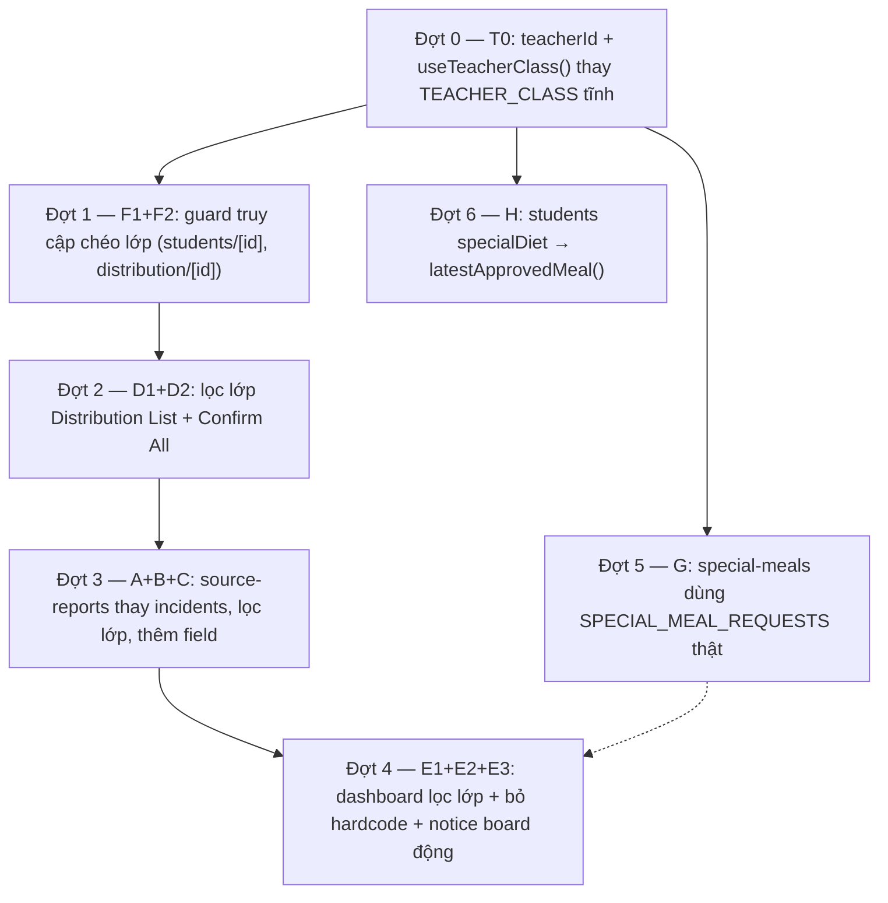

# Kế hoạch thực hiện — Nối lại hiển thị Teacher (Web) đúng với `mock-data.ts` + phạm vi dữ liệu theo lớp chủ nhiệm

**Mục đích**: rà toàn bộ 9 trang trong `03_Design/08_FrontEnd/Web/src/app/(app)/teacher/` đối chiếu field-by-field với `mock-data.ts` + `lib/api/db.ts` + `lib/api/mock-server.ts`, liệt kê các chỗ hiển thị sai/không nối đúng nguồn dữ liệu, và bổ sung ràng buộc **giáo viên chỉ được xem dữ liệu của lớp mình chủ nhiệm** (`TEACHER_CLASS.classId = "3A"`). Kế hoạch này **không phải quyết định nghiệp vụ mới** — mọi fix đều bám theo đúng comment "nguồn duy nhất"/"redesign" đã có sẵn trong `mock-data.ts`.

**Ngày lập**: 27/07/2026.

**Tài liệu nguồn đã xác minh trực tiếp trong code** (không suy đoán):
- `mock-data.ts`: `STATUS_BADGE`, `Incident`/`IncidentSourceReport` (comment "Redesign Incident 09/07/2026"), `SpecialMealRequest` (comment "MỘT nguồn duy nhất... Mảng riêng của màn Phụ huynh đã gộp vào"), `Student.specialDiet` (comment `@deprecated 27/07/2026`), `ALLERGY_DECLARATIONS` (comment "nguồn sự thật duy nhất... Student.allergies là TRƯỜNG DẪN XUẤT"), `TEACHER_CLASS`, `CLASSROOMS` (field `teacher` chỉ là tên hiển thị, không phải khoá ngoại), `STUDENTS` (lớp 3A chỉ có 10 em), `DIET_GROUPS`.
- `lib/api/db.ts`: bảng registry resource → mảng seed (xác nhận `"incidents"` = `INCIDENTS`, `"source-reports"` = `SOURCE_REPORTS`, `"special-meals"` = `SPECIAL_MEAL_REQUESTS`).
- `lib/api/mock-server.ts`: hàm `paginate()` (lọc chính xác theo field cho **danh sách**) và route `GET /:resource/:id` (chỉ `find by id`, **không lọc theo bất kỳ field nào**) — xác nhận bằng cách đọc trực tiếp dòng 27-91 và 320-333.
- `lib/health-docs.ts`: `latestApprovedMeal()` — helper đã tồn tại, đang dùng ở `medical-staff/*`, chưa được `teacher/*` tái sử dụng.
- `lib/stores/auth-store.ts`: `useAuthStore`/`SessionUser`/`DEMO_USERS` — phiên đăng nhập mock hiện có `name/email/role/school`, **không có `id`**, nên không nối được với `CLASSROOMS` bằng khoá ổn định; `TEACHER_CLASS` hiện là hằng số tĩnh, không hề đọc từ phiên đăng nhập.
- Đối chiếu với `review/review_screen_parent_and_teacher.md` (03/07/2026): tài liệu đó review lúc Teacher mới có 5/13 màn; tại thời điểm lập kế hoạch này (27/07/2026) cả 9 route đã tồn tại, nên các gap dưới đây là **gap mới phát sinh sau khi màn đã được dựng thêm** (Distribution Detail, Student Detail, Meal Records, Special Meals), không trùng nội dung file cũ.

---

## 1. Phạm vi

### 1.1. Trong phạm vi (code Web — Teacher)

| # | Việc | File | Vấn đề cụ thể | Ưu tiên |
| --- | --- | --- | --- | --- |
| T0 | Lấy lớp chủ nhiệm từ phiên đăng nhập thay vì hằng số tĩnh | `mock-data.ts`, `lib/stores/auth-store.ts`, 6 file `teacher/*` đang import `TEACHER_CLASS` | `TEACHER_CLASS.classId = "3A"` là hằng số cứng, không đọc từ `useAuthStore`. `CLASSROOMS.teacher` và `USER_ACCOUNTS.name`/`SCHOOL_STAFF.name` chỉ nối được với nhau bằng **so tên hiển thị** — không có khoá ngoại ổn định, sai lệch nếu 2 giáo viên trùng tên hoặc sau này có nhiều tài khoản giáo viên | **P0** (làm trước mọi việc khác — mọi task bên dưới đều dùng lại "lớp của giáo viên đang đăng nhập") |
| F1 | Chặn truy cập chéo lớp ở `students/[id]` | `teacher/students/[id]/page.tsx` | `useDetail<Student>("students", id)` không đối chiếu `s.class` với lớp của giáo viên đang đăng nhập. Vì `GET /:resource/:id` của mock server chỉ `find by id`, không lọc gì — gõ thẳng URL id học sinh lớp khác vẫn xem được đầy đủ hồ sơ sức khỏe/dị ứng | **P0** |
| F2 | Chặn truy cập chéo lớp ở `distribution/[id]` | `teacher/distribution/[id]/page.tsx` | Tương tự F1: `useDetail<StudentDistribution>("student-distributions", id)` không đối chiếu `d.class` với lớp của giáo viên đang đăng nhập | **P0** |
| D1 | Thêm lọc lớp ở Distribution List | `teacher/distribution/page.tsx` | `filters` chỉ có `{ date: TODAY }`, thiếu `class`. Dữ liệu `STUDENT_DISTRIBUTIONS` có cả lớp 3A/3B cùng ngày (06/07/2026) | **P0** |
| D2 | Thêm lọc lớp ở query "Xác nhận cả lớp" | `teacher/distribution/page.tsx` | `pendingData` (nguồn của nút "Xác nhận cả lớp") cũng thiếu `class` trong params — bấm 1 nút có thể xác nhận nhầm suất ăn lớp khác | **P0** (đi cùng D1) |
| A | Đổi luồng tạo báo cáo sự cố sang đúng kiến trúc RPT → INC | `teacher/incidents/page.tsx` | `useCreate("incidents")` tạo thẳng `INC-xxx` với `status:"OPEN"` — giá trị này **không tồn tại** trong state machine thật của `Incident.status` (`SEVERITY_PENDING→TREATMENT→...→CAPA_APPROVED→CLOSED`, xem seed `INCIDENTS` chỉ có `CAPA_APPROVED`/`CLOSED`). Đúng theo redesign 09/07/2026 và theo cách `parent/safety-concern/page.tsx` đã làm: Teacher chỉ tạo **báo cáo thô** vào `"source-reports"` (`RPT-xxx`, `status:"PENDING_TRIAGE"`) | **P0** |
| B | Đổi "Lịch sử báo cáo" sang resource + trạng thái đúng, có lọc lớp | `teacher/incidents/page.tsx` | Bảng đang đọc `resource="incidents"` **không lọc lớp**, tab lọc theo `OPEN/INVESTIGATING` — 2 giá trị không có trong `IncidentSourceReport.status` (`PENDING_TRIAGE/DRAFTING/DRAFTED/MERGED/CLOSED_NOT_FOOD_SAFETY`) lẫn `Incident.status` mới | **P0** (đi cùng A) |
| C | Bổ sung field còn thiếu trong Incident Form | `teacher/incidents/page.tsx` | Thiếu **Ngày ăn** (`mealDate`, bắt buộc BR-154, `IncidentSourceReport.mealDate`) — hiện không có input nào cho field này; Triệu chứng đang hardcode `symptoms: []` dù `CONCERN_SYMPTOMS` đã có sẵn trong `mock-data.ts` (Parent đang dùng, Teacher thì chưa) | **P0** (đi cùng A/B) |
| E1 | Lọc lớp cho danh sách sự cố ở Dashboard | `teacher/dashboard/page.tsx` | `usePagedList<Incident>("incidents", { pageSize: 100 })` không lọc — `latestIncident = incidents[0]` có thể là sự cố của lớp khác (1 `Incident` có thể có `affectedStudents` thuộc nhiều lớp) | **P1** |
| E2 | Bỏ hardcode "Sĩ số hôm nay" | `teacher/dashboard/page.tsx` | `StatCard value="38/38"` cứng, trong khi roster thật lớp 3A trong `STUDENTS` chỉ có 10 em (`TEACHER_CLASS.students = 38` cũng lệch seed) | **P1** |
| E3 | Tính động dòng đầu Notice Board | `teacher/dashboard/page.tsx` | Chuỗi cứng "Nguyễn Minh Khang — Tôm trùng món Tôm rim thịt" không khớp thực đơn hôm nay trong seed (`STUDENT_DISTRIBUTIONS` hôm nay = `MENU-TD-3`, thực đơn chay) | **P1** |
| G | Đổi nguồn dữ liệu suất ăn đặc biệt | `teacher/special-meals/page.tsx` + tab "Suất ăn đặc biệt" của `teacher/students/[id]/page.tsx` | Đang đọc `SPECIAL_DIET_REQUIREMENTS` — mảng tĩnh riêng, **không** nằm trong `db.ts`, lệch dữ liệu so với nguồn thật `SPECIAL_MEAL_REQUESTS` (resource `"special-meals"`): thiếu Nguyễn Minh Khang (Nut-Free, APPROVED), sai trạng thái Vũ Ngọc Diệp (thực tế PENDING chứ không phải APPROVED) | **P1** |
| H | Đổi cột "Bữa ăn đặc biệt" sang nguồn chuẩn | `teacher/students/page.tsx` | Đọc `Student.specialDiet` — field đã `@deprecated`, nguồn chuẩn là `latestApprovedMeal()` (đã có ở `lib/health-docs.ts`, đang dùng ở `medical-staff/*`) | **P2** |
| I | (Ghi nhận, không bắt buộc sửa) Đồng bộ severity dị ứng | `mock-data.ts` | `STUDENT_HEALTH_INFO["HS-3A-009"].allergies[0].severity = "Nhẹ"` lệch với `ALLERGY_DECLARATIONS` (`ALG-005`, severity `"Trung bình"`) cho cùng học sinh/allergen — 2 mảng song song có thể trôi dữ liệu | **P2** |
| J | (Ghi nhận, không bắt buộc sửa) Thêm field `class` cho `TeacherMealRecord` | `mock-data.ts` | Hiện an toàn vì seed `TEACHER_MEAL_RECORDS` chỉ có lớp 3A, nhưng interface không có `class` nên không lọc tường minh được nếu seed mở rộng thêm lớp khác | **P2** |

### 1.2. Ngoài phạm vi

- Sửa `medical-staff/incidents/*` hay `parent/safety-concern/page.tsx` — 2 màn này đã đúng kiến trúc `source-reports`, chỉ dùng làm tham chiếu.
- Bổ sung Screen Spec/Wireframe — đã có ghi chú nợ tài liệu ở `review/review_screen_parent_and_teacher.md` §5.1, không lặp lại ở đây.
- Đổi enum `Incident.status`/`CorrectiveAction.status` — thuộc phạm vi `review/medical_staff/review_medicalstaff_plan.md`, Teacher chỉ **tạo** báo cáo, không đổi state machine.

---

## 2. Phân tích phụ thuộc & thứ tự đợt

Lý do thứ tự: (0) Đợt 0 làm trước tất cả vì mọi đợt sau đều cần đọc "lớp của giáo viên đang đăng nhập" — nếu làm Đợt 1-6 trước rồi mới đổi nguồn ở Đợt 0, phải sửa lại y hệt các file đó lần hai; (1) Đợt 1 làm ngay sau vì đây là lỗ hổng phạm vi dữ liệu độc lập, rủi ro cao nhất đúng với ràng buộc "chỉ xem lớp mình"; (2) Đợt 2 độc lập, làm sớm vì ảnh hưởng tới hành động ghi dữ liệu (xác nhận nhầm lớp khác); (3) Đợt 3 đổi kiến trúc trước Đợt 4 vì Dashboard (E1) nên dùng lại đúng 1 cách tính "sự cố của lớp mình" mà Đợt 3 vừa chuẩn hoá, tránh viết 2 lần 2 kiểu; (4) Đợt 5 (G) độc lập hoàn toàn, có thể chạy song song Đợt 3/4; (5) Đợt 6 (H) độc lập, ưu tiên thấp nhất vì chỉ đổi 1 cột hiển thị.

---

## 3. Câu hỏi cần chốt trước khi code Đợt 3–4 (không tự quyết)

| # | Câu hỏi | Chặn việc | Đề xuất mặc định nếu không có phản hồi |
| --- | --- | --- | --- |
| 1 | StatCard "Sự cố đã báo" ở Dashboard nên đếm theo `source-reports` (RPT-xxx, gồm cả report đang chờ triage) hay theo `incidents` (INC-xxx, đã qua triage, lọc theo `affectedStudents.className`)? Hai nguồn cho ra số khác nhau | E1 (Đợt 4) | Đếm cả 2, tách nhãn rõ: "X báo cáo đang chờ tiếp nhận" (source-reports) + "Y sự cố đang xử lý" (incidents), tránh gộp lẫn 2 khái niệm khác nhau trong 1 con số |
| 2 | "Lịch sử báo cáo" của Teacher (sau khi đổi sang `source-reports`) nên lọc theo `className === useTeacherClass()?.id` (mọi báo cáo liên quan lớp, kể cả của Parent) hay chỉ theo `reportedBy` chứa tên giáo viên (chỉ báo cáo do chính mình gửi)? | B (Đợt 3) | Lọc theo `className` — đúng tinh thần "xem dữ liệu lớp mình phụ trách", không phải "chỉ xem việc mình đã làm" |

---

## 4. Task chi tiết theo từng đợt

### Đợt 0 — Lấy lớp chủ nhiệm từ phiên đăng nhập (T0)

- [x] **Task 0.1**: `mock-data.ts` — thêm `teacherId?: string` vào interface `Classroom`; điền cho seed `CLASSROOMS` theo đúng `UserAccount.id` đã trùng tên sẵn có: `3A→"U-0004"`, `3B→"U-0009"`, `4A→"U-0010"`, `4B→"U-0011"`, `5A→"U-0012"` (5 lớp còn lại chưa có tài khoản giáo viên tương ứng trong seed, để trống, không bịa thêm).
- [x] **Task 0.2**: `lib/stores/auth-store.ts` — thêm `id: string` vào interface `SessionUser`; điền `id` khớp `UserAccount.id` cho từng `DEMO_USERS[role]` (ít nhất `teacher: { id: "U-0004", ... }`).
- [x] **Task 0.3**: viết hook `useTeacherClass()` (đặt cạnh `useAuthStore` trong `auth-store.ts`, hoặc file mới `lib/hooks/use-teacher-class.ts`): `CLASSROOMS.find(c => c.teacherId === useAuthStore(s => s.user)?.id)`, trả về `Classroom | undefined`.
- [x] **Task 0.4**: thay `import { TEACHER_CLASS } from "@/lib/mock-data"` bằng `useTeacherClass()` ở 6 file: `teacher/dashboard/page.tsx`, `teacher/students/page.tsx`, `teacher/meal-records/page.tsx`, `teacher/special-meals/page.tsx`, `teacher/distribution/page.tsx`, `teacher/incidents/page.tsx` — đổi mọi chỗ đọc `TEACHER_CLASS.classId/.teacher/.students/.lunchTime` sang field tương ứng của `Classroom` (`.id/.teacher/.students`; `lunchTime` chưa có trong `Classroom` — thêm optional field này vào interface nếu vẫn cần hiển thị giờ ăn trưa).
- Ghi chú: vì hiện chỉ có đúng 1 tài khoản demo giáo viên (`U-0004`/lớp 3A), giao diện sẽ **không đổi gì** sau đợt này — mục đích là sửa đúng cơ chế join theo id, không còn phụ thuộc hằng số tĩnh hay so khớp tên hiển thị.
- Nghiệm thu: `tsc --noEmit` sạch; các đợt sau (1-6) viết `useTeacherClass()?.id` thay vì `TEACHER_CLASS.classId`.

### Đợt 1 — Chặn truy cập chéo lớp (F1+F2)

- [x] **Task 1.1**: `teacher/students/[id]/page.tsx` — sau khi có `s` từ `useDetail<Student>("students", id)`, thêm điều kiện `s.class !== useTeacherClass()?.id` → render nhánh "không tìm thấy" giống nhánh `!s` hiện có (message "Không tìm thấy học sinh (MSG-004)").
- [x] **Task 1.2**: `teacher/distribution/[id]/page.tsx` — thêm guard tương tự với `d.class !== useTeacherClass()?.id` sau khi có `d` từ `useDetail<StudentDistribution>`.
- Ghi chú: 2 task này không thể xử lý bằng query param vì `GET /:resource/:id` (mock-server.ts dòng 320-333) chỉ `find by id`, không lọc field nào — bắt buộc guard trong component.
- Nghiệm thu: `tsc --noEmit` sạch; test thủ công gõ 1 id thuộc lớp 3B vào URL, phải ra "không tìm thấy".

### Đợt 2 — Lọc lớp ở Distribution List + Confirm All (D1+D2)

- [x] **Task 2.1**: `teacher/distribution/page.tsx` — thêm `class: useTeacherClass()?.id` vào object `filters` truyền cho `DataTable`.
- [x] **Task 2.2**: cùng file — thêm `class: useTeacherClass()?.id` vào params của `usePagedList<StudentDistribution>("student-distributions", { date: TODAY, status: "PENDING", pageSize: 100 })` (nguồn `pendingRows` cho nút "Xác nhận cả lớp").
- Nghiệm thu: `tsc --noEmit` sạch; bảng chỉ còn học sinh lớp 3A; nút "Xác nhận cả lớp (N)" đúng số học sinh 3A đang PENDING.

### Đợt 3 — Chuyển Incident Form/History sang `source-reports` (A+B+C)

- [x] **Task 3.1**: đổi `useCreate<Omit<Incident,"id">, Incident>("incidents")` → `useCreate<Partial<IncidentSourceReport>>("source-reports")`; payload theo đúng field `IncidentSourceReport` (`reportedBy`, `reportedAt`, `className: useTeacherClass()?.id`, `affectedStudents`, `symptoms`, `suspectedMealText`, `mealDate`, `description`, `evidencePhotos`, `status: "PENDING_TRIAGE"`) — tham khảo cách `parent/safety-concern/page.tsx` đang làm.
- [x] **Task 3.2**: thêm ô "Ngày ăn *" (`DateInput`, bắt buộc BR-154) bind vào `mealDate`.
- [x] **Task 3.3**: thay `symptoms: []` hardcode bằng nhóm chọn triệu chứng dùng `CONCERN_SYMPTOMS` (đã có sẵn trong `mock-data.ts`).
- [x] **Task 3.4**: đổi bảng "Lịch sử báo cáo" — `resource="incidents"` → `resource="source-reports"`; filter thêm `className: useTeacherClass()?.id` (theo câu hỏi #2, Mục 3); đổi `HISTORY_TABS` từ `all/OPEN/INVESTIGATING` sang `all/PENDING_TRIAGE/MERGED/CLOSED_NOT_FOOD_SAFETY`; sửa `historyColumns` cho khớp field mới (`IncidentSourceReport` không có `title`, thay bằng `suspectedMealText` hoặc ghép `className + mealDate`).
- [x] **Task 3.5**: sửa lại comment đầu file cho khớp field thật đang implement (bỏ nhắc "Severity Radio" nếu không làm — severity của RPT do Y tế đặt sau, không phải Teacher nhập).
- Nghiệm thu: `tsc --noEmit` sạch; tạo 1 báo cáo mới → thấy ngay trong "Lịch sử báo cáo" (invalidate query đã có sẵn qua `useCreate`).

### Đợt 4 — Dashboard: lọc lớp + bỏ hardcode + notice board động (E1+E2+E3)

- [x] **Task 4.1**: lọc `incidents` trước khi lấy `latestIncident`: chỉ giữ các `Incident` có `affectedStudents.some(a => a.className === useTeacherClass()?.id)`.
- [x] **Task 4.2**: StatCard "Sĩ số hôm nay" — đổi `value="38/38"` hardcode sang tính từ `classStudents.length` (biến đã có sẵn trong file).
- [x] **Task 4.3**: StatCard "Sự cố đã báo" — tính lại theo phương án đã chốt ở câu hỏi #1 (Mục 3).
- [x] **Task 4.4**: dòng đầu `noticeBoard` — bỏ chuỗi cứng "Tôm rim thịt...", thay bằng lọc `STUDENT_DISTRIBUTIONS` (đã có `distPage` trong file) theo `class === useTeacherClass()?.id` + ngày hôm nay, lấy dòng có `allergyWarning`, hiển thị tên + nội dung thật.
- Nghiệm thu: `tsc --noEmit` sạch; số liệu trên dashboard khớp đúng dữ liệu lớp 3A trong `mock-data.ts`.

### Đợt 5 — Special Meals dùng nguồn thật (G)

- [x] **Task 5.1**: `teacher/special-meals/page.tsx` — thay `SPECIAL_DIET_REQUIREMENTS` (import tĩnh) bằng `usePagedList<SpecialMealRequest>("special-meals", { class: useTeacherClass()?.id })`; map cột `dietType→dietaryType`, `reason→justification`, `approval→status`.
- [x] **Task 5.2**: cột "Ghi chú chế biến (BR-082)" — lấy từ `DIET_GROUPS.find(g => g.matchDiet === r.dietaryType)?.note ?? "—"` thay cho field `prepNote` không tồn tại ở `SpecialMealRequest`.
- [x] **Task 5.3**: `teacher/students/[id]/page.tsx` tab "Suất ăn đặc biệt" — đổi sang cùng nguồn `special-meals` (filter theo `studentId`), áp cùng cách lấy ghi chú chế biến như Task 5.2.
- Nghiệm thu: `tsc --noEmit` sạch; danh sách khớp đúng `SPECIAL_MEAL_REQUESTS` (bao gồm cả Nguyễn Minh Khang, đúng trạng thái PENDING của Vũ Ngọc Diệp).

### Đợt 6 — `students/page.tsx` dùng `latestApprovedMeal()` (H)

- [x] **Task 6.1**: import `latestApprovedMeal` từ `@/lib/health-docs` + `usePagedList<SpecialMealRequest>("special-meals", { pageSize: 300 })`.
- [x] **Task 6.2**: cột "Bữa ăn đặc biệt (BR-125)" — đổi từ đọc `row.original.specialDiet` (đã deprecated) sang `latestApprovedMeal(mealReqData?.items, row.original.id)?.dietaryType`, fallback `"—"`.
- Nghiệm thu: `tsc --noEmit` sạch; đối chiếu cách dùng tương tự ở `medical-staff/health-records/page.tsx`.

---

## 5. Rủi ro & lưu ý nhất quán

1. **Đợt 0 bắt buộc xong trước** — nếu làm Đợt 1-6 trước bằng hằng số `TEACHER_CLASS.classId` rồi mới quay lại đổi sang `useTeacherClass()`, sẽ phải sửa lại đúng những chỗ vừa viết; nên chốt Đợt 0 xong hẳn (kể cả nghiệm thu) trước khi đụng vào Đợt 1.
2. **Đợt 0 không đổi hiển thị** — vì `DEMO_USERS` hiện chỉ có 1 tài khoản giáo viên, mọi kết quả tính từ `useTeacherClass()` vẫn ra lớp 3A giống hệt trước. Nếu sau khi làm xong mà giao diện đổi khác 3A, nghĩa là Task 0.1/0.2 điền sai `teacherId`/`id` — phải kiểm tra lại trước khi làm tiếp Đợt 1.
3. **Đợt 3 (A+B+C) là đợt rủi ro cao nhất** trong các đợt còn lại — đổi cả nguồn tạo lẫn nguồn đọc trong cùng 1 file; nên chạy `tsc --noEmit` + click-test thủ công luồng "tạo báo cáo → thấy ngay trong Lịch sử báo cáo" trước khi coi là xong (invalidate query đã có sẵn qua `useCreate`, không cần sửa thêm).
4. **Không tự đổi state machine của `Incident.status`** — phạm vi Teacher chỉ dừng ở tạo `source-reports`; việc gộp RPT→INC vẫn do Medical Staff xử lý (`medical-staff/incidents/page.tsx`), không đụng vào.
5. **`filters` theo lớp là lọc thật ở tầng mock server** (`paginate()` trong `mock-server.ts`), không phải lọc client-side — nhưng `useDetail`/`GET /:id` hoàn toàn không hỗ trợ lọc, nên Đợt 1 (F1/F2) không thể thay bằng cách "thêm filter", bắt buộc phải guard trong component.
6. **2 mục I/J chỉ ghi nhận, không đưa vào lịch code** — vì đụng tới sửa seed dữ liệu (`mock-data.ts`) ngoài phạm vi hiển thị Teacher, cần người phụ trách data model quyết định trước (theo đúng nguyên tắc "MỘT nguồn duy nhất" đã áp cho allergies/special-meal).
7. Sau khi xong Đợt 0–6, nên chạy lại 1 lượt đối chiếu với `review/review_screen_parent_and_teacher.md` §4 (Teacher) để cập nhật trạng thái các gap cũ đã được vá thêm (Student Detail, Distribution Detail, Meal Records nay đã tồn tại — tài liệu đó cần ghi chú lại, không xoá).

---

**Trạng thái file này**: kế hoạch task, dựa hoàn toàn trên đối chiếu code thật (`mock-data.ts`, `db.ts`, `mock-server.ts`, `health-docs.ts`) — KHÔNG phải quyết định nghiệp vụ mới. Câu hỏi ở Mục 3 cần người dùng chốt trước khi làm Đợt 3-4; các đợt còn lại có thể làm ngay.

---

## 6. ĐÃ ÁP CODE — 27/07/2026

Toàn bộ Đợt 0-6 đã code xong theo đúng task list ở Mục 4 (câu hỏi #1/#2 Mục 3 áp theo đúng phương án mặc định đề xuất — tách nhãn "sự cố đã báo" theo 2 nguồn, lọc "Lịch sử báo cáo" theo `className`). `npx tsc --noEmit -p tsconfig.check.json` sạch (chỉ còn 2 lỗi có sẵn từ trước ở `medical-staff/violations/[id]/page.tsx`, không liên quan tới thay đổi này). `TEACHER_CLASS` giữ lại trong `mock-data.ts` với chú thích `@deprecated`, không còn nơi nào trong `teacher/*` đọc hằng số này.

**Fix hồi quy (cùng ngày)**: `useAuthStore` không persist qua reload (không như `useChildStore` của Parent, có default `activeChildId` sẵn) — vào thẳng URL `/teacher/...` hoặc F5 mà chưa qua `/login` chọn vai trò khiến `user` là `null`, `useTeacherClass()` trả `undefined`, mọi trang Teacher lọc ra rỗng. Đã sửa `useTeacherClass()` (`lib/stores/auth-store.ts`) mặc định về `DEMO_USERS.teacher.id` khi chưa có phiên đăng nhập, cùng cách `useActiveChild()` đã làm cho Parent.

**Fix bug có sẵn từ trước (phát hiện khi kiểm tra `/teacher/distribution` sau các đợt trên)**: `teacher/distribution/page.tsx` hardcode `const TODAY = "03/07/2026"` — không khớp bất kỳ ngày nào trong `STUDENT_DISTRIBUTIONS` (lô "hôm nay" của seed dùng `vnInDays(0)`, tức ngày chạy thực; 2 lô còn lại cố định 06/07 và 07/07/2026), nên bảng luôn trống bất kể có sửa lọc lớp hay không — không liên quan tới Đợt 0-6. Đã đổi `TODAY = vnOfDate()` (cùng công thức tính ngày với `vnInDays(0)`), khớp đúng 10 dòng PENDING của lớp 3A (MENU-TD-3, thực đơn chay).

**Fix bug liên quan (phát hiện khi kiểm `/teacher/meal-records` sau fix trên)**: `TEACHER_MEAL_RECORDS` chỉ có 2 lô cố định 03/07 và 02/07/2026 — không có dòng nào cho "hôm nay" (ngày chạy thực), nên sau khi Distribution List đã hiển thị đúng ngày hôm nay, Ghi nhận bữa ăn lại mặc định về "ngày 3" cũ, gây lệch ngày giữa 2 màn liền luồng nghiệp vụ (phát suất → ghi nhận tiêu thụ cùng buổi). Đã thêm lô `MR-TD-3A-001..010` (`vnInDays(0)`, khớp đúng thực đơn MENU-TD-3 đã phát ở `STUDENT_DISTRIBUTIONS` "hôm nay") vào `TEACHER_MEAL_RECORDS`, và đổi mặc định `date`/`DATE_OPTIONS` của `teacher/meal-records/page.tsx` sang `vnOfDate()`.
