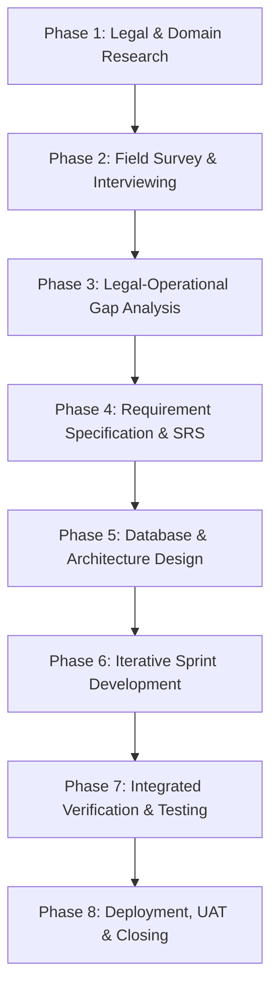

**CAPSTONE PROJECT REPORT**

**Report 1 - Project Introduction**

**School Food Safety Management Support System**

[1 Record of changes 4](#_Toc233638207)

[2 Definition 4](#_Toc233638208)

[2.1. Acronyms 4](#_Toc233638209)

[2.2. List of Figures and Tables 6](#_Toc233638210)

[2.2.1. List Figures 6](#_Toc233638211)

[2.2.2. List Table 6](#_Toc233638212)

[3 Project Introduction 6](#_Toc233638213)

[3.1. Overview 6](#_Toc233638214)

[3.1.1. Project Information 6](#_Toc233638215)

[3.1.2. Project Team 7](#_Toc233638216)

[4 Product Background 7](#_Toc233638217)

[4.1. Global Overview 7](#_Toc233638218)

[4.1.1. School food safety is no longer only a kitchen operation – but a public health and operational risk management issue 7](#_Toc233638219)

[4.1.2. Risks are not limited to food poisoning incidents alone 8](#_Toc233638220)

[4.1.3. School food safety incidents continue to occur across countries regardless of development level 9](#_Toc233638221)

[4.1.4. Southeast Asia faces additional operational challenges 10](#_Toc233638222)

[4.1.5. Why regulations and training alone are insufficient 10](#_Toc233638223)

[4.1.6. Global technology trends in school food safety management 11](#_Toc233638224)

[4.2. Vietnam Background 12](#_Toc233638225)

[4.2.1. School Food Safety in Vietnam is Becoming an Increasingly Critical Operational and Public Health Issue 12](#_Toc233638226)

[4.2.2. Food Safety Incidents in Vietnamese Schools Continue to Raise Serious Public Concern 14](#_Toc233638227)

[4.2.3. Vietnamese Legal Framework and Regulatory Responsibilities for School Food Safety 19](#_Toc233638228)

[5 Existing Solutions 31](#_Toc233638229)

[5.1. SafetyCulture (iAuditor) 31](#_Toc233638230)

[5.2. Smart Food Safe 33](#_Toc233638231)

[5.3. Existing Internal Food Safety Systems in Vietnamese Schools 36](#_Toc233638232)

[5.4. Spreadsheet and Paper-Based Operational Workflows 38](#_Toc233638233)

[6 Business Opportunity 41](#_Toc233638234)

[6.1. Market Gap Analysis 41](#_Toc233638235)

[6.2. Business Opportunity and Market Expansion 42](#_Toc233638236)

[6.3. Legal and Regulatory Basis 45](#_Toc233638237)

[6.4. Target Market and Scalability 47](#_Toc233638238)

[7 Product Vision 49](#_Toc233638239)

[7.1. Growth Opportunity 49](#_Toc233638240)

[7.2. Benefits Expected from the System 50](#_Toc233638241)

[8 Project Scope & Limitations 53](#_Toc233638242)

[8.1. Major Features 53](#_Toc233638243)

[8.2. In & Out of Scope 56](#_Toc233638244)

# Record of changes

|  |  |  |  |
| --- | --- | --- | --- |
| Date | A\*, M, D | In charge | Change Description |
| 28/05/2026 | A | NamNV | Version 1.0 |
| 30/05/2026 | M | MinhTT | Fix Report 1 |
| 11/06/2026 | M | MinhTT | Version 2.0 |
| 12/06/2026 | M | ThaoNP | Update Feature |
| 23/06/2026 | M | ManhND | Update Feature |
| 27/06/2026 | M | MinhTT | Update Actor, fix name, scope |
| 28/06/2026 | M | NamNV | Sync Report 1 with Report 3 SRS: dissolve MF13 into MF12, fix 72h retention description, add Guest stakeholder, add Account Activation to MF01 |

Table 1‑1 Record of changes

# Definition

## Acronyms

|  |  |  |
| --- | --- | --- |
| Acronym | Full Term | Description |
| SFMS | School Food Safety Management Support System | The proposed system was developed for managing and supporting food safety operations in educational institutions. |
| HACCP | Hazard Analysis and Critical Control Points | International food safety management methodology focusing on risk prevention and critical control point monitoring. |
| CCP | Critical Control Point | A stage in the food handling process where safety risks must be monitored and controlled. |
| RBAC | Role-Based Access Control | Security model that restricts system access based on user roles and permissions. |
| CAPA | Corrective and Preventive Action | Operational process for handling incidents, correcting issues, and preventing recurrence. |
| CRUD | Create, Read, Update, Delete | Basic operations used for managing system data records. |
| SOP | Standard Operating Procedure | Standardized operational instructions used to ensure consistent food safety workflows. |
| OTP | One-Time Password | Temporary authentication code used for login verification and security enhancement. |
| IoT | Internet of Things | Network of connected smart devices such as sensors and monitoring equipment. |
| AI | Artificial Intelligence | Computational technologies capable of supporting intelligent analysis and automation. |
| NLP | Natural Language Processing | AI technology enables systems to understand and process human language. |
| QR | Quick Response Code | Machine-readable code used for traceability, identification, and operational scanning. |
| CSV | Comma-Separated Values | Common file format used for data import and export operations. |
| PDF | Portable Document Format | Standard file format used for reports and document exports. |
| SMS | Short Message Service | Mobile text messaging service used for notifications and alerts. |
| MFA | Multi-Factor Authentication | Security mechanism requiring multiple verification methods during authentication. |
| ERP | Enterprise Resource Planning | Integrated enterprise management system supporting organizational operations. |
| LMS | Learning Management System | Educational management platform supporting learning and academic administration. |
| PDPD | Personal Data Protection Decree | Vietnamese regulation governing the collection, processing, storage, and protection of personal data while ensuring individuals' privacy rights. |
| MOH | Ministry of Health | Vietnamese governmental authority responsible for health and food safety management. |
| MOET | Ministry of Education and Training | Vietnamese governmental authority responsible for education management and policy. |

Table 2‑1 Acronyms

## List of Figures and Tables

### List Figures

[Figure 5‑1 SafetyCulture 31](#_Toc233638263)

[Figure 5‑2 Smart Food Safe 33](#_Toc233638264)

[Figure 5‑3 Safety Canteen Audit System 36](#_Toc233638265)

### List Table

[Table 1‑1 Record of changes 4](#_Toc233638275)

[Table 2‑1 Acronyms 5](#_Toc233638276)

[Table 3‑1 Project Team 7](#_Toc233638277)

[Table 3‑2 Supervisor 7](#_Toc233638278)

[Table 4‑1 Stakeholder 23](#_Toc233638279)

[Table 7‑1 Expected Benefits 51](#_Toc233638280)

[Table 8‑1 Major Feature 56](#_Toc233638281)

[Table 8‑2 In & Out of Scope 58](#_Toc233638282)

# Project Introduction

## Overview

School Food Safety Management Support System (SFMS) is a digital platform designed to support and standardize food safety within school kitchen environments. The system focuses on digitizing critical workflows such as supplier management, ingredient inspection, HACCP monitoring, three-step food inspection, food sample retention, incident reporting, and operational traceability. By replacing fragmented paper-based processes and disconnected spreadsheets with a centralized platform, SFMS helps schools improve operational consistency, transparency, and accountability in food safety management.

The system provides role-based access for multiple stakeholders including school representatives, school health departments, kitchen operators, school administrators, suppliers, and parents. Through workflow-based monitoring, audit logs, reporting dashboards, and controlled transparency mechanisms, the platform supports both operational compliance and efficient incident investigation. In addition, offline-capable inspection workflows help maintain system usability in kitchen environments where internet connectivity may be unstable.

SFMS is designed specifically for the operational realities of Vietnamese educational institutions, where schools are under increasing pressure to ensure food safety compliance while managing large-scale meal operations with limited technical resources. The platform aims to reduce manual paperwork, improve traceability, strengthen operational monitoring, and support safer school meal environments for students who may be vulnerable due to age, health conditions, or limited self-awareness regarding food safety risks.

### Project Information

* Project English Name: School Food Safety Management Support System
* Project Vietnamese Name: Hệ thống hỗ trợ quản lý an toàn thực phẩm học đường
* Project Code: SFMS
* Group Name: SEP490 – G8
* Software Type: Web App, Mobile App

### Project Team

**Team**

|  |  |  |  |
| --- | --- | --- | --- |
| Full Name | Role | Email | Mobile |
| Nguyen Van Nam | Leader | namnvhe180863@fpt.edu.vn | 0587501083 |
| Nguyen Phuong Thao | Member | thaonphe182154@fpt.edu.vn | 0981281791 |
| Bui Quang Huy | Member | huybqhe180599@fpt.edu.vn | 0866375436 |
| Nguyen Duc Manh | Member | manhndhe160692@fpt.edu.vn | 0837336288 |
| Tran Tuan Minh | Member | minhtthe186258@fpt.edu.vn | 0823960159 |

Table 3‑1 Project Team

**Supervisor**

|  |  |  |
| --- | --- | --- |
| Full Name | Role | Email |
| Nguyen Cuong Manh | Supervisor | manhnc5@fpt.edu.vn |

Table 3‑2 Supervisor

# Product Background

## Global Overview

### School food safety is no longer only a kitchen operation – but a public health and operational risk management issue

On a global scale, school food safety is increasingly viewed not merely as a cafeteria or kitchen management activity, but as a critical public health and operational safety issue directly affecting millions of children every day. In many countries, school meal systems have become one of the largest organized food distribution operations, serving students daily through centralized kitchens, catering providers, or school-operated meal services.

According to the World Food Programme (WFP), school feeding programmes support hundreds of millions of students globally and are considered an essential component of child welfare, nutrition, and educational development.

**Ref:**

[*https://www.wfp.org/publications/state-school-feeding-worldwide*](https://www.wfp.org/publications/state-school-feeding-worldwide)

Unlike ordinary food service environments, school food systems serve children — a vulnerable population with lower physical resilience, weaker self-protection capability, and higher sensitivity to foodborne illnesses, contamination, allergens, and hygiene failures. As a result, even small operational mistakes may escalate into large-scale incidents affecting dozens or hundreds of students simultaneously.

In many countries, food safety management in educational institutions is increasingly treated as a “high-accountability operational chain” involving suppliers, transportation units, kitchen operators, school administrators, health departments, and government regulators. Similar to transportation safety systems or healthcare operations, school food safety depends on multiple interconnected processes where a single weak point can compromise the entire safety chain.

### Risks are not limited to food poisoning incidents alone

A common misconception is that school food safety risks only involve large-scale food poisoning outbreaks. However, international food safety studies and operational audits indicate that many risks originate from routine operational failures occurring before incidents become visible.

These risks include:

* Cross-contamination between raw and cooked food
* Improper cleaning of kitchen utensils
* Inadequate food storage temperatures
* Expired ingredients
* Unverified supplier sources
* Improper food handling by staff
* Incomplete inspection records
* Failure to follow HACCP procedures
* Delayed incident response and traceability

The World Health Organization (WHO) estimates that contaminated food causes approximately 600 million illnesses and 420,000 deaths globally every year, with children under five years old representing one of the highest-risk groups.

**Ref:**

[*https://www.who.int/news-room/fact-sheets/detail/food-safety*](https://www.who.int/news-room/fact-sheets/detail/food-safety)

Operationally, many incidents are not caused by a complete absence of regulations, but by failures in compliance execution, monitoring consistency, and operational accountability. In many kitchens, procedures exist on paper but are difficult to enforce consistently under real-world workload pressure and manual operational environments.

### School food safety incidents continue to occur across countries regardless of development level

Serious food safety incidents involving school meal systems have been reported in both developing and developed countries, demonstrating that the problem is systemic rather than limited to specific economic conditions.

In India, one of the most severe school food poisoning incidents occurred in Bihar in 2013, where 23 students died after consuming school meals contaminated with pesticide-tainted cooking oil.

**Ref:**

[*https://en.wikipedia.org/wiki/Bihar\_school\_meal\_poisoning\_incident*](https://en.wikipedia.org/wiki/Bihar_school_meal_poisoning_incident)

The incident exposed major weaknesses in supplier control, ingredient traceability, and operational oversight within school meal programs.

In Japan, despite having one of the world’s strictest food safety cultures, school meal contamination incidents have still occurred. In Osaka, hundreds of students and staff experienced food poisoning symptoms linked to contaminated school meal products, highlighting the risks associated with centralized meal preparation and distribution systems.

**Ref:**

[*https://english.news.cn/20260326/352f9b5012034b40b0ffaae15d5b56f6/c.html*](https://english.news.cn/20260326/352f9b5012034b40b0ffaae15d5b56f6/c.html)

Indonesia has also faced multiple food safety incidents involving school meal programmes and large-scale catering operations, raising concerns regarding operational monitoring, transportation conditions, and food handling consistency.

**Ref:**

[*https://en.vietnamplus.vn/indonesia-dozens-of-students-hospitalised-after-free-school-meal-post340588.vnp*](https://en.vietnamplus.vn/indonesia-dozens-of-students-hospitalised-after-free-school-meal-post340588.vnp)

In China, several cases involving unsafe school meal conditions and expired food ingredients triggered public backlash and large-scale government inspections. In Shanghai, authorities launched city-wide kitchen inspections after parents discovered mouldy vegetables and expired seasonings in an international school cafeteria.

**Ref:**

[*https://www.scmp.com/news/china/society/article/2169867/shanghai-school-food-scare-triggers-city-wide-kitchen-health*](https://www.scmp.com/news/china/society/article/2169867/shanghai-school-food-scare-triggers-city-wide-kitchen-health)

These incidents demonstrate that school food safety failures are not isolated events, but recurring operational risks that may emerge even in countries with advanced infrastructure and regulatory systems.

### Southeast Asia faces additional operational challenges

Countries in Southeast Asia face additional complexities due to:

* Rapid urbanization
* Large-scale student populations
* Limited operational budgets
* Fragmented supplier ecosystems
* High-temperature climates
* Inconsistent infrastructure quality

In many schools across Southeast Asia, operational processes still rely heavily on paper-based inspection forms, manual supervision, and disconnected communication channels. Internet connectivity may also be unstable in kitchen environments, making real-time monitoring difficult.

Additionally, large-scale centralized catering systems are increasingly common in urban areas. While these systems improve efficiency, they also amplify risk: a single operational failure may affect multiple schools simultaneously.

As governments strengthen food safety regulations and public expectations continue to rise, schools and catering operators face growing pressure to improve operational transparency, traceability, and compliance management.

### Why regulations and training alone are insufficient

After major incidents, common responses typically include:

* Strengthening regulations
* Increasing inspections
* Conducting additional staff training
* Expanding accountability requirements

However, operational evidence shows that regulations and training alone cannot eliminate risk completely.

Human operators may still:

* Forget procedures
* Skip inspection steps
* Make incorrect assumptions
* Fail under workload pressure
* Lose records
* Delay reporting incidents

This is especially common in repetitive, high-volume kitchen environments where many safety procedures depend heavily on memory, manual recording, and human discipline.

When operational data is fragmented or incomplete, post-incident investigation becomes extremely difficult. Determining which ingredient batch was used, who performed inspections, or whether procedures were followed may require reconstructing information from paper records, messaging applications, or verbal reports.

As a result, many countries and organizations are increasingly adopting digital food safety systems as an additional operational safety layer designed to reduce dependency on human memory and improve traceability, monitoring consistency, and accountability.

### Global technology trends in school food safety management

Globally, food safety management systems are shifting toward digital and workflow-oriented operational models.

Modern school food safety platforms increasingly support:

* Digital HACCP workflows
* Supplier traceability management
* Digital inspection checklists
* Food sample retention tracking
* Role-based operational monitoring
* Audit logs and compliance history
* Automated reminders and alerts
* Incident reporting workflows
* Offline-capable operational interfaces
* Parent transparency portals

In addition, many systems are moving away from static paper documentation toward operational evidence collection through timestamps, photos, QR tracking, and synchronized digital records.

Technology is increasingly viewed not as a replacement for operational staff, but as a “secondary safety layer” designed to detect procedural gaps, reduce operational blind spots, and improve accountability before incidents escalate into serious public health crises.

## Vietnam Background

### School Food Safety in Vietnam is Becoming an Increasingly Critical Operational and Public Health Issue

In Vietnam, school food safety has become an increasingly important issue due to the rapid expansion of semi-boarding and boarding educational models, particularly in large urban areas such as Hanoi and Ho Chi Minh City. Many educational institutions now operate large-scale collective kitchen systems capable of preparing and serving hundreds or even thousands of meals per day for students, teachers, and staff. As meal volume increases, operational complexity also grows significantly across supplier management, ingredient traceability, storage conditions, food processing workflows, hygiene supervision, and incident handling activities.

According to reports from Hanoi authorities and local media agencies, the city currently operates thousands of collective kitchens and school meal facilities, reflecting the large operational scale of food service systems within educational environments.

**Ref:**

[*https://thanglong.chinhphu.vn/siet-chat-an-toan-thuc-pham-bep-an-truong-hoc-bao-ve-suc-khoe-va-tuong-lai-hoc-sinh-103251208114800767.htm*](https://thanglong.chinhphu.vn/siet-chat-an-toan-thuc-pham-bep-an-truong-hoc-bao-ve-suc-khoe-va-tuong-lai-hoc-sinh-103251208114800767.htm)

Unlike ordinary restaurant environments, school kitchens serve children — a highly vulnerable population with lower physical resilience and higher sensitivity to foodborne illnesses, contamination, allergens, and hygiene failures. Even relatively small operational mistakes may escalate into large-scale incidents affecting many students simultaneously, resulting not only in public health consequences but also in severe reputational damage for educational institutions and catering providers.

In recent years, food safety incidents involving schools, collective kitchens, and catering systems have received increasing public attention in Vietnam. Public concern has intensified significantly due to the widespread use of social media platforms, where hygiene violations, unsafe ingredients, or operational failures may rapidly spread and trigger strong reactions from parents and the wider community. As a result, schools and catering providers are under growing pressure to improve transparency, operational accountability, supplier supervision, and food safety compliance.

At the regulatory level, Vietnam has continuously strengthened its legal framework governing food safety operations. The Law on Food Safety No. 55/2010/QH12 establishes the foundational legal framework for food safety management nationwide, including responsibilities relating to food production, processing, transportation, storage, and food business operations.

**Ref:**

[*https://vanban.chinhphu.vn/?docid=96032&pageid=27160*](https://vanban.chinhphu.vn/?docid=96032&pageid=27160)

In addition, Vietnamese authorities have repeatedly strengthened inspection and supervision activities targeting collective kitchens, school meal providers, and food suppliers. Following several food safety incidents involving educational institutions and catering systems, local governments and health agencies have intensified inspections related to ingredient quality, operational hygiene, supplier traceability, and collective kitchen management.

**Ref:**

[*https://vietnamnet.vn/en/citywide-inspection-ordered-for-school-lunch-providers-in-hcm-city-2486724.html*](https://vietnamnet.vn/en/citywide-inspection-ordered-for-school-lunch-providers-in-hcm-city-2486724.html)

**Ref:**

[*https://vietnamnet.vn/en/after-diseased-pork-scandal-stricter-scrutiny-of-school-food-supplies-urged-2504074.html*](https://vietnamnet.vn/en/after-diseased-pork-scandal-stricter-scrutiny-of-school-food-supplies-urged-2504074.html)

Furthermore, educational authorities have increasingly emphasized the importance of supplier transparency, operational monitoring, and stronger supervision of school meal services in order to improve trust and reduce operational risks within educational environments.

**Ref:**

[*https://news.laodong.vn/thoi-su/bo-giao-duc-va-dao-tao-truong-hoc-phai-cong-khai-don-vi-cung-cap-thuc-pham-1680077.ldo*](https://news.laodong.vn/thoi-su/bo-giao-duc-va-dao-tao-truong-hoc-phai-cong-khai-don-vi-cung-cap-thuc-pham-1680077.ldo)

However, despite the existence of legal regulations and inspection procedures, many operational activities in practice remain heavily dependent on manual workflows such as paper-based checklists, handwritten reports, spreadsheets, messaging applications, and fragmented communication channels. In many schools, food safety monitoring still relies significantly on human memory, manual supervision, and post-event reporting rather than real-time operational control mechanisms.

This operational model creates several systemic challenges:

* Difficulties in maintaining consistent compliance
* Fragmented operational records
* Limited traceability capabilities
* Delayed incident response
* High dependence on manual coordination
* Limited transparency for stakeholders
* Weak operational auditability

Furthermore, many schools face practical constraints such as unstable internet connectivity in kitchen areas, limited technical personnel, and operational pressure caused by high meal volumes and repetitive workflows. Under such conditions, ensuring that every inspection step, hygiene process, and safety procedure is executed consistently becomes extremely difficult without technological support.

As Vietnam continues to strengthen food safety regulations and public expectations continue to rise, educational institutions increasingly require digital systems capable of supporting operational traceability, workflow standardization, inspection management, and real-time monitoring. This creates a significant opportunity for school-oriented food safety management platforms designed specifically for the operational realities of Vietnamese educational environments.

### Food Safety Incidents in Vietnamese Schools Continue to Raise Serious Public Concern

In Vietnam, food safety incidents related to schools, collective kitchens, and student meal services have continued to occur in recent years despite increasing regulatory oversight. These incidents demonstrate that food safety risks within educational environments are not theoretical concerns, but real operational problems capable of directly affecting student health, institutional reputation, and public trust.

One of the major concerns in Vietnam is that school food safety incidents often occur within large-scale collective meal environments, where a single operational failure may affect dozens or even hundreds of students simultaneously. Due to the vulnerable nature of children and the strong public sensitivity surrounding educational institutions, even relatively small incidents may quickly escalate into national-level public discussions.

According to reports from the Vietnam Food Administration (VFA) under the Ministry of Health, Vietnam continues to record multiple food poisoning incidents annually involving collective kitchens, industrial catering systems, and educational institutions.

**Ref:**

[*https://vfa.gov.vn/tin-tuc/siet-chat-quan-ly-an-toan-thuc-pham-tai-bep-an-tap-the-va-thuc-an-duong-pho-de-bao-ve-suc-khoe-tu-bua-an-hang-ngay.html*](https://vfa.gov.vn/tin-tuc/siet-chat-quan-ly-an-toan-thuc-pham-tai-bep-an-tap-the-va-thuc-an-duong-pho-de-bao-ve-suc-khoe-tu-bua-an-hang-ngay.html)

In 2024 and 2025, multiple food poisoning incidents involving schools and collective kitchens were reported by national media agencies, reinforcing public concerns regarding the operational safety of school meal systems.

**Large-scale food poisoning incidents reveal operational vulnerabilities**

In several incidents across Vietnam, dozens of students experienced symptoms such as abdominal pain, vomiting, dizziness, diarrhea, and nausea after consuming meals prepared at school kitchens or food sold near educational environments.

For example, in Khanh Hoa Province, multiple students were hospitalized after suspected food poisoning incidents linked to food consumed around school areas. Authorities subsequently launched investigations and implemented emergency food safety control measures.

**Ref:**

[*https://vietnamnews.vn/society/1653627/more-food-poisoning-involving-students-in-khanh-hoa-province.html*](https://vietnamnews.vn/society/1653627/more-food-poisoning-involving-students-in-khanh-hoa-province.html)

In addition, Vietnam continues recording numerous collective food poisoning incidents involving schools, industrial kitchens, catering systems, and collective meal environments. According to reports on national food safety conditions, many incidents are associated with operational weaknesses involving food handling, hygiene compliance, contamination control, and inspection effectiveness.

**Ref:**

[*https://vietnamnews.vn/society/1689671/food-poisoning-cases-a-growing-concern.html*](https://vietnamnews.vn/society/1689671/food-poisoning-cases-a-growing-concern.html)

[*https://vfa.gov.vn/tin-tuc/siet-chat-quan-ly-an-toan-thuc-pham-tai-bep-an-tap-the-va-thuc-an-duong-pho-de-bao-ve-suc-khoe-tu-bua-an-hang-ngay.html*](https://vfa.gov.vn/tin-tuc/siet-chat-quan-ly-an-toan-thuc-pham-tai-bep-an-tap-the-va-thuc-an-duong-pho-de-bao-ve-suc-khoe-tu-bua-an-hang-ngay.html)

These incidents demonstrate that food safety risks within educational and collective food service environments are not isolated to a single region or operational model. Instead, they reflect broader systemic vulnerabilities involving supplier supervision, ingredient traceability, food handling processes, storage conditions, hygiene compliance, workflow monitoring, and incident response coordination.

Investigations following food poisoning incidents have repeatedly revealed operational weaknesses such as incomplete inspection procedures, inconsistent hygiene management, weak traceability mechanisms, and difficulties reconstructing operational history during incident investigations. This highlights the growing need for digital systems capable of supporting operational traceability, standardized inspection workflows, and centralized food safety monitoring.

**Many incidents originate from operational failures rather than absence of regulations**

A notable characteristic of food safety incidents in Vietnam is that many occur despite the existence of formal procedures, inspection requirements, and legal regulations. Investigations frequently identify failures related to operational execution, workflow consistency, and compliance enforcement rather than a complete absence of regulatory frameworks.

Common causes identified in reported incidents include:

* Improper food preservation temperatures
* Cross-contamination between raw and cooked food
* Unverified or low-quality ingredient sources
* Inadequate kitchen sanitation
* Incomplete inspection procedures
* Failure to comply with food sample retention requirements
* Unsafe transportation or storage conditions
* Human error during food processing

According to Vietnamese health authorities and reports regarding collective kitchen management, ensuring food safety in school kitchens and collective meal systems remains particularly challenging because operational compliance depends heavily on human consistency across repetitive daily workflows, inspection activities, and hygiene procedures.

**Ref:**

[*https://vietnamnews.vn/society/1689671/food-poisoning-cases-a-growing-concern.html*](https://vietnamnews.vn/society/1689671/food-poisoning-cases-a-growing-concern.html)

In practice, many operational activities are still managed manually using paper-based checklists, handwritten reports, spreadsheets, or messaging applications. As a result, inspection data is often fragmented, difficult to verify consistently, and challenging to audit efficiently during incident investigations or compliance reviews.

These operational limitations create significant challenges for schools and collective kitchen operators in maintaining consistent traceability, standardized workflow execution, and real-time operational visibility across large-scale meal preparation environments.

**School food safety incidents create significant reputational and social pressure**

Unlike ordinary food service incidents, school-related food safety events generate exceptionally strong public reactions because they directly involve children.

In many cases:

* Parents rapidly share concerns through social media platforms
* News agencies quickly publish incident updates
* Public trust toward schools may decline significantly
* Schools and catering providers face reputational crises
* Regulatory inspections intensify immediately after incidents

This environment creates substantial operational pressure for schools to improve transparency, compliance management, and incident response capabilities.

Additionally, schools must balance two conflicting requirements:

1. Increasing transparency regarding food safety operations
2. Protecting sensitive internal operational and supplier-related information

This balance is difficult to achieve under fragmented manual systems where records are scattered across paper documents, messaging groups, and isolated spreadsheets.

**Existing operational models create traceability and accountability gaps**

Another major issue identified in Vietnam is the difficulty of tracing operational history after incidents occur.

When a food safety incident happens, schools and authorities often need to determine:

* Which ingredient batches were used
* Which supplier delivered the products
* Who performed inspections
* Whether procedures were followed correctly
* Which students consumed specific meals
* Whether food samples were retained properly

However, under manual operational environments, reconstructing this information may take hours or even days. In some cases, records may be incomplete, inconsistent, or missing entirely.

The Vietnam Food Administration has repeatedly emphasized the importance of improving traceability and strengthening management across the entire food supply chain.

**Ref:**

[*https://vfa.gov.vn/tin-tuc/siet-chat-quan-ly-an-toan-thuc-pham-tai-bep-an-tap-the-va-thuc-an-duong-pho-de-bao-ve-suc-khoe-tu-bua-an-hang-ngay.html*](https://vfa.gov.vn/tin-tuc/siet-chat-quan-ly-an-toan-thuc-pham-tai-bep-an-tap-the-va-thuc-an-duong-pho-de-bao-ve-suc-khoe-tu-bua-an-hang-ngay.html)

These operational gaps demonstrate that current approaches remain highly dependent on manual supervision and retrospective investigation rather than proactive, technology-supported risk prevention.

**Digital transformation is increasingly viewed as a necessary operational direction**

As food safety incidents continue to attract public concern, Vietnam is gradually moving toward stronger digitalization in food safety management activities.

Current policy and operational trends increasingly emphasize:

* Digital traceability systems
* Centralized operational records
* Workflow standardization
* Strengthened inspection monitoring
* Supplier transparency
* Faster incident investigation
* Improved accountability mechanisms

Several schools and local authorities have already begun experimenting with QR-based traceability systems, digital inspection workflows, and operational monitoring platforms for collective kitchens and school meal systems.

**Ref:**

[*https://baodienbienphu.vn/tin-bai/chuyen-doi-so/kiem-soat-an-toan-thuc-pham-tu-so-hoa-bep-an-truong-hoc*](https://baodienbienphu.vn/tin-bai/chuyen-doi-so/kiem-soat-an-toan-thuc-pham-tu-so-hoa-bep-an-truong-hoc)

However, many existing implementations remain fragmented, limited in functionality, or difficult to adapt to the real operational conditions of school kitchens in Vietnam. This creates a strong need for a school-oriented food safety management platform capable of supporting operational workflows, compliance monitoring, traceability, and incident response within a practical and scalable digital environment.

### Vietnamese Legal Framework and Regulatory Responsibilities for School Food Safety

In Vietnam, school food safety operations are governed by a relatively comprehensive legal framework involving multiple ministries, regulatory agencies, educational institutions, and food service operators. The regulatory structure covers food production, transportation, processing, storage, inspection, and operational responsibilities for collective kitchens, including school meal systems.

Although Vietnam already possesses a substantial legal foundation for food safety management, ensuring consistent compliance in real operational environments remains a major challenge, especially within large-scale school kitchens where operational activities are repetitive, time-sensitive, and highly dependent on human execution.

**The Law on Food Safety establishes the national legal foundation**

The primary legal basis governing food safety operations in Vietnam is:

* Law on Food Safety No. 55/2010/QH12

**Ref:**

[*https://vanban.chinhphu.vn/?pageid=27160&docid=96032*](https://vanban.chinhphu.vn/?pageid=27160&docid=96032)

The Law defines responsibilities for organizations and individuals involved in food production, processing, transportation, preservation, and business activities. It also establishes requirements regarding food safety conditions, traceability, inspection responsibilities, and incident handling obligations.

Under the Law, organizations providing food services — including school kitchens and collective catering systems — are responsible for ensuring:

* Safe food ingredients
* Hygienic processing environments
* Compliance with food preservation requirements
* Food sample retention
* Prevention of food contamination
* Compliance with inspection and traceability obligations

The Law also emphasizes that food safety management must follow a preventive approach rather than relying solely on post-incident handling.

**School kitchens are regulated as collective kitchens and catering facilities**

Under Vietnamese regulations, school kitchens are generally classified as:

* Collective kitchens (bếp ăn tập thể)
* Catering food service establishments

As a result, schools and meal providers must comply with food safety requirements applicable to collective meal operations.

One important regulatory document is:

* Decree No. 15/2018/NĐ-CP detailing implementation of several articles of the Law on Food Safety

**Ref:**

[*https://vanban.chinhphu.vn/?pageid=27160&docid=192829*](https://vanban.chinhphu.vn/?pageid=27160&docid=192829)

[*https://vbpl.vn/van-ban/chi-tiet/nghi-dinh-so-15-2018-nd-cp-quy-dinh-chi-tiet-thi-hanh-mot-so-dieu-cua-luat-an-toan-thuc-pham--128513*](https://vbpl.vn/van-ban/chi-tiet/nghi-dinh-so-15-2018-nd-cp-quy-dinh-chi-tiet-thi-hanh-mot-so-dieu-cua-luat-an-toan-thuc-pham--128513)

The Decree regulates:

* Food safety self-declaration
* Traceability responsibilities
* Inspection procedures
* Regulatory management responsibilities
* Food service operational requirements

In practice, this means schools and kitchen operators must maintain operational evidence regarding food sources, inspections, storage conditions, and food safety procedures.

**Food sample retention is legally required**

One of the most important operational requirements in school food safety management is food sample retention.

The Ministry of Health issued:

* Decision No. 1246/QĐ-BYT on guidance for food sample retention in food service establishments

**Ref:**

[*https://thuvienphapluat.vn/van-ban/The-thao-Y-te/Quyet-dinh-1246-QD-BYT-che-do-kiem-thuc-ba-buoc-luu-mau-thuc-an-kinh-doanh-dich-vu-an-uong-2017-345320.aspx*](https://thuvienphapluat.vn/van-ban/The-thao-Y-te/Quyet-dinh-1246-QD-BYT-che-do-kiem-thuc-ba-buoc-luu-mau-thuc-an-kinh-doanh-dich-vu-an-uong-2017-345320.aspx)

[*https://vfa.gov.vn/tin-tuc/ha-nam-hoi-nghi-trien-khai-quyet-dinh-so-1246qd-byt-ngay-3132017-cua-bo-y-te.html*](https://vfa.gov.vn/tin-tuc/ha-nam-hoi-nghi-trien-khai-quyet-dinh-so-1246qd-byt-ngay-3132017-cua-bo-y-te.html)

The regulation requires collective kitchens and food service establishments to:

* Retain food samples after processing
* Store samples separately
* Record sample information
* Preserve samples under proper conditions
* Retain samples for a minimum required duration

The purpose of food sample retention is to support:

* Incident investigation
* Food poisoning analysis
* Traceability
* Accountability determination

However, food sample retention in practice remains heavily manual in many schools, relying on handwritten labels, paper records, and disconnected storage logs.

**Three-step food inspection is mandatory in collective kitchens**

Vietnamese regulations also require implementation of the “three-step food inspection” process (kiểm thực ba bước), especially for collective kitchens and school meal systems.

This process is guided under:

* Decision No. 1246/QĐ-BYT

**Ref:**

[*https://thuvienphapluat.vn/van-ban/The-thao-Y-te/Quyet-dinh-1246-QD-BYT-che-do-kiem-thuc-ba-buoc-luu-mau-thuc-an-kinh-doanh-dich-vu-an-uong-2017-345320.aspx*](https://thuvienphapluat.vn/van-ban/The-thao-Y-te/Quyet-dinh-1246-QD-BYT-che-do-kiem-thuc-ba-buoc-luu-mau-thuc-an-kinh-doanh-dich-vu-an-uong-2017-345320.aspx)

The three inspection stages include:

1. Inspection before processing
2. Inspection during processing
3. Inspection before serving

The purpose is to:

* Detect unsafe ingredients
* Reduce contamination risks
* Verify processing conditions
* Ensure serving safety

Operationally, these inspections require:

* Repetitive daily execution
* Accurate documentation
* Staff coordination
* Consistent compliance

In many schools, these activities are still recorded manually through paper checklists and handwritten logs, increasing the risk of incomplete or retrospective record creation.

**Educational institutions are directly responsible for student food safety**

Vietnamese regulations increasingly emphasize that educational institutions are directly responsible for ensuring food safety conditions within school environments, particularly for collective kitchens, semi-boarding meal systems, and school catering activities.

At the legal level, the Law on Food Safety No. 55/2010/QH12 establishes the national legal framework governing food production, processing, storage, transportation, and food business operations, including responsibilities related to food safety management and incident prevention within collective food service environments.

**Ref:**

[*https://vanban.chinhphu.vn/?docid=96032&pageid=27160*](https://vanban.chinhphu.vn/?docid=96032&pageid=27160)

[*https://vbpl.vn/van-ban/chi-tiet/law-55-2010-qh12--vbpqta\_10497*](https://vbpl.vn/van-ban/chi-tiet/law-55-2010-qh12--vbpqta_10497)

In addition, the Inter-Ministerial Circular No. 13/2016/TTLT-BYT-BGDĐT issued jointly by the Ministry of Health and the Ministry of Education and Training provides regulations regarding school health operations, including responsibilities related to hygiene conditions, food safety supervision, and protection of student health within educational institutions.

**Ref:**

[*https://thuvienphapluat.vn/van-ban/Giao-duc/Thong-tu-13-2016-TTLT-BYT-BGDDT-huong-dan-thuc-hien-cong-tac-y-te-truong-hoc-295062.aspx*](https://thuvienphapluat.vn/van-ban/Giao-duc/Thong-tu-13-2016-TTLT-BYT-BGDDT-huong-dan-thuc-hien-cong-tac-y-te-truong-hoc-295062.aspx)

[*https://vbpl.vn/van-ban/chi-tiet/thong-tu-lien-tich-so-13-2016-ttlt-byt-bgddt-quy-dinh-ve-cong-tac-y-te-truong-hoc--132249*](https://vbpl.vn/van-ban/chi-tiet/thong-tu-lien-tich-so-13-2016-ttlt-byt-bgddt-quy-dinh-ve-cong-tac-y-te-truong-hoc--132249)

Furthermore, the Ministry of Education and Training has recently required schools to publicize food suppliers and strengthen food safety supervision activities within educational environments in order to improve transparency, operational accountability, and parent trust.

**Ref:** [**https://news.laodong.vn/thoi-su/bo-giao-duc-va-dao-tao-truong-hoc-phai-cong-khai-don-vi-cung-cap-thuc-pham-1680077.ldo**](https://news.laodong.vn/thoi-su/bo-giao-duc-va-dao-tao-truong-hoc-phai-cong-khai-don-vi-cung-cap-thuc-pham-1680077.ldo)

Educational authorities also continue emphasizing the strengthening of food safety measures, inspection procedures, and operational supervision in educational institutions, particularly for collective kitchens and school meal systems.

**Ref:** [**https://moet.gov.vn/tin-tuc/tang-cuong-bien-phap-bao-dam-an-toan-thuc-pham-trong-cac-co-so-giao-duc2.html**](https://moet.gov.vn/tin-tuc/tang-cuong-bien-phap-bao-dam-an-toan-thuc-pham-trong-cac-co-so-giao-duc2.html)

These developments demonstrate that food safety is no longer viewed solely as a kitchen-level operational issue, but as a broader educational governance responsibility directly associated with student safety, institutional reputation, operational transparency, and regulatory compliance.

**Multiple stakeholders share operational responsibilities**

One major characteristic of school food safety management in Vietnam is the involvement of multiple independent stakeholders.

These typically include:

|  |  |
| --- | --- |
| Stakeholder | Operational Responsibility |
| System Admin | System management |
| School Administration | Oversight and coordination |
| Medical Staff | Monitoring and reporting |
| Service Caterers | Food preparation and hygiene |
| Raw Food Supplier | Ingredient quality and traceability |
| Teacher | Meal supervision/student management |
| Parents | Community supervision and feedback |
| Guest | Unauthenticated user accessing public-facing functions such as supplier registration, service caterers registration, and school registration requests. |

Table 4‑1 Stakeholder

Because responsibilities are distributed across multiple actors, operational coordination and information consistency become extremely important.

However, under fragmented manual systems:

* Data may be inconsistent
* Operational history may be incomplete
* Responsibilities may become unclear after incidents occur

This creates significant operational risks for schools and catering providers.

**Current legal trends increasingly emphasize traceability and digital management**

Recent policy directions in Vietnam increasingly emphasize:

* Food traceability
* Centralized management
* Digital transformation
* Strengthened operational accountability
* Supply chain monitoring

Government agencies have repeatedly encouraged stronger digital management approaches for food safety supervision.

**Ref:** [**https://vfa.gov.vn/tin-tuc/siet-chat-quan-ly-an-toan-thuc-pham-tai-bep-an-tap-the-va-thuc-an-duong-pho-de-bao-ve-suc-khoe-tu-bua-an-hang-ngay.html**](https://vfa.gov.vn/tin-tuc/siet-chat-quan-ly-an-toan-thuc-pham-tai-bep-an-tap-the-va-thuc-an-duong-pho-de-bao-ve-suc-khoe-tu-bua-an-hang-ngay.html)

This regulatory direction creates a strong foundation for developing digital food safety management platforms capable of supporting:

* Inspection digitization
* Operational traceability
* Compliance monitoring
* Incident investigation
* Audit management
* Supplier transparency
* Workflow standardization

As regulations become stricter and operational accountability requirements continue to increase, schools are expected to face growing pressure to modernize their food safety management processes beyond traditional paper-based operational models.

### Field Survey Methodology and Group Operational Sequence

In order to ground the development of the School Food Safety Management Support System (SFMS) in real-world conditions, the project team conducted a structured field survey and followed a rigorous operational sequence.

#### 1. Field Survey Scope and Methodology
To validate the operational pain points and legal compliance gaps in school collective kitchens, the project team designed and executed a field survey between May 18, 2026, and May 22, 2026. The study employed a mixed-method approach:
* **Target Context**: The survey target comprised 5 representative boarding primary schools in urban areas (Hanoi and Ho Chi Minh City) with active collective kitchens serving between 800 to 2,500 student meals daily.
* **Participants**:
  * **Qualitative In-depth Interviews**: 5 School Board members (School Administration), 5 School Health Officers (Medical Staff), and 8 Kitchen Managers.
  * **Quantitative Questionnaires**: Distributed via digital forms to 12 Kitchen Staff/Food Handlers, 25 Boarding Class Teachers, and 120 Parents.
* **Core Investigation Areas**: The survey focused on verifying raw ingredient sourcing transparency, the frequency and reliability of three-step food inspections (kiểm thực 3 bước), operational constraints of food sample retention (lưu mẫu thức ăn), student allergy tracking, and post-incident investigation speeds.

#### 2. Key Survey Findings and Identified Vulnerabilities
The survey exposed significant operational bottlenecks and compliance risks in the traditional manual management model:
* **Retrospective Record Creation (Sổ kiểm thực đối phó)**: 100% of the surveyed school kitchens rely on paper-based journals to record three-step food inspections (Mẫu sổ kiểm thực ba bước per Decision 1246/QĐ-BYT). However, 75% of kitchen managers and staff admitted that due to intensive preparation workloads between 5:30 AM and 10:30 AM, they frequently fill out the inspection checklist retrospectively (from memory at the end of the day or week) rather than performing real-time verification. This makes the data auditable but operationally unreliable.
* **Sourcing and Certificate Gaps**: 3 out of 5 schools experienced significant difficulties in tracking supplier compliance certificates (Food Safety Certificates, Business Licenses, and Product Self-Declarations). These documents are archived in physical folders that are rarely updated, leading to instances where ingredients were sourced from suppliers with expired certifications.
* **Sample Retention (Lưu mẫu) Operational Failures**: While all kitchens physically retain food samples, labeling is done manually using paper slips that frequently get smudged, torn, or detached in freezer environments. Furthermore, 42% of kitchen staff admitted they occasionally forget to log the disposal of samples after the mandatory 24-hour limit, causing freezer clutter, and often perform disposals without the presence of a witness as legally required.
* **Allergy Communication Failures**: 90% of boarding class teachers rely on fragmented Zalo messages or paper notes from parents to track students' severe food allergies. Without a centralized database, kitchen staff have no direct visibility into daily class allergy profiles, resulting in accidental allergen exposure.
* **Parental Trust and Transparency Gap**: 88% of parents surveyed expressed deep anxiety regarding school food safety and stated they have zero visibility into ingredient origins or daily kitchen inspection compliance, receiving only basic monthly menu schedules.

#### 3. Group's R&D Operational Sequence (Trình tự cách làm của nhóm)
The group structured its work sequence across 8 distinct phases, moving from legal analysis to field validation and incremental system implementation:

* **Phase 1: Legal & Domain Research (Tuần 1)**: Studied the school boarding kitchen domain and performed a deep audit of the Vietnamese legal corpus (Law 55/2010, Decree 15/2018, Decision 1246/BYT, and Circular 13/2016).
* **Phase 2: Field Survey (Tuần 2)**: Designed survey questions, obtained school access, conducted onsite interviews, and consolidated qualitative and quantitative data.
* **Phase 3: Legal-Operational Gap Analysis (Tuần 3)**: Compared field survey realities against legal requirements to identify the specific compliance gaps (e.g., lack of self-declaration checks, retrospective signing, missing witness logs) that the system must resolve.
* **Phase 4: Requirement Specification (Tuần 4)**: Defined system actors, modeled use cases, and drafted the Software Requirements Specification (SRS) with 165 strict business rules.
* **Phase 5: Database & Architecture Design (Tuần 5)**: Designed the multi-tenant PostgreSQL schema (including tables for audit logs, verification tokens, password history, and parent consent) and established the Spring Boot-ReactJS-Flutter cross-platform architecture.
* **Phase 6: Iterative Sprint Development (Tuần 6 - 12)**: Developed the system incrementally across 7 development sprints, focusing first on core infrastructure (Auth & RBAC), followed by Supplier Sourcing, receiving inspection, 3-step inspection, sample retention, student health/allergy management, and reporting dashboards.
* **Phase 7: Integrated Verification & Testing (Tuần 13)**: Executed backend unit tests (JUnit, Mockito), frontend validation, and end-to-end integration tests to ensure data sync between the React web portal and Flutter mobile app.
* **Phase 8: Deployment & UAT (Tuần 14-15)**: Deployed backend services on an Ubuntu VPS, conducted User Acceptance Testing (UAT) with school health officers, and finalized user manuals for system defense.

---

### Specific Safety Standards and Proposed Digital Measures

To bridge the gap between regulatory requirements and real-world kitchen execution, the SFMS platform translates national food safety standards into mandatory, automated digital workflows and proposes specific operational measures.

#### 1. Mapping of Food Safety Standards to Digital Controls
The system's core workflows are mapped directly to four pillars of the Vietnamese school food safety legal framework:
* **Decision No. 1246/QĐ-BYT (Three-Step Food Inspection & Sample Retention)**:
  * **Three-Step Inspection (Kiểm thực 3 bước)**: Enforces real-time digital logging of checks before processing (raw ingredients quality and origin docs), during processing (hygiene and temperature controls), and before serving (cooking core temperatures >= 75°C for protein, sensory verification).
  * **Food Sample Retention (Lưu mẫu thức ăn)**: Mandates that all served dishes are sampled (minimum 100g for solids, 150ml for liquids), sealed in sterile containers, and stored in a dedicated refrigerator at 2°C–8°C.
  * **Sample Disposal**: Requires documenting the exact disposal timestamp, disposal method, and witness name in compliance with standard Form Mẫu số 5.
* **Joint Circular No. 13/2016/TTLT-BYT-BGDĐT (School Health & Canteen Conditions)**:
  * Enforces the tracking of student health profiles, medical conditions, and severe allergy records.
  * Mandates that school health staff (Medical Staff) supervise environmental sanitation and produce periodic health status reports for parents at least once per school year.
* **Law No. 55/2010/QH12 & Decree No. 15/2018/NĐ-CP (Sourcing, Traceability & Self-Declaration)**:
  * Requires verification of supplier business licenses and Food Safety Certificates (Giấy chứng nhận cơ sở đủ điều kiện ATTP).
  * Enforces self-declaration of conformity tracking (Số tự công bố sản phẩm) for high-risk processed ingredients.
  * Enforces batch-level traceability from raw material delivery notes to inventory transactions and cooking distribution.

#### 2. Specific Proposed Digital Measures and Mitigation Features
The SFMS system proposes five major digital measures to enforce safety standards on the ground:

##### Measure A: Anti-Fraud and Real-Time Three-Step Inspection Control
* **The Problem**: Traditional paper checklists are easily written retrospectively (back-filled from memory).
* **Proposed Measure**: The mobile application digitizes the three-step inspection checklists. To prevent staff from filling out inspections retrospectively, the system:
  1. Enforces **mandatory photo uploads** of ingredients, processing conditions, and prepared dishes during each step.
  2. Automatically captures and embeds **GPS coordinates** (verifying that the staff member is physically inside the school kitchen) and **cryptographic timestamps** that cannot be modified by the user.
  3. Enforces dual digital signatures (co-signing) by both the Kitchen Manager and School Health Officer before meals can be authorized for distribution.

##### Measure B: Standardized QR-Based Sample Retention and Expiration Alerting
* **The Problem**: Handwritten paper labels smudge in freezers, and staff forget to dispose of samples after 24 hours or dispose of them without a witness.
* **Proposed Measure**: The system standardizes and automates sample retention using Mẫu số 5:
  1. Upon meal preparation, the system auto-generates a unique sample registration record, linking it to the menu, batch number, and chef in charge.
  2. The system prints a **waterproof QR label** containing the sample ID, dish name, collection time, and collector's name to be affixed to the jar.
  3. A digital countdown timer tracks the retention age. If the sample approaches the 72-hour maximum retention limit, the system sends an automated alert prompting disposal.
  4. The disposal flow enforces that the user records the disposal method, timestamp, and the **mandatory name of a witness** (BR-113) before the sample record can be closed.

##### Measure C: Automated AI-Driven Allergy Guard and Menu Recommendation
* **The Problem**: Teachers and kitchen staff lack a centralized way to check student allergy profiles against daily menus, risking accidental allergen ingestion.
* **Proposed Measure**: The system integrates an automated cross-referencing system:
  1. During menu planning, the system automatically runs a database query comparing menu ingredients with the severe allergy profiles of boarding students.
  2. If an allergen conflict is detected (e.g., peanut oil used when a student has a peanut allergy), the system blocks menu approval and issues a high-severity alert.
  3. Using **Gemini AI integration**, the system analyzes the nutritional gap and automatically recommends safe alternative dishes (e.g., substituting tofu for seafood) tailored to the affected students.

##### Measure D: Automated Supplier Certification and Self-Declaration Enforcement
* **The Problem**: Schools contract with suppliers whose food safety certificates or product self-declarations have expired.
* **Proposed Measure**: The system digitizes the supplier application and compliance vault:
  1. Suppliers must upload digital copies of their Business License, Food Safety Certificate (Giấy chứng nhận ATTP), and Product Self-Declaration numbers (per Decree 15/2018) to the portal.
  2. The backend tracks the expiration dates of these documents. It sends warning notifications to both the supplier and school administration 30 days prior to expiry.
  3. If a document expires, the system **automatically suspends the supplier account** and blocks them from being selected in any new purchase request until valid documents are resubmitted and approved.

##### Measure E: CAPA-Based Incident Management and Traceability Engine
* **The Problem**: Post-incident investigations are slow because records are scattered, delaying emergency alerts and response.
* **Proposed Measure**: During a suspected food safety incident, the platform provides a structured, rapid-response workflow:
  1. Medical Staff or Teachers can instantly report symptoms via the mobile app, triggering immediate push notifications (via FCM) to the School Board.
  2. Medical Staff can query the active menu to trace exactly which dishes the affected students consumed and retrieve the corresponding retained food samples via QR scan for laboratory testing.
  3. The system guides school health officers through recording a formal **Corrective and Preventive Action (CAPA)** report, tracking the containment measures, investigation results, and preventive adjustments to prevent recurrence.

---

**4.2.4. Market Demand and Stakeholder Pain Points**

The operational realities described in previous sections demonstrate that food safety management in Vietnamese schools is not only a regulatory challenge, but also a coordination, monitoring, and operational sustainability problem involving multiple stakeholders simultaneously. Although legal obligations and inspection procedures already exist, daily execution still depends heavily on manual communication, repetitive workflows, fragmented documentation, and human consistency under operational pressure.

As meal volumes continue to increase and public expectations regarding school food safety become stricter, existing operational approaches are becoming increasingly difficult to scale safely and consistently. This creates strong demand for a practical digital platform capable of supporting operational monitoring, workflow standardization, traceability, and accountability within real-world school kitchen environments.

**a) School Health Departments**

School health departments play a central role in supervising food safety compliance within educational institutions. However, in many schools, operational monitoring still relies heavily on manual inspection workflows and fragmented records.

Current responsibilities typically include:

* Monitoring food safety procedures
* Coordinating inspections
* Reviewing supplier documentation
* Supervising food sample retention
* Reporting incidents
* Coordinating with local health authorities

Despite these responsibilities, health personnel often face several operational difficulties.

One major issue is fragmented operational data. Inspection records, supplier information, kitchen photos, and food sample logs may exist across:

* Paper forms
* Excel spreadsheets
* Messaging applications
* Printed reports

As a result, retrieving historical operational information during inspections or incidents becomes time-consuming and error prone.

Another challenge is the repetitive nature of food safety monitoring activities. Daily inspections, checklist verification, and manual documentation create significant operational workload, especially in schools serving large numbers of meals every day. Under routine operational pressure, inspection workflows may gradually become procedural formalities rather than active compliance verification mechanisms.

In addition, many operational activities still depend heavily on retrospective reporting. In some cases:

* Checklists may be completed after operational activities finish
* Temperature logs may be recorded manually from memory
* Operational evidence may be incomplete
* Corrective actions may not be tracked consistently

This reduces auditability and weakens the reliability of compliance records.

**b) Kitchen Staff and Food Handlers**

Kitchen staff operate within highly demanding environments characterized by:

* Strict time pressure
* High meal volume
* Physically intensive workflows
* Repetitive operational tasks
* Wet and high-temperature conditions

Under these conditions, maintaining consistent compliance with food safety procedures becomes operationally difficult without workflow support.

Many operational activities still require:

* Manual checklist completion
* Handwritten records
* Repetitive documentation
* Multi-step approval workflows

This creates “compliance fatigue,” where workers gradually perceive inspection procedures as administrative burdens rather than active safety mechanisms.

Operationally, kitchen staff may face:

* Pressure to complete meal preparation quickly
* Limited staffing during peak periods
* Frequent interruptions
* Coordination difficulties between preparation stages

As a result, errors such as:

* Missing protective equipment
* Cross-contamination risks
* Incomplete sanitation
* Incorrect food storage
* Inconsistent sample retention

may occur even when staff are aware of the required procedures.

Another practical issue is infrastructure limitation. In many kitchen environments:

* Internet connectivity is unstable
* Devices are shared
* Continuous digital interaction is inconvenient during food preparation

Therefore, systems requiring excessive typing, complex navigation, or constant internet connectivity may reduce adoption significantly.

**c) School Administration**

School administrators face increasing operational and reputational pressure regarding food safety management.

Unlike ordinary operational failures, food safety incidents involving students often generate:

* Strong parental reactions
* Intensive media attention
* Public criticism on social media
* Regulatory inspections
* Long-term reputational consequences

As a result, school administrators increasingly require:

* Stronger operational visibility
* Faster incident response capability
* Better traceability
* More reliable audit evidence
* Improved coordination between departments

However, many schools currently lack centralized operational oversight mechanisms.

Important operational data may be distributed across:

* Different departments
* Paper archives
* Messaging applications
* Separate spreadsheets
* Contractor-managed systems

This fragmentation creates major difficulties in:

* Monitoring operational compliance
* Verifying corrective actions
* Investigating incidents
* Producing audit evidence
* Coordinating with authorities

Additionally, administrators must balance two conflicting requirements:

1. Improving transparency and parent trust
2. Protecting sensitive operational and contractor-related information

This balance becomes difficult to manage without role-based digital access control and centralized information management.

**d) Parents and Guardians**

Parents are increasingly concerned about school food safety due to:

* Growing public awareness
* Frequent media coverage of food poisoning incidents
* Social media exposure
* Increased expectations regarding school accountability

However, under traditional operational models, parents typically have limited visibility into school meal operations.

In many cases, parents:

* Do not know ingredient origins
* Cannot verify operational compliance
* Receive delayed information during incidents
* Depending entirely on official announcements from schools

This lack of transparency may reduce trust even when schools are operating safely.

At the same time, excessive exposure of raw operational monitoring data is also problematic. Daily operational records such as:

* Internal inspection checklists
* Temporary non-compliance events
* Internal corrective actions
* Operational violations

may easily be misunderstood outside professional food safety contexts.

For example, a temporary procedural deviation or a single image showing staff without gloves may trigger disproportionate public reactions even if corrective action was implemented immediately afterward.

As a result, schools increasingly require “controlled transparency” mechanisms capable of:

* Providing meaningful visibility to parents
* Maintaining institutional trust
* Protecting sensitive operational information
* Preventing misinformation and reputational escalation

This creates demand for parent-facing systems capable of selectively presenting:

* Menus
* Nutrition information
* Supplier overviews
* Certificates
* Official announcements
* Incident notifications

without exposing sensitive internal operational records.

**e) Suppliers and Catering Contractors**

Suppliers and catering operators also face increasing compliance pressure under Vietnam’s strengthening food safety regulations.

Food suppliers must increasingly demonstrate:

* Ingredient traceability
* Certification validity
* Product quality consistency
* Compliance with storage and transportation requirements

However, operational coordination between suppliers and schools often remains fragmented and document heavy.

Common operational difficulties include:

* Manual verification of supplier documents
* Inconsistent traceability records
* Difficulty tracking delivery history
* Lack of centralized communication
* Delayed reporting of quality issues

For catering contractors operating across multiple schools, these coordination problems scale significantly as operational complexity increases.

A single supplier issue or food safety incident may affect:

* Multiple schools
* Large student populations
* Several operational stakeholders simultaneously

Without centralized operational records and digital traceability mechanisms, accountability determination and incident investigation become significantly more difficult.

**Operational Scaling Challenges**

One of the most important systemic issues within school food safety management is that manual operational models scale poorly as meal volume and institutional complexity increase.

As schools expand:

* More meals are served daily
* More suppliers are involved
* More operational records are generated
* More inspections are required
* More stakeholders participate in coordination

However, manual workflows do not scale proportionally.

Instead, larger operational environments typically experience:

* Higher probability of oversight
* Increased documentation inconsistency
* Delayed incident response
* Greater operational fatigue
* Reduced traceability reliability

This creates a structural risk environment where operational safety becomes increasingly dependent on human memory and coordination rather than standardized, verifiable workflows.

**Emerging Demand for School-Oriented Digital Food Safety Platforms**

The challenges described above demonstrate that schools increasingly require operational systems capable of:

* Reducing manual paperwork
* Supporting standardized workflows
* Improving operational traceability
* Strengthening accountability
* Simplifying repetitive compliance tasks
* Supporting incident investigation
* Improving communication between stakeholders
* Maintaining controlled transparency
* Operating effectively under real-world infrastructure constraints

Importantly, these systems must remain operationally practical for:

* Non-technical users
* High-pressure kitchen environments
* Schools with unstable connectivity
* Institutions with limited technical resources

This creates strong market demand for modular, school-oriented food safety management platforms specifically designed around the operational realities of Vietnamese educational institutions rather than generic enterprise compliance systems.

# Existing Solutions

## SafetyCulture (iAuditor)

Figure 5‑1 SafetyCulture

**Description**

SafetyCulture (formerly iAuditor) is a digital inspection and operational compliance platform widely used across industries including food service, manufacturing, healthcare, logistics, and facility management. The platform focuses on digitizing inspection workflows, operational checklists, incident reporting, and audit processes.

In food-related operations, SafetyCulture is commonly used to support HACCP inspections, kitchen sanitation monitoring, operational audits, and compliance reporting. The platform supports mobile inspection workflows and offline operation, allowing users to complete checklists and synchronize data once internet connectivity becomes available.

Unlike school-specific food safety systems, SafetyCulture is designed as a generalized inspection platform adaptable to multiple operational environments.

**Link:** <https://safetyculture.com/>

**Main Features**

* Digital inspection checklists
* HACCP and compliance workflow support
* Incident reporting and corrective action management
* Audit logs and inspection history
* Offline-capable mobile inspection workflows
* Real-time operational reporting dashboards
* Photo and evidence attachment support
* Task assignment and workflow tracking
* Operational analytics and reporting
* Multi-user operational access management

**Pros**

* Strong mobile inspection experience suitable for operational environments.
* Supports offline workflows, useful in environments with unstable internet connectivity.
* Flexible checklist creation allows adaptation for food safety inspections.
* Reduces dependency on paper-based inspection records.
* Supports operational evidence collection through photos and timestamps.
* Real-time dashboards improve inspection visibility and reporting.
* Strong audit history and operational tracking.
* Widely adopted internationally, indicating operational maturity.
* Suitable for organizations operating across multiple sites.
* Supports task tracking and corrective action management.

**Cons**

* The platform is generic and not specifically designed for school food safety operations.
* No built-in workflow for Vietnam’s “three-step food inspection” process.
* Food sample retention management is not specialized for school kitchens.
* Parent-facing transparency functions are limited.
* Requires operational customization before deployment.
* Some workflows may feel complex for non-technical kitchen staff.
* Subscription costs may become expensive for schools with limited budgets.
* HACCP configuration may require experienced administrators.
* Does not specifically address Vietnamese educational regulations.
* Traceability workflows are less specialized compared to dedicated food safety platforms.

**GAP for This Project**

SafetyCulture provides strong operational inspection functionality but remains a generalized enterprise inspection platform rather than a school-oriented food safety management system. The platform lacks specialized workflows for Vietnamese school kitchens such as three-step food inspection, food sample retention, school meal traceability, controlled parent transparency, and simplified workflows designed for educational environments.

## Smart Food Safe

Figure 5‑2 Smart Food Safe

**Description**

Smart Food Safe is a cloud-based food safety management platform designed primarily for restaurants, catering businesses, food manufacturers, and food service operations. The system focuses heavily on HACCP compliance, operational monitoring, traceability, and food safety documentation.

The platform supports digital food safety records, supplier management, temperature monitoring workflows, operational audits, and corrective action management. Smart Food Safe is positioned as an enterprise-oriented compliance management solution intended to reduce manual paperwork and improve food safety accountability.

Link: <https://smartfoodsafe.com/>

**Main Features**

* HACCP workflow management
* Digital food safety records
* Supplier and ingredient tracking
* Corrective action management
* Operational audit workflows
* Temperature and compliance monitoring
* Traceability and reporting
* Inspection scheduling and history
* Compliance dashboards and analytics
* Multi-site operational management

**Pros**

* Strong focus on HACCP and operational compliance.
* Supports centralized food safety documentation.
* Improves audit readiness and operational traceability.
* Reduces dependency on paper records.
* Supports corrective action tracking and accountability.
* Multi-site operational support is suitable for large organizations.
* Provides detailed compliance monitoring tools.
* Designed specifically for food-related operational environments.
* Strong historical operational tracking.
* Supports supplier and ingredient traceability.

**Cons**

* Enterprise-oriented workflows may be too complex for school kitchen environments.
* Operational setup and configuration can require significant administrative effort.
* Interface complexity may reduce usability for non-technical staff.
* Not designed specifically for educational institutions.
* Parent-facing transparency functionality is limited.
* Limited support for Vietnamese school operational practices.
* Requires stable operational discipline to maintain accurate records.
* Subscription and operational costs may be difficult for smaller schools.
* Some workflows assume enterprise-level operational maturity.
* Offline workflow support is more limited compared to lightweight inspection-focused platforms.

**GAP for This Project**

Smart Food Safe provides strong enterprise-level HACCP and food safety management capabilities but is not optimized for the operational realities of Vietnamese school kitchens. The platform lacks simplified school-oriented workflows, controlled transparency mechanisms for parents, localized operational processes, and practical support for repetitive high-volume school meal environments.

## Existing Internal Food Safety Systems in Vietnamese Schools

Figure 5‑3 Safety Canteen Audit System

**Description**

Some schools and catering providers in Vietnam currently operate internal food safety management systems or web portals used to manage inspection records, supplier information, food sample retention logs, and operational reporting.

An example referenced during preliminary research is:

Link: <http://attp.ptudev.net/>

These systems are typically developed internally or customized for organizational use rather than distributed as commercial food safety platforms.

Operationally, such systems are often used alongside:

* Excel spreadsheets
* Printed inspection forms
* Messaging applications
* Manual operational workflows

**Main Features**

* Inspection record management
* Supplier information storage
* Food safety reporting
* Operational record archiving
* User authentication and role management
* Basic inspection history tracking
* Internal operational coordination

**Pros**

* More aligned with Vietnamese operational contexts.
* Supports localized food safety documentation workflows.
* Centralizes some operational records.
* Improves operational accessibility compared to paper-only workflows.
* Supports role-based access control.
* Easier adaptation to internal organizational requirements.
* Lower deployment complexity compared to enterprise foreign platforms.
* Familiar operational workflows for local staff.

**Cons**

* Functionality is often limited and fragmented.
* Heavy dependence on manual data entry remains.
* Workflow automation may be incomplete.
* Offline-first operational support is often limited.
* User interfaces may not be optimized for kitchen environments.
* Operational traceability may remain incomplete.
* Parent-facing transparency mechanisms are usually absent.
* Audit and corrective action workflows may not be standardized.
* System scalability may be limited.
* Many operational activities still rely on external communication tools.

**GAP for This Project**

Existing internal systems in Vietnam partially digitize food safety records but often focus mainly on document storage rather than complete operational workflow management. Many systems still rely heavily on manual coordination and do not fully support centralized traceability, operational auditability, offline-capable workflows, or structured incident investigation processes.

## Spreadsheet and Paper-Based Operational Workflows

**Description**

Despite increasing digital transformation efforts, many schools in Vietnam still manage food safety operations through traditional manual workflows involving paper-based records, Excel spreadsheets, printed forms, and messaging applications such as Zalo.

Operational activities commonly handled manually include:

* Daily inspection records
* Supplier verification
* Food sample retention logs
* Temperature recording
* Kitchen sanitation checklists
* Incident reporting
* Internal operational communication

This remains the most common operational model in many educational institutions.

**Main Features**

* Paper-based inspection forms
* Handwritten food safety logs
* Excel-based operational tracking
* Messaging-based coordination
* Manual archival of operational evidence
* Physical signatures and approvals

**Pros**

* Low initial operational cost.
* Familiar workflows for operational staff.
* Minimal technical infrastructure requirements.
* Easy to deploy without system implementation.
* Suitable for organizations with limited digital experience.
* Flexible adaptation for small-scale operations.

**Cons**

* Highly fragmented operational data.
* Difficult traceability during incidents.
* Heavy dependence on human memory and discipline.
* Increased risk of retrospective checklist completion.
* Difficult operational auditing and verification.
* No centralized operational visibility.
* High risk of incomplete or inconsistent records.
* Incident investigation becomes slow and difficult.
* Reporting and analytics are time-consuming.
* Poor scalability for large school meal operations.

**GAP for This Project**

Paper-based and spreadsheet-driven workflows cannot adequately support modern operational requirements for school food safety management. As meal volumes and compliance pressure increase, manual operational models become increasingly difficult to scale safely, consistently, and transparently.

**Section Summary**

Existing food safety management solutions currently fall into three major categories:

1. Generic operational inspection platforms
2. Enterprise-oriented food safety compliance systems
3. Manual or semi-digital local operational workflows

Although these approaches provide partial operational support, important gaps remain unresolved within Vietnamese school food safety environments.

Current solutions often:

* Lack school-specific operational workflows
* Depend heavily on manual coordination
* Provide limited operational traceability
* Offer weak parent transparency mechanisms
* Require significant operational complexity
* Assume stable infrastructure conditions
* Are not optimized for repetitive high-volume school kitchen operations

These gaps create opportunities for a modular, school-oriented food safety management platform capable of supporting:

* Three-step inspection workflows
* Food sample retention management
* Supplier traceability
* Incident investigation
* Operational auditability
* Controlled transparency
* Offline-capable operation
* Simplified compliance workflows for educational environments

# Business Opportunity

## Market Gap Analysis

In Vietnam, ensuring food safety within school environments is becoming increasingly important due to growing public concern, stricter regulatory oversight, and the expansion of semi-boarding and boarding educational models. However, despite increasing operational pressure, food safety management in many educational institutions remains fragmented, inconsistent, and heavily dependent on manual operational workflows.

Current operational practices in many schools still rely on combinations of:

* Paper-based inspection forms
* Handwritten checklists
* Excel spreadsheets
* Messaging applications such as Zalo
* Manual reporting processes
* Isolated internal systems

rather than centralized operational management platforms specifically designed for school food safety environments.

Existing digital solutions in the market also reveal significant limitations.

Generic operational inspection platforms such as SafetyCulture provide flexible checklist and audit functionality but are not specifically designed for school food safety management workflows. Enterprise-oriented food safety systems such as Smart Food Safe primarily target industrial food production, restaurants, and large-scale catering operations, making them operationally complex for many educational institutions with repetitive high-volume meal environments and limited technical resources.

At the same time, many localized systems currently used in Vietnam focus mainly on record storage rather than complete operational workflow management. Important operational activities such as:

* Three-step food inspection
* Food sample retention
* Supplier traceability
* Corrective action tracking
* Incident reconstruction
* Audit history management
* Controlled transparency
* Offline-capable operational workflows

remain fragmented or partially manual.

As a result, schools continue facing major operational difficulties including:

* Limited traceability during incidents
* Heavy dependence on human memory and discipline
* Inconsistent operational records
* Weak auditability
* Delayed incident investigation
* High administrative workload
* Difficult coordination between stakeholders

In addition, many operational environments in Vietnamese school kitchens face practical constraints such as:

* Unstable internet connectivity
* Limited technical familiarity among operational staff
* Repetitive and time-sensitive workflows
* Heavy operational dependence on manual coordination

These operational realities make manual compliance management increasingly difficult to scale safely and consistently as meal volume and institutional complexity continue increasing.

The limitations of current approaches demonstrate a clear market gap for a centralized, school-oriented food safety management platform capable of supporting practical operational workflows while improving accountability, traceability, compliance management, and operational transparency within educational environments.

## Business Opportunity and Market Expansion

School food service operations in Vietnam already exist at significant scale, particularly in major urban areas where semi-boarding educational models continue expanding rapidly.

According to reports citing Hanoi health authorities, the city currently operates more than 3,550 school collective kitchens and food service facilities, demonstrating the large operational scale of school meal systems within educational environments.

**Ref:**[**https://nhabaothudo.hanoi.gov.vn/giao-duc-y-te/-/asset\_publisher/1bc5Z2szetP5/content/kiem-soat-tot-an-toan-thuc-pham-bep-an-truong-hoc**](https://nhabaothudo.hanoi.gov.vn/giao-duc-y-te/-/asset_publisher/1bc5Z2szetP5/content/kiem-soat-tot-an-toan-thuc-pham-bep-an-truong-hoc)

[**https://taymo.hanoi.gov.vn/y-te-giao-duc/kiem-soat-tot-an-toan-thuc-pham-bep-an-truong-hoc-2696250728104124259.htm**](https://taymo.hanoi.gov.vn/y-te-giao-duc/kiem-soat-tot-an-toan-thuc-pham-bep-an-truong-hoc-2696250728104124259.htm)

At the same time, Vietnamese health authorities continue strengthening inspection and supervision activities for collective kitchens and school food safety operations due to increasing concerns regarding food poisoning incidents and operational compliance risks.

**Ref:** [**https://vfa.gov.vn/tin-tuc/bo-y-te-de-nghi-tang-cuong-kiem-tra-bao-dam-an-toan-thuc-pham-o-cac-bep-an-tap-the-bep-an-truong-hoc.html**](https://vfa.gov.vn/tin-tuc/bo-y-te-de-nghi-tang-cuong-kiem-tra-bao-dam-an-toan-thuc-pham-o-cac-bep-an-tap-the-bep-an-truong-hoc.html)

Food poisoning incidents involving collective kitchens remain a major public health concern in Vietnam because a single operational failure may affect large numbers of students simultaneously.

**Ref:** [**https://vfa.gov.vn/tin-tuc/bo-y-te-de-nghi-tang-cuong-kiem-tra-bao-dam-an-toan-thuc-pham-o-cac-bep-an-tap-the-bep-an-truong-hoc.html**](https://vfa.gov.vn/tin-tuc/bo-y-te-de-nghi-tang-cuong-kiem-tra-bao-dam-an-toan-thuc-pham-o-cac-bep-an-tap-the-bep-an-truong-hoc.html)

These conditions indicate that school food safety management in Vietnam is no longer a small operational issue, but a large and continuously growing operational ecosystem involving:

* Educational institutions
* Catering providers
* Suppliers
* School health departments
* Parents
* Local health authorities
* Regulatory agencies

Unlike emerging or hypothetical markets, school food safety operations already exist extensively across Vietnam. However, many organizations still lack centralized digital systems capable of supporting:

* Operational inspection workflows
* Supplier traceability
* Food sample retention management
* Incident investigation
* Operational auditability
* Compliance monitoring
* Historical operational tracking
* Controlled transparency for stakeholders

Rather than introducing an entirely new operational model, SFMS focuses on digitizing and standardizing existing operational processes while reducing dependence on fragmented manual workflows.

The platform aims to support:

* Workflow standardization
* Operational traceability
* Accountability improvement
* Compliance management
* Operational monitoring
* Incident reconstruction
* Communication coordination between stakeholders

As public sensitivity regarding school food safety continues increasing, schools face growing pressure to:

* Demonstrate operational accountability
* Improve inspection consistency
* Maintain operational evidence
* Respond rapidly during incidents
* Protect institutional reputation

These pressures are expected to continue intensifying due to:

* Urban population growth
* Expansion of semi-boarding educational models
* Increasing parent expectations
* Strengthening regulatory oversight
* Ongoing digital transformation initiatives

From a business perspective, these trends create favorable conditions for long-term system adoption and market expansion.

Initially, SFMS can target:

* Private schools
* International schools
* Semi-boarding schools
* Schools with centralized kitchen operations

These organizations often face:

* Higher operational complexity
* Larger meal volumes
* Stronger compliance pressure
* Greater reputational sensitivity

Following successful deployment in major urban areas such as Hanoi and Ho Chi Minh City, the system may expand toward:

* Public educational institutions
* Provincial school systems
* Independent catering providers
* Multi-school operational management environments

In the long term, SFMS may also evolve into a broader educational operational ecosystem through integration with:

* Parent communication systems
* Nutrition management modules
* Student health monitoring
* Supplier ecosystems
* Operational analytics
* Educational compliance workflows

This scalability creates opportunities not only for deployment across multiple institutions, but also for long-term platform expansion as operational and regulatory requirements continue evolving.

## Legal and Regulatory Basis

Food safety management in Vietnamese schools is governed by an increasingly strict legal and regulatory framework emphasizing operational accountability, hygiene control, traceability, and incident prevention.

The primary legal foundation is:

* Law on Food Safety No. 55/2010/QH12

**Ref:** [**https://vanban.chinhphu.vn/?pageid=27160&docid=96032**](https://vanban.chinhphu.vn/?pageid=27160&docid=96032)

The Law establishes responsibilities relating to:

* Food processing
* Transportation
* Storage
* Hygiene conditions
* Traceability
* Compliance management
* Incident handling

Additional regulations and guidance relevant to school food safety include:

* Decree No. 15/2018/NĐ-CP
* Decision No. 1246/QĐ-BYT regarding three-step food inspection and food sample retention
* Ministry of Health operational guidance for collective kitchens
* Decree No. 13/2023/NĐ-CP on Personal Data Protection (PDPD)

**Refs:**[**https://thuvienphapluat.vn/van-ban/The-thao-Y-te/Nghi-dinh-15-2018-ND-CP-huong-dan-Luat-an-toan-thuc-pham-341254.aspx**](https://thuvienphapluat.vn/van-ban/The-thao-Y-te/Nghi-dinh-15-2018-ND-CP-huong-dan-Luat-an-toan-thuc-pham-341254.aspx)

[**https://thuvienphapluat.vn/van-ban/The-thao-Y-te/Quyet-dinh-1246-QD-BYT-che-do-kiem-thuc-ba-buoc-luu-mau-thuc-an-kinh-doanh-dich-vu-an-uong-2017-345320.aspx**](https://thuvienphapluat.vn/van-ban/The-thao-Y-te/Quyet-dinh-1246-QD-BYT-che-do-kiem-thuc-ba-buoc-luu-mau-thuc-an-kinh-doanh-dich-vu-an-uong-2017-345320.aspx)

[**https://thuvienphapluat.vn/cong-dong-dan-luat/bo-y-te-nguoi-dung-dau-to-chuc-bep-an-tap-the-phai-chiu-trach-nhiem-attp-203279.html**](https://thuvienphapluat.vn/cong-dong-dan-luat/bo-y-te-nguoi-dung-dau-to-chuc-bep-an-tap-the-phai-chiu-trach-nhiem-attp-203279.html)

[**https://vbpl.vn/van-ban/chi-tiet/nghi-dinh-so-15-2018-nd-cp-quy-dinh-chi-tiet-thi-hanh-mot-so-dieu-cua-luat-an-toan-thuc-pham--128513**](https://vbpl.vn/van-ban/chi-tiet/nghi-dinh-so-15-2018-nd-cp-quy-dinh-chi-tiet-thi-hanh-mot-so-dieu-cua-luat-an-toan-thuc-pham--128513)

[**https://vbpl.vn/van-ban/chi-tiet/luat-an-toan-thuc-pham-so-55-2010-qh12--25495**](https://vbpl.vn/van-ban/chi-tiet/luat-an-toan-thuc-pham-so-55-2010-qh12--25495)

[**Nghị định 13/2023/NĐ-CP bảo vệ dữ liệu cá nhân**](https://thuvienphapluat.vn/van-ban/Cong-nghe-thong-tin/Nghi-dinh-13-2023-ND-CP-bao-ve-du-lieu-ca-nhan-465185.aspx)

These regulations increasingly require schools and collective kitchen operators to maintain:

* Inspection records
* Supplier documentation
* Food sample retention evidence
* Monitoring logs
* Traceability information
* Incident reporting records

As regulatory oversight continues strengthening, fragmented paper-based operational management becomes increasingly insufficient for demonstrating operational accountability and compliance consistency.

Without centralized operational systems, schools may face:

* Compliance risks
* Operational monitoring difficulties
* Delayed incident investigation
* Weak traceability capabilities
* Increased reputational vulnerability

In this context, SFMS functions not only as a management platform, but also as a compliance-support and operational accountability system helping schools:

* Maintain operational evidence
* Standardize workflows
* Improve auditability
* Strengthen traceability
* Simplify operational monitoring
* Support regulatory compliance obligations

As food safety regulations continue strengthening in Vietnam, demand for structured digital compliance-support systems is expected to increase significantly.

## Target Market and Scalability

SFMS primarily targets educational institutions operating collective kitchens or school meal systems, including:

* Kindergartens
* Primary schools
* Secondary schools
* High schools
* Universities

In the initial deployment phase, the most suitable customer segments include:

* Private schools
* International schools
* Semi-boarding schools
* Large urban educational institutions

These organizations typically face:

* Higher meal volume
* Greater compliance pressure
* Stronger parent expectations
* Increased operational complexity
* Greater reputational sensitivity

School catering providers and centralized kitchen operators also represent important target customers because they require:

* Operational traceability
* Inspection standardization
* Supplier coordination
* Compliance documentation
* Audit support

Initially, SFMS can focus on major urban centers such as:

* Hanoi
* Ho Chi Minh City

where:

* Semi-boarding education models are expanding rapidly
* School meal operations already operate at large scale
* Regulatory attention is stronger
* Digital transformation adoption is increasing

From a scalability perspective, SFMS is designed as a modular and configurable platform capable of supporting:

* Single-school deployment
* Centralized kitchen operations
* Multi-role operational environments

The platform architecture supports scaling in:

* Number of schools
* Operational users
* Suppliers
* Meal volume
* Inspection workflows
* Reporting complexity

without requiring major changes to the system core architecture.

Additionally, schools may enable or disable modules depending on operational requirements and institutional scale.

Optional modules may include:

* Parent transparency portal
* Nutrition management
* Incident handling workflows
* Advanced audit management
* Supplier management

This modular approach allows the system to remain adaptable to the operational realities of different educational environments while supporting long-term scalability and platform expansion.

# Product Vision

## Growth Opportunity

In the context of Vietnam’s ongoing digital transformation and increasing public concern regarding food safety, educational institutions are facing growing pressure to strengthen operational accountability and compliance within school meal environments. Recent food poisoning incidents involving collective kitchens and school meal services have exposed significant limitations in traditional food safety management methods that rely heavily on manual inspections, paper-based workflows, fragmented reporting processes, and human memory.

At the same time, the rapid development of digital technologies such as cloud computing, mobile platforms, QR-based traceability, workflow automation, and centralized operational management systems creates strong opportunities for applying digital solutions to school food safety operations.

Schools—particularly semi-boarding schools, private educational institutions, international schools, and large urban school systems—are increasingly seeking practical solutions capable of:

* Supporting centralized operational monitoring
* Improving inspection consistency
* Strengthening traceability
* Reducing administrative workload
* Supporting incident investigation
* Enhancing operational transparency
* Maintaining compliance evidence

Unlike industrial food production environments, school kitchens operate under unique constraints including:

* High meal volume
* Repetitive daily workflows
* Limited technical staff
* Operational pressure during meal preparation
* Sensitive stakeholder environments involving children and parents

These operational conditions create strong demand for a school-oriented food safety management platform specifically designed around the practical realities of educational environments.

The School Food Safety Management Support System (SFMS) is positioned to address this growing demand by digitizing and standardizing critical food safety workflows within school operations. Rather than functioning solely as a digital record storage system, SFMS aims to support operational consistency, accountability, and workflow coordination across multiple stakeholders including school administrators, health departments, kitchen operators, suppliers, and parents.

By centralizing inspection workflows, traceability records, food sample retention management, and operational audit history, the platform enables schools to improve food safety oversight proactively rather than relying primarily on post-incident investigation and fragmented manual reporting.

In addition, increasing regulatory attention toward collective kitchens, food traceability, and operational accountability is expected to further strengthen demand for structured compliance-support systems in educational institutions throughout Vietnam.

## Benefits Expected from the System

|  |  |
| --- | --- |
| User Group | Key Benefits |
| Students | Improved food safety protection through standardized inspection workflows, stronger hygiene monitoring, and better operational traceability; reduced risk of food contamination and operational safety failures. |
| Parents | Increased transparency regarding school meal operations; improved trust in school food safety management; access to menus, certificates, official announcements, and verified operational information. |
| Kitchen Staff & Food Handlers | Simplified operational workflows; reduced paperwork; easier inspection recording; workflow guidance and reminders; reduced dependence on memory and manual coordination. |
| School Health Departments | Centralized inspection management; easier operational monitoring; improved incident investigation capability; stronger auditability and compliance tracking; reduced fragmentation of operational records. |
| School Administration | Improved operational oversight; stronger accountability mechanisms; easier audit preparation; faster access to operational history; reduced reputational and compliance risks. |

Table 7‑1 Expected Benefits

* 1. **Long-term Vision**
* In the long term, the School Food Safety Management Support System (SFMS) is envisioned to evolve into a comprehensive digital food safety and operational compliance platform for educational institutions.
* Beyond basic inspection digitization and operational record management, the platform may gradually expand with advanced capabilities including:
* Integrated IoT-based environmental monitoring, supporting automated temperature and storage-conditioning tracking for refrigerators, storage areas, and food transportation environments.
* QR-based ingredient and supplier traceability, enabling faster operational verification, simplified audit workflows, and improved traceability across food supply chains.
* AI-assisted operational monitoring and anomaly detection, supporting the identification of unusual operational patterns, repetitive compliance failures, missing inspection records, or potential hygiene risks.
* Advanced incident investigation and corrective action management, including automated escalation workflows, centralized evidence management, and structured operational reconstruction support.
* Operational analytics and intelligent reporting, providing long-term insights into compliance performance, operational bottlenecks, recurring risks, and workflow efficiency to support evidence-based decision-making.
* Integration with broader educational ecosystems, including:
  + Student information systems
  + Parent communication platforms
  + School operational management systems
  + Nutrition management modules
  + Health monitoring systems
* Centralized kitchen operational management, enabling large educational organizations and catering providers to monitor multiple facilities through centralized dashboards and standardized operational workflows.

However, during the initial development phase, the system intentionally maintains a focused and operationally practical scope.

The first version of SFMS is designed primarily as:

* A reliable school food safety management platform
* A workflow digitization system
* A compliance-support tool for educational institutions
* A practical operational management solution for Vietnamese school kitchens

The system prioritizes:

* Stability
* Usability
* Operational simplicity
* Workflow practicality
* Role-based access control
* Controlled transparency
* Compliance support
* Real-world deplorability

By focusing initially on practical operational challenges within Vietnamese educational environments, SFMS establishes a strong technical and organizational foundation for future expansion into a broader digital food safety and educational operational ecosystem.

# Project Scope & Limitations

## Major Features

| Main Function (MF) | Sub Module | Features |
| --- | --- | --- |
| MF01: User Management & Access Control | Role & Permission Management | Role Management, Permission Assignment, Access Policy Configuration, RBAC |
| Account Management | User Account Creation, Status Management (Active/Deactivate), Password Management, Multi-role Assignment |
| Authentication & Security | Login, Logout, OTP Authentication, Session Management, Password Recovery (Forget Password), Account Activation & Initial Password Setup |
| User Profile Management | Staff Profile, Supplier Profile, Parent Profile, Update Profile |
| MF02: School & Organization Management | School Management | School Registration, School CRUD, Active/Deactivate School |
| Classroom Management | Create Classroom, Update Classroom, Manage Classrooms |
| Homeroom Teacher Assignment | Assign and manage homeroom teachers for classrooms |
| MF03: Student & Parent Management | Student Profile Management | Create Student, Update Student, View Student List, Bulk Import Student & Parent |
| Health & Allergy Information | Submit Health & Allergy Information, Update Health & Allergy Information, Review Health Information, View Allergy Information |
| Health Records Management | Update Health Records, View Student Health Records, View Student Health History |
| Special Meal Requests | Review Special Meal Requests, View Student Health & Allergy Information |
| MF04: Supplier & Partner Management | Supplier Management | Register Supplier Account, Approve/Reject Supplier, View List Supplier, View Supplier Detail |
| Supplier Application Workflow | Submit Supplier Application, Track Supplier Application Status, Update/Resubmit Supplier Application, Manage Supplier Application |
| Service Caterers Management | Register Service Caterers Account, Approve/Reject Service Caterers, View List Service Caterers, View Service Caterers Detail |
| Catering Application Workflow | Submit Catering Application, Track Catering Application Status, Update/Resubmit Catering Application, Manage Catering Application |
| Face Data Management | Register Face Data, Delete Face Data, Scan Face Data (GPS-based biometric verification for delivery personnel) |
| Delivery & Compliance | Create Delivery Person Profile, View Delivery Person List, Manage Compliance Documents, Upload Food Safety Certificates, Upload Product Origin Documents |
| MF05:Menu & Diet Management | Menu Management | Create Menu, Update Menu, Manage Menus, Submit Menu for Approval, Approve/Reject Menu, View List Menu, View Menu Detail |
| AI Menu Recommendation | Request AI Menu Recommendations (Gemini AI integration for nutritional analysis and menu suggestion) |
| Allergy & Special Meal Management | Allergen Conflict Detection, Create Special Meal Plan, View Special Meal Arrangements |
| Nutrition Management | Calorie Tracking, Nutritional Analysis, View Menu Information |
| MF06: Ingredient & Inventory Management | Ingredient Receiving | Record Ingredient Receiving, Manage Ingredient Receiving, View Ingredient Receiving Records, Reject Ingredient Batch |
| Delivery Management | Confirm Delivery Schedule, Submit Delivery Information, Update Delivery Status, Manage Deliveries |
| Inventory Management | Record Ingredient Storage, Manage Inventory, Record Inventory Transactions, Record Prepare Ingredient Information, Create Purchase Request, View Purchase Requests |
| Inventory Management | Record Ingredient Storage, Manage Inventory, Record Inventory Transactions, Record Prepare Ingredient Information, Create Purchase Request, View Purchase Requests |
| Batch & Traceability | Submit Batch Information, Upload Batch Certificates, View Batch History, View Delivery Batch Records, Manage Ingredient Batches |
| MF07: Food Safety Inspection & Monitoring | Three-Step Inspection Workflow | Record Ingredients Before Processing (Step 1), Record Ingredients In Processing (Step 2), Record Meals Before Serving (Step 3) |
| Inspection Management | Manage Three-Step Food Inspection, View Inspection Records, View Food Inspection Records |
| Food Safety Monitoring | Monitor Food Safety, Daily Food Safety Monitoring, Conduct Food Safety Inspection |
| Reports & Compliance | View Food Inspection Reports, View Food Safety Compliance Report, View Food Safety Reports |
| MF08: Food Sample Retention | Food Sample Management | Register Food Sample, Manage Food Sample Retention, Dispose Food Sample |
| Sample Traceability | Retrieve Food Sample Records, View Food Sample Records, Meal-to-Sample Mapping, Batch Association |
| Retention Monitoring | 24–72-hour Retention Duration Tracking (minimum 24 hours, maximum 72 hours), GPS & Timestamp Verification, Refrigerator Temperature Logging (2°C–8°C range) |
| MF09: Meal Serving & Distribution | Meal Distribution | Confirm Meal Distribution, Manage Meal Service, View Meal Distribution List |
| Special Meal Handling | View Special Meal Requirements, View Special Meal Records, View Allergy Alerts |
| Meal History & Monitoring | Student Meal Consumption, Monitor Student Meal History, Monitor Child Meal History, View Meal History, Monitor School Meals |
| MF10: Feedback & Announcement Management | Announcement Management | Create Announcement, Update Announcement, View List Announcement, View Announcement Detail |
| Meal Feedback | Submit Meal & Food Quality Feedback (Parent), Submit Meal Feedback (Service Caterers), Manage Meal Feedback |
| MF11: Incident & Emergency Management | Incident Management | Report Food Safety Incident, Report Food Safety Concern, Assign Incident Severity, Manage Food Safety Incidents, View Food Poisoning Incident List |
| Investigation & CAPA | Manage Corrective Actions, Record Corrective Actions Report, Approve/Reject Corrective Action, Submit Corrective Action Results, Close Incident |
| Reporting | Generate Incident Report, Export Incident Reports, View Incident Report, View Food Safety Incident Detail, View Incident Information |
| MF12: AI & Supporting Services | AI Chatbot | Chat with AI, View History Chat (Gemini AI-powered FAQ, workflow guidance, regulation lookup) |
| System Administration | Manage External Integrations, Monitor System Activities, View Audit Logs, View Error Logs, View System Status, View Usage Statistics |
| Notification Management | Receive Notification, Turn off/Turn on Notification, View Notification History |
|  | Reporting & Analytics | Operational Reports (Inspection Reports, Food Safety Reports, Supplier Reports, Incident Reports), Analytics Dashboard (Risk Monitoring, Compliance Analytics, Daily Summary), Export & Scheduling (PDF Export, Excel Export, Scheduled Reports) |

Table 8‑1 Major Feature

## In & Out of Scope

| In Scope | Out Of Scope |
| --- | --- |
| RBAC system to ensure only authorized users can access and perform permitted operations within the platform. | Validation of government-issued food business licenses or direct regulatory approval processes. |
| School and classroom management features including school registration, classroom CRUD, and homeroom teacher assignment. | Full integration with external ERP, LMS, or nationwide education management systems in the initial phase. |
| Student and parent management including health information, allergy profiles, and special meal requests. | Direct supplier-side operational control outside the school environment. |
| Supplier and service caterers partner management including application workflows, compliance documents, and approval processes. | Full industrial food manufacturing management or factory-scale production workflows. |
| Ingredient, inventory, and supplier traceability management including batch management, delivery tracking, and FEFO/FIFO inventory control. | Laboratory testing or microbiological food analysis functions. |
| Three-step food inspection workflows compliant with Decision 1246/QĐ-BYT, including GPS verification, photo evidence, and digital co-signatures. | Automatic legal enforcement or regulatory sanction management. |
| Food sample retention management with 24–72-hour tracking (minimum 24 hours mandatory retention, maximum 72 hours before disposal), refrigerator temperature logging (2°C–8°C), and disposal recording. | AI-powered autonomous operational decision-making or predictive enforcement systems. |
| Menu management with AI-assisted recommendations (Gemini AI), nutritional analysis, allergy conflict detection, and approval workflow. | Public exposure of detailed internal operational logs, audit records, or sensitive compliance data. |
| Meal serving and distribution management including meal confirmation by teachers, special meal handling, and meal history tracking. | Support for every external communication platform such as Telegram, Signal, Messenger, or advanced social integrations. |
| Feedback and announcement management including meal quality feedback from parents and service caterers, and official school announcements. | Full business intelligence ecosystem or enterprise-scale analytics platform. |
| Incident reporting, investigation support, CAPA management, and corrective action tracking for food safety incidents. | Advanced generative AI automation capable of fully replacing operational staff or inspectors. |
| Real-time operational dashboards and centralized food safety monitoring for school collective kitchens. | Development of a complete school ERP including academic grading, timetable management, or financial management. |
| Parent transparency portal including menu viewing, nutritional information, food safety certificates, and meal feedback submission. | Full international regulatory framework support beyond Vietnamese operational requirements in the initial phase. |
| In-app, email, and push notification system (Firebase Cloud Messaging) for operational alerts and incident communication. | Fully offline infrastructure without any centralized synchronization capability. |
| Reporting, analytics, audit log management, and export (PDF/Excel) for operational accountability and compliance evidence. | Continuous video surveillance recording throughout the entire kitchen environment. |
| AI chatbot (Gemini AI) for FAQ support, regulation lookup, menu recommendations, and workflow guidance. | Professional medical diagnosis or healthcare treatment management related to food poisoning incidents. |
| Biometric face verification (GPS-based) for delivery personnel identity confirmation. | Biometric identification of minors (students) is excluded from this phase due to data privacy considerations. |
| System administration features including audit logs, error logs, external integration management, and system status monitoring. | Automation of physical cooking processes or direct kitchen machinery control. |
| Multi-role workflow support for System Admin, School Administration, Service Caterers, Medical Staff, Teacher, Parent, Raw Food Supplier, and Service Caterers actors. | Financial management, payment processing, or procurement budgeting systems. |

Table 8‑2 In & Out of Scope