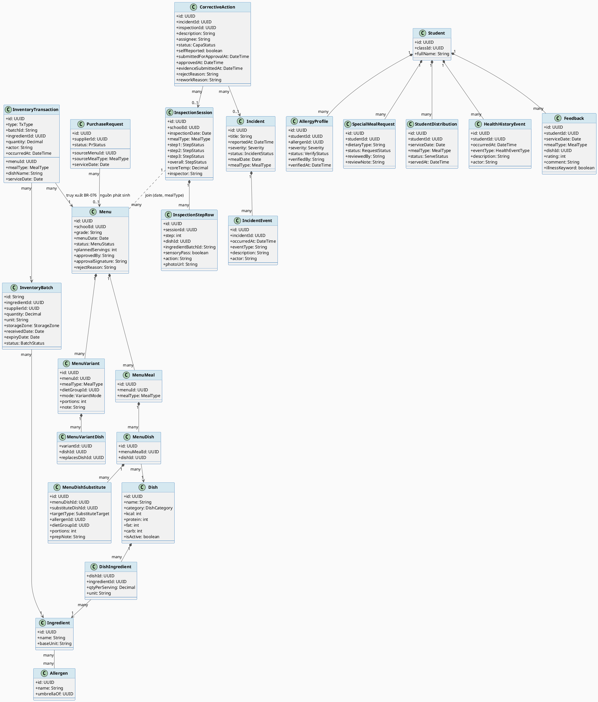

# ENGINEERING DOCUMENTATION STANDARD (EDS) v2.0
# Mô hình dữ liệu nghiệp vụ — bàn giao cho hiện thực hóa Backend

| Field | Value |
|-------|-------|
| **Document ID** | `SFMS-DATA-IMP-001` |
| **Version** | `1.0` |
| **Date** | `2026-07-22` |
| **Status** | `Draft` |
| **Document Owner** | Nguyễn Văn Nam |
| **Author** | Nguyễn Văn Nam — Web (School Admin / System Admin) |
| **Reviewed by** | *(chưa review)* |
| **DPO Sign-off** | `[ ] Pending` — module chạm PII học sinh (hồ sơ dị ứng, bệnh lý nền) |
| **Approved by** | *(chưa duyệt)* |
| **Last Review** | `2026-07-22` |
| **Based on EDS** | `v2.0` |

> **Phạm vi & giới hạn của tài liệu này — đọc trước khi dùng.**
>
> Đây **không phải** TDS đầy đủ 17 mục. Tài liệu chỉ đặc tả **mô hình dữ liệu** đã được
> kiểm chứng trên bản mock FE, phục vụ việc dựng schema và sửa class diagram trước khi
> code Spring Boot. Các mục 4, 6, 8–16 của template **để trống có chủ đích** vì chưa có
> căn cứ thực nghiệm — điền vào lúc này sẽ là bịa, đúng loại lỗi mà chính tài liệu này
> đang đi sửa (xem ADR-004).
>
> Mọi khẳng định trong Mục 5 và Mục 2 đều **đã chạy kiểm chứng trên dữ liệu mock**, số
> liệu dẫn ra là kết quả chạy thật chứ không phải mô tả ý định.

---

## CHANGELOG

| Ngày | Người thực hiện | Nội dung thay đổi |
|------|-----------------|-------------------|
| 2026-07-22 | Nguyễn Văn Nam | Tạo tài liệu lần đầu — chốt mô hình dữ liệu sau 18 commit dọn nguồn sự thật trên bản mock |

---

## MỤC LỤC

1. [Tổng quan Module](#1-tổng-quan-module)
2. [Ma trận Truy vết](#2-ma-trận-truy-vết)
3. [Architecture Decision Records](#3-architecture-decision-records)
4. ~~Non-Functional Requirements & SLA~~ — *ngoài phạm vi, xem Mục 17.2*
5. [Static Modeling](#5-static-modeling)
6. ~~Dynamic Modeling~~ — *ngoài phạm vi, xem Mục 17.2*
7. [Domain Event Catalog](#7-domain-event-catalog)
8. ~~Interface Specification~~ — *ngoài phạm vi*
9. ~~API Specification~~ — *ngoài phạm vi*
10. ~~Bảng mã lỗi~~ — *ngoài phạm vi*
11. ~~Quy trình Triển khai~~ — *ngoài phạm vi*
12. ~~Rollback & Incident Runbook~~ — *ngoài phạm vi*
13. ~~Kịch bản Kiểm thử~~ — *ngoài phạm vi*
14. [Phương pháp Xác minh](#14-phương-pháp-xác-minh)
15. ~~Mẫu thử thực tế~~ — *ngoài phạm vi*
16. ~~Authorization Matrix~~ — *ngoài phạm vi*
17. [Nợ kỹ thuật & việc còn lại](#17-nợ-kỹ-thuật--việc-còn-lại)

---

## 1. Tổng quan Module

| Field | Value |
|-------|-------|
| **Module Name** | Mô hình dữ liệu nghiệp vụ SFMS (thực đơn · kho · kiểm thực · sự cố · suất đặc biệt) |
| **Bounded Context** | School Food Safety Management |
| **Data Classification** | `Sensitive-PII` — hồ sơ dị ứng và bệnh lý nền của học sinh |
| **Compliance Scope** | Nghị định PDPD (Việt Nam) · QĐ 1246/QĐ-BYT (biểu mẫu kiểm thực ba bước) |
| **Upstream Dependencies** | Danh mục nguyên liệu, Đối tác/NCC, Hồ sơ học sinh |
| **Downstream Consumers** | Toàn bộ 7 vai: School Admin, Medical Staff, Service Caterers, Teacher, Parent, Supplier, System Admin |

### 1.1. Vì sao có tài liệu này

Bản mock FE được dùng làm nguồn tham chiếu để dựng backend. Rà soát toàn bộ 46 resource
trong mock DB phát hiện **cùng một khái niệm nghiệp vụ tồn tại ở nhiều bảng khác nhau**,
và nhiều bảng là dữ liệu khai tay không nơi nào sinh ra. Nếu dựng schema theo bản mock cũ,
các lỗi đó sẽ đi thẳng vào cơ sở dữ liệu thật.

Đã thực hiện 18 lượt sửa để đưa về một nguồn sự thật. Tài liệu này chốt kết quả đó.

---

## 2. Ma trận Truy vết

> Ánh xạ: [Mã quy tắc] → [Thành phần dữ liệu] → [Mục tiêu tuân thủ].

| Requirement ID | Loại | Mô tả yêu cầu | Thành phần dữ liệu | Compliance Target | ADR |
|---|---|---|---|---|---|
| BR-062 | Business Rule | Chuẩn dinh dưỡng theo nhóm tuổi | `Dish.kcal/protein/fat/carb`, `MenuVariant` | Dinh dưỡng học đường | ADR-002 |
| BR-063 | Business Rule | Cảnh báo dị ứng theo khối, chặn duyệt khi còn xung đột | `Dish.ingredients[].ingredientId` → `Ingredient.allergens` | An toàn học sinh | ADR-001 |
| BR-065/066 | Business Rule | HS dị ứng đã xác minh phải có suất riêng | `MenuDishSubstitute`, `MenuVariant` | An toàn học sinh | ADR-002 |
| BR-069 | Business Rule | Khai báo đầy đủ thành phần + định lượng | `DishIngredient.qtyPerServing` **NOT NULL** | QĐ 1246 | ADR-001 |
| BR-075 | Business Rule | Xuất kho FEFO — hạn gần nhất trước | `InventoryBatch.expiryDate`, `InventoryTransaction` | ATTP | ADR-003 |
| BR-076 | Business Rule | Truy xuất nguồn gốc món ↔ lô | `InventoryTransaction.menuId/mealType/dishName` + `ingredientId` | ATTP | ADR-001, ADR-003 |
| BR-094 | Business Rule | Không phục vụ nếu có bước kiểm thực thất bại | `InspectionSession.step1/2/3` ↔ `StudentDistribution.mealType` | QĐ 1246 | ADR-005 |
| BR-095 | Business Rule | Bước kiểm tra thất bại → tự tạo yêu cầu khắc phục | `CorrectiveAction.inspectionId` | QĐ 1246 | ADR-006 |
| BR-097 | Business Rule | Chỉ thất bại **nghiêm trọng** mới liên kết sự cố | `CorrectiveAction.incidentId` **nullable** | ATTP | ADR-006 |
| BR-142 | Business Rule | Phản hồi có từ khóa bệnh lý → chuyển Y tế | `Feedback.illnessKeyword`, `Feedback.studentId` | An toàn học sinh | — |
| BR-152 | Business Rule | Mỗi sự cố phải có CAPA | `CorrectiveAction.incidentId` | ATTP | ADR-006 |
| BR-172 | Business Rule | Lịch sử sức khỏe append-only | `HealthHistoryEvent` (chỉ INSERT) | PDPD | ADR-004 |
| BR-216 | Business Rule | 1 Incident = 1 CAPA; vòng đời 6 trạng thái | `CorrectiveAction.status` + unique(incidentId) | ATTP | ADR-006 |

---

## 3. Architecture Decision Records

### ADR-001 — Khóa ngoại thật, không dùng chuỗi hiển thị làm khóa

| Field | Value |
|-------|-------|
| **Status** | `Accepted` |
| **Deciders** | Nguyễn Văn Nam |
| **Date** | 2026-07-22 |

#### Bối cảnh

Bản mock nối các bảng bằng **tên hiển thị**. Hệ quả đo được:

- Món trong thực đơn nối với thư viện món bằng `name` — 47 món seed, **0 món** có khóa.
  Bữa trưa 21/07 Khối 1 và Khối 3 cùng có "Cơm trắng" và "Gà rang gừng" nhưng hệ thống
  coi là **4 món rời nhau**.
- Nguyên liệu nối bằng tên: `"Tôm sú đông lạnh"` ≠ `"Tôm sú"` → bản đồ truy xuất bỏ sót lô.
- Màn duyệt CAPA của Ban giám hiệu dò mã sự cố bằng `source.match(/INC-\d{4}-\d+/)` trên
  chuỗi hiển thị.
- Màn chi tiết sự cố lọc CAPA bằng `c.source.includes(incident.id)`.

#### Các phương án đã xem xét

| Phương án | Mô tả | Ưu điểm | Nhược điểm |
|---|---|---|---|
| A | Giữ tên, chuẩn hóa cách viết | + Không đổi schema | − Lệch âm thầm, không có ràng buộc nào bắt được |
| B | Thêm khóa ngoại thật, tên chỉ để hiển thị | + DB ràng buộc được; join chính xác | − Phải backfill dữ liệu cũ |

#### Quyết định

Chọn **B**. Mọi quan hệ dùng khóa; cột tên giữ lại **chỉ để hiển thị**, không tham gia join.

#### Hệ quả

**Tích cực:** DB tự bắt được lệch bằng FK constraint; truy xuất BR-076 không còn phụ thuộc
kỷ luật nhập liệu.

**Trade-off:** Dữ liệu cũ phải backfill. Đã làm trên mock: `dishId` gắn được **28/47** món;
19 món còn lại là khoảng trống thật của thư viện (0 món nhóm "Bữa phụ") — **không bịa khóa
cho chúng**, để `NULL` và bổ sung qua màn Thư viện món.

---

### ADR-002 — Suất ăn đặc biệt có hai hình thái, không gộp làm một

| Field | Value |
|-------|-------|
| **Status** | `Accepted` |
| **Deciders** | Nguyễn Văn Nam |
| **Date** | 2026-07-21 |

#### Bối cảnh

Mô hình ban đầu giả định *suất đặc biệt = thay từng món lẻ*. Đúng với ăn chay (thay 2–3
món), **sai với tiểu đường**: đổi cơm trắng sang gạo lứt, giảm khẩu phần tinh bột, bỏ món
ngọt — gần như một thực đơn khác. Và vì suất chỉ là các mẩu rời rạc nên **không kiểm được
tổng kcal/đạm** của chính suất đó (BR-062).

#### Quyết định

Hai bảng tách biệt:

- `MenuDishSubstitute` (PARTIAL) — chỉ ghi phần khác biệt, gắn vào món gốc.
- `MenuVariant` + `MenuVariantDish` (FULL) — ghi trọn bộ món của một buổi cho một nhóm.

Dish của variant trỏ về `Dish.id` nên **dinh dưỡng cộng tự động**, không nhập tay.

#### Hệ quả

**Tích cực:** Kiểm được tổng kcal/đạm từng suất. Kiểm chứng: variant seed = 595 kcal / 33g
đạm so với chuẩn 715/28 → hệ thống đánh dấu THẤP, đúng ý đồ BR-062.

**Trade-off:** Hai đường đọc cho cùng câu hỏi "em này ăn gì" — phải gộp ở tầng dẫn xuất
(`personalizeBlock`), không để mỗi màn tự xử.

---

### ADR-003 — Xuất kho gộp theo BỮA, phiếu vẫn neo từng khối

| Field | Value |
|-------|-------|
| **Status** | `Accepted` |
| **Deciders** | Nguyễn Văn Nam |
| **Date** | 2026-07-22 |

#### Bối cảnh

Thực đơn lập theo **NGÀY × KHỐI**, nhưng bếp nấu theo **BỮA**: cùng "Cơm trắng" thì Khối 1
và Khối 3 ăn chung một nồi. Xuất kho từng thực đơn khối một gây hai lỗi đo được:

1. FEFO chạy độc lập cho mỗi khối ⇒ **cùng một nồi bị ghi nhận lấy từ hai lô khác nhau**.
   Khi lô A nhiễm, bản đồ truy xuất chỉ ra đúng khối "dính" lô A, trong khi thực tế mọi
   khối ăn chung nồi đều bị ảnh hưởng.
2. Hai phiếu tính độc lập trên cùng tồn. Mô phỏng lô gạo còn **20kg**: Khối 1 lấy 14kg,
   Khối 3 lấy 16kg → **tổng 30kg**, không phiếu nào báo thiếu.

#### Quyết định

Cộng nhu cầu theo **nguyên liệu** trên toàn bộ thực đơn của bữa → chạy FEFO **một lần** →
chia ngược lượng đã phân bổ về từng thực đơn khối theo đúng thứ tự FEFO.

`InventoryTransaction` vẫn giữ `menuId` từng khối ⇒ truy xuất giữ nguyên độ mịn (BR-076).

#### Hệ quả

**Tích cực:** Cùng kịch bản 20kg, sau khi sửa: phân bổ đúng 20kg, báo thiếu 10kg, Khối 1
đủ 14/14 và Khối 3 được 6/16. Bất biến *"tổng chia ngược = tổng FEFO phân bổ"* đã kiểm
trên toàn bộ seed.

**Trade-off:** Tầng tính phức tạp hơn (gộp → phân bổ → chia ngược). Backend nên đặt logic
này ở service, không rải trong controller.

---

### ADR-004 — Dẫn xuất khi có thể, lưu khi cần bất biến

| Field | Value |
|-------|-------|
| **Status** | `Accepted` |
| **Deciders** | Nguyễn Văn Nam |
| **Date** | 2026-07-22 |

#### Bối cảnh

Nhiều bảng trong mock là **kết quả tính toán được khai tay**, và đã lệch với nguồn:

| Bảng khai tay | Lệch thế nào |
|---|---|
| `special-meal-plans` | Ban giám hiệu kết luận "đủ/thiếu kế hoạch" trên seed đóng băng; dẫn xuất lại cho thấy **6/9 HS bắt buộc chưa có kế hoạch nào** |
| `distributions` | 3 trong 4 dòng là ngày **không có bản ghi phát suất nào** bên dưới |
| `caterer-violations` | 3/4 bản ghi trùng đúng sự việc đã có trong `violations` → báo cáo BR-214 **đếm trùng** |
| `STEP2_DISH_CATALOG` | Ghi "Cơm trắng — Gạo tám thơm 150kg / 1850 suất" trong khi BOM cho **148kg**; "Thịt kho trứng cút — thịt lợn 45kg" trong khi BOM cho **92,5kg** |
| `Dish.allergens` | Khai tay nên sót — món dùng nước mắm không được đánh dấu tác nhân Cá |

#### Quyết định

- **Dẫn xuất** (không lưu): allergen của món, kế hoạch suất riêng, tổng hợp phát suất
  theo ngày × lớp, dòng biểu mẫu kiểm thực, bản đồ truy xuất, dòng thời gian sự cố,
  cảnh báo thiếu nguyên liệu.
- **Lưu** (bất biến theo thời điểm): mọi thứ là *bằng chứng pháp lý hoặc lịch sử* — phiếu
  xuất kho, phiếu kiểm thực đã chốt, chữ ký duyệt, lịch sử sức khỏe (BR-172), và **suất ăn
  thực tế lúc phát** (xem Mục 17.1 — chưa làm).

**Nguyên tắc phân biệt:** nếu tính lại sau 6 tháng mà ra kết quả khác thì **phải lưu**;
nếu luôn ra cùng kết quả từ dữ liệu gốc thì **dẫn xuất**.

#### Hệ quả

**Tích cực:** Bỏ được 6 bảng trùng nguồn. Số liệu tự nhất quán — Mẫu số 2 nay ra
"Cơm trắng | 380 suất | Gạo tám thơm 30.4kg", đúng 80g × 380.

**Trade-off:** Tính lúc đọc tốn CPU hơn. Với quy mô một trường (~1850 suất/bữa) không đáng
kể; nếu mở rộng nhiều trường thì cân nhắc materialized view, **không** quay lại bảng khai tay.

---

### ADR-005 — Kiểm thực theo BỮA cho toàn trường, không theo khối

| Field | Value |
|-------|-------|
| **Status** | `Accepted` |
| **Deciders** | Nguyễn Văn Nam |
| **Date** | 2026-07-22 |

#### Bối cảnh

Bếp nấu một mẻ cho cả trường nên kiểm thực ba bước là **một phiên cho mỗi bữa**. Mẫu số
1/2/3 của QĐ 1246 ghi theo *"ca/bữa ăn"*, và `Step2Row.servings` trong mock là **1850** —
số suất toàn trường. Mô hình hiện tại **đúng**.

Vấn đề nằm ở chỗ khác: hai bên mã hóa cùng hai chiều (ngày, bữa) theo hai kiểu khác nhau
(`"02/07/2026"` + `"Bữa trưa"` so với `menuDateIso` + `MealType`), nên mỗi nơi dùng phải
tự quy đổi. Kiểm chứng: sau khi quy đổi, **0/5 phiên** khớp được thực đơn nào vì seed hai
cụm lệch ngày hoàn toàn (kiểm thực 29/06–02/07, thực đơn từ 06/07).

#### Quyết định

**Không** thêm khóa từ phiên kiểm thực xuống từng thực đơn khối. Thay vào đó thống nhất
kiểu dữ liệu: cả hai bảng lưu `DATE` + `enum meal_type`, quan hệ suy ra bằng join hai cột
đó. Bỏ hẳn chuỗi hiển thị khỏi vai trò khóa.

#### Hệ quả

**Tích cực:** Chuỗi truy xuất chạy thông — `INSP-20260706-L` → Khối 3 / `MENU-2026-27` →
5 dòng xuất → 5 lô cụ thể.

**Trade-off:** Join hai cột thay vì một FK. Đổi lại không phải duy trì bảng nối
`inspection_menu` vốn luôn suy được.

---

### ADR-006 — CAPA có hai đường sinh, `incidentId` phải nullable

| Field | Value |
|-------|-------|
| **Status** | `Accepted` |
| **Deciders** | Nguyễn Văn Nam |
| **Date** | 2026-07-22 |

#### Bối cảnh

Trực giác thường gặp là "phải có sự cố mới cần CAPA". Văn bản quy định nói khác:

- **BR-152**: *"Sau mỗi sự cố, phải có CAPA"* → sự cố ⇒ CAPA. Đúng.
- **BR-095**: *"Khi một bước kiểm tra thất bại, hệ thống phải ... tự động tạo yêu cầu hành
  động khắc phục"* → kiểm thực fail ⇒ CAPA, **không cần sự cố**.
- **BR-097**: chỉ thất bại **nghiêm trọng** mới liên kết sang quản lý sự cố.

Nên chiều ngược lại không đúng: **không phải CAPA nào cũng thuộc một sự cố**.

#### Quyết định

`CorrectiveAction` có **hai khóa nguồn cùng nullable**: `incidentId` và `inspectionId`;
ràng buộc CHECK yêu cầu có ít nhất một. Áp `UNIQUE(incidentId)` để thực thi BR-216
*"1 Incident = 1 CAPA"*.

Mọi CAPA — kể cả loại sinh từ kiểm thực — đều đi qua Ban giám hiệu duyệt kế hoạch
(BR-153) trước khi thực hiện.

#### Hệ quả

**Tích cực:** Seed sau khi chỉnh: không sự cố nào có quá 1 CAPA, không sự cố nào thiếu
CAPA, không CAPA nào thiếu khóa nguồn, 5/5 CAPA đã hoặc đang qua BGH duyệt.

**Trade-off:** Không dùng được FK NOT NULL đơn giản. Đổi lại phản ánh đúng quy định.

---

## 5. Static Modeling

> **Lưu ý sai lệch template:** mục 5.2 của EDS v2.0 dùng Prisma. Dự án dựng backend bằng
> **Spring Boot**, nên phần schema viết bằng **JPA entity + DDL PostgreSQL**.

### 5.1. Class Diagram (PlantUML)



### 5.2. Data Structure (JPA + DDL PostgreSQL)

> Chỉ liệt kê các entity **có thay đổi so với bản mock cũ** hoặc **có ràng buộc đặc biệt**.
> Các entity còn lại giữ nguyên cấu trúc đã có.

```java
// === THƯ VIỆN MÓN — allergens KHÔNG lưu, dẫn xuất từ thành phần (ADR-004) ===
@Entity @Table(name = "dish")
public class Dish {
    @Id @GeneratedValue private UUID id;
    @Column(nullable = false) private String name;
    @Enumerated(EnumType.STRING) private DishCategory category;
    private int kcal, protein, fat, carb;
    @Column(nullable = false) private boolean isActive = true;

    @OneToMany(mappedBy = "dish", cascade = CascadeType.ALL, orphanRemoval = true)
    private List<DishIngredient> ingredients = new ArrayList<>();
}

// === BOM — qtyPerServing BẮT BUỘC (BR-069) ===
@Entity @Table(name = "dish_ingredient")
public class DishIngredient {
    @Id @GeneratedValue private UUID id;
    @ManyToOne(optional = false) private Dish dish;
    @ManyToOne(optional = false) private Ingredient ingredient;

    /**
     * Định lượng cho MỘT suất. NOT NULL và > 0.
     * Thiếu cột này thì nhu cầu xuất kho nhân ra 0 — bếp không lấy được gì cho
     * suất đó, và đơn đặt hàng cũng thiếu toàn bộ nguyên liệu tương ứng.
     */
    @Column(nullable = false, precision = 10, scale = 3)
    private BigDecimal qtyPerServing;

    @Column(nullable = false) private String unit;
}
```

```sql
-- Ràng buộc bắt buộc, không để tầng ứng dụng tự giữ
ALTER TABLE dish_ingredient
  ADD CONSTRAINT ck_dish_ingredient_qty_positive CHECK (qty_per_serving > 0);
```

```java
// === CAPA — hai đường sinh, incidentId nullable (ADR-006) ===
@Entity @Table(name = "corrective_action")
public class CorrectiveAction {
    @Id @GeneratedValue private UUID id;

    /** Nguồn 1: sự cố (BR-152). NULL với CAPA sinh từ kiểm thực. */
    @ManyToOne @JoinColumn(name = "incident_id") private Incident incident;

    /** Nguồn 2: phiên kiểm thực không đạt (BR-095). */
    @ManyToOne @JoinColumn(name = "inspection_id") private InspectionSession inspection;

    @Enumerated(EnumType.STRING) @Column(nullable = false)
    private CapaStatus status = CapaStatus.DRAFT;

    /** BR-189: đơn vị suất ăn tự ghi nhận, khác với do Y tế/BGH lập. */
    private boolean selfReported;

    private Instant submittedForApprovalAt, approvedAt, evidenceSubmittedAt;
    private String rejectReason, reworkReason;
}
```

```sql
-- BR-216: 1 Incident = 1 CAPA — không tách nhiều CAPA song song trong một sự cố
ALTER TABLE corrective_action
  ADD CONSTRAINT uq_capa_per_incident UNIQUE (incident_id);

-- ADR-006: phải có ít nhất một nguồn phát sinh
ALTER TABLE corrective_action
  ADD CONSTRAINT ck_capa_has_source
  CHECK (incident_id IS NOT NULL OR inspection_id IS NOT NULL);
```

```java
// === KIỂM THỰC — một phiên / bữa cho cả trường (ADR-005) ===
@Entity @Table(name = "inspection_session")
public class InspectionSession {
    @Id @GeneratedValue private UUID id;
    @Column(nullable = false) private LocalDate inspectionDate;

    /**
     * Lưu enum, KHÔNG lưu nhãn tiếng Việt. Bản mock lưu "Bữa trưa" ở đây và
     * "LUNCH" ở bảng thực đơn — cùng một chiều dữ liệu, hai cách mã hoá, nên mọi
     * nơi dùng phải tự quy đổi và không ràng buộc được gì.
     */
    @Enumerated(EnumType.STRING) @Column(nullable = false)
    private MealType mealType;

    @Enumerated(EnumType.STRING) private StepStatus step1, step2, step3, overall;
}
```

```sql
-- ADR-005: mỗi bữa mỗi ngày chỉ một phiên kiểm thực cho toàn trường
ALTER TABLE inspection_session
  ADD CONSTRAINT uq_inspection_per_meal UNIQUE (school_id, inspection_date, meal_type);

-- Chỉ mục phục vụ join Menu ↔ InspectionSession và cổng BR-094
CREATE INDEX ix_menu_date_school ON menu (school_id, menu_date);
CREATE INDEX ix_inspection_date_meal ON inspection_session (inspection_date, meal_type);
```

```java
// === LỊCH SỬ SỨC KHỎE — append-only (BR-172) ===
@Entity @Table(name = "health_history_event")
@Immutable   // Hibernate: chặn UPDATE ở tầng ORM
public class HealthHistoryEvent {
    @Id @GeneratedValue private UUID id;
    @ManyToOne(optional = false) private Student student;
    @Column(nullable = false) private Instant occurredAt;
    @Enumerated(EnumType.STRING) private HealthEventType eventType;
    @Column(nullable = false) private String description;
    @Column(nullable = false) private String actor;
}
```

```sql
-- Chặn ở tầng DB, không chỉ tin vào ORM
REVOKE UPDATE, DELETE ON health_history_event FROM app_user;
```

### 5.3. Enum

```java
public enum MealType { BREAKFAST, LUNCH, SNACK }
public enum MenuStatus { DRAFT, PENDING_APPROVAL, APPROVED, PUBLISHED, REJECTED }
public enum VariantMode { PARTIAL, FULL }
public enum SubstituteTarget { ALLERGEN, DIET_GROUP }
public enum StorageZone { DRY, CHILLED, FROZEN }
public enum BatchStatus { ACTIVE, EXPIRING_SOON, EXPIRED, QUARANTINED }
public enum StepStatus { PENDING, IN_PROGRESS, PASSED, FAILED }

/** BR-216 — vòng đời CAPA, 3 vai thao tác ở 3 chặng khác nhau. */
public enum CapaStatus {
    DRAFT,                      // Y tế soạn
    PENDING_ADMIN_APPROVAL,     // Ban giám hiệu duyệt kế hoạch
    APPROVED_FOR_IMPLEMENTATION,// Đơn vị suất ăn nhận việc
    IN_PROGRESS,                // Đơn vị suất ăn thực hiện
    SUBMITTED_EVIDENCE,         // Y tế đánh giá hiệu quả
    COMPLETED                   // Trạng thái cuối
}
```

---

## 7. Domain Event Catalog

> Bản mock chưa có message bus. Bảng dưới là **các mốc nghiệp vụ đã được hiện thực** trên
> FE dưới dạng ghi bản ghi + thông báo; backend nên nâng thành domain event thật.

### 7.1. Events Published

| Event Name | Trigger | Publisher | Subscriber | Ghi chú |
|---|---|---|---|---|
| `InspectionStepFailed` | Một bước kiểm thực chấm Không đạt | InspectionService | CorrectiveActionService, DistributionService | **BR-095** tạo CAPA `DRAFT`; **BR-094** chặn phát suất bữa đó |
| `MenuApproved` | BGH duyệt & công bố thực đơn | MenuService | NotificationService | Thông báo phụ huynh (BR-070) |
| `MenuRejected` | BGH từ chối kèm lý do | MenuService | NotificationService | Gửi đơn vị suất ăn (BR-048) |
| `SpecialMealRequested` | Phụ huynh khai chế độ ăn | SpecialMealService | NotificationService, HealthHistoryService | Vào hàng chờ Y tế (BR-066) |
| `SpecialMealReviewed` | Y tế duyệt/từ chối | SpecialMealService | NotificationService, HealthHistoryService | Ghi vết BR-172 |
| `AllergyProfileVerified` | Y tế xác minh hồ sơ dị ứng | HealthService | HealthHistoryService, MenuService | Kích hoạt cảnh báo BR-123 |
| `FeedbackWithIllnessKeyword` | Phản hồi chứa từ khóa bệnh lý | FeedbackService | NotificationService | **BR-142** chuyển Y tế |
| `SafetyConcernReported` | Phụ huynh báo sự cố khẩn | IncidentService | NotificationService | **BR-138** đi thẳng, không qua duyệt |
| `IngredientsIssued` | Xác nhận xuất kho FEFO | InventoryService | TraceabilityService | Sinh liên kết món ↔ lô (BR-076) |
| `BatchReceived` | Hoàn tất phiên nhận hàng | ReceivingService | InventoryService | Tạo tồn kho, giữ nguyên mã lô NCC |
| `ShortageDetected` | Nhu cầu > tồn khả dụng | InventoryService | PurchaseService | Prefill đơn đặt hàng (BR-077) |

### 7.2. Events Consumed

| Event Name | Source | Handler | Action |
|---|---|---|---|
| `InspectionStepFailed` | Inspection | `CorrectiveActionHandler` | Tạo CAPA trạng thái `DRAFT`, gắn `inspectionId` |
| `InspectionStepFailed` | Inspection | `DistributionGateHandler` | Chặn xác nhận phát suất của bữa đó (BR-094) |
| `BatchQuarantined` | Incident | `InventoryHandler` | Loại lô khỏi phân bổ FEFO (BR-149) |

---

## 14. Phương pháp Xác minh

Mọi con số trong tài liệu này lấy từ **chạy thật trên dữ liệu mock**, không phải ước lượng.
Cách kiểm chứng: nạp `lib/mock-data.ts` bằng `jiti` rồi gọi thẳng các hàm nghiệp vụ.

| # | Khẳng định | Cách kiểm | Kết quả |
|---|---|---|---|
| 1 | Món dùng chung nhiều khối | Gom món theo (ngày, bữa), lọc món xuất hiện ở ≥2 khối | 20/07 "Cơm trắng" (Khối 3+4); 21/07 "Cơm trắng" và "Gà rang gừng" (Khối 1+3) |
| 2 | FEFO tính trên tồn cũ | Mô phỏng 2 phiếu liên tiếp cho cùng lô | Cả hai đều thấy tồn 169.6kg → sau khi sửa: 169.6 rồi 155.6 |
| 3 | Xuất vượt tồn | Đặt lô còn 20kg, chạy 2 phiếu độc lập | Lấy ra 30kg, không báo thiếu → sau khi gộp: phân bổ 20kg, báo thiếu 10kg |
| 4 | Bất biến chia ngược | So tổng FEFO phân bổ với tổng chia về các khối | Khớp tuyệt đối trên toàn seed |
| 5 | Kế hoạch suất riêng | Dẫn xuất từ thực đơn thay vì đọc bảng seed | 9 HS bắt buộc → 5 suất đã lập, **6 em chưa có kế hoạch**, 2 món đã công bố còn chạm dị ứng |
| 6 | CAPA trùng | Đối chiếu từng dòng `caterer-violations` với `violations` | 3/4 bản ghi trùng đúng sự việc |
| 7 | Ràng buộc BR-216 | Đếm CAPA theo từng sự cố | Không sự cố nào >1 CAPA; không sự cố nào thiếu CAPA |
| 8 | Kiểm thực ↔ thực đơn | Quy đổi (ngày, bữa) rồi join | Trước: 0/5 phiên khớp. Sau khi căn seed: `INSP-20260706-L` → Khối 3 → 5 lô |
| 9 | Biểu mẫu khớp BOM | Dựng Mẫu số 2 từ thực đơn | "Cơm trắng \| 380 suất \| Gạo tám thơm 30.4kg" = 80g × 380 |
| 10 | Cổng BR-094 | Gọi `mealServingGate` cho bữa có bước fail | `blocked=true`, nêu đích danh "Bước 2 — trong chế biến" |

### 14.1. Quy mô dữ liệu mock hiện tại

| Bảng | Số bản ghi | | Bảng | Số bản ghi |
|---|---|---|---|---|
| `MENUS` | 9 | | `INSPECTIONS` | 7 |
| `DISH_LIBRARY` | 16 | | `INCIDENTS` | 3 |
| `MENU_VARIANTS` | 1 | | `CORRECTIVE_ACTIONS` | 5 |
| `INGREDIENT_CATALOG` | 38 | | `VIOLATIONS` | 6 |
| `INVENTORY` | 20 | | `SPECIAL_MEAL_REQUESTS` | 7 |
| `INVENTORY_TRANSACTIONS` | 16 | | `STUDENT_DISTRIBUTIONS` | 10 |
| `STUDENTS` | 18 | | `FEEDBACKS` | 3 |
| `HEALTH_HISTORY` | 9 | | | |

---

## 17. Nợ kỹ thuật & việc còn lại

### 17.1. Nợ mô hình — phải quyết trước khi chốt schema

**Cập nhật 22/07/2026:** 8/8 nợ đã được sửa **trên bản mock FE** — mô hình dưới đây
là mô hình đã hiện thực và đã kiểm chứng bằng dữ liệu chạy thật, không còn là đề xuất.
Class diagram (Mục 5.1) đã vẽ theo trạng thái sau khi sửa.

| # | Nợ | Trạng thái | Đã làm gì |
|---|---|---|---|
| 1 | **`ServingDish`** (gap T3) | ✅ Đã sửa | `StudentDistribution.servedDishes[]` (dishId · dishName · isSubstitute · substitutedForDishName · reason), ghi lúc giáo viên xác nhận phát, **không tính lại**. Kiểm chứng: cùng một buổi, hồ sơ dị ứng đổi làm suất dẫn xuất đổi từ "Canh bí đỏ thịt băm" sang "Canh bí đỏ nấu tôm" — bản đóng băng giữ nguyên |
| 2 | **`IncidentAffectedStudent`** (gap T4) | ✅ Đã sửa | Thay cả `affectedStudents: int` ở `Incident` lẫn mảng tên ở `IncidentSourceReport`. Ràng buộc mã HS làm lộ 3 sai lệch seed (học sinh không tồn tại, sự cố khai 4 HS mà chỉ gộp 2, sự cố khai 0 mà báo cáo nguồn có 1) — đã sửa; 3/3 sự cố nay khớp hợp các báo cáo nguồn |
| 3 | **Bảng sự kiện sự cố** | ✅ Đã sửa | `IncidentEvent` append-only, ghi tại lúc hành động xảy ra |
| 4 | **`SubstituteDish.dishId`** | ✅ Đã sửa | Nối khóa + backfill seed |
| 5 | **`groupId` gộp hai khái niệm** | ✅ Đã sửa | `targetType: ALLERGEN \| DIET_GROUP` + `allergenIds[]`/`dietGroupId`; `MenuVariant.groupId` → `dietGroupId`. Suất dị ứng nay ghi rõ tác nhân — "Canh bí đỏ nấu tôm" → `["Tôm", "Hải sản"]` |
| 6 | **Hai mô hình dị ứng song song** | ✅ Đã sửa | Gộp về `ALLERGY_DECLARATIONS` làm nguồn duy nhất; `Student.allergies` thành trường dẫn xuất; xác minh chuyển về mức TỪNG tác nhân (BR-031). Hai mô hình này không chỉ trùng mà đang cấp cho hai luồng khác nhau — hệ quả là em dị ứng Trứng vẫn được giao "Thịt kho trứng cút". Sau khi gộp: 0 trường hợp học sinh nhận món chứa tác nhân của chính mình |
| 7 | **`UserNotification` không người nhận** | ✅ Đã sửa | `recipientRoles: RoleKey[]`, hộp thư lọc theo vai |
| 8 | **Thư viện món thiếu nhóm "Bữa phụ"** | ✅ Đã sửa | Thư viện lên 28 món, `dishId` phủ 47/47 món trong thực đơn |

**Việc còn lại trước khi chốt schema:** cập nhật class diagram của đồ án theo Mục 5.1, và
hai quyết định nêu ở SFMS-FLOW-REV-001 §9 (gộp/tách `Menu.APPROVED` vs `PUBLISHED`; bổ
sung API cho 4 trạng thái hiện chưa có đường vào từ giao diện).

### 17.2. Ngoài phạm vi tài liệu này

Các mục 4, 6, 8–13, 15, 16 của template EDS v2.0 **chưa điền**. Lý do: chúng cần dữ liệu
mà bản mock FE không cung cấp được — SLA đo thật, sequence diagram của luồng backend, hợp
đồng API, mã lỗi, runbook vận hành, kịch bản kiểm thử tích hợp, ma trận phân quyền chi
tiết. Điền vào lúc này sẽ là suy đoán, và đó chính là loại lỗi mà ADR-004 đang sửa.

Đề nghị: viết bổ sung khi hiện thực hóa từng module Spring Boot, mỗi module một TDS riêng
với `Document ID` dạng `SFMS-[MODULE]-IMP-[NNN]`, tham chiếu ngược về tài liệu này.

### 17.3. Nguồn tham chiếu

| Nguồn | Vị trí |
|---|---|
| Bản mock FE (nguồn của mọi số liệu kiểm chứng) | `03_Design/08_FrontEnd/Web/src/lib/mock-data.ts` |
| Registry resource mock DB | `03_Design/08_FrontEnd/Web/src/lib/api/db.ts` |
| Rà soát truy xuất & mô hình dữ liệu | `03_Design/08_FrontEnd/Web/review/review_data_model_traceability_for_backend.md` |
| Quy tắc nghiệp vụ | `02_Requirements/00_BusinessRules/business_rules.md` |
| Lịch sử thay đổi mô hình | 18 commit trên nhánh `namnvhe180863`, từ `bc82e48` đến `7f79a26` |
