# MF01 — User Management & Access Control
## Design Diagrams (Database, Class, Sequence, State)

> **Stack:** Spring Boot 4.1.x (Java 25) · PostgreSQL 16 · Flyway · Spring Security + JWT · Spring Security OAuth2 Client  
> **Bounded Context:** Identity & Access Management (IAM)  
> **Based on:** TDS `SFMS-MF01-IMP-001 v2.0` (Approved 2026-07-31)  
> **Notation:** class diagrams use standard UML (`+` public / `-` private / `~` package, `<<interface>>`, `<<enumeration>>`, association multiplicities `1`, `0..1`, `n`); sequence diagrams use standard UML lifelines named in object notation `:ClassName` (anonymous instance of that class) and typed with the UML robustness stereotypes — `actor` (human), `boundary` (UI screen or external identity provider port), `control` (controller / service / validator), `entity` (Spring Data repository — the only component allowed to touch the database), `database` (persistent store) — with synchronous calls (solid arrow) always paired with a reply (dashed arrow), activation bars, and `alt`/`else`/`opt` combined fragments; state diagrams use UML state-machine notation (`[*]` initial/final pseudo-states, `event [guard] / action` transition labels).

---

## Database Architecture (DBML)

> Reflects Flyway `V1__init_schema.sql` owned by MF01. All tables use UUID primary keys generated server-side. Cross-module references (`school_id`, `partner_id`) are UUID-only — no foreign key constraints across module boundaries (AP-AI-005).

```dbml
// Module: MF01 — User Management & Access Control
// Source: TDS SFMS-MF01-IMP-001 v2.0 | Flyway V1__init_schema.sql
// Docs: https://dbml.dbdiagram.io/docs

Table roles {
  id          uuid        [pk, default: `gen_random_uuid()`, note: "Internal PK"]
  name        varchar(100) [unique, not null, note: "BR-008: system roles cannot be renamed"]
  description varchar(255) [not null]
  system      boolean      [not null, default: false, note: "BR-008: system=true → cannot be deleted or renamed"]
  permissions jsonb        [not null, default: '[]', note: "List of permission code strings, logically many-to-many with permissions.id (UC-129) — not FK-enforced, JSONB array"]
  created_at  timestamptz  [not null, default: `now()`]

  indexes {
    name [unique]
  }

  Note: "7 system roles are seeded at startup (BR-007). Custom roles are allowed but can only be deleted when they have 0 assigned users (BR-008)."
}

Table permissions {
  id          varchar(20)  [pk, note: "Fixed catalog ID e.g. PERM-001"]
  name        varchar(80)  [unique, not null]
  module      varchar(60)  [not null]
  description varchar(255) [not null]

  Note: "Read-only catalog of 16 permissions (UC-129), referenced by roles.permissions (JSONB array of these ids). Seeded at startup; no INSERT/UPDATE/DELETE in production."
}

Table user_accounts {
  id                  uuid         [pk, default: `gen_random_uuid()`]
  name                varchar(150) [not null]
  email               varchar(180) [unique, not null, note: "BR-012: valid & unique"]
  phone               varchar(20)  [note: "BR-012: format +84 / 0xx"]
  password_hash       varchar(72)  [null, note: "BR-001: BCrypt strength 12. NULL when PENDING_VERIFICATION or Google-only account"]
  google_sub          varchar(64)  [unique, null, note: "BR-218: Google identity sub, set on first Google login"]
  role_id             uuid         [not null, ref: > roles.id, note: "BR-007: RBAC role"]
  school_id           uuid         [null, note: "UUID ref → schools(id) in MF02. NULL for platform-level accounts"]
  partner_id          uuid         [null, note: "UUID ref → partners(id) in MF04. Provides tenant isolation for suppliers/caterers (ADR-M04-6)"]
  status              varchar(24)  [not null, default: 'PENDING_VERIFICATION', note: "ADR-M03: one of PENDING_VERIFICATION | ACTIVE | INACTIVE | SUSPENDED"]
  email_verified      boolean      [not null, default: false, note: "BR-010: login only after email verified"]
  failed_login_count  int          [not null, default: 0, note: "BR-002: lockout counter"]
  locked_until        timestamptz  [null, note: "BR-002: account locked until this instant (5 fails → +15 min)"]
  terms_accepted_at   timestamptz  [null, note: "BR-009: must accept terms on first login"]
  last_login          timestamptz  [null]
  created_at          timestamptz  [not null, default: `now()`]
  created_by          varchar(180) [null, note: "Email of actor who created this account"]

  indexes {
    email [unique, name: "ix_user_email"]
    google_sub [unique, name: "ix_user_google_sub"]
    role_id [name: "ix_user_role"]
    status [name: "ix_user_status"]
    partner_id [name: "ix_user_partner"]
  }

  Note: "Central entity for all SFMS users. JWT claims: sub(email), uid, role, schoolId, partnerId."
}

Table security_policies {
  id                      varchar(20)  [pk, note: "Fixed ID e.g. SEC-DEFAULT"]
  max_login_attempts      int          [not null, note: "BR-002: default 5"]
  lockout_minutes         int          [not null, note: "BR-002: default 15"]
  session_timeout_minutes int          [not null, note: "BR-004: access token TTL, default 30 min"]
  password_min_length     int          [not null, note: "BR-006: default 8"]
  require_special_char    boolean      [not null]
  require_number          boolean      [not null]
  require_mixed_case      boolean      [not null]
  no_reuse_last3          boolean      [not null, note: "BR-015: cannot reuse last 3 passwords"]
  updated_at              timestamptz  [null]
  updated_by              varchar(180) [null]

  Note: "Single active policy row (SEC-DEFAULT), read by AuthService/PasswordResetService/AccountService at runtime for every user_accounts row — no hardcoded values in the service layer. Not FK-linked to user_accounts: it is a global singleton, not a per-user setting."
}

Table refresh_tokens {
  id          uuid        [pk, default: `gen_random_uuid()`]
  user_id     uuid        [not null, ref: > user_accounts.id]
  token_hash  varchar(88) [unique, not null, note: "SHA-256 hash of the opaque random token (≥256 bits). Never store raw token."]
  expires_at  timestamptz [not null, note: "BR-004 v1.9: sliding +14 days on each valid use"]
  revoked_at  timestamptz [null, note: "Set immediately on logout / lockout / deactivate / new login (BR-004, BR-005)"]
  created_at  timestamptz [not null, default: `now()`]

  indexes {
    token_hash [unique, name: "ix_rt_hash"]
    user_id    [name: "ix_rt_user"]
  }

  Note: "Enforces single-session (BR-005): at most 1 non-revoked, non-expired row is kept per user_id."
}

Table account_activation_tokens {
  id          uuid        [pk, default: `gen_random_uuid()`]
  user_id     uuid        [not null, ref: > user_accounts.id]
  token_hash  varchar(88) [unique, not null, note: "Hash of one-time activation link token"]
  expires_at  timestamptz [not null, note: "BR-011: 48 hours from generation"]
  used_at     timestamptz [null, note: "Set when token is consumed — cannot reuse"]

  Note: "Generated on account creation (UC-024/026) and used once to activate the account and set its password (UC-154)."
}

Table password_reset_tokens {
  id          uuid        [pk, default: `gen_random_uuid()`]
  user_id     uuid        [not null, ref: > user_accounts.id]
  token_hash  varchar(88) [unique, not null]
  expires_at  timestamptz [not null, note: "BR-003: 1 hour TTL. Rate-limited to 1 request per 15 min per email."]
  used_at     timestamptz [null, note: "Set when consumed — one-time use only"]

  Note: "Issued by the forgot-password flow (UC-032). The raw token is sent via email; only its hash is stored."
}

Table password_history {
  id            uuid        [pk, default: `gen_random_uuid()`]
  user_id       uuid        [not null, ref: > user_accounts.id]
  password_hash varchar(72) [not null, note: "BCrypt hash of a past password"]
  created_at    timestamptz [not null, default: `now()`]

  indexes {
    user_id [name: "ix_ph_user"]
  }

  Note: "Keeps the last 3 password hashes per user (BR-015), queried via findTop3ByUserIdOrderByCreatedAtDesc."
}

Table audit_logs {
  id        uuid        [pk, default: `gen_random_uuid()`]
  timestamp timestamptz [not null, default: `now()`]
  actor     varchar(180) [not null, note: "Email or system identifier of the acting user"]
  ip        varchar(45) [null, note: "IPv4 or IPv6 of the request origin (UC-106)"]
  action    varchar(255) [not null, note: "e.g. LOGIN, LOGOUT, CREATE_USER, DELETE_ROLE, GOOGLE_LINK"]
  resource  varchar(120) [not null, note: "e.g. Authentication, UserAccount/U-0011, Role/ROLE-TEACHER"]
  result    varchar(16) [not null, note: "SUCCESS | BLOCKED"]

  Note: "APPEND-ONLY — no UPDATE or DELETE. This tamper-evident log is retained for ≥12 months (BR-162). actor_user_id is intentionally omitted so no FK constraint is placed on this immutable table; actor is instead recorded by email/identifier (resolve to user_accounts.email if needed)."
}

// ── Relationships summary ──────────────────────────────────────────────────
// Enforced (real FK columns):
// user_accounts.role_id             → roles.id              (BR-007)
// refresh_tokens.user_id            → user_accounts.id      (BR-004)
// account_activation_tokens.user_id → user_accounts.id      (BR-011)
// password_reset_tokens.user_id     → user_accounts.id      (BR-003)
// password_history.user_id          → user_accounts.id      (BR-015)
//
// Logical only (no FK by design):
// roles.permissions (jsonb)         ↔ permissions.id        (UC-129, many-to-many via code array, not FK-enforced)
// security_policies                 ↔ user_accounts          (governs all rows; global singleton, no per-row FK)
// audit_logs.actor                  ↔ user_accounts.email    (append-only table, FK deliberately omitted)
// user_accounts.school_id           → schools.id (MF02, UUID-only, no FK)
// user_accounts.partner_id          → partners.id (MF04, UUID-only, no FK)
```

---

## 1. Authentication

### 1.1 Class Diagram

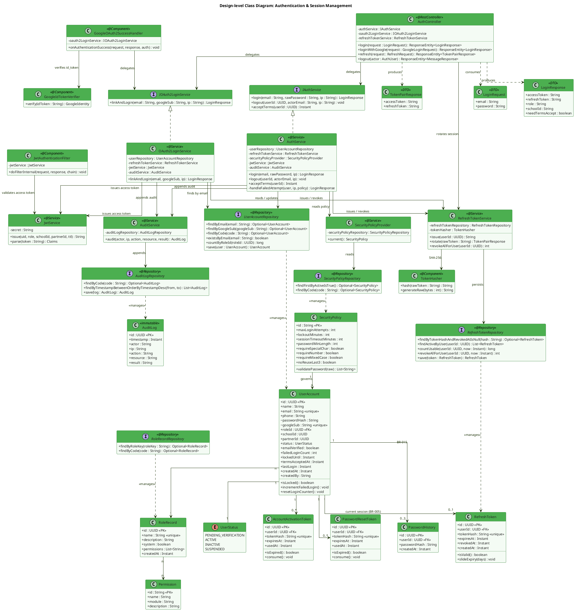

**Description:**  
This class diagram covers the authentication domain of MF01, sliced into the four layers the sequence diagrams below traverse: `AuthController` (`<<@RestController>>`, the only HTTP entry point), the service layer (`AuthService`, `OAuth2LoginService`, `RefreshTokenService`, `SecurityPolicyProvider`, `AuditService`), the Spring Data repositories (`<<@Repository>>` — the only components allowed to touch PostgreSQL), and the domain entities. `UserAccount` is the central entity holding credentials, login state (lockout counters), and identity references (role, school, partner). `RefreshToken` implements the sliding 14-day session model (BR-004 v1.9), with strict single-session enforcement via `RefreshTokenRepository.revokeAllForUser` (BR-005); the raw token never leaves memory — only its SHA-256 hash from `TokenHasher` is persisted. `SecurityPolicy` provides all configurable thresholds (lock attempts, lockout minutes, access-token TTL) and is read at runtime through `SecurityPolicyProvider` — no hardcoded values in the service layer. `GoogleOAuth2SuccessHandler` delegates to `OAuth2LoginService`, which performs link-only login (BR-218): only accounts with a matching email are allowed in; no new accounts are auto-created.

---

### 1.2 Sequence Diagram — Email/Password Login (UC-034)

```plantuml
@startuml MF01_Login_EmailPassword
title Sequence Diagram: Email/Password Login

' Bật chế độ liên kết vuông góc (Orthogonal lines)
skinparam linetype ortho

' ==========================================
' CẤU HÌNH MÀU SẮC TÔNG XANH LÁ
' ==========================================
skinparam backgroundColor #FFFFFF

' Định dạng chung cho Stereotype
skinparam stereotype {
    CBackgroundColor #E8F5E9
    CBorderColor #2E7D32
    EBackgroundColor #E8F5E9
    EBorderColor #2E7D32
    ABackgroundColor #E8F5E9
    ABorderColor #2E7D32
    IBackgroundColor #E8F5E9
    IBorderColor #2E7D32
}

' ==========================================
' Note
' ==========================================
skinparam NoteBackgroundColor #E8F5E9
skinparam NoteBorderColor #2E7D32
skinparam NoteFontColor #212121
skinparam NoteFontName Arial

' ==========================================
' Lifeline theo stereotype robustness UML
' (boundary / control / entity / database)
' ==========================================
skinparam BoundaryBackgroundColor #F4FBF4
skinparam BoundaryBorderColor #2E7D32
skinparam BoundaryFontColor #212121
skinparam BoundaryFontName Arial
skinparam BoundaryFontSize 13

skinparam ControlBackgroundColor #F4FBF4
skinparam ControlBorderColor #2E7D32
skinparam ControlFontColor #212121
skinparam ControlFontName Arial
skinparam ControlFontSize 13

skinparam EntityBackgroundColor #F4FBF4
skinparam EntityBorderColor #2E7D32
skinparam EntityFontColor #212121
skinparam EntityFontName Arial
skinparam EntityFontSize 13

skinparam CollectionsBackgroundColor #F4FBF4
skinparam CollectionsBorderColor #2E7D32
skinparam CollectionsFontColor #212121

skinparam DatabaseBackgroundColor #F4FBF4
skinparam DatabaseBorderColor #2E7D32
skinparam DatabaseFontColor #212121
skinparam DatabaseFontName Arial
skinparam DatabaseFontSize 13

skinparam sequence {

    ' ==========================================
    ' Actor & Participant
    ' ==========================================
    ActorBackgroundColor #E8F5E9
    ActorBorderColor #2E7D32
    ActorFontColor #1B5E20
    ActorFontName Arial
    ActorFontSize 13

    ParticipantBackgroundColor #F4FBF4
    ParticipantBorderColor #2E7D32
    ParticipantFontColor #212121
    ParticipantFontName Arial
    ParticipantFontSize 13

    ' ==========================================
    ' Message
    ' ==========================================
    ArrowColor #2E7D32
    ArrowFontColor #1B5E20
    ArrowFontName Arial
    ArrowFontSize 12

    ' ==========================================
    ' Activation (Execution)
    ' ==========================================
    LifeLineBackgroundColor #C8E6C9
    LifeLineBorderColor #2E7D32

    ' ==========================================
    ' Group (alt / opt / loop / par...)
    ' ==========================================
    GroupBackgroundColor #F4FBF4
    GroupBorderColor #2E7D32
    GroupHeaderFontColor #FFFFFF
    GroupHeaderBackgroundColor #4CAF50
    GroupFontColor #212121
    GroupFontName Arial

}

actor "User" as U
boundary ":LoginUI" as UI
control ":AuthController" as C
control ":AuthService" as S
control ":SecurityPolicyProvider" as SPP
control ":RefreshTokenService" as RTS
control ":JwtService" as JWT
control ":AuditService" as AUD
entity ":UserAccountRepository" as UR
entity ":SecurityPolicyRepository" as SPR
entity ":RefreshTokenRepository" as RTR
entity ":AuditLogRepository" as ALR
database ":PostgreSQL" as DB

U -> UI : enter email + password,\nclick "Sign in"
activate UI
UI -> C : POST /api/v1/auth/login\n{ email, password }
activate C
C -> S : login(email, rawPassword, ip)
activate S

S -> UR : findByEmail(email)
activate UR
UR -> DB : SELECT * FROM user_accounts\nWHERE email = ?
activate DB
DB --> UR : row / empty
deactivate DB
UR --> S : Optional<UserAccount>
deactivate UR

alt account not found
  S -> AUD : audit(email, ip, LOGIN, BLOCKED)
  activate AUD
  AUD -> ALR : save(AuditLog)
  activate ALR
  ALR -> DB : INSERT INTO audit_logs (...)
  activate DB
  DB --> ALR : auditId
  deactivate DB
  ALR --> AUD : AuditLog
  deactivate ALR
  AUD --> S : auditId
  deactivate AUD
  S --> C : 401 IAM-002 (MSG-002)\n"Invalid email or password."
else account found
  S -> SPP : current()
  activate SPP
  SPP -> SPR : findFirstByActiveIsTrue()
  activate SPR
  SPR -> DB : SELECT * FROM security_policies\nWHERE active = true
  activate DB
  DB --> SPR : row
  deactivate DB
  SPR --> SPP : Optional<SecurityPolicy>
  deactivate SPR
  SPP --> S : SecurityPolicy (SEC-DEFAULT)
  deactivate SPP

  S -> S : assertStatus(ACTIVE)\n&& assertEmailVerified() — BR-010

  S -> S : user.isLocked()\n[lockedUntil > now()] — BR-002

  S -> S : BCrypt.matches(rawPassword,\nuser.passwordHash) — BR-001

  alt wrong password
    S -> S : handleFailedAttempt():\nfailedLoginCount++\n[count >= policy.maxLoginAttempts]\n→ lockedUntil = now() + lockoutMinutes
    S -> UR : save(user)
    activate UR
    UR -> DB : UPDATE user_accounts SET\nfailed_login_count = ?, locked_until = ?\nWHERE id = ?
    activate DB
    DB --> UR : 1 row updated
    deactivate DB
    UR --> S : UserAccount (updated)
    deactivate UR
    S -> AUD : audit(email, ip, LOGIN, BLOCKED)
    activate AUD
    AUD -> ALR : save(AuditLog)
    activate ALR
    ALR -> DB : INSERT INTO audit_logs (...)
    activate DB
    DB --> ALR : auditId
    deactivate DB
    ALR --> AUD : AuditLog
    deactivate ALR
    AUD --> S : auditId
    deactivate AUD
    S --> C : 401 IAM-002 (MSG-002)\n{ attemptsLeft }
  else correct password
    S -> S : resetLoginCounter()\nfailedLoginCount = 0, lockedUntil = null

    alt user.schoolId != null
      S -> UR : ReferenceResolver.resolveSchoolStatus(schoolId)
      activate UR
      UR --> S : School.status (or null if no matching row)
      deactivate UR
      alt schoolStatus present && != ACTIVE
        S -> AUD : audit(email, ip, LOGIN, BLOCKED)
        activate AUD
        AUD --> S : auditId
        deactivate AUD
        S --> C : 401 IAM-003 (MSG-003)\n"Account's school is not active."
      end
    end
    note right of S
      *(Cập nhật 11/08/2026 theo code thật)*
      School-status gate: System Admin
      (schoolId == null) is exempt.
      schoolStatus == null (no matching
      school row) is deliberately allowed
      through. Not yet assigned a BR code —
      cần Nam/Huy chốt.
    end note

    S -> S : needTermsAccept =\n(termsAcceptedAt == null) — BR-009

    S -> RTS : issue(user.id)
    activate RTS
    RTS -> RTR : revokeAllForUser(userId, now())
    activate RTR
    RTR -> DB : UPDATE refresh_tokens\nSET revoked_at = now()\nWHERE user_id = ? AND revoked_at IS NULL
    activate DB
    DB --> RTR : n rows revoked
    deactivate DB
    RTR --> RTS : int revokedCount
    deactivate RTR
    RTS -> RTS : rawToken = SecureRandom(32 bytes)\ntokenHash = SHA-256(rawToken)
    RTS -> RTR : save(RefreshToken)
    activate RTR
    RTR -> DB : INSERT INTO refresh_tokens\n(user_id, token_hash, expires_at = now()+14d)
    activate DB
    DB --> RTR : refreshTokenId (uuid)
    deactivate DB
    RTR --> RTS : RefreshToken
    deactivate RTR
    RTS --> S : rawRefreshToken (String)
    deactivate RTS

    S -> JWT : issue(uid, role, schoolId, partnerId,\nttl = policy.sessionTimeoutMinutes)
    activate JWT
    JWT --> S : accessToken (JWT, 30') — BR-004
    deactivate JWT

    S -> UR : save(user with lastLogin = now())
    activate UR
    UR -> DB : UPDATE user_accounts SET\nlast_login = now(), failed_login_count = 0\nWHERE id = ?
    activate DB
    DB --> UR : 1 row updated
    deactivate DB
    UR --> S : UserAccount (updated)
    deactivate UR

    S -> AUD : audit(email, ip, LOGIN, SUCCESS)
    activate AUD
    AUD -> ALR : save(AuditLog)
    activate ALR
    ALR -> DB : INSERT INTO audit_logs (...)
    activate DB
    DB --> ALR : auditId
    deactivate DB
    ALR --> AUD : AuditLog
    deactivate ALR
    AUD --> S : auditId
    deactivate AUD

    S --> C : LoginResponse { accessToken, refreshToken,\nrole, schoolId, needTermsAccept }
  end
end
deactivate S

C --> UI : 200 (MSG-026) / 401 / 403 / 423
deactivate C
UI --> U : redirect to role home page,\nor show error message
deactivate UI
@enduml
```

**Description:**  
Describes the full email/password login flow. The service first validates account status (ACTIVE + email verified), then checks if the account is currently locked (BR-002). A failed BCrypt comparison increments the counter and may trigger a 15-minute lockout. On a correct password, System additionally checks (11/08/2026) that the account's linked school (if any) is still ACTIVE, rejecting login otherwise — System Admin accounts (no `schoolId`) are exempt, and accounts with no matching school row are allowed through. This school-status gate is shared with the Google OAuth2 login path (§1.3) via `completeLogin`, but has no assigned BR code yet. A successful login revokes any existing refresh token (single-session, BR-005), issues a new sliding refresh token (14 days, BR-004 v1.9), and generates a short-lived JWT access token (30 minutes). A `needTermsAccept` flag is returned on the first login to prompt terms acceptance (BR-009).

---

### 1.3 Sequence Diagram — Google OAuth2 Login (UC-191, BR-218)

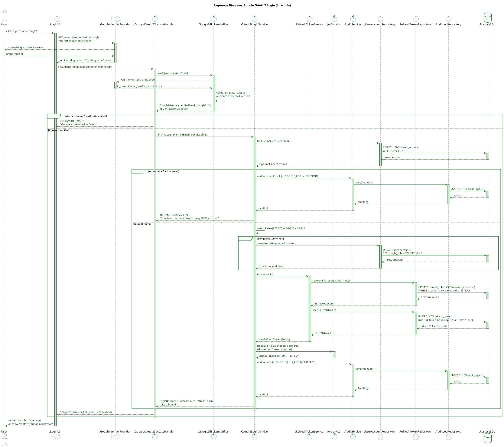

**Description:**  
Implements Google OAuth2 Authorization Code flow via Spring Security OAuth2 Client (ADR-M05). The flow is link-only (BR-218): Google login is only permitted for accounts that already exist in the system with a matching verified email. A first-time Google login stores the `googleSub` field on the account. No new accounts are ever auto-created. The same JWT + sliding refresh token scheme applies (BR-004). Token exchange failures (Google-side errors) return IAM-103.

---

### 1.4 Sequence Diagram — Refresh Token (BR-004 v1.9)

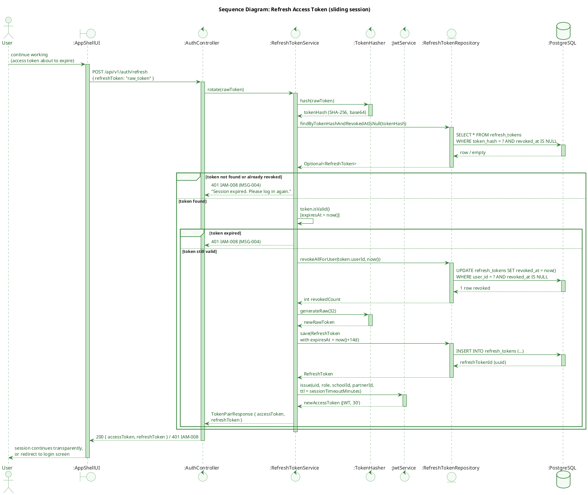

**Description:**  
Implements the sliding refresh token mechanism (BR-004 v1.9). Each call to `/auth/refresh` performs token rotation: the old token is immediately revoked, and a new one is issued with a fresh 14-day expiry. This prevents token reuse after rotation. The access JWT is reissued with a new 30-minute TTL. If the token is expired, revoked, or not found, the client must perform a full login.

---

### 1.5 Sequence Diagram — Logout (UC-035)

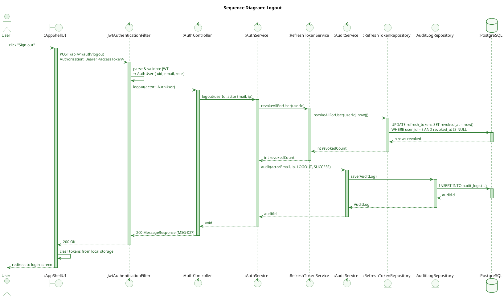

**Description:**  
Logout is stateless on the access token side (JWT is not blocklisted), but the refresh token is immediately revoked in the database, preventing any future token refresh. The `userId` is read from the JWT claims — never trusted from the request body (BR-007, AP-AI-006). An audit record is appended.

---

### 1.6 State Diagram — Refresh Token (Session) Lifecycle

```plantuml
@startuml MF01_RefreshToken_StateDiagram
title State Diagram: Refresh Token Lifecycle

' Bật chế độ liên kết vuông góc (Orthogonal lines)
skinparam linetype ortho

' ==========================================
' CẤU HÌNH MÀU SẮC TÔNG XANH LÁ
' ==========================================
skinparam backgroundColor #FFFFFF

' ==========================================
' State
' ==========================================
skinparam state {
    BackgroundColor #F4FBF4
    BorderColor #2E7D32
    FontColor #212121
    FontName Arial
    FontSize 13
}

' ==========================================
' Arrow
' ==========================================
skinparam arrow {
    Color #2E7D32
    FontColor #1B5E20
    FontName Arial
    FontSize 12
}

' ==========================================
' Note
' ==========================================
skinparam note {
    BackgroundColor #E8F5E9
    BorderColor #2E7D32
    FontColor #212121
    FontName Arial
    FontSize 12
}

' ==========================================
' Start / End
' ==========================================
skinparam startColor #2E7D32
skinparam endColor #2E7D32

[*] --> ACTIVE : login

ACTIVE --> ACTIVE : refresh
ACTIVE --> EXPIRED : 14 days elapsed

ACTIVE --> REVOKED : logout
ACTIVE --> REVOKED : login elsewhere
ACTIVE --> REVOKED : account deactivated
ACTIVE --> REVOKED : password changed

REVOKED --> [*] : reuse
EXPIRED --> [*] : reuse

@enduml
```

**Description:**  
The refresh token is the only server-side session state in MF01 — the access JWT itself is never blocklisted. A token is born `ACTIVE` at login with a 14-day expiry and stays `ACTIVE` across refreshes, but each refresh is a *rotation*: the presented row is revoked and a replacement row is inserted with a fresh +14-day window (BR-004 v1.9), so a stolen token stops working as soon as the legitimate client refreshes. `REVOKED` is reached by five distinct events — logout, a competing login (BR-005 single-session), admin deactivation/suspension, and any password change or reset — all implemented through the same `RefreshTokenRepository.revokeAllForUser(userId, now())` call. Both `REVOKED` and `EXPIRED` are terminal: `findByTokenHashAndRevokedAtIsNull` no longer matches the row, so the client receives 401 `IAM-008` (MSG-004) and must log in again.

---

### 1.7 State Diagram — Login Attempt & Account Lockout (BR-002)

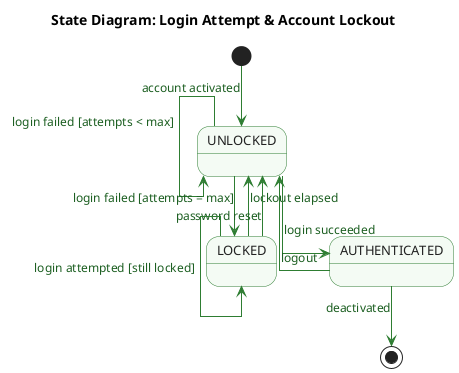

**Description:**  
This state machine is the per-account view of BR-002 and lives in the `failed_login_count` / `locked_until` columns of `user_accounts`. Every failed BCrypt comparison in §1.2 increments the counter; crossing `policy.maxLoginAttempts` stamps `locked_until = now() + policy.lockoutMinutes` and writes a `BLOCKED` audit record. While `LOCKED`, the credentials are never even checked — the service short-circuits with 423 `IAM-007` (MSG-076) carrying `minutesRemaining`, which also means a correct password does not unlock the account early. The lock clears in exactly two ways: the clock passing `locked_until`, or a completed password reset (UC-032), both of which reset the counter to zero. Note the thresholds are policy-driven (`SecurityPolicyProvider`), so tightening them is a configuration change, not a code change.

---

## 2. Password Management

### 2.1 Class Diagram

```plantuml
@startuml MF01_Password_ClassDiagram
title Design-level Class Diagram: Password Lifecycle Management

' ==========================================
' CẤU HÌNH BỐ CỤC VÀ MÀU SẮC RATIONAL ROSE
' ==========================================
skinparam classAttributeIconSize 0
skinparam linetype ortho
skinparam nodesep 60
skinparam ranksep 60
skinparam backgroundColor #FFFFFF

' Định dạng cho Class / Interface / Abstract Class
skinparam class {
    BackgroundColor #F4FBF4
    BorderColor #2E7D32
    FontColor #212121
    FontName Arial
    FontSize 13

    HeaderBackgroundColor #4CAF50
    HeaderFontColor #FFFFFF

    AttributeFontColor #212121
    AttributeFontName Arial
    AttributeFontSize 12
}

skinparam interface {
    BackgroundColor #f7ed93ff
    BorderColor #000000ff
    FontColor #000000ff
    FontName Arial
}

' Định dạng Mũi tên & Liên kết (Relationships & Arrows)
skinparam arrow {
    Color #162c00ff
    FontColor #162c00ff
    FontName Arial
    FontSize 11
}

' Định dạng Icon Stereotype (C, I, A, E)
skinparam stereotype {
    CBackgroundColor #f6eedcff
    CBorderColor #000000ff
    EBackgroundColor #f6eedcff
    EBorderColor #000000ff
    ABackgroundColor #f6eedcff
    ABorderColor #000000ff
    IBackgroundColor #f6eedcff
    IBorderColor #000000ff
}

hide empty members

interface IPasswordResetService {
  +request(email : String) : void
  +reset(token : String, newPassword : String) : void
}

interface IAccountService {
  +changePassword(userId : UUID, current : String, newPwd : String) : void
}

interface IAccountActivationService {
  +activate(token : String, newPassword : String) : void
  +resend(userId : UUID) : void
}

class PasswordResetService {
  -userRepo : UserAccountRepository
  -tokenRepo : PasswordResetTokenRepository
  -historyRepo : PasswordHistoryRepository
  -policyRepo : SecurityPolicyRepository
  -emailService : EmailService
  +request(email) : void
  +reset(token, newPassword) : void
  -validatePolicy(raw) : void
  -checkHistory(userId, raw) : void
}

class AccountService {
  -userRepo : UserAccountRepository
  -historyRepo : PasswordHistoryRepository
  -policyRepo : SecurityPolicyRepository
  -tokenRepo : RefreshTokenRepository
  +changePassword(userId, current, newPwd) : void
}

class AccountActivationService {
  -userRepo : UserAccountRepository
  -tokenRepo : AccountActivationTokenRepository
  -emailService : EmailService
  +activate(token, newPassword) : void
  +resend(userId) : void
}

class PasswordHistory {
  +id : UUID <<PK>>
  +userId : UUID <<FK>>
  +passwordHash : String
  +createdAt : Instant
}

class PasswordResetToken {
  +id : UUID <<PK>>
  +userId : UUID <<FK>>
  +tokenHash : String <<unique>>
  +expiresAt : Instant
  +usedAt : Instant
  +isExpired() : boolean
  +consume() : void
}

class AccountActivationToken {
  +id : UUID <<PK>>
  +userId : UUID <<FK>>
  +tokenHash : String <<unique>>
  +expiresAt : Instant
  +usedAt : Instant
  +isExpired() : boolean
  +consume() : void
}

class SecurityPolicy {
  +passwordMinLength : int
  +requireSpecialChar : boolean
  +requireNumber : boolean
  +requireMixedCase : boolean
  +noReuseLast3 : boolean
  +validatePassword(raw) : List<String>
}

class AuthController <<@RestController>> {
  -passwordResetService : IPasswordResetService
  -activationService : IAccountActivationService
  +forgotPassword(request : ForgotPasswordRequest) : ResponseEntity<MessageResponse>
  +resetPassword(request : ResetPasswordRequest) : ResponseEntity<MessageResponse>
  +activate(request : ActivateRequest) : ResponseEntity<MessageResponse>
  +resendActivation(request : ResendActivationRequest) : ResponseEntity<MessageResponse>
}

class AccountController <<@RestController>> {
  -accountService : IAccountService
  +changePassword(actor : AuthUser,\nrequest : ChangePasswordRequest) : ResponseEntity<MessageResponse>
}

class PasswordPolicyValidator <<@Component>> {
  -securityPolicyProvider : SecurityPolicyProvider
  +validate(raw : String) : List<String>
}

class PasswordHistoryService <<@Service>> {
  -passwordHistoryRepository : PasswordHistoryRepository
  +assertNotReused(userId : UUID, raw : String) : void
  +append(userId : UUID, hash : String) : void
  -pruneBeyondLast3(userId : UUID) : void
}

class TokenHasher <<@Component>> {
  +hash(rawToken : String) : String
  +generateRaw(bytes : int) : String
}

class EmailService <<@Service>> {
  +sendResetEmail(email : String, rawToken : String) : void
  +sendActivationEmail(email : String, rawToken : String) : void
}

interface UserAccountRepository <<@Repository>> {
  +findByEmail(email : String) : Optional<UserAccount>
  +save(user : UserAccount) : UserAccount
}

interface PasswordResetTokenRepository <<@Repository>> {
  +findByTokenHash(tokenHash : String) : Optional<PasswordResetToken>
  +findFirstByUserIdOrderByCreatedAtDesc(userId : UUID) : Optional<PasswordResetToken>
  +invalidateAllForUser(userId : UUID, now : Instant) : int
  +save(token : PasswordResetToken) : PasswordResetToken
}

interface AccountActivationTokenRepository <<@Repository>> {
  +findByTokenHash(tokenHash : String) : Optional<AccountActivationToken>
  +invalidateAllForUser(userId : UUID, now : Instant) : int
  +save(token : AccountActivationToken) : AccountActivationToken
}

interface PasswordHistoryRepository <<@Repository>> {
  +findTop3ByUserIdOrderByCreatedAtDesc(userId : UUID) : List<PasswordHistory>
  +countByUserId(userId : UUID) : long
  +deleteOlderThan(userId : UUID, keepIds : List<UUID>) : int
  +save(row : PasswordHistory) : PasswordHistory
}

interface RefreshTokenRepository <<@Repository>> {
  +revokeAllForUser(userId : UUID, now : Instant) : int
}

class ResetPasswordRequest <<DTO>> {
  +token : String
  +newPassword : String
}

class ChangePasswordRequest <<DTO>> {
  +currentPassword : String
  +newPassword : String
}

class ActivateRequest <<DTO>> {
  +token : String
  +newPassword : String
}

IPasswordResetService <|.. PasswordResetService
IAccountService <|.. AccountService
IAccountActivationService <|.. AccountActivationService

AuthController --> IPasswordResetService : delegates
AuthController --> IAccountActivationService : delegates
AccountController --> IAccountService : delegates
AuthController ..> ResetPasswordRequest : consumes
AuthController ..> ActivateRequest : consumes
AccountController ..> ChangePasswordRequest : consumes

PasswordResetService --> UserAccountRepository : reads / updates
PasswordResetService --> PasswordResetTokenRepository : issues / consumes
PasswordResetService --> PasswordPolicyValidator : validates (BR-006)
PasswordResetService --> PasswordHistoryService : checks last 3 (BR-015)
PasswordResetService --> RefreshTokenRepository : revokes sessions
PasswordResetService --> TokenHasher : SHA-256
PasswordResetService --> EmailService : sends reset link

AccountService --> UserAccountRepository : reads / updates
AccountService --> PasswordPolicyValidator : validates (BR-006)
AccountService --> PasswordHistoryService : checks & appends
AccountService --> RefreshTokenRepository : revokes sessions

AccountActivationService --> UserAccountRepository : activates account
AccountActivationService --> AccountActivationTokenRepository : issues / consumes
AccountActivationService --> PasswordPolicyValidator : validates (BR-006)
AccountActivationService --> TokenHasher : SHA-256
AccountActivationService --> EmailService : sends activation link

PasswordPolicyValidator --> SecurityPolicy : reads thresholds
PasswordHistoryService --> PasswordHistoryRepository : reads / appends

PasswordResetTokenRepository ..> PasswordResetToken : <<manages>>
AccountActivationTokenRepository ..> AccountActivationToken : <<manages>>
PasswordHistoryRepository ..> PasswordHistory : <<manages>>
@enduml
```

**Description:**  
Three dedicated services handle the password lifecycle: `PasswordResetService` (forgot password flow, UC-032), `AccountService` (change password while logged in, UC-011), and `AccountActivationService` (initial password setup, UC-154). The two `<<@RestController>>` entry points are `AuthController` (unauthenticated: forgot / reset / activate / resend) and `AccountController` (authenticated: change password). All three services delegate policy enforcement to the same two collaborators rather than duplicating rules — `PasswordPolicyValidator`, which reads its thresholds from `SecurityPolicy` (BR-006), and `PasswordHistoryService`, which reads the last three hashes through `PasswordHistoryRepository` to block reuse (BR-015) and prunes anything older. Both token repositories (`PasswordResetTokenRepository`, `AccountActivationTokenRepository`) expose the same `findByTokenHash` / `invalidateAllForUser` pair, because the tokens share one lifecycle (§2.4): single-use, TTL-bounded, and stored only as a SHA-256 hash produced by `TokenHasher`.

---

### 2.2 Sequence Diagram — Forgot Password (UC-032)

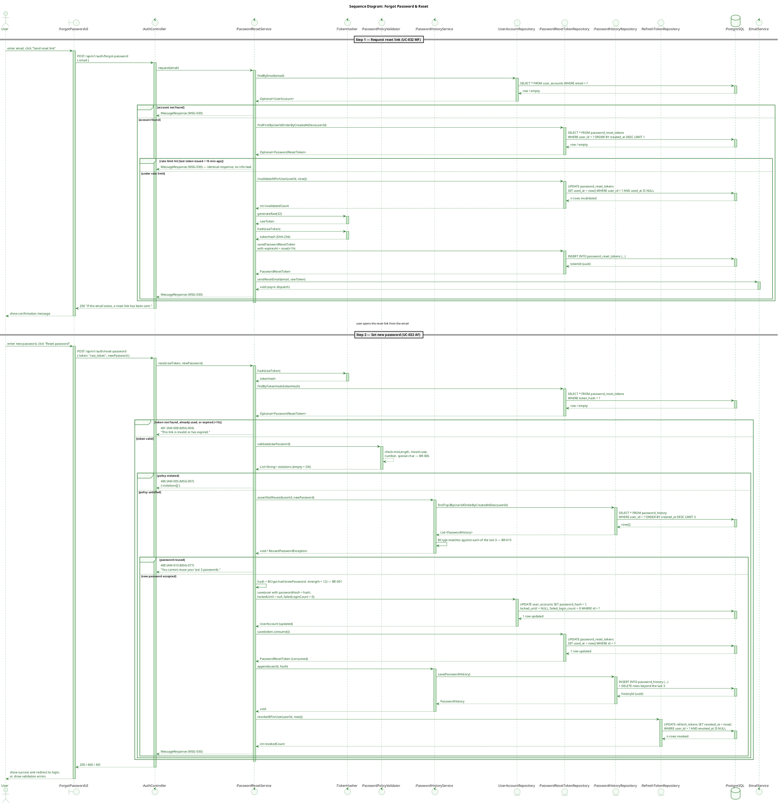

**Description:**  
The forgot password flow is designed to prevent email enumeration — the API always returns 200 regardless of whether the email exists. Rate-limiting prevents abuse (max 1 request per 15 minutes per email, BR-003). The raw token is emailed; only its SHA-256 hash is stored. On reset, the token is validated (1-hour TTL), the password policy and history are checked (BR-006, BR-015), then the hash is stored and all existing refresh tokens revoked.

---

### 2.3 Sequence Diagram — Account Activation & Set Password (UC-154)

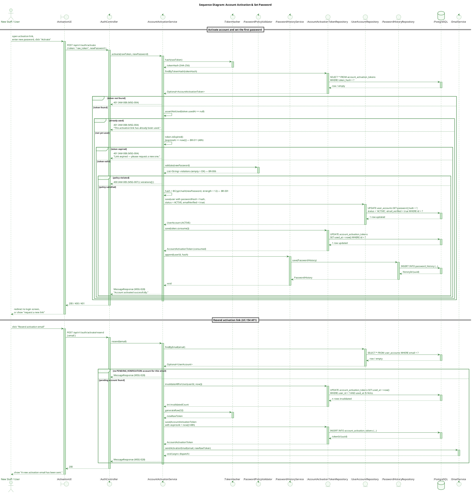

**Description:**  
New accounts start in `PENDING_VERIFICATION` status with no password set (ADR-M03). The activation token (48-hour TTL, BR-011) is emailed upon account creation. This is the only way to set a password for a new account. On successful activation, the account transitions to `ACTIVE` and `email_verified = true`. If the token expires, the user can request a resend, which generates a fresh 48-hour token and invalidates the old one.

---

### 2.4 State Diagram — One-Time Token Lifecycle (activation & password reset)

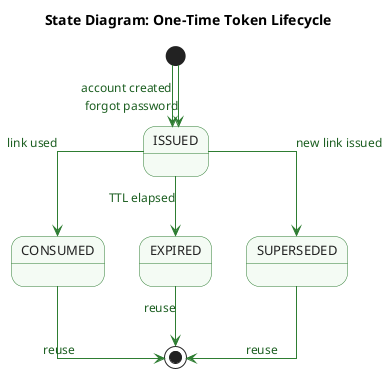

**Description:**  
`account_activation_tokens` and `password_reset_tokens` share one lifecycle, which is why they share one state machine — the only differences are the TTL (48 hours for activation, BR-011; 1 hour for reset, BR-003) and the entry event. The `ISSUED` state is represented in the database by `used_at IS NULL AND expires_at > now()`; every other state is a way of failing that predicate, and all three terminal states are indistinguishable to the caller — they all return 401 `IAM-008` (MSG-004) so an attacker cannot tell a consumed token from an expired or superseded one. `SUPERSEDED` exists because issuing a replacement always calls `invalidateAllForUser` first, guaranteeing at most one usable link per user and closing the window where an old email could still be redeemed. Only the SHA-256 hash is ever persisted; the raw token lives only in the email.

---

## 3. User & Staff Account Management

### 3.1 Class Diagram

```plantuml
@startuml MF01_UserManagement_ClassDiagram
title Design-level Class Diagram: User, Staff & Profile Management

' ==========================================
' CẤU HÌNH BỐ CỤC VÀ MÀU SẮC RATIONAL ROSE
' ==========================================
skinparam classAttributeIconSize 0
skinparam linetype ortho
skinparam nodesep 60
skinparam ranksep 60
skinparam backgroundColor #FFFFFF

' Định dạng cho Class / Interface / Abstract Class
skinparam class {
    BackgroundColor #F4FBF4
    BorderColor #2E7D32
    FontColor #212121
    FontName Arial
    FontSize 13

    HeaderBackgroundColor #4CAF50
    HeaderFontColor #FFFFFF

    AttributeFontColor #212121
    AttributeFontName Arial
    AttributeFontSize 12
}

skinparam interface {
    BackgroundColor #f7ed93ff
    BorderColor #000000ff
    FontColor #000000ff
    FontName Arial
}

' Định dạng Mũi tên & Liên kết (Relationships & Arrows)
skinparam arrow {
    Color #162c00ff
    FontColor #162c00ff
    FontName Arial
    FontSize 11
}

' Định dạng Icon Stereotype (C, I, A, E)
skinparam stereotype {
    CBackgroundColor #f6eedcff
    CBorderColor #000000ff
    EBackgroundColor #f6eedcff
    EBorderColor #000000ff
    ABackgroundColor #f6eedcff
    ABorderColor #000000ff
    IBackgroundColor #f6eedcff
    IBorderColor #000000ff
}

hide empty members

interface IUserService {
  +create(cmd : CreateUserCommand, actor : Principal) : UserAccount
  +toggleStatus(userId : UUID, active : boolean, actor : Principal) : UserAccount
  +list(query : ListQuery, actor : Principal) : PagedResponse<UserAccount>
  +getById(code : String) : UserAccount
}

interface IStaffService {
  +create(cmd : CreateStaffCommand, actor : Principal) : UserAccount
  +toggleStatus(staffId : UUID, active : boolean, actor : Principal) : UserAccount
  +list(query : ListQuery, actor : Principal) : PagedResponse<UserAccount>
}

interface IProfileService {
  +getHub(userId : UUID) : ProfileDto
  +update(userId : UUID, cmd : UpdateProfileCommand) : ProfileDto
  +getById(code : String) : ProfileDto
}

class UserService {
  -userRepo : UserAccountRepository
  -roleRepo : RoleRecordRepository
  -tokenRepo : RefreshTokenRepository
  -activationService : IAccountActivationService
  -auditService : AuditService
  +create(cmd, actor) : UserAccount
  +toggleStatus(userId, active, actor) : UserAccount
  +list(query, actor) : PagedResponse<UserAccount>
}

class StaffService {
  -userRepo : UserAccountRepository
  -tokenRepo : RefreshTokenRepository
  -activationService : IAccountActivationService
  -auditService : AuditService
  +create(cmd, actor) : UserAccount
  +toggleStatus(staffId, active, actor) : UserAccount
  +list(query, actor) : PagedResponse<UserAccount>
}

class ProfileService {
  -userRepo : UserAccountRepository
  +getHub(userId) : ProfileDto
  +update(userId, cmd) : ProfileDto
  +getById(code) : ProfileDto
}

class UserAccount {
  +id : UUID <<PK>>
  +name : String
  +email : String
  +phone : String
  +roleId : UUID
  +schoolId : UUID
  +partnerId : UUID
  +status : UserStatus
  +emailVerified : boolean
  +lastLogin : Instant
  +createdAt : Instant
}

class AuditLog <<immutable>> {
  +id : UUID <<PK>>
  +timestamp : Instant
  +actor : String
  +action : String
  +resource : String
  +result : String
}

class UserController <<@RestController>> {
  -userService : IUserService
  -userMapper : UserMapper
  +create(request : CreateUserRequest) : ResponseEntity<UserResponse>
  +toggleStatus(code : String,\nrequest : ToggleStatusRequest) : ResponseEntity<UserResponse>
  +list(page, pageSize, search, filters) : ResponseEntity<PagedResponse<UserResponse>>
  +detail(code : String) : ResponseEntity<UserResponse>
}

class StaffController <<@RestController>> {
  -staffService : IStaffService
  -userMapper : UserMapper
  +create(request : CreateStaffRequest) : ResponseEntity<UserResponse>
  +toggleStatus(code : String,\nrequest : ToggleStatusRequest) : ResponseEntity<UserResponse>
  +list(...) : ResponseEntity<PagedResponse<UserResponse>>
}

class ProfileController <<@RestController>> {
  -profileService : IProfileService
  +getHub(actor : AuthUser) : ResponseEntity<ProfileResponse>
  +update(actor : AuthUser,\nrequest : UpdateProfileRequest) : ResponseEntity<ProfileResponse>
}

class AccountCascadeHandler <<@Component>> {
  -userRepository : UserAccountRepository
  -refreshTokenRepository : RefreshTokenRepository
  +onPartnerSuspended(event : PartnerSuspended) : void
  +onPartnerRestored(event : PartnerRestored) : void
}

class UserSpec <<Specification>> {
  +bySchool(schoolId : UUID) : Specification<UserAccount>
  +byPartner(partnerId : UUID) : Specification<UserAccount>
  +byStatus(status : UserStatus) : Specification<UserAccount>
  +search(keyword : String) : Specification<UserAccount>
}

class UserMapper <<@Mapper MapStruct>> {
  +toResponse(entity : UserAccount) : UserResponse
  +toResponseList(entities : List<UserAccount>) : List<UserResponse>
  +toProfile(entity : UserAccount) : ProfileResponse
}

interface UserAccountRepository <<@Repository>> {
  +findByCode(code : String) : Optional<UserAccount>
  +findByStaffCode(staffCode : String) : Optional<UserAccount>
  +findByEmail(email : String) : Optional<UserAccount>
  +existsByEmail(email : String) : boolean
  +findAllBySchoolId(schoolId : UUID) : List<UserAccount>
  +findAllByPartnerId(partnerId : UUID) : List<UserAccount>
  +findAll(spec : Specification<UserAccount>, page : Pageable) : Page<UserAccount>
  +save(user : UserAccount) : UserAccount
}

interface RoleRecordRepository <<@Repository>> {
  +findByRoleKey(roleKey : String) : Optional<RoleRecord>
  +findByCode(code : String) : Optional<RoleRecord>
}

interface RefreshTokenRepository <<@Repository>> {
  +revokeAllForUser(userId : UUID, now : Instant) : int
}

interface AuditLogRepository <<@Repository>> {
  +save(log : AuditLog) : AuditLog
}

class CreateUserRequest <<DTO>> {
  +name : String
  +email : String
  +phone : String
  +roleCode : String
  +schoolId : String
}

class UserResponse <<DTO>> {
  +id : String
  +name : String
  +email : String
  +role : String
  +schoolId : String
  +status : String
  +lastLogin : Instant
}

class ProfileResponse <<DTO>> {
  +id : String
  +name : String
  +email : String
  +phone : String
  +role : String
  +schoolName : String
}

interface IAccountActivationService {
  +issueAndSend(user : UserAccount) : void
  +resend(email : String) : void
}

class AuditService <<@Service>> {
  -auditLogRepository : AuditLogRepository
  +audit(actor, ip, action, resource, result) : AuditLog
}

enum UserStatus {
  PENDING_VERIFICATION
  ACTIVE
  INACTIVE
  SUSPENDED
}

IUserService <|.. UserService
IStaffService <|.. StaffService
IProfileService <|.. ProfileService

UserController --> IUserService : delegates
UserController --> UserMapper : maps
StaffController --> IStaffService : delegates
StaffController --> UserMapper : maps
ProfileController --> IProfileService : delegates
UserController ..> CreateUserRequest : consumes
UserMapper ..> UserResponse
UserMapper ..> ProfileResponse

UserService --> UserAccountRepository : creates / updates
UserService --> RoleRecordRepository : resolves role code
UserService --> RefreshTokenRepository : revokes sessions
UserService --> IAccountActivationService : sends activation email
UserService --> AuditService : appends
UserService --> UserSpec : builds filters

StaffService --> UserAccountRepository : creates / updates
StaffService --> RefreshTokenRepository : revokes sessions
StaffService --> IAccountActivationService : sends activation email
StaffService --> AuditService : appends
StaffService --> UserSpec : builds filters

ProfileService --> UserAccountRepository : reads / updates
AccountCascadeHandler --> UserAccountRepository : cascades partner suspension
AccountCascadeHandler --> RefreshTokenRepository : revokes sessions
AuditService --> AuditLogRepository : appends

UserAccountRepository ..> UserAccount : <<manages>>
AuditLogRepository ..> AuditLog : <<manages>>
UserAccount "1" -- "1" UserStatus
@enduml
```

**Description:**  
`UserService` handles platform-level user management (System Admin only, UC-026/003/153), while `StaffService` handles school-scoped staff (School Admin, BR-013, UC-024/002/144). Both services share the same `UserAccount` entity, the same `UserAccountRepository`, and the same status lifecycle (§5) — they differ only in the RBAC guard and the tenant filter they push into `UserSpec`. `ProfileService` provides self-service profile read/update (UC-059/097/138) for any authenticated user. Each service is fronted by its own `<<@RestController>>` (`UserController`, `StaffController`, `ProfileController`), and none of them return entities directly: `UserMapper` (MapStruct) converts `UserAccount` into `UserResponse` for admin screens and the narrower `ProfileResponse` for self-service. `AccountCascadeHandler` is the one component that changes account status without an HTTP request — it listens for MF04 partner events and drives the `ACTIVE ↔ SUSPENDED` transitions, revoking sessions as it goes.

---

### 3.2 Sequence Diagram — Create User Account (UC-026, System Admin)

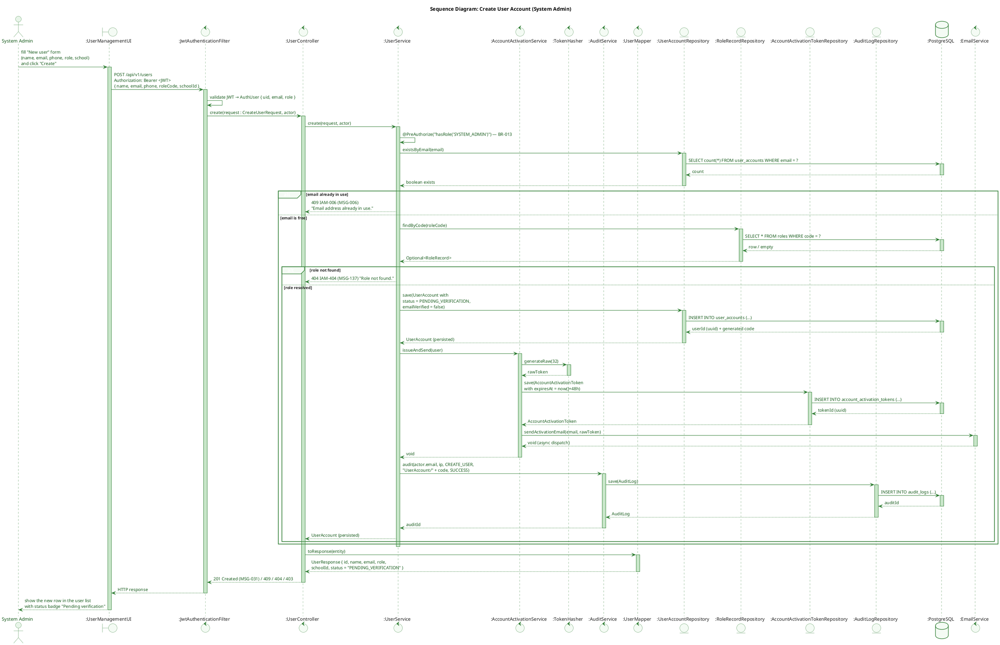

**Description:**  
Only System Admin can create platform-level user accounts (BR-013). The account is created with `PENDING_VERIFICATION` status and no password — the new user must complete the activation flow (UC-154) to set their password and activate the account. An activation email (48-hour token) is sent immediately after creation (BR-011).

---

### 3.3 Sequence Diagram — Activate / Deactivate User (UC-003)

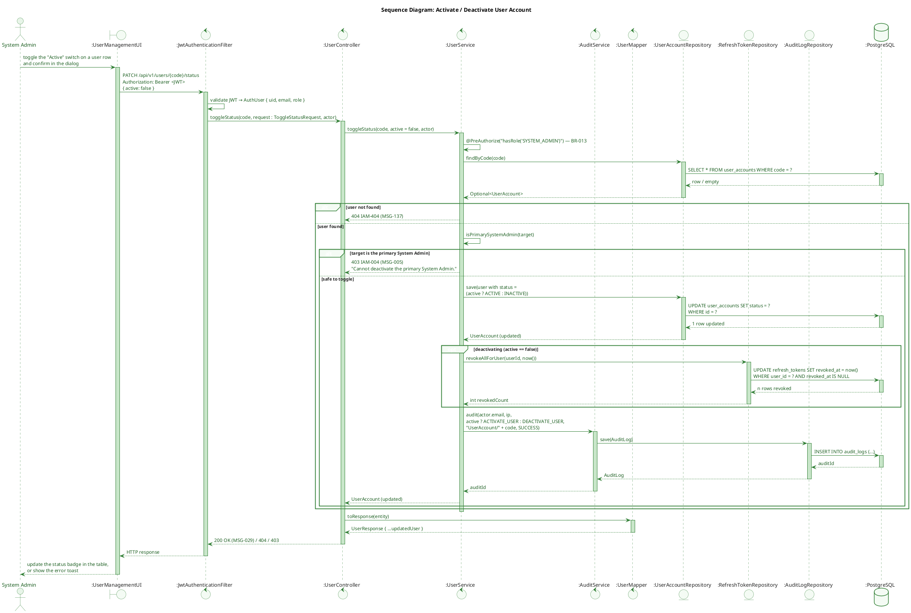

**Description:**  
Activating or deactivating a user account immediately revokes all refresh tokens for that user (BR-004), preventing any further use of existing sessions. The primary System Admin account cannot be deactivated (business safeguard). The `code` business identifier (D1) is used as the path parameter.

---

## 4. Role & Permission Management

### 4.1 Class Diagram

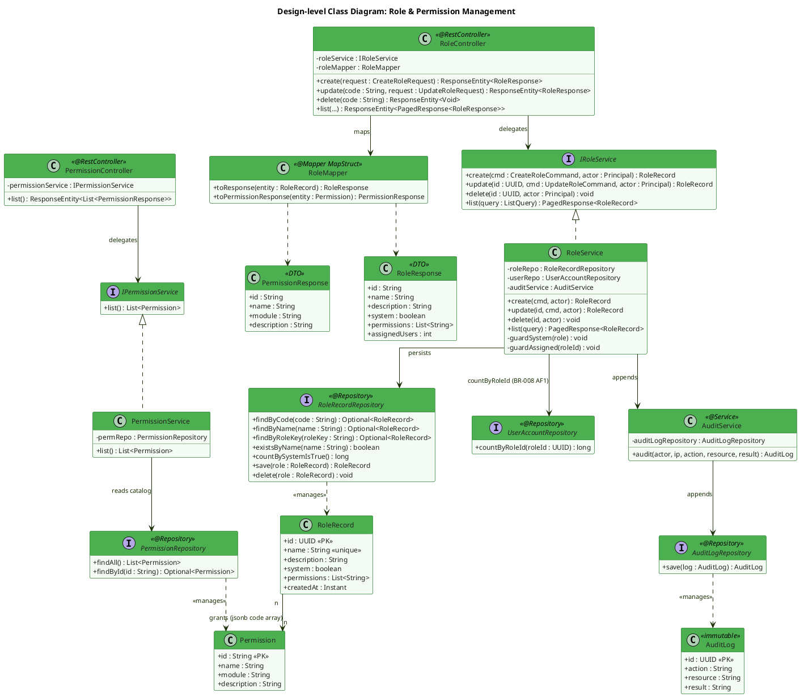

**Description:**  
Role management is restricted to System Admin (BR-007). The two guards in `RoleService` enforce BR-008: `guardSystem()` prevents any modification to system-seeded roles (`system=true`), and `guardAssigned()` prevents deletion of roles that still have users assigned — which is why `RoleService` depends on `UserAccountRepository.countByRoleId` and not only on its own repository. Permissions are a read-only catalog (UC-129): `PermissionRepository` exposes nothing but reads, and `PermissionController` publishes only a `list()` endpoint — there are no create/update/delete routes. The link between the two is not a foreign key: `RoleRecord.permissions` is a JSONB array of `Permission.id` codes, so the many-to-many association shown here is enforced in the service layer, not by the database.

---

### 4.2 Sequence Diagram — Delete Role (UC-029)

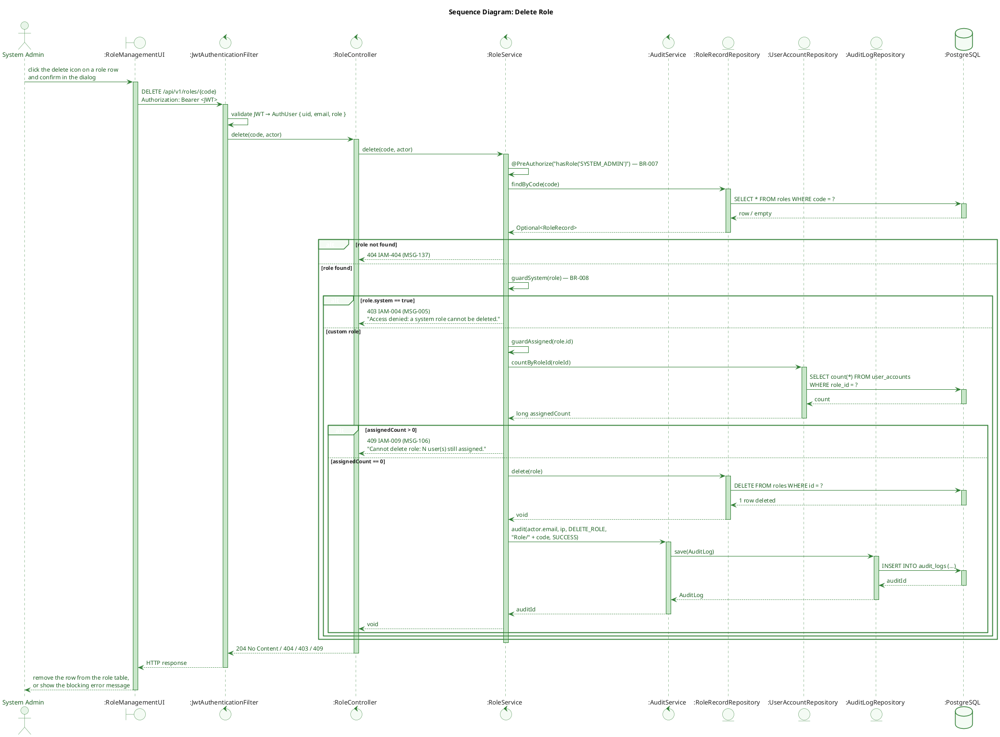

**Description:**  
Role deletion enforces two guards from BR-008: system-seeded roles (7 built-in roles) are permanently protected from deletion, and custom roles can only be deleted when no users — active or inactive — are assigned to them. This ensures referential integrity without a database foreign key between the `audit_logs` immutable table and `roles`.

---

### 4.3 State Diagram — Role Lifecycle (BR-008)

```plantuml
@startuml MF01_Role_StateDiagram
title State Diagram: Role Lifecycle

' Bật chế độ liên kết vuông góc (Orthogonal lines)
skinparam linetype ortho

' ==========================================
' CẤU HÌNH MÀU SẮC TÔNG XANH LÁ
' ==========================================
skinparam backgroundColor #FFFFFF

' ==========================================
' State
' ==========================================
skinparam state {
    BackgroundColor #F4FBF4
    BorderColor #2E7D32
    FontColor #212121
    FontName Arial
    FontSize 13
}

' ==========================================
' Arrow
' ==========================================
skinparam arrow {
    Color #2E7D32
    FontColor #1B5E20
    FontName Arial
    FontSize 12
}

' ==========================================
' Note
' ==========================================
skinparam note {
    BackgroundColor #E8F5E9
    BorderColor #2E7D32
    FontColor #212121
    FontName Arial
    FontSize 12
}

' ==========================================
' Start / End
' ==========================================
skinparam startColor #2E7D32
skinparam endColor #2E7D32

state "SYSTEM (system = true)" as SYSTEM
state "UNASSIGNED (0 users)" as UNASSIGNED
state "ASSIGNED (n > 0 users)" as ASSIGNED

[*] --> SYSTEM : seeded at startup
[*] --> UNASSIGNED : create custom role

SYSTEM --> SYSTEM : rename or delete
SYSTEM --> SYSTEM : update permissions

UNASSIGNED --> ASSIGNED : assigned to a user
UNASSIGNED --> UNASSIGNED : update
UNASSIGNED --> [*] : delete

ASSIGNED --> UNASSIGNED : last user reassigned
ASSIGNED --> ASSIGNED : delete
ASSIGNED --> ASSIGNED : update

@enduml
```

**Description:**  
Roles have no `status` column — their "state" is derived from two facts: the `system` flag and the live result of `UserAccountRepository.countByRoleId`. That is exactly what the two guards in §4.2 test. Seeded roles land in `SYSTEM` and never leave it: `guardSystem` rejects both rename and delete with 403 `IAM-004`, so the seven built-in roles survive any admin mistake (BR-008). Custom roles oscillate between `UNASSIGNED` and `ASSIGNED` as users are created or reassigned, and only `UNASSIGNED` has an edge to the final state — `guardAssigned` returns 409 `IAM-009` (MSG-106) with the assigned-user count otherwise. The count deliberately includes `INACTIVE` and `SUSPENDED` users, since deactivating a user does not clear their `role_id`. Permission edits (UC-030/UC-129) are self-transitions available in every non-terminal state and never affect deletability.

---

## 5. Account Lifecycle State Machine

```plantuml
@startuml MF01_AccountStateMachine
title State Diagram: User Account Lifecycle

' Bật chế độ liên kết vuông góc (Orthogonal lines)
skinparam linetype ortho

' ==========================================
' CẤU HÌNH MÀU SẮC TÔNG XANH LÁ
' ==========================================
skinparam backgroundColor #FFFFFF

' ==========================================
' State
' ==========================================
skinparam state {
    BackgroundColor #F4FBF4
    BorderColor #2E7D32
    FontColor #212121
    FontName Arial
    FontSize 13
}

' ==========================================
' Arrow
' ==========================================
skinparam arrow {
    Color #2E7D32
    FontColor #1B5E20
    FontName Arial
    FontSize 12
}

' ==========================================
' Note
' ==========================================
skinparam note {
    BackgroundColor #E8F5E9
    BorderColor #2E7D32
    FontColor #212121
    FontName Arial
    FontSize 12
}

' ==========================================
' Start / End
' ==========================================
skinparam startColor #2E7D32
skinparam endColor #2E7D32

[*] --> PENDING_VERIFICATION : create account

PENDING_VERIFICATION --> PENDING_VERIFICATION : resend activation
PENDING_VERIFICATION --> ACTIVE : activate [token valid]
PENDING_VERIFICATION --> INACTIVE : deactivate

ACTIVE --> ACTIVE : login / logout
ACTIVE --> INACTIVE : deactivate
ACTIVE --> SUSPENDED : partner suspended

INACTIVE --> ACTIVE : reactivate
SUSPENDED --> ACTIVE : partner restored

@enduml
```

**Description:**  
The account lifecycle state machine (ADR-M03) defines the four values of `user_accounts.status` and is the authority behind every status check in the sequence diagrams above. New accounts always start in `PENDING_VERIFICATION` — enforced server-side in §3.2 regardless of any value in the request body — and the only way out is the activation flow of §2.3, which is also the only place a first password can be set. `SUSPENDED` is a cascade state driven by MF04 partner events through `AccountCascadeHandler`, never triggered directly by an admin; `INACTIVE` is the admin-controlled counterpart and is always reversible, since accounts are never hard-deleted. Every transition out of `ACTIVE` calls `revokeAllForUser`, so sessions die with the state change (BR-004/BR-005). Note what this machine deliberately does *not* model: temporary lockout after failed logins (BR-002) leaves `status = ACTIVE` and lives entirely in `locked_until` — see §1.7 — and session validity lives in `refresh_tokens` — see §1.6. Login of either kind is permitted only from `ACTIVE`; every other state returns 403 `IAM-003` (BR-010, BR-218).

---

*Document generated from TDS `SFMS-MF01-IMP-001 v2.0` (Approved 2026-07-31).*
