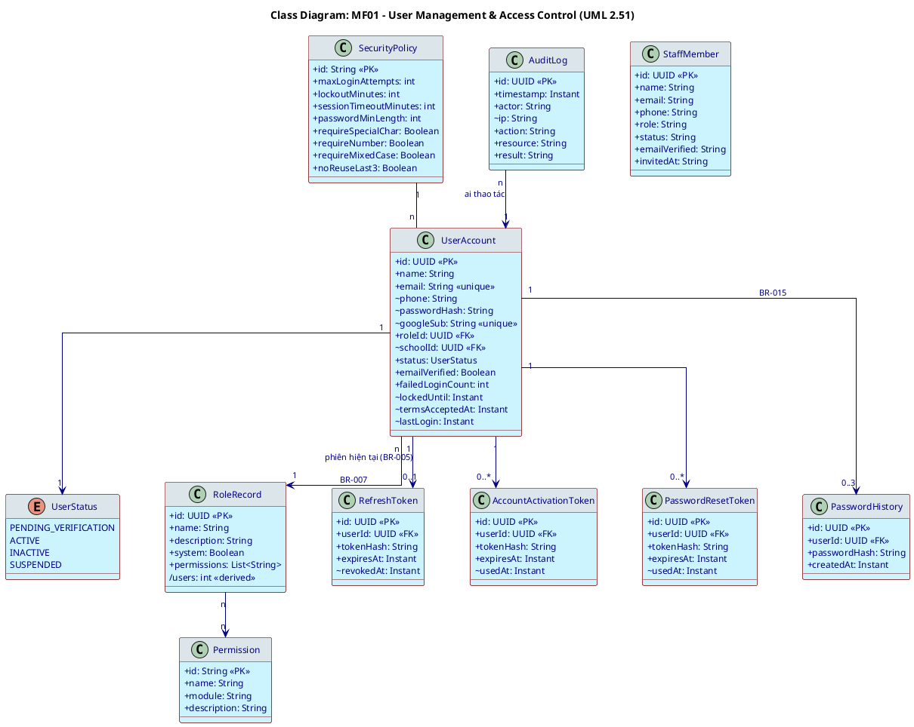
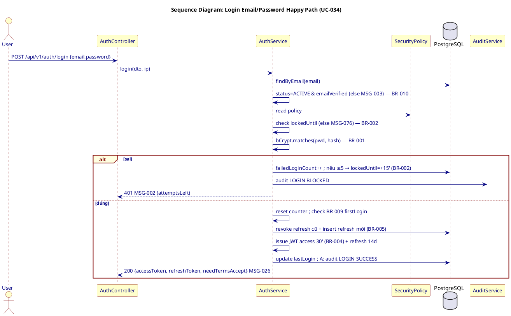
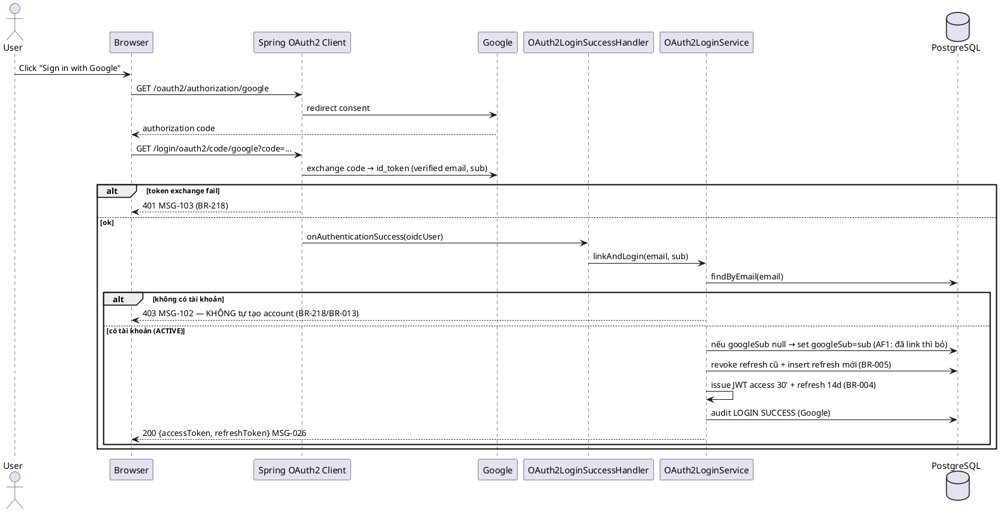
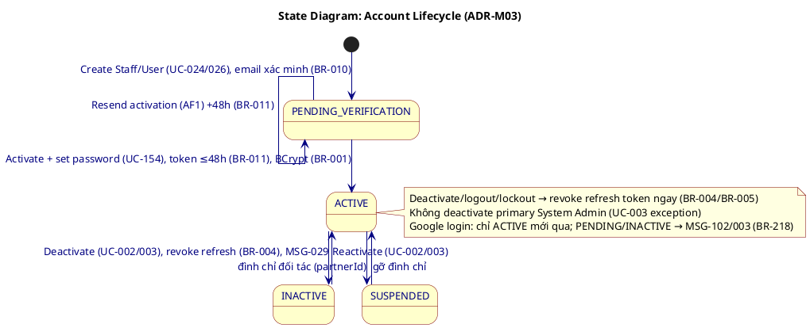

# ENGINEERING DOCUMENTATION STANDARD (EDS) v2.0 — TDS Backend
# MF01 — User Management & Access Control

| Field | Value |
|-------|-------|
| **Document ID** | `SFMS-MF01-IMP-001` |
| **Version** | `2.0` |
| **Date** | `2026-07-28` |
| **Status** | `Approved` |
| **Document Owner** | Nguyễn Văn Nam (NamNVHE180863) |
| **Author** | Nguyễn Văn Nam — Backend Dev (phụ trách School Admin & System Admin, giữ Flyway V1 + auth nền) |
| **Reviewed by** | Bùi Quang Huy (Traceability) · Nguyễn Đức Mạnh (Schema/API) · Trần Tuấn Minh (Interface) · Nguyễn Phương Thảo (TestSpec) — cả nhóm duyệt 2026-07-31 |
| **DPO Sign-off** | `[ ] Pending` *(module PII: email, SĐT, mật khẩu hash, googleSub)* |
| **Approved by** | Nguyễn Văn Nam — Final Approval, 2026-07-31 |
| **Last Review** | `2026-07-31` |
| **Based on EDS** | `v2.0` |

> **Stack (ADR-000 / `01_MVP_Backend_Implementation_Plan.md` §3):** Spring Boot **4.1.x (Java 25 LTS)** · PostgreSQL 16 · **Flyway** (V1 = toàn bộ schema, do Nam giữ) · **Spring Security + JWT** · **Spring Security OAuth2 Client** (Google) · springdoc-OpenAPI (Swagger) · MapStruct.
>
> **MF01 là module NỀN.** Pattern JWT + Refresh Token + BCrypt + RBAC 7 role + Google OAuth2 tại tài liệu này là **bản mẫu (convention)** cho 12 module còn lại copy. Xem §17 (AI Prompt Constraints).

---

## CHANGELOG

> **Policy 4.4 — Immutable History:** Không xóa thông tin cũ.

| Ngày | Người thực hiện | Nội dung thay đổi |
|------|-----------------|-------------------|
| 2026-07-28 | Nguyễn Văn Nam | Tạo bản đầu (v1.0). |
| 2026-07-28 | Nguyễn Văn Nam | **v2.0 — thay thế hoàn toàn v1.0.** (1) Chuyển toàn bộ ví dụ code từ TypeScript/Prisma (sai stack) sang **Java + JPA + Flyway SQL**. (2) Bổ sung **UC-191 Login with Google (OAuth2)** + **BR-218** + **MSG-102/MSG-103**. (3) Cập nhật **BR-004 v1.9**: access token 30' + refresh token sliding 14 ngày. Nguồn: UC file (sync 2026-07-28), traceability §1.1, business_rules v1.9, error_message, mock, data_model, ADR-000, MVP plan §3. |
| 2026-07-31 | Nguyễn Văn Nam | **Đóng §2 L3/L15 của TestSpec-MF01, chuyển Status → Approved** sau khi cả nhóm (Huy/Mạnh/Minh/Thảo) review OK. §9.2: `attemptsLeft` chuyển vào `details` (D2, 3 khóa đúng chuẩn). §10: bổ sung `IAM-404`/MSG-137 và `IAM-422`/MSG-138 (dùng chung mọi module). Mở khóa `MF01-TC-INT-002`, `INT-015`, `INT-016` của TestSpec-MF01. |

---

## MỤC LỤC

1. [Tổng quan Module](#1-tổng-quan-module) · 2. [Ma trận Truy vết](#2-ma-trận-truy-vết) · 3. [Architecture Decisions](#3-architecture-decisions-inline-adr) · 4. [NFR & SLA](#4-non-functional-requirements--sla) · 5. [Static Modeling](#5-static-modeling) · 6. [Dynamic Modeling](#6-dynamic-modeling) · 7. [Domain Event Catalog](#7-domain-event-catalog) · 8. [Interface Specification](#8-interface-specification) · 9. [API Specification](#9-api-specification) · 10. [Error Codes](#10-bảng-mã-lỗi) · 11. [Triển khai](#11-quy-trình-triển-khai) · 12. [Rollback Runbook](#12-rollback--incident-runbook) · 13. [Kiểm thử](#13-kịch-bản-kiểm-thử) · 14. [Xác minh](#14-phương-pháp-xác-minh) · 15. [API Samples](#15-mẫu-thử-thực-tế) · 16. [Authorization Matrix](#16-authorization-matrix) · 17. [AI Prompt Constraints](#17-ai-prompt-constraints-case-20)

---

## 1. Tổng quan Module

> MF01 quản lý vòng đời tài khoản, xác thực (login email/MK + **Google OAuth2**, logout, đổi/quên mật khẩu, kích hoạt), hồ sơ cá nhân, và RBAC (vai trò + quyền). Cổng vào của mọi actor SFMS.

| Field | Value |
|-------|-------|
| **Module Name** | User Management & Access Control (MF01) |
| **Bounded Context** | Identity & Access Management (IAM) |
| **Data Classification** | `PII` (email, SĐT, mật khẩu hash, googleSub, lastLogin, audit actor) |
| **Compliance Scope** | PDPD — theo ADR-000/ADR-001 |
| **Upstream Dependencies** | Email Service (SMTP); **Google OAuth2 Provider** (UC-191); MF02 School & Class (schoolId) |
| **Downstream Consumers** | **Toàn bộ 12 module còn lại** — tin cậy JWT (userId, role, schoolId) do MF01 phát hành; RBAC 7 role là nền chung |

**Phạm vi 20 Use Case (đúng traceability §1.1):** UC-034, UC-035, UC-011, UC-032, UC-154, UC-097, UC-059, UC-138, UC-024, UC-026, UC-002, UC-003, UC-022, UC-029, UC-098, UC-129, UC-130, UC-144, UC-153, **UC-191**.

**7 vai trò hệ thống (BR-007):** System Admin, School Administration, Medical Staff, Teacher, Parent, Raw Food Supplier, Service Caterers.

**Thư mục màn hình đã đọc (nguồn 6):** `(auth)/login`, `(auth)/forgot-password`, `(auth)/reset-password`, `(auth)/verify-otp`, `(auth)/register/{,school,supplier,caterer}`; `(app)/system-admin/{users,roles,permissions}`, `(app)/school-admin/staff`. **Ghi chú:** các màn `(auth)` hiện là mock chọn-vai-trò (Zustand), **chưa** nối backend; **không có nút "Sign in with Google"** — UC-191 là tính năng MỚI, chưa có trong mock.

---

## 2. Ma trận Truy vết

> **Nguồn:** cột BR/MSG lấy **nguyên văn** `traceability_matrix.md` §1.1; tên UC nguyên văn UC file (sync 2026-07-28); nội dung BR tra `business_rules.md` §1–2. **Policy:** chỉ dùng mã có trong §1.1, không bịa mã mới.

### 2.1. UC ↔ BR ↔ MSG ↔ Code

| UC ID | Tên UC (nguyên văn) | Business Rules (§1.1) | System Messages (§1.1) | Thành phần Code (Java) |
|-------|---------------------|-----------------------|------------------------|------------------------|
| UC-034 | Login | BR-002, BR-004, BR-005, BR-009, BR-010 | MSG-002, MSG-003, MSG-004, MSG-026, MSG-062, MSG-076 | `AuthService.login()`, `AuthController#login` |
| UC-191 | Login with Google (OAuth2) | BR-004, BR-005, BR-010, BR-218 | MSG-026, MSG-102, MSG-103 | `GoogleOAuth2SuccessHandler`, `OAuth2LoginService.linkAndLogin()` |
| UC-035 | Logout | BR-004 | MSG-004, MSG-005, MSG-027 | `AuthService.logout()` |
| UC-011 | Change Password | BR-001, BR-006, BR-007 | MSG-002, MSG-004, MSG-005, MSG-030, MSG-063 | `AccountService.changePassword()` |
| UC-032 | Forgot Password | BR-001, BR-003, BR-006 | MSG-003, MSG-030 | `PasswordResetService.request()/reset()` |
| UC-154 | Activate Account & Set Password | BR-010, BR-011 | MSG-028 | `AccountActivationService.activate()` |
| UC-097 | Update Profile | BR-012 | MSG-004, MSG-005, MSG-008, MSG-009, MSG-029 | `ProfileService.update()` |
| UC-059 | Profile Manage | BR-012 | MSG-004, MSG-005 | `ProfileService.getHub()` |
| UC-138 | View Profile | — | MSG-004, MSG-005 | `ProfileService.getById()` |
| UC-024 | Create Staff | BR-010, BR-012, BR-013 | MSG-004, MSG-005, MSG-006, MSG-031 | `StaffService.create()` |
| UC-026 | Create User | BR-008, BR-010, BR-012, BR-013 | MSG-004, MSG-005, MSG-006, MSG-031 | `UserService.create()` |
| UC-002 | Active/Deactivate Staff | BR-007, BR-008 | MSG-004, MSG-005, MSG-029 | `StaffService.toggleStatus()` |
| UC-003 | Active/Deactivate User | BR-007, BR-008 | MSG-004, MSG-005, MSG-029 | `UserService.toggleStatus()` |
| UC-022 | Create Role | BR-008 | MSG-004, MSG-005, MSG-031 | `RoleService.create()` |
| UC-029 | Delete Role | BR-008 | MSG-004, MSG-005 | `RoleService.delete()` |
| UC-098 | Update Role | BR-008 | MSG-004, MSG-005 | `RoleService.update()` |
| UC-129 | View List Permission | BR-007 | MSG-004, MSG-005 | `PermissionService.list()` |
| UC-130 | View List Role | BR-007, BR-008 | MSG-004, MSG-005 | `RoleService.list()` |
| UC-144 | View Staff Account List | BR-013 | MSG-004, MSG-005 | `StaffService.list()` (scope=school) |
| UC-153 | View User Account List | BR-007 | MSG-004, MSG-005 | `UserService.list()` (scope=platform) |

### 2.2. Business Rules — nội dung (nguyên văn `business_rules.md` §1–2, v1.9)

| BR | Tóm tắt | Ghi chú |
|----|---------|---------|
| BR-001 | Hash BCrypt trước khi lưu; không plain text | ADR-M02 |
| BR-002 | 5 sai liên tiếp → khóa 15'; ghi audit | — |
| BR-003 | Token quên MK 1 giờ; tối đa 1 req/15'/email | — |
| BR-004 | **(v1.9)** Access token **30'** + **Refresh token sliding 14 ngày** (tự gia hạn ngầm); refresh bị vô hiệu ngay khi logout / khóa BR-002 / deactivate / login thiết bị khác (BR-005) | ADR-M01 |
| BR-005 | Single Session — login mới vô hiệu phiên cũ (thay refresh token cũ) | — |
| BR-006 | Chính sách độ mạnh MK; không trùng 3 MK gần nhất (dẫn chiếu BR-015) | — |
| BR-007 | RBAC — quyền theo vai trò; 7 vai trò hệ thống | — |
| BR-008 | Role hệ thống mặc định bất khả xóa/sửa tên; role custom chỉ xóa khi 0 user gán (kể cả đã vô hiệu) | — |
| BR-009 | Lần login đầu phải chấp nhận Chính sách Bảo mật & Điều khoản | — |
| BR-010 | Chỉ login sau khi xác minh email; email Google coi như đã xác minh (BR-218) | — |
| BR-011 | Token kích hoạt 48 giờ; hết hạn gửi lại +48h | — |
| BR-012 | SĐT hợp lệ; email hợp lệ & duy nhất | — |
| BR-013 | Chỉ School Administration tạo staff (trường mình); System Admin tạo user toàn hệ thống | — |
| BR-218 | **(mới)** Google OAuth2 login — **chỉ liên kết tài khoản đã tồn tại** (match email), **KHÔNG tự tạo account mới**; lưu `googleSub` lần đầu; email Google thỏa BR-010; **không** áp BR-001/006/015 cho phiên Google | ADR-M05 |

### 2.3. ⚠️ Mâu thuẫn giữa các nguồn (ghi rõ, KHÔNG tự chọn bên đúng)

| # | Mô tả | Nguồn A | Nguồn B | Xử lý trong TDS |
|---|-------|---------|---------|-----------------|
| **CF-1** | **BR-015 (không dùng lại 3 MK gần nhất)** áp dụng cho đổi/quên MK (UC-011/032) và được BR-006 dẫn chiếu, nhưng **KHÔNG** xuất hiện trong cột Business Rules của UC-011/UC-032 tại traceability §1.1. | UC-011/032 logic + BR-006 body | traceability §1.1 (UC-011=BR-001/006/007; UC-032=BR-001/003/006) | §2.1 bám traceability (không thêm BR-015). BR-015 nêu như ràng buộc con của BR-006 (§2.2). **Không** tự sửa traceability_matrix.md — chờ Huy/Lead Traceability xác nhận. |
| **CF-2** | **UC-154 danh sách BR/MSG khác nhau** giữa file UC và traceability §1.1. UC file: BR-001, BR-006, BR-010, BR-011, BR-012 / MSG-031. traceability: **BR-010, BR-011 / MSG-028**. | UC file | traceability §1.1 | Dùng **traceability làm chuẩn** (BR-010, BR-011 / MSG-028) theo quy tắc nguồn. BR-001/006 vẫn áp ở tầng đặt mật khẩu (§6.3). Ghi rõ để Huy đối chiếu. |
| CF-3 | **UC-097 trích "BR-013" cho ràng buộc ảnh (JPG/PNG, 5MB)** nhưng BR-013 canonical = phân quyền tạo staff. traceability UC-097 chỉ ghi BR-012. | UC file narrative | business_rules BR-013 | §2.1 bám traceability (chỉ BR-012); ràng buộc ảnh coi là validation UI. |
| CF-4 | **MSG-008 nội dung = "exceeds 10MB"** nhưng UC-097 narrative nói ảnh tối đa **5MB**. | error_message MSG-008 | UC file | §10 giữ nguyên văn MSG-008 (10MB) + chú thích UC nói 5MB. |
| CF-5 | **Mock KHÔNG có `/auth/login` thật, không nút Google login** — chỉ role-picker Zustand; BR-002/004/006 đọc từ resource `security-policies`. | mock FE | UC-034/191, BR-004/218 | TDS đặc tả backend đầy đủ; §9 cột "Mock?" đánh dấu route chưa có mock. Google OAuth2 = phần MỚI, tự thiết kế theo BR-218/UC-191. |
| CF-6 | **MSG-029 dùng cho Active/Deactivate (UC-002/003)** nhưng nội dung MSG-029 = "Profile updated successfully." (ngữ nghĩa hồ sơ). | traceability §1.1 | error_message MSG-029 | Giữ MSG-029 theo traceability; ghi chú lệch ngữ nghĩa. |

---

## 3. Architecture Decisions (inline ADR)

> ### ⚠️ Quy ước chung bắt buộc — `07_implement/00_Common_Conventions.md` (D1–D7)
>
> Áp dụng **D1–D7** của `00_Common_Conventions.md` cho toàn bộ tài liệu này. Các ADR bên dưới chỉ ghi phần **riêng của module**; khi xung đột, thứ tự ưu tiên là: **`00_Common_Conventions.md` > ADR module (§3) > hợp đồng mock FE**.
>
> | | Quy ước | Ảnh hưởng tới tài liệu này |
> |---|---|---|
> | **D1** | `id` trong JSON **và** path param = **mã nghiệp vụ**; UUID chỉ là PK nội bộ | §5.2 phải có `code VARCHAR(32)` + `UNIQUE(school_id, code)`; §9.2 path param dùng `{code}` |
> | **D2** | Envelope lỗi `{ "error": { "code", "message", "details" } }` ở `@RestControllerAdvice` | §10 — mã module là `error.code` |
> | **D3** | `baseURL` = `/api/v1` | §9 — mọi path |
> | **D4** | JSON ngày/giờ **luôn ISO-8601** (`LocalDate` / `Instant`) | §9.2 — **bỏ** mọi `@JsonFormat("dd/MM/yyyy")` |
> | **D5** | Nhận `body.id` client gửi → kiểm trùng → **409**; vắng thì server sinh | §9.2 — mọi `POST` |
> | **D6** | 8 enum dùng chung ở `common/enums/`, tất cả **SCREAMING_SNAKE** | §5.1, §5.2, §9.2 — không tự khai lại enum đã có ở D6 |
> | **D7** | Backend trả `code` + `message` **tiếng Anh** (nguyên văn `error_message.md`); FE tra bảng nhãn | §10 |
>
> *Bổ sung 2026-07-29 theo `review.md` mục A — 7 mismatch xuyên module, phần lớn là lệch **giữa các TDS với nhau** chứ không phải lệch FE↔BE.*


> Theo nguồn 9: **KHÔNG tạo file ADR riêng cho MF01.** Quyết định kiến trúc riêng của MF01 viết inline dưới đây (Option/Decision/Rationale), trích lại stack/kiến trúc chung từ ADR-000. Trích ADR-000 §Constraint: *"BCrypt password hash (BR-001) và password policy (BR-006) PHẢI hoạt động đầy đủ trong dev profile."* + *"Mock external services PHẢI trả response đúng format contract."*

### ADR-M01 — JWT Access Token (30') + Refresh Token sliding 14 ngày (BR-004 v1.9)

| Option | Mô tả | Ưu | Nhược |
|--------|-------|----|-------|
| A ✅ | JWT access 30' (stateless) + **refresh token opaque** lưu DB (`refresh_tokens`, hash), sliding 14 ngày; single-session bằng 1 refresh token hợp lệ/user | Đúng BR-004 v1.9; revoke tức thì (logout/deactivate/BR-002); enforce BR-005 | Cần 1 bảng + lookup khi refresh |
| B | Pure stateless JWT dài hạn, không refresh | Đơn giản | Không revoke được, vi phạm BR-004/005 |
| C | Server session (cookie) thuần | Dễ revoke | Lệch stack JWT của ADR-000; khó cho Flutter |

**Decision:** **A.** Access token JWT TTL = `sessionTimeoutMinutes` (BR-004, mặc định 30' từ `SecurityPolicy`). Refresh token là chuỗi ngẫu nhiên ≥256-bit, lưu **hash** + `expiresAt` (=lần cấp/gia hạn gần nhất + 14 ngày). Mỗi lần dùng refresh token còn hạn → cấp access token mới **và** trượt `expiresAt` (sliding). Login mới ghi đè refresh token cũ của user (BR-005). Logout / deactivate (UC-002/003) / lockout (BR-002) → set `revokedAt` ngay.
**Rationale:** khớp đúng câu chữ BR-004 v1.9 ("tự gia hạn ngầm ... không phải login lại miễn mở app 1 lần/14 ngày").

### ADR-M02 — BCrypt + token 1 lần (reset 1h / activation 48h)

| Option | Mô tả | Ưu | Nhược |
|--------|-------|----|-------|
| A ✅ | `BCryptPasswordEncoder` (strength 12); reset/activation token lưu **hash**, dùng 1 lần; `password_history` giữ 3 hash (BR-015) | Đúng BR-001/003/011/015 | Thêm 3 bảng token/history |
| B | SHA-256 + salt tự quản | — | Lệch Spring Security default; rủi ro tự cài |

**Decision:** **A** (Spring Security `BCryptPasswordEncoder`). Reset token TTL 1h (BR-003), activation 48h (BR-011); rate-limit forgot-password 1 req/15'/email (BR-003). Không set password lúc tạo tài khoản — chỉ qua UC-154.

### ADR-M03 — Vòng đời tài khoản: PENDING_VERIFICATION → ACTIVE → INACTIVE/SUSPENDED

**Decision:** State machine §6.3. `status` = `PENDING_VERIFICATION | ACTIVE | INACTIVE | SUSPENDED` (khớp mock `UserAccount.status` = ACTIVE/SUSPENDED/INACTIVE + trạng thái PENDING của `StaffMember`). `SUSPENDED` = khóa tạm theo đình chỉ đối tác (`partnerId`); `INACTIVE` = ngừng do quản trị. **Rationale:** khớp field mock, không phát sinh field lạ.

### ADR-M04 — RBAC Role→Permission, bảo vệ role hệ thống ở tầng Service

**Decision:** giữ mô hình mock: `RoleRecord.permissions` = list PERM-id, cờ `system` bảo vệ role mặc định. Guard xóa role đúng như `mock-server.ts` (dòng 368–372): `system=true` → 403; `countByRoleId>0` → 409 (BR-008, AF1 UC-029). Danh mục 16 Permission cố định, chỉ đọc (UC-129).

### ADR-M05 — Google OAuth2 Authorization Code flow (link-only, BR-218) — phần MỚI, chưa có trong mock

| Option | Mô tả | Ưu | Nhược |
|--------|-------|----|-------|
| A ✅ | **Spring Security OAuth2 Client** (`spring-boot-starter-oauth2-client`), endpoint chuẩn `/oauth2/authorization/google` + callback `/login/oauth2/code/google`; custom `OAuth2LoginSuccessHandler` → match email → link `googleSub` → cấp JWT+refresh | Chuẩn Spring, không tự viết flow; đúng BR-218 | Cần cấu hình client-id/secret (ENV, BR-164) |
| B | Tự implement OAuth2 (gọi token endpoint tay) | Kiểm soát chi tiết | Vi phạm ràng buộc stack (không tự viết flow tay) |
| C | Thư viện Node (passport/next-auth) | — | Sai stack (Java) — loại |

**Decision:** **A.** Flow: `/oauth2/authorization/google` → Google consent → callback `/login/oauth2/code/google` → lấy verified email + `sub` → `UserRepository.findByEmail`. **Nếu không có tài khoản** → chặn, MSG-102 (KHÔNG tự tạo account — BR-218/BR-013). **Nếu có & chưa link** → lưu `googleSub` (AF1: đã link thì bỏ bước này). Cấp access+refresh (BR-004), ghi đè phiên cũ (BR-005), audit. Token exchange lỗi → MSG-103. **Không** áp BR-001/006/015 (không có MK cục bộ). **Rationale:** đúng câu chữ BR-218 + ràng buộc stack.

---

## 4. Non-Functional Requirements & SLA

### 4.1. Performance & Availability
| Category | Requirement | Target | Measurement |
|----------|-------------|--------|-------------|
| Latency | `POST /auth/login` p99 (gồm BCrypt) | < 400ms | k6 |
| Latency | `POST /auth/refresh` p99 | < 150ms | k6 |
| Latency | `GET /users` list p99 | < 300ms | k6 |
| Availability | Uptime auth endpoints | 99.9% | Uptime monitor |
| Throughput | Login đồng thời | 200 req/s | Load test |

### 4.2. Data Integrity & Retention
| Category | Requirement | Target | Basis |
|----------|-------------|--------|-------|
| Uniqueness | Email duy nhất | 100% | BR-012 |
| Uniqueness | `googleSub` duy nhất | 100% | BR-218 |
| Retention | Audit log auth | ≥ 12 tháng (downstream BR-171) | — |
| Append-only | Audit log bất biến | Không UPDATE/DELETE | BR-162 (downstream) |

### 4.3. Security
| Category | Requirement | Target | Basis |
|----------|-------------|--------|-------|
| Password at rest | BCrypt strength ≥ 12 | Không plain text | BR-001 |
| OAuth secret | client-id/secret trong ENV, mã hóa | Không hardcode | BR-164, ADR-000 |
| Transport | Mọi endpoint | TLS 1.3+ (Cloudflare) | ADR-001 |
| Account lockout | 5 sai → 15' | Server-side | BR-002 |
| Session | Access 30' + refresh 14d sliding + single session | DB `refresh_tokens` | BR-004, BR-005 |
| Access control | RBAC least-privilege | §16 | BR-007, BR-008 |

### 4.4. Scalability
> ~5.000 tài khoản (mock ~4.700 theo `ROLE_RECORDS.users`), ~15.000 login/ngày. Stateless JWT verify; refresh token lookup index `token_hash`. List phân trang mặc định `pageSize=8` (mock). Index `email`, `role_id`, `school_id`, `status`, `google_sub`.

---

## 5. Static Modeling

### 5.1. Class Diagram (PlantUML)

> Đồng bộ `data_model.puml` package "Tài khoản & Phân quyền" (`UserAccount`, `RoleRecord`, `Permission`, `SecurityPolicy`, `AuditLog`, `StaffMember`). Bổ sung entity backend chưa có trong mock/data_model: `RefreshToken`, `AccountActivationToken`, `PasswordResetToken`, `PasswordHistory` (+ cột `googleSub`, `passwordHash` trên `UserAccount`) — **phần MỚI của tầng backend**.



**Chú thích field → BR/UC (ánh xạ cho sơ đồ trên; comment không hiển thị trong ảnh render nên tách ra bảng):**

| Entity.field | Ý nghĩa / ràng buộc |
|--------------|---------------------|
| `UserAccount.email` `<<unique>>` | Email hợp lệ & duy nhất — BR-012 |
| `UserAccount.phone` | Định dạng +84 / 0xx — BR-012 |
| `UserAccount.passwordHash` | Hash BCrypt; null khi `PENDING_VERIFICATION` hoặc tài khoản Google-only — BR-001 |
| `UserAccount.googleSub` `<<unique>>` | Định danh Google, set lần đầu login Google — **BR-218 (MỚI)** |
| `UserAccount.roleId` | Vai trò RBAC — BR-007 |
| `UserAccount.schoolId` | Trường trực thuộc (nếu role cấp trường) — BR-013 |
| `UserAccount.emailVerified` | Chỉ login khi đã xác minh — BR-010 |
| `UserAccount.failedLoginCount` / `lockedUntil` | Đếm sai & khóa 15' — BR-002 |
| `UserAccount.termsAcceptedAt` | Chấp nhận điều khoản lần login đầu — BR-009 |
| `RoleRecord.system` | Role mặc định bất khả xóa/sửa tên — BR-008 |
| `SecurityPolicy.sessionTimeoutMinutes` | TTL access token (mặc định 30') — BR-004 |
| `SecurityPolicy.noReuseLast3` | Không dùng lại 3 MK gần nhất — BR-015 |
| `RefreshToken.expiresAt` | Sliding +14 ngày mỗi lần refresh — **BR-004 v1.9 (MỚI)** |
| `AccountActivationToken.expiresAt` | Hết hạn sau 48h — BR-011 |
| `PasswordResetToken.expiresAt` | Hết hạn sau 1h — BR-003 |
| `AuditLog.ip` | Cột IP bắt buộc — UC-106 |

### 5.2. Data Structure — JPA Entity + Flyway migration (Java 25 / Spring Boot 4.1)

> **Flyway `V1__init_schema.sql` do Nam giữ (MVP plan §3).** Dưới đây là entity MF01 + đoạn SQL tương ứng. **Không dùng Prisma.**

```java
// UserAccount.java
@Entity @Table(name = "user_accounts",
  indexes = { @Index(name="ix_user_email", columnList="email", unique=true),
              @Index(name="ix_user_google_sub", columnList="google_sub", unique=true),
              @Index(name="ix_user_role", columnList="role_id"),
              @Index(name="ix_user_status", columnList="status") })
public class UserAccount {
  @Id @GeneratedValue(strategy = GenerationType.UUID)
  private UUID id;
  @Column(nullable = false) private String name;
  @Column(nullable = false, unique = true) private String email;          // BR-012
  private String phone;                                                    // BR-012
  @Column(name = "password_hash") private String passwordHash;             // BR-001, null khi PENDING/Google-only
  @Column(name = "google_sub", unique = true) private String googleSub;    // BR-218 (MỚI)
  @Column(name = "role_id", nullable = false) private UUID roleId;         // BR-007
  @Column(name = "school_id") private UUID schoolId;                       // BR-013
  @Enumerated(EnumType.STRING) @Column(nullable = false)
  private UserStatus status = UserStatus.PENDING_VERIFICATION;
  @Column(name = "email_verified", nullable = false) private boolean emailVerified = false; // BR-010
  @Column(name = "failed_login_count", nullable = false) private int failedLoginCount = 0;  // BR-002
  @Column(name = "locked_until") private Instant lockedUntil;              // BR-002
  @Column(name = "terms_accepted_at") private Instant termsAcceptedAt;     // BR-009
  @Column(name = "last_login") private Instant lastLogin;
  @Column(name = "created_at", nullable = false) private Instant createdAt = Instant.now();
  @Column(name = "created_by") private String createdBy;
  // getters/setters...
}

// UserStatus.java
public enum UserStatus { PENDING_VERIFICATION, ACTIVE, INACTIVE, SUSPENDED }

// RefreshToken.java — MỚI, BR-004 v1.9
@Entity @Table(name = "refresh_tokens",
  indexes = { @Index(name="ix_rt_hash", columnList="token_hash", unique=true),
              @Index(name="ix_rt_user", columnList="user_id") })
public class RefreshToken {
  @Id @GeneratedValue(strategy = GenerationType.UUID) private UUID id;
  @Column(name = "user_id", nullable = false) private UUID userId;
  @Column(name = "token_hash", nullable = false, unique = true) private String tokenHash;
  @Column(name = "expires_at", nullable = false) private Instant expiresAt;  // sliding +14 ngày
  @Column(name = "revoked_at") private Instant revokedAt;
  @Column(name = "created_at", nullable = false) private Instant createdAt = Instant.now();
}
```

```sql
-- Trích V1__init_schema.sql (Flyway) — phần MF01
CREATE TABLE roles (
  id UUID PRIMARY KEY DEFAULT gen_random_uuid(),
  name VARCHAR(100) NOT NULL UNIQUE,
  description VARCHAR(255) NOT NULL,
  system BOOLEAN NOT NULL DEFAULT FALSE,          -- BR-008
  permissions JSONB NOT NULL DEFAULT '[]',
  created_at TIMESTAMPTZ NOT NULL DEFAULT now()
);
CREATE TABLE permissions (                          -- danh mục cố định, chỉ đọc (UC-129)
  id VARCHAR(20) PRIMARY KEY, name VARCHAR(80) NOT NULL UNIQUE,
  module VARCHAR(60) NOT NULL, description VARCHAR(255) NOT NULL
);
CREATE TABLE user_accounts (
  id UUID PRIMARY KEY DEFAULT gen_random_uuid(),
  name VARCHAR(150) NOT NULL,
  email VARCHAR(180) NOT NULL UNIQUE,               -- BR-012
  phone VARCHAR(20),                                -- BR-012
  password_hash VARCHAR(72),                        -- BR-001, nullable
  google_sub VARCHAR(64) UNIQUE,                    -- BR-218 (MỚI)
  role_id UUID NOT NULL REFERENCES roles(id),       -- BR-007
  school_id UUID,                                   -- BR-013
  partner_id UUID,                                  -- -> partners(id), MF04. NULL với tài khoản nội bộ trường.
                                                    -- Bổ sung 29/07/2026 (review mục B3): khóa cách ly dữ liệu
                                                    -- đa-tenant của NCC + là cơ chế DUY NHẤT để cascade đình chỉ
                                                    -- đối tác kéo theo khóa tài khoản (MF04 ADR-M04-6, U-0007/SUP-004).
  status VARCHAR(24) NOT NULL DEFAULT 'PENDING_VERIFICATION',
  email_verified BOOLEAN NOT NULL DEFAULT FALSE,    -- BR-010
  failed_login_count INT NOT NULL DEFAULT 0,        -- BR-002
  locked_until TIMESTAMPTZ,                          -- BR-002
  terms_accepted_at TIMESTAMPTZ,                     -- BR-009
  last_login TIMESTAMPTZ,
  created_at TIMESTAMPTZ NOT NULL DEFAULT now(),
  created_by VARCHAR(180)
);
CREATE INDEX ix_user_role ON user_accounts(role_id);
CREATE INDEX ix_user_status ON user_accounts(status);
CREATE INDEX ix_user_partner ON user_accounts(partner_id);   -- cascade đình chỉ NCC (MF04 ADR-M04-6)

CREATE TABLE security_policies (
  id VARCHAR(20) PRIMARY KEY,
  max_login_attempts INT NOT NULL,                  -- BR-002
  lockout_minutes INT NOT NULL,                     -- BR-002
  session_timeout_minutes INT NOT NULL,             -- BR-004 access TTL
  password_min_length INT NOT NULL,                 -- BR-006
  require_special_char BOOLEAN NOT NULL,
  require_number BOOLEAN NOT NULL,
  require_mixed_case BOOLEAN NOT NULL,
  no_reuse_last3 BOOLEAN NOT NULL,                  -- BR-015
  updated_at TIMESTAMPTZ, updated_by VARCHAR(180)
);
CREATE TABLE refresh_tokens (                        -- MỚI, BR-004 v1.9
  id UUID PRIMARY KEY DEFAULT gen_random_uuid(),
  user_id UUID NOT NULL REFERENCES user_accounts(id),
  token_hash VARCHAR(88) NOT NULL UNIQUE,
  expires_at TIMESTAMPTZ NOT NULL,                  -- sliding +14 ngày
  revoked_at TIMESTAMPTZ,
  created_at TIMESTAMPTZ NOT NULL DEFAULT now()
);
CREATE INDEX ix_rt_user ON refresh_tokens(user_id);
CREATE TABLE account_activation_tokens (             -- BR-011 (48h)
  id UUID PRIMARY KEY DEFAULT gen_random_uuid(),
  user_id UUID NOT NULL REFERENCES user_accounts(id),
  token_hash VARCHAR(88) NOT NULL UNIQUE,
  expires_at TIMESTAMPTZ NOT NULL, used_at TIMESTAMPTZ
);
CREATE TABLE password_reset_tokens (                 -- BR-003 (1h)
  id UUID PRIMARY KEY DEFAULT gen_random_uuid(),
  user_id UUID NOT NULL REFERENCES user_accounts(id),
  token_hash VARCHAR(88) NOT NULL UNIQUE,
  expires_at TIMESTAMPTZ NOT NULL, used_at TIMESTAMPTZ
);
CREATE TABLE password_history (                      -- BR-015 (3 gần nhất)
  id UUID PRIMARY KEY DEFAULT gen_random_uuid(),
  user_id UUID NOT NULL REFERENCES user_accounts(id),
  password_hash VARCHAR(72) NOT NULL,
  created_at TIMESTAMPTZ NOT NULL DEFAULT now()
);
CREATE INDEX ix_ph_user ON password_history(user_id);
CREATE TABLE audit_logs (                            -- UC-106, BR-162 (downstream: append-only)
  id UUID PRIMARY KEY DEFAULT gen_random_uuid(),
  timestamp TIMESTAMPTZ NOT NULL DEFAULT now(),
  actor VARCHAR(180) NOT NULL, ip VARCHAR(45),
  action VARCHAR(255) NOT NULL, resource VARCHAR(120) NOT NULL,
  result VARCHAR(16) NOT NULL                        -- SUCCESS | BLOCKED
);
```

---

## 6. Dynamic Modeling

### 6.1. Sequence — Login email/password Happy Path (UC-034)



### 6.2. Sequence — Login with Google (UC-191, BR-218) — phần MỚI



### 6.3. State Machine — Vòng đời Tài khoản (ADR-M03)



> **⚠️ Invariant:** (1) không set password khi tạo tài khoản — chỉ UC-154. (2) deactivate/logout/lockout → revoke refresh token. (3) không xóa/deactivate primary System Admin. (4) role `system=true` bất khả sửa tên/xóa (BR-008). (5) Google login **không** tự tạo account (BR-218).

---

## 7. Domain Event Catalog

### 7.1. Events Published
| Event | Trigger | Publisher | Subscriber(s) | Async? |
|-------|---------|-----------|---------------|--------|
| `UserAccountCreated` | UC-024/026 | `UserService`/`StaffService` | EmailService (activation), AuditService | Yes |
| `UserAccountActivated` | UC-154 | `AccountActivationService` | AuditService | No |
| `UserAccountDeactivated` | UC-002/003 | `UserService`/`StaffService` | RefreshTokenRegistry (revoke), EmailService, AuditService | No |
| `PasswordChanged` | UC-011/032 | `AccountService` | RefreshTokenRegistry (revoke phiên khác), EmailService (MSG-030) | No |
| `GoogleIdentityLinked` | UC-191 lần đầu | `OAuth2LoginService` | AuditService | No |
| `LoginSucceeded` / `LoginBlocked` | UC-034/191 | `AuthService` | AuditService (BR-002) | No |
| `RoleChanged` | UC-022/029/098 | `RoleService` | AuditService | No |

### 7.2. Events Consumed
| Event | Source | Handler | Action |
|-------|--------|---------|--------|
| `SchoolDeactivated` | MF02 (BR-021 cascade) | `AccountCascadeHandler` | Tạm dừng tài khoản thuộc trường |
| `PartnerSuspended` | MF04 | `AccountCascadeHandler` | `status=SUSPENDED` cho user có `partnerId` |

### 7.3. Payload Schema (Java record)

```java
// UserAccountDeactivated.java
public record UserAccountDeactivated(
    String eventId,                 // UUID — deduplicate
    String eventType,               // "UserAccountDeactivated"
    Instant occurredAt,             // ISO-8601
    String version,                 // "1.0"
    Payload payload,
    Metadata metadata
) {
  public record Payload(
      UUID userId,
      UserStatus previousStatus,    // ACTIVE
      String reason,                // ADMIN_ACTION | PARTNER_SUSPENDED | SCHOOL_CASCADE
      int revokedRefreshTokens      // BR-004/BR-005
  ) {}
  public record Metadata(String correlationId, String causedBy /* actor userId */) {}
}
```

---

## 8. Interface Specification

> Java interfaces (Spring `@Service`). `@version 1.0`. Không dùng TypeScript.

### 8.1. Service Interfaces

```java
// IAuthService.java — @version 1.0
public interface IAuthService {
  /** UC-034. @throws IamException IAM-002 sai MK · IAM-003 deactivated · IAM-007 locked (BR-002) */
  LoginResult login(LoginCommand cmd);                 // BR-002/004/005/009/010
  /** UC-035. Revoke refresh token + xóa phiên (BR-004). */
  void logout(UUID userId);
  /** BR-004 v1.9: đổi refresh token còn hạn lấy access mới + trượt hạn 14 ngày. */
  TokenPair refresh(String refreshToken);              // @throws IAM-008 nếu hết hạn/không hợp lệ
}
public record LoginCommand(String email, String password, String ip) {}
public record LoginResult(String accessToken, String refreshToken, String role,
                          Optional<UUID> schoolId, boolean needTermsAccept) {} // BR-009
public record TokenPair(String accessToken, String refreshToken) {}

// IOAuth2LoginService.java — @version 1.0 (MỚI — UC-191/BR-218)
public interface IOAuth2LoginService {
  /** UC-191. Match email → link googleSub (lần đầu) → cấp token.
   *  @throws IamException IAM-102 nếu email chưa có tài khoản (MSG-102, KHÔNG tự tạo — BR-218)
   *  @throws IamException IAM-103 nếu OAuth2 token exchange lỗi (MSG-103) */
  LoginResult linkAndLogin(String verifiedGoogleEmail, String googleSub);
}

// IAccountService.java — @version 1.0
public interface IAccountService {
  /** UC-011. @throws IAM-002 sai MK hiện tại · IAM-006policy MK yếu (BR-006/015). Revoke phiên khác. */
  void changePassword(UUID userId, String currentPassword, String newPassword);
}

// IPasswordResetService.java — @version 1.0
public interface IPasswordResetService {
  /** UC-032 b1. Rate-limit 1 req/15'/email (BR-003). Không lộ email tồn tại hay không. */
  void request(String email);
  /** UC-032 b2. Token ≤1h (BR-003), policy BR-006, hash BCrypt (BR-001). */
  void reset(String token, String newPassword);
}

// IAccountActivationService.java — @version 1.0
public interface IAccountActivationService {
  /** UC-154. Token ≤48h (BR-011), set MK (BR-001), status→ACTIVE. */
  void activate(String token, String newPassword);
  void resend(UUID userId);                            // UC-154 AF1: +48h
}

// IUserService.java — @version 1.0
public interface IUserService {
  /** UC-026 (System Admin). @throws IAM-006 email trùng (MSG-006); BR-012/013. */
  UserAccount create(CreateUserCommand cmd, Principal actor);
  /** UC-003. @throws IAM-004 nếu là primary System Admin. Revoke refresh (BR-004). */
  UserAccount toggleStatus(UUID userId, boolean active, Principal actor);
  /** UC-153. Scope toàn hệ thống. */
  PagedResponse<UserAccount> list(ListQuery q, Principal actor);
}
public record CreateUserCommand(String name, String email, String phone,
                                String role, Optional<UUID> schoolId) {}

// IRoleService.java — @version 1.0
public interface IRoleService {
  RoleRecord create(CreateRoleCommand cmd, Principal actor);        // UC-022
  RoleRecord update(UUID id, UpdateRoleCommand cmd, Principal actor);// UC-098 — chặn system=true (BR-008)
  void delete(UUID id, Principal actor);                            // UC-029 — chặn system/users>0 (BR-008)
  PagedResponse<RoleRecord> list(ListQuery q);                      // UC-130
}
```

### 8.2. Repository Interfaces (Spring Data JPA)

```java
public interface UserAccountRepository extends JpaRepository<UserAccount, UUID>,
                                               JpaSpecificationExecutor<UserAccount> {
  Optional<UserAccount> findByEmail(String email);
  Optional<UserAccount> findByGoogleSub(String googleSub);   // BR-218
  boolean existsByEmail(String email);                       // BR-012
  long countByRoleId(UUID roleId);                           // BR-008 (xóa role)
}
public interface RoleRecordRepository extends JpaRepository<RoleRecord, UUID> {
  Optional<RoleRecord> findByName(String name);
}
public interface RefreshTokenRepository extends JpaRepository<RefreshToken, UUID> {
  Optional<RefreshToken> findByTokenHashAndRevokedAtIsNull(String tokenHash);
  @Modifying @Query("update RefreshToken t set t.revokedAt = :now where t.userId = :uid and t.revokedAt is null")
  int revokeAllForUser(@Param("uid") UUID userId, @Param("now") Instant now); // BR-005/logout/deactivate
}
public interface PasswordHistoryRepository extends JpaRepository<PasswordHistory, UUID> {
  List<PasswordHistory> findTop3ByUserIdOrderByCreatedAtDesc(UUID userId); // BR-015
}
```

---

## 9. API Specification

### 9.1. Endpoints Table

> Cột **Mock?**: generic REST mock phục vụ `/users`, `/roles`, `/permissions`, `/staff`, `/audit-logs`, `/security-policies`. Auth + Google = phần chưa có mock (CF-5).

| Method | Path | Auth | Roles | Rate Limit | Mock? |
|--------|------|------|-------|------------|-------|
| `POST` | `/api/v1/auth/login` | Public | — | 10/min/IP | ❌ |
| `POST` | `/api/v1/auth/refresh` | Refresh token | — | 60/min | ❌ (MỚI BR-004 v1.9) |
| `POST` | `/api/v1/auth/logout` | JWT | mọi role | 30/min | ❌ |
| `GET`  | `/oauth2/authorization/google` | Public | — | 10/min/IP | ❌ (MỚI UC-191) |
| `GET`  | `/login/oauth2/code/google` (callback) | Public | — | — | ❌ (MỚI UC-191) |
| `POST` | `/api/v1/auth/forgot-password` | Public | — | 1/15min/email (BR-003) | ❌ |
| `POST` | `/api/v1/auth/reset-password` | Public+token | — | 5/min | ❌ |
| `POST` | `/api/v1/auth/activate` | Public+token | — | 5/min | ❌ |
| `POST` | `/api/v1/auth/activate/resend` | Public | — | 1/15min | ❌ |
| `PATCH`| `/api/v1/account/password` | JWT | mọi role | 5/min | ❌ |
| `GET`/`PATCH` | `/api/v1/profile/me` | JWT | mọi role | 300/60 min | ✅ (`/users/:id`) |
| `GET`/`POST` | `/api/v1/users` | JWT | System Admin | 300/60 min | ✅ `/users` |
| `PATCH`| `/api/v1/users/{id}/status` | JWT | System Admin | 60/min | ✅ (PUT `/users/:id`) |
| `GET`/`POST` | `/api/v1/staff` | JWT | School Administration | 300/60 min | ✅ `/staff` |
| `PATCH`| `/api/v1/staff/{id}/status` | JWT | School Administration | 60/min | ✅ |
| `GET`/`POST` | `/api/v1/roles` | JWT | System Admin | 300/30 min | ✅ `/roles` |
| `PATCH`/`DELETE` | `/api/v1/roles/{id}` | JWT | System Admin | 30/min | ✅ (guard BR-008) |
| `GET`  | `/api/v1/permissions` | JWT | System Admin | 300/min | ✅ `/permissions` |

### 9.2. Request / Response Schemas

#### `POST /api/v1/auth/login` (UC-034)
**Request:** `{ "email": "toanpq@dtd.edu.vn", "password": "••••••••" }`
**200 OK:**
```json
{ "accessToken": "eyJhbGci...", "refreshToken": "b3f1...", "role": "school-admin",
  "schoolId": "SCH-HN-0042", "partnerId": null, "needTermsAccept": false }
```

> **Claim JWT** (`AuthUser`): `sub` (email), `uid`, `role`, `schoolId`, **`partnerId`**.
> `partnerId` bổ sung 29/07/2026 (review mục B3): với tài khoản thuộc nhà cung cấp/đơn vị nấu ăn, đây là khóa cách ly dữ liệu đa-tenant — mọi truy vấn của MF04/MF06/MF08 lọc theo nó. `null` với tài khoản nội bộ trường.
> `role` dùng `RoleKey` **kebab-case** theo `00_Common_Conventions.md` **D6** (`school-admin`, không phải `"School Administration"`) — FE dùng chính giá trị này để routing.
**401 (MSG-002):** `{ "error": { "code": "IAM-002", "message": "Invalid credentials. Please check your email and password.", "details": [ { "field": "attemptsLeft", "value": 3 } ] } }`
**423 (MSG-076, BR-002):** `{ "error": { "code": "IAM-007", "message": "Account temporarily locked due to too many failed login attempts. Please try again after 15 minutes." } }`

> ⚠️ **Sửa 2026-07-31 (đóng §2 L3 của TestSpec-MF01):** `attemptsLeft` chuyển vào **`details`** (mảng) thay vì khóa ngang hàng với `code`/`message` — envelope lỗi chỉ có đúng 3 khóa `code`/`message`/`details` theo **D2**. Áp dụng cho **cả hai** nhánh email-tồn-tại và email-không-tồn-tại (cùng khuôn `details`, cùng dải giá trị giả) để không mở kênh dò email hợp lệ (đối chiếu `MF01-TC-SEC-011`).

#### `POST /api/v1/auth/refresh` (BR-004 v1.9 — MỚI)
**Request:** `{ "refreshToken": "b3f1..." }`
**200:** `{ "accessToken": "eyJ...", "refreshToken": "c7a2..." }` *(refresh cũ bị thay, hạn trượt +14 ngày)*
**401 (MSG-004):** `{ "error": { "code": "IAM-008", "message": "Session expired. Please log in again." } }`

#### Google OAuth2 (UC-191 — MỚI, chưa có trong mock)
- Vào: `GET /oauth2/authorization/google` (Spring Security OAuth2 Client tự redirect Google).
- Callback: `GET /login/oauth2/code/google` → `OAuth2LoginSuccessHandler`.
- **200 OK:** `{ "accessToken": "...", "refreshToken": "...", "role": "Teacher" }` (MSG-026)
- **403 (MSG-102, BR-218):** `{ "error": { "code": "IAM-102", "message": "Google account not linked to any SFMS account. Please contact your administrator to create your account first." } }`
- **401 (MSG-103):** `{ "error": { "code": "IAM-103", "message": "Google authentication failed. Please try again." } }`

#### `POST /api/v1/users` (UC-026)
**Request:** `{ "name": "Trần Thị B", "email": "b.tran@dtd.edu.vn", "phone": "0912345678", "role": "teacher", "schoolId": "SCH-HN-0042" }`
**201 (MSG-031):**
```json
{ "id": "U-0011", "name": "Trần Thị B", "email": "b.tran@dtd.edu.vn", "role": "teacher",
  "schoolId": "SCH-HN-0042", "school": "TH Đoàn Thị Điểm", "partnerId": null,
  "status": "PENDING_VERIFICATION", "lastLogin": null }
```
**409 (MSG-006, BR-012):** `{ "error": { "code": "IAM-006", "message": "Registration failed: The email address is already in use." } }`

> ⚠️ **Sửa 2026-07-29 (review mục B1/B2):**
> - **B2** — bản trước nhận `schoolId` ở request nhưng response **chỉ** trả `school` (tên hiển thị), khiến FE không có khóa để nối và phải gửi ngược lại **tên trường** làm giá trị. Response nay trả **cả hai**: `schoolId` (khóa) và `school` (nhãn). Đây đúng là trường hợp "nối bằng tên thay vì khóa" mà chính `db.ts` cảnh báo qua `findIsolatedNameFields`.
> - **B1** — `status` **do server quyết định** (`PENDING_VERIFICATION`, đúng ADR-M03 + BR-010/011), **không** nhận từ request. Mock FE đang gửi `status: "INACTIVE"` cứng — giá trị này bị bỏ qua.
> - `role` dùng `RoleKey` kebab-case theo **D6**.

#### `GET /api/v1/roles` (UC-029, UC-153) — **bổ sung 2026-07-29, bản trước §9.2 thiếu hẳn schema**
**200:**
```json
{ "items": [
    { "id": "ROLE-TEACHER", "name": "Teacher", "description": "Giáo viên chủ nhiệm",
      "system": true, "users": 42, "permissions": ["student:read:own-class", "meal-record:write"] } ],
  "total": 7, "page": 1, "pageSize": 8, "pageCount": 1 }
```
> `users` là **field dẫn xuất**, tính runtime bằng `COUNT(user_accounts WHERE role_id = ...)` — **không lưu cột**, đúng ADR-M02-2 (cấm lưu field dẫn xuất). Giữ nguyên tên field `users` để màn `system-admin/roles` (cột "Số người dùng") không phải đổi.
>
> Đây cũng là dữ liệu mà guard xóa role đọc để chặn (`Number(row.users) > 0` trong mock) — nên nó **bắt buộc** phải có trong response, không phải tùy chọn.

#### `DELETE /api/v1/roles/{id}` (UC-029) — khớp guard `mock-server.ts`
**403 (MSG-005, BR-008):** `{ "error": { "code": "IAM-004", "message": "Access denied: You do not have permission to access this resource." } }` *(role hệ thống — `system=true`)*
**409 (MSG-106, BR-008 AF1):** `{ "error": { "code": "IAM-009", "message": "Cannot delete this role: 42 user(s) are still assigned to it. Please reassign them first." } }`

---

## 10. Bảng mã lỗi

> Tiền tố `IAM-`. Ánh xạ về `error_message.md` — **không đổi nội dung MSG gốc**.

| Code | HTTP | MSG nguồn | Message (nguyên văn) | Trigger | BR |
|------|------|-----------|----------------------|---------|-----|
| IAM-002 | 401 | MSG-002 | Invalid credentials. Please check your email and password. | Login/đổi MK sai | — |
| IAM-003 | 403 | MSG-003 | Your account has been deactivated. Please contact your administrator. | Login tài khoản INACTIVE/SUSPENDED | BR-010 |
| IAM-004 | 403 | MSG-005 | Access denied: You do not have permission to access this resource. | Sai RBAC; xóa role hệ thống; deactivate primary admin | BR-007, BR-008 |
| IAM-005 | 401 | MSG-004 | Session expired. Please log in again. | Access token hết hạn | BR-004 |
| IAM-006 | 409 | MSG-006 | Registration failed: The email address is already in use. | Email trùng khi tạo user/staff | BR-012 |
| IAM-006policy | 422 | **MSG-104** | Password does not meet the security policy. It must contain uppercase, lowercase, a number, and a special character. | MK không đạt chính sách khi tạo/đổi/đặt lại | BR-006 |
| IAM-006reuse | 422 | **MSG-105** | You cannot reuse any of your last 3 passwords. Please choose a different one. | Đổi MK trùng 1 trong 3 MK gần nhất (UC-011/032) — xem **CF-1** | BR-015 |
| IAM-007 | 423 | MSG-076 | Account temporarily locked due to too many failed login attempts. Please try again after [Minutes] minutes. | 5 lần sai (BR-002) | BR-002 |
| IAM-008 | 401 | MSG-004 | Session expired. Please log in again. | Refresh/reset/activation token hết hạn/không hợp lệ (BR-003/004/011) | BR-003/004/011 |
| IAM-009 | 409 | **MSG-106** | Cannot delete this role: [Number] user(s) are still assigned to it. Please reassign them first. | Xóa role còn user (kể cả đã vô hiệu hóa) | BR-008 |
| IAM-010 | 422 | MSG-008 / MSG-009 | File upload failed: size exceeds 10MB / Unsupported file type (PDF/JPG/PNG). | Upload ảnh hồ sơ (UC-097) — xem CF-3/CF-4 | (UI) |
| **IAM-102** | 403 | **MSG-102** | Google account not linked to any SFMS account. Please contact your administrator to create your account first. | Login Google email chưa có tài khoản (KHÔNG tự tạo) | BR-218 |
| **IAM-103** | 401 | **MSG-103** | Google authentication failed. Please try again. | OAuth2 token exchange thất bại/bị từ chối | BR-218 |
| IAM-062 | 200/warn | MSG-062 | Suspicious login attempt detected from a new location/device. Verification code required. | Login thiết bị lạ | BR-002 |
| **IAM-404** | 404 | **MSG-137** | Resource not found. | `GET /users/{code}`, `PATCH /users/{code}/status` khi `code` không tồn tại (dùng chung mọi module theo `error_message.md`) | — |
| **IAM-422** | 422 | **MSG-138** | Validation failed: one or more required fields are missing or invalid. | DTO thiếu/sai field (dùng chung mọi module theo `error_message.md`) | — |

> ⚠️ **Bổ sung 2026-07-31 (đóng §2 L15 của TestSpec-MF01):** MSG-137/MSG-138 là mã dùng chung mọi module (`error_message.md` v1.5); mở khóa `MF01-TC-INT-015`/`INT-016`.

**Success MSG liên quan:** MSG-026 (login — dùng cho cả UC-034 & UC-191), MSG-027 (logout), MSG-028 (activation email — UC-154 theo traceability, xem CF-2), MSG-029 (profile updated — UC-002/003/097, xem CF-6), MSG-030 (password changed — UC-011/032), MSG-031 (account created — UC-022/024/026).

---

## 11. Quy trình Triển khai

### 11.1. Prerequisites
- [ ] Quyết định §3 (ADR-M01–M05) đã chốt; ADR-000 (stack) đã Accepted.
- [ ] DPO sign-off (PII: email/SĐT/MK hash/googleSub) — `Pending`.
- [ ] `SecurityPolicy` seed mặc định (SEC-DEFAULT: 5/15/30/8, các cờ = true — nguồn `SECURITY_POLICIES`).
- [ ] SMTP/Mailpit sẵn sàng; **Google OAuth2 client-id/secret** cấu hình trong ENV (BR-164, không hardcode).

### 11.2. Pre-Migration Checklist
- [ ] Backup DB: `pg_dump -h [host] -U sfms sfms > backup_20260728.sql`
- [ ] Flyway `V1__init_schema.sql` **do Nam giữ** — module khác không sửa V1 (MVP plan §3, §4b bảng va chạm).
- [ ] Seed 7 role hệ thống (`system=true`, khớp `ROLE_RECORDS`) + 16 permission (khớp `PERMISSIONS`).

### 11.3. Implementation Steps (Flyway — KHÔNG dùng `npx prisma`)

**Chặng 1 — Schema & seed (Flyway):**
```bash
# Flyway chạy khi Spring Boot khởi động (hoặc CLI):
./mvnw -pl app flyway:migrate
# File: src/main/resources/db/migration/V1__init_schema.sql (toàn schema, Nam giữ)
#       src/main/resources/db/migration/V2__seed_roles_permissions_policy.sql
```

**Chặng 2 — Auth core (Spring Security + JWT):**
```
- BCryptPasswordEncoder (strength 12) — BR-001
- JwtAuthenticationFilter: verify access token, đặt Authentication {sub, role, schoolId}
- RefreshTokenService: rotate + slide expiresAt +14d (BR-004 v1.9); revokeAllForUser khi logout/deactivate/lockout
- Lockout: failedLoginCount + lockedUntil (BR-002); tham số từ SecurityPolicy (không hardcode)
- @PreAuthorize("hasRole('SYSTEM_ADMIN')") ... theo §16
```

**Chặng 3 — Google OAuth2 (Spring Security OAuth2 Client — MỚI):**
```yaml
# application.yml — spring.security.oauth2.client (secret đọc từ ENV)
spring:
  security:
    oauth2:
      client:
        registration:
          google:
            client-id: ${GOOGLE_CLIENT_ID}
            client-secret: ${GOOGLE_CLIENT_SECRET}
            scope: openid, email, profile
```
```java
// SecurityConfig: .oauth2Login(o -> o.successHandler(googleOAuth2SuccessHandler))
//   handler gọi OAuth2LoginService.linkAndLogin(email, sub) → MSG-102 nếu không match (BR-218)
```

**Chặng 4 — Verification sau deploy:**
```bash
curl -s https://[host]/api/v1/health   # {"status":"ok"}
# Swagger UI: https://[host]/swagger-ui/index.html  (springdoc-OpenAPI)
```

### 11.4. Deployment Checklist
- [ ] Login/logout/refresh OK; access 30' + refresh 14d sliding (BR-004).
- [ ] Lockout sau 5 lần sai → MSG-076 (BR-002).
- [ ] Google login: email có tài khoản → vào; email lạ → MSG-102 (không tạo account); token lỗi → MSG-103 (BR-218).
- [ ] Deactivate user → revoke refresh token tức thì.
- [ ] DELETE role hệ thống → 403; role còn user → 409 (BR-008).
- [ ] Audit log sinh cho LOGIN/LOGIN BLOCKED/GOOGLE-LINK/CREATE/DELETE.

---

## 12. Rollback & Incident Runbook

### 12.1. Trigger Conditions
| Điều kiện | Ngưỡng | Người quyết định |
|-----------|--------|------------------|
| Login error rate | > 5% / 5' | On-call |
| Google callback fail hàng loạt | > 20% / 5' | On-call |
| JWT verify fail toàn cục | > 1' | On-call |
| Lộ MK/token/googleSub trong log | bất kỳ | Tech Lead + DPO |

### 12.2. Rollback Procedure (Flyway)
```bash
# Flyway community không auto-undo — dùng migration bù/khôi phục backup:
psql -h [host] -U sfms sfms < backup_20260728.sql   # khôi phục nếu V-mới hỏng
kubectl rollout undo deployment/sfms-api
kubectl rollout status deployment/sfms-api
curl -s https://[host]/api/v1/health
```

### 12.3. Notification Protocol
| Thời điểm | Người nhận | Kênh |
|-----------|------------|------|
| Ngay khi phát hiện | On-call | Slack `#incident` |
| Trong 30' | DPO (nếu lộ MK/PII) | Email — PDPD |

### 12.4. Post-Incident Review
> PIR trong 48h: Timeline, Root Cause (5 Whys), Impact (số tài khoản/PII), Remediation, Prevention.

---

## 13. Kịch bản Kiểm thử

> Mọi test data = `SYNTHETIC`. Không dùng Production PII. Framework: JUnit 5 + Spring Boot Test + Testcontainers (PostgreSQL). **Ghi chú:** `semantic-audit.ts` (nguồn 8) chỉ chứa luật cho module lưu mẫu thực phẩm — **không có luật nào liên quan MF01**; MF01 test theo BR/UC dưới đây.

### 13.1. Unit Tests

#### TC-UNIT-001 — BCrypt (BR-001) + không trùng 3 MK (BR-015)
```gherkin
Feature: Password hashing
  Background: Given test data classification: SYNTHETIC
  Scenario: hash không phải plain text
    When AccountService lưu "P@ssw0rd123"
    Then giá trị lưu bắt đầu "$2" và khác chuỗi gốc
  Scenario: MK mới trùng 1 trong 3 gần nhất bị chặn (BR-015)
    Given user có 3 hash gần nhất
    When đổi sang MK trùng
    Then ném IAM-006policy (MSG-063)
```
**Hàm:** `AccountService.changePassword()`.

#### TC-UNIT-002 — Lockout (BR-002)
```gherkin
  Scenario: khóa sau 5 lần sai
    Given policy maxLoginAttempts=5, lockoutMinutes=15
    When login sai 5 lần
    Then lần 6 trả IAM-007 (MSG-076), lockedUntil=now+15'
```

#### TC-UNIT-003 — Guard xóa role (BR-008)
```gherkin
  Scenario: chặn xóa role hệ thống
    Given ROLE-01 system=true
    When delete → IAM-004 (403)
  Scenario: chặn xóa role còn user
    Given ROLE-08 users=3
    When delete → IAM-009 (409)
```

#### TC-UNIT-004 — Google link-only (BR-218) — MỚI
```gherkin
  Scenario: email Google chưa có tài khoản → chặn, không tạo account
    Given không có user email "new.person@gmail.com"
    When OAuth2LoginService.linkAndLogin("new.person@gmail.com","sub-x")
    Then ném IAM-102 (MSG-102) và KHÔNG có user mới trong DB (BR-218)
  Scenario: email khớp, chưa link → set googleSub
    Given user "toanpq@dtd.edu.vn" ACTIVE, googleSub=null
    When linkAndLogin("toanpq@dtd.edu.vn","sub-1")
    Then user.googleSub="sub-1", cấp access+refresh (BR-004), MSG-026
```

### 13.2. Integration Tests

#### TC-INT-001 — Refresh token sliding + single session (BR-004 v1.9, BR-005)
```gherkin
  Scenario: refresh trượt hạn, login mới vô hiệu refresh cũ
    Given user login → refresh R1 (hạn +14d)
    When POST /auth/refresh với R1
    Then nhận access mới + refresh R2, R1 bị revoke
    When user login lại trên thiết bị khác
    Then R2 bị revoke (BR-005), chỉ refresh mới nhất còn hiệu lực
```
**Deps:** PostgreSQL (Testcontainers).

#### TC-INT-002 — Deactivate revoke refresh (UC-003, BR-004)
```gherkin
  Scenario: deactivate → revoke refresh + MSG-029
    Given user ACTIVE có refresh hợp lệ
    When System Admin PATCH /users/{id}/status active=false
    Then revokeAllForUser gọi 1 lần; audit DEACTIVATE; email gửi; response MSG-029
```

### 13.3. E2E / Security Tests

#### TC-E2E-001 — RBAC least privilege (§16, BR-007)
```gherkin
  Scenario: Teacher gọi API System Admin → 403
    Given JWT role Teacher
    When GET /api/v1/users
    Then 403, code IAM-004 (MSG-005)
```

#### TC-E2E-002 — Create user trùng email (UC-026, BR-012)
```gherkin
  When System Admin POST /users email "toanpq@dtd.edu.vn" (đã tồn tại)
  Then 409, IAM-006 (MSG-006)
```

#### TC-E2E-003 — Injection / token an toàn / Google fail
```gherkin
  Scenario: SQL injection ở email login
    Given email "' OR 1=1 --"
    When POST /auth/login
    Then IAM-002, không lộ dữ liệu (JPA parameterized)
  Scenario: reset token hết hạn (BR-003)
    Given token tạo 61 phút trước → POST /auth/reset-password → IAM-008 (401)
  Scenario: Google token exchange lỗi (BR-218)
    Given Google trả lỗi ở callback → 401 IAM-103 (MSG-103)
```

---

## 14. Phương pháp Xác minh

### 14.1. Database Inspection
```sql
-- BR-001: không plain text
SELECT id, email, left(password_hash,4) AS hash_prefix FROM user_accounts WHERE email='b.tran@dtd.edu.vn';
-- kỳ vọng '$2a$' / '$2b$'

-- BR-012: email duy nhất
SELECT email, count(*) FROM user_accounts GROUP BY email HAVING count(*) > 1;   -- 0 dòng

-- BR-218: googleSub duy nhất, chỉ set cho tài khoản đã tồn tại
SELECT google_sub, count(*) FROM user_accounts WHERE google_sub IS NOT NULL GROUP BY google_sub HAVING count(*)>1; -- 0 dòng

-- BR-008: 7 role hệ thống
SELECT id, name, system FROM roles WHERE system = TRUE;   -- 7 dòng

-- BR-004: refresh token còn hiệu lực/user (single session) ≤ 1
SELECT user_id, count(*) FROM refresh_tokens WHERE revoked_at IS NULL AND expires_at > now() GROUP BY user_id HAVING count(*)>1; -- 0 dòng
```

### 14.2. Log / Audit Verification
```bash
# Audit login có IP (UC-106)
kubectl logs -l app=sfms-api | grep '"resource":"Authentication"' | head -5
# KHÔNG lộ MK/token/googleSub (PDPD)
kubectl logs -l app=sfms-api | grep -iE "password|refreshToken|accessToken|google_sub|client-secret"
# kỳ vọng: No output
```

### 14.3. Tool-based
```bash
# Giải mã claims JWT (không lộ chữ ký)
echo "[JWT]" | cut -d'.' -f2 | base64 -d | jq .   # kỳ vọng: sub, role, schoolId, exp
# Swagger contract
curl -s https://[host]/v3/api-docs | jq '.paths | keys'   # kiểm endpoint MF01
```

---

## 15. Mẫu thử thực tế

### 15.1. Happy Path
```bash
# Login (UC-034)
curl -X POST https://[host]/api/v1/auth/login \
  -H "Content-Type: application/json" \
  -d '{"email":"toanpq@dtd.edu.vn","password":"P@ssw0rd123"}'
```
**200:** `{ "accessToken":"eyJ...", "refreshToken":"b3f1...", "role":"School Administration", "schoolId":"SCH-HN-0042", "needTermsAccept":false }`

```bash
# Refresh (BR-004 v1.9)
curl -X POST https://[host]/api/v1/auth/refresh -H "Content-Type: application/json" -d '{"refreshToken":"b3f1..."}'
```
**200:** `{ "accessToken":"eyJ...", "refreshToken":"c7a2..." }`

```bash
# Tạo user (UC-026) — JWT System Admin
curl -X POST https://[host]/api/v1/users -H "Authorization: Bearer [JWT]" -H "Content-Type: application/json" \
  -d '{"name":"Trần Thị B","email":"b.tran@dtd.edu.vn","phone":"0912345678","role":"Teacher","schoolId":"SCH-HN-0042"}'
```
**201:** `{ "status":"PENDING_VERIFICATION", ... }` (MSG-031)

### 15.2. Error Paths
```bash
# Login sai 6 lần → khóa (BR-002)
curl -X POST https://[host]/api/v1/auth/login -H "Content-Type: application/json" -d '{"email":"x@y.vn","password":"wrong"}'
```
**423 (MSG-076):** `{ "error": { "code":"IAM-007", "message":"Account temporarily locked ... after 15 minutes." } }`

```bash
# Google login email lạ (BR-218) — sau callback
```
**403 (MSG-102):** `{ "error": { "code":"IAM-102", "message":"Google account not linked to any SFMS account. Please contact your administrator to create your account first." } }`

```bash
# Không JWT → 401
curl -X GET https://[host]/api/v1/users
```
**401 (MSG-004):** `{ "error": { "code":"IAM-005", "message":"Session expired. Please log in again." } }`

---

## 16. Authorization Matrix

> Least Privilege — 7 role (BR-007). `Own` = tài nguyên của chính mình; `School` = trong trường mình (schoolId trong JWT).

| Endpoint | SYS ADMIN | SCHOOL ADMIN | MEDICAL/TEACHER/CATERER/SUPPLIER | PARENT |
|----------|-----------|--------------|----------------------------------|--------|
| `POST /auth/login` · `/refresh` · `/logout` · Google OAuth2 | ✅ | ✅ | ✅ | ✅ |
| `PATCH /account/password` (UC-011) | ✅ | ✅ | ✅ | ✅ |
| `GET/PATCH /profile/me` (UC-059/097/138) | ✅ Own | ✅ Own | ✅ Own | ✅ Own |
| `GET /users` (UC-153) | ✅ All | ❌ | ❌ | ❌ |
| `POST /users` (UC-026) | ✅ | ❌ | ❌ | ❌ |
| `PATCH /users/{id}/status` (UC-003) | ✅ (trừ primary admin) | ❌ | ❌ | ❌ |
| `GET /staff` (UC-144) | ✅ All | ✅ School | ❌ | ❌ |
| `POST /staff` (UC-024) | ❌ | ✅ School (BR-013) | ❌ | ❌ |
| `PATCH /staff/{id}/status` (UC-002) | ❌ | ✅ School | ❌ | ❌ |
| `GET /roles` (UC-130) · `/permissions` (UC-129) | ✅ | ❌ | ❌ | ❌ |
| `POST/PATCH/DELETE /roles` (UC-022/098/029) | ✅ (BR-008) | ❌ | ❌ | ❌ |

> **BR-013:** tạo staff CHỈ School Administration (trường mình); tạo user toàn hệ thống CHỈ System Admin. **BR-008:** thao tác role chỉ System Admin, không đụng role `system=true`. **BR-218:** Google login chỉ liên kết tài khoản đã tồn tại — không cấp quyền tạo account.

---

## 17. AI Prompt Constraints (CASE 2.0)

> ⭐⭐ MF01 là **module nền**. Block dưới đây là **convention mẫu** cho 12 module còn lại. Stack = Java 25 / Spring Boot 4.1.x / Flyway / Spring Security + JWT + OAuth2 Client.

### 17.1 Constraint Summary Table

| # | Constraint | Source | Last Verified |
|---|-----------|--------|---------------|
| C1 | Mật khẩu **PHẢI** hash `BCryptPasswordEncoder` (strength ≥ 10) trước khi lưu. KHÔNG lưu/log plain text. **Không** áp cho phiên Google (không có MK cục bộ). | BR-001, BR-218, ADR-000 §Constraint#3 | 2026-07-28 |
| C2 | Identity (`sub`=userId, `role`, `schoolId`) **PHẢI** đọc từ JWT access token do backend phát hành — KHÔNG tin `userId`/`role` từ body/query. Phân quyền bằng `@PreAuthorize` theo role (RBAC). | BR-007, ADR-M01 | 2026-07-28 |
| C3 | Token: access **30'** + refresh **sliding 14 ngày** (BR-004 v1.9), refresh lưu **hash** trong `refresh_tokens`. Revoke ngay khi logout / lockout (BR-002) / deactivate (UC-002/003) / login thiết bị khác (BR-005). Đọc TTL từ `SecurityPolicy`, không hardcode. | BR-002/004/005, ADR-M01 | 2026-07-28 |
| C4 | Role `system=true` bất khả sửa tên/xóa; xóa role chỉ khi `system=false` **và** `countByRoleId=0` (kể cả user đã vô hiệu). Kiểm ở tầng Service (khớp `mock-server.ts` 368–372). | BR-008, ADR-M04 | 2026-07-28 |
| C5 | Google login qua **Spring Security OAuth2 Client** (`/oauth2/authorization/google` + callback `/login/oauth2/code/google`) — **KHÔNG** tự viết flow tay, **KHÔNG** thư viện Node. Chỉ **liên kết tài khoản đã tồn tại** (match email) → set `googleSub` lần đầu; email lạ → **MSG-102, KHÔNG tạo account** (BR-218/BR-013); token exchange lỗi → MSG-103. | BR-218, ADR-M05 | 2026-07-28 |
| C6 | Token reset (1h — BR-003) / activation (48h — BR-011) lưu hash, dùng 1 lần; forgot-password 1 req/15'/email. Không set password lúc tạo tài khoản — chỉ UC-154. 7 role cố định (BR-007); email + `googleSub` duy nhất; SĐT +84/0xx (BR-012); audit log mọi thao tác nhạy cảm (BR-170 downstream). | BR-003/011/012, BR-170 | 2026-07-28 |

### 17.2 Constraint Injection Block (Copy-Paste)

```
[CONSTRAINT BLOCK — Module: MF01 User Management & Access Control]
Stack: Java 25 / Spring Boot 4.1.x / PostgreSQL 16 / Flyway (V so ke tiep con trong — xem 00_Common_Conventions.md §0-BIS) /
       Spring Security + JWT / Spring Security OAuth2 Client / MapStruct / springdoc-OpenAPI.
Theo TDS SFMS-MF01-IMP-001 + ADR-000:

1. Hash mật khẩu bằng BCryptPasswordEncoder trước khi lưu; không log/không lưu plain text (BR-001). Không áp cho phiên Google (BR-218).
2. Lấy userId/role/schoolId TỪ JWT, không tin body/query; phân quyền @PreAuthorize theo role (BR-007).
3. Access token 30' + refresh token sliding 14 ngày lưu hash; revoke khi logout/lockout/deactivate/login-thiết-bị-khác (BR-004 v1.9/BR-005). TTL đọc từ SecurityPolicy.
4. Role system=true bất khả xóa/sửa tên; xóa role chỉ khi system=false VÀ 0 user gán (BR-008).
5. Google login = Spring Security OAuth2 Client (endpoint chuẩn); CHỈ liên kết tài khoản đã tồn tại, email lạ → MSG-102 (không tạo account, BR-218); token lỗi → MSG-103. KHÔNG tự viết OAuth2 flow tay.
6. Token reset(1h)/activation(48h) hash + dùng-1-lần; forgot-password 1 req/15'/email; set password chỉ qua UC-154 (BR-003/011). Email+googleSub unique, SĐT +84/0xx (BR-012).

[CONTEXT BLOCK]
- Bounded Context: IAM · Data Classification: PII · Compliance: PDPD
- Interfaces: §8 (Java) · Error codes: §10 (IAM-) · Auth matrix: §16
- Migration: Flyway V{n}__<mo_ta>.sql (KHÔNG npx prisma)

[TASK BLOCK]
Implement {feature} thỏa constraints trên. Output Java theo §8. Test JUnit5+Testcontainers cover §13.
```

### 17.3 Constraint Quality Checklist
- [x] Mỗi constraint traceable BR/ADR cụ thể.
- [x] Không constraint generic.
- [x] Last Verified ≤ 2 sprints (2026-07-28).
- [x] ≥ 3 constraint cụ thể; reference §8 + §16.
- [x] Ràng buộc stack (Java/Flyway/OAuth2 Client) nêu tường minh.

### 17.4 Anti-Pattern Detection
| AP-ID | Anti-Pattern | Dấu hiệu | Hành động |
|-------|-------------|----------|-----------|
| AP-AI-001 | Unconstrained Gen | Code không match C1–C6 | Reject — inject lại |
| AP-AI-003 | Implicit Decision | Tự chọn session/OAuth ngoài §3 | Reject — bổ sung decision §3 |
| AP-AI-005 | Hallucinated Contract | Import service/type ngoài §8 | Reject — verify contract |
| AP-AI-006 | Trust FE identity | Đọc role/userId từ body thay vì JWT | Reject — vi phạm C2 |
| AP-AI-007 | Wrong stack | Sinh Prisma/TS/passport/next-auth | Reject — sai stack (Java/Flyway/OAuth2 Client) |
| AP-AI-008 | Auto-create on Google | Google login tự tạo account | Reject — vi phạm BR-218/C5 |

### 17.5 ⚠️ Ghi chú mâu thuẫn cho reviewer (nhắc lại từ §2.3)
- **CF-1:** BR-015 áp dụng đổi/quên MK (UC-011/032) nhưng **không** có trong cột BR của traceability §1.1 — chờ Lead Traceability (Huy) xác nhận. TDS **không** tự thêm BR-015 vào traceability.
- **CF-2:** UC-154 BR/MSG lệch giữa UC file và traceability — TDS dùng **traceability làm chuẩn** (BR-010, BR-011 / MSG-028), ghi rõ để Huy đối chiếu.
- **CF-5:** Google OAuth2 (UC-191) là phần **MỚI, chưa có trong mock** — thiết kế theo BR-218/UC-191, không suy diễn từ mock.

---

## PHỤ LỤC

### A. Glossary
| Thuật ngữ | Định nghĩa |
|-----------|------------|
| RBAC | Role-Based Access Control (BR-007) |
| Refresh token sliding | Token gia hạn ngầm 14 ngày mỗi lần dùng còn hạn (BR-004 v1.9) |
| Single Session | 1 phiên/thiết bị tại một thời điểm (BR-005) |
| `googleSub` | Định danh Google (`sub`), lưu lần đầu login Google (BR-218) |
| PENDING_VERIFICATION | Tài khoản mới tạo, chưa đặt MK/chưa xác minh email |
| System role | Role mặc định `system=true`, bất khả xóa (BR-008) |
| PII / PDPD | Personally Identifiable Information / Nghị định Bảo vệ Dữ liệu Cá nhân |

### B. Tài liệu tham chiếu
| Document | Path |
|----------|------|
| UC MF01 (sync 2026-07-28, gồm UC-191) | `02_Requirements/02_UseCases/MF01_User_Management_Access_Control.md` |
| Traceability §1.1 | `02_Requirements/03_TraceabilityMatrix/traceability_matrix.md` |
| Business Rules §1–2 (v1.9) | `02_Requirements/00_BusinessRules/business_rules.md` |
| Error/System Messages (MSG-102/103) | `02_Requirements/00_BusinessRules/error_message.md` |
| Mock API | `03_Design/08_FrontEnd/Web/src/lib/api/mock-server.ts`, `db.ts`, `mock-data.ts` |
| Data Model | `03_Design/01_Diagrams/01_Class_Diagram/data_model.puml` |
| Test rule (không có luật MF01) | `03_Design/08_FrontEnd/Web/scripts/semantic-audit.ts` |
| ADR nền (stack) | `03_Design/02_ADR/ADR-000.md` |
| Stack & Flyway V1 | `07_implement/01_MVP_Backend_Implementation_Plan.md` §3 |

---

## ✅ DANH SÁCH MÃ ĐÃ TRÍCH DẪN (đối chiếu nhanh khi review)

**Use Cases (20) — nguồn UC file + traceability §1.1:**
UC-002, UC-003, UC-011, UC-022, UC-024, UC-026, UC-029, UC-032, UC-034, UC-035, UC-059, UC-097, UC-098, UC-129, UC-130, UC-138, UC-144, UC-153, UC-154, **UC-191**.

**Business Rules (14) — nguồn business_rules.md §1–2 (v1.9), đúng theo traceability §1.1:**
BR-001, BR-002, BR-003, **BR-004 (v1.9 refresh token)**, BR-005, BR-006, BR-007, BR-008, BR-009, BR-010, BR-011, BR-012, BR-013, **BR-218**.
*(BR-015 — không trùng 3 MK gần nhất — nêu như ràng buộc con của BR-006; xem CF-1. Không có trong cột BR của traceability §1.1 nên không tính là BR chính.)*

**System Messages — nguồn error_message.md, đúng theo traceability §1.1:**
Error/Blocking: MSG-002, MSG-003, MSG-004, MSG-005, MSG-006, MSG-062, MSG-076, **MSG-102**, **MSG-103**.
Success: MSG-026, MSG-027, MSG-028, MSG-029, MSG-030, MSG-031.
Warning: MSG-063.
*(MSG-008, MSG-009 ở UC-097 — upload ảnh; xem CF-3/CF-4.)*

**Quyết định kiến trúc (inline §3, KHÔNG tách file):** ADR-M01 (JWT+refresh), ADR-M02 (BCrypt+token), ADR-M03 (vòng đời tài khoản), ADR-M04 (RBAC), ADR-M05 (Google OAuth2). Trích stack nền từ **ADR-000**.

---

*EDS v2.1 — TDS Backend MF01 v2.0 (stack Java/Spring Boot/Flyway). Sections ⭐ = EDS v2.0; ⭐⭐ = CASE 2.0 (§17).*
