# MF02 — School & Class Management (+ Academic Year)
## Design Diagrams (Database, Class, Sequence, State)

> **Stack:** Spring Boot 4.1.x (Java 25) · PostgreSQL 16 · Flyway · Spring Security + JWT (RBAC, 7 roles) · springdoc-OpenAPI · MapStruct
> **Bounded Context:** Organization & Academic Structure
> **Based on:** TDS `SFMS-MF02-IMP-001 v1.0` (Approved 2026-07-31)

---

## Database Architecture (DBML)

> Reflects Flyway `V1__init_schema.sql`, MF02 section. All tables use UUID primary keys generated server-side (`gen_random_uuid()`). Every business entity also exposes an immutable `code` (D1) — the value returned as `"id"` in the JSON API and used as the path parameter; the UUID `id` never leaves the backend. `classrooms.homeroom_teacher_id` is the **only** MF02 column with a real foreign key into another module's table (`user_accounts`, owned by MF01) — kept because both tables share the same physical database; all other cross-module links (e.g. student/staff counts) are UUID-only references resolved through ports, with no FK.

```dbml
// Use DBML to define your database structure
// Docs: https://dbml.dbdiagram.io/docs
// Module: MF02 — School & Class Management + Academic Year
// Source: TDS SFMS-MF02-IMP-001 v1.0 | Flyway V1__init_schema.sql

Table schools {
  id                uuid         [pk, default: `gen_random_uuid()`, note: "Internal PK — never exposed in JSON/path"]
  code              varchar(32)  [unique, not null, note: "D1: business identifier e.g. SCH-HN-0042, returned as \"id\" in API"]
  name              varchar(180) [not null, note: "SEARCH_FIELDS (ADR-M02-1)"]
  address           varchar(255) [not null, note: "SEARCH_FIELDS"]
  tax_id            varchar(20)  [unique, not null, note: "BR-028: format validated on register (SCH-007 if invalid)"]
  email             varchar(180) [not null, note: "SEARCH_FIELDS"]
  lat               decimal(9,6) [not null, note: "BR-028: must be in [-90, 90]"]
  lng               decimal(9,6) [not null, note: "BR-028: must be in [-180, 180]"]
  coordinate_locked boolean      [not null, default: false, note: "BR-028: set true after school becomes ACTIVE"]
  operating_hours   varchar(80)  [null]
  emergency_contact varchar(120) [null]
  meals_per_day     int          [not null, default: 0]
  status            varchar(16)  [not null, default: 'PENDING', note: "PENDING | ACTIVE | INACTIVE (UC-070/UC-001)"]
  registered_at     timestamptz  [not null, default: `now()`]
  created_by        varchar(180) [null]

  indexes {
    status  [name: "ix_school_status"]
    tax_id  [unique, name: "ix_school_taxid"]
    code    [unique, name: "ix_school_code"]
  }

  Note: "Derived counters (students/classes/staff) are NEVER stored — computed at runtime via COUNT (ADR-M02-2)."
}

Table school_config {
  id               uuid         [pk, default: `gen_random_uuid()`]
  school_id        uuid         [unique, not null, ref: > schools.id, note: "1:1 with school — one config row per school"]
  cost_ceiling     decimal(12,2) [null, note: "BR-080 — owned by MF05, referenced read-only here"]
  geofence_radius  int          [not null, default: 200, note: "BR-028: bounded 50..500 meters"]
  report_emails    jsonb        [not null, default: '[]']
  updated_at       timestamptz  [null]
  updated_by       varchar(180) [null]

  Note: "Addressed only via /schools/{code}/config (child of School) — no standalone /school-config/{id} endpoint."
}

Table academic_years {
  id             uuid        [pk, default: `gen_random_uuid()`]
  code           varchar(32) [not null, note: "D1: e.g. AY-2025, returned as \"id\" in API"]
  school_id      uuid        [not null, ref: > schools.id, note: "BR-191: lifecycle is enforced per school (not global)"]
  name           varchar(60) [not null, note: "e.g. \"School Year 2026-2027\""]
  start_date     date        [not null]
  end_date       date        [not null]
  status         varchar(16) [not null, default: 'DRAFT', note: "DRAFT | ACTIVE | CLOSED | ARCHIVED"]
  copy_structure boolean     [not null, default: false, note: "BR-194: whether classroom structure was copied from the previous year"]
  created_at     timestamptz [not null, default: `now()`]

  indexes {
    (school_id, code)   [unique, name: "uq_ay_school_code"]
    (school_id, name)   [unique, name: "uq_ay_school_name"]
    (school_id, status) [name: "ix_ay_school_status"]
  }

  Note: "BR-191 invariant enforced by DB: UNIQUE INDEX uq_ay_one_active_per_school ON academic_years(school_id) WHERE status='ACTIVE'. Archived rows remain queryable read-only forever (BR-195)."
}

Table classrooms {
  id                  uuid        [pk, default: `gen_random_uuid()`]
  code                varchar(20) [not null, note: "D1: e.g. \"3A\", immutable identifier, returned as \"id\" in API"]
  school_id           uuid        [not null, ref: > schools.id]
  academic_year_id    uuid        [not null, ref: > academic_years.id, note: "BR-192: classroom cannot exist without a parent academic year"]
  name                varchar(20) [not null, note: "Display label — editable independently of code (chốt 2026-08-01: kept as 2 distinct fields, never merged)"]
  grade               int         [not null, note: "BR-024: CHECK grade BETWEEN 1 AND 12"]
  capacity            int         [not null, default: 50, note: "BR-025: CHECK capacity BETWEEN 1 AND 50"]
  homeroom_teacher_id uuid        [null, ref: > user_accounts.id, note: "BR-020: resolved from code OR staff_code via native query (ADR-M02-5) — real cross-DB FK, MF01-owned table"]
  read_only           boolean     [not null, default: false, note: "BR-193: set true when parent academic year is CLOSED/ARCHIVED"]
  created_at          timestamptz [not null, default: `now()`]

  indexes {
    (academic_year_id, code) [unique, name: "uq_class_ay_code"]
    (academic_year_id, name) [unique, name: "uq_class_ay_name"]
    (academic_year_id, grade) [name: "ix_class_ay_grade"]
    (academic_year_id, homeroom_teacher_id) [unique, name: "uq_homeroom_teacher_per_year", note: "Partial unique WHERE homeroom_teacher_id IS NOT NULL — BR-020: one teacher homerooms at most one classroom per academic year"]
  }

  Note: "Derived counters (students/allergies) are NEVER stored — computed at runtime (ADR-M02-2)."
}

Table user_accounts {
  id uuid [pk, note: "Owned by MF01 — shown here only as the FK target of classrooms.homeroom_teacher_id (ADR-M02-5). Full definition lives in the MF01 design doc."]
}

// ── Relationships summary ──────────────────────────────────────────────────
// school_config.school_id       → schools.id            (1:1, UC-095)
// academic_years.school_id      → schools.id             (BR-191, per-school lifecycle)
// classrooms.school_id          → schools.id
// classrooms.academic_year_id   → academic_years.id      (BR-192)
// classrooms.homeroom_teacher_id→ user_accounts.id        (MF01, BR-020, ADR-M02-5)
```

---

## 1. School Registration & Profile Management

### 1.1 Class Diagram

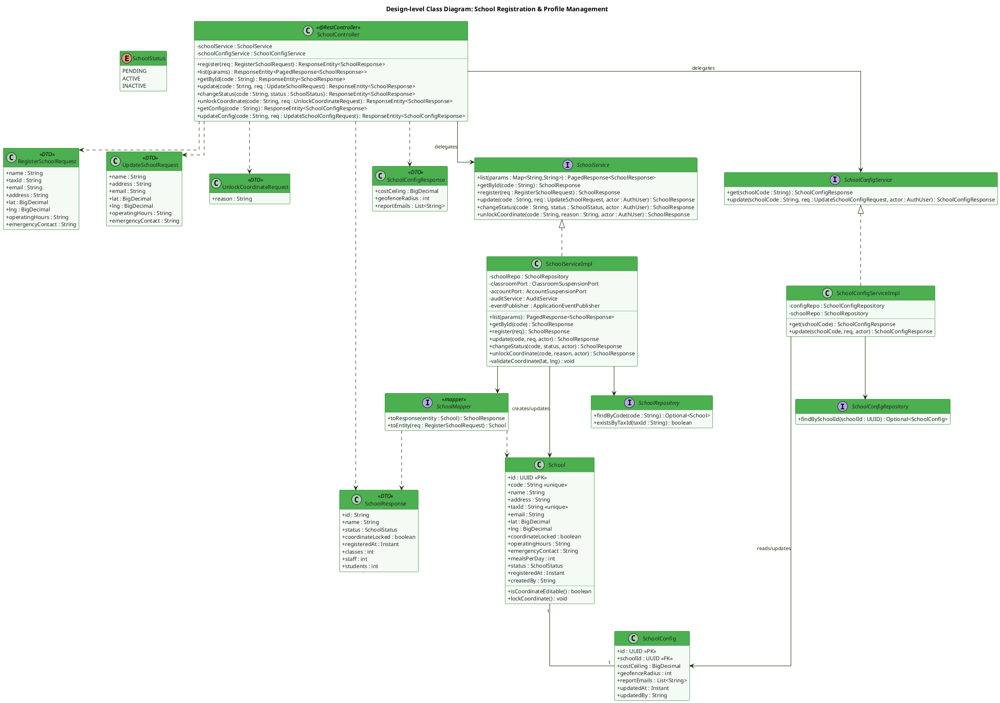

**Description:**
`School` is the aggregate root of MF02; derived counters (`classes`, `staff`, `students`) are never persisted — `SchoolServiceImpl` computes them at read time (ADR-M02-2), and `SchoolResponse` merely carries the resulting numbers to the client. `SchoolConfig` is a 1:1 satellite table holding operational parameters (`geofenceRadius`, BR-028) addressed only as a child resource of `School` (`/schools/{code}/config`). The `SchoolController` exposes both resources but delegates all business logic to `SchoolService`/`SchoolConfigService` — controllers stay thin, DTO ⇄ entity conversion is centralized in `SchoolMapper` (MapStruct). GPS coordinate mutation, cascade status changes and rate limiting are pure service-layer concerns, kept out of the DTOs.

---

### 1.2 Sequence Diagram — Register School (UC-070)

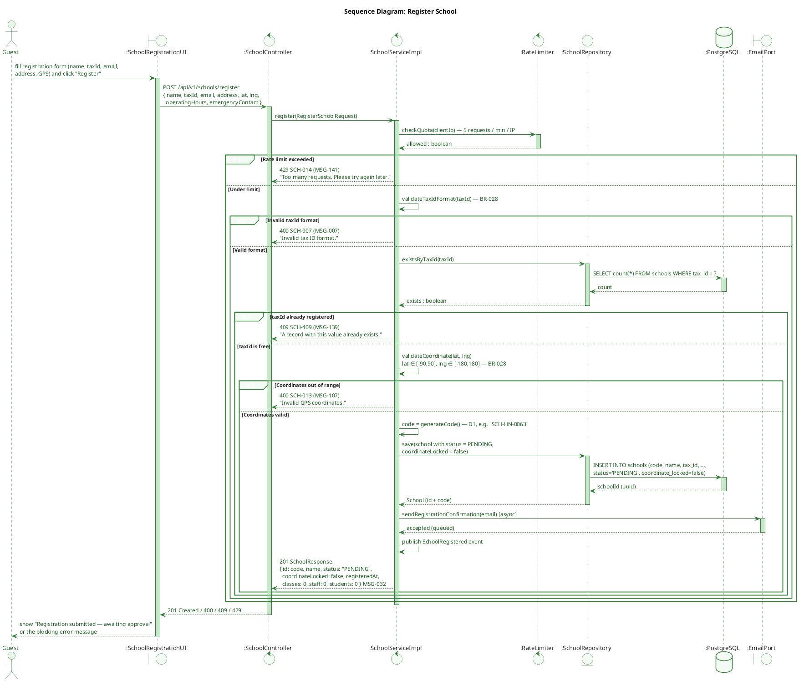

**Description:**
Any Guest may self-register a school (UC-070); it always starts in `PENDING` status pending System Admin approval (UC-001). The endpoint is public and therefore rate-limited to 5 requests/minute/IP (SCH-014/MSG-141) to prevent abuse. Validation runs in order: rate limit → tax ID format (BR-028) → tax ID uniqueness (SCH-409) → GPS coordinate range (BR-028, SCH-013). A successful registration never sets `coordinateLocked=true` — the lock is only applied once the school transitions to `ACTIVE` (see §1.4).

---

### 1.3 Sequence Diagram — Update School Info & GPS Coordinate Lock (UC-095, BR-028)

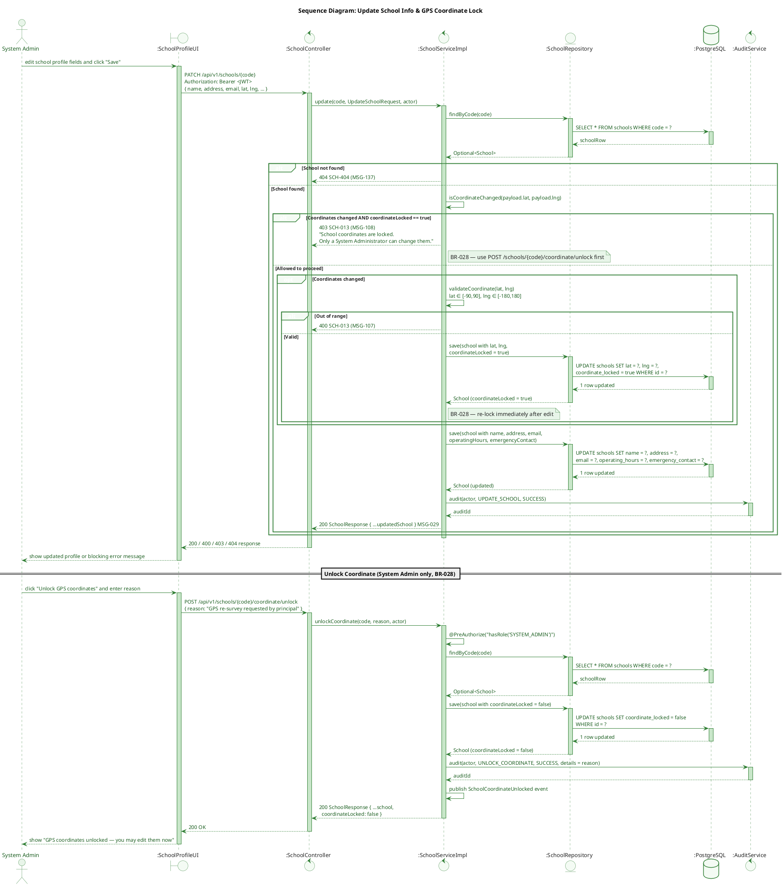

**Description:**
`UpdateSchool` (UC-095) allows editing any profile field, but a GPS coordinate change is only accepted while `coordinateLocked=false`; once a school is `ACTIVE`, the coordinates are locked automatically. Any change that does slip through re-locks the record immediately (`coordinate_locked = true`) so the lock is self-healing. To edit coordinates on a locked school, a System Admin must call the dedicated unlock endpoint with a written `reason` (BR-028) — every unlock is audited and emits `SchoolCoordinateUnlocked` so the change is traceable.

---

### 1.4 Sequence Diagram — Deactivate School Cascade (UC-001, BR-021)

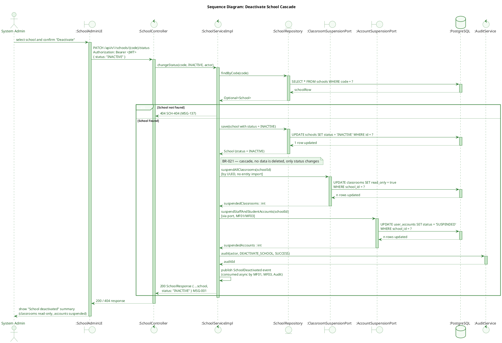

**Description:**
Deactivating a school (System Admin only) triggers a cascade defined by BR-021: every classroom of that school becomes read-only and every staff/student account tied to the school is suspended. Cross-module effects are performed through ports (`ClassroomSuspensionPort`, `AccountSuspensionPort`) referencing entities by UUID only — MF02 never imports MF01/MF03 JPA entities directly (AP-AI-005). No row is ever deleted; the cascade is purely a status transition, fully reversible by reactivating the school (`status: "ACTIVE"`).

---

## 2. School Policy (Read-Only, Cross-Role)

### 2.1 Class Diagram

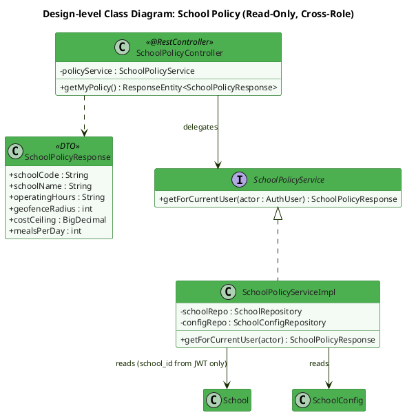

**Description:**
`GET /schools/me/policy` (UC-137) is available to Teacher, Medical Staff and Service Caterers. `SchoolPolicyServiceImpl` never accepts a school identifier from the client — `schoolId` is read exclusively from the JWT claims (BR-022), which structurally rules out cross-school access rather than relying on a runtime check alone.

---

### 2.2 Sequence Diagram — View School Policy (UC-137, BR-022)

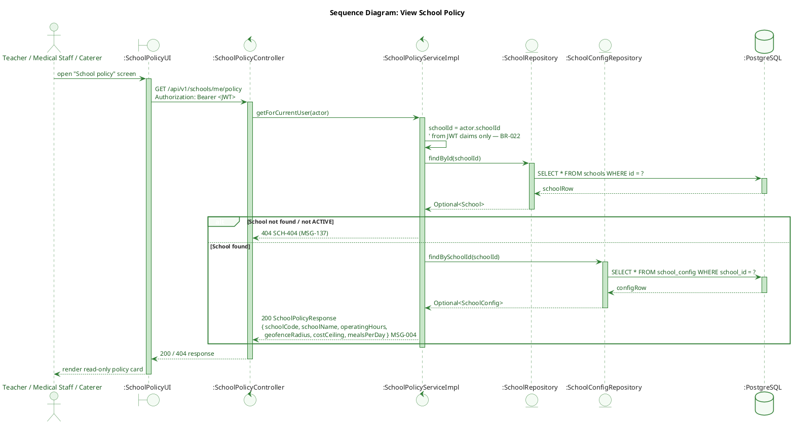

**Description:**
The `schoolId` used for the lookup always comes from the caller's JWT, never from a request parameter — a caller cannot request another school's policy even by guessing an ID, since no ID parameter exists on this endpoint. This satisfies BR-022's cross-school isolation requirement by construction.

---

## 3. Classroom Management

### 3.1 Class Diagram

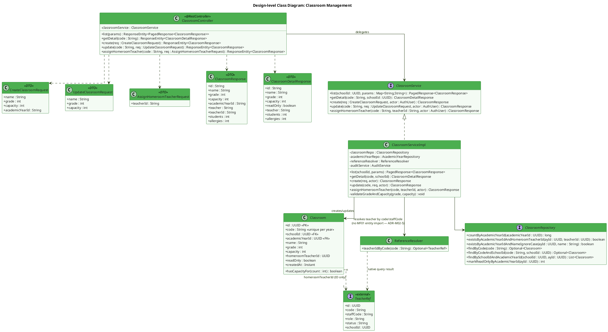

**Description:**
`ClassroomServiceImpl` never depends on a MF01 JPA entity or repository to resolve a homeroom teacher: `ReferenceResolver.teacherIdByCode()` runs a native SQL query against `user_accounts` and returns a lightweight `TeacherRef` projection (id, role, status, schoolId), which is validated in-service (role = Teacher, status = ACTIVE, same school) before the UUID is stored on `Classroom.homeroomTeacherId` (ADR-M02-5). This keeps the module boundary intact while still allowing a real foreign key in the schema, since both tables live in the same physical database. `CreateClassroomRequest`/`UpdateClassroomRequest` intentionally omit `schoolId` — it is always taken from the authenticated actor, never trusted from the request body.

---

### 3.2 Sequence Diagram — Create Classroom (UC-018, BR-024/025/192)

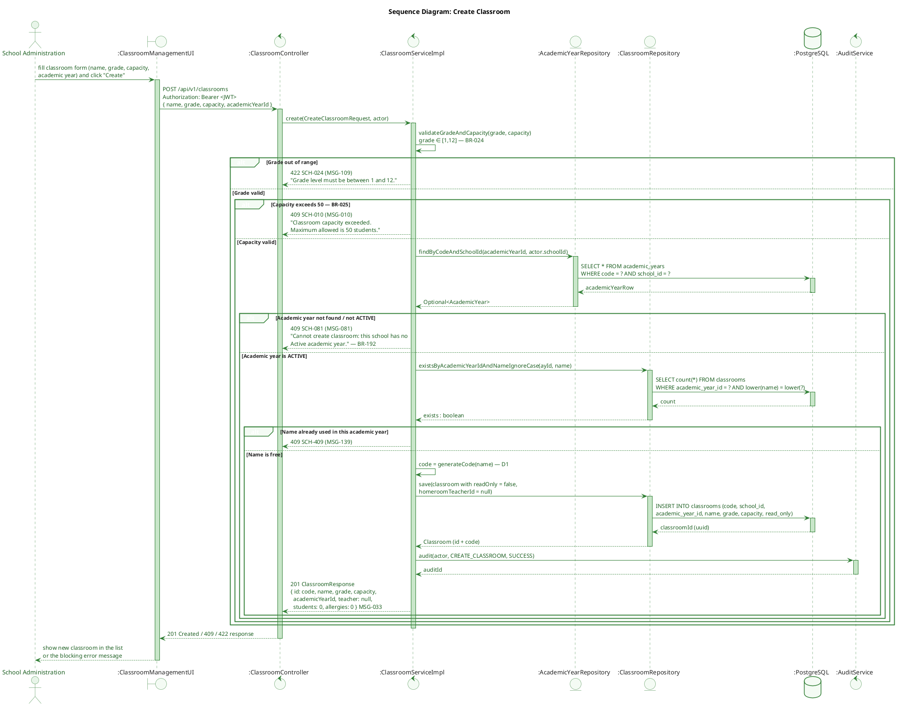

**Description:**
Validation runs strictly in the order specified by traceability: grade range (BR-024) → capacity ceiling (BR-025) → the parent academic year must exist and be `ACTIVE` for this school (BR-192, SCH-081) → classroom name uniqueness within that academic year. A new classroom always starts with `readOnly=false` and no assigned teacher; `students`/`allergies` are always `0` at creation since they are derived counters (ADR-M02-2), never seeded values.

---

### 3.3 Sequence Diagram — Assign Homeroom Teacher (UC-008, BR-020/026)

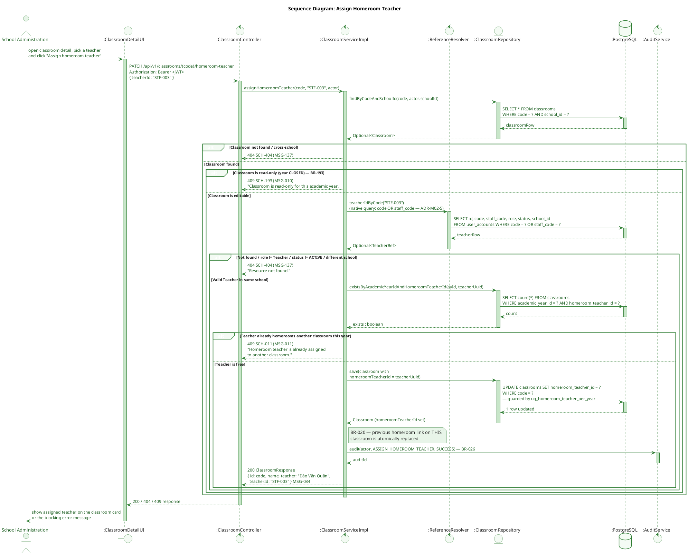

**Description:**
`teacherId` in the request accepts either the platform `code` (`U-0010`) or the domain-specific `staffCode` (`STF-003`) — both resolve to the same `user_accounts` row via `ReferenceResolver` (ADR-M02-5), never through a direct MF01 entity import. Assignment is guarded by the partial unique index `uq_homeroom_teacher_per_year`, so a teacher can never end up homerooming two classrooms in the same academic year (BR-020); reassigning a classroom's teacher simply overwrites the FK on that one row, and every assignment is written to the audit trail with actor and timestamp (BR-026).

---

## 4. Academic Year Management

### 4.1 Class Diagram

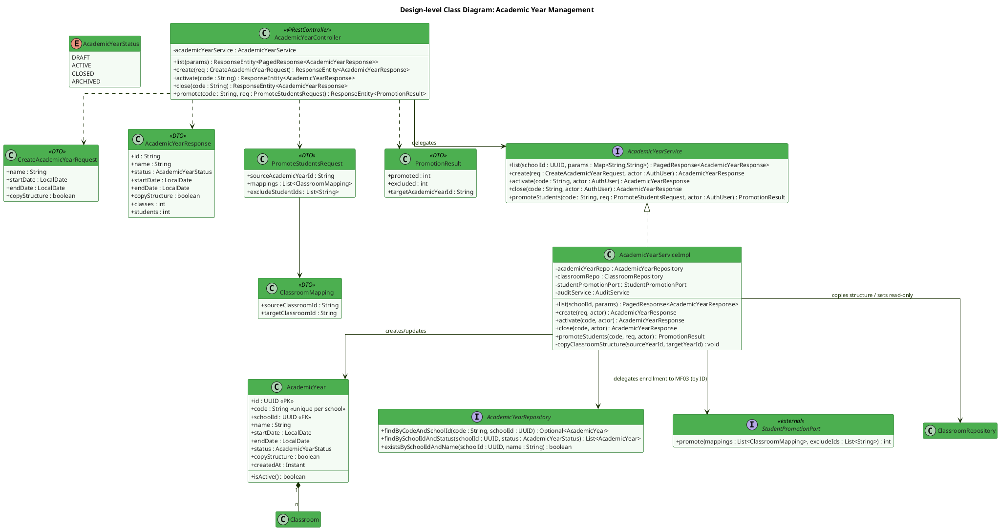

**Description:**
`AcademicYearServiceImpl.activate()` and `close()` both run inside a transaction with `PESSIMISTIC_WRITE` locking on the school's academic-year rows to prevent two concurrent activation requests from both passing the "no other ACTIVE year" check (BR-191) — the DB-level partial unique index `uq_ay_one_active_per_school` is the final backstop. Promoting students (UC-177, BR-194) is delegated to `StudentPromotionPort`, an ID-only interface into MF03 — MF02 never touches MF03's `Student` entity directly, keeping the module boundary intact even though promotion is initiated from this module.

---

### 4.2 Sequence Diagram — Activate Academic Year (UC-175, BR-191)

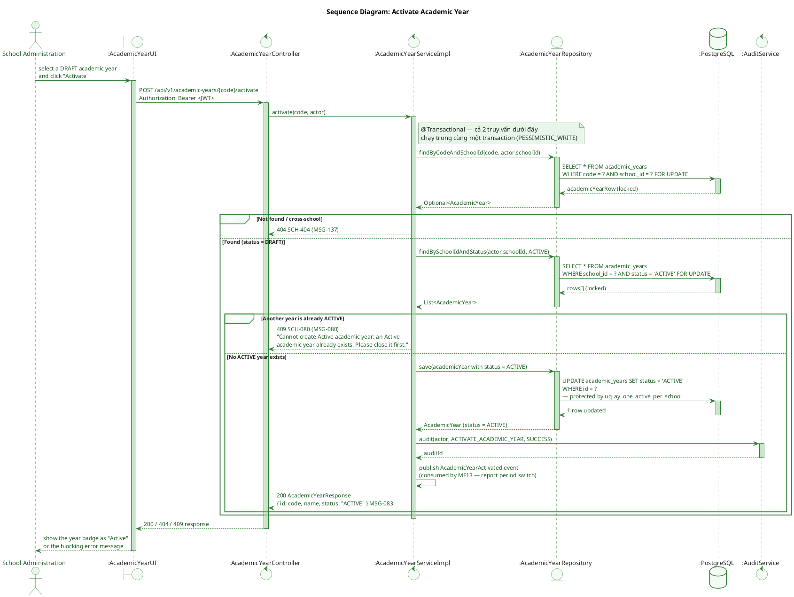

**Description:**
Both the existence lookup and the "any ACTIVE year" check use `SELECT ... FOR UPDATE`, and the entire method runs inside a single `@Transactional` boundary — this closes the race window where two simultaneous activate calls could both read "no ACTIVE year" and both proceed. Even if the row-level lock were bypassed, the DB-level partial unique index `uq_ay_one_active_per_school` guarantees BR-191 holds at the storage layer as the final invariant.

---

### 4.3 Sequence Diagram — Close Academic Year Cascade (UC-175, BR-193)

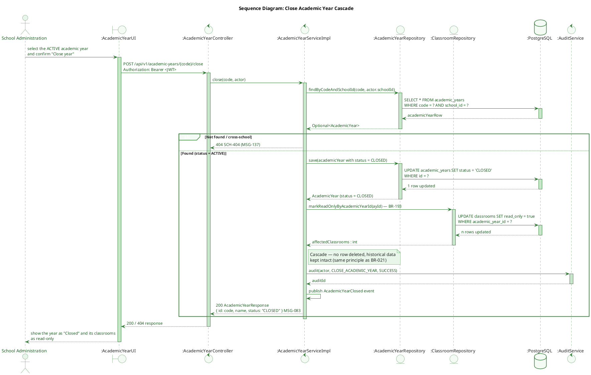

**Description:**
Closing an academic year cascades a `read_only=true` flag onto every classroom of that year (BR-193) — new students cannot be enrolled and the homeroom teacher cannot be reassigned (rejected by `assignHomeroomTeacher`, see §3.3). No data is deleted; a closed year eventually transitions to `ARCHIVED` and remains permanently queryable in read-only mode (BR-195).

---

### 4.4 Sequence Diagram — Promote Students to Next Academic Year (UC-177, BR-194)

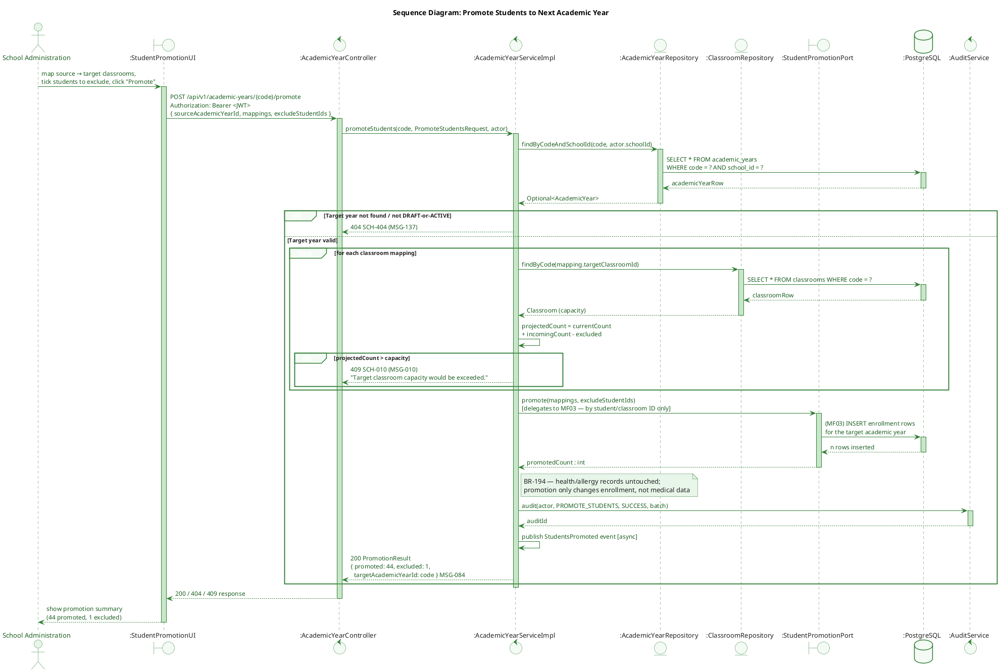

**Description:**
Promotion is an explicit, batch, opt-out operation per BR-194 — creating a new academic year with `copyStructure=true` only clones classroom shells (name/grade/capacity), it never moves students. `promoteStudents()` is the only action that actually re-enrolls students, grade by grade, with the ability to exclude specific students (e.g. those repeating a grade or leaving the school). Each target classroom's capacity is checked before delegating to MF03's `StudentPromotionPort`, and student health/allergy records are explicitly out of scope for this operation — they remain owned by MF03 and are unaffected by an academic year change.

---

## 5. Lifecycle State Machines

### 5.1 School State Machine (UC-070/UC-001, BR-021/BR-028)

```plantuml
@startuml MF02_SchoolState
title State Diagram: School Lifecycle

' Bật chế độ liên kết vuông góc (Orthogonal lines)
skinparam linetype ortho

' ==========================================
' CẤU HÌNH MÀU SẮC TÔNG XANH LÁ
' ==========================================
skinparam backgroundColor #FFFFFF

' ==========================================
' State
' ==========================================
skinparam state {
    BackgroundColor #F4FBF4
    BorderColor #2E7D32
    FontColor #212121
    FontName Arial
    FontSize 13
}

' ==========================================
' Arrow
' ==========================================
skinparam arrow {
    Color #2E7D32
    FontColor #1B5E20
    FontName Arial
    FontSize 12
}

' ==========================================
' Note
' ==========================================
skinparam note {
    BackgroundColor #E8F5E9
    BorderColor #2E7D32
    FontColor #212121
    FontName Arial
    FontSize 12
}

' ==========================================
' Start / End
' ==========================================
skinparam startColor #2E7D32
skinparam endColor #2E7D32

[*] --> PENDING : register

PENDING --> ACTIVE : approve

ACTIVE --> INACTIVE : deactivate

INACTIVE --> ACTIVE : reactivate
@enduml
```

**Description:**
A school always enters at `PENDING` (self-registration, UC-070) and only System Admin approval moves it to `ACTIVE`, which is also the moment its GPS coordinates become locked (BR-028). `ACTIVE ⇄ INACTIVE` is fully reversible; the `INACTIVE` cascade (BR-021) never deletes data, it only flips status flags on dependent classrooms and accounts, which are restored automatically on reactivation.

### 5.2 Academic Year State Machine (BR-191/BR-193/BR-195)

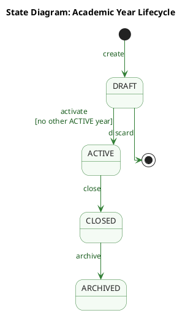

**Description:**
No transition ever deletes an academic year or its classrooms — the model is append-only by design once a year leaves `DRAFT`. The `≤ 1 ACTIVE` invariant (BR-191) is the single most safety-critical rule in MF02 and is therefore enforced redundantly at both the service layer (pessimistic locking) and the database layer (partial unique index), so it cannot be violated even by a bug in the service code.

### 5.3 Classroom State Machine (UC-018, BR-021/BR-192/BR-193)

```plantuml
@startuml MF02_ClassroomState
title State Diagram: Classroom Lifecycle

' Bật chế độ liên kết vuông góc (Orthogonal lines)
skinparam linetype ortho

' ==========================================
' CẤU HÌNH MÀU SẮC TÔNG XANH LÁ
' ==========================================
skinparam backgroundColor #FFFFFF

' ==========================================
' State
' ==========================================
skinparam state {
    BackgroundColor #F4FBF4
    BorderColor #2E7D32
    FontColor #212121
    FontName Arial
    FontSize 13
}

' ==========================================
' Arrow
' ==========================================
skinparam arrow {
    Color #2E7D32
    FontColor #1B5E20
    FontName Arial
    FontSize 12
}

' ==========================================
' Note
' ==========================================
skinparam note {
    BackgroundColor #E8F5E9
    BorderColor #2E7D32
    FontColor #212121
    FontName Arial
    FontSize 12
}

' ==========================================
' Start / End
' ==========================================
skinparam startColor #2E7D32
skinparam endColor #2E7D32

state EDITABLE : readOnly = false
state READ_ONLY : readOnly = true

[*] --> EDITABLE : create\n[year is ACTIVE]

EDITABLE --> EDITABLE : update
EDITABLE --> EDITABLE : assign teacher

EDITABLE --> READ_ONLY : close year
EDITABLE --> READ_ONLY : deactivate school

READ_ONLY --> EDITABLE : reactivate school\n[year still ACTIVE]

READ_ONLY --> [*] : archive year
@enduml
```

**Description:**
A classroom has no `status` column of its own — its lifecycle is expressed entirely by the boolean `read_only`, which is a *derived* flag driven by two parents: the academic year (BR-193, §4.3) and the school (BR-021, §1.4). This is why the diagram has only two stable states. A classroom can only be created while its parent academic year is `ACTIVE` (BR-192), and re-editability is possible only via the school path — once the academic year is `CLOSED` the flag is permanent for that year, since a closed year never returns to `ACTIVE` (§5.2). All rejected writes share the same error contract (409 `SCH-193` / MSG-010), which is what `assignHomeroomTeacher` checks first in §3.3.

### 5.4 GPS Coordinate Lock State Machine (BR-028)

```plantuml
@startuml MF02_CoordinateLockState
title State Diagram: School GPS Coordinate Lock

' Bật chế độ liên kết vuông góc (Orthogonal lines)
skinparam linetype ortho

' ==========================================
' CẤU HÌNH MÀU SẮC TÔNG XANH LÁ
' ==========================================
skinparam backgroundColor #FFFFFF

' ==========================================
' State
' ==========================================
skinparam state {
    BackgroundColor #F4FBF4
    BorderColor #2E7D32
    FontColor #212121
    FontName Arial
    FontSize 13
}

' ==========================================
' Arrow
' ==========================================
skinparam arrow {
    Color #2E7D32
    FontColor #1B5E20
    FontName Arial
    FontSize 12
}

' ==========================================
' Note
' ==========================================
skinparam note {
    BackgroundColor #E8F5E9
    BorderColor #2E7D32
    FontColor #212121
    FontName Arial
    FontSize 12
}

' ==========================================
' Start / End
' ==========================================
skinparam startColor #2E7D32
skinparam endColor #2E7D32

state UNLOCKED : coordinateLocked = false
state LOCKED : coordinateLocked = true

[*] --> UNLOCKED : register school

UNLOCKED --> UNLOCKED : edit coordinates\n[valid range]

UNLOCKED --> LOCKED : activate school
UNLOCKED --> LOCKED : save coordinates

LOCKED --> UNLOCKED : unlock\n[System Admin + reason]

LOCKED --> LOCKED : edit rejected (403)
@enduml
```

**Description:**
`coordinateLocked` is a second, independent state machine living on the same `School` row as §5.1 — a school can be `ACTIVE` while its coordinates are momentarily `UNLOCKED`. Modelling it separately makes the BR-028 invariant explicit: the `LOCKED → UNLOCKED` edge is the only privileged transition in MF02 that requires both a role check (`SYSTEM_ADMIN`) and a mandatory free-text `reason`, and it is always audited. Because every successful coordinate write re-locks the record, an unlock is effectively a one-shot permission rather than a lasting mode — which is what the self-transition on `LOCKED` (403 `SCH-013`) and the re-lock edge in §1.3 jointly enforce.

---

*Document generated from TDS `SFMS-MF02-IMP-001 v1.0` (Approved 2026-07-31).*
