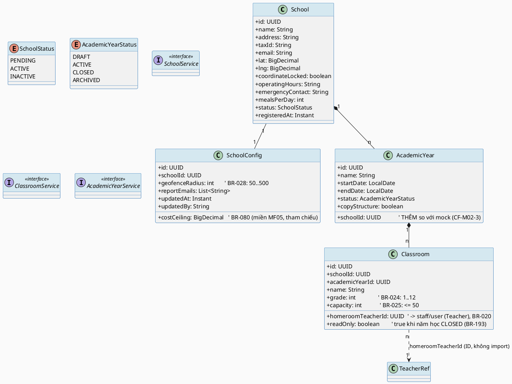
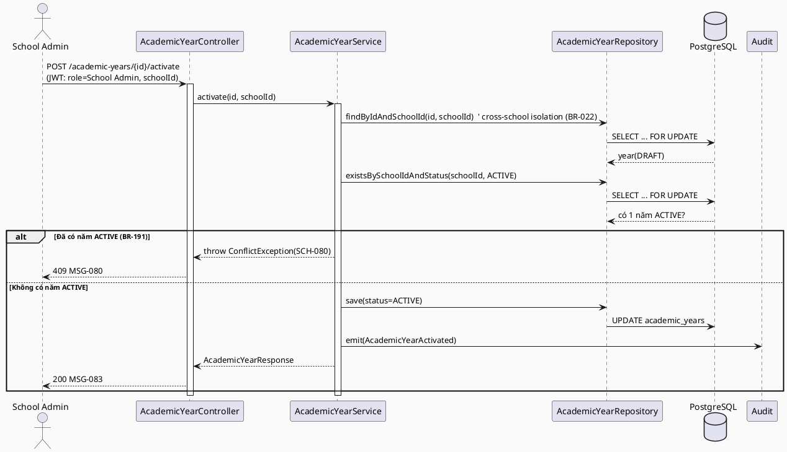
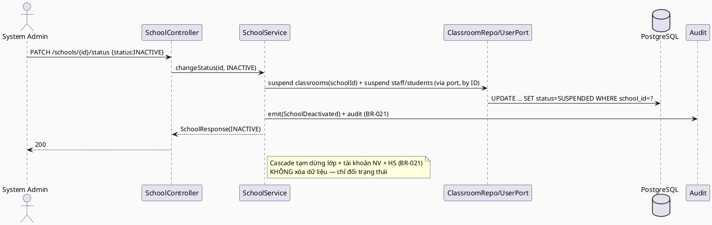
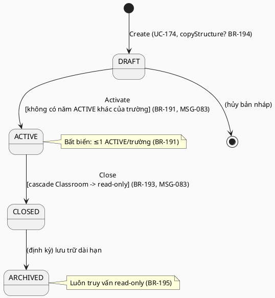
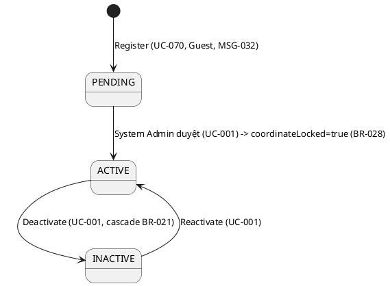

# ENGINEERING DOCUMENTATION STANDARD (EDS) v2.0 — TDS Backend
# MF02 — School & Class Management (+ Academic Year)

| Field | Value |
|-------|-------|
| **Document ID** | `SFMS-MF02-IMP-001` |
| **Version** | `1.0` |
| **Date** | `2026-07-28` |
| **Status** | `Approved` |
| **Document Owner** | Nguyễn Văn Nam (NamNVHE180863) |
| **Author** | Nguyễn Văn Nam — Backend Dev (phụ trách School Admin & System Admin, giữ Flyway V1 + nền chung) |
| **Reviewed by** | Bùi Quang Huy (Traceability) · Nguyễn Đức Mạnh (Schema/API) · Trần Tuấn Minh (Interface) · Nguyễn Phương Thảo (TestSpec) — cả nhóm duyệt 2026-07-31 |
| **DPO Sign-off** | `[ ] Pending` *(dữ liệu trường học `Confidential`; không chứa PII học sinh trực tiếp — HS ở MF03)* |
| **Approved by** | Nguyễn Văn Nam — Final Approval, 2026-07-31 |
| **Last Review** | `2026-07-31` |
| **Based on EDS** | `v2.0` |

> **Stack (ADR-000 / `01_MVP_Backend_Implementation_Plan.md` §3):** Spring Boot **4.1.x (Java 25 LTS)** · PostgreSQL 16 · **Flyway** (V1 = toàn bộ schema, do Nam giữ) · **Spring Security + JWT** (RBAC 7 role, tin cậy JWT do MF01 phát hành) · springdoc-OpenAPI (Swagger) · MapStruct.
>
> **MF02 là "vertical slice mẫu" (P0).** Pattern `PagedResponse<T>` + `Specification` (list/search/filter khớp §2b của `00_Team_Work_Assignment_Plan.md`), mapper MapStruct, `@RestControllerAdvice` error-code tại tài liệu này là **bản mẫu (convention)** cho 11 module nghiệp vụ còn lại copy. Xem §17.

---

## CHANGELOG

> **Policy 4.4 — Immutable History:** Không xóa thông tin cũ.

| Ngày | Người thực hiện | Nội dung thay đổi |
|------|-----------------|-------------------|
| 2026-07-28 | Nguyễn Văn Nam | Tạo bản đầu (v1.0). Nguồn: UC file `MF02_School_Class_Management.md`, traceability §1.2, `business_rules.md` §3 + §19, `error_message.md`, mock (`mock-server.ts`/`db.ts`/`mock-data.ts`), `data_model.puml`, `semantic-audit.ts`, ADR-000, MVP plan §3. Toàn bộ ví dụ code viết bằng **Java + JPA + Flyway SQL** (không TypeScript/Prisma). |
| 2026-07-31 | Nguyễn Văn Nam | **Đóng toàn bộ Logic Issues của TestSpec-MF02 §2 (L1, L3, L7, L9, L8b) + gap riêng của `SEC-005`, chuyển Status → Approved** sau khi cả nhóm (Huy/Mạnh/Minh/Thảo) review OK. (1) **L1**: §5.2 bổ sung cột `code` (D1) cho `schools` (UNIQUE toàn cục), `academic_years` (`UNIQUE(school_id, code)`), `classrooms` (`UNIQUE(academic_year_id, code)`) — `school_config` không cần vì chỉ địa chỉ hoá qua `/schools/{code}/config`. (2) **ADR-M02-5 (L3)**: `homeroom_teacher_id` → `user_accounts.id` (không có bảng `staff` riêng, khớp thiết kế đã triển khai ở MF01: cột `code`/`staff_code` cùng 1 PK). (3) **§10 (L7)**: cross-school → **404 SCH-404** thay vì 403 SCH-005 (nhất quán MF01 `requireInScope()`); `SCH-005` chỉ còn cho sai vai trò trong cùng trường. (4) **§10 (L9)**: bổ sung `SCH-409`/**MSG-139** (`error_message.md` v1.6) cho xung đột D5 và `taxId` trùng. (5) **L8b**: cấp **BR-219** mới (`business_rules.md` v1.10) + tách `SCH-012`/**MSG-140** (`error_message.md` v1.7) khỏi `SCH-010` cho điều kiện "capacity < sĩ số hiện tại" — quyết định người dùng (Nam): giữ luật, không bỏ. (6) **`SEC-005`**: bổ sung `SCH-014`/**MSG-141** (`error_message.md` v1.8) cho rate-limit 429. L2 (redundant `name`/`code` ở Classroom) **vẫn treo** — không chặn Approve, chờ Nam + Minh quyết định gộp field. |
| 2026-08-01 | Nguyễn Văn Nam | **Chốt L2 (§2 TestSpec-MF02): giữ vĩnh viễn cả `Classroom.code` lẫn `Classroom.name`, không gộp** — quyết định người dùng (Nam), không cần chờ Minh. Lý giải: `code` = định danh bất biến (D1, path param + `UNIQUE(academic_year_id, code)`); `name` = nhãn hiển thị được phép đổi độc lập (khớp đúng code MF02 đã sinh: `ClassroomService.update` chỉ set `name`, giữ nguyên `code`) — hai giá trị có thể lệch nhau sau khi đổi tên, đó là hành vi đúng thiết kế, không phải dữ liệu dư thừa cần dọn. Không có thay đổi schema/entity/test — code MF02 hiện có đã đúng theo quyết định này. Cập nhật §5.2 (comment entity + DDL) và §2 TestSpec-MF02. |

---

## MỤC LỤC

1. [Tổng quan Module](#1-tổng-quan-module) · 2. [Ma trận Truy vết](#2-ma-trận-truy-vết) · 3. [Architecture Decisions](#3-architecture-decisions-inline-adr) · 4. [NFR & SLA](#4-non-functional-requirements--sla) · 5. [Static Modeling](#5-static-modeling) · 6. [Dynamic Modeling](#6-dynamic-modeling) · 7. [Domain Event Catalog](#7-domain-event-catalog) · 8. [Interface Specification](#8-interface-specification) · 9. [API Specification](#9-api-specification) · 10. [Error Codes](#10-bảng-mã-lỗi) · 11. [Triển khai](#11-quy-trình-triển-khai) · 12. [Rollback Runbook](#12-rollback--incident-runbook) · 13. [Kiểm thử](#13-kịch-bản-kiểm-thử) · 14. [Xác minh](#14-phương-pháp-xác-minh) · 15. [API Samples](#15-mẫu-thử-thực-tế) · 16. [Authorization Matrix](#16-authorization-matrix) · 17. [AI Prompt Constraints](#17-ai-prompt-constraints-case-20)

---

## 1. Tổng quan Module

> MF02 quản lý **hồ sơ trường học** (đăng ký, kích hoạt/vô hiệu hóa dạng thác nước, xem/sửa hồ sơ, tọa độ GPS + geofence), **lớp học** (tạo/sửa, phân công giáo viên chủ nhiệm, xem danh sách/chi tiết), và **năm học** (tạo, kích hoạt/đóng, xem danh sách, lên lớp hàng loạt). Là "vertical slice" nền tảng chốt convention cho cả nhóm.

| Field | Value |
|-------|-------|
| **Module Name** | School & Class Management + Academic Year (MF02) |
| **Bounded Context** | Organization & Academic Structure |
| **Data Classification** | `Confidential` (hồ sơ trường, tọa độ GPS, mã số thuế) — **không** chứa PII học sinh (HS ở MF03) |
| **Compliance Scope** | PDPD — theo ADR-000 |
| **Upstream Dependencies** | **MF01** (JWT: userId/role/schoolId; danh mục nhân sự Teacher cho phân công GVCN — bảng `staff`) |
| **Downstream Consumers** | **MF03** (Student ← Classroom), **MF05** (Menu theo khối/grade), **MF06/MF07/MF08** (tọa độ GPS + geofence làm mốc xác minh vị trí — BR-028), **MF09** (phân suất theo lớp), **MF13** (thống kê theo trường/lớp/năm học) |

**Phạm vi 16 Use Case (đúng traceability §1.2):**
- **Trường học:** UC-070 (Register), UC-001 (Active/Deactivate), UC-095 (Update Info), UC-122 (View Info), UC-140 (View List).
- **Lớp học:** UC-018 (Create), UC-090 (Update), UC-008 (Assign Homeroom Teacher), UC-037 (Manage), UC-165 (View Detail), UC-166 (View List), UC-137 (View Policy Of School).
- **Năm học:** UC-174 (Create), UC-175 (Activate/Close), UC-176 (View List), UC-177 (Promote Students).

> ⚠️ Kế hoạch `00_Team_Work_Assignment_Plan.md` ghi "13 UC" là con số xấp xỉ; **traceability §1.2 liệt kê 16 UC** — tài liệu này bám theo traceability (nguồn chuẩn).

**Vai trò liên quan (BR-007):** Guest (đăng ký trường), System Admin (quản trị trường toàn nền tảng), School Administration (lớp + năm học của trường mình), Teacher / Medical Staff / Service Caterers (xem chính sách trường mình — UC-137/BR-022).

**Thư mục màn hình đã đọc (nguồn 6 — `src/app/(app)` + `(auth)`):**
- `(auth)/register/school` — Register School (UC-070, Guest).
- `system-admin/schools` + `system-admin/schools/[id]` — View School List / View & Update School (UC-140, UC-122, UC-095, UC-001).
- `school-admin/classrooms` + `school-admin/classrooms/[id]` — Manage/View List/Detail + Update + Assign Teacher (UC-037, UC-166, UC-165, UC-090, UC-008, UC-018).
- `school-admin/academic-years` + `[id]` + `promote` — Academic Year List/Detail/Activate/Close/Create + Promote (UC-176, UC-175, UC-174, UC-177).
- `school-admin/config` — cấu hình cấp trường (geofence radius BR-028; costCeiling BR-080 — thuộc miền MF05, chỉ tham chiếu).

---

## 2. Ma trận Truy vết

> **Nguồn:** cột BR/MSG lấy **nguyên văn** `traceability_matrix.md` §1.2; tên UC nguyên văn UC file `MF02_School_Class_Management.md`; nội dung BR tra `business_rules.md` §3 (BR-020..028) + §19 (BR-191..195). **Policy:** chỉ dùng mã có trong §1.2, không bịa mã mới.

### 2.1. UC ↔ BR ↔ MSG ↔ Code

| UC ID | Tên UC (nguyên văn) | Actor | Business Rules (§1.2) | System Messages (§1.2) | Thành phần Code (Java) |
|-------|---------------------|-------|-----------------------|------------------------|------------------------|
| UC-070 | Register School | Guest | BR-028 | MSG-007, MSG-032 | `SchoolService.register()`, `SchoolController#register` |
| UC-001 | Active/Deactivate School | System Admin | BR-021 | MSG-001 | `SchoolService.changeStatus()` (cascade) |
| UC-095 | Update Information School | System Admin | BR-028 | MSG-001, MSG-029 | `SchoolService.update()`, `SchoolConfigService.update()` |
| UC-122 | View Information School | System Admin | — | MSG-004, MSG-005 | `SchoolService.getById()` |
| UC-140 | View School List | System Admin | — | MSG-004, MSG-005 | `SchoolService.list()` (`SchoolSpec`) |
| UC-018 | Create Classroom | School Administration | BR-024, BR-025, BR-192 | MSG-010, MSG-033, MSG-081 | `ClassroomService.create()` |
| UC-090 | Update Classroom | School Administration | BR-024, BR-025 | MSG-010, MSG-029 | `ClassroomService.update()` |
| UC-008 | Assign Homeroom Teacher | School Administration | BR-020, BR-026 | MSG-011, MSG-034 | `ClassroomService.assignHomeroomTeacher()` |
| UC-037 | Manage Classrooms | School Administration | BR-024, BR-025 | MSG-004, MSG-005 | `ClassroomService.list()` (`ClassroomSpec`) |
| UC-165 | View Classroom Detail | School Administration | BR-020, BR-024, BR-025 | MSG-004, MSG-005 | `ClassroomService.getDetail()` |
| UC-166 | View List Classrooms | School Administration | BR-024, BR-025 | MSG-004, MSG-005 | `ClassroomService.list()` |
| UC-137 | View Policy Of School | Teacher/Medical/Caterers | BR-022 | MSG-004, MSG-005 | `SchoolPolicyService.getForCurrentUser()` |
| UC-174 | Create Academic Year | School Administration | BR-191, BR-192, BR-194 | MSG-080, MSG-082 | `AcademicYearService.create()` (+copyStructure) |
| UC-175 | Activate/Close Academic Year | School Administration | BR-191, BR-193 | MSG-080, MSG-083 | `AcademicYearService.activate()/close()` |
| UC-176 | View Academic Year List | School Administration, System Admin | BR-195 | MSG-004, MSG-005 | `AcademicYearService.list()` |
| UC-177 | Promote Students to Next Academic Year | School Administration | BR-194 | MSG-084 | `AcademicYearService.promoteStudents()` |

### 2.2. Business Rules — nội dung (nguyên văn `business_rules.md`)

| BR | Nội dung (rút gọn nguyên văn) | Áp ở |
|----|-------------------------------|------|
| **BR-020** | Mỗi lớp chỉ **một** giáo viên chủ nhiệm tại một thời điểm; gán mới → tự hủy liên kết cũ + ghi nhật ký. | `assignHomeroomTeacher()` |
| **BR-021** | Vô hiệu hóa trường **cascade**: tạm dừng toàn bộ lớp, tài khoản nhân viên, tài khoản HS thuộc trường; ghi audit log. | `changeStatus()` |
| **BR-022** | Người dùng chỉ xem chính sách **trường mình** (theo `schoolId` trong JWT); Teacher/Medical/Caterers có quyền xem; cross-school bị từ chối. | `SchoolPolicyService` |
| **BR-024** | Cấp lớp hợp lệ trong khoảng **1–12** (hệ phổ thông VN). | `create()/update()` classroom |
| **BR-025** | Mỗi lớp sức chứa tối đa **50 HS**. | `create()/update()` classroom |
| **BR-026** | Mỗi lần phân công/thay GVCN ghi vào **audit trail** kèm ngày giờ + người thực hiện. | `assignHomeroomTeacher()` |
| **BR-028** | Tọa độ hợp lệ: lat ∈ [-90,90], lng ∈ [-180,180]; sau khi trường ACTIVE → `coordinateLocked=true`, mọi cập nhật tọa độ bị từ chối. **Chỉ System Admin** mở khóa kèm **lý do văn bản** + audit. Geofence mặc định **200m**, cấu hình **50–500m**. | `register()/update()`, `SchoolConfig` |
| **BR-191** | Mỗi trường chỉ **đúng 1** `AcademicYear` **Active** tại một thời điểm; kích hoạt năm mới phải đóng năm Active hiện tại trước; cho phép song song **1 Draft**. | `activate()` |
| **BR-192** | Mỗi `Classroom` thuộc **đúng 1** `AcademicYear`; **không** tạo lớp khi trường chưa có năm học Active. | `create()` classroom / academic year |
| **BR-193** | Đóng năm học → toàn bộ `Classroom` của năm đó chuyển **read-only** (không tạo HS mới, không đổi GVCN); giữ nguyên dữ liệu lịch sử (cùng nguyên tắc cascade BR-021). | `close()` |
| **BR-194** | Tạo năm mới có thể **sao chép cấu trúc lớp** (tên/cấp/sức chứa) từ năm liền trước; **không** tự chuyển HS — "lên lớp" là hành động tường minh, hàng loạt theo khối, cho phép loại trừ/giữ lại từng HS; hồ sơ sức khỏe/dị ứng HS không bị ảnh hưởng. | `create(copyStructure)`, `promoteStudents()` |
| **BR-195** | Dữ liệu năm học đã **Archived** luôn truy vấn được ở chế độ **read-only** (audit/báo cáo dài hạn). | `list()`, mọi query năm cũ |

### 2.3. ⚠️ Mâu thuẫn giữa các nguồn (ghi rõ, KHÔNG tự chọn bên đúng)

| # | Mô tả mâu thuẫn | Xử lý trong TDS |
|---|-----------------|-----------------|
| **CF-M02-1** | **UC-137 "View Policy Of School"** có trong traceability §1.2 (BR-022) nhưng **không có** Use Case Spec chi tiết trong `MF02_School_Class_Management.md` (traceability tự ghi chú: *"UC-137 has no detailed Functional Specification section in Report 3 yet"*). | Giữ UC-137 trong §2.1 (traceability là nguồn chuẩn) + thiết kế `SchoolPolicyService` theo BR-022. Cần Huy (Lead Traceability) xác nhận/bổ sung UC spec. |
| **CF-M02-2** | **UC-095**: bảng UC file ghi Business Rules = "BR-028, **BR-030**" và Normal Flow bước 4 dẫn "operational rules (BR-030)". Nhưng `business_rules.md` **BR-030 = "Liên kết học sinh với phụ huynh"** (miền MF03), sai ngữ cảnh cấu hình trường. Traceability §1.2 cho UC-095 **chỉ** liệt kê **BR-028**. | Theo quy tắc §2c: dùng **traceability làm chuẩn** → chỉ áp **BR-028** cho UC-095. Không áp BR-030 (student-parent) vào cấu hình trường. Ghi rõ để Huy đối chiếu; tham số vận hành thực tế (trần chi phí = BR-080) thuộc `SchoolConfig` nhưng **không** có trong cột BR §1.2 nên không tính là BR chính của MF02. |
| **CF-M02-3** | **BR-191 quy định "mỗi trường"** (per-school) nhưng mock `academic-years` (`mock-data.ts` 2584) **không có field `schoolId`**, và handler `POST /academic-years/:id/activate` (`mock-server.ts` 234) kiểm tra tồn tại năm Active **toàn cục** (không lọc theo trường). | Mock đơn giản hóa (in-memory 1 trường). **Backend thật PHẢI** thêm `school_id` vào `academic_years` và enforce BR-191 **theo từng trường** (`WHERE school_id = ? AND status='ACTIVE'`). Đây là phần backend làm khác mock có chủ đích — theo quy tắc chống lệch (§0 kế hoạch): cần cập nhật đồng thời mock FE khi triển khai. |
| **CF-M02-4** | **UC-018 Create Classroom**: UC file ghi BR = "BR-025, BR-024" và Exceptions = MSG-004/005/010/033; traceability §1.2 **bổ sung BR-192 + MSG-081** (không tạo lớp khi chưa có năm học Active). | Theo traceability: áp **BR-192** + trả **MSG-081** khi trường chưa có năm học Active. |
| **CF-M02-5** | **UC-001 Active/Deactivate School**: khối "Alternative Flows" của UC file mô tả AF1 "Reassignment homeroom teacher" — nội dung thuộc **UC-008**, dán nhầm vào UC-001. | Bỏ qua AF1 dán nhầm ở UC-001; logic reassignment chỉ thuộc `assignHomeroomTeacher()` (UC-008). Ghi chú để Huy dọn UC file. |
| **CF-M02-6** | Trường dẫn xuất `<<derived>>` trong `data_model.puml`: `SchoolRecord.students/classes/staff`, `Classroom.students/allergies`, `AcademicYear.classes/students`. Mock lưu sẵn số này (seed). | Theo "Chuẩn dữ liệu" (§5 kế hoạch): **KHÔNG lưu field dẫn xuất** — backend tính runtime (`COUNT`) qua view/query, không cột vật lý. Response API vẫn trả các số này để khớp hợp đồng FE. |

---

## 3. Architecture Decisions (inline ADR)

> ### ⚠️ Quy ước chung bắt buộc — `07_implement/00_Common_Conventions.md` (D1–D7)
>
> Áp dụng **D1–D7** của `00_Common_Conventions.md` cho toàn bộ tài liệu này. Các ADR bên dưới chỉ ghi phần **riêng của module**; khi xung đột, thứ tự ưu tiên là: **`00_Common_Conventions.md` > ADR module (§3) > hợp đồng mock FE**.
>
> | | Quy ước | Ảnh hưởng tới tài liệu này |
> |---|---|---|
> | **D1** | `id` trong JSON **và** path param = **mã nghiệp vụ**; UUID chỉ là PK nội bộ | §5.2 phải có `code VARCHAR(32)` + `UNIQUE(school_id, code)`; §9.2 path param dùng `{code}` |
> | **D2** | Envelope lỗi `{ "error": { "code", "message", "details" } }` ở `@RestControllerAdvice` | §10 — mã module là `error.code` |
> | **D3** | `baseURL` = `/api/v1` | §9 — mọi path |
> | **D4** | JSON ngày/giờ **luôn ISO-8601** (`LocalDate` / `Instant`) | §9.2 — **bỏ** mọi `@JsonFormat("dd/MM/yyyy")` |
> | **D5** | Nhận `body.id` client gửi → kiểm trùng → **409**; vắng thì server sinh | §9.2 — mọi `POST` |
> | **D6** | 8 enum dùng chung ở `common/enums/`, tất cả **SCREAMING_SNAKE** | §5.1, §5.2, §9.2 — không tự khai lại enum đã có ở D6 |
> | **D7** | Backend trả `code` + `message` **tiếng Anh** (nguyên văn `error_message.md`); FE tra bảng nhãn | §10 |
>
> *Bổ sung 2026-07-29 theo `review.md` mục A — 7 mismatch xuyên module, phần lớn là lệch **giữa các TDS với nhau** chứ không phải lệch FE↔BE.*


> Áp dụng nguyên **ADR-000** (stack, dev/stub external services). Các quyết định dưới đây **inline** (chỉ ảnh hưởng MF02) — không tách file `ADR-MF02_*.md` (theo quy ước §2c-5: chỉ tách khi quyết định ảnh hưởng >1 module).

### ADR-M02-1 — `PagedResponse<T>` + `Specification` là bản mẫu list/search/filter chung
- **Bối cảnh:** 52 resource FE gọi qua `usePagedList` cần cùng shape `{items,total,page,pageSize,pageCount}` (§2b kế hoạch).
- **Quyết định:** Nam dựng `PagedResponse<T>` (record, `common/dto/`) + mẫu `SchoolSpec`/`ClassroomSpec` một lần ở MF02; 11 module còn lại copy. `search` chỉ chạy trên `SEARCH_FIELDS` cố định (tránh full-table-scan), **không** OR mọi cột như mock in-memory.
- **Hệ quả:** `SEARCH_FIELDS` — School: `name, address, principalName`(*)/`email, taxId`; Classroom: `id(name), teacher`. (*)Ghi chú: mock `SchoolRecord` **không** có field `principalName`; §2b gợi ý cột này nhưng schema thật dùng `emergencyContact`/`email`. Backend dùng `name, address, email, taxId` (các cột có thật).

### ADR-M02-2 — Không lưu field dẫn xuất; đếm runtime
- **Quyết định:** `students/classes/staff/allergies` là `COUNT` runtime (không cột vật lý) — khớp `<<derived>>` của `data_model.puml` (CF-M02-6). Dùng subquery/`@Formula` hoặc DTO projection.
- **Hệ quả:** không có nguy cơ số liệu đóng băng (bài học từ mock: các seed `classes`/`students` lệch thực tế).

### ADR-M02-3 — Tọa độ GPS: khóa sau ACTIVE, chỉ System Admin mở khóa kèm lý do (BR-028)
- **Quyết định:** `coordinateLocked` là cờ trên `schools`. `PUT /schools/:id` với thay đổi `lat/lng` khi `coordinateLocked=true` → **từ chối** (SCH-013) trừ khi có `unlockReason` + role System Admin (endpoint `POST /schools/:id/coordinate/unlock`). Sau khi lưu tọa độ mới → tự đặt lại `coordinateLocked=true`. Mọi mở khóa ghi audit (khớp seed `AUD-98955` mock).
- **Hệ quả:** geofence (mặc định 200m, cấu hình 50–500m) lưu ở `school_config.geofence_radius`, là mốc cho MF06/07/08.

### ADR-M02-4 — Vòng đời năm học per-school; đóng năm → cascade read-only (BR-191/193)
- **Quyết định:** `academic_years.school_id` (thêm so với mock — CF-M02-3). Bất biến: `COUNT(status='ACTIVE' WHERE school_id=?) ≤ 1`. Enforce ở tầng Service **trong transaction** (`SELECT ... FOR UPDATE` trên các năm của trường) để tránh race 2 request activate song song. Đóng năm → set trạng thái đọc-only cho `Classroom` của năm đó (không xóa — append-only theo năm học, `business_rules.md` §19 note).

### ADR-M02-5 — Phân công GVCN tham chiếu bằng ID, không import entity MF01
- **Quyết định (chốt 2026-07-31, đóng §2 L3 của TestSpec-MF02):** `Classroom.homeroom_teacher_id` (UUID) trỏ **`user_accounts.id`** — KHÔNG có bảng `staff` riêng, khớp thiết kế đã triển khai ở MF01 (`user_accounts` có cả cột `code` và `staff_code`, cùng một PK). API nhận `teacherId` là `code` (`U-0010`) **hoặc** `staff_code` (`STF-003`) — cả hai đều resolve về cùng một `UserAccount`. **Không import `UserAccountRepository`/entity của MF01** (vi phạm §4b + AP-AI-005) — resolve qua **native query** theo đúng pattern `common/reference/ReferenceResolver` đã dựng ở MF01 (VD thêm method `teacherIdByCode(String code)`: `SELECT id, role, status, school_id FROM user_accounts WHERE code = :code OR staff_code = :code`), rồi validate `role=Teacher`, `status=ACTIVE`, cùng `schoolId`, chưa chủ nhiệm lớp khác (BR-020) — **tham chiếu bằng ID**, không JOIN cứng cross-module.

---

## 4. Non-Functional Requirements & SLA

### 4.1. Performance & Availability
| Category | Requirement | Target | Đo |
|----------|-------------|--------|-----|
| Latency | `GET /schools`, `/classrooms`, `/academic-years` (p99) | `< 300ms` | k6 |
| Latency | `POST /academic-years/:id/activate` (transaction có lock) | `< 500ms` | k6 |
| Availability | Uptime tháng | `99.9%` | Uptime monitor |

### 4.2. Data Integrity & Retention
| Category | Requirement | Target | Compliance |
|----------|-------------|--------|------------|
| Invariant | ≤ 1 năm học Active / trường | 100% | BR-191 |
| Invariant | Lớp `grade` ∈ [1,12], `capacity` ≤ 50, `students ≤ capacity` | 100% | BR-024/025 |
| Retention | Dữ liệu năm học Archived truy vấn read-only | ∞ (không xóa) | BR-195 |
| Audit | Mọi thao tác ghi (register/status/assign/activate/close/unlock) | 100% | BR-026, BR-021 |

### 4.3. Security
| Category | Requirement | Compliance |
|----------|-------------|------------|
| Access control | RBAC `@PreAuthorize`; School Admin bị giới hạn `schoolId` của mình | BR-007, BR-022 |
| Cross-school isolation | Mọi query lớp/năm học/chính sách lọc theo `schoolId` từ JWT | BR-022 |
| Coordinate lock | Chỉ System Admin mở khóa tọa độ + lý do văn bản | BR-028 |

### 4.4. Scalability
> 12 tháng: ~100 trường × ~30 lớp × ~5 năm học = ~15k `classrooms`. Index `(school_id, academic_year_id)`, `(academic_year_id, grade)`. List phân trang server-side, không tải toàn bộ.

---

## 5. Static Modeling

### 5.1. Class Diagram (PlantUML)



### 5.2. Data Structure — JPA Entity + Flyway migration (Java 25 / Spring Boot 4.1)

> **Flyway `V1__init_schema.sql` do Nam giữ (MVP plan §3).** Dưới đây là entity MF02 + đoạn SQL. **Không dùng Prisma.** Số dẫn xuất (`students/classes/...`) KHÔNG là cột — tính runtime (ADR-M02-2).
>
> ⚠️ **Chốt 2026-07-31 (đóng §2 L1 của TestSpec-MF02):** bổ sung cột `code` cho `schools` (`UNIQUE` toàn cục — không có trường cha), `academic_years` (`UNIQUE(school_id, code)`), `classrooms` (`UNIQUE(academic_year_id, code)`), theo đúng D1 mà §3 tài liệu này đã yêu cầu nhưng bản trước chưa thêm. `school_config` **không** cần `code` — resource này chỉ được địa chỉ hoá qua `/schools/{code}/config` (con của School), không có endpoint `/school-config/{id}` riêng. `id` UUID vẫn là PK nội bộ, **không** lộ ra JSON/path — `code` mới là giá trị trả về dưới tên `"id"` trong response (D1). Path param của §9.2 dùng `{code}`. Ở `Classroom`, `code` và `name` ban đầu trùng giá trị lúc tạo — **L2 (§2 TestSpec) đã chốt 2026-08-01 (Nam): giữ vĩnh viễn cả hai cột**, không gộp. `code` là định danh bất biến (D1, dùng ở path param + `UNIQUE(academic_year_id, code)`); `name` là nhãn hiển thị, được phép đổi độc lập qua `PATCH /classrooms/{code}` (chỉ set `name`, không đụng `code` — xem `ClassroomService.update`), nên có thể lệch giá trị với `code` theo thời gian và đó là hành vi **đúng thiết kế**, không phải bug.

```java
// School.java
@Entity @Table(name = "schools",
  indexes = { @Index(name="ix_school_status", columnList="status"),
              @Index(name="ix_school_taxid", columnList="tax_id", unique=true),
              @Index(name="ix_school_code", columnList="code", unique=true) })
public class School {
  @Id @GeneratedValue(strategy = GenerationType.UUID) private UUID id;     // PK nội bộ, KHÔNG lộ ra JSON/path
  @Column(nullable = false, length = 32, unique = true) private String code;  // D1 (chốt 2026-07-31, đóng L1) — "SCH-HN-0042", lộ ra JSON dưới tên "id"
  @Column(nullable = false) private String name;                         // SEARCH_FIELDS
  @Column(nullable = false) private String address;
  @Column(name="tax_id", nullable = false, unique = true) private String taxId;   // BR-028 validate format (MSG-007)
  @Column(nullable = false) private String email;
  @Column(nullable = false, precision = 9, scale = 6) private BigDecimal lat;      // BR-028 [-90,90]
  @Column(nullable = false, precision = 9, scale = 6) private BigDecimal lng;      // BR-028 [-180,180]
  @Column(name="coordinate_locked", nullable = false) private boolean coordinateLocked = false; // BR-028
  @Column(name="operating_hours") private String operatingHours;
  @Column(name="emergency_contact") private String emergencyContact;
  @Column(name="meals_per_day") private int mealsPerDay;
  @Enumerated(EnumType.STRING) @Column(nullable = false)
  private SchoolStatus status = SchoolStatus.PENDING;                    // UC-070 -> PENDING
  @Column(name="registered_at", nullable = false) private Instant registeredAt = Instant.now();
  @Column(name="created_by") private String createdBy;
  // getters/setters...
}
public enum SchoolStatus { PENDING, ACTIVE, INACTIVE }

// AcademicYear.java
@Entity @Table(name = "academic_years",
  indexes = { @Index(name="ix_ay_school", columnList="school_id"),
              @Index(name="ix_ay_school_status", columnList="school_id,status") })
public class AcademicYear {
  @Id @GeneratedValue(strategy = GenerationType.UUID) private UUID id;    // PK nội bộ, KHÔNG lộ ra JSON/path
  @Column(nullable = false, length = 32) private String code;            // D1 (chốt 2026-07-31, đóng L1) — "AY-2025", UNIQUE(school_id, code), lộ ra JSON dưới tên "id"
  @Column(name="school_id", nullable = false) private UUID schoolId;     // BR-191 per-school (CF-M02-3)
  @Column(nullable = false) private String name;                        // "Năm học 2026-2027" — unique/school
  @Column(name="start_date", nullable = false) private LocalDate startDate;
  @Column(name="end_date", nullable = false) private LocalDate endDate;
  @Enumerated(EnumType.STRING) @Column(nullable = false)
  private AcademicYearStatus status = AcademicYearStatus.DRAFT;          // BR-191
  @Column(name="copy_structure", nullable = false) private boolean copyStructure = false; // BR-194
  @Column(name="created_at", nullable = false) private Instant createdAt = Instant.now();
}
public enum AcademicYearStatus { DRAFT, ACTIVE, CLOSED, ARCHIVED }

// Classroom.java
@Entity @Table(name = "classrooms",
  indexes = { @Index(name="ix_class_school", columnList="school_id"),
              @Index(name="ix_class_ay", columnList="academic_year_id"),
              @Index(name="ix_class_ay_grade", columnList="academic_year_id,grade") })
public class Classroom {
  @Id @GeneratedValue(strategy = GenerationType.UUID) private UUID id;    // PK nội bộ, KHÔNG lộ ra JSON/path
  @Column(nullable = false, length = 20) private String code;            // D1 (chốt 2026-07-31, đóng L1) — "3A", UNIQUE(academic_year_id, code), lộ ra JSON dưới tên "id"
  @Column(name="school_id", nullable = false) private UUID schoolId;
  @Column(name="academic_year_id", nullable = false) private UUID academicYearId; // BR-192
  @Column(nullable = false) private String name;                        // L2 chốt 2026-08-01 (Nam): giữ vĩnh viễn cả 2 cột — `code` = định danh bất biến (D1, dùng ở path/UNIQUE), `name` = nhãn hiển thị được phép đổi độc lập qua PATCH (xem ClassroomService.update — chỉ set name, không đụng code). Ban đầu = giá trị nhập lúc tạo, có thể lệch `code` sau khi đổi tên.
  @Column(nullable = false) private int grade;                          // BR-024: CHECK 1..12
  @Column(nullable = false) private int capacity = 50;                  // BR-025: CHECK <= 50
  @Column(name="homeroom_teacher_id") private UUID homeroomTeacherId;   // BR-020, ref user_accounts.id (ADR-M02-5, chốt 2026-07-31)
  @Column(name="read_only", nullable = false) private boolean readOnly = false;   // BR-193
  @Column(name="created_at", nullable = false) private Instant createdAt = Instant.now();
}

// SchoolConfig.java — bảng 1 dòng / trường (UC-095)
@Entity @Table(name = "school_config")
public class SchoolConfig {
  @Id @GeneratedValue(strategy = GenerationType.UUID) private UUID id;
  @Column(name="school_id", nullable = false, unique = true) private UUID schoolId;
  @Column(name="cost_ceiling", precision = 12, scale = 2) private BigDecimal costCeiling; // BR-080 (MF05)
  @Column(name="geofence_radius", nullable = false) private int geofenceRadius = 200;     // BR-028: 50..500
  @Column(name="report_emails", columnDefinition = "jsonb") private String reportEmailsJson;
  @Column(name="updated_at") private Instant updatedAt;
  @Column(name="updated_by") private String updatedBy;
}
```

```sql
-- Trích V1__init_schema.sql (Flyway) — phần MF02
CREATE TABLE schools (
  id UUID PRIMARY KEY DEFAULT gen_random_uuid(),
  code VARCHAR(32) NOT NULL UNIQUE,                 -- D1 (chốt 2026-07-31, đóng L1): "SCH-HN-0042"
  name VARCHAR(180) NOT NULL,
  address VARCHAR(255) NOT NULL,
  tax_id VARCHAR(20) NOT NULL UNIQUE,               -- BR-028 (MSG-007 nếu sai định dạng)
  email VARCHAR(180) NOT NULL,
  lat NUMERIC(9,6) NOT NULL CHECK (lat BETWEEN -90 AND 90),      -- BR-028
  lng NUMERIC(9,6) NOT NULL CHECK (lng BETWEEN -180 AND 180),    -- BR-028
  coordinate_locked BOOLEAN NOT NULL DEFAULT FALSE,             -- BR-028
  operating_hours VARCHAR(80),
  emergency_contact VARCHAR(120),
  meals_per_day INT NOT NULL DEFAULT 0,
  status VARCHAR(16) NOT NULL DEFAULT 'PENDING',                -- UC-070
  registered_at TIMESTAMPTZ NOT NULL DEFAULT now(),
  created_by VARCHAR(180)
);
CREATE INDEX ix_school_status ON schools(status);

CREATE TABLE school_config (
  id UUID PRIMARY KEY DEFAULT gen_random_uuid(),
  school_id UUID NOT NULL UNIQUE REFERENCES schools(id),
  cost_ceiling NUMERIC(12,2),                                   -- BR-080 (miền MF05)
  geofence_radius INT NOT NULL DEFAULT 200 CHECK (geofence_radius BETWEEN 50 AND 500), -- BR-028
  report_emails JSONB NOT NULL DEFAULT '[]',
  updated_at TIMESTAMPTZ, updated_by VARCHAR(180)
);

CREATE TABLE academic_years (
  id UUID PRIMARY KEY DEFAULT gen_random_uuid(),
  code VARCHAR(32) NOT NULL,                                    -- D1 (chốt 2026-07-31, đóng L1): "AY-2025"
  school_id UUID NOT NULL REFERENCES schools(id),               -- BR-191 per-school
  name VARCHAR(60) NOT NULL,
  start_date DATE NOT NULL,
  end_date DATE NOT NULL,
  status VARCHAR(16) NOT NULL DEFAULT 'DRAFT',                  -- DRAFT|ACTIVE|CLOSED|ARCHIVED
  copy_structure BOOLEAN NOT NULL DEFAULT FALSE,               -- BR-194
  created_at TIMESTAMPTZ NOT NULL DEFAULT now(),
  CONSTRAINT uq_ay_school_code UNIQUE (school_id, code),        -- D1: mã nghiệp vụ unique/trường
  CONSTRAINT uq_ay_school_name UNIQUE (school_id, name)         -- year label unique/school (UC-174)
);
CREATE INDEX ix_ay_school_status ON academic_years(school_id, status);
-- BR-191: ≤1 Active/trường — partial unique index (bất biến ở tầng DB)
CREATE UNIQUE INDEX uq_ay_one_active_per_school
  ON academic_years(school_id) WHERE status = 'ACTIVE';

CREATE TABLE classrooms (
  id UUID PRIMARY KEY DEFAULT gen_random_uuid(),
  code VARCHAR(20) NOT NULL,                                    -- D1 (chốt 2026-07-31, đóng L1): "3A", bất biến — L2 chốt 2026-08-01: giữ vĩnh viễn cùng `name` (xem cột `name` bên dưới)
  school_id UUID NOT NULL REFERENCES schools(id),
  academic_year_id UUID NOT NULL REFERENCES academic_years(id), -- BR-192
  name VARCHAR(20) NOT NULL,
  grade INT NOT NULL CHECK (grade BETWEEN 1 AND 12),           -- BR-024
  capacity INT NOT NULL DEFAULT 50 CHECK (capacity BETWEEN 1 AND 50), -- BR-025
  homeroom_teacher_id UUID REFERENCES user_accounts(id),        -- BR-020 (ADR-M02-5, chốt 2026-07-31: user_accounts.id, không phải bảng staff riêng)
  read_only BOOLEAN NOT NULL DEFAULT FALSE,                    -- BR-193
  created_at TIMESTAMPTZ NOT NULL DEFAULT now(),
  CONSTRAINT uq_class_ay_code UNIQUE (academic_year_id, code),  -- D1: mã nghiệp vụ unique/năm học
  CONSTRAINT uq_class_ay_name UNIQUE (academic_year_id, name)   -- tên lớp unique trong 1 năm học
);
CREATE INDEX ix_class_ay_grade ON classrooms(academic_year_id, grade);
-- BR-020: 1 GV chỉ chủ nhiệm 1 lớp trong 1 năm học Active — partial unique
CREATE UNIQUE INDEX uq_homeroom_teacher_per_year
  ON classrooms(academic_year_id, homeroom_teacher_id)
  WHERE homeroom_teacher_id IS NOT NULL;
```

> **Bất biến DB (không chỉ ở service):** `uq_ay_one_active_per_school` (BR-191), `uq_homeroom_teacher_per_year` (BR-020), CHECK grade/capacity (BR-024/025). Service vẫn kiểm trước để trả đúng MSG, nhưng DB là chốt chặn cuối.

---

## 6. Dynamic Modeling

### 6.1. Sequence — Activate Academic Year Happy Path (UC-175, BR-191)



### 6.2. Sequence — Deactivate School cascade (UC-001, BR-021)



### 6.3. State Machine — AcademicYear (BR-191/193/195)



> **⚠️ Invariant:** (1) ≤ 1 `ACTIVE`/trường mọi lúc; (2) không transition nào **xóa** năm học/lớp (append-only theo năm học); (3) `CLOSED`/`ARCHIVED` → Classroom `read_only=true`.

### 6.4. State Machine — School (UC-070/001)



---

## 7. Domain Event Catalog

### 7.1. Events Published
| Event | Trigger | Publisher | Subscriber(s) | Async? |
|-------|---------|-----------|---------------|--------|
| `SchoolRegistered` | UC-070 tạo trường PENDING | `SchoolService` | Email (gửi xác nhận MSG-032), Audit | Yes |
| `SchoolDeactivated` | UC-001 INACTIVE | `SchoolService` | MF01 (suspend accounts), MF03 (HS), Audit — BR-021 | Yes |
| `SchoolCoordinateUnlocked` | mở khóa GPS (BR-028) | `SchoolService` | Audit (lý do + actor) | No |
| `HomeroomTeacherAssigned` | UC-008 | `ClassroomService` | Audit (BR-026), MF01 (thông báo GV) | Yes |
| `AcademicYearActivated` | UC-175 | `AcademicYearService` | Audit, MF13 (đổi kỳ báo cáo) | No |
| `AcademicYearClosed` | UC-175 | `AcademicYearService` | Classroom→read-only (BR-193), Audit | No |
| `StudentsPromoted` | UC-177 | `AcademicYearService` | MF03 (enrollment mới), Audit (batch) | Yes |

### 7.2. Events Consumed
| Event | Source | Handler | Action |
|-------|--------|---------|--------|
| `UserDeactivated` (Teacher) | MF01 | `ClassroomAssignmentHandler` | Nếu GV đang chủ nhiệm → cảnh báo cần reassign (BR-020) |

### 7.3. Payload Schema (Java record)

```java
// AcademicYearActivated.java
public record AcademicYearActivated(
    UUID    eventId,        // dedup
    String  eventType,      // "AcademicYearActivated"
    Instant occurredAt,     // ISO-8601
    String  version,        // "1.0"
    UUID    academicYearId,
    UUID    schoolId,
    UUID    previousActiveYearId, // null nếu không có
    String  causedBy        // userId (từ JWT)
) {}
```

---

## 8. Interface Specification

> **Policy:** interface khai `@version`; breaking change → ADR mới. Viết **Java** (không TypeScript).

### 8.1. Service Interfaces

```java
// SchoolService.java — @version 1.0
public interface SchoolService {
  PagedResponse<SchoolResponse> list(Map<String,String> params);              // UC-140
  SchoolResponse getById(UUID id);                                            // UC-122
  SchoolResponse register(RegisterSchoolRequest req);                         // UC-070 -> PENDING (MSG-032)
  SchoolResponse update(UUID id, UpdateSchoolRequest req, AuthUser actor);    // UC-095 (BR-028)
  SchoolResponse changeStatus(UUID id, SchoolStatus status, AuthUser actor);  // UC-001 (cascade BR-021)
  void unlockCoordinate(UUID id, String reason, AuthUser actor);              // BR-028 (System Admin only)
}

// ClassroomService.java — @version 1.0
public interface ClassroomService {
  PagedResponse<ClassroomResponse> list(UUID schoolId, Map<String,String> params); // UC-037/166
  ClassroomDetailResponse getDetail(UUID id, UUID schoolId);                        // UC-165
  ClassroomResponse create(CreateClassroomRequest req, AuthUser actor);            // UC-018 (BR-024/025/192)
  ClassroomResponse update(UUID id, UpdateClassroomRequest req, AuthUser actor);   // UC-090 (BR-024/025)
  ClassroomResponse assignHomeroomTeacher(UUID id, UUID teacherId, AuthUser actor);// UC-008 (BR-020/026)
}

// AcademicYearService.java — @version 1.0
public interface AcademicYearService {
  PagedResponse<AcademicYearResponse> list(UUID schoolId, Map<String,String> params); // UC-176 (BR-195)
  AcademicYearResponse create(CreateAcademicYearRequest req, AuthUser actor);         // UC-174 (BR-191/192/194)
  AcademicYearResponse activate(UUID id, AuthUser actor);                             // UC-175 (BR-191)
  AcademicYearResponse close(UUID id, AuthUser actor);                               // UC-175 (BR-193)
  PromotionResult promoteStudents(UUID id, PromoteStudentsRequest req, AuthUser actor); // UC-177 (BR-194)
}

// SchoolPolicyService.java — @version 1.0 (UC-137, BR-022)
public interface SchoolPolicyService {
  SchoolPolicyResponse getForCurrentUser(AuthUser actor); // chỉ trường của actor (schoolId trong JWT)
}
```

### 8.2. Repository Interfaces (Spring Data JPA)

```java
public interface SchoolRepository extends JpaRepository<School, UUID>, JpaSpecificationExecutor<School> {
  boolean existsByTaxId(String taxId);          // BR-028 (định dạng) + unique
}

public interface AcademicYearRepository extends JpaRepository<AcademicYear, UUID>,
                                                JpaSpecificationExecutor<AcademicYear> {
  Optional<AcademicYear> findByIdAndSchoolId(UUID id, UUID schoolId);            // isolation
  @Lock(LockModeType.PESSIMISTIC_WRITE)
  List<AcademicYear> findBySchoolIdAndStatus(UUID schoolId, AcademicYearStatus s); // BR-191 (FOR UPDATE)
  boolean existsBySchoolIdAndName(UUID schoolId, String name);                    // UC-174 unique label
}

public interface ClassroomRepository extends JpaRepository<Classroom, UUID>,
                                             JpaSpecificationExecutor<Classroom> {
  long countByAcademicYearId(UUID academicYearId);
  boolean existsByAcademicYearIdAndHomeroomTeacherId(UUID ayId, UUID teacherId); // BR-020
  boolean existsByAcademicYearIdAndNameIgnoreCase(UUID ayId, String name);       // tên lớp unique
  List<Classroom> findBySchoolIdAndAcademicYearId(UUID schoolId, UUID ayId);
}

public interface SchoolConfigRepository extends JpaRepository<SchoolConfig, UUID> {
  Optional<SchoolConfig> findBySchoolId(UUID schoolId);
}
```

---

## 9. API Specification

### 9.1. Endpoints Table

> Cột **Mock?**: generic REST mock (`mock-server.ts`) phục vụ `/schools`, `/classrooms`, `/academic-years`, `/school-config`, `/staff`; 2 handler nghiệp vụ riêng: `POST /academic-years/:id/activate` (BR-191/MSG-080) và `/close` (BR-193). Path thật thêm tiền tố `/api/v1`.

| Method | Path | Auth | Roles | Rate Limit | Mock? |
|--------|------|------|-------|------------|-------|
| `POST` | `/api/v1/schools/register` | Public | Guest | 5/min/IP | ✅ (POST `/schools`) |
| `GET`  | `/api/v1/schools` | JWT | System Admin | 300/min | ✅ `/schools` |
| `GET`  | `/api/v1/schools/{id}` | JWT | System Admin | 300/min | ✅ `/schools/:id` |
| `PATCH`| `/api/v1/schools/{id}` | JWT | System Admin | 60/min | ✅ (PUT `/schools/:id`) |
| `PATCH`| `/api/v1/schools/{id}/status` | JWT | System Admin | 30/min | ✅ (PUT) |
| `POST` | `/api/v1/schools/{id}/coordinate/unlock` | JWT | System Admin | 10/min | ❌ (MỚI, BR-028) |
| `GET`/`PATCH` | `/api/v1/schools/{id}/config` | JWT | System Admin, School Administration | 60/min | ✅ `/school-config` |
| `GET`  | `/api/v1/schools/me/policy` | JWT | Teacher, Medical Staff, Service Caterers | 300/min | ✅ (UC-137, BR-022) |
| `GET`  | `/api/v1/classrooms` | JWT | School Administration | 300/min | ✅ `/classrooms` |
| `GET`  | `/api/v1/classrooms/{id}` | JWT | School Administration | 300/min | ✅ `/classrooms/:id` |
| `POST` | `/api/v1/classrooms` | JWT | School Administration | 60/min | ✅ `/classrooms` |
| `PATCH`| `/api/v1/classrooms/{id}` | JWT | School Administration | 60/min | ✅ (PUT) |
| `PATCH`| `/api/v1/classrooms/{id}/homeroom-teacher` | JWT | School Administration | 60/min | ✅ (PUT, BR-020) |
| `GET`  | `/api/v1/academic-years` | JWT | School Administration, System Admin | 300/min | ✅ `/academic-years` |
| `POST` | `/api/v1/academic-years` | JWT | School Administration | 30/min | ✅ `/academic-years` |
| `POST` | `/api/v1/academic-years/{id}/activate` | JWT | School Administration | 30/min | ✅ (handler riêng, BR-191) |
| `POST` | `/api/v1/academic-years/{id}/close` | JWT | School Administration | 30/min | ✅ (handler riêng, BR-193) |
| `POST` | `/api/v1/academic-years/{id}/promote` | JWT | School Administration | 10/min | ⚠️ **UI có, chưa nối API** — route `school-admin/academic-years/promote` tồn tại (UC-177/BR-194); cần Minh xác nhận màn này gọi endpoint nào |

> **Response list bất biến (§2b kế hoạch):** mọi `GET` danh sách trả `{ items, total, page, pageSize, pageCount }` — không wrapper, đủ 5 field, `pageCount ≥ 1` kể cả khi rỗng, `page` đã clamp.

### 9.2. Request / Response Schemas

#### `POST /api/v1/schools/register` (UC-070)
**Request:**
```json
{ "name": "TH Vinschool Times City", "taxId": "0109988776", "email": "admin@vinschool-tc.edu.vn",
  "address": "Hai Bà Trưng, Hà Nội", "lat": 20.9955, "lng": 105.8683,
  "operatingHours": "07:30 – 17:30 (T2–T6)", "emergencyContact": "Lê Minh Châu — 0936 555 888" }
```
**201 (MSG-032):**
```json
{ "id": "SCH-HN-0063", "name": "TH Vinschool Times City", "status": "PENDING", "coordinateLocked": false,
  "registeredAt": "2026-07-28", "classes": 0, "staff": 0, "students": 0 }
```
**400 (MSG-007, BR-028):** `{ "error": { "code": "SCH-007", "message": "Invalid tax ID format. Please verify and try again." } }`
**400 (BR-028 tọa độ ngoài dải):** `{ "error": { "code": "SCH-013", "message": "Invalid GPS coordinates.", "details": [{ "field": "lat", "message": "lat must be between -90 and 90" }] } }`
**429 (MSG-141):** `{ "error": { "code": "SCH-014", "message": "Too many requests. Please try again later.", "details": [] } }` — vượt `5/min/IP` (chốt 2026-07-31, đóng `MF02-TC-SEC-005`)

#### `POST /api/v1/classrooms` (UC-018)
**Request:** `{ "name": "3C", "grade": 3, "capacity": 45, "academicYearId": "AY-2025" }`
**201 (MSG-033):** `{ "id": "...", "name": "3C", "grade": 3, "capacity": 45, "academicYearId": "AY-2025", "students": 0, "allergies": 0, "teacher": null }`
**409 (MSG-010, BR-025):** `{ "error": { "code": "SCH-010", "message": "Classroom capacity exceeded. Maximum allowed is 50 students." } }`
**409 (MSG-081, BR-192):** `{ "error": { "code": "SCH-081", "message": "Cannot create classroom: this school has no Active academic year. Please activate an academic year first." } }`
**422 (MSG-109, BR-024):** `{ "error": { "code": "SCH-024", "message": "Grade level must be between 1 and 12." } }`

#### `PATCH /api/v1/classrooms/{id}/homeroom-teacher` (UC-008, BR-020)
**Request:** `{ "teacherId": "STF-003" }` *(chấp nhận `code` **hoặc** `staff_code` — cả hai resolve về cùng 1 `user_accounts.id`, xem ADR-M02-5)*
**200 (MSG-034):** `{ "id": "CLS-3A", "name": "3A", "teacher": "Đào Văn Quân", "teacherId": "STF-003" }` *(GV cũ tự hủy liên kết + audit BR-026)*
**404 (MSG-137, ADR-M02-5):** `{ "error": { "code": "SCH-404", "message": "Resource not found." } }` — `teacherId` không resolve được (sai mã, không phải Teacher, hoặc khác trường)
**409 (MSG-011, BR-020):** `{ "error": { "code": "SCH-011", "message": "Homeroom teacher is already assigned to another classroom." } }`

#### `POST /api/v1/academic-years/{id}/activate` (UC-175, BR-191) — khớp handler mock
**200 (MSG-083):** `{ "id": "AY-2026", "name": "Năm học 2026–2027", "status": "ACTIVE" }`
**409 (MSG-080, BR-191):** `{ "error": { "code": "SCH-080", "message": "Cannot create Active academic year: an Active academic year already exists for this school. Please close it first." } }`

#### `POST /api/v1/academic-years` (UC-174, BR-194)
**Request:** `{ "name": "Năm học 2027–2028", "startDate": "2027-09-05", "endDate": "2028-05-31", "copyStructure": true }`
**201 (MSG-082):** `{ "id": "...", "name": "Năm học 2027–2028", "status": "DRAFT", "copyStructure": true, "classes": 28, "students": 0 }` *(copyStructure → tạo lớp theo cấu trúc năm trước, KHÔNG chuyển HS — BR-194)*

#### `POST /api/v1/academic-years/{id}/promote` (UC-177, BR-194) — MỚI, chưa có mock
**Request:** `{ "sourceAcademicYearId": "AY-2025", "mappings": [{ "sourceClassroomId": "5A", "targetClassroomId": "6A" }], "excludeStudentIds": ["STU-0102"] }`
**200 (MSG-084):** `{ "promoted": 44, "excluded": 1, "targetAcademicYearId": "AY-2026" }`
**409 (MSG-010, BR-025):** `{ "error": { "code": "SCH-010", "message": "Target classroom capacity would be exceeded." } }`

---

## 10. Bảng mã lỗi

> Tiền tố `SCH-`. Ánh xạ về `error_message.md` — **không đổi nội dung MSG gốc**.

| Code | HTTP | MSG nguồn | Message (nguyên văn) | Trigger | BR |
|------|------|-----------|----------------------|---------|-----|
| SCH-001 | 500 | MSG-001 | System error while saving school data. Please try again. | Lỗi lưu dữ liệu trường (UC-001/095) | — |
| SCH-004 | 401 | MSG-004 | Session expired. Please log in again. | Access token hết hạn | BR-004 |
| SCH-005 | 403 | MSG-005 | Access denied: You do not have permission to access this resource. | Sai RBAC **trong cùng trường** (đủ phạm vi dữ liệu nhưng sai vai trò) | BR-007 |
| SCH-007 | 400 | MSG-007 | Invalid tax ID format. Please verify and try again. | Mã số thuế sai định dạng (UC-070) | BR-028 |
| SCH-010 | 409 | MSG-010 | Classroom capacity exceeded. Maximum allowed is 50 students. | capacity > 50 (UC-018/090/177) | BR-025 |
| **SCH-012** | 409 | **MSG-140** | Classroom capacity cannot be reduced below the current number of enrolled students. | capacity < sĩ số hiện tại khi cập nhật lớp (UC-018/090/177) | **BR-219** |
| SCH-011 | 409 | MSG-011 | Homeroom teacher is already assigned to another classroom. | GV đã chủ nhiệm lớp khác (UC-008) | BR-020 |
| SCH-080 | 409 | MSG-080 | Cannot create Active academic year: an Active academic year already exists for this school. Please close it first. | Kích hoạt năm học khi trường đã có năm Active (UC-174/175) | BR-191 |
| SCH-081 | 409 | MSG-081 | Cannot create classroom: this school has no Active academic year. Please activate an academic year first. | Tạo lớp khi chưa có năm học Active (UC-018) | BR-192 |
| SCH-013 | 400 | **MSG-107** | Invalid GPS coordinates. Latitude must be between -90 and 90, longitude between -180 and 180. | Tọa độ ngoài dải hợp lệ | BR-028 |
| SCH-013 | 403 | **MSG-108** | School coordinates are locked. Only a System Administrator can change them. | Sửa tọa độ khi `coordinateLocked=true` mà không phải System Admin | BR-028 |
| SCH-024 | 422 | **MSG-109** | Grade level must be between 1 and 12. | grade ∉ [1,12] (UC-018/090) | BR-024 |
| SCH-404 | 404 | **MSG-137** | Resource not found. | school/classroom/academic-year không tồn tại **hoặc cross-school** (BR-022 — xem ghi chú L7 dưới) | — |
| **SCH-409** | 409 | **MSG-139** | A record with this value already exists. | (a) D5: client gửi `id`/`code` trùng ở `POST /schools`, `/classrooms`, `/academic-years`; (b) `taxId` trùng ở `POST /schools` (UNIQUE nhưng khác lỗi định dạng SCH-007) | — |
| **SCH-014** | 429 | **MSG-141** | Too many requests. Please try again later. | Vượt rate limit `5/min/IP` ở `POST /schools/register` (Guest, public) | — |

**Success MSG liên quan:** MSG-029 (Profile/Classroom updated — UC-095/090), MSG-032 (School registered — pending approval, UC-070), MSG-033 (Classroom created — UC-018), MSG-034 (Homeroom teacher assigned — UC-008), MSG-082 (Academic year created — UC-174), MSG-083 (Academic year status updated — UC-175), MSG-084 (Students promoted — UC-177).

> **Ghi chú (cập nhật 2026-07-29 — đã xử lý):** Ghi chú cũ viết *"MSG-013/024 không tồn tại trong `error_message.md`"* — **sai ở phần MSG-013**. `MSG-013` **có tồn tại** ("Supplier food safety certificate has expired. Onboarding blocked.") nhưng thuộc **MF04** (BR-046/BR-048), hoàn toàn không liên quan tọa độ GPS của BR-028; trùng số hiệu `SCH-013` ↔ `MSG-013` chỉ là ngẫu nhiên và dễ gây tra nhầm.
>
> Đã cấp MSG chính thức ở `error_message.md` **v1.5**: `SCH-013` → **MSG-107** (tọa độ ngoài dải) và **MSG-108** (tọa độ bị khóa, chỉ System Admin sửa được); `SCH-024` → **MSG-109** (grade ∉ [1,12]). Mã `SCH-xxx` vẫn giữ vai trò `error.code` trong envelope API theo `00_Common_Conventions.md` **D2**.
>
> ⚠️ **Chốt 2026-07-31 (đóng §2 L7 của TestSpec-MF02):** Cross-school → **404 `SCH-404`/MSG-137**, **không phải 403**. Nhất quán với quyết định đã triển khai ở MF01 (`StaffService.requireInScope()`: *"Ngoài phạm vi dữ liệu được phép đọc ⇒ 404 MSG-137, không phải 403"*) — tránh lộ sự tồn tại của bản ghi ở trường khác qua khác biệt mã HTTP (OWASP: tenant isolation không dùng 403 để tránh authorization oracle). `SCH-005`/403 chỉ còn dùng cho sai vai trò **trong cùng trường** (đã xác nhận thuộc phạm vi dữ liệu nhưng không đủ quyền thao tác).
>
> ⚠️ **Chốt 2026-07-31 (đóng §2 L9 của TestSpec-MF02):** Bổ sung **MSG-139** (`error_message.md` v1.6, dùng chung mọi module giống MSG-137/138) cho xung đột D5 (client gửi `id`/`code` trùng) và cho `taxId` trùng — cả hai dùng `SCH-409`/409.
>
> ⚠️ **Chốt 2026-07-31 (đóng `MF02-TC-SEC-005`, gap rate-limit ngoài §2):** Bổ sung **MSG-141** (`error_message.md` v1.8, dùng chung mọi module) cho HTTP 429 — `POST /schools/register` vượt `5/min/IP` → `SCH-014`/429/MSG-141.
>
> ⚠️ **Chốt 2026-07-31 (đóng §2 L3 của TestSpec-MF02):** `Classroom.homeroom_teacher_id` (UUID) trỏ **`user_accounts.id`** — KHÔNG có bảng `staff` riêng. Đồng bộ với thiết kế đã triển khai ở MF01: `user_accounts` có cả cột `code` (`U-0010`, resource `/users`) và `staff_code` (`STF-003`, resource `/staff`) trỏ **cùng một dòng, cùng một UUID PK**. `PATCH /classrooms/{id}/homeroom-teacher` nhận `teacherId` là `code` **hoặc** `staff_code` — resolve qua **native query** (mở rộng `common/reference/ReferenceResolver`, KHÔNG import `UserAccountRepository`/entity MF01 — vi phạm §4b + AP-AI-005), sau đó validate role=Teacher, status=ACTIVE, cùng `schoolId`, và ghi `homeroom_teacher_id` = UUID đã resolve. Bất biến `uq_homeroom_teacher_per_year` kiểm trên **đúng một cột UUID** — không còn rủi ro lách luật qua 2 mã khác nhau (§9.2 và §5.2 cập nhật tương ứng).

---

## 11. Quy trình Triển khai

### 11.1. Prerequisites
- [ ] Quyết định §3 (ADR-M02-1..5) đã chốt; ADR-000 (stack) Accepted.
- [ ] MF01 nền chung sẵn sàng: JWT filter phát `AuthUser{userId, role, schoolId}`; `PagedResponse<T>` + `@RestControllerAdvice` (Nam dựng) đã có ở `common/`.
- [ ] Danh mục `staff` (Teacher role, MF01) có dữ liệu để phân công GVCN.

### 11.2. Pre-Migration Checklist
- [ ] Backup DB: `pg_dump -h [host] -U sfms sfms > backup_20260728.sql`
- [ ] Flyway `V1__init_schema.sql` **do Nam giữ** — MF02 chỉ thêm phần schema trường/lớp/năm học vào V1 (một lần) + seed ở `V{n}__seed_*.sql`; module khác không sửa V1 (MVP plan §3, §4b).
- [ ] Seed từ `mock-data.ts`: 4 `SCHOOLS`, 10 `CLASSROOMS`, 3 `ACADEMIC_YEARS`, `SCHOOL_CONFIG` (chú ý gán `school_id` cho academic-years — mock thiếu, CF-M02-3).

### 11.3. Implementation Steps (Flyway — KHÔNG dùng `npx prisma`)

**Chặng 1 — Schema & seed:**
```bash
./mvnw -pl app flyway:migrate
# V1__init_schema.sql (toàn schema, Nam giữ — gồm schools/academic_years/classrooms/school_config)
# V{n}__seed_mf02.sql (4 trường, 3 năm học có school_id, 10 lớp)
```
> ⚠️ **Bất biến DB bắt buộc:** `uq_ay_one_active_per_school` (BR-191), `uq_homeroom_teacher_per_year` (BR-020), CHECK grade/capacity/lat/lng. Nếu seed vi phạm → migration fail (đó là mục đích).

**Chặng 2 — Service + validate (port từ BR/semantic-audit):**
```
- SchoolSpec/ClassroomSpec: SEARCH_FIELDS cố định (ADR-M02-1), lọc exact/not:/dateFrom-To theo §2b
- BR-191: activate() trong @Transactional + PESSIMISTIC_WRITE (chống race 2 request activate)
- BR-192: create classroom chặn khi không có năm Active (SCH-081)
- BR-020: assignHomeroomTeacher() — hủy GV cũ + gán mới, 1 transaction, audit (BR-026)
- BR-021: changeStatus(INACTIVE) cascade suspend qua port (ID), không JOIN entity module khác
- BR-028: validate lat/lng dải + coordinateLocked; unlock chỉ System Admin + reason + audit
- BR-194: create(copyStructure) copy tên/cấp/sức chứa; promoteStudents() không đụng health record
```

**Chặng 3 — Verification sau deploy:**
```bash
curl -s https://[host]/api/v1/schools?page=1&pageSize=8 -H "Authorization: Bearer $JWT" | jq '{total, pageCount}'
```

### 11.4. Deployment Checklist
- [ ] Migration OK; 5 field paged response đúng shape.
- [ ] `POST /academic-years/:id/activate` trả 409 MSG-080 khi trường đã có năm Active; 200 MSG-083 khi hợp lệ.
- [ ] Audit log sinh cho register/status/assign/activate/close/unlock.
- [ ] School Admin trường A **không** đọc được lớp/năm học/chính sách trường B (BR-022).

---

## 12. Rollback & Incident Runbook

### 12.1. Trigger Conditions
| Điều kiện | Ngưỡng | Người quyết định |
|-----------|--------|------------------|
| Xuất hiện >1 năm học ACTIVE/trường (vi phạm BR-191) | bất kỳ | Tech Lead |
| Error rate `/academic-years/*` | > 5% / 5 phút | On-call |
| Cascade deactivate suspend nhầm trường khác | bất kỳ | Tech Lead + DPO |

### 12.2. Rollback Procedure (Flyway)
```bash
# Nếu V{n} MF02 lỗi:
./mvnw -pl app flyway:undo   # hoặc restore từ backup_20260728.sql nếu undo không khả dụng
kubectl rollout undo deployment/sfms-api
curl -s https://[host]/api/v1/schools -H "Authorization: Bearer $JWT" | jq '.total'
```
> ⚠️ Bất biến `uq_ay_one_active_per_school` là chốt chặn — nếu bị bỏ index khi rollback, chạy job đối soát: `SELECT school_id, COUNT(*) FROM academic_years WHERE status='ACTIVE' GROUP BY school_id HAVING COUNT(*)>1;` (phải rỗng).

### 12.3. Notification Protocol
| Thời điểm | Người nhận | Kênh |
|-----------|------------|------|
| Ngay khi phát hiện | On-call | Slack `#incident` |
| Nếu cascade sai phạm vi trường | DPO | Email (BR-021 ảnh hưởng tài khoản) |

### 12.4. Post-Incident Review
PIR trong 48h: Timeline · Root Cause (5 Whys) · Impact (số trường/lớp) · Remediation · Prevention.

---

## 13. Kịch bản Kiểm thử

> Test Data Classification: **SYNTHETIC** (seed từ `mock-data.ts`). Oracle mọi expected lấy từ BR/MSG/UC — không giả định.

### 13.1. Unit Tests

#### TC-UNIT-001 — BR-024/025 validate lớp (UC-018)
```gherkin
Feature: Create Classroom
  Scenario: grade ngoài [1,12] bị từ chối
    Given test data classification: SYNTHETIC
    When ClassroomService.create(grade=13, capacity=40)
    Then throw ValidationException code SCH-024
  Scenario: capacity > 50 bị từ chối (BR-025)
    When ClassroomService.create(grade=3, capacity=51)
    Then throw ConflictException code SCH-010
```
**Hàm test:** `ClassroomService.create()` · **Invariant:** grade∈[1,12], capacity≤50.

#### TC-UNIT-002 — BR-020 gán GVCN tự hủy liên kết cũ (UC-008)
```gherkin
  Scenario: gán GV đang chủ nhiệm lớp khác
    Given GV STF-003 đang chủ nhiệm 4A (cùng năm học Active)
    When assignHomeroomTeacher(classroom=3B, teacher=STF-003)
    Then throw ConflictException code SCH-011 (BR-020)
  Scenario: gán GV mới cho lớp đã có GVCN
    Given 3A có GVCN STF-001
    When assignHomeroomTeacher(classroom=3A, teacher=STF-002) [STF-002 rảnh]
    Then 3A.teacherId = STF-002 AND liên kết STF-001↔3A bị hủy AND audit ghi (BR-026)
```

### 13.2. Integration Tests

#### TC-INT-001 — BR-191 một năm Active/trường (UC-175)
```gherkin
  Scenario: kích hoạt năm Draft khi trường đã có năm Active
    Given database seed: SCH-HN-0042 có AY-2025=ACTIVE, AY-2026=DRAFT
    When POST /academic-years/AY-2026/activate (JWT School Admin SCH-HN-0042)
    Then response 409 với message MSG-080
    And AY-2026 vẫn DRAFT, AY-2025 vẫn ACTIVE
  Scenario: kích hoạt sau khi đóng năm cũ
    Given AY-2025 đã CLOSED
    When POST /academic-years/AY-2026/activate
    Then response 200 MSG-083 AND đúng 1 năm ACTIVE của trường
```
**Mock strategy:** Testcontainers PostgreSQL 16 (ràng buộc `uq_ay_one_active_per_school` thật).

#### TC-INT-002 — BR-192 chặn tạo lớp khi chưa có năm Active (UC-018)
```gherkin
  Scenario: trường chưa có năm học Active
    Given SCH-HN-0063 (PENDING) không có AcademicYear ACTIVE
    When POST /classrooms {academicYearId=<năm DRAFT>}
    Then response 409 message MSG-081 (BR-192)
```

#### TC-INT-003 — BR-193 đóng năm → lớp read-only (UC-175)
```gherkin
  Scenario: đóng năm học Active
    When POST /academic-years/AY-2025/close
    Then AY-2025.status=CLOSED AND mọi Classroom(academicYearId=AY-2025).readOnly=true
    And PATCH /classrooms/3A/homeroom-teacher → 409 (lớp read-only, BR-193)
```

#### TC-INT-004 — BR-194 copyStructure không chuyển HS (UC-174)
```gherkin
  Scenario: tạo năm mới copy cấu trúc
    When POST /academic-years {copyStructure=true} từ năm liền trước có 10 lớp
    Then tạo 10 Classroom mới (đúng tên/grade/capacity) AND students của mỗi lớp = 0
```

### 13.3. E2E / Security Tests

#### TC-E2E-001 — Cross-school isolation (BR-022, UC-137/165/176)
```gherkin
  Scenario: School Admin trường A đọc lớp trường B
    Given School Admin schoolId=SCH-HN-0042 (JWT hợp lệ)
    When GET /classrooms/<lớp thuộc SCH-HN-0051>
    Then response 404 code SCH-404 (BR-022, chốt 2026-07-31 — đóng L7, không lộ tồn tại qua mã HTTP)
  Scenario: Teacher xem chính sách trường mình
    Given Teacher schoolId=SCH-HN-0042
    When GET /schools/me/policy
    Then 200, chỉ trả chính sách của SCH-HN-0042 (BR-022)
```

#### TC-E2E-002 — BR-028 coordinate lock
```gherkin
  Scenario: sửa tọa độ khi đã khóa (không phải System Admin)
    Given SCH-HN-0042 coordinateLocked=true, actor=School Admin
    When PATCH /schools/SCH-HN-0042 {lat: 21.5}
    Then 403 SCH-013 (tọa độ bị khóa)
  Scenario: System Admin mở khóa kèm lý do
    When POST /schools/SCH-HN-0042/coordinate/unlock {reason:"hiệu chỉnh sai số GPS ±40m"}
    Then 200 AND audit log ghi actor+reason AND coordinateLocked về true sau khi lưu tọa độ mới
```

> **Nguồn semantic-audit:** module MF02 không có luật riêng trong `semantic-audit.ts` (54 luật tập trung MF05/07/09...); các invariant BR-191/192/020/024/025 ở trên là oracle chính, port trực tiếp từ `business_rules.md`.

---

## 14. Phương pháp Xác minh

### 14.1. Database Inspection
```sql
-- BR-191: không trường nào có >1 năm Active
SELECT school_id, COUNT(*) FROM academic_years WHERE status='ACTIVE'
GROUP BY school_id HAVING COUNT(*) > 1;   -- Expected: 0 rows

-- BR-020: không GV nào chủ nhiệm >1 lớp trong 1 năm học
SELECT academic_year_id, homeroom_teacher_id, COUNT(*) FROM classrooms
WHERE homeroom_teacher_id IS NOT NULL
GROUP BY academic_year_id, homeroom_teacher_id HAVING COUNT(*) > 1;  -- Expected: 0 rows

-- BR-024/025: grade/capacity hợp lệ
SELECT id FROM classrooms WHERE grade NOT BETWEEN 1 AND 12 OR capacity > 50; -- Expected: 0 rows
```

### 14.2. Log / Audit Verification
```bash
# BR-026 / BR-021 / BR-028: thao tác nhạy cảm có audit
kubectl logs -l app=sfms-api | grep -E 'ASSIGN Homeroom|DEACTIVATE School|UNLOCK coordinate|ACTIVATE AcademicYear'
```

### 14.3. Tool-based
```bash
# Verify shape paged response đủ 5 field (§2b)
curl -s "$H/api/v1/classrooms?page=99&pageSize=8" -H "Authorization: Bearer $JWT" \
 | jq 'keys' # Expected: ["items","page","pageCount","pageSize","total"] và page đã clamp
```

---

## 15. Mẫu thử thực tế

### 15.1. Happy Path
```bash
# Tạo lớp (UC-018)
curl -X POST "$H/api/v1/classrooms" -H "Authorization: Bearer $JWT" \
  -H "Content-Type: application/json" \
  -d '{"name":"3C","grade":3,"capacity":45,"academicYearId":"AY-2025"}'
```
**201 (MSG-033):** `{ "id":"CLA-101","name":"3C","grade":3,"capacity":45,"students":0,"allergies":0,"teacher":null }`

### 15.2. Error Paths
```bash
# capacity > 50 → 409 MSG-010
curl -X POST "$H/api/v1/classrooms" -H "Authorization: Bearer $JWT" \
  -H "Content-Type: application/json" -d '{"name":"3D","grade":3,"capacity":60,"academicYearId":"AY-2025"}'
```
**409:** `{ "error": { "code":"SCH-010", "message":"Classroom capacity exceeded. Maximum allowed is 50 students." } }`

```bash
# Kích hoạt năm học khi trường đã có năm Active → 409 MSG-080
curl -X POST "$H/api/v1/academic-years/AY-2026/activate" -H "Authorization: Bearer $JWT"
```
**409:** `{ "error": { "code":"SCH-080", "message":"Cannot create Active academic year: an Active academic year already exists for this school. Please close it first." } }`

```bash
# Không JWT → 401
curl -X GET "$H/api/v1/schools"
```
**401:** `{ "error": { "code":"SCH-004", "message":"Session expired. Please log in again." } }`

---

## 16. Authorization Matrix

> Least Privilege — 7 role (BR-007). `School` = chỉ trong trường mình (schoolId trong JWT — BR-022). `All` = toàn nền tảng.

| Endpoint | SYS ADMIN | SCHOOL ADMIN | TEACHER / MEDICAL / CATERER | SUPPLIER | PARENT | GUEST |
|----------|-----------|--------------|------------------------------|----------|--------|-------|
| `POST /schools/register` (UC-070) | ➖ | ➖ | ❌ | ❌ | ❌ | ✅ |
| `GET /schools` · `/schools/{id}` (UC-140/122) | ✅ All | ❌ | ❌ | ❌ | ❌ | ❌ |
| `PATCH /schools/{id}` · `/status` (UC-095/001) | ✅ All | ❌ | ❌ | ❌ | ❌ | ❌ |
| `POST /schools/{id}/coordinate/unlock` (BR-028) | ✅ | ❌ | ❌ | ❌ | ❌ | ❌ |
| `GET/PATCH /schools/{id}/config` (UC-095) | ✅ All | ✅ School | ❌ | ❌ | ❌ | ❌ |
| `GET /schools/me/policy` (UC-137, BR-022) | ✅ | ✅ School | ✅ School | ❌ | ❌ | ❌ |
| `GET /classrooms` · `/{id}` (UC-037/166/165) | ✅ All | ✅ School | ❌ | ❌ | ❌ | ❌ |
| `POST/PATCH /classrooms` (UC-018/090) | ❌ | ✅ School | ❌ | ❌ | ❌ | ❌ |
| `PATCH /classrooms/{id}/homeroom-teacher` (UC-008) | ❌ | ✅ School | ❌ | ❌ | ❌ | ❌ |
| `GET /academic-years` (UC-176) | ✅ All | ✅ School | ❌ | ❌ | ❌ | ❌ |
| `POST /academic-years` · `/activate` · `/close` · `/promote` (UC-174/175/177) | ❌ | ✅ School | ❌ | ❌ | ❌ | ❌ |

> **BR-022:** Teacher/Medical/Caterers chỉ xem chính sách **trường mình**; mọi truy cập cross-school → 404 (SCH-404, chốt 2026-07-31 — xem §10). **BR-007:** quản trị trường toàn nền tảng chỉ System Admin; lớp + năm học chỉ School Administration (trường mình). ➖ = không áp dụng (đã đăng nhập không dùng luồng đăng ký Guest).

---

## 17. AI Prompt Constraints (CASE 2.0)

> ⭐⭐ MF02 là **vertical slice mẫu**. Block dưới đây là convention cho 11 module nghiệp vụ copy (list/search/filter, isolation theo schoolId, không lưu field dẫn xuất). Stack = Java 25 / Spring Boot 4.1.x / Flyway / Spring Security + JWT.

### 17.1 Constraint Summary Table

| # | Constraint | Source | Last Verified |
|---|-----------|--------|---------------|
| C1 | Mọi `GET` danh sách **PHẢI** trả `PagedResponse<T> {items,total,page,pageSize,pageCount}` (đủ 5 field, không wrapper, `pageCount≥1`, `page` clamp). `search` chỉ chạy trên `SEARCH_FIELDS` cố định (School: `name,address,email,taxId`; Classroom: `name,teacher`) — KHÔNG OR mọi cột. Lọc exact/`not:`/`dateFrom`/`dateTo` theo §2b. | §2b kế hoạch, ADR-M02-1 | 2026-07-28 |
| C2 | `schoolId`/`role`/`userId` **PHẢI** đọc từ JWT (AuthUser) — KHÔNG tin body/query. School Admin & Teacher/Medical/Caterers chỉ thao tác/đọc tài nguyên **trong trường mình**; cross-school → **404 SCH-404** (chốt 2026-07-31); sai vai trò trong cùng trường → 403 SCH-005. | BR-007, BR-022, ADR-M02-5 | 2026-07-31 |
| C3 | Năm học: bất biến **≤1 ACTIVE/trường** enforce ở DB (`uq_ay_one_active_per_school`) **và** service trong `@Transactional`+`PESSIMISTIC_WRITE`; activate khi đã có Active → 409 MSG-080. Đóng năm → Classroom của năm đó `readOnly=true`, KHÔNG xóa (BR-193/195, append-only). | BR-191/193/195, ADR-M02-4 | 2026-07-28 |
| C4 | Lớp: `grade` CHECK [1,12] (BR-024, SCH-024), `capacity` CHECK ≤50 (BR-025, SCH-010/MSG-010) **và** ≥ sĩ số hiện tại (**BR-219**, `SCH-012`/MSG-140 — chốt 2026-07-31). Không tạo lớp khi trường chưa có năm học Active (BR-192, MSG-081). GVCN: 1 GV/1 lớp/năm (`uq_homeroom_teacher_per_year`, BR-020); gán mới tự hủy liên kết cũ + audit (BR-026). | BR-020/024/025/192/219, ADR-M02-5 | 2026-07-31 |
| C5 | Tọa độ GPS: lat∈[-90,90], lng∈[-180,180] (BR-028); sau ACTIVE `coordinateLocked=true`; sửa tọa độ khi khóa → 403 SCH-013 trừ System Admin qua `/coordinate/unlock` (bắt buộc `reason` + audit), lưu xong tự khóa lại. Geofence 50–500m ở `school_config`. | BR-028, ADR-M02-3 | 2026-07-28 |
| C6 | **KHÔNG lưu field dẫn xuất** (`students/classes/staff/allergies`) — tính runtime `COUNT` (ADR-M02-2). Tham chiếu module khác bằng **ID** (`homeroomTeacherId`, `schoolId`), KHÔNG import entity MF01/MF03. Cascade deactivate trường (BR-021) qua port theo ID, không JOIN cứng. | data_model `<<derived>>`, §4b/§5 kế hoạch | 2026-07-28 |

### 17.2 Constraint Injection Block (Copy-Paste)

```
[CONSTRAINT BLOCK — Module: MF02 School & Class Management (+ Academic Year)]
Stack: Java 25 / Spring Boot 4.1.x / PostgreSQL 16 / Flyway (V so ke tiep con trong — xem 00_Common_Conventions.md §0-BIS) /
       Spring Security + JWT / MapStruct / springdoc-OpenAPI.
Theo TDS SFMS-MF02-IMP-001 + ADR-000:

1. GET danh sách trả PagedResponse{items,total,page,pageSize,pageCount}; search chỉ trên SEARCH_FIELDS cố định; lọc exact/not:/dateFrom/dateTo theo §2b (dùng Specification, không OR mọi cột).
2. Đọc schoolId/role/userId TỪ JWT; School Admin & Teacher/Medical/Caterers chỉ thao tác tài nguyên trong trường mình; cross-school → 404 SCH-404 (BR-022, chốt 2026-07-31); sai vai trò trong cùng trường → 403 SCH-005.
3. ≤1 AcademicYear ACTIVE/trường: enforce cả DB (partial unique) lẫn service (@Transactional + PESSIMISTIC_WRITE); activate khi đã có Active → 409 MSG-080; close → Classroom readOnly=true, không xóa (BR-191/193/195).
4. Classroom: grade∈[1,12] (BR-024), capacity≤50 (BR-025, MSG-010) và ≥ sĩ số hiện tại (BR-219, MSG-140); không tạo khi chưa có năm Active (BR-192, MSG-081); 1 GVCN/lớp/năm, gán mới hủy GV cũ + audit (BR-020/026).
5. Tọa độ GPS validate dải + coordinateLocked; chỉ System Admin unlock kèm reason + audit; geofence 50–500m ở school_config (BR-028).
6. KHÔNG lưu field dẫn xuất (đếm runtime); tham chiếu module khác bằng ID (không import entity); cascade deactivate qua port theo ID (BR-021).

[CONTEXT BLOCK]
- Bounded Context: Organization & Academic Structure · Data Classification: Confidential · Compliance: PDPD
- Interfaces: §8 (Java) · Error codes: §10 (SCH-) · Auth matrix: §16
- Migration: Flyway V{n}__<mo_ta>.sql (KHÔNG npx prisma)

[TASK BLOCK]
Implement {feature} thỏa constraints trên. Output Java theo §8. Test JUnit5 + Testcontainers cover §13.
```

### 17.3 Constraint Quality Checklist
- [x] Mỗi constraint traceable BR/ADR cụ thể.
- [x] Không constraint generic.
- [x] Last Verified ≤ 2 sprints (2026-07-28).
- [x] ≥ 3 constraint cụ thể; reference §8 + §16.
- [x] Ràng buộc stack (Java/Flyway) nêu tường minh; cấm Prisma/TypeScript.

### 17.4 Anti-Pattern Detection
| AP-ID | Anti-Pattern | Dấu hiệu | Hành động |
|-------|-------------|----------|-----------|
| AP-AI-001 | Unconstrained Gen | Code không match C1–C6 | Reject — inject lại |
| AP-AI-003 | Implicit Decision | Tự chọn cascade/lock ngoài §3 | Reject — bổ sung decision §3 |
| AP-AI-005 | Hallucinated Contract | Import service/type ngoài §8 | Reject — verify contract |
| AP-AI-006 | Trust FE identity | Đọc schoolId/role từ body thay vì JWT | Reject — vi phạm C2 |
| AP-AI-007 | Wrong stack | Sinh Prisma/TS | Reject — sai stack |
| AP-AI-009 | Store derived field | Thêm cột `students`/`classes` vật lý | Reject — vi phạm C6/ADR-M02-2 |
| AP-AI-010 | Global academic year | activate() kiểm Active toàn cục thay vì per-school | Reject — vi phạm BR-191/CF-M02-3 |

### 17.5 ⚠️ Ghi chú mâu thuẫn cho reviewer (nhắc lại từ §2.3)
- **CF-M02-1:** UC-137 có trong traceability §1.2 nhưng thiếu UC spec chi tiết — chờ Huy bổ sung.
- **CF-M02-2:** UC-095 UC file cite BR-030 (student-parent, sai ngữ cảnh) — TDS dùng traceability (BR-028) làm chuẩn.
- **CF-M02-3:** BR-191 per-school nhưng mock thiếu `schoolId` + kiểm Active toàn cục — backend thêm `school_id`, enforce per-school (cần sync mock FE khi triển khai).
- **CF-M02-4:** UC-018 traceability bổ sung BR-192 + MSG-081 so với UC file.
- **CF-M02-6:** field dẫn xuất — không lưu, đếm runtime.

---

## PHỤ LỤC

### A. Glossary
| Thuật ngữ | Định nghĩa |
|-----------|------------|
| Cascade deactivate | Vô hiệu hóa trường → tạm dừng toàn bộ lớp + tài khoản (BR-021), không xóa dữ liệu |
| coordinateLocked | Cờ khóa tọa độ GPS sau khi trường ACTIVE (BR-028); chỉ System Admin mở khóa kèm lý do |
| Geofence radius | Bán kính khu vực hợp lệ quanh tọa độ trường (mặc định 200m, cấu hình 50–500m — BR-028) |
| Homeroom teacher | Giáo viên chủ nhiệm — 1 GV/lớp/năm học (BR-020) |
| Academic Year lifecycle | DRAFT → ACTIVE → CLOSED → ARCHIVED; ≤1 ACTIVE/trường (BR-191) |
| Promote (lên lớp) | Hành động tường minh chuyển HS hàng loạt sang lớp năm mới (BR-194), không tự động |
| Derived field | Số dẫn xuất (`students/classes/...`) tính runtime, không lưu cột (ADR-M02-2) |
| Read-only classroom | Lớp thuộc năm học CLOSED/ARCHIVED, không đổi GVCN/thêm HS (BR-193) |

### B. Tài liệu tham chiếu
| Document | Path |
|----------|------|
| UC MF02 | `02_Requirements/02_UseCases/MF02_School_Class_Management.md` |
| Traceability §1.2 | `02_Requirements/03_TraceabilityMatrix/traceability_matrix.md` |
| Business Rules §3 (BR-020..028) + §19 (BR-191..195) | `02_Requirements/00_BusinessRules/business_rules.md` |
| Error/System Messages | `02_Requirements/00_BusinessRules/error_message.md` |
| Mock API + seed | `03_Design/08_FrontEnd/Web/src/lib/api/mock-server.ts`, `db.ts`, `mock-data.ts` |
| Data Model | `03_Design/01_Diagrams/01_Class_Diagram/data_model.puml` (SchoolRecord/SchoolConfig/AcademicYear/Classroom) |
| Test rule (không có luật MF02 riêng) | `03_Design/08_FrontEnd/Web/scripts/semantic-audit.ts` |
| Hợp đồng phân trang/search/filter | `07_implement/00_Team_Work_Assignment_Plan.md` §2b |
| ADR nền (stack) | `03_Design/02_ADR/ADR-000.md` |
| Stack & Flyway V1 | `07_implement/01_MVP_Backend_Implementation_Plan.md` §3 |

---

## ✅ DANH SÁCH MÃ ĐÃ TRÍCH DẪN (đối chiếu nhanh khi review)

**Use Cases (16) — nguồn UC file + traceability §1.2:**
UC-001, UC-008, UC-018, UC-037, UC-070, UC-090, UC-095, UC-122, **UC-137**, UC-140, UC-165, UC-166, UC-174, UC-175, UC-176, UC-177.
*(UC-137 có trong traceability §1.2 nhưng thiếu UC spec chi tiết — xem CF-M02-1.)*

**Business Rules (12) — nguồn business_rules.md §3 + §19, đúng theo traceability §1.2:**
BR-020, BR-021, BR-022, BR-024, BR-025, BR-026, BR-028, BR-191, BR-192, BR-193, BR-194, BR-195.
*(BR-030 bị UC-095 UC file cite nhầm — KHÔNG dùng, xem CF-M02-2. BR-080 costCeiling thuộc miền MF05, chỉ tham chiếu ở `SchoolConfig` — không có trong cột BR §1.2 nên không tính là BR chính.)*

**System Messages — nguồn error_message.md, đúng theo traceability §1.2:**
Error/Blocking: MSG-001, MSG-004, MSG-005, MSG-007, MSG-010, MSG-011, MSG-080, MSG-081.
Success: MSG-029, MSG-032, MSG-033, MSG-034, MSG-082, MSG-083, MSG-084.
*(SCH-013/SCH-024 là mã cục bộ TDS dẫn xuất từ BR-028/BR-024 — chưa có MSG chính thức, xem ghi chú §10.)*

**Quyết định kiến trúc (inline §3, KHÔNG tách file):** ADR-M02-1 (PagedResponse/Specification mẫu), ADR-M02-2 (không lưu field dẫn xuất), ADR-M02-3 (coordinate lock BR-028), ADR-M02-4 (academic year per-school + cascade), ADR-M02-5 (GVCN tham chiếu ID). Trích stack nền từ **ADR-000**.
