# MF03 — Student & Parent Management
## Design Diagrams (Database, Class, Sequence, State)

> **Stack:** Spring Boot 4.1.x (Java 25) · PostgreSQL 16 · Flyway · Spring Security + JWT · springdoc-OpenAPI · MapStruct
> **Bounded Context:** Student Profile & Health Records
> **Data Classification:** `Restricted` — child PII + health data (allergies, chronic conditions, clinical records)
> **Based on:** TDS `SFMS-MF03-IMP-001 v1.1` (Approved 2026-08-02)

---

## Database Architecture (DBML)

> Reflects Flyway `V4__mf03_student_parent.sql` (owned by MF03; `V1` = MF01, `V3` = MF02 — MF03 never edits those files). All tables use UUID primary keys generated server-side (`gen_random_uuid()`). Cross-module references (`school_id`, `classroom_id`, `parent_user_id`) are UUID-only, resolved through `ReferenceResolver` — no foreign key import of another module's entity (design rule §4b). Derived fields (`healthStatus`, `allergies`, `specialDiet`, BMI) are **never** persisted as columns (ADR-M03-3) — they are computed at query time and appear only in API responses.

```dbml
// Use DBML to define your database structure
// Docs: https://dbml.dbdiagram.io/docs
// Module: MF03 — Student & Parent Management
// Source: TDS SFMS-MF03-IMP-001 v1.1 | Flyway V4__mf03_student_parent.sql

Table students {
  id              uuid         [pk, default: `gen_random_uuid()`, note: "Internal PK"]
  code            varchar(32)  [not null, note: "Business code e.g. HS-3A-001 (exposed as \"id\" in JSON, design rule D1)"]
  registration_no varchar(32)  [not null, unique, note: "System-wide unique admission/registration number (UC-025 step 6)"]
  name            varchar(120) [not null, note: "Search field"]
  dob             date         [not null]
  school_id       uuid         [not null, note: "UUID ref -> schools(id) in MF02, no cross-module FK"]
  classroom_id    uuid         [not null, note: "UUID ref -> classrooms(id) in MF02. BR-025: capacity checked via port"]
  status          varchar(16)  [not null, default: 'ACTIVE', note: "ACTIVE | SUSPENDED | TRANSFERRED"]
  created_at      timestamptz  [not null, default: `now()`]
  updated_at      timestamptz
  created_by      varchar(180)
  updated_by      varchar(180)

  indexes {
    (school_id, classroom_id) [name: "ix_student_school_class"]
    (school_id, code) [unique, name: "uq_student_school_code"]
  }

  Note: "Core student profile. Derived-only fields NOT stored as columns: allergies, specialDiet, healthStatus, allergySeverity, hasAllergy, hasSpecialDiet, parent, class (ADR-M03-3)."
}

Table student_parents {
  id             uuid        [pk, default: `gen_random_uuid()`]
  student_id     uuid        [not null, ref: > students.id, note: "ON DELETE CASCADE"]
  parent_user_id uuid        [not null, note: "UUID ref -> user_accounts(id) in MF01, role Parent"]
  relationship   varchar(40) [note: "e.g. Father | Mother | Guardian"]
  is_primary     boolean     [not null, default: false]
  linked_at      timestamptz [not null, default: `now()`]

  indexes {
    (student_id, parent_user_id) [unique, name: "uq_student_parent"]
    parent_user_id [name: "ix_sp_parent"]
    student_id [name: "ix_sp_student"]
  }

  Note: "Join table replacing the mock's free-text Student.parent string (ADR-M03-1). Enforces BR-030 (>=1 parent per student) and BR-201 (<=5 students per parent, guarded by a BEFORE INSERT trigger)."
}

Table allergy_declarations {
  id                   uuid         [pk, default: `gen_random_uuid()`]
  student_id           uuid         [not null, ref: > students.id, note: "ON DELETE CASCADE"]
  category             varchar(80)  [not null]
  allergen             varchar(80)  [not null]
  severity             varchar(16)  [not null, note: "MILD | MODERATE | SEVERE (common enum, D6)"]
  declared_at          timestamptz  [not null, default: `now()`]
  declared_by_user_id  uuid         [not null]
  status               varchar(16)  [not null, default: 'PENDING', note: "PENDING | VERIFIED | NEEDS_INFO — BR-031 gate"]
  proof_file_id        uuid         [ref: > health_documents.id]
  review_note          varchar(500)
  verified_by_user_id  uuid
  verified_at          timestamptz

  indexes {
    (student_id, status) [name: "ix_alg_student_status"]
  }

  Note: "Source of truth for verified allergies (ADR-M03-2, per-allergen verification, not a single flag). CHECK ck_severe_needs_proof: SEVERE + VERIFIED requires proof_file_id (BR-031). Only status=VERIFIED rows feed MF05 (menu conflict) and MF09 (BR-123 serving alert)."
}

Table chronic_condition_declarations {
  id                   uuid         [pk, default: `gen_random_uuid()`]
  student_id           uuid         [not null, ref: > students.id, note: "ON DELETE CASCADE"]
  category             varchar(80)  [not null]
  condition_name       varchar(160) [not null]
  severity             varchar(16)  [not null, note: "MILD | MODERATE | SEVERE"]
  notes                varchar(1000)
  declared_at          timestamptz  [not null, default: `now()`]
  declared_by_user_id  uuid         [not null]
  status               varchar(16)  [not null, default: 'PENDING', note: "PENDING | VERIFIED | NEEDS_INFO"]
  proof_file_id        uuid         [ref: > health_documents.id]
  review_note          varchar(500)
  verified_by_user_id  uuid
  verified_at          timestamptz

  Note: "Structurally symmetric with allergy_declarations. Same CHECK constraint pattern (ck_chronic_severe_needs_proof)."
}

Table special_meal_requests {
  id                    uuid         [pk, default: `gen_random_uuid()`]
  student_id            uuid         [not null, ref: > students.id, note: "ON DELETE CASCADE"]
  dietary_type          varchar(60)  [not null, note: "BR-066 open catalog (Halal, Vegetarian, Gluten-Free, Nut-Free, Lactose-Free, ...)"]
  duration              varchar(120) [not null]
  justification         varchar(1000) [not null]
  document_id           uuid         [ref: > health_documents.id]
  requested_by_user_id  uuid         [not null]
  requested_at          timestamptz  [not null, default: `now()`]
  status                varchar(16)  [not null, default: 'PENDING', note: "PENDING | APPROVED | REJECTED | NEEDS_INFO"]
  review_note           varchar(500)
  reviewed_by_user_id   uuid
  reviewed_at           timestamptz

  indexes {
    (student_id, status) [name: "ix_smr_student_status"]
  }

  Note: "Latest APPROVED row per student is the derived source of Student.specialDiet (ADR-M03-3/CF-M03-11). APPROVED triggers SpecialMealApproved event -> MF05 must create a dedicated meal plan (BR-065). dietaryType outside the standard 5 values -> NEEDS_INFO, never a silent reject (BR-220)."
}

Table student_health_records {
  id            uuid         [pk, default: `gen_random_uuid()`]
  student_id    uuid         [not null, unique, ref: > students.id, note: "ON DELETE CASCADE, 1-1"]
  height_cm     decimal(5,1) [note: "CHECK BETWEEN 50 AND 220"]
  weight_kg     decimal(5,1) [note: "CHECK BETWEEN 5 AND 150"]
  blood_type    varchar(4)
  status        varchar(16)  [not null, default: 'PENDING', note: "PENDING | VERIFIED | NEEDS_INFO"]
  proof_file_id uuid         [ref: > health_documents.id]
  created_at    timestamptz  [not null, default: `now()`]
  updated_at    timestamptz
  created_by    varchar(180)
  updated_by    varchar(180)

  Note: "New resource vs. the mock (CF-M03-9). BMI is NOT stored — derived as weightKg / (heightCm/100)^2 (ADR-M03-3)."
}

Table student_clinical_files {
  id                       uuid          [pk, default: `gen_random_uuid()`]
  student_id               uuid          [not null, unique, ref: > students.id, note: "ON DELETE CASCADE, 1-1"]
  medical_conditions       varchar(2000)
  medications              varchar(2000)
  emergency_contact        varchar(200)
  emergency_instructions   varchar(2000)
  created_at               timestamptz   [not null, default: `now()`]
  updated_at                timestamptz
  created_by                varchar(180)
  updated_by                varchar(180)

  Note: "UC-094 edits ONLY these 3-4 clinical fields — never touches allergy/diet verification status (invariant C8). Separated from Student to keep the medical-record write path narrow."
}

Table health_history_events {
  id         uuid        [pk, default: `gen_random_uuid()`]
  student_id uuid        [not null, ref: > students.id]
  at         timestamptz [not null, default: `now()`]
  type       varchar(24) [not null, note: "DECLARED | VERIFIED | CLINICAL_NOTE | INCIDENT | MEDICATION_UPDATE"]
  event      varchar(1000) [not null]
  by_user_id uuid        [not null]

  indexes {
    (student_id, `at desc`) [name: "ix_hh_student_at"]
  }

  Note: "APPEND-ONLY (BR-172, ADR-M03-4). DB-level RULE blocks UPDATE/DELETE and the app role has UPDATE/DELETE REVOKEd — correction is a new event, never an edit of an old one."
}

Table health_documents {
  id                   uuid         [pk, default: `gen_random_uuid()`]
  student_id           uuid         [not null, ref: > students.id]
  file_name            varchar(255) [not null]
  storage_key          varchar(512) [not null, note: "Object storage key — no public URL (ADR-M03-5, PDPD/BR-173)"]
  content_type         varchar(80)  [not null]
  size_bytes           bigint       [not null]
  uploaded_by_user_id  uuid         [not null]
  uploaded_at          timestamptz  [not null, default: `now()`]

  Note: "Backing store for proof_file_id / document_id references. Downloaded only via GET /health-documents/{id}/content with RBAC + audit — never a direct public link."
}

// -- Relationships summary --------------------------------------------------
// student_parents.student_id           -> students.id                (BR-030, BR-201)
// allergy_declarations.student_id      -> students.id                (C4 — mandatory FK)
// chronic_condition_declarations.student_id -> students.id
// special_meal_requests.student_id     -> students.id
// student_health_records.student_id    -> students.id (1-1)
// student_clinical_files.student_id    -> students.id (1-1)
// health_history_events.student_id     -> students.id (append-only)
// health_documents.student_id          -> students.id
// *_declarations/*_requests.proof_file_id / document_id -> health_documents.id
// students.school_id      -> schools.id (MF02, UUID-only, no FK)
// students.classroom_id   -> classrooms.id (MF02, UUID-only, no FK)
// student_parents.parent_user_id -> user_accounts.id (MF01, UUID-only, no FK)
```

---

## 1. Student Profile Management

### 1.1 Class Diagram

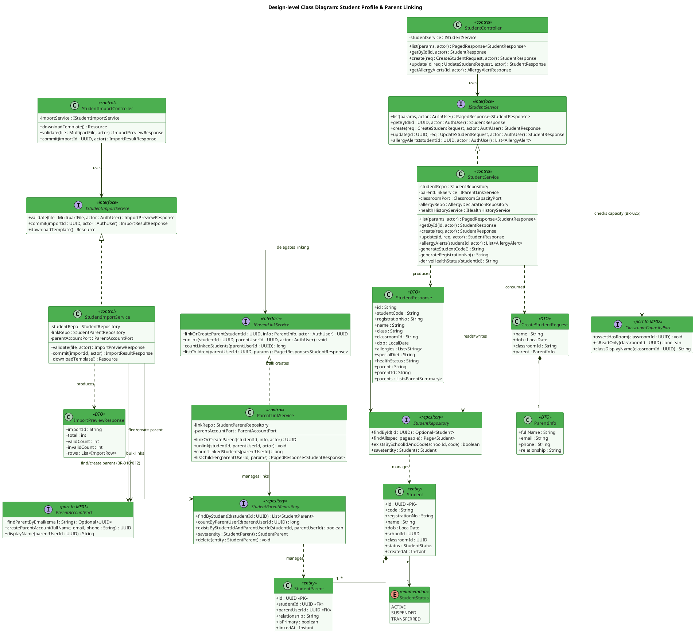

**Description:**
`StudentController` exposes the read/write endpoints for the student roster (UC-147 list, UC-025 create, UC-099 update, BR-123 allergy alerts); `StudentImportController` is split out for the two-phase bulk-import flow (UC-010). `StudentService` never talks to MF01/MF02 directly — it goes through `ParentAccountPort` and `ClassroomCapacityPort`, which reference the other modules purely by UUID (design rule §4b, no cross-module entity import). `ParentLinkService` owns the `student_parents` join table introduced to replace the mock's free-text `parent` field (ADR-M03-1), enforcing BR-030 (≥1 parent per student) and BR-201 (≤5 students per parent). `StudentResponse` intentionally carries several derived-only fields (`allergies`, `specialDiet`, `healthStatus`, `parent`) that do not exist as columns on `Student` (ADR-M03-3) — they are computed by `StudentService` at read time.

---

### 1.2 Sequence Diagram — Create Student & Link Parent (UC-025, BR-030 / BR-201)

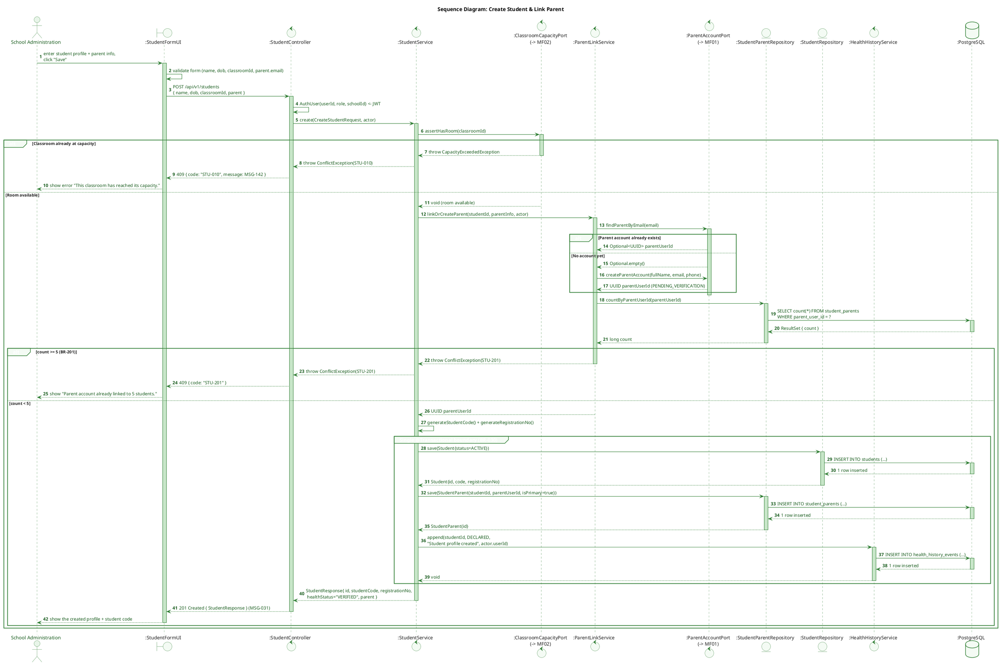

**Description:**
Creating a student is a single transaction that spans two module boundaries. Classroom capacity (BR-025) is verified first via `ClassroomCapacityPort` so no orphaned student row is ever created against a full class. Parent linking is delegated to `ParentLinkService`, which resolves an existing parent account by email or asks MF01 to create one (MF01 owns account creation and email dispatch — MF03 never sends mail itself). The 5-student cap (BR-201) is checked in the service *and* re-validated by a database trigger (`check_parent_link_limit`) so the invariant survives even a bug in the service layer. Every successful creation appends one `health_history_events` row, satisfying the append-only audit requirement (BR-172).

---

### 1.3 Sequence Diagram — Bulk Import Students & Parents (UC-010, BR-032)

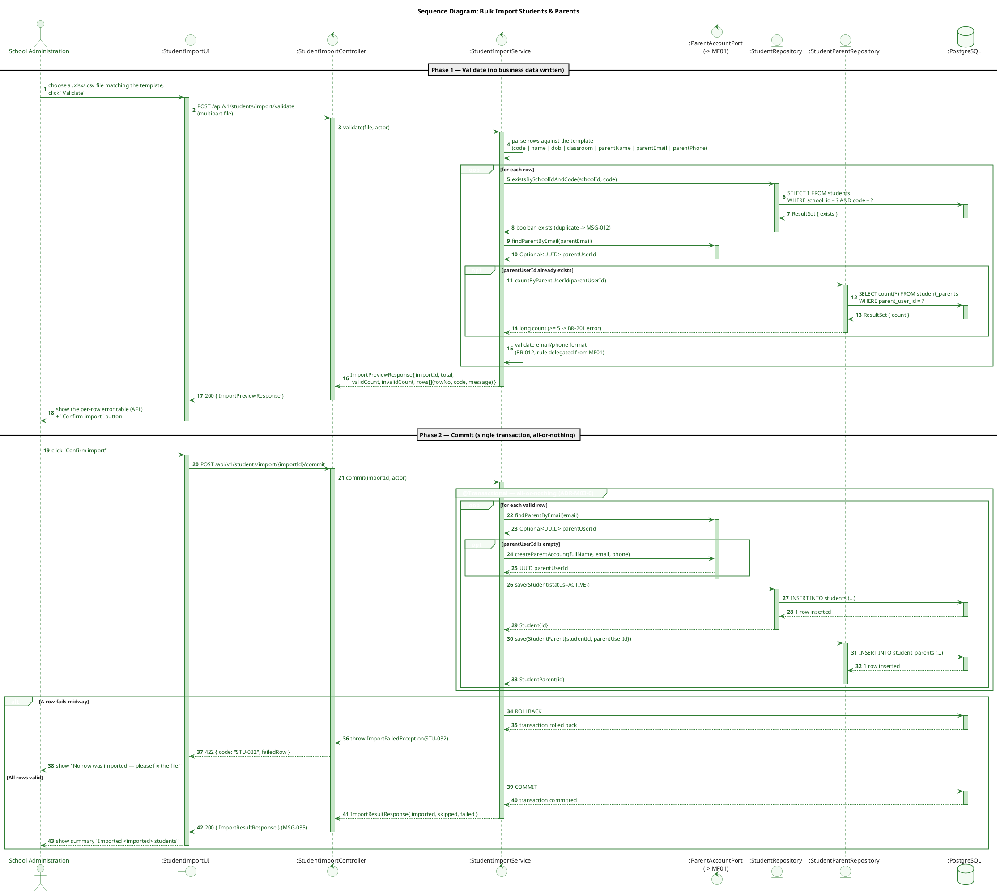

**Description:**
Bulk import runs in two explicit phases (ADR-M03-6). Phase 1 (`validate`) never writes business data — it only parses the uploaded file, checks for duplicate admission codes (MSG-012), unknown classrooms, and the BR-201 parent-link cap, returning a per-row error report so the operator can fix and re-upload. Phase 2 (`commit`) replays only the previously-validated rows inside a single database transaction — either every row is inserted or none are, closing the gap left by row-by-row inserts that could fail halfway through.

---

## 2. Health & Allergy Declaration

### 2.1 Class Diagram

```plantuml
@startuml MF03_HealthDeclaration_ClassDiagram
title Design-level Class Diagram: Health & Allergy Declaration Review

' ==========================================
' CẤU HÌNH BỐ CỤC VÀ MÀU SẮC RATIONAL ROSE
' ==========================================
skinparam classAttributeIconSize 0
skinparam linetype ortho
skinparam nodesep 60
skinparam ranksep 60
skinparam backgroundColor #FFFFFF

' Định dạng cho Class / Interface / Abstract Class
skinparam class {
    BackgroundColor #F4FBF4
    BorderColor #2E7D32
    FontColor #212121
    FontName Arial
    FontSize 13

    HeaderBackgroundColor #4CAF50
    HeaderFontColor #FFFFFF

    AttributeFontColor #212121
    AttributeFontName Arial
    AttributeFontSize 12
}

skinparam interface {
    BackgroundColor #f7ed93ff
    BorderColor #000000ff
    FontColor #000000ff
    FontName Arial
}

' Định dạng Mũi tên & Liên kết (Relationships & Arrows)
skinparam arrow {
    Color #162c00ff
    FontColor #162c00ff
    FontName Arial
    FontSize 11
}

' Định dạng Icon Stereotype (C, I, A, E)
skinparam stereotype {
    CBackgroundColor #f6eedcff
    CBorderColor #000000ff
    EBackgroundColor #f6eedcff
    EBorderColor #000000ff
    ABackgroundColor #f6eedcff
    ABorderColor #000000ff
    IBackgroundColor #f6eedcff
    IBorderColor #000000ff
}

hide empty members

class AllergyDeclarationController <<control>> {
  -declarationService : IAllergyDeclarationService
  +list(params, actor) : PagedResponse<AllergyDeclarationResponse>
  +submit(req : SubmitAllergyRequest, actor) : AllergyDeclarationResponse
  +resubmit(id, req : SubmitAllergyRequest, actor) : AllergyDeclarationResponse
}

class HealthReviewController <<control>> {
  -reviewService : IHealthReviewService
  +listAllergyDeclarations(params) : PagedResponse<AllergyDeclarationResponse>
  +verifyAllergy(id) : AllergyDeclarationResponse
  +requestAllergyInfo(id, req : ReviewNoteRequest) : AllergyDeclarationResponse
  +verifyChronic(id) : ChronicConditionResponse
  +requestChronicInfo(id, req : ReviewNoteRequest) : ChronicConditionResponse
}

interface IAllergyDeclarationService <<interface>> {
  +list(params, actor : AuthUser) : PagedResponse<AllergyDeclarationResponse>
  +submit(req : SubmitAllergyRequest, parent : AuthUser) : AllergyDeclarationResponse
  +resubmit(id : UUID, req : SubmitAllergyRequest, parent : AuthUser) : AllergyDeclarationResponse
}

interface IHealthReviewService <<interface>> {
  +listAllergyDeclarations(params, actor : AuthUser) : PagedResponse<AllergyDeclarationResponse>
  +verifyAllergy(id : UUID, actor : AuthUser) : AllergyDeclarationResponse
  +requestAllergyInfo(id : UUID, reason : String, actor : AuthUser) : AllergyDeclarationResponse
  +verifyChronic(id : UUID, actor : AuthUser) : ChronicConditionResponse
  +requestChronicInfo(id : UUID, reason : String, actor : AuthUser) : ChronicConditionResponse
}

class AllergyDeclarationService <<control>> {
  -declRepo : AllergyDeclarationRepository
  -studentParentRepo : StudentParentRepository
  -historyService : IHealthHistoryService
  +list(params, actor) : PagedResponse<AllergyDeclarationResponse>
  +submit(req, parent) : AllergyDeclarationResponse
  +resubmit(id, req, parent) : AllergyDeclarationResponse
  -assertParentOwnsStudent(studentId, parent) : void
}

class HealthReviewService <<control>> {
  -declRepo : AllergyDeclarationRepository
  -chronicRepo : ChronicConditionDeclarationRepository
  -historyService : IHealthHistoryService
  -eventPublisher : EventPublisher
  +listAllergyDeclarations(params, actor) : PagedResponse<AllergyDeclarationResponse>
  +verifyAllergy(id, actor) : AllergyDeclarationResponse
  +requestAllergyInfo(id, reason, actor) : AllergyDeclarationResponse
  +verifyChronic(id, actor) : ChronicConditionResponse
  +requestChronicInfo(id, reason, actor) : ChronicConditionResponse
  -assertHasProofIfSevere(decl) : void
}

interface AllergyDeclarationRepository <<repository>> {
  +findById(id : UUID) : Optional<AllergyDeclaration>
  +findByIdWithStudent(id : UUID) : Optional<AllergyDeclaration>
  +findByStudentIdAndStatus(studentId, status) : List<AllergyDeclaration>
  +save(entity : AllergyDeclaration) : AllergyDeclaration
}

interface ChronicConditionDeclarationRepository <<repository>> {
  +findById(id : UUID) : Optional<ChronicConditionDeclaration>
  +save(entity : ChronicConditionDeclaration) : ChronicConditionDeclaration
}

interface StudentParentRepository <<repository>> {
  +existsByStudentIdAndParentUserId(studentId, parentUserId) : boolean
}

class EventPublisher <<control>> {
  +publish(event : DomainEvent) : void
}

class AllergyDeclaration <<entity>> {
  +id : UUID <<PK>>
  +studentId : UUID <<FK>>
  +category : String
  +allergen : String
  +severity : AllergySeverity
  +declaredAt : Instant
  +declaredByUserId : UUID
  +status : DeclarationStatus
  +proofFileId : UUID
  +reviewNote : String
  +verifiedByUserId : UUID
  +verifiedAt : Instant
}

class ChronicConditionDeclaration <<entity>> {
  +id : UUID <<PK>>
  +studentId : UUID <<FK>>
  +category : String
  +conditionName : String
  +severity : AllergySeverity
  +status : DeclarationStatus
  +proofFileId : UUID
}

enum AllergySeverity <<enumeration>> {
  MILD
  MODERATE
  SEVERE
}

enum DeclarationStatus <<enumeration>> {
  PENDING
  VERIFIED
  NEEDS_INFO
}

class SubmitAllergyRequest <<DTO>> {
  +studentId : String
  +category : String
  +allergen : String
  +severity : AllergySeverity
  +proofFileId : String
}

class AllergyDeclarationResponse <<DTO>> {
  +id : String
  +studentId : String
  +allergen : String
  +severity : AllergySeverity
  +status : DeclarationStatus
  +verifiedBy : String
  +verifiedAt : Instant
}

class ReviewNoteRequest <<DTO>> {
  +reason : String
}

interface IHealthHistoryService <<interface>> {
  +append(studentId : UUID, type : HistoryType, event : String, byUserId : UUID) : void
}

AllergyDeclarationController --> IAllergyDeclarationService : uses
HealthReviewController --> IHealthReviewService : uses
IAllergyDeclarationService <|.. AllergyDeclarationService
IHealthReviewService <|.. HealthReviewService

AllergyDeclarationService --> AllergyDeclarationRepository : creates/updates
AllergyDeclarationService --> StudentParentRepository : checks ownership (STU-005)
AllergyDeclarationService --> IHealthHistoryService : appends DECLARED event
AllergyDeclarationService ..> SubmitAllergyRequest : consumes
AllergyDeclarationService ..> AllergyDeclarationResponse : produces

HealthReviewService --> AllergyDeclarationRepository : updates status (BR-031 gate)
HealthReviewService --> ChronicConditionDeclarationRepository : updates status
HealthReviewService --> IHealthHistoryService : appends VERIFIED event
HealthReviewService --> EventPublisher : publishes AllergyVerified
HealthReviewService ..> AllergyDeclarationResponse : produces
HealthReviewService ..> ReviewNoteRequest : consumes

AllergyDeclarationRepository ..> AllergyDeclaration : manages
ChronicConditionDeclarationRepository ..> ChronicConditionDeclaration : manages
AllergyDeclaration "n" --> "1" AllergySeverity
AllergyDeclaration "n" --> "1" DeclarationStatus
ChronicConditionDeclaration "n" --> "1" DeclarationStatus
@enduml
```

**Description:**
Two services split submission from review, matching who is allowed to do what: `AllergyDeclarationService` handles the parent-facing submit/resubmit path (UC-084/UC-093), while `HealthReviewService` is the Medical Staff gate (UC-077) that flips `status` from `PENDING`/`NEEDS_INFO` to `VERIFIED` — the only condition under which a declaration counts toward BR-123 alerts or BR-063 menu conflicts (ADR-M03-2, per-allergen verification, not a single student-level flag). `HealthReviewService.assertHasProofIfSevere()` mirrors the database CHECK constraint (`ck_severe_needs_proof`) at the service layer so the 422 error can carry a clear message before the INSERT/UPDATE ever reaches PostgreSQL. Both services call the shared `IHealthHistoryService.append()` so every state transition leaves exactly one immutable audit row (BR-172).

---

### 2.2 Sequence Diagram — Submit Allergy Declaration (UC-084, BR-031)

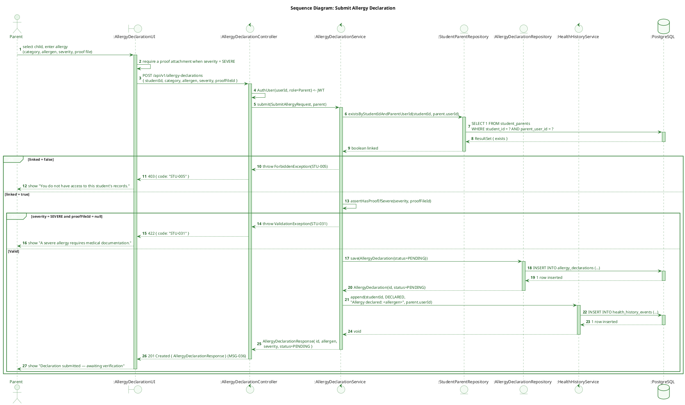

**Description:**
A parent may only declare allergies for a student they are linked to — enforced by checking `student_parents` before any write, not merely by role. A `SEVERE` declaration without a proof document is rejected client-side by the service before it ever reaches the database, giving a precise 422 instead of surfacing a raw constraint violation. Successful submission starts the declaration at `PENDING` and appends one history event; the Medical Staff review queue picks it up from there (§2.3).

---

### 2.3 Sequence Diagram — Medical Staff Verifies Allergy Declaration (UC-077, BR-031 → BR-123)

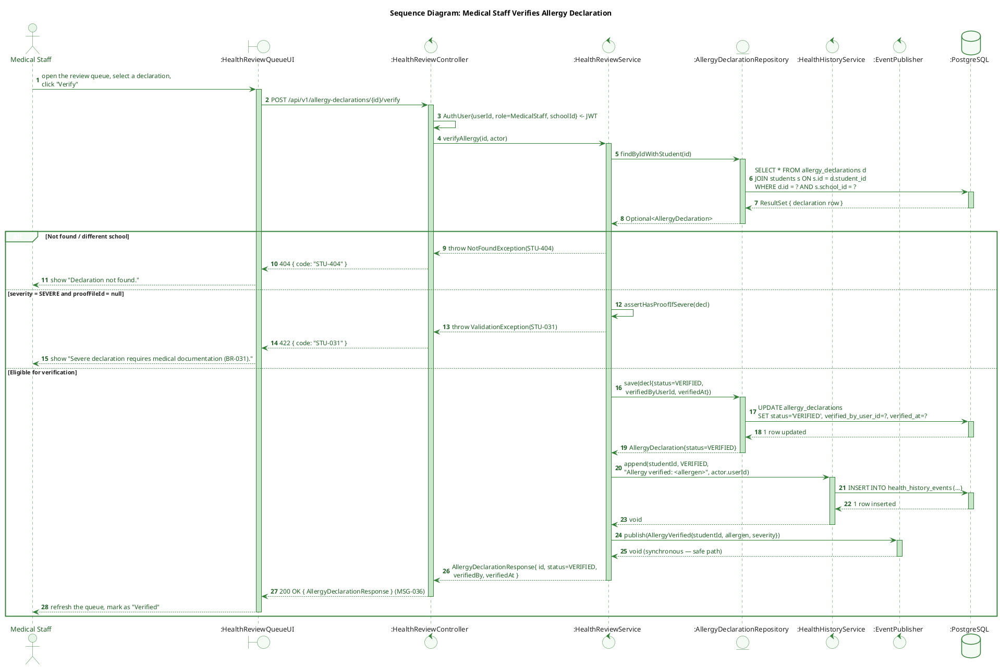

**Description:**
Verification is the single event that makes an allergy declaration "count" downstream — before this call, MF05 and MF09 never see the row. The same severe/proof-required rule from submission is re-checked here because a declaration can also arrive at review already missing a document (e.g. a resubmission edge case), and the database CHECK constraint is the final backstop either way. Publishing `AllergyVerified` is intentionally synchronous ("safe path") because MF09's serving-time alert (BR-123) is safety-critical — the review action should not be reported as successful before downstream systems can react to it.

---

## 3. Special Meal Request Management

### 3.1 Class Diagram

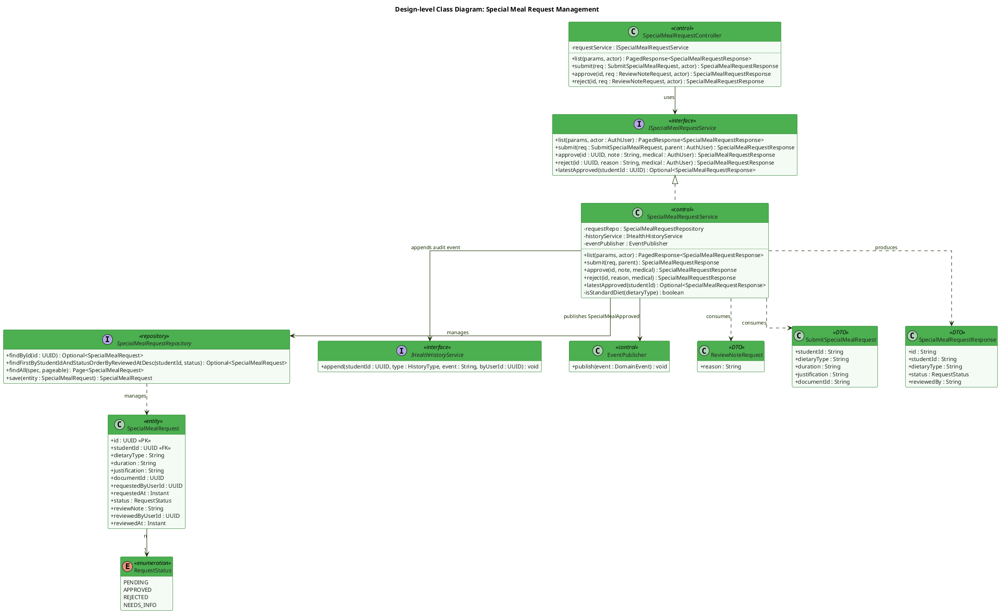

**Description:**
`SpecialMealRequestService.isStandardDiet()` checks `dietaryType` against the BR-066 catalog (Halal, Vegetarian, Gluten-Free, Nut-Free, Lactose-Free). Per BR-220, a non-standard value is **not** a hard rejection — approval is redirected to `NEEDS_INFO`, requiring the medical justification before it can be approved. `latestApproved(studentId)` backs the derived `Student.specialDiet` field (ADR-M03-3/CF-M03-11): there is no `special_diet` column anywhere — the current diet is always the most recent `APPROVED` row for that student.

---

### 3.2 Sequence Diagram — Approve Special Meal Request (UC-078, BR-065 / BR-220)

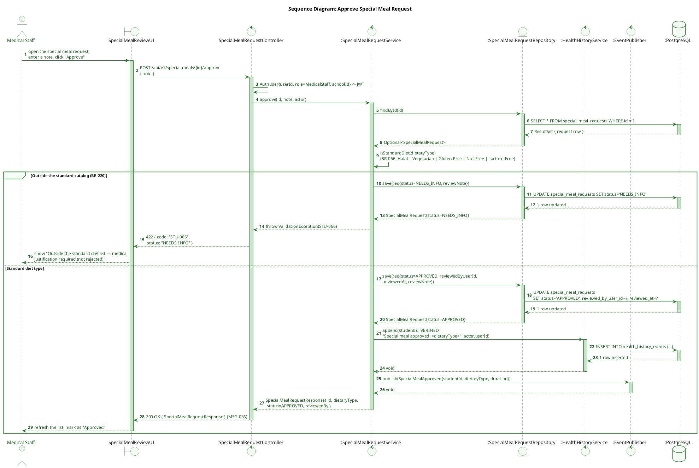

**Description:**
The BR-066/BR-220 branch is the key decision point: an out-of-catalog diet type never silently becomes `REJECTED` — it becomes `NEEDS_INFO`, sending the request back for additional medical justification before a Medical Staff member can approve it. Only a genuine `APPROVED` transition publishes `SpecialMealApproved`, which is the trigger MF05 relies on to build a dedicated meal plan (BR-065) and instruct the caterer to prepare it separately (BR-082).

---

## 4. Student Health Record & Clinical File

### 4.1 Class Diagram

```plantuml
@startuml MF03_HealthFile_ClassDiagram
title Design-level Class Diagram: Student Health Record & Clinical File

' ==========================================
' CẤU HÌNH BỐ CỤC VÀ MÀU SẮC RATIONAL ROSE
' ==========================================
skinparam classAttributeIconSize 0
skinparam linetype ortho
skinparam nodesep 60
skinparam ranksep 60
skinparam backgroundColor #FFFFFF

' Định dạng cho Class / Interface / Abstract Class
skinparam class {
    BackgroundColor #F4FBF4
    BorderColor #2E7D32
    FontColor #212121
    FontName Arial
    FontSize 13

    HeaderBackgroundColor #4CAF50
    HeaderFontColor #FFFFFF

    AttributeFontColor #212121
    AttributeFontName Arial
    AttributeFontSize 12
}

skinparam interface {
    BackgroundColor #f7ed93ff
    BorderColor #000000ff
    FontColor #000000ff
    FontName Arial
}

' Định dạng Mũi tên & Liên kết (Relationships & Arrows)
skinparam arrow {
    Color #162c00ff
    FontColor #162c00ff
    FontName Arial
    FontSize 11
}

' Định dạng Icon Stereotype (C, I, A, E)
skinparam stereotype {
    CBackgroundColor #f6eedcff
    CBorderColor #000000ff
    EBackgroundColor #f6eedcff
    EBorderColor #000000ff
    ABackgroundColor #f6eedcff
    ABorderColor #000000ff
    IBackgroundColor #f6eedcff
    IBorderColor #000000ff
}

hide empty members

class StudentHealthFileController <<control>> {
  -healthFileService : IStudentHealthFileService
  +getFile(studentId, actor) : StudentHealthFileResponse
  +appendClinical(studentId, req : ClinicalUpdateRequest, actor) : StudentHealthFileResponse
  +getHealthRecord(studentId, actor) : StudentHealthRecordResponse
  +upsertHealthRecord(studentId, req : HealthRecordRequest, actor) : StudentHealthRecordResponse
}

interface IStudentHealthFileService <<interface>> {
  +getFile(studentId : UUID, actor : AuthUser) : StudentHealthFileResponse
  +appendClinical(studentId : UUID, req : ClinicalUpdateRequest, medical : AuthUser) : StudentHealthFileResponse
  +getHealthRecord(studentId : UUID, actor : AuthUser) : StudentHealthRecordResponse
  +upsertHealthRecord(studentId : UUID, req : HealthRecordRequest, actor : AuthUser) : StudentHealthRecordResponse
}

class StudentHealthFileService <<control>> {
  -clinicalRepo : StudentClinicalFileRepository
  -recordRepo : StudentHealthRecordRepository
  -allergyRepo : AllergyDeclarationRepository
  -historyService : IHealthHistoryService
  +getFile(studentId, actor) : StudentHealthFileResponse
  +appendClinical(studentId, req, medical) : StudentHealthFileResponse
  +getHealthRecord(studentId, actor) : StudentHealthRecordResponse
  +upsertHealthRecord(studentId, req, actor) : StudentHealthRecordResponse
  -computeBmi(heightCm, weightKg) : BigDecimal
}

interface StudentClinicalFileRepository <<repository>> {
  +findByStudentId(studentId : UUID) : Optional<StudentClinicalFile>
  +save(entity : StudentClinicalFile) : StudentClinicalFile
}

interface StudentHealthRecordRepository <<repository>> {
  +findByStudentId(studentId : UUID) : Optional<StudentHealthRecord>
  +save(entity : StudentHealthRecord) : StudentHealthRecord
}

interface IHealthHistoryService <<interface>> {
  +append(studentId : UUID, type : HistoryType, event : String, byUserId : UUID) : void
}

class StudentClinicalFile <<entity>> {
  +id : UUID <<PK>>
  +studentId : UUID <<FK, unique>>
  +medicalConditions : String
  +medications : String
  +emergencyContact : String
  +emergencyInstructions : String
  +updatedAt : Instant
}

class StudentHealthRecord <<entity>> {
  +id : UUID <<PK>>
  +studentId : UUID <<FK, unique>>
  +heightCm : BigDecimal
  +weightKg : BigDecimal
  +bloodType : String
  +status : DeclarationStatus
  +proofFileId : UUID
  +updatedAt : Instant
}

class ClinicalUpdateRequest <<DTO>> {
  +medicalConditions : String
  +medications : String
  +emergencyContact : String
  +emergencyInstructions : String
}

class StudentHealthFileResponse <<DTO>> {
  +studentId : String
  +medicalConditions : String
  +medications : String
  +emergencyContact : String
  +emergencyInstructions : String
  +medicalDocuments : List<String>
}

class HealthRecordRequest <<DTO>> {
  +heightCm : BigDecimal
  +weightKg : BigDecimal
  +bloodType : String
}

class StudentHealthRecordResponse <<DTO>> {
  +studentId : String
  +heightCm : BigDecimal
  +weightKg : BigDecimal
  +bmi : BigDecimal
  +bloodType : String
  +status : DeclarationStatus
}

StudentHealthFileController --> IStudentHealthFileService : uses
IStudentHealthFileService <|.. StudentHealthFileService
StudentHealthFileService --> StudentClinicalFileRepository : reads/updates
StudentHealthFileService --> StudentHealthRecordRepository : reads/updates
StudentHealthFileService --> IHealthHistoryService : appends CLINICAL_NOTE event
StudentHealthFileService ..> ClinicalUpdateRequest : consumes (only 4 fields)
StudentHealthFileService ..> HealthRecordRequest : consumes
StudentHealthFileService ..> StudentHealthFileResponse : produces
StudentHealthFileService ..> StudentHealthRecordResponse : produces (bmi derived)
StudentClinicalFileRepository ..> StudentClinicalFile : manages
StudentHealthRecordRepository ..> StudentHealthRecord : manages
@enduml
```

**Description:**
`appendClinical()` accepts **only** `medicalConditions`, `medications`, `emergencyContact`, `emergencyInstructions` — any other field (e.g. an attempt to set `allergies` or `healthStatus` through this endpoint) is rejected with `400 STU-094`, because those values are owned exclusively by the allergy/special-meal review flows (§2, §3). `getFile()` still returns a derived `medicalDocuments[]` array (joined from `allergy_declarations.proof_file_id`) for display purposes, but that array is read-only through this service — documents can only be attached via a declaration.

---

### 4.2 Sequence Diagram — Update Clinical Record (UC-094, BR-172)

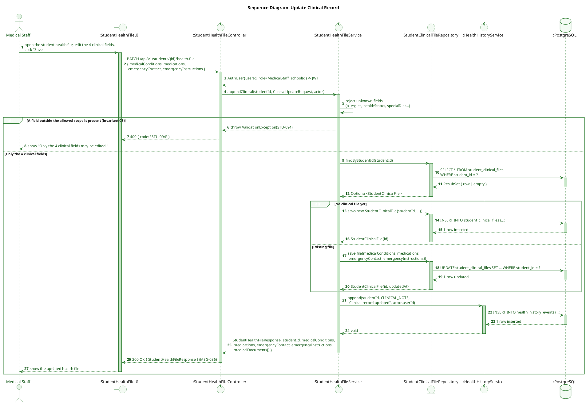

**Description:**
The service explicitly rejects any field outside the four clinical attributes before touching the repository, so a caller cannot accidentally (or intentionally) flip `healthStatus` or `allergies` through this narrower endpoint — those remain gated by the declaration review flows (§2.3, §3.2). Every update, not just the first one, appends a new `health_history_events` row rather than overwriting the previous state, keeping the full edit history available for UC-146.

---

## 5. Health History (Audit Trail)

### 5.1 Class Diagram

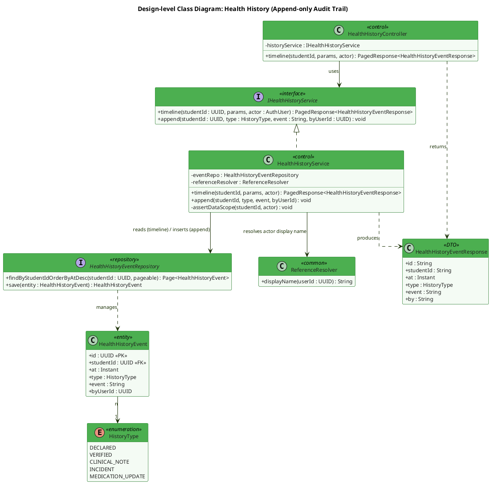

**Description:**
`HealthHistoryService.append()` is the single internal choke point every other MF03 service goes through to record an event — there is deliberately no `POST /health-history` endpoint exposed to clients (BR-172, ADR-M03-4). `HealthHistoryController.timeline()` is strictly read-only (UC-146, UC-051); the underlying `health_history_events` table has database-level `RULE`s that turn `UPDATE`/`DELETE` into no-ops and the application role has those grants revoked, so immutability does not depend on every future engineer remembering not to call `save()` on an existing row.

---

### 5.2 Sequence Diagram — View Student Health History Timeline (UC-146, BR-172)

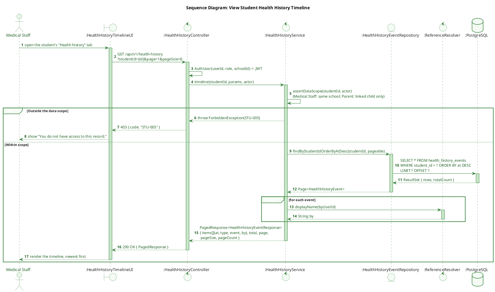

**Description:**
The timeline endpoint is a plain, scoped read: Medical Staff see any student in their school, Parents see only their linked children. Because the table is append-only, the response always reflects the true, unaltered chronology of declarations, verifications, clinical notes, and incidents for a student — there is no code path, authorized or not, that can rewrite history after the fact.

---

## 6. State Machines

### 6.1 Declaration Lifecycle — AllergyDeclaration / ChronicConditionDeclaration (BR-031)

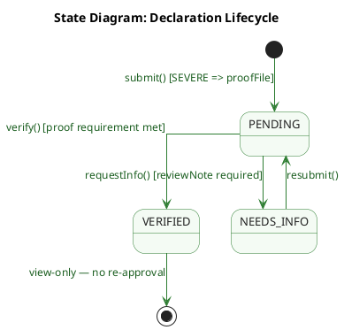

**Description:**
`VERIFIED` is a terminal, one-way state reachable only through explicit Medical Staff review — nothing in MF03 ever un-verifies a declaration through the UI. Any subsequent correction (e.g. discovering the allergen was misrecorded) is captured as a brand-new history event rather than a mutation of the existing row, preserving the append-only guarantee (BR-172) end to end.

---

### 6.2 Request Lifecycle — SpecialMealRequest (UC-078, BR-065)

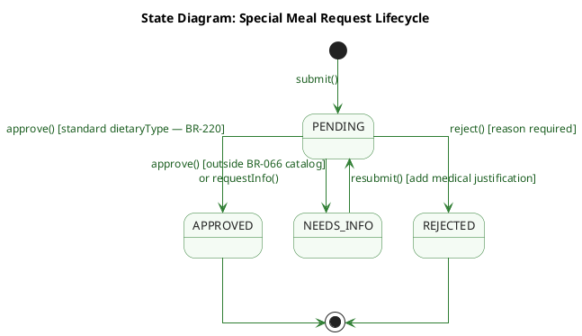

**Description:**
The distinguishing rule versus a typical approve/reject flow is BR-220: an out-of-catalog `dietaryType` is deliberately routed to `NEEDS_INFO` rather than `REJECTED`, since BR-066's diet catalog is open-ended and a novel value may simply need supporting medical justification rather than outright denial. Only the `APPROVED` transition has downstream consequences — it is the sole event that obligates MF05 to build a dedicated meal plan.

---

### 6.3 Student Lifecycle — `Student.status` (UC-025 / UC-099, BR-025)

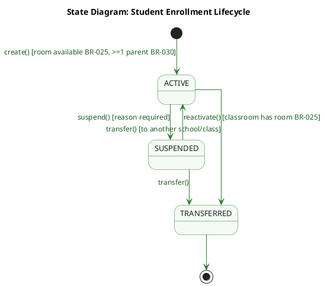

**Description:**
A student is born `ACTIVE` only after both gates pass — classroom capacity (BR-025) and at least one linked parent (BR-030). `SUSPENDED` is reversible and is the state used for temporary leave: the roster hides the student from serving lists (MF09) while every declaration, clinical field, and history row stays intact. `TRANSFERRED` is terminal because MF03 never deletes a student record — the health history must remain readable after departure (BR-172), so "removal" is modelled as a final state rather than a `DELETE`.

---

### 6.4 Health Record Lifecycle — `StudentHealthRecord.status` (UC-094, CF-M03-9)

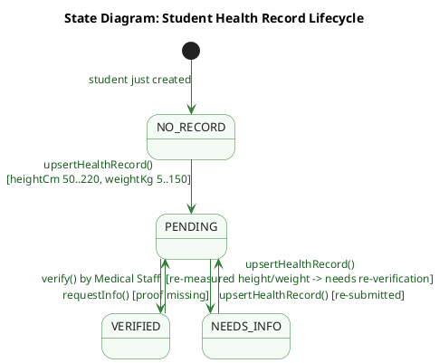

**Description:**
Unlike a declaration, a health record is *re-measurable*: a new height/weight in a later school term pushes a `VERIFIED` record back to `PENDING` rather than creating a second row, because `student_health_records` is 1-1 with the student. `NO_RECORD` is an explicit modelled state, not an accident — the API answers `204 No Content` instead of `404`, which is what lets the FE distinguish "not measured yet" from "student does not exist". Each transition still appends its own `health_history_events` row, so the measurement history survives even though the record itself is overwritten in place.

---

### 6.5 Import Session Lifecycle — Bulk Import (UC-010, ADR-M03-6)

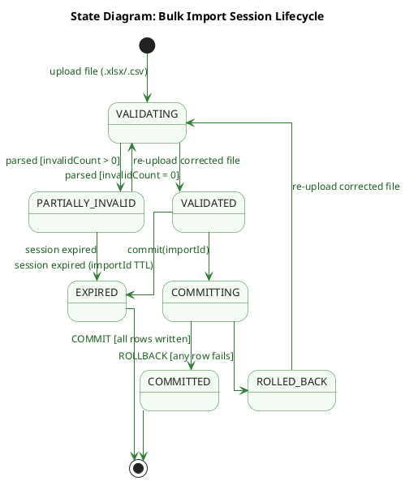

**Description:**
The import session is the state that makes the two-phase design visible: no student row exists until `COMMITTING` succeeds, so `PARTIALLY_INVALID` is a safe, repeatable place for the operator to iterate on the spreadsheet. `ROLLED_BACK` and `COMMITTED` are mutually exclusive by construction (single transaction), which is precisely the guarantee the row-by-row mock could not offer. `EXPIRED` exists because `importId` only holds a parsed, in-memory preview — an abandoned preview must not stay committable indefinitely.

---

*Document derived from TDS `SFMS-MF03-IMP-001 v1.1` (Approved 2026-08-02). The five Section 6 state machines and the DBML schema mirror the entity model in TDS §5.1–5.2; all business rule references (BR-xxx) and error codes (STU-xxx) are unchanged from the source TDS. Sequence diagrams use UML robustness stereotypes — `boundary` (UI), `control` (controller/service/port), `entity` (repository), `database` — with `:ObjectName` lifelines, explicit return messages, and `autonumber`.*
