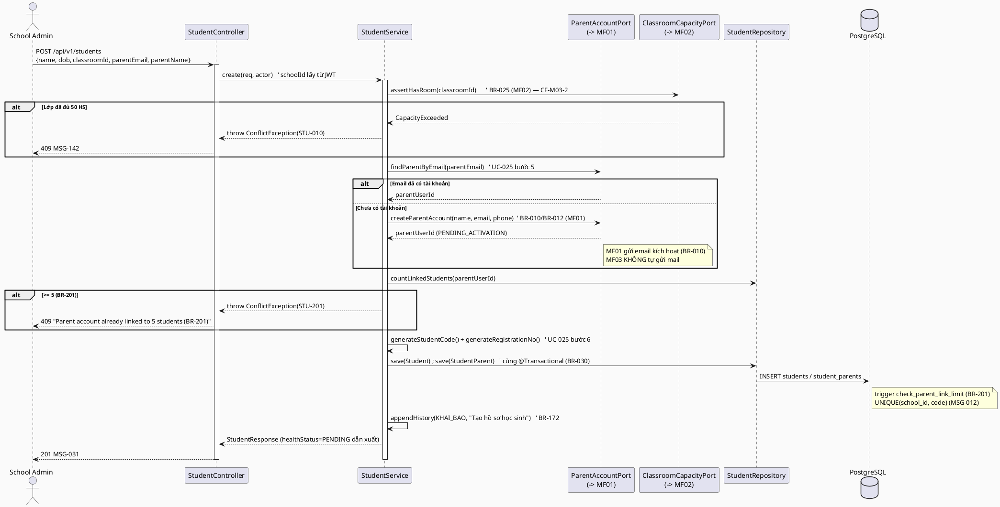
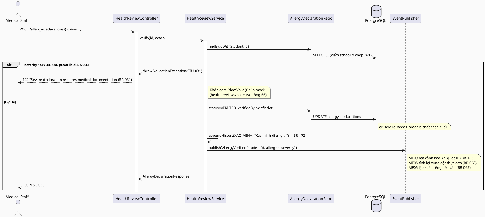
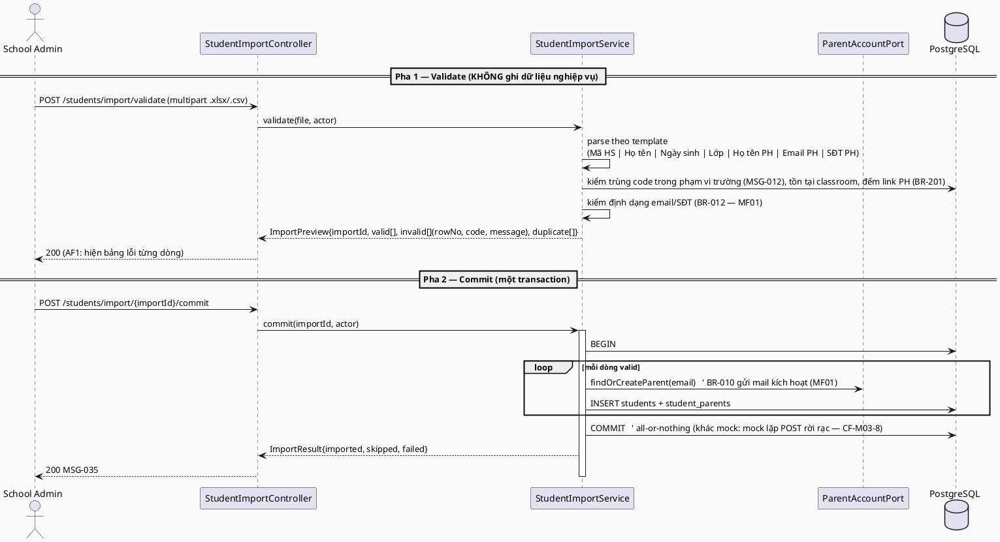
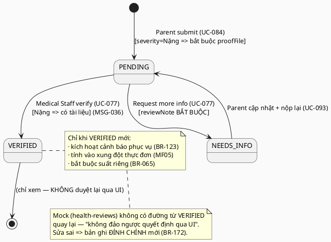
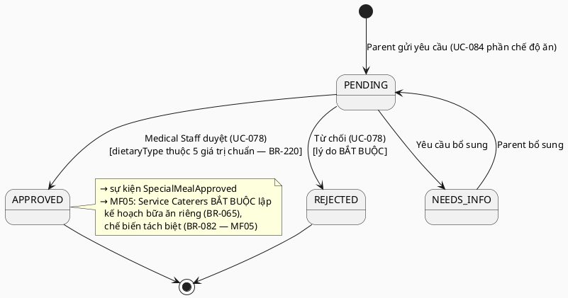

# ENGINEERING DOCUMENTATION STANDARD (EDS) v2.0 — TDS Backend
# MF03 — Student & Parent Management

| Field | Value |
|-------|-------|
| **Document ID** | `SFMS-MF03-IMP-001` |
| **Version** | `1.1` |
| **Date** | `2026-08-02` |
| **Status** | `Approved` |
| **Document Owner** | Bùi Quang Huy (HuyBQHE180599) |
| **Author** | Bùi Quang Huy — chủ module MF03/MF06, Lead Requirements & Traceability Reviewer |
| **Reviewed by** | Nguyễn Đức Mạnh (Backend/DB) · Trần Tuấn Minh (FE↔BE contract) · Nguyễn Phương Thảo (Test) — duyệt 2026-08-02 |
| **DPO Sign-off** | `[ ] Pending` — ⚠️ **Restricted**: module chứa **PII trẻ em + dữ liệu sức khỏe** (dị ứng, bệnh lý nền, hồ sơ lâm sàng). **Không chặn `Approved`** (MF02 cũng vậy) nhưng **bắt buộc DPO ký trước khi lên môi trường thật** (BR-173 PDPD). Giữ dòng này nổi bật cho tới khi có chữ ký. |
| **Approved by** | Nguyễn Văn Nam — Final Approval, 2026-08-02 |
| **Last Review** | `2026-08-02` |
| **Based on EDS** | `v2.0` |

> **Stack (ADR-000 / `01_MVP_Backend_Implementation_Plan.md` §3):** Spring Boot **4.1.x (Java 25 LTS)** · PostgreSQL 16 · **Flyway** · **Spring Security + JWT** (RBAC 7 role, tin JWT do MF01 phát hành) · springdoc-OpenAPI (Swagger) · MapStruct.
>
> **Vị trí code:** `04_Development/Backend/` (Maven, `com.sfms`). Package MF03 = **`com.sfms.mf03`** — khớp cách đặt của MF02 (`com.sfms.mf02`); MF01 dùng `com.sfms.iam` vì lý do lịch sử, KHÔNG lấy làm mẫu.
>
> **Flyway (thực tế sau khi MF01/MF02 build xong 31/07):** mô hình "V1 = toàn bộ schema, Nam giữ" **đã bị bỏ**. Thực tế `V1__init_schema.sql` = MF01 (12 bảng), `V2` = seed role/permission, `V3__mf02_school_class_academic_year.sql` = MF02. **MF03 tự giữ `V4__mf03_student_parent.sql` + `V5__seed_mf03.sql`**, không sửa V1.
>
> **MF03 kế thừa convention từ MF02** (vertical slice mẫu): `PagedResponse<T>` + `Specification`, `@RestControllerAdvice`, `SEARCH_FIELDS` cố định, tham chiếu cross-module bằng **ID** (qua `common/reference/ReferenceResolver`, native query — KHÔNG import entity module khác, ADR-M02-5). Không phát minh lại — xem `TDS-MF02_Backend.md` §3/§17 và code thật ở `04_Development/Backend/src/main/java/com/sfms/mf02/`.

---

## CHANGELOG

> **Policy 4.4 — Immutable History:** Không xóa thông tin cũ.

| Ngày | Người thực hiện | Nội dung thay đổi |
|------|-----------------|-------------------|
| 2026-08-02 | Bùi Quang Huy | **Chốt Q1/Q3/Q5, chuyển sang `Approved`.** (a) **Q3** — `STU-010` thôi mượn MSG-010 của MF02, dùng **MSG-142** riêng *"This classroom has reached its capacity."*; MSG-010 ghi cứng *"Maximum allowed is 50 students"* nên sai ngữ nghĩa ở lớp `capacity<50`. Tách theo **D7**, cùng lý do MF02 tách MSG-140 ngày 31/07. (b) **Q5** — `STU-500` dùng **MSG-143** riêng thay vì mượn MSG-001 (nguyên văn *"school data"*, thuộc module khác). (c) **Q1** — không sửa BR-066 để hợp thức hóa hành vi; **giữ BR-066 là danh mục MỞ** và cấp **BR-220** mới: `dietaryType` ngoài 5 giá trị chuẩn **không bị từ chối** nhưng **không duyệt thẳng**, chuyển `NEEDS_INFO` chờ Y tế bổ sung căn cứ. Cấp **MSG-144**, **MSG-114 ngừng dùng**. Cập nhật §2.1 (BR-025), §4 state machine, §5.1, §9.3, §10 (3 dòng), §13, §15, §17.1. Nguồn: `error_message.md` **v1.9**, `business_rules.md` **BR-220**. |
| 2026-08-02 | Bùi Quang Huy | **v1.1 — đồng bộ TDS với nền chung đã build (MF01 31/07, MF02 31/07).** Bản v1.0 viết ngày 28/07, trước khi `04_Development/Backend/` tồn tại, nên 6 nhóm giả định đã lạc hậu. Không xóa nội dung cũ (Policy 4.4), chỉ sửa chỗ mâu thuẫn: **(1) D9** — mọi entity `extends BaseEntity`; gỡ `created_at`/`created_by` tự khai trong `Student` và DDL `students`; gỡ `updated_by_user_id` khỏi `student_clinical_files`; bổ sung đủ 4 cột audit vào DDL `students`/`student_health_records`/`student_clinical_files` theo mẫu `classrooms` (V3:114-117). **(2) D1** — đổi cột `student_code UNIQUE` → `code` + `UNIQUE(school_id, code)` (`uq_student_school_code`); `registration_no` giữ UNIQUE toàn hệ thống (UC-025 b6); sửa `existsByStudentCode` → `existsByCodeAndSchoolId`. **(3) D1/CF-M03-13 (mới)** — khóa ngoại trong JSON đổi từ UUID sang `code` của bảng đích (`classroomId:"3A"`, `parentId:"U-0005"`); UUID trong mock FE là giá trị điền tạm, FE sync khi tích hợp. Sửa luôn `"id":"…"`/`"id":"c3f1…"` ở §9.3/§15 thành mã nghiệp vụ. **(4) D6** — bỏ enum cục bộ `AllergySeverity`/`HistoryType`, import `com.sfms.common.enums.AllergySeverity`/`HealthHistoryEventType` (5 giá trị khớp nguyên vẹn). **(5) Flyway** — mô hình "V1 = toàn schema, Nam giữ" đã bị bỏ từ MF02; MF03 tự giữ `V4__mf03_student_parent.sql` + `V5__seed_mf03.sql`, KHÔNG sửa V1/V3 (checksum mismatch). **(6) Vị trí code** — chốt `04_Development/Backend/`, package `com.sfms.mf03` (theo MF02; `com.sfms.iam` của MF01 là ngoại lệ lịch sử). Cập nhật §17.2 Constraint Block. **Còn mở:** Q1 (BR-066 danh mục mở), Q3 (MSG cho "lớp đầy theo capacity"), Q5 (MSG cho STU-500) — xem TestSpec §2. |
| 2026-07-28 | Bùi Quang Huy | Tạo bản đầu (v1.0). Nguồn: UC file `MF03_Student_Parent_Management.md`, traceability §1.3, `business_rules.md` §4 (BR-030/031/032/201) + BR-065, BR-123, BR-172, `error_message.md`, mock (`mock-server.ts`/`db.ts`/`mock-data.ts`), `data_model.puml` (package "Học sinh & Hồ sơ sức khoẻ"), `semantic-audit.ts` §12, ADR-000, MVP plan §3. Toàn bộ ví dụ code viết bằng **Java + JPA + Flyway SQL** (không TypeScript/Prisma). Ghi nhận **11 mâu thuẫn nguồn** ở §2.3. |

---

## MỤC LỤC

1. [Tổng quan Module](#1-tổng-quan-module) · 2. [Ma trận Truy vết](#2-ma-trận-truy-vết) · 3. [Architecture Decisions](#3-architecture-decisions-inline-adr) · 4. [NFR & SLA](#4-non-functional-requirements--sla) · 5. [Static Modeling](#5-static-modeling) · 6. [Dynamic Modeling](#6-dynamic-modeling) · 7. [Domain Event Catalog](#7-domain-event-catalog) · 8. [Interface Specification](#8-interface-specification) · 9. [API Specification](#9-api-specification) · 10. [Error Codes](#10-bảng-mã-lỗi) · 11. [Triển khai](#11-quy-trình-triển-khai) · 12. [Rollback Runbook](#12-rollback--incident-runbook) · 13. [Kiểm thử](#13-kịch-bản-kiểm-thử) · 14. [Xác minh](#14-phương-pháp-xác-minh) · 15. [API Samples](#15-mẫu-thử-thực-tế) · 16. [Authorization Matrix](#16-authorization-matrix) · 17. [AI Prompt Constraints](#17-ai-prompt-constraints-case-20)

---

## 1. Tổng quan Module

> MF03 quản lý **hồ sơ học sinh** (tạo/sửa/xem danh sách, nhập hàng loạt, liên kết phụ huynh), **khai báo sức khỏe do phụ huynh gửi** (dị ứng, bệnh lý nền, chế độ ăn đặc biệt), **quy trình xác minh của Y tế trường** (BR-031), và **hồ sơ lâm sàng + lịch sử sức khỏe append-only** (BR-172). Đây là **nguồn sự thật duy nhất về dị ứng đã xác minh** — đầu vào chặn cứng cho MF05 (xung đột thực đơn), MF09 (cảnh báo khi phát suất, BR-123) và MF11 (điều tra sự cố).

| Field | Value |
|-------|-------|
| **Module Name** | Student & Parent Management (MF03) |
| **Bounded Context** | Student Profile & Health Records |
| **Data Classification** | `Restricted` — **PII trẻ em + dữ liệu sức khỏe**. Cao hơn mọi module khác (MF02 chỉ `Confidential`). |
| **Compliance Scope** | **PDPD (BR-173)** — không thu thập dữ liệu sinh trắc học của học sinh; tài liệu y tế lưu ở object storage có kiểm soát truy cập, không public URL. |
| **Upstream Dependencies** | **MF01** (JWT `userId/role/schoolId`; tài khoản Parent — BR-010 kích hoạt qua email, BR-012 định dạng email/SĐT), **MF02** (`Classroom` — sức chứa BR-025, `AcademicYear` — BR-192/193/194) |
| **Downstream Consumers** | **MF05** (dị ứng đã xác minh → xung đột thực đơn BR-063; chế độ ăn đã duyệt → suất riêng BR-065/082), **MF09** (cảnh báo dị ứng khi quét ID — BR-123; `StudentDistribution` trỏ `studentId`), **MF11** (`IncidentAffectedStudent` trỏ `studentId`), **MF10** (`Feedback.studentId`), **MF13** (thống kê hồ sơ sức khỏe chưa đầy đủ — MSG-064) |

**Phạm vi 15 Use Case (đúng traceability §1.3):**
- **Hồ sơ học sinh (School Administration):** UC-025 (Create Student), UC-099 (Update Student), UC-010 (Bulk Import Student & Parent), UC-147 (View Student List).
- **Khai báo của phụ huynh (Parent):** UC-084 (Submit Health & Allergy Information), UC-093 (Update Health & Allergy Information), UC-050 (View List Student Health Information).
- **Xét duyệt của Y tế (Medical Staff):** UC-077 (Review Health Information), UC-078 (Review Special Meal Requests), UC-036 (View List Allergy & Special Meals), UC-094 (Update Health Records), UC-051 (View List Student Health Records), UC-146 (View Student Health History).
- **Tra cứu (đa vai):** UC-104 (View Allergy Information — Medical Staff/Parent), UC-145 (View Student Health & Allergy Information — Teacher).

> ⚠️ `00_Team_Work_Assignment_Plan.md` §3 ghi MF03 có "15 UC" — **khớp đúng** traceability §1.3 (15 dòng). Không có UC nào bị thừa/thiếu.

**Vai trò liên quan (BR-007):** School Administration (tạo/sửa/nhập hàng loạt HS), Parent (khai báo sức khỏe con mình — tối đa 5 HS, BR-201), Medical Staff (xác minh khai báo, ghi hồ sơ lâm sàng), Teacher (xem sổ sức khỏe lớp chủ nhiệm — BR-123), Service Caterers (chỉ **đọc** danh sách dị ứng đã xác minh + chế độ ăn đã duyệt, qua MF05/MF09 — không có endpoint ghi ở MF03), System Admin (không thao tác nghiệp vụ HS).

**Thư mục màn hình đã đọc (nguồn 6 — `03_Design/08_FrontEnd/Web/src/app/(app)/`):**

| Thư mục | UC phủ | Ghi chú |
|---|---|---|
| `school-admin/students/` · `students/[id]/` · `students/import/` | UC-147, UC-025, UC-099, UC-010 | Dialog "Thêm học sinh" bắt buộc tên PH + **email PH** (tra tài khoản); stepper import 4 bước |
| `school-admin/parents/[id]/` | UC-025 (bundled) | Đọc `students?parent=<tên>`; StatCard `n/5` (BR-201) |
| `school-admin/allergy-review/` · `school-admin/special-meals/` | UC-036, UC-104 (view) | Màn giám sát của BGH — chỉ đọc |
| `parent/allergies/` · `parent/chronic-conditions/` · `parent/health/` | UC-084, UC-093, UC-050 | Form khai báo; mức **Nặng** bắt buộc tệp bằng chứng |
| `parent/special-meal-requests/` · `parent/special-meal-records/` · `parent/special-meals/` | UC-084 (diet), UC-050 | Gửi yêu cầu chế độ ăn; theo dõi kết quả |
| `medical-staff/health-reviews/` | **UC-077** | Segmented control 2 module (Dị ứng · Bệnh lý nền) × 2 tab (Chờ xử lý · Đã duyệt) |
| `medical-staff/special-meals/` | **UC-078** | Approve/Reject + lý do bắt buộc; validate danh mục chuẩn |
| `medical-staff/health-records/` · `[id]/` · `[id]/history/` | UC-051, UC-094, UC-146 | Hồ sơ lâm sàng; timeline **read-only** |
| `teacher/students/` · `teacher/students/[id]/` | **UC-145** | Sổ lớp chủ nhiệm; dị ứng badge đỏ (BR-123) |

---

## 2. Ma trận Truy vết

> **Nguồn:** cột BR/MSG lấy **nguyên văn** `traceability_matrix.md` §1.3 (nguồn CHUẨN theo quy tắc §2c của kế hoạch); tên UC nguyên văn UC file `MF03_Student_Parent_Management.md`; nội dung BR tra `business_rules.md` §4 (BR-030/031/032/201), §7 (BR-065), §12 (BR-123), §17 (BR-172). **Policy:** chỉ dùng mã có trong §1.3 — không bịa mã mới. Mọi lệch giữa UC file và traceability được ghi nguyên trạng ở §2.3, **không tự chọn bên đúng**.

### 2.1. UC ↔ BR ↔ MSG ↔ Code

| UC ID | Tên UC (nguyên văn UC file) | Actor (§1.3) | Business Rules (§1.3) | System Messages (§1.3) | Thành phần Code (Java) |
|-------|------------------------------|--------------|------------------------|------------------------|------------------------|
| UC-025 | Create Student | School Administration | BR-030, BR-201 | MSG-012, MSG-031 | `StudentService.create()`, `ParentLinkService.linkOrCreateParent()` |
| UC-099 | Update Student | School Administration | BR-030 | MSG-029 | `StudentService.update()` |
| UC-010 | Bulk Import Student & Parent | School Administration | BR-032 | MSG-035 | `StudentImportService.validate()/commit()` |
| UC-147 | View Student List | School Administration | — | MSG-004, MSG-005 | `StudentService.list()` (`StudentSpec`) |
| UC-084 | Submit Health & Allergy Information | Parent | BR-030, BR-031 | MSG-036 | `AllergyDeclarationService.submit()`, `ChronicConditionService.submit()` |
| UC-093 | Update Health & Allergy Information | Parent | BR-031, BR-201 | MSG-029, MSG-036 | `AllergyDeclarationService.resubmit()` |
| UC-077 | Review Health Information | Medical Staff | BR-031 | MSG-029 | `HealthReviewService.verify()/requestInfo()` |
| UC-078 | Review Special Meal Requests | Medical Staff | BR-031, BR-065 | MSG-029 | `SpecialMealRequestService.approve()/reject()` |
| UC-094 | Update Health Records | Medical Staff | BR-172 | MSG-029 | `StudentHealthFileService.appendClinical()` |
| UC-050 | View List Student Health Information | Parent | BR-030, BR-201 | MSG-004, MSG-005 | `ParentPortalService.listChildrenHealth()` |
| UC-051 | View List Student Health Records | Medical Staff | BR-172 | MSG-004, MSG-005 | `StudentHealthFileService.getFile()` |
| UC-104 | View Allergy Information | Medical Staff/Parent | BR-030 | MSG-004, MSG-005 | `AllergyDeclarationService.list()` |
| UC-145 | View Student Health & Allergy Information | Teacher | BR-030, BR-123 | MSG-004, MSG-005 | `ClassHealthRegistryService.listForHomeroom()` |
| UC-146 | View Student Health History | Medical Staff | BR-172 | MSG-004, MSG-005 | `HealthHistoryService.timeline()` (read-only) |
| UC-036 | View List Allergy & Special Meals | Medical Staff | BR-030, BR-065 | MSG-004, MSG-005 | `SpecialMealRequestService.list()` |

> Tên UC-145 trong traceability §1.3 viết tắt là *"View Student Health & Allergy Info"*; UC file ghi đầy đủ *"...Information"*. Dùng bản đầy đủ của UC file (khác biệt thuần chính tả, không phải mâu thuẫn nghiệp vụ).

### 2.2. Business Rules — nội dung (nguyên văn `business_rules.md`)

| BR | Nội dung (nguyên văn rút gọn) | Áp ở |
|----|-------------------------------|------|
| **BR-030** | Mỗi học sinh phải được liên kết với **ít nhất một** tài khoản phụ huynh. Thông tin dị ứng và chế độ ăn đặc biệt của HS phải được **khai báo và lưu trong hồ sơ học sinh**. | `StudentService.create()`, `ParentLinkService`, mọi query dị ứng theo `studentId` |
| **BR-031** | Thông tin sức khỏe và dị ứng do phụ huynh khai báo phải được **Medical Staff xem xét và xác nhận trước khi có hiệu lực**. | `HealthReviewService`, gate `status=VERIFIED` |
| **BR-032** | Hệ thống hỗ trợ **nhập hàng loạt** hồ sơ HS + PH qua template định nghĩa sẵn với **quy tắc kiểm tra dữ liệu**. | `StudentImportService` |
| **BR-201** | Một tài khoản phụ huynh liên kết **tối đa 5 hồ sơ học sinh**; đạt giới hạn → hệ thống **chặn** liên kết thêm, yêu cầu School Administration xác minh trước khi xử lý ngoại lệ. | `ParentLinkService.link()` (invariant DB + service) |
| **BR-065** | HS có **dị ứng đã xác minh** hoặc chế độ ăn đặc biệt → hệ thống **bắt buộc** Service Caterers tạo **kế hoạch bữa ăn riêng**. | `SpecialMealRequestApproved` event → MF05 |
| **BR-123** | Khi quét ID học sinh có **dị ứng thực phẩm đã đăng ký**, hệ thống **tự động kích hoạt cảnh báo** trực quan + âm thanh trên màn hình phục vụ. | MF03 cung cấp `GET /students/{id}/allergy-alerts` (đã VERIFIED) cho MF09 |
| **BR-172** | Hệ thống phải có cơ chế **bảo vệ toàn vẹn nhật ký**, ngăn chặn mọi hình thức chỉnh sửa trái phép. | `health_history_events` **append-only** (không UPDATE/DELETE, chặn ở DB trigger) |

**BR tham chiếu (không nằm trong cột BR của §1.3 — dùng làm ngữ cảnh, KHÔNG tính là BR chính của MF03):**

| BR | Vì sao xuất hiện | Xử lý |
|----|------------------|-------|
| BR-010 / BR-012 | UC-025 & UC-010 Normal Flow: tạo tài khoản PH mới → gửi email xác minh (BR-010); định dạng email/SĐT (BR-012). Cả hai thuộc **§1.1 MF01**. | Gọi sang MF01 qua port (`ParentAccountPort`) — MF03 **không** tự tạo user/gửi mail. Xem CF-M03-1. |
| BR-025 | UC-025/UC-099 Normal Flow: lớp không vượt **`capacity`** của chính nó (trần cứng 50 — MSG-142). Thuộc **§1.2 MF02**. | MF03 đếm `COUNT(students)` so với `classrooms.capacity` qua `ReferenceResolver` (KHÔNG còn `ClassroomCapacityPort` — L22); lỗi trả **MSG-142**. Xem CF-M03-2. |
| BR-066 | UC-036/UC-078 UC file + mock (`STANDARD_DIETS`) dùng danh mục chuẩn Halal/Vegetarian/Gluten-Free/Nut-Free. Thuộc **§1.6 MF05**. | Validate danh mục ở `SpecialMealRequestService.approve()`, nhưng ghi rõ là BR **của MF05**. Xem CF-M03-4. |
| BR-173 | PDPD — không thu thập sinh trắc học trẻ em. Thuộc §17. | Ràng buộc thiết kế §4.3, không phải BR của UC nào trong §1.3. |

### 2.3. ⚠️ Mâu thuẫn giữa các nguồn (ghi nguyên trạng — KHÔNG tự chọn bên đúng)

> Quy tắc §2c kế hoạch: **`traceability_matrix.md` là nguồn chuẩn**; mọi sai khác so với UC file / mock được liệt kê ở đây để Huy (Lead Traceability) + Mạnh (Backend/DB) + Minh (FE contract) đối chiếu. Không tự sửa `traceability_matrix.md` trong phạm vi TDS này.

| # | Mô tả mâu thuẫn | Xử lý trong TDS |
|---|-----------------|-----------------|
| **CF-M03-1** | **UC-025 Create Student** — UC file cột Business Rules = `BR-010, BR-012, BR-025, BR-031, BR-201`; traceability §1.3 chỉ có `BR-030, BR-201`. Bốn BR (010/012/025/031) thuộc module khác (MF01/MF02) hoặc giai đoạn khác của luồng. | Theo traceability: BR chính của UC-025 = **BR-030, BR-201**. BR-010/012 (tài khoản PH) gọi sang MF01 qua port; BR-025 (sức chứa lớp) gọi sang MF02 qua port — ghi rõ ở §2.2 bảng "BR tham chiếu". Cần Huy xác nhận có bổ sung vào §1.3 hay không. |
| **CF-M03-2** | **MSG-010** (`Classroom capacity exceeded…`) xuất hiện ở Exceptions của **UC-025 và UC-099** trong UC file, nhưng traceability §1.3 **không** liệt kê MSG-010 cho hai UC này (chỉ MSG-012/031 và MSG-029). `error_message.md` §Module coverage cũng xếp MSG-010 vào **School & Class Management**. | Backend **vẫn phải** trả MSG-010 khi lớp đầy (nếu không thì tạo được HS thứ 51). Mã lỗi cục bộ `STU-010` ánh xạ MSG-010 của MF02 — ghi rõ là **mã mượn cross-module**, không phải MSG mới. Cần Huy quyết định bổ sung MSG-010 vào §1.3. |
| **CF-M03-3** | **UC-099 Update Student** — UC file cột Business Rules = **`BR-041`**. `business_rules.md` BR-041 = *"Trạng thái nhà cung cấp: Pending → Approved/Rejected"* (**§5 MF04**) — sai hoàn toàn ngữ cảnh. Traceability §1.3 ghi `BR-030`. | Dùng **BR-030** (traceability). **KHÔNG** áp BR-041 (supplier status) vào cập nhật hồ sơ học sinh. Lỗi trích dẫn ở UC file — cần Huy sửa UC file. |
| **CF-M03-4** | **UC-036 / UC-078** — UC file cite **BR-066** ("Danh mục chế độ ăn đặc biệt: Halal, Vegetarian, Gluten-Free, Nut-Free"); traceability §1.3 cite **BR-065** ("Kế hoạch bữa ăn đặc biệt bắt buộc"). Hai BR khác nhau, cả hai đều tồn tại. Mock (`medical-staff/special-meals/page.tsx` dòng 46) validate theo **`STANDARD_DIETS`** = đúng nội dung **BR-066**, và toast khi từ chối ghi *"không thuộc danh mục chuẩn (BR-066)"* (seed `SMR-2026-035`). | Cột §2.1 giữ **BR-065** (traceability). Đồng thời **vẫn implement** validate danh mục theo BR-066 vì đó là hành vi mock/FE đang dựa vào — đánh dấu BR-066 là "BR tham chiếu MF05" ở §2.2. Cần Huy xác nhận §1.3 có nên liệt kê cả hai. |
| **CF-M03-5** | **UC-146 View Student Health History** — UC file cột Business Rules = `BR-025, BR-123` (sức chứa lớp + cảnh báo khi quét ID) — **không liên quan** timeline read-only; UC file Preconditions/Postconditions lại mô tả đúng BR-172 (*"non-editable timeline format (BR-172)"*). Traceability §1.3 ghi **BR-172**. | Dùng **BR-172**. Bảng "Business Rules" của UC-146 trong UC file nhiều khả năng bị copy nhầm từ UC-145 (cùng cặp BR-025/BR-123) — cần Huy dọn. |
| **CF-M03-6** | **UC-084 / UC-093 / UC-050 / UC-051 / UC-094 / UC-104 / UC-145** — UC file dùng **BR-031** ở hầu hết các UC xem/khai báo; traceability §1.3 thay bằng **BR-030** ở UC-050/084/104/145 và **BR-172** ở UC-051/094. | Theo traceability. Ghi chú: BR-030 câu 2 (*"Thông tin dị ứng và chế độ ăn đặc biệt phải được khai báo và lưu trong hồ sơ học sinh"*) **có** phủ ngữ nghĩa "xem/khai báo", nên thay thế này hợp lý — nhưng gate **hiệu lực** vẫn là BR-031 và được giữ ở UC-077/078/084/093. |
| **CF-M03-7** | **Mock `Student.parent` là một CHUỖI TÊN** (`"Nguyễn Văn Bình"`), không phải khoá ngoại. Màn `school-admin/parents/[id]` tra con bằng `GET /students?parent=<tên đã URL-encode>`. Không có resource `parents` trong `db.ts`; tài khoản PH nằm ở `USER_ACCOUNTS`/`ROLE-06 Parent` (MF01). ⇒ Với mô hình này **không thể enforce BR-030 (liên kết tài khoản) lẫn BR-201 (≤5 HS/tài khoản)** — trùng tên là gộp nhầm, đổi tên là đứt liên kết (đúng lỗi mà C6 `data_model.puml` cảnh báo: *"Truy xuất nối bằng KHOÁ, không bằng tên"*). | **Backend làm KHÁC mock có chủ đích**: thêm bảng liên kết `student_parents(student_id, parent_user_id, relationship, is_primary)` trỏ `user_accounts.id` (role Parent, MF01). Response API **vẫn trả field `parent`** (tên hiển thị) để không phá hợp đồng FE, đồng thời **bổ sung** `parentId`/`parents[]`. Theo quy tắc chống lệch (§0 kế hoạch): **phải sửa đồng thời mock FE** (`students?parentId=`) khi triển khai — Minh xác nhận. |
| **CF-M03-8** | **Mock POST `/students` là handler REST generic** (`mock-server.ts` dòng 335): chỉ `unshift` body vào mảng. Không tra email PH, không tạo tài khoản PH, không gửi email xác minh, **không** kiểm giới hạn 5 HS (BR-201), **không** kiểm sức chứa lớp (BR-025), không sinh mã tuyển sinh. Toàn bộ luồng UC-025 bước 5–7 chỉ tồn tại ở tầng UI (dialog) hoặc **không tồn tại**. Tương tự, `students/import/page.tsx` dùng mảng `MOCK_PARSED` **hard-code** — không parse file thật, không kiểm trùng thật. | Backend **phải** implement đầy đủ UC-025 bước 5–8 và UC-010 bước 3–5 (validate + duplicate detection + email xác minh). Đây là phần backend **vượt** mock, không phải sai lệch hợp đồng JSON — shape response giữ nguyên. |
| **CF-M03-9** | **`HealthRecord`** (height/weight/bloodType/bmi/status/updatedAt/proofFile) **có** trong `data_model.puml` (package "Học sinh & Hồ sơ sức khoẻ") và trong `mock-data.ts` (`HEALTH_RECORDS`, `healthRecordOfStudent()`), nhưng **KHÔNG** có resource trong `db.ts` — màn `parent/health` import tĩnh, không gọi API. Ngoài ra `HealthRecord` trong `data_model.puml` **thiếu `studentId <<FK>>`** (mock-data đã có `studentId`, kèm chú thích sửa 27/07/2026). | Backend tạo bảng `student_health_records` **có** `student_id` (unique) và expose `GET/PUT /api/v1/students/{id}/health-record` (UC-050 hub, UC-094 cập nhật). Đây là resource **MỚI** so với mock — cần Minh bổ sung vào `db.ts` + `mock-server.ts` khi sync. Cần Mạnh cập nhật `data_model.puml` thêm `+studentId : String <<FK>>` cho `HealthRecord`. |
| **CF-M03-10** | **Mô hình dị ứng đôi (dual-source)**: `Student` có `allergySeverity` + `medicalDocuments[]` ở **mức học sinh**, trong khi `AllergyDeclaration` có `severity` + `proofFile` ở **mức từng tác nhân**. `data_model.puml` ràng buộc **C4**: *"Xác minh theo TỪNG tác nhân (BR-031), không phải một cờ chung ở mức học sinh"*. Mock `health-reviews/page.tsx` vẫn ghi cả hai: đổi `Student.healthStatus` **và** lặp `updateDecl` cho từng khai báo (hàm `setDeclStatus`). `Student.allergies` được khai rõ là **DẪN XUẤT** (`db.ts` dòng 114, `mock-data.ts` dòng 3287: *"backend KHÔNG tạo cột này — nó là một phép join"*). | **Nguồn sự thật = `allergy_declarations`** (per-allergen). Backend **KHÔNG** tạo cột `allergies`, `hasAllergy`, `hasSpecialDiet`, `allergySeverity`, `medicalDocuments` trên bảng `students`. `Student.healthStatus` giữ lại như **trạng thái tổng hợp DẪN XUẤT** (xem ADR-M03-3) để khớp hợp đồng FE (tab "Chờ xử lý"/"Đã duyệt" lọc `healthStatus`/`not:healthStatus`). |
| **CF-M03-11** | **`Student.specialDiet` đã `@deprecated`** (`mock-data.ts` dòng 1499, 27/07/2026): nguồn duy nhất cho "chế độ ăn đặc biệt" là `SpecialMealRequest` **đã APPROVED gần nhất** (`latestApprovedMeal()`), nhưng field cũ **vẫn còn** và một số màn (Parent/School Admin/Service Caterers) còn đọc tạm. `data_model.puml` vẫn liệt kê `~specialDiet : String`. Ngoài ra `db.ts` sinh `hasSpecialDiet` từ chính field deprecated này. | Backend **KHÔNG** tạo cột `special_diet`. `specialDiet` trong response là **DẪN XUẤT** từ `special_meal_requests` (APPROVED, `date` mới nhất) — cùng công thức `latestApprovedMeal()`. Filter `hasSpecialDiet=yes|no` thành `EXISTS` subquery. Cần Minh lên lịch sweep bỏ field ở FE. |
| **CF-M03-12** | **MSG-064** (*"Incomplete student health profiles detected for class [Class Name]"*) được `error_message.md` §Module coverage xếp vào **Student & Parent Management**, nhưng **không UC nào** trong traceability §1.3 tham chiếu MSG-064. | Không dùng MSG-064 ở endpoint nào của MF03 trong bản này. Nhiều khả năng thuộc cảnh báo tổng hợp (MF13/dashboard Teacher). Ghi lại để Huy đối chiếu; **không** tự gán vào UC-145/147. |

---

## 3. Architecture Decisions (inline ADR)

> ### ⚠️ Quy ước chung bắt buộc — `07_implement/00_Common_Conventions.md` (D1–D7)
>
> Áp dụng **D1–D7** của `00_Common_Conventions.md` cho toàn bộ tài liệu này. Các ADR bên dưới chỉ ghi phần **riêng của module**; khi xung đột, thứ tự ưu tiên là: **`00_Common_Conventions.md` > ADR module (§3) > hợp đồng mock FE**.
>
> | | Quy ước | Ảnh hưởng tới tài liệu này |
> |---|---|---|
> | **D1** | `id` trong JSON **và** path param = **mã nghiệp vụ**; UUID chỉ là PK nội bộ | §5.2 phải có `code VARCHAR(32)` + `UNIQUE(school_id, code)`; §9.2 path param dùng `{code}` |
> | **D2** | Envelope lỗi `{ "error": { "code", "message", "details" } }` ở `@RestControllerAdvice` | §10 — mã module là `error.code` |
> | **D3** | `baseURL` = `/api/v1` | §9 — mọi path |
> | **D4** | JSON ngày/giờ **luôn ISO-8601** (`LocalDate` / `Instant`) | §9.2 — **bỏ** mọi `@JsonFormat("dd/MM/yyyy")` |
> | **D5** | Nhận `body.id` client gửi → kiểm trùng → **409**; vắng thì server sinh | §9.2 — mọi `POST` |
> | **D6** | 8 enum dùng chung ở `common/enums/`, tất cả **SCREAMING_SNAKE** | §5.1, §5.2, §9.2 — không tự khai lại enum đã có ở D6 |
> | **D7** | Backend trả `code` + `message` **tiếng Anh** (nguyên văn `error_message.md`); FE tra bảng nhãn | §10 |
>
> *Bổ sung 2026-07-29 theo `review.md` mục A — 7 mismatch xuyên module, phần lớn là lệch **giữa các TDS với nhau** chứ không phải lệch FE↔BE.*


> Áp dụng nguyên **ADR-000** (stack, dev/stub external services) và convention của **MF02** (`PagedResponse`/`Specification`/`@RestControllerAdvice`). Các quyết định dưới đây **inline** — không tách file `ADR-MF03_*.md` (quy ước §2c-5: chỉ tách khi quyết định ảnh hưởng >1 module). Ngoại lệ tiềm năng: **ADR-M03-1** chạm cả MF01 — nếu Nam thấy cần, nâng thành ADR chung.

### ADR-M03-1 — Liên kết HS↔PH bằng bảng nối trỏ `user_accounts.id`, KHÔNG bằng tên
- **Bối cảnh:** BR-030 (≥1 PH/HS) và BR-201 (≤5 HS/PH) là ràng buộc **đếm được trên quan hệ**. Mock lưu `Student.parent` là chuỗi tên (CF-M03-7) — không đếm được, không chống trùng tên, đứt liên kết khi đổi tên.
- **Phương án:**

| Option | Mô tả | Đánh giá |
|---|---|---|
| A | Giữ `parent` là chuỗi tên (như mock) | ❌ Không enforce được BR-030/BR-201; vi phạm C6 `data_model.puml` |
| B | Cột `parent_user_id` 1-1 trên `students` | ⚠️ Đơn giản nhưng BR-030 nói *"ít nhất một"* → chặn trường hợp bố+mẹ cùng theo dõi |
| C | **Bảng nối `student_parents`** (n-n, có `is_primary`, `relationship`) | ✅ **Chọn** — enforce cả BR-030 (≥1 dòng/HS) lẫn BR-201 (≤5 dòng/parent) bằng invariant DB |

- **Quyết định:** **Option C**. `student_parents(student_id, parent_user_id, relationship, is_primary, linked_at)`; `parent_user_id` trỏ `user_accounts.id` (role Parent, MF01) — **tham chiếu bằng ID, không import entity MF01** (§4b kế hoạch). BR-201 enforce bằng trigger/`SELECT ... FOR UPDATE` + kiểm ở service để trả đúng mã lỗi.
- **Hệ quả:** Response giữ field `parent` (tên hiển thị, DẪN XUẤT từ join) để không phá FE; **bổ sung** `parentId` + `parents[]`. Mock FE phải đổi `students?parent=<tên>` → `students?parentId=<code, VD U-0005>` (CF-M03-7 + CF-M03-13, Minh sync).

### ADR-M03-2 — Khai báo sức khỏe: xác minh theo TỪNG bản ghi (per-declaration), không theo cờ ở mức học sinh
- **Quyết định:** `allergy_declarations` và `chronic_condition_declarations` mỗi dòng có `status` riêng (`PENDING | VERIFIED | NEEDS_INFO`) + `verified_by` + `verified_at` + `review_note`. Gate hiệu lực (BR-031) đọc **status của từng dòng**, không đọc cờ tổng.
- **Lý do:** Ràng buộc **C4** `data_model.puml`; và bài học ghi trong `mock-data.ts` dòng 3258–3272 — hai mô hình song song từng khiến *"em dị ứng Trứng vẫn được giao Thịt kho trứng cút"* vì bên phát suất tra ra danh sách rỗng.
- **Hệ quả:** MF05/MF09 **chỉ** đọc `WHERE status='VERIFIED'`. Endpoint `GET /students/{id}/allergy-alerts` trả đúng tập đã xác minh (BR-123).

### ADR-M03-3 — `healthStatus`, `allergies`, `specialDiet` là DẪN XUẤT, không lưu cột
- **Quyết định:** Ba giá trị này **tính runtime**:
  - `allergies[]` = `SELECT DISTINCT allergen FROM allergy_declarations WHERE student_id=?` (mock đã khai rõ là join — CF-M03-10);
  - `specialDiet` = `dietaryType` của `special_meal_requests` APPROVED mới nhất (`latestApprovedMeal()` — CF-M03-11);
  - `healthStatus` = tổng hợp: `NEEDS_INFO` nếu có ≥1 khai báo NEEDS_INFO; ngược lại `PENDING` nếu có ≥1 PENDING; ngược lại `VERIFIED` nếu có ≥1 VERIFIED; nếu **không có khai báo nào** → `VERIFIED` (không có gì cần duyệt) — khớp seed mock (HS không dị ứng vẫn `VERIFIED`).
- **Lý do:** Kế thừa ADR-M02-2 ("không lưu field dẫn xuất") + tránh trạng thái đóng băng khi Y tế duyệt từng tác nhân.
- **Hệ quả:** Filter FE `healthStatus=VERIFIED` / `not:healthStatus=VERIFIED` / `hasAllergy=yes` / `hasSpecialDiet=yes` (`db.ts` dòng 114–122) implement bằng **subquery/`EXISTS`** trong `StudentSpec`, **không** bằng cột. Nếu đo được nghẽn (§4.4), thêm **materialized view** hoặc cột cache cập nhật qua event — **không** cho phép ghi tay.

### ADR-M03-4 — `health_history_events` append-only, chặn ở tầng DB (BR-172)
- **Quyết định:** Bảng chỉ nhận `INSERT`. Chặn `UPDATE`/`DELETE` bằng **rule/trigger PostgreSQL** + `REVOKE UPDATE, DELETE` trên role ứng dụng — không chỉ dựa vào "service không gọi save()".
- **Lý do:** BR-172 nói *"ngăn chặn **mọi** hình thức chỉnh sửa trái phép"*; UC-051 Postconditions và UC-146 đều yêu cầu timeline **read-only**. Một `@Transactional` quên `readOnly` là đủ phá — chốt chặn phải ở DB.
- **Hệ quả:** Sửa nhầm nội dung ⇒ **ghi bản ghi đính chính mới**, không sửa dòng cũ. Không có endpoint `PUT`/`DELETE` cho `health-history`.

### ADR-M03-5 — Tài liệu y tế lưu ở object storage, DB chỉ giữ metadata + tham chiếu có kiểm soát (BR-173/PDPD)
- **Quyết định:** `proof_file` / `medical_documents` lưu **key** (không phải URL public). Tải xuống qua `GET /api/v1/health-documents/{id}/content` có kiểm RBAC + phạm vi (PH chỉ tải tài liệu con mình; Teacher **không** được tải). Dev/stub theo ADR-000: lưu filesystem local, cùng API.
- **Hệ quả:** Mock `openDocPreview()` mở tab tên file — FE thật đổi sang gọi endpoint trên. Mọi lượt tải ghi audit (BR-172 tinh thần + PDPD).

### ADR-M03-6 — Bulk import 2 pha (validate → commit), không import từng dòng qua POST lặp
- **Bối cảnh:** Mock `students/import/page.tsx` gọi `create.mutate()` **trong vòng lặp** cho từng dòng hợp lệ (dòng 59–72) — không giao dịch, lỗi giữa chừng để lại dữ liệu nửa vời; và `MOCK_PARSED` là mảng hard-code.
- **Quyết định:** Hai endpoint: `POST /students/import/validate` (multipart, trả `importId` + tổng hợp valid/invalid/duplicate + lỗi từng dòng kèm mã) và `POST /students/import/{importId}/commit` (chạy **một transaction**, all-or-nothing trên tập valid). Kết quả MSG-035.
- **Hệ quả:** AF1 của UC-010 (liệt kê dòng lỗi kèm mã, sửa file rồi upload lại) chạy đúng; không cần thay đổi hợp đồng JSON của FE ngoài 2 path mới.

---

## 4. Non-Functional Requirements & SLA

### 4.1. Performance & Availability

| Category | Requirement | Target | Đo |
|----------|-------------|--------|-----|
| Latency | `GET /students` (p99, có subquery dẫn xuất `healthStatus`/`hasAllergy`) | `< 300ms` | k6 |
| Latency | `GET /students/{id}/allergy-alerts` — **đường chặn suất ăn của MF09 (BR-123)** | `< 120ms` | k6 |
| Latency | `GET /health-history?studentId=` (timeline) | `< 300ms` | k6 |
| Throughput | `POST /students/import/{id}/commit` — 1.000 dòng | `< 30s` | Load test |
| Availability | Uptime tháng | `99.9%` | Uptime monitor |

> ⚠️ `allergy-alerts` được gọi **mỗi lần quét ID học sinh** trong giờ phục vụ (BR-123) — đây là endpoint nóng nhất của MF03; đặt index `(student_id, status)` trên `allergy_declarations`.

### 4.2. Data Integrity & Retention

| Category | Requirement | Target | Compliance |
|----------|-------------|--------|------------|
| Invariant | Mỗi `student` có **≥1** dòng `student_parents` | 100% | BR-030 |
| Invariant | Mỗi `parent_user_id` có **≤5** dòng `student_parents` | 100% | BR-201 |
| Invariant | `allergy_declarations.severity='Nặng' AND status='VERIFIED'` ⇒ `proof_file IS NOT NULL` | 100% | BR-031 (+ `semantic-audit.ts` §12) |
| Invariant | Mọi khai báo sức khỏe có `student_id` hợp lệ (FK) | 100% | BR-030, C4 |
| Immutability | `health_history_events`: 0 lượt UPDATE/DELETE | 100% | **BR-172** |
| Retention | Hồ sơ sức khỏe HS giữ đến hết + 5 năm sau khi rời trường; xóa theo yêu cầu PDPD có quy trình riêng | — | BR-173 |
| Audit | Mọi thao tác verify/reject/approve/link/unlink/import ghi audit | 100% | BR-031, BR-172 |

### 4.3. Security

| Category | Requirement | Compliance |
|----------|-------------|------------|
| Access control | RBAC `@PreAuthorize` + **kiểm phạm vi dữ liệu**: Parent chỉ chạm HS đã liên kết; Teacher chỉ lớp chủ nhiệm; Medical Staff/School Admin chỉ trường mình | BR-007, BR-022, BR-030 |
| PII trẻ em | **Không** thu thập/lưu dữ liệu sinh trắc học học sinh | **BR-173** |
| Tài liệu y tế | Không public URL; tải qua endpoint có RBAC + audit (ADR-M03-5) | BR-173 |
| Log an toàn | **Cấm** log nội dung khai báo dị ứng/bệnh lý, tên HS ở mức INFO; chỉ log ID | BR-173 |
| Immutability | Role DB của app bị `REVOKE UPDATE, DELETE` trên `health_history_events` | BR-172 |

### 4.4. Scalability

> 12 tháng: ~100 trường × ~800 HS = **~80k `students`**; ~1,2 khai báo dị ứng/HS ⇒ ~100k `allergy_declarations`; `health_history_events` tăng tuyến tính (~5 sự kiện/HS/năm ⇒ ~400k dòng/năm, **không bao giờ xóa** — BR-172).
> Index: `students(school_id, classroom_id)`, `students(school_id, code)` unique (`uq_student_school_code`), `allergy_declarations(student_id, status)`, `student_parents(parent_user_id)`, `health_history_events(student_id, at DESC)`.
> `healthStatus` dẫn xuất bằng subquery — nếu p99 vượt ngưỡng §4.1, chuyển sang **materialized view** refresh theo event (ADR-M03-3), **không** thêm cột ghi tay.

---

## 5. Static Modeling

### 5.1. Class Diagram (PlantUML)

```plantuml
@startuml MF03_ClassDiagram
skinparam classAttributeIconSize 0
skinparam backgroundColor #FAFAFA
skinparam ClassBorderColor #B45454
skinparam ClassHeaderBackgroundColor #FEF2F2
skinparam linetype ortho
hide empty members

package "Hồ sơ học sinh" #FEF2F2 {
  class Student {
    + id : UUID
    + code : String        -- D1, lộ ra JSON dưới tên "id"
    + registrationNo : String
    + name : String
    + dob : LocalDate
    + schoolId : UUID
    + classroomId : UUID
    + status : StudentStatus
    + createdAt : Instant
  }

  class StudentParent {
    + id : UUID
    + studentId : UUID
    + parentUserId : UUID
    + relationship : String
    + isPrimary : boolean
    + linkedAt : Instant
  }
}

package "Khai báo sức khỏe (gate BR-031)" #FFF7ED {
  class AllergyDeclaration {
    + id : UUID
    + studentId : UUID
    + category : String
    + allergen : String
    + severity : AllergySeverity
    + declaredAt : Instant
    + declaredByUserId : UUID
    + status : DeclarationStatus
    + proofFileId : UUID
    + reviewNote : String
    + verifiedByUserId : UUID
    + verifiedAt : Instant
  }

  class ChronicConditionDeclaration {
    + id : UUID
    + studentId : UUID
    + category : String
    + conditionName : String
    + severity : AllergySeverity
    + notes : String
    + declaredAt : Instant
    + status : DeclarationStatus
    + proofFileId : UUID
    + reviewNote : String
    + verifiedByUserId : UUID
    + verifiedAt : Instant
  }

  class SpecialMealRequest {
    + id : UUID
    + studentId : UUID
    + dietaryType : String
    + duration : String
    + justification : String
    + documentId : UUID
    + requestedByUserId : UUID
    + requestedAt : Instant
    + status : RequestStatus
    + reviewNote : String
    + reviewedByUserId : UUID
    + reviewedAt : Instant
  }
}

package "Hồ sơ y tế" #EFF6FF {
  class StudentHealthRecord {
    + id : UUID
    + studentId : UUID
    + heightCm : BigDecimal
    + weightKg : BigDecimal
    + bloodType : String
    + status : DeclarationStatus
    + proofFileId : UUID
    + updatedAt : Instant
  }

  class StudentClinicalFile {
    + id : UUID
    + studentId : UUID
    + medicalConditions : String
    + medications : String
    + emergencyContact : String
    + emergencyInstructions : String
    + updatedByUserId : UUID
    + updatedAt : Instant
  }

  class HealthHistoryEvent <<append_only>> {
    + id : UUID
    + studentId : UUID
    + at : Instant
    + type : HistoryType
    + event : String
    + byUserId : UUID
  }

  class HealthDocument {
    + id : UUID
    + studentId : UUID
    + fileName : String
    + storageKey : String
    + contentType : String
    + sizeBytes : long
    + uploadedByUserId : UUID
    + uploadedAt : Instant
  }
}

' Tham chiếu module khác — CHỈ bằng ID, không import entity (§4b kế hoạch)
class ParentUserRef <<external MF01>>
class ClassroomRef  <<external MF02>>

enum StudentStatus {
  ACTIVE
  SUSPENDED
  TRANSFERRED
}
enum DeclarationStatus {
  PENDING
  VERIFIED
  NEEDS_INFO
}
enum AllergySeverity {
  MILD
  MODERATE
  SEVERE
}
enum RequestStatus {
  PENDING
  APPROVED
  REJECTED
  NEEDS_INFO
}
enum HistoryType {
  KHAI_BAO
  XAC_MINH
  GHI_CHU_LAM_SANG
  SU_CO
  CAP_NHAT_THUOC
}

Student "1" *-- "n" StudentParent
Student "1" *-- "n" AllergyDeclaration
Student "1" *-- "n" ChronicConditionDeclaration
Student "1" *-- "n" SpecialMealRequest
Student "1" *-- "n" HealthHistoryEvent
Student "1" *-- "n" HealthDocument
Student "1" -- "0..1" StudentHealthRecord
Student "1" -- "0..1" StudentClinicalFile
AllergyDeclaration "n" ..> "0..1" HealthDocument : proofFileId
StudentParent "n" ..> "1" ParentUserRef : parentUserId
Student "n" ..> "1" ClassroomRef : classroomId

note top of Student
  **DẪN XUẤT — KHÔNG lưu cột** (ADR-M03-3):
  allergies · specialDiet · healthStatus
  allergySeverity · hasAllergy · hasSpecialDiet
  parent · class
  --
  code: UNIQUE(school_id, code) - D1 . registrationNo: UNIQUE toan he thong (MSG-012, UC-025 b6)
  schoolId / classroomId: khoá sang MF02 (BR-025)
end note

note right of StudentParent
  ADR-M03-1 — thay chuỗi tên của mock (CF-M03-7)
  BR-030: ≥ 1 dòng / học sinh
  BR-201: ≤ 5 dòng / parentUserId
end note

note bottom of AllergyDeclaration
  ADR-M03-2 + ràng buộc C4: xác minh theo TỪNG tác nhân,
  không dùng cờ chung ở mức học sinh (BR-031).
  severity = SEVERE & status = VERIFIED ⇒ proofFileId BẮT BUỘC
end note

note bottom of SpecialMealRequest
  dietaryType ngoài 5 giá trị chuẩn -> NEEDS_INFO, KHÔNG reject (BR-220; BR-066 là danh mục MỞ)
  APPROVED ⇒ bắt buộc lập suất riêng (BR-065)
end note

note right of HealthHistoryEvent
  **BR-172 — APPEND-ONLY** (ADR-M03-4)
  chỉ INSERT; RULE + REVOKE UPDATE/DELETE ở DB
end note

note right of StudentHealthRecord
  studentId UNIQUE — CF-M03-9
  (data_model.puml đang thiếu FK này)
  bmi = DẪN XUẤT weightKg / (heightCm/100)²
end note

note right of StudentClinicalFile
  UC-094 chỉ sửa 3 field lâm sàng —
  KHÔNG đụng dị ứng / chế độ ăn (C8)
end note

note bottom of HealthDocument
  ADR-M03-5: lưu storageKey ở object storage,
  KHÔNG public URL; tải qua endpoint có RBAC + audit
end note

@enduml
```



> **Khác biệt có chủ đích so với `data_model.puml`** (đã ghi ở §2.3): (a) thêm `StudentParent` thay chuỗi `Student.parent` — CF-M03-7; (b) `HealthRecord` được bổ sung `studentId` — CF-M03-9; (c) bỏ `Student.allergies/specialDiet/allergySeverity/medicalDocuments` khỏi bảng vật lý — CF-M03-10/11; (d) tách `StudentClinicalFile` khỏi `Student` để UC-094 không đụng field khai báo.
>
> **Quy ước vẽ (đã render kiểm chứng bằng PlantUML 1.2024.7):** ghi chú nghiệp vụ đặt trong khối `note ... end note`, **không** viết `' chú thích` sau tên field — PlantUML coi phần chữ sau dấu `'` là một phần của member, và member nào có dấu ngoặc đơn sẽ bị xếp nhầm sang **ngăn method**. Danh sách interface service không vẽ ở đây (tránh hộp rỗng trôi nổi) — xem đầy đủ ở **§8.1**.

### 5.2. Data Structure — JPA Entity + Flyway migration (Java 25 / Spring Boot 4.1)

> **Migration MF03 = `V4__mf03_student_parent.sql`** (MF03 tự giữ; V1 = MF01, V3 = MF02 — xem ghi chú Flyway ở đầu tài liệu). Seed đi riêng ở `V5__seed_mf03.sql`. **Không dùng Prisma.** Field dẫn xuất KHÔNG là cột (ADR-M03-3).
>
> **Ba quy ước bắt buộc kế thừa từ nền chung đã build (31/07) — áp cho mọi entity dưới đây:**
> - **D9** — entity `extends BaseEntity` (`common/domain/BaseEntity.java`) để có `id` UUID + `created_at`/`updated_at`/`created_by`/`updated_by` tự động qua `AuditingEntityListener`. Entity **TUYỆT ĐỐI KHÔNG** khai lại 4 cột này (khai lại ⇒ Hibernate duplicate-column, build đỏ). DDL **vẫn phải** tạo đủ 4 cột — xem khối SQL bên dưới, giống hệt `classrooms` trong `V3`.
> - **D1** — cột mã nghiệp vụ tên đúng là **`code`** (không phải `student_code`), `UNIQUE(school_id, code)`. Tiền lệ: `classrooms.code` + `uq_class_ay_code` (`V3` dòng 106/118). Cột `registration_no` giữ UNIQUE **toàn hệ thống** vì UC-025 b6 định nghĩa nó là "unique school registration number" cấp nhà nước, không thuộc phạm vi trường.
> - **D6** — `AllergySeverity` và `HealthHistoryEventType` **đã tồn tại** ở `common/enums/`; MF03 `import`, **không** khai lại enum cục bộ.

```java
// Student.java — package com.sfms.mf03.domain
@Entity @Table(name = "students",
  indexes = { @Index(name="ix_student_school_class", columnList="school_id,classroom_id") })
public class Student extends BaseEntity {          // D9 — id/created_at/updated_at/created_by/updated_by
  /** D1 — mã nghiệp vụ công khai ("HS-3A-001"), lộ ra JSON dưới tên "id". UNIQUE(school_id, code). */
  @Column(name="code", nullable=false, length=32)
  private String code;                              // UC-025 b6, MSG-012 khi trùng/không hợp lệ
  @Column(name="registration_no", nullable=false, unique=true, length=32)
  private String registrationNo;                    // "unique school registration number" (UC-025 b6)
  @Column(nullable=false, length=120) private String name;   // SEARCH_FIELDS
  @Column(nullable=false) private LocalDate dob;    // ISO — KHÔNG lưu chuỗi dd/MM/yyyy như mock
  @Column(name="school_id", nullable=false) private UUID schoolId;      // -> MF02 (ID)
  @Column(name="classroom_id", nullable=false) private UUID classroomId; // -> MF02, BR-025
  @Enumerated(EnumType.STRING) @Column(nullable=false)
  private StudentStatus status = StudentStatus.ACTIVE;
  // KHÔNG khai created_at/created_by/updated_at/updated_by — BaseEntity giữ (D9)
  // KHÔNG có: allergies, specialDiet, healthStatus, allergySeverity,
  //           medicalDocuments, hasAllergy, hasSpecialDiet  (ADR-M03-3, CF-M03-10/11)
}
public enum StudentStatus { ACTIVE, SUSPENDED, TRANSFERRED }

// StudentParent.java — bảng nối HS↔tài khoản PH (ADR-M03-1, BR-030/BR-201)
@Entity @Table(name = "student_parents",
  uniqueConstraints = @UniqueConstraint(name="uq_student_parent",
                                        columnNames={"student_id","parent_user_id"}),
  indexes = { @Index(name="ix_sp_parent", columnList="parent_user_id"),
              @Index(name="ix_sp_student", columnList="student_id") })
public class StudentParent {
  @Id @GeneratedValue(strategy = GenerationType.UUID) private UUID id;
  @Column(name="student_id", nullable=false) private UUID studentId;
  @Column(name="parent_user_id", nullable=false) private UUID parentUserId; // -> MF01 (ID)
  @Column(length=40) private String relationship;      // "Bố" | "Mẹ" | "Người giám hộ"
  @Column(name="is_primary", nullable=false) private boolean isPrimary = false;
  @Column(name="linked_at", nullable=false) private Instant linkedAt = Instant.now();
}

// AllergyDeclaration.java — NGUỒN SỰ THẬT về dị ứng (ADR-M03-2, C4)
@Entity @Table(name = "allergy_declarations",
  indexes = { @Index(name="ix_alg_student_status", columnList="student_id,status") })
public class AllergyDeclaration {
  @Id @GeneratedValue(strategy = GenerationType.UUID) private UUID id;
  @Column(name="student_id", nullable=false) private UUID studentId;     // C4: BẮT BUỘC
  @Column(nullable=false, length=80) private String category;            // ALLERGEN_CATEGORIES
  @Column(nullable=false, length=80) private String allergen;
  @Enumerated(EnumType.STRING) @Column(nullable=false)
  private AllergySeverity severity;                                      // MILD|MODERATE|SEVERE
  @Column(name="declared_at", nullable=false) private Instant declaredAt = Instant.now();
  @Column(name="declared_by_user_id", nullable=false) private UUID declaredByUserId;
  @Enumerated(EnumType.STRING) @Column(nullable=false)
  private DeclarationStatus status = DeclarationStatus.PENDING;          // BR-031
  @Column(name="proof_file_id") private UUID proofFileId;                // bắt buộc khi SEVERE+VERIFIED
  @Column(name="review_note", length=500) private String reviewNote;
  @Column(name="verified_by_user_id") private UUID verifiedByUserId;
  @Column(name="verified_at") private Instant verifiedAt;
}
public enum DeclarationStatus { PENDING, VERIFIED, NEEDS_INFO }   // cục bộ MF03 — OK
// AllergySeverity: KHÔNG khai lại — import com.sfms.common.enums.AllergySeverity (D6, đã có sẵn).
//                  MILD|MODERATE|SEVERE, map "Nhẹ"|"Trung bình"|"Nặng" ở DTO.

// HealthHistoryEvent.java — APPEND-ONLY (ADR-M03-4, BR-172)
@Entity @Table(name = "health_history_events",
  indexes = @Index(name="ix_hh_student_at", columnList="student_id,at"))
@org.hibernate.annotations.Immutable          // Hibernate không sinh UPDATE
public class HealthHistoryEvent {
  @Id @GeneratedValue(strategy = GenerationType.UUID) private UUID id;
  @Column(name="student_id", nullable=false, updatable=false) private UUID studentId;
  @Column(nullable=false, updatable=false) private Instant at = Instant.now();
  @Enumerated(EnumType.STRING) @Column(nullable=false, updatable=false)
  private HealthHistoryEventType type;                       // D6 — common/enums/, KHÔNG khai lại
  @Column(nullable=false, length=1000, updatable=false) private String event;
  @Column(name="by_user_id", nullable=false, updatable=false) private UUID byUserId;
}
// HistoryType (tên cũ) ĐÃ BỎ — dùng com.sfms.common.enums.HealthHistoryEventType (D6),
// 5 giá trị KHAI_BAO|XAC_MINH|GHI_CHU_LAM_SANG|SU_CO|CAP_NHAT_THUOC khớp nguyên vẹn.
```

```sql
-- V4__mf03_student_parent.sql (Flyway) — MF03 tự giữ; KHÔNG sửa V1 (MF01) / V3 (MF02).
-- Khối 4 cột audit dưới đây là bắt buộc cho MỌI bảng có entity extends BaseEntity (D9),
-- viết y hệt bảng `classrooms` ở V3 dòng 114-117.
CREATE TABLE students (
  id UUID PRIMARY KEY DEFAULT gen_random_uuid(),
  code            VARCHAR(32)  NOT NULL,                 -- D1 "HS-3A-001"; MSG-012 khi trùng
  registration_no VARCHAR(32)  NOT NULL UNIQUE,          -- UC-025 bước 6 — unique TOÀN HỆ THỐNG
  name            VARCHAR(120) NOT NULL,
  dob             DATE         NOT NULL,
  school_id       UUID NOT NULL REFERENCES schools(id),          -- MF02
  classroom_id    UUID NOT NULL REFERENCES classrooms(id),       -- MF02, BR-025
  status          VARCHAR(16)  NOT NULL DEFAULT 'ACTIVE',
  created_at      TIMESTAMPTZ  NOT NULL DEFAULT now(),   -- D9 BaseEntity
  updated_at      TIMESTAMPTZ,                           -- D9 BaseEntity
  created_by      VARCHAR(180),                          -- D9 BaseEntity
  updated_by      VARCHAR(180),                          -- D9 BaseEntity
  CONSTRAINT uq_student_school_code UNIQUE (school_id, code)     -- D1 (KHÔNG unique toàn cục)
  -- KHÔNG có cột allergies / special_diet / health_status / has_allergy (ADR-M03-3)
);
CREATE INDEX ix_student_school_class ON students(school_id, classroom_id);

CREATE TABLE student_parents (
  id UUID PRIMARY KEY DEFAULT gen_random_uuid(),
  student_id     UUID NOT NULL REFERENCES students(id) ON DELETE CASCADE,
  parent_user_id UUID NOT NULL REFERENCES user_accounts(id),     -- MF01, role Parent
  relationship   VARCHAR(40),
  is_primary     BOOLEAN NOT NULL DEFAULT FALSE,
  linked_at      TIMESTAMPTZ NOT NULL DEFAULT now(),
  CONSTRAINT uq_student_parent UNIQUE (student_id, parent_user_id)
);
CREATE INDEX ix_sp_parent ON student_parents(parent_user_id);

-- BR-201: ≤5 HS / tài khoản phụ huynh — chốt chặn ở DB, không chỉ ở service
CREATE OR REPLACE FUNCTION trg_check_parent_link_limit() RETURNS trigger AS $$
DECLARE cnt INT;
BEGIN
  SELECT COUNT(*) INTO cnt FROM student_parents WHERE parent_user_id = NEW.parent_user_id;
  IF cnt >= 5 THEN
    RAISE EXCEPTION 'BR-201: parent % already linked to 5 students', NEW.parent_user_id
      USING ERRCODE = 'check_violation';
  END IF;
  RETURN NEW;
END $$ LANGUAGE plpgsql;
CREATE TRIGGER check_parent_link_limit BEFORE INSERT ON student_parents
  FOR EACH ROW EXECUTE FUNCTION trg_check_parent_link_limit();

CREATE TABLE health_documents (
  id UUID PRIMARY KEY DEFAULT gen_random_uuid(),
  student_id  UUID NOT NULL REFERENCES students(id),
  file_name   VARCHAR(255) NOT NULL,
  storage_key VARCHAR(512) NOT NULL,                     -- ADR-M03-5: KHÔNG public URL
  content_type VARCHAR(80) NOT NULL,
  size_bytes  BIGINT NOT NULL,
  uploaded_by_user_id UUID NOT NULL,
  uploaded_at TIMESTAMPTZ NOT NULL DEFAULT now()
);

CREATE TABLE allergy_declarations (
  id UUID PRIMARY KEY DEFAULT gen_random_uuid(),
  student_id   UUID NOT NULL REFERENCES students(id) ON DELETE CASCADE,   -- C4
  category     VARCHAR(80) NOT NULL,
  allergen     VARCHAR(80) NOT NULL,
  severity     VARCHAR(16) NOT NULL CHECK (severity IN ('MILD','MODERATE','SEVERE')),
  declared_at  TIMESTAMPTZ NOT NULL DEFAULT now(),
  declared_by_user_id UUID NOT NULL,
  status       VARCHAR(16) NOT NULL DEFAULT 'PENDING'
               CHECK (status IN ('PENDING','VERIFIED','NEEDS_INFO')),      -- BR-031
  proof_file_id UUID REFERENCES health_documents(id),
  review_note  VARCHAR(500),
  verified_by_user_id UUID,
  verified_at  TIMESTAMPTZ,
  -- BR-031 + semantic-audit §12 XAC_MINH_MUC_NANG_KHONG_CO_MINH_CHUNG:
  CONSTRAINT ck_severe_needs_proof
    CHECK (NOT (severity = 'SEVERE' AND status = 'VERIFIED' AND proof_file_id IS NULL))
);
CREATE INDEX ix_alg_student_status ON allergy_declarations(student_id, status);

CREATE TABLE chronic_condition_declarations (        -- cấu trúc đối xứng dị ứng
  id UUID PRIMARY KEY DEFAULT gen_random_uuid(),
  student_id     UUID NOT NULL REFERENCES students(id) ON DELETE CASCADE,
  category       VARCHAR(80) NOT NULL,
  condition_name VARCHAR(160) NOT NULL,
  severity       VARCHAR(16) NOT NULL CHECK (severity IN ('MILD','MODERATE','SEVERE')),
  notes          VARCHAR(1000),
  declared_at    TIMESTAMPTZ NOT NULL DEFAULT now(),
  declared_by_user_id UUID NOT NULL,
  status         VARCHAR(16) NOT NULL DEFAULT 'PENDING'
                 CHECK (status IN ('PENDING','VERIFIED','NEEDS_INFO')),
  proof_file_id  UUID REFERENCES health_documents(id),
  review_note    VARCHAR(500),
  verified_by_user_id UUID, verified_at TIMESTAMPTZ,
  CONSTRAINT ck_chronic_severe_needs_proof
    CHECK (NOT (severity = 'SEVERE' AND status = 'VERIFIED' AND proof_file_id IS NULL))
);

CREATE TABLE special_meal_requests (
  id UUID PRIMARY KEY DEFAULT gen_random_uuid(),
  student_id   UUID NOT NULL REFERENCES students(id) ON DELETE CASCADE,
  dietary_type VARCHAR(60) NOT NULL,                    -- BR-066 (MF05) — CF-M03-4
  duration     VARCHAR(120) NOT NULL,
  justification VARCHAR(1000) NOT NULL,
  document_id  UUID REFERENCES health_documents(id),
  requested_by_user_id UUID NOT NULL,
  requested_at TIMESTAMPTZ NOT NULL DEFAULT now(),
  status       VARCHAR(16) NOT NULL DEFAULT 'PENDING'
               CHECK (status IN ('PENDING','APPROVED','REJECTED','NEEDS_INFO')),
  review_note  VARCHAR(500),
  reviewed_by_user_id UUID, reviewed_at TIMESTAMPTZ
);
CREATE INDEX ix_smr_student_status ON special_meal_requests(student_id, status);

CREATE TABLE student_health_records (                 -- CF-M03-9 (resource MỚI so với mock)
  id UUID PRIMARY KEY DEFAULT gen_random_uuid(),
  student_id UUID NOT NULL UNIQUE REFERENCES students(id) ON DELETE CASCADE,
  height_cm  NUMERIC(5,1) CHECK (height_cm  BETWEEN 50 AND 220),
  weight_kg  NUMERIC(5,1) CHECK (weight_kg  BETWEEN 5  AND 150),
  blood_type VARCHAR(4),
  status     VARCHAR(16) NOT NULL DEFAULT 'PENDING'
             CHECK (status IN ('PENDING','VERIFIED','NEEDS_INFO')),
  proof_file_id UUID REFERENCES health_documents(id),
  created_at TIMESTAMPTZ NOT NULL DEFAULT now(),        -- D9 BaseEntity
  updated_at TIMESTAMPTZ,                               -- D9 BaseEntity (KHÔNG NOT NULL/DEFAULT:
                                                        --   BaseEntity để null cho tới lần sửa đầu)
  created_by VARCHAR(180),                              -- D9 BaseEntity
  updated_by VARCHAR(180)                               -- D9 BaseEntity
  -- bmi KHÔNG lưu: dẫn xuất weight_kg / (height_cm/100)^2 (ADR-M03-3)
);

CREATE TABLE student_clinical_files (                 -- UC-051/094
  id UUID PRIMARY KEY DEFAULT gen_random_uuid(),
  student_id UUID NOT NULL UNIQUE REFERENCES students(id) ON DELETE CASCADE,
  medical_conditions     VARCHAR(2000),
  medications            VARCHAR(2000),
  emergency_contact      VARCHAR(200),
  emergency_instructions VARCHAR(2000),
  -- `updated_by_user_id` ĐÃ BỎ (D9): đây là audit thuần, BaseEntity đã điền `updated_by`
  -- tự động qua AuditorAware. Các cột `*_by_user_id` còn lại (declared_by/verified_by/
  -- reviewed_by/by_user_id) được GIỮ vì mang ngữ nghĩa nghiệp vụ, không phải audit.
  created_at TIMESTAMPTZ NOT NULL DEFAULT now(),        -- D9 BaseEntity
  updated_at TIMESTAMPTZ,                               -- D9 BaseEntity
  created_by VARCHAR(180),                              -- D9 BaseEntity
  updated_by VARCHAR(180)                               -- D9 BaseEntity
);

CREATE TABLE health_history_events (                  -- BR-172 APPEND-ONLY (ADR-M03-4)
  id UUID PRIMARY KEY DEFAULT gen_random_uuid(),
  student_id UUID NOT NULL REFERENCES students(id),
  at    TIMESTAMPTZ NOT NULL DEFAULT now(),
  type  VARCHAR(24) NOT NULL
        CHECK (type IN ('KHAI_BAO','XAC_MINH','GHI_CHU_LAM_SANG','SU_CO','CAP_NHAT_THUOC')),
  event VARCHAR(1000) NOT NULL,
  by_user_id UUID NOT NULL
);
CREATE INDEX ix_hh_student_at ON health_history_events(student_id, at DESC);

-- BR-172: chốt chặn ở DB — không dựa vào "service không gọi save()"
CREATE RULE hh_no_update AS ON UPDATE TO health_history_events DO INSTEAD NOTHING;
CREATE RULE hh_no_delete AS ON DELETE TO health_history_events DO INSTEAD NOTHING;
REVOKE UPDATE, DELETE ON health_history_events FROM sfms_app;
```

> **Bất biến DB (không chỉ ở service):** `ck_severe_needs_proof` (BR-031 + `semantic-audit.ts` §12), `check_parent_link_limit` (BR-201), FK `student_id NOT NULL` mọi bảng khai báo (C4 `data_model.puml`), `hh_no_update`/`hh_no_delete` (BR-172), unique `(school_id, code)` (D1) / `registration_no` toan he thong (MSG-012).
> **BR-030 (≥1 PH/HS)** không biểu diễn được bằng CHECK đơn lẻ (ràng buộc liên bảng, chiều ngược) → enforce trong **cùng transaction** của `StudentService.create()` + job đối soát định kỳ (§14.1).

### 5.3. Bản đồ Resource mock ↔ Bảng backend

| Resource mock (`db.ts`) | Bảng backend | Ghi chú lệch |
|---|---|---|
| `students` | `students` (+ join dẫn xuất) | Bỏ `parent` chuỗi → `student_parents` (CF-M03-7); bỏ field dẫn xuất (CF-M03-10/11) |
| `allergy-declarations` | `allergy_declarations` | Khớp 1-1 |
| `chronic-conditions` | `chronic_condition_declarations` | Khớp 1-1 |
| `special-meals` | `special_meal_requests` | Bỏ `student`/`class` trùng lặp → join theo `studentId` (C6) |
| `health-history` | `health_history_events` | Mock cho phép POST tự do; backend chỉ service nội bộ append (§9) |
| *(không có — import tĩnh)* | `student_health_records` | **Resource MỚI** — CF-M03-9 |
| *(nằm trong `students`)* | `student_clinical_files` | Tách bảng — UC-094 chỉ sửa field lâm sàng |
| *(tên tệp trong mảng)* | `health_documents` | ADR-M03-5 |

---

## 6. Dynamic Modeling

### 6.1. Sequence — Create Student + liên kết phụ huynh (UC-025, BR-030/BR-201)



### 6.2. Sequence — Y tế xác minh khai báo dị ứng (UC-077, BR-031 → BR-123)



### 6.3. Sequence — Bulk Import 2 pha (UC-010, BR-032 — ADR-M03-6)



### 6.4. State Machine — AllergyDeclaration / ChronicConditionDeclaration (BR-031)



### 6.5. State Machine — SpecialMealRequest (UC-078, BR-065)



> **⚠️ Invariant xuyên §6:** (1) Không transition nào **xóa** khai báo hay sự kiện lịch sử (BR-172); (2) `VERIFIED` là **điều kiện cần duy nhất** để dữ liệu dị ứng có hiệu lực xuống MF05/MF09 (BR-031); (3) mọi transition sinh **1 dòng `health_history_events`** — ghi tại thời điểm hành động, không dựng lại từ trạng thái (nguyên tắc ghi trong `lib/health-history.ts` của mock).

---

## 7. Domain Event Catalog

> Nguồn: các handler mock có `audit()` (`mock-server.ts` dòng 125–135, 343, 355) + các điểm mock gọi `useAppendHealthHistory()`/`useNotify()` trong màn Y tế (`health-reviews`, `special-meals`).

### 7.1. Events Published

| Event | Trigger | Publisher | Subscriber(s) | Async? |
|-------|---------|-----------|---------------|--------|
| `StudentCreated` | UC-025 tạo HS + liên kết PH | `StudentService` | Audit, MF02 (đếm sĩ số lớp), MF13 | Yes |
| `StudentParentLinked` | Liên kết HS↔tài khoản PH (UC-025/UC-010) | `ParentLinkService` | MF01 (kích hoạt tài khoản PH — BR-010), Audit | Yes |
| `StudentsBulkImported` | UC-010 commit | `StudentImportService` | Audit (batch), MF01 (gửi mail xác minh loạt), MF13 | Yes |
| `HealthDeclarationSubmitted` | UC-084/UC-093 phụ huynh gửi/nộp lại | `AllergyDeclarationService`, `ChronicConditionService` | **Notification → Medical Staff** (khớp `NTF-901` mock), Audit | Yes |
| **`AllergyVerified`** | UC-077 Y tế xác minh (BR-031) | `HealthReviewService` | **MF09 (bật cảnh báo quét ID — BR-123)**, **MF05 (xung đột thực đơn BR-063, suất riêng BR-065)**, Notification → Teacher/Service Caterers, Audit | No *(đường an toàn — đồng bộ)* |
| `AllergyNeedsInfo` | UC-077 yêu cầu bổ sung | `HealthReviewService` | Notification → Parent (kèm `reviewNote`), Audit | Yes |
| `ChronicConditionVerified` | UC-077 module bệnh lý nền | `HealthReviewService` | Notification → Teacher/Service Caterers, Audit | Yes |
| **`SpecialMealApproved`** | UC-078 duyệt chế độ ăn | `SpecialMealRequestService` | **MF05 (BẮT BUỘC lập kế hoạch suất riêng — BR-065)**, Notification → Parent + Service Caterers, Audit | No |
| `SpecialMealRejected` | UC-078 từ chối (lý do bắt buộc) | `SpecialMealRequestService` | Notification → Parent (kèm lý do), Audit | Yes |
| `ClinicalRecordAppended` | UC-094 ghi chú lâm sàng | `StudentHealthFileService` | Audit (BR-172) | Yes |

### 7.2. Events Consumed

| Event | Source | Handler | Action |
|-------|--------|---------|--------|
| `SchoolDeactivated` | MF02 (BR-021) | `StudentCascadeHandler` | Đặt `students.status = SUSPENDED` cho trường đó — **không xóa** dữ liệu sức khỏe |
| `AcademicYearClosed` | MF02 (BR-193) | `StudentEnrollmentHandler` | Lớp thuộc năm đó read-only → chặn tạo/chuyển HS vào lớp cũ |
| `StudentsPromoted` | MF02 (UC-177/BR-194) | `StudentEnrollmentHandler` | Cập nhật `classroom_id`; **hồ sơ sức khỏe/dị ứng KHÔNG bị ảnh hưởng** (BR-194 nói rõ) |
| `UserDeactivated` (Parent) | MF01 | `ParentLinkHandler` | Nếu HS chỉ còn PH đó → cảnh báo vi phạm BR-030, yêu cầu School Admin liên kết PH khác |
| `IncidentAffectedStudentAdded` | MF11 | `HealthHistoryHandler` | Append `health_history_events(type=SU_CO)` — khớp seed `HH-104` mock |

### 7.3. Payload Schema (Java record)

```java
// AllergyVerified.java — sự kiện quan trọng nhất của MF03 (BR-031 -> BR-123/BR-065)
public record AllergyVerified(
    UUID    eventId,         // dedup
    String  eventType,       // "AllergyVerified"
    Instant occurredAt,      // ISO-8601
    String  version,         // "1.0"
    UUID    declarationId,
    UUID    studentId,
    String  allergen,        // "Tôm"
    String  severity,        // "MILD" | "MODERATE" | "SEVERE"
    UUID    verifiedByUserId,
    UUID    schoolId
) {}

// SpecialMealApproved.java — buộc MF05 lập suất riêng (BR-065)
public record SpecialMealApproved(
    UUID    eventId,
    String  eventType,       // "SpecialMealApproved"
    Instant occurredAt,
    String  version,         // "1.0"
    UUID    requestId,
    UUID    studentId,
    String  dietaryType,     // BR-220 (ngoài danh mục chuẩn -> NEEDS_INFO); BR-066 mở
    String  duration,
    UUID    reviewedByUserId
) {}

// StudentsBulkImported.java — UC-010 (BR-032)
public record StudentsBulkImported(
    UUID      eventId,
    String    eventType,     // "StudentsBulkImported"
    Instant   occurredAt,
    String    version,       // "1.0"
    UUID      importId,
    int       imported,
    int       skipped,
    List<UUID> newParentUserIds,   // MF01 gửi email kích hoạt (BR-010)
    UUID      causedByUserId
) {}
```

---

## 8. Interface Specification

> **Policy:** interface khai `@version`; breaking change → ADR mới. Viết **Java** (không TypeScript). Kiểu trả về danh sách dùng `PagedResponse<T>` của `common/dto/` (Nam giữ — MF02 §3).

### 8.1. Service Interfaces

```java
// StudentService.java — @version 1.0
public interface StudentService {
  PagedResponse<StudentResponse> list(Map<String,String> params, AuthUser actor);   // UC-147 (StudentSpec)
  StudentResponse  getById(UUID id, AuthUser actor);                                // UC-147/145 detail
  StudentResponse  create(CreateStudentRequest req, AuthUser actor);                // UC-025 (BR-030/201)
  StudentResponse  update(UUID id, UpdateStudentRequest req, AuthUser actor);       // UC-099 (BR-030)
  List<AllergyAlert> allergyAlerts(UUID studentId, AuthUser actor);                 // BR-123 -> MF09
}

// ParentLinkService.java — @version 1.0 (ADR-M03-1)
public interface ParentLinkService {
  /** Tra tài khoản PH theo email; chưa có thì nhờ MF01 tạo (BR-010/BR-012). */
  UUID linkOrCreateParent(UUID studentId, ParentInfo info, AuthUser actor);          // UC-025 bước 5
  void unlink(UUID studentId, UUID parentUserId, AuthUser actor);                    // giữ BR-030: >=1 PH
  long countLinkedStudents(UUID parentUserId);                                       // BR-201
  PagedResponse<StudentResponse> listChildren(UUID parentUserId, Map<String,String> p); // UC-050
}

// HealthReviewService.java — @version 1.0 (UC-077, BR-031)
public interface HealthReviewService {
  PagedResponse<AllergyDeclarationResponse> listAllergyDeclarations(Map<String,String> p, AuthUser a);
  AllergyDeclarationResponse verifyAllergy(UUID id, AuthUser actor);                 // Nặng => bắt buộc tài liệu
  AllergyDeclarationResponse requestAllergyInfo(UUID id, String reason, AuthUser a); // reason BẮT BUỘC
  ChronicConditionResponse   verifyChronic(UUID id, AuthUser actor);
  ChronicConditionResponse   requestChronicInfo(UUID id, String reason, AuthUser a);
}

// AllergyDeclarationService.java — @version 1.0 (UC-084/093/104)
public interface AllergyDeclarationService {
  PagedResponse<AllergyDeclarationResponse> list(Map<String,String> params, AuthUser actor);
  AllergyDeclarationResponse submit(SubmitAllergyRequest req, AuthUser parent);      // UC-084 -> PENDING
  AllergyDeclarationResponse resubmit(UUID id, SubmitAllergyRequest req, AuthUser p);// UC-093 (NEEDS_INFO -> PENDING)
}

// SpecialMealRequestService.java — @version 1.0 (UC-078/036)
public interface SpecialMealRequestService {
  PagedResponse<SpecialMealRequestResponse> list(Map<String,String> params, AuthUser actor); // UC-036
  SpecialMealRequestResponse submit(SubmitSpecialMealRequest req, AuthUser parent);
  SpecialMealRequestResponse approve(UUID id, String note, AuthUser medical);        // BR-065 -> MF05
  SpecialMealRequestResponse reject(UUID id, String reason, AuthUser medical);       // reason BẮT BUỘC
  Optional<SpecialMealRequestResponse> latestApproved(UUID studentId);               // nguồn "specialDiet" (CF-M03-11)
}

// StudentHealthFileService.java — @version 1.0 (UC-051/094/050)
public interface StudentHealthFileService {
  StudentHealthFileResponse getFile(UUID studentId, AuthUser actor);                 // UC-051
  /** UC-094: CHỈ sửa 3 field lâm sàng — KHÔNG đụng dị ứng/chế độ ăn, KHÔNG đổi trạng thái xác minh. */
  StudentHealthFileResponse appendClinical(UUID studentId, ClinicalUpdateRequest req, AuthUser medical);
  StudentHealthRecordResponse getHealthRecord(UUID studentId, AuthUser actor);       // CF-M03-9
  StudentHealthRecordResponse upsertHealthRecord(UUID studentId, HealthRecordRequest r, AuthUser a);
}

// HealthHistoryService.java — @version 1.0 (UC-146, BR-172)
public interface HealthHistoryService {
  PagedResponse<HealthHistoryEventResponse> timeline(UUID studentId, Map<String,String> p, AuthUser a);
  /** Chỉ service nội bộ gọi — KHÔNG expose endpoint ghi công khai (ADR-M03-4). */
  void append(UUID studentId, HistoryType type, String event, UUID byUserId);
}

// StudentImportService.java — @version 1.0 (UC-010, BR-032, ADR-M03-6)
public interface StudentImportService {
  ImportPreviewResponse validate(MultipartFile file, AuthUser actor);
  ImportResultResponse  commit(UUID importId, AuthUser actor);   // MỘT transaction
  Resource              downloadTemplate();
}
```

### 8.2. Repository Interfaces (Spring Data JPA)

```java
public interface StudentRepository extends JpaRepository<Student, UUID>,
                                           JpaSpecificationExecutor<Student> {
  Optional<Student> findByIdAndSchoolId(UUID id, UUID schoolId);       // isolation (BR-022)
  boolean existsByCodeAndSchoolId(String code, UUID schoolId);         // MSG-012 (D1)
  long countByClassroomId(UUID classroomId);                           // BR-025 (đối chiếu MF02)
  List<Student> findByClassroomId(UUID classroomId);                   // UC-145 sổ lớp chủ nhiệm
}

public interface StudentParentRepository extends JpaRepository<StudentParent, UUID> {
  long countByParentUserId(UUID parentUserId);                         // BR-201
  long countByStudentId(UUID studentId);                               // BR-030 (>=1)
  List<StudentParent> findByParentUserId(UUID parentUserId);           // UC-050
  boolean existsByStudentIdAndParentUserId(UUID studentId, UUID parentUserId); // kiểm phạm vi Parent
}

public interface AllergyDeclarationRepository extends JpaRepository<AllergyDeclaration, UUID>,
                                                      JpaSpecificationExecutor<AllergyDeclaration> {
  List<AllergyDeclaration> findByStudentIdAndStatus(UUID studentId, DeclarationStatus status); // BR-123
  List<AllergyDeclaration> findByStudentId(UUID studentId);
  @Query("select distinct d.allergen from AllergyDeclaration d where d.studentId = :sid")
  List<String> findDistinctAllergens(@Param("sid") UUID studentId);    // `allergies` dẫn xuất (ADR-M03-3)
}

public interface SpecialMealRequestRepository extends JpaRepository<SpecialMealRequest, UUID>,
                                                      JpaSpecificationExecutor<SpecialMealRequest> {
  Optional<SpecialMealRequest> findFirstByStudentIdAndStatusOrderByRequestedAtDesc(
      UUID studentId, RequestStatus status);                            // latestApproved (CF-M03-11)
}

public interface HealthHistoryEventRepository extends JpaRepository<HealthHistoryEvent, UUID> {
  Page<HealthHistoryEvent> findByStudentIdOrderByAtDesc(UUID studentId, Pageable pageable);
  // KHÔNG khai delete*/update* — BR-172 (ADR-M03-4)
}

public interface StudentHealthRecordRepository extends JpaRepository<StudentHealthRecord, UUID> {
  Optional<StudentHealthRecord> findByStudentId(UUID studentId);
}

public interface StudentClinicalFileRepository extends JpaRepository<StudentClinicalFile, UUID> {
  Optional<StudentClinicalFile> findByStudentId(UUID studentId);
}
```

### 8.3. Ports sang module khác (tham chiếu bằng ID — §4b kế hoạch)

```java
/** -> MF01: tài khoản phụ huynh. MF03 KHÔNG import entity User, KHÔNG tự gửi email. */
public interface ParentAccountPort {
  Optional<UUID> findParentByEmail(String email);                       // UC-025 bước 5
  UUID createParentAccount(String fullName, String email, String phone); // BR-010/BR-012 (MF01 gửi mail)
  String displayName(UUID parentUserId);                                // field `parent` dẫn xuất (CF-M03-7)
}

/** -> MF02: sức chứa lớp (BR-025) + trạng thái năm học (BR-193). */
public interface ClassroomCapacityPort {
  void assertHasRoom(UUID classroomId);      // ném CapacityExceeded -> STU-010 (MSG-142, Q3)
  boolean isReadOnly(UUID classroomId);      // lớp thuộc năm học CLOSED (BR-193)
  String  classDisplayName(UUID classroomId); // field `class` dẫn xuất
}
```

---

## 9. API Specification

### 9.1. Endpoints Table

> Cột **Mock?**: `mock-server.ts` phục vụ MF03 **hoàn toàn bằng handler REST generic** (dòng 320–376) cho các resource `students`, `allergy-declarations`, `chronic-conditions`, `special-meals`, `health-history` — **không có handler nghiệp vụ riêng nào cho MF03** (khác MF02 có `/academic-years/:id/activate`). Vì thế mọi hành động nghiệp vụ (verify/approve/import) ở mock là `PUT /:resource/:id` đổi field `status`. Backend tách thành endpoint hành động tường minh và **giữ nguyên shape JSON** — Minh xác nhận khi sync. Path thật thêm tiền tố `/api/v1`.

| Method | Path | Auth | Roles | Rate Limit | Mock? |
|--------|------|------|-------|------------|-------|
| `GET` | `/api/v1/students` | JWT | School Admin, Medical Staff, Teacher | 300/min | ✅ `GET /students` (paginate) |
| `GET` | `/api/v1/students/{id}` | JWT | School Admin, Medical Staff, Teacher, Parent* | 300/min | ✅ `GET /students/:id` |
| `POST` | `/api/v1/students` | JWT | School Administration | 60/min | ⚠️ `POST /students` (generic — thiếu toàn bộ BR, CF-M03-8) |
| `PATCH` | `/api/v1/students/{id}` | JWT | School Administration | 60/min | ✅ (PUT `/students/:id`) |
| `GET` | `/api/v1/students/{id}/allergy-alerts` | JWT | Teacher, Service Caterers, Medical Staff | 600/min | ❌ **MỚI** — BR-123, phục vụ MF09 |
| `GET` | `/api/v1/students/template` | JWT | School Administration | 10/min | ❌ **MỚI** — UC-010 bước 1 |
| `POST` | `/api/v1/students/import/validate` | JWT | School Administration | 10/min | ❌ **MỚI** — UC-010 (ADR-M03-6) |
| `POST` | `/api/v1/students/import/{importId}/commit` | JWT | School Administration | 10/min | ❌ **MỚI** — MSG-035 |
| `GET` | `/api/v1/parents/{parentUserId}/students` | JWT | School Admin, Parent* | 300/min | ⚠️ mock dùng `GET /students?parent=<tên>` (CF-M03-7) |
| `POST` | `/api/v1/students/{id}/parents` | JWT | School Administration | 30/min | ❌ **MỚI** — BR-030/BR-201 |
| `DELETE` | `/api/v1/students/{id}/parents/{parentUserId}` | JWT | School Administration | 30/min | ❌ **MỚI** — chặn nếu còn 1 PH (BR-030) |
| `GET` | `/api/v1/allergy-declarations` | JWT | Medical Staff, School Admin, Parent*, Teacher* | 300/min | ✅ |
| `POST` | `/api/v1/allergy-declarations` | JWT | Parent | 30/min | ✅ (`POST /allergy-declarations`) |
| `PATCH` | `/api/v1/allergy-declarations/{id}` | JWT | Parent (chỉ khi NEEDS_INFO) | 30/min | ✅ (PUT) — UC-093 |
| `POST` | `/api/v1/allergy-declarations/{id}/verify` | JWT | Medical Staff | 60/min | ⚠️ mock: PUT đổi `status` |
| `POST` | `/api/v1/allergy-declarations/{id}/request-info` | JWT | Medical Staff | 60/min | ⚠️ mock: PUT đổi `status` |
| `GET`/`POST` | `/api/v1/chronic-conditions` | JWT | Medical Staff, Parent | 300/60 min | ✅ |
| `POST` | `/api/v1/chronic-conditions/{id}/verify` · `/request-info` | JWT | Medical Staff | 60/min | ⚠️ mock: PUT đổi `status` |
| `GET` | `/api/v1/special-meals` | JWT | Medical Staff, School Admin, Parent*, Teacher* | 300/min | ✅ `/special-meals` |
| `POST` | `/api/v1/special-meals` | JWT | Parent | 30/min | ✅ |
| `POST` | `/api/v1/special-meals/{id}/approve` | JWT | Medical Staff | 60/min | ⚠️ mock: PUT `{status:"APPROVED"}` |
| `POST` | `/api/v1/special-meals/{id}/reject` | JWT | Medical Staff | 60/min | ⚠️ mock: PUT `{status:"REJECTED"}` |
| `GET` | `/api/v1/students/{id}/health-file` | JWT | Medical Staff | 300/min | ⚠️ mock đọc field trên `/students/:id` |
| `PATCH` | `/api/v1/students/{id}/health-file` | JWT | Medical Staff | 60/min | ⚠️ mock: PUT `/students/:id` — UC-094 |
| `GET`/`PUT` | `/api/v1/students/{id}/health-record` | JWT | Medical Staff, Parent* | 300/60 min | ❌ **MỚI** — CF-M03-9. **`GET` khi HS chưa có bản ghi → `200` + body `null`**, KHÔNG 404 (chốt 02/08): §2b-6 *"tập rỗng là 200"*, và 404 ở đây sẽ lẫn với "học sinh không tồn tại" (`STU-404`/MSG-137) — một mã hai nghĩa, trái **D7** |
| `GET` | `/api/v1/health-history` | JWT | Medical Staff, Parent* | 300/min | ✅ `/health-history?studentId=` |
| `GET` | `/api/v1/health-documents/{id}/content` | JWT | Medical Staff, Parent* | 120/min | ❌ **MỚI** — ADR-M03-5 |

> `*` = **giới hạn phạm vi dữ liệu**: Parent chỉ HS đã liên kết (`student_parents`); Teacher chỉ HS thuộc lớp chủ nhiệm. Kiểm ở service, không chỉ ở `@PreAuthorize` — xem §16.
> **Response list bất biến (§2b kế hoạch):** mọi `GET` danh sách trả `{ items, total, page, pageSize, pageCount }` — không wrapper, đủ 5 field, `pageCount ≥ 1` kể cả khi rỗng, `page` đã clamp.

### 9.2. Hợp đồng list — `GET /api/v1/students`

**SEARCH_FIELDS (§2b kế hoạch — "Student: `fullName`, `studentCode`, `className`"):** ánh xạ sang cột thật = `students.name`, `students.code`, `classrooms.name` (join). **KHÔNG** OR mọi cột String.

| Param | Kiểu | Ý nghĩa | Nguồn |
|---|---|---|---|
| `page`, `pageSize`, `search` | int/int/string | Chuẩn §2b (default 1 / 8 / "") | `paginate()` mock |
| `class` | string | Lọc chính xác theo tên lớp | `DataTable` FE |
| `healthStatus` | `PENDING\|VERIFIED\|NEEDS_INFO` | Lọc **dẫn xuất** (ADR-M03-3) | tab "Đã duyệt" |
| `not:healthStatus` | string | Lọc phủ định | tab "Chờ xử lý" (`health-reviews` dòng 459) |
| `hasAllergy` | `yes\|no` | `EXISTS(allergy_declarations)` — **không** cột | `db.ts` dòng 114–122 |
| `hasSpecialDiet` | `yes\|no` | `EXISTS(special_meal_requests APPROVED)` | `db.ts` + CF-M03-11 |
| `parentId` | string (**code** `U-0005`, D1 — KHÔNG uuid) | HS của một tài khoản PH | **thay** `parent=<tên>` (CF-M03-7) |
| `classroomId` | string (**code** `3A`, D1 — KHÔNG uuid) | Lọc theo khoá lớp | C6 (nối bằng khoá) |

**200 — shape phần tử `items[]` (giữ đúng field mock để FE không phải sửa render):**
```json
{
  "items": [
    {
      "id": "HS-3A-001",
      "studentCode": "HS-3A-001",
      "registrationNo": "DTD-2026-0001",
      "name": "Nguyễn Minh Khang",
      "class": "3A",
      "classroomId": "3A",
      "dob": "2018-03-12",
      "allergies": ["Tôm", "Cua"],
      "specialDiet": "Nut-Free",
      "healthStatus": "VERIFIED",
      "allergySeverity": "SEVERE",
      "parent": "Nguyễn Văn Bình",
      "parentId": "U-0005",
      "parents": [{ "parentId": "U-0005", "name": "Nguyễn Văn Bình", "relationship": "Bố", "isPrimary": true }],
      "hasAllergy": "yes",
      "hasSpecialDiet": "yes"
    }
  ],
  "total": 20, "page": 1, "pageSize": 8, "pageCount": 3
}
```
> `allergies`, `specialDiet`, `healthStatus`, `allergySeverity`, `hasAllergy`, `hasSpecialDiet`, `parent`, `class` là **DẪN XUẤT** — trả trong response nhưng **không** tồn tại dưới dạng cột (ADR-M03-3, CF-M03-10/11). `dob` trả **ISO `yyyy-MM-dd`**, khác mock (chuỗi `dd/MM/yyyy`) — theo "Chuẩn dữ liệu" §5 kế hoạch; FE format khi hiển thị.
>
> 🆕 **CF-M03-13 — ĐÃ CHỐT 2026-08-02: khóa ngoại trong JSON là `code`, KHÔNG phải UUID.**
> Bản v1.0 trả `classroomId: "8f1c…"`, `parentId: "b2a7…"` (UUID nội bộ), vi phạm **D1**: *"Khóa ngoại trong JSON dùng `code` của bảng đích: `"partnerId": "SUP-001"`, không phải UUID"*. Giá trị UUID trong mock FE là **giá trị điền tạm**, không phải hợp đồng thật.
> **Quyết định:** D1 đã Approved 2026-07-30 ⇒ backend làm đúng D1, **FE sync sau khi tích hợp**. `classroomId` = `classrooms.code` (`"3A"`), `parentId`/`parents[].parentId` = `user_accounts.code` (`"U-0005"`), `schoolId` = `schools.code`.
> **Cách làm:** dịch hai chiều bằng `common/reference/ReferenceResolver` (đã có sẵn, native query — không import entity MF01/MF02). MF03 cần bổ sung 2 cặp method `classroomCode/classroomIdByCode` và `userCode/userIdByCode` vào resolver — xin Nam vì file thuộc `common/`.
> **Bên trong DB và chữ ký repository/port vẫn là `UUID`** (`countByClassroomId(UUID)`, `classroom_id UUID REFERENCES classrooms(id)`) — D1 chỉ đổi lớp JSON, không đổi toàn vẹn tham chiếu.

### 9.3. Request / Response Schemas

#### `POST /api/v1/students` (UC-025, BR-030/BR-201)
**Request:**
```json
{ "name": "Nguyễn Gia Huy", "dob": "2019-03-12", "classroomId": "2A",
  "parent": { "fullName": "Nguyễn Văn Sáu", "email": "saunv.parent@gmail.com", "phone": "0912345678",
              "relationship": "Bố" } }
```
**201 (MSG-031):**
```json
{ "id": "HS-2A-011", "studentCode": "HS-2A-011", "registrationNo": "DTD-2026-0142", "name": "Nguyễn Gia Huy",
  "class": "2A", "dob": "2019-03-12", "allergies": [], "healthStatus": "VERIFIED",
  "parent": "Nguyễn Văn Sáu", "parentId": "U-0011", "parentAccountCreated": true }
```
> ⚠️ **D1** — `id` là **mã nghiệp vụ** (`HS-2A-011`), **không** phải UUID. Bản v1.0 ghi `"id": "…"` gây hiểu nhầm là UUID; đã sửa. `studentCode` giữ lại **chỉ để FE không phải sửa render** (trùng giá trị `id`) — Minh có thể bỏ khi sync mock.
> `parentAccountCreated: true` ⇒ MF01 đã gửi email kích hoạt (BR-010). `healthStatus` = `VERIFIED` vì **chưa có khai báo nào chờ duyệt** (công thức ADR-M03-3) — khớp seed mock (`HS-3A-002` không dị ứng vẫn `VERIFIED`). Mock dialog gửi `healthStatus:"PENDING"` cứng; đây là **lệch có chủ đích**, cần Minh sync.

**409 (MSG-012):** `{ "error": { "code": "STU-012", "message": "Student admission code is invalid or has already been used." } }`
**409 (BR-201):** `{ "error": { "code": "STU-201", "message": "Parent account is already linked to 5 students. School Administration verification required." } }`
**409 (MSG-142):** `{ "error": { "code": "STU-010", "message": "This classroom has reached its capacity.", "details": { "field": "classroomId", "capacity": 45, "current": 45 } } }`
**422 (BR-030 — thiếu thông tin PH):** `{ "error": { "code": "STU-030", "message": "Each student must be linked to at least one parent account.", "details": [{ "field": "parent.email", "message": "required" }] } }`

#### `POST /api/v1/allergy-declarations` (UC-084, BR-031)
**Request:** `{ "studentId": "…", "category": "Hải sản (tôm, cua, sò, ốc)", "allergen": "Tôm", "severity": "SEVERE", "proofFileId": "…" }`
**201 (MSG-036):** `{ "id": "…", "studentId": "…", "allergen": "Tôm", "severity": "SEVERE", "status": "PENDING", "declaredAt": "2026-07-28T09:12:00Z" }`
**422 (MSG-112, BR-031 — Nặng thiếu tài liệu):** `{ "error": { "code": "STU-031", "message": "Severe allergy declaration requires supporting medical documentation." } }`
**403 (phạm vi):** PH khai cho HS **không** thuộc `student_parents` của mình → `STU-005` (MSG-005).

> ⚠️ **Sửa 2026-07-29 (review mục D1) — `severity` từng có BA bộ từ vựng cho MỘT khái niệm:**
>
> | Nguồn | Giá trị cũ |
> |---|---|
> | MF03 §5.2 + §9.3 (tài liệu này) | `NHE` / `TRUNG_BINH` / `NANG` |
> | MF03 §9.2 `GET /students` items[] | `"Mild"` / `"Moderate"` / `"Severe"` |
> | MF09 §9.2 `/allergy-alerts` | `"Severe"` |
> | FE `AllergyDeclaration.severity` | `"Nhẹ"` / `"Trung bình"` / `"Nặng"` |
> | FE `Student.allergySeverity` | `"Mild"` / `"Moderate"` / `"Severe"` |
>
> Tức là **chính TDS này tự dùng 2 bộ khác nhau** ở hai mục. Đã thống nhất về `AllergySeverity = MILD | MODERATE | SEVERE` theo `00_Common_Conventions.md` **D6**, áp đồng thời cho MF03 và MF09; FE map nhãn tiếng Việt ở `lib/labels.ts`.
>
> **Vì sao là blocker chứ không phải chuyện đặt tên:** đây là dữ liệu điều khiển **cảnh báo đỏ BR-123**. Nếu MF09 so `severity === "Severe"` trong khi MF03 lưu `"NANG"`, phép so **luôn sai** → học sinh dị ứng nặng không được cảnh báo, và không có lỗi nào được ném ra.

#### `POST /api/v1/allergy-declarations/{id}/verify` (UC-077, BR-031)
**200 (MSG-036):**
```json
{ "id": "ALG-001", "studentId": "HS-3A-001", "allergen": "Tôm", "severity": "SEVERE",
  "status": "VERIFIED", "verifiedBy": "Ngô Thị Hà (Y tế)", "verifiedAt": "2026-07-28T10:05:00Z" }
```
*(Sinh `AllergyVerified` → MF09 bật cảnh báo BR-123; append `health_history_events(XAC_MINH)` — BR-172.)*
**422 (BR-031):** `STU-031` — mức `SEVERE` chưa có `proofFileId`; khớp gate `docsValid()` của mock (nút Approve bị khóa).

#### `POST /api/v1/allergy-declarations/{id}/request-info` (UC-077)
**Request:** `{ "reason": "Thiếu đơn bác sĩ xác nhận mức độ dị ứng" }` — **bắt buộc**, khớp mock (`rejectReason.trim() === ""` chặn nút).
**200 (MSG-029):** `{ "id": "ALG-004", "status": "NEEDS_INFO", "reviewNote": "Thiếu đơn bác sĩ…" }`
**422:** `{ "error": { "code": "STU-032", "message": "Review reason is required when requesting more information." } }`

#### `POST /api/v1/special-meals/{id}/approve` (UC-078, BR-065)
**Request:** `{ "note": "Đơn bác sĩ hợp lệ; yêu cầu Caterer chế biến tách biệt." }` *(tuỳ chọn)*
**200:** `{ "id": "SMR-2026-045", "status": "APPROVED", "reviewedBy": "Ngô Thị Hà (Y tế)", "dietaryType": "Lactose-Free" }`
**422 (BR-220 — Q1, chốt 02/08):** `{ "error": { "code": "STU-066", "message": "This dietary type is outside the standard list and requires medical justification before approval.", "details": { "standardDiets": ["Halal","Vegetarian","Gluten-Free","Nut-Free","Lactose-Free"] } } }` — yêu cầu chuyển **`NEEDS_INFO`**, KHÔNG phải `REJECTED`. Seed `SMR-2026-035` (`dietaryType="Keto"`) đổi kỳ vọng từ *bị từ chối* sang *chờ bổ sung căn cứ*.

#### `POST /api/v1/special-meals/{id}/reject` (UC-078)
**Request:** `{ "reason": "…" }` — **bắt buộc** (mock: `toast.error("Lý do từ chối là bắt buộc (UC-078 Exceptions)")`).

#### `POST /api/v1/students/import/validate` (UC-010, BR-032) — multipart
**200:**
```json
{ "importId": "IMP-2026-0007", "total": 5, "validCount": 3, "invalidCount": 2, "duplicateCount": 0,
  "rows": [
    { "rowNo": 3, "studentCode": "HS-3A-001", "valid": false, "code": "STU-012",
      "message": "Student admission code is invalid or has already been used." },
    { "rowNo": 4, "studentCode": "HS-2B-009", "valid": false, "code": "STU-012B",
      "message": "Parent email format is invalid." }
  ] }
```
*(Khớp đúng 2 loại lỗi mock hard-code: "Mã học sinh đã dùng (MSG-012)" và "Email phụ huynh sai định dạng (BR-012)".)*

#### `POST /api/v1/students/import/{importId}/commit` (UC-010)
**200 (MSG-035):** `{ "imported": 3, "skipped": 2, "newParentAccounts": 3, "message": "Student profiles and parent links imported successfully." }`

#### `PATCH /api/v1/students/{id}/health-file` (UC-094, BR-172)
**Request:** `{ "medicalConditions": "…", "medications": "…", "emergencyContact": "…", "emergencyInstructions": "…" }`
> ⚠️ **KHÔNG** nhận `allergies`, `specialDiet`, `healthStatus`, `allergySeverity` — hai luồng đó có gate duyệt riêng (UC-077/UC-078). Khớp bản sửa mock 27/07/2026 (*"`saveEdit()` KHÔNG còn set `healthStatus:'VERIFIED'` vô điều kiện"*). Field lạ → **400 `STU-094`** (MSG-115), không im lặng bỏ qua.

**200 (MSG-036):** trả file lâm sàng đã cập nhật + **1 dòng `health_history_events(GHI_CHU_LAM_SANG)` mới**.

> ⚠️ **Sửa 2026-07-29 (review mục D3) — hai field FE đang gửi mà request DTO không nhận, trong khi gate `STU-094` chặn cứng field lạ. Hệ quả: MỌI lệnh PATCH của FE hiện tại sẽ 400.**
>
> | Field FE gửi | Xử lý |
> |---|---|
> | `emergencyContact` | **Đã bổ sung vào request** ở trên. Cột `emergency_contact VARCHAR(200)` **vốn đã có** trong §5.2 `student_clinical_files` — chỉ §9.2 quên khai. Seed FE (*"Nguyễn Văn Bình (bố) — 0912 345 678"*) xác nhận đây là **người liên hệ**, khác hẳn `emergencyInstructions` (**chỉ dẫn xử trí**); hai field là hai thứ, không phải một field bị đặt sai tên. |
> | `medicalDocuments[]` | **Vẫn từ chối (400 `STU-094`) — có chủ đích.** Theo **CF-M03-10**, tài liệu y tế thuộc **từng tác nhân dị ứng** (`allergy_declarations.proof_file_id`, ràng buộc C4/BR-031), không phải một mảng phẳng ở mức học sinh. Ghi ở đây để người hiện thực không "sửa cho hết lỗi" bằng cách thêm cột. **FE phải bỏ field này khỏi payload** — thuộc Phase 3 của `review_fix_plan.md`. |
>
> Response `GET /health-file` **có** trả `medicalDocuments[]` như field **dẫn xuất** (join từ `allergy_declarations`) để màn hình vẫn hiển thị được — đọc được, ghi không được.

#### `GET /api/v1/students/{id}/allergy-alerts` (BR-123) — MỚI, phục vụ MF09
**200:**
```json
{ "studentId": "HS-3A-001", "studentName": "Nguyễn Minh Khang", "class": "3A",
  "alerts": [ { "allergen": "Tôm", "severity": "SEVERE", "verifiedAt": "2026-07-28T10:05:00Z" },
              { "allergen": "Cua", "severity": "SEVERE", "verifiedAt": "2026-07-28T10:05:00Z" } ],
  "approvedDiet": "Nut-Free", "hasSevereAllergy": true }
```
> Chỉ trả khai báo `status='VERIFIED'` (BR-031). `hasSevereAllergy` điều khiển cảnh báo đỏ + âm thanh (BR-123).

> ⚠️ **Chốt chủ sở hữu 2026-07-29 (review mục D8) — hai endpoint song song cho cùng một dữ liệu.**
>
> MF03 định nghĩa `GET /students/{id}/allergy-alerts` (BR-123, ghi *"phục vụ MF09"*), còn MF09 định nghĩa `GET /allergy-alerts?date=&mealType=&class=` (UC-103, cùng BR-123) — **hai thiết kế do hai người viết độc lập, chưa ai đối chiếu**, và trước bản sửa này còn dùng **hai bộ `severity` khác nhau**.
>
> **Quyết định (ADR-M03-6, ghi song song ở ADR-M09-9):**
>
> | Module | Sở hữu | Endpoint |
> |---|---|---|
> | **MF03** | **Dữ liệu dị ứng** — nguồn sự thật là `allergy_declarations` (per-allergen, đã VERIFIED) | `GET /students/{id}/allergy-alerts` — tra theo **một học sinh** |
> | **MF09** | **Ngữ cảnh bữa ăn** — ai ăn gì, lớp nào, buổi nào | `GET /allergy-alerts?date=&mealType=&class=` — tra theo **một buổi ăn của một lớp** |
>
> Giữ **cả hai** vì hai câu hỏi nghiệp vụ khác nhau, nhưng MF09 **không** tự đọc bảng của MF03: gọi qua `AllergyQueryPort` (đúng nguyên tắc tham chiếu liên module bằng port — ADR-M11-7), và **dùng chung `AllergySeverity`** của `common/enums` (**D6**). Không được sinh ra bản sao thứ hai của logic "khai báo nào được tính là cảnh báo".

#### `GET /api/v1/health-history?studentId=…` (UC-146, BR-172)
**200:** `{ "items": [ { "id": "HH-105", "studentId": "HS-3A-001", "at": "2026-06-19T08:00:00Z", "type": "CAP_NHAT_THUOC", "event": "Bổ sung Loratadin 5mg…", "by": "Ngô Thị Hà (Y tế)" } ], "total": 5, "page": 1, "pageSize": 8, "pageCount": 1 }`
> **Không có** `PUT`/`DELETE` cho resource này (ADR-M03-4). Gọi `PUT /health-history/{id}` → **405 `STU-172`**.

---

## 10. Bảng mã lỗi

> Tiền tố `STU-`. Ánh xạ về `error_message.md` — **không đổi nội dung MSG gốc**.

| Code | HTTP | MSG nguồn | Message (nguyên văn) | Trigger | BR |
|------|------|-----------|----------------------|---------|-----|
| STU-004 | 401 | MSG-004 | Session expired. Please log in again. | Access token hết hạn | BR-004 (MF01) |
| STU-005 | 403 | MSG-005 | Access denied: You do not have permission to access this resource. | Sai RBAC; **hoặc sai phạm vi dữ liệu** (PH chạm HS không liên kết, Teacher chạm lớp khác, cross-school) | BR-007, BR-030 |
| STU-012 | 409 | MSG-012 | Student admission code is invalid or has already been used. | `code` trùng trong phạm vi trường (D1) hoặc sai định dạng (UC-025 b6, UC-010) | BR-032 |
| STU-010 | 409 | **MSG-142** | This classroom has reached its capacity. | Lớp đích đã đủ sĩ số theo `capacity` **của chính lớp đó** (UC-025/UC-099). `error.details` = `{field:"classroomId", capacity, current}` (D2). **Đổi 02/08 (Q3)**: trước đây mượn MSG-010 của MF02 — sai ngữ nghĩa ở lớp `capacity<50` vì MSG-010 ghi cứng *"Maximum allowed is 50 students"*; tách theo D7, cùng lý do MF02 đã tách MSG-140 | BR-025 (MF02) |
| STU-201 | 409 | **MSG-110** | This parent account is already linked to 5 students. School Administration verification is required. | Liên kết HS thứ 6 vào 1 tài khoản PH | **BR-201** |
| STU-030 | 422 | **MSG-111** | Each student must be linked to at least one parent account. | Tạo HS không có PH; hoặc gỡ liên kết PH cuối cùng | **BR-030** |
| STU-031 | 422 | **MSG-112** | Severe allergy declaration requires supporting medical documentation. | `severity=SEVERE` mà thiếu `proofFileId` khi submit/verify | **BR-031** |
| STU-032 | 422 | **MSG-113** | A reason is required for this action. | Y tế Reject/Request-info không kèm lý do (UC-077/UC-078) | **BR-031** |
| STU-066 | 422 | **MSG-144** | This dietary type is outside the standard list and requires medical justification before approval. | `dietaryType` ngoài 5 giá trị chuẩn khi duyệt (UC-078). **KHÔNG phải từ chối** — yêu cầu chuyển `NEEDS_INFO` chờ Y tế bổ sung căn cứ. `error.details` chứa danh mục chuẩn. **Đổi 02/08 (Q1)**: MSG-114 cũ cite BR-066 làm oracle cho việc *chặn*, nhưng BR-066 là danh mục **MỞ** — xem TestSpec §2 L14 | **BR-220** (mới 02/08) + BR-066 (MF05) |
| STU-094 | 400 | **MSG-115** | This field cannot be edited through this endpoint. | `PATCH /health-file` gửi kèm `allergies`/`specialDiet`/`healthStatus` | BR-031, BR-172 |
| STU-172 | 405 | **MSG-116** | Health history is append-only and cannot be modified or deleted. | `PUT`/`DELETE` vào `health-history` | **BR-172** |
| STU-193 | 409 | — | Classroom belongs to a closed academic year and is read-only. | Tạo/chuyển HS vào lớp của năm học CLOSED | BR-193 (MF02) |
| STU-404 | 404 | **MSG-137** | Resource not found. | student / declaration / request không tồn tại | — |
| STU-500 | 500 | **MSG-143** | System error while saving student data. Please try again. | Lỗi hạ tầng khi ghi. **Đổi 02/08 (Q5)**: trước đây ghi MSG-001, nhưng MSG-001 nguyên văn là *"school data"* và thuộc School & Class Management | — |

> ⚠️ **Cập nhật 2026-07-29 (review mục A7):** 7 mã `STU-*` trước đây ghi *"(dẫn xuất BR-xxx)"* — tức mã lỗi tự đặt, không có MSG chính thức. Đã cấp **MSG-110…MSG-116** ở `error_message.md` v1.5. Mã `STU-xxx` giữ vai trò `error.code` trong envelope theo `00_Common_Conventions.md` **D2**.
> `severity` đổi từ `"NANG"` sang **`SEVERE`** theo **D6** — xem thêm ghi chú §9.3.

**Success MSG liên quan (nguyên văn `error_message.md`):**
`MSG-031` *"User account created successfully."* (UC-025 — tạo hồ sơ + tài khoản PH) · `MSG-029` *"Profile updated successfully."* (UC-099/077/078/093/094) · `MSG-035` *"Student profiles and parent links imported successfully."* (UC-010) · `MSG-036` *"Allergy profile updated successfully and alerts set."* (UC-084/093/077/094).

> **Ghi chú (cho Huy — Lead Traceability):**
> 1. `STU-201`, `STU-030`, `STU-031`, `STU-032`, `STU-066`, `STU-094`, `STU-172` là **mã cục bộ TDS dẫn xuất trực tiếp từ BR**, chưa có MSG chính thức trong `error_message.md` — UC file chỉ ghi chung *"system displays validation warning"* / *"System blocks submission"*. Cần quyết định có bổ sung MSG mới hay không.
> 2. `STU-010` nay dùng **MSG-142 riêng** (v1.9, 02/08) thay vì mượn MSG-010 của MF02 — xem Q3. Traceability §1.3 vẫn chưa liệt kê MSG cho UC-025/UC-099, Huy bổ sung MSG-142.
> 3. **MSG-064** (*"Incomplete student health profiles detected for class…"*) được `error_message.md` xếp vào module Student & Parent nhưng **không UC nào của §1.3 dùng** — **không** gán bừa vào endpoint nào (CF-M03-12).

---

## 11. Quy trình Triển khai

### 11.1. Prerequisites
- [ ] Quyết định §3 (ADR-M03-1..6) đã chốt; ADR-000 (stack) Accepted; **ADR-M03-1 được Nam duyệt** (chạm sang MF01).
- [ ] **MF01 sẵn sàng**: JWT filter phát `AuthUser{userId, role, schoolId}`; API/port tạo tài khoản Parent + gửi email kích hoạt (BR-010, BR-012); role `Parent` (ROLE-06) đã seed.
- [ ] **MF02 sẵn sàng**: bảng `schools`, `classrooms`, `academic_years` đã có; port `assertHasRoom()` (BR-025) dùng được.
- [ ] Nền chung của Nam: `PagedResponse<T>`, `@RestControllerAdvice`, `common/` enum + error-code.
- [ ] **DPO ký duyệt** phân loại `Restricted` + phương án lưu tài liệu y tế (ADR-M03-5) — bắt buộc trước môi trường thật.

### 11.2. Pre-Migration Checklist
- [ ] Backup DB: `pg_dump -h [host] -U sfms sfms > backup_20260728.sql`
- [ ] Flyway: MF03 **tự tạo `V4__mf03_student_parent.sql`** (schema HS/khai báo/hồ sơ) + **`V5__seed_mf03.sql`** (seed). **KHÔNG sửa** `V1` (MF01) hay `V3` (MF02) — chúng đã chạy trên DB của Nam/Mạnh, sửa file cũ ⇒ Flyway checksum mismatch, migrate fail.
- [ ] `schools` và `classrooms` đã tồn tại (V1 stub + V3) trước khi V4 tạo FK trỏ tới — Flyway chạy theo thứ tự version nên điều kiện này tự thỏa; chỉ cần đảm bảo **không** đặt số version < 4.
- [ ] Seed từ `mock-data.ts`: **20 `STUDENTS`**, **10 `ALLERGY_DECLARATIONS`**, **1 `PARENT_CHRONIC_CONDITIONS`**, **7 `SPECIAL_MEAL_REQUESTS`**, **9 `HEALTH_HISTORY`**, **2 `HEALTH_RECORDS`**, **2 `PARENT_CHILDREN`**.
- [ ] ⚠️ Seed **phải sinh tài khoản PH thật** trong `user_accounts` (role Parent) rồi mới dựng `student_parents` — mock chỉ có chuỗi tên (CF-M03-7). Chú ý `HS-3A-001` và `HS-1B-007` **cùng phụ huynh** "Nguyễn Văn Bình" (`PARENT_CHILDREN`) ⇒ **một** `parent_user_id`, hai dòng liên kết.
- [ ] ⚠️ Seed **KHÔNG** được ghi `allergies`/`specialDiet`/`healthStatus`/`hasAllergy`/`hasSpecialDiet` — đó là dẫn xuất (ADR-M03-3). `ALG-004` (`HS-3A-005`, `NEEDS_INFO`) phải kéo `healthStatus` của HS đó về `NEEDS_INFO` bằng công thức, khớp seed mock.
- [ ] ⚠️ Seed `ALG-001/002/003` là `severity=Nặng` + `VERIFIED` ⇒ **bắt buộc** có `proof_file_id` (`ck_severe_needs_proof`) — tạo trước bản ghi `health_documents` tương ứng (`don-bac-si-di-ung-tom-cua.pdf`, `don-bac-si-nhi-trung-uong.pdf`).

### 11.3. Implementation Steps (Flyway — KHÔNG dùng `npx prisma`)

**Chặng 1 — Schema & seed:**
```bash
mvn -f 04_Development/Backend/pom.xml flyway:migrate
# (đã có sẵn) V1__init_schema.sql  = MF01 · V2__seed_roles_permissions_policy.sql
#             V3__mf02_school_class_academic_year.sql = MF02
# V4__mf03_student_parent.sql  (9 bảng MF03: students, student_parents, allergy_declarations,
#                        chronic_condition_declarations, special_meal_requests, student_health_records,
#                        student_clinical_files, health_history_events, health_documents)
# V5__seed_mf03.sql      (20 HS, 10 khai báo dị ứng, 7 yêu cầu chế độ ăn, 9 sự kiện lịch sử,
#                        + tài khoản PH tương ứng và bảng nối student_parents)
```
> ⚠️ **Bất biến DB bắt buộc:** `ck_severe_needs_proof` (BR-031), `check_parent_link_limit` (BR-201), `hh_no_update`/`hh_no_delete` + `REVOKE` (BR-172), UNIQUE `(school_id, code)` (D1) / `registration_no` (MSG-012), FK `student_id NOT NULL` mọi bảng khai báo (C4). Nếu seed vi phạm → migration **fail** (đó là mục đích).

**Chặng 2 — Service + validate (port từ BR + `semantic-audit.ts` §12):**
```
- StudentSpec: SEARCH_FIELDS = {students.name, students.code, classrooms.name} (§2b)
               filter dẫn xuất healthStatus / hasAllergy / hasSpecialDiet bằng EXISTS subquery (ADR-M03-3)
- BR-030: create() trong @Transactional — INSERT students + student_parents cùng lúc; unlink() chặn PH cuối
- BR-201: countByParentUserId() < 5 kiểm ở service (trả STU-201) + trigger DB là chốt chặn cuối
- BR-031: verify() chặn severity=SEVERE thiếu proofFileId (STU-031); request-info bắt buộc reason (STU-032)
- BR-065: approve() phát SpecialMealApproved -> MF05 bắt buộc lập suất riêng
- BR-123: allergyAlerts() CHỈ trả status='VERIFIED'
- BR-172: mọi verify/approve/clinical-update append health_history_events trong CÙNG transaction
- BR-032: import 2 pha, commit all-or-nothing (ADR-M03-6)
- BR-025/BR-193: gọi ClassroomCapacityPort trước khi gán lớp (STU-010 / STU-193)
```

**Chặng 3 — Verification sau deploy:**
```bash
curl -s "$H/api/v1/students?page=1&pageSize=8" -H "Authorization: Bearer $JWT" | jq '{total, pageCount}'
curl -s "$H/api/v1/students/HS-3A-001/allergy-alerts" -H "Authorization: Bearer $JWT" | jq '.hasSevereAllergy'
```

### 11.4. Deployment Checklist
- [ ] Migration OK; 5 field paged response đúng shape cho cả 5 resource MF03.
- [ ] `POST /allergy-declarations/{id}/verify` trả **422 STU-031** khi mức Nặng thiếu tài liệu; **200 MSG-036** khi hợp lệ.
- [ ] Liên kết HS thứ 6 vào 1 tài khoản PH → **409 STU-201** (BR-201).
- [ ] `PUT /health-history/{id}` → **405 STU-172**; kiểm `REVOKE` đã áp cho role app (BR-172).
- [ ] Parent A **không** đọc được hồ sơ con của Parent B; Teacher lớp 3A **không** đọc được HS lớp 3B.
- [ ] `GET /students` trả `allergies`/`specialDiet`/`healthStatus` đúng bằng dữ liệu join (đối chiếu seed mock).
- [ ] Audit log sinh cho create/update/link/unlink/verify/approve/reject/import/download-document.

---

## 12. Rollback & Incident Runbook

### 12.1. Trigger Conditions

| Điều kiện | Ngưỡng | Người quyết định |
|-----------|--------|------------------|
| **Khai báo dị ứng `VERIFIED` biến mất / trả sai ở `allergy-alerts`** (nguy cơ phát nhầm suất — BR-123) | bất kỳ | **Ngay lập tức** — Tech Lead + Y tế trường |
| Xuất hiện `student` không có dòng `student_parents` (vi phạm BR-030) | bất kỳ | Tech Lead |
| Xuất hiện `parent_user_id` liên kết > 5 HS (vi phạm BR-201) | bất kỳ | Tech Lead |
| Phát hiện `health_history_events` bị UPDATE/DELETE (vi phạm BR-172) | bất kỳ | **Tech Lead + DPO** (sự cố toàn vẹn) |
| Rò rỉ tài liệu y tế qua URL không kiểm soát | bất kỳ | **DPO** (sự cố PDPD — BR-173) |
| Error rate `/students*`, `/allergy-declarations*` | > 5% / 5 phút | On-call |

### 12.2. Rollback Procedure (Flyway)
```bash
# Nếu V4/V5 (MF03) lỗi:
mvn -f 04_Development/Backend/pom.xml flyway:undo   # Flyway Community KHÔNG có undo →
                                                    # thực tế: restore backup_20260728.sql
kubectl rollout undo deployment/sfms-api
curl -s "$H/api/v1/students" -H "Authorization: Bearer $JWT" | jq '.total'
```
> ⚠️ **KHÔNG rollback bằng cách DROP `health_history_events`** — dữ liệu append-only là bằng chứng tuân thủ (BR-172). Nếu buộc phải rollback schema, **export bảng này ra file trước** và ghi vào biên bản sự cố.
> ⚠️ Sau mọi rollback, chạy lại 4 truy vấn đối soát §14.1 — đặc biệt BR-201/BR-030 (trigger có thể bị mất khi hạ version schema).

### 12.3. Notification Protocol

| Thời điểm | Người nhận | Kênh |
|-----------|------------|------|
| Ngay khi phát hiện | On-call | Slack `#incident` |
| Sự cố chạm cảnh báo dị ứng (BR-123) | **Y tế trường + Service Caterers + Teacher** | Slack + thông báo trong hệ thống — **tạm dừng phát suất tự động, chuyển đối chiếu thủ công** |
| Sự cố toàn vẹn lịch sử (BR-172) hoặc rò rỉ tài liệu y tế (BR-173) | **DPO + Ban giám hiệu** | Email chính thức trong 24h |

### 12.4. Post-Incident Review
PIR trong 48h: Timeline · Root Cause (5 Whys) · Impact (**số học sinh bị ảnh hưởng, có phát nhầm suất không**) · Remediation · Prevention. Sự cố nhóm BR-123/BR-172/BR-173 **bắt buộc** có mục "thông báo phụ huynh" trong PIR.

---

## 13. Kịch bản Kiểm thử

> Test Data Classification: **SYNTHETIC** (seed từ `mock-data.ts` — **không** dùng dữ liệu HS thật, BR-173). Oracle mọi expected lấy từ BR/MSG/UC — không giả định.
> **Nguồn `semantic-audit.ts`:** §12 "Khai báo dị ứng" (dòng 450–461) có **2 luật** thuộc MF03 → port thành TC-UNIT-003 và TC-INT-004. Ngoài ra §6 (dòng 157–163) có 2 luật `HOC_SINH_SAI_LOP` / `TEN_KHONG_KHOP_HOC_SINH` kiểm sổ phát suất **đối chiếu ngược về hồ sơ HS của MF03** → port thành TC-INT-006 (chống lặp tên/lớp, C6).

### 13.1. Unit Tests

#### TC-UNIT-001 — BR-201 giới hạn 5 HS/tài khoản phụ huynh (UC-025)
```gherkin
Feature: Link student to parent account
  Scenario: liên kết học sinh thứ 6
    Given test data classification: SYNTHETIC
    And tài khoản PH "binhnv@parent.vn" đã liên kết 5 học sinh
    When ParentLinkService.linkOrCreateParent(student=<HS mới>, email="binhnv@parent.vn")
    Then throw ConflictException code STU-201
    And không dòng student_parents nào được tạo
  Scenario: liên kết học sinh thứ 5 (biên hợp lệ)
    Given tài khoản PH đã liên kết 4 học sinh
    Then liên kết thành công AND countLinkedStudents() = 5
```
**Hàm test:** `ParentLinkService.linkOrCreateParent()` · **Invariant:** `COUNT(student_parents WHERE parent_user_id=?) ≤ 5` (BR-201).

#### TC-UNIT-002 — BR-030 mỗi HS ≥1 phụ huynh (UC-025/UC-099)
```gherkin
  Scenario: tạo học sinh không khai phụ huynh
    When StudentService.create({name:"…", classroomId:"…", parent: null})
    Then throw ValidationException code STU-030 (BR-030)
  Scenario: gỡ liên kết phụ huynh cuối cùng
    Given HS-3A-002 chỉ có 1 phụ huynh liên kết
    When ParentLinkService.unlink(HS-3A-002, <PH đó>)
    Then throw ValidationException code STU-030
```

#### TC-UNIT-003 — BR-031 mức Nặng bắt buộc tài liệu y tế *(port `XAC_MINH_MUC_NANG_KHONG_CO_MINH_CHUNG`)*
```gherkin
  Scenario: xác minh khai báo mức Nặng không có tài liệu
    Given AllergyDeclaration(severity=SEVERE, proofFileId=null, status=PENDING)
    When HealthReviewService.verifyAllergy(id)
    Then throw ValidationException code STU-031 (BR-031)
    And status vẫn PENDING
  Scenario: mức Trung bình không có tài liệu vẫn xác minh được
    Given AllergyDeclaration(severity=MODERATE, proofFileId=null)   # ALG-005 seed
    When verifyAllergy(id)
    Then status = VERIFIED
```
> Oracle từ chú thích `semantic-audit.ts` dòng 454–455: *"BR-031 chỉ bắt buộc tài liệu y tế với mức NẶNG — mức nhẹ/trung bình Y tế xác minh trực tiếp với phụ huynh"*.

#### TC-UNIT-004 — ADR-M03-3 công thức `healthStatus` dẫn xuất
```gherkin
  Scenario Outline: tổng hợp trạng thái từ các khai báo
    Given học sinh có các khai báo <declarations>
    When StudentMapper.toResponse(student)
    Then healthStatus = <expected>
    Examples:
      | declarations                          | expected   |
      | (không có khai báo nào)               | VERIFIED   |
      | [VERIFIED, VERIFIED]                  | VERIFIED   |
      | [VERIFIED, PENDING]                   | PENDING    |
      | [VERIFIED, NEEDS_INFO]                | NEEDS_INFO |
      | [PENDING, NEEDS_INFO]                 | NEEDS_INFO |
```
**Đối chiếu seed mock:** `HS-3A-002` (không khai báo) = `VERIFIED` ✔ · `HS-3A-005` (ALG-004 `NEEDS_INFO`) = `NEEDS_INFO` ✔ · `HS-4A-001` (ALG-007 `PENDING`) = `PENDING` ✔.

#### TC-UNIT-005 — BR-066 danh mục chế độ ăn chuẩn (UC-078 — CF-M03-4)
```gherkin
  Scenario: duyệt yêu cầu chế độ ăn ngoài danh mục
    Given SpecialMealRequest(dietaryType="Keto")      # SMR-2026-035 seed
    When SpecialMealRequestService.approve(id)
    Then throw ValidationException code STU-066 (MSG-144) AND status -> NEEDS_INFO (BR-220)
  Scenario: từ chối không kèm lý do
    When SpecialMealRequestService.reject(id, reason="")
    Then throw ValidationException code STU-032 (UC-078 Exceptions)
```

### 13.2. Integration Tests

#### TC-INT-001 — UC-025 tạo HS + tự tạo tài khoản PH + gửi mail kích hoạt
```gherkin
  Scenario: email phụ huynh chưa có tài khoản
    Given database seed: không có user với email "saunv.parent@gmail.com"
    When POST /api/v1/students {name:"Nguyễn Gia Huy", classroomId:<2A>, parent:{email:"saunv.parent@gmail.com", …}}
    Then response 201 với MSG-031
    And tồn tại 1 dòng student_parents trỏ user mới (BR-030)
    And ParentAccountPort.createParentAccount được gọi đúng 1 lần (BR-010 — MF01 gửi mail)
    And 1 dòng health_history_events(type=KHAI_BAO) được ghi (BR-172)
  Scenario: email phụ huynh đã tồn tại
    Given user "binhnv@parent.vn" tồn tại và đang liên kết 2 HS
    When POST /api/v1/students {parent:{email:"binhnv@parent.vn"}}
    Then response 201 AND KHÔNG tạo user mới AND countLinkedStudents = 3
```
**Mock strategy:** Testcontainers PostgreSQL 16 (trigger `check_parent_link_limit` + CHECK thật) · `ParentAccountPort` stub theo ADR-000.

#### TC-INT-002 — BR-025 sức chứa lớp khi tạo/chuyển HS (CF-M03-2)
```gherkin
  Scenario: lớp đã đủ 50 học sinh
    Given classroom 3A có 50 HS ACTIVE
    When POST /api/v1/students {classroomId:<3A>}
    Then response 409 với message MSG-142 (code STU-010) + details{capacity,current}
  Scenario: chuyển lớp sang lớp đầy (UC-099)
    When PATCH /api/v1/students/HS-4A-001 {classroomId:<3A đầy>}
    Then response 409 MSG-142 AND classroom_id không đổi
```

#### TC-INT-003 — UC-077 xác minh → bật cảnh báo BR-123 (đường an toàn thực phẩm)
```gherkin
  Scenario: xác minh khai báo dị ứng của HS-4A-001
    Given ALG-007 (Đậu nành, MODERATE) status=PENDING
    And GET /students/HS-4A-001/allergy-alerts trả alerts = []      # chưa xác minh -> chưa cảnh báo
    When POST /api/v1/allergy-declarations/ALG-007/verify (JWT Medical Staff)
    Then response 200 MSG-036
    And GET /students/HS-4A-001/allergy-alerts trả alerts chứa "Đậu nành" (BR-123)
    And sự kiện AllergyVerified được publish (MF05/MF09 tiêu thụ)
    And health_history_events có thêm dòng type=XAC_MINH (BR-172)
```
> ⚠️ Đây là test **quan trọng nhất** của MF03: nó chứng minh dữ liệu chỉ có hiệu lực **sau** khi Y tế xác minh (BR-031) và **có** đến được điểm phát suất (BR-123) — đúng lỗi mà `mock-data.ts` dòng 3258–3272 mô tả từng xảy ra.

#### TC-INT-004 — C4 + `semantic-audit` §12: khai báo phải trỏ HS có thật
```gherkin
  Scenario: khai báo dị ứng trỏ studentId không tồn tại
    When POST /api/v1/allergy-declarations {studentId:"HS-KHONG-CO", …}
    Then response 404 STU-404 (FK chặn ở DB)
  Scenario: đối soát toàn bảng sau seed
    Then truy vấn §14.1 câu 1 trả 0 dòng   # KHAI_DI_UNG_TRO_HOC_SINH_KHONG_TON_TAI
```

#### TC-INT-005 — BR-172 lịch sử append-only, chặn ở tầng DB
```gherkin
  Scenario: gọi API sửa lịch sử
    When PUT /api/v1/health-history/HH-101 {event:"sửa nội dung"}
    Then response 405 STU-172
  Scenario: sửa thẳng qua repository (mô phỏng lỗi lập trình)
    When HealthHistoryEventRepository.save(<entity đã đổi event>)
    Then bản ghi trong DB KHÔNG đổi        # RULE hh_no_update + @Immutable
  Scenario: xoá thẳng qua SQL bằng role ứng dụng
    When DELETE FROM health_history_events WHERE id='HH-101'  (role sfms_app)
    Then thất bại / không dòng nào bị xoá   # REVOKE DELETE
```

#### TC-INT-006 — C6: MF09 nối bằng khoá, hồ sơ HS là nguồn *(port `HOC_SINH_SAI_LOP`, `TEN_KHONG_KHOP_HOC_SINH`)*
```gherkin
  Scenario: đổi lớp học sinh rồi đọc lại sổ phát suất
    Given HS-3A-001 đang lớp 3A và có bản ghi student_distributions cũ
    When PATCH /api/v1/students/HS-3A-001 {classroomId:<3B>}
    Then GET /students/HS-3A-001 trả class = "3B"
    And MF09 render tên/lớp theo join studentId — KHÔNG theo chuỗi lưu trong sổ (C6)
```

#### TC-INT-007 — UC-010 bulk import 2 pha (BR-032, ADR-M03-6)
```gherkin
  Scenario: file có dòng trùng mã HS và email sai định dạng
    Given file 5 dòng: 3 hợp lệ, 1 trùng "HS-3A-001", 1 email "chin.parent@"
    When POST /api/v1/students/import/validate
    Then response 200 với validCount=3, invalidCount=2
    And rows chứa code STU-012 cho dòng trùng mã (MSG-012)
    And chưa có student nào được tạo                       # pha 1 KHÔNG ghi
    When POST /api/v1/students/import/{importId}/commit
    Then response 200 MSG-035 với imported=3
    And đúng 3 student + 3 dòng student_parents được tạo
  Scenario: lỗi ở dòng cuối khi commit -> rollback toàn bộ
    Given dòng thứ 3 vi phạm BR-201 (PH đã đủ 5 HS)
    When commit
    Then response 409 STU-201 AND KHÔNG học sinh nào được tạo   # all-or-nothing
```

#### TC-INT-008 — UC-094 không được đổi trạng thái xác minh
```gherkin
  Scenario: cập nhật ghi chú lâm sàng
    Given HS-3A-005 healthStatus dẫn xuất = NEEDS_INFO
    When PATCH /api/v1/students/HS-3A-005/health-file {medicalConditions:"…"}
    Then response 200 MSG-036
    And healthStatus vẫn NEEDS_INFO           # gate BR-031 chỉ đổi qua UC-077
    And health_history_events có dòng GHI_CHU_LAM_SANG
  Scenario: cố gửi kèm field khai báo
    When PATCH /students/HS-3A-005/health-file {allergies:["Tôm"]}
    Then response 400 STU-094
```

### 13.3. E2E / Security Tests

#### TC-E2E-001 — Phạm vi dữ liệu của Parent (BR-030, MSG-005)
```gherkin
  Scenario: phụ huynh đọc hồ sơ con người khác
    Given Parent "Nguyễn Văn Bình" liên kết HS-3A-001, HS-1B-007
    When GET /api/v1/students/HS-3B-002 (JWT Parent)
    Then response 403 STU-005 (MSG-005)
  Scenario: phụ huynh khai dị ứng cho HS không liên kết
    When POST /api/v1/allergy-declarations {studentId:"HS-3B-002"}
    Then response 403 STU-005
  Scenario: phụ huynh đọc đúng con mình
    When GET /api/v1/parents/{binhUserId}/students
    Then 200 với đúng 2 học sinh (HS-3A-001, HS-1B-007)
```

#### TC-E2E-002 — Phạm vi của Teacher (UC-145, BR-123)
```gherkin
  Scenario: giáo viên chủ nhiệm 3A xem sổ sức khỏe lớp
    When GET /api/v1/students?class=3A (JWT Teacher lớp 3A)
    Then 200, mọi item thuộc lớp 3A
    And HS có dị ứng Nặng đã xác minh trả allergySeverity="Severe"  # FE tô đỏ (BR-123)
  Scenario: giáo viên đọc lớp khác
    When GET /api/v1/students?class=3B (JWT Teacher lớp 3A)
    Then 403 STU-005
  Scenario: giáo viên tải tài liệu y tế
    When GET /api/v1/health-documents/{id}/content (JWT Teacher)
    Then 403 STU-005      # ADR-M03-5: Teacher xem cảnh báo, KHÔNG xem hồ sơ y tế gốc
```

#### TC-E2E-003 — Cross-school isolation (BR-022, kế thừa MF02)
```gherkin
  Scenario: Medical Staff trường A đọc HS trường B
    When GET /api/v1/students/<HS thuộc trường B> (JWT Medical Staff trường A)
    Then 403 STU-005
```

#### TC-E2E-004 — PDPD: không lộ PII qua log & URL (BR-173)
```gherkin
  Scenario: log không chứa nội dung khai báo
    When POST /api/v1/allergy-declarations (mức Nặng, có tài liệu)
    Then log INFO chứa studentId nhưng KHÔNG chứa tên HS, tên allergen, tên tệp
  Scenario: tài liệu y tế không truy cập được nếu không có JWT
    When GET /api/v1/health-documents/{id}/content (không JWT)
    Then 401 STU-004
```

---

## 14. Phương pháp Xác minh

### 14.1. Database Inspection

```sql
-- 1) C4 + semantic-audit §12: mọi khai báo phải trỏ học sinh có thật
SELECT a.id FROM allergy_declarations a
LEFT JOIN students s ON s.id = a.student_id WHERE s.id IS NULL;      -- Expected: 0 rows

-- 2) BR-031 + semantic-audit §12 (XAC_MINH_MUC_NANG_KHONG_CO_MINH_CHUNG)
SELECT id, student_id, allergen FROM allergy_declarations
WHERE severity = 'SEVERE' AND status = 'VERIFIED' AND proof_file_id IS NULL;  -- Expected: 0 rows

-- 3) BR-030: không học sinh nào thiếu phụ huynh
SELECT s.id, s.code FROM students s
LEFT JOIN student_parents sp ON sp.student_id = s.id
WHERE sp.id IS NULL;                                                  -- Expected: 0 rows

-- 4) BR-201: không tài khoản phụ huynh nào vượt 5 học sinh
SELECT parent_user_id, COUNT(*) FROM student_parents
GROUP BY parent_user_id HAVING COUNT(*) > 5;                          -- Expected: 0 rows

-- 5) BR-172: lịch sử không bị sửa — không dòng nào có id trùng/khoảng trống bất thường
--    (kiểm quyền là chính, xem 14.2)
SELECT grantee, privilege_type FROM information_schema.role_table_grants
WHERE table_name = 'health_history_events' AND privilege_type IN ('UPDATE','DELETE');
                                                                      -- Expected: 0 rows cho sfms_app

-- 6) ADR-M03-3: KHÔNG có cột dẫn xuất nào lọt vào bảng students
SELECT column_name FROM information_schema.columns
WHERE table_name = 'students'
  AND column_name IN ('allergies','special_diet','health_status','allergy_severity',
                      'has_allergy','has_special_diet','medical_documents','parent');
                                                                      -- Expected: 0 rows

-- 7) MSG-012: mã HS/mã đăng ký không trùng
SELECT school_id, code, COUNT(*) FROM students GROUP BY school_id, code HAVING COUNT(*) > 1;  -- 0 rows
```

### 14.2. Log / Audit Verification
```bash
# BR-031 / BR-172: thao tác xác minh & ghi hồ sơ đều có audit
kubectl logs -l app=sfms-api | grep -E 'VERIFY AllergyDeclaration|APPROVE SpecialMeal|APPEND ClinicalRecord|LINK StudentParent|IMPORT Students'

# BR-173: KHÔNG được thấy tên học sinh / tên allergen / tên tệp y tế trong log INFO
kubectl logs -l app=sfms-api | grep -Ei 'nguyễn|dị ứng|\.pdf' | grep -v ERROR   # Expected: rỗng
```

### 14.3. Tool-based
```bash
# Shape paged response đủ 5 field + clamp page (§2b)
curl -s "$H/api/v1/students?page=99&pageSize=8" -H "Authorization: Bearer $JWT" \
 | jq 'keys'      # Expected: ["items","page","pageCount","pageSize","total"], page đã clamp

# Tập rỗng sau lọc -> 200 chứ không 404 (§2b-6)
curl -s "$H/api/v1/students?class=KHONG-TON-TAI" -H "Authorization: Bearer $JWT" \
 | jq '{total, pageCount, items}'   # Expected: total=0, pageCount=1, items=[]

# BR-123: chỉ khai báo đã xác minh mới ra cảnh báo
curl -s "$H/api/v1/students/HS-4A-001/allergy-alerts" -H "Authorization: Bearer $JWT" | jq '.alerts'
# Expected TRƯỚC khi verify ALG-007: []   |   SAU khi verify: [{"allergen":"Đậu nành",...}]

# Append-only (BR-172)
curl -s -o /dev/null -w '%{http_code}\n' -X PUT "$H/api/v1/health-history/HH-101" \
  -H "Authorization: Bearer $JWT" -H 'Content-Type: application/json' -d '{"event":"x"}'
# Expected: 405
```

### 14.4. Đối chiếu với mock (Minh xác nhận — FE↔BE contract)
```bash
# So field của 1 học sinh giữa mock và backend (trừ các field lệch đã ghi ở §9.2)
diff <(curl -s "$MOCK/students/HS-3A-001" | jq -S 'keys') \
     <(curl -s "$H/api/v1/students/HS-3A-001" -H "Authorization: Bearer $JWT" | jq -S 'keys')
# Khác biệt CHẤP NHẬN ĐƯỢC (đã ghi §2.3): + studentCode, registrationNo, parentId, parents, classroomId
#                                          ; dob đổi sang ISO
```

---

## 15. Mẫu thử thực tế

### 15.1. Happy Path

```bash
# Tạo hồ sơ học sinh + liên kết phụ huynh (UC-025)
curl -X POST "$H/api/v1/students" -H "Authorization: Bearer $JWT" \
  -H "Content-Type: application/json" \
  -d '{"name":"Nguyễn Gia Huy","dob":"2019-03-12","classroomId":"2A",
       "parent":{"fullName":"Nguyễn Văn Sáu","email":"saunv.parent@gmail.com",
                 "phone":"0912345678","relationship":"Bố"}}'
```
**201 (MSG-031):**
```json
{ "id":"HS-2A-011","studentCode":"HS-2A-011","registrationNo":"DTD-2026-0142",
  "name":"Nguyễn Gia Huy","class":"2A","dob":"2019-03-12","allergies":[],
  "healthStatus":"VERIFIED","parent":"Nguyễn Văn Sáu","parentId":"U-0011",
  "parentAccountCreated":true }
```

```bash
# Phụ huynh khai báo dị ứng mức Nặng kèm tài liệu (UC-084)
curl -X POST "$H/api/v1/allergy-declarations" -H "Authorization: Bearer $PARENT_JWT" \
  -H "Content-Type: application/json" \
  -d '{"studentId":"HS-3A-001","category":"Hải sản (tôm, cua, sò, ốc)",
       "allergen":"Tôm","severity":"SEVERE","proofFileId":"doc-771"}'
```
**201 (MSG-036):** `{ "id":"ALG-112","status":"PENDING","severity":"SEVERE" }`

```bash
# Y tế xác minh -> bật cảnh báo phục vụ (UC-077, BR-031 -> BR-123)
curl -X POST "$H/api/v1/allergy-declarations/ALG-112/verify" -H "Authorization: Bearer $MED_JWT"
```
**200 (MSG-036):** `{ "id":"ALG-112","status":"VERIFIED","verifiedBy":"Ngô Thị Hà (Y tế)","verifiedAt":"2026-07-28T10:05:00Z" }`

```bash
# MF09 đọc cảnh báo khi quét ID học sinh (BR-123)
curl -s "$H/api/v1/students/HS-3A-001/allergy-alerts" -H "Authorization: Bearer $TEACHER_JWT"
```
**200:** `{ "studentId":"HS-3A-001","alerts":[{"allergen":"Tôm","severity":"SEVERE"}],"hasSevereAllergy":true }`

### 15.2. Error Paths

```bash
# Liên kết học sinh thứ 6 vào 1 tài khoản phụ huynh -> 409 (BR-201)
curl -X POST "$H/api/v1/students/HS-9Z-001/parents" -H "Authorization: Bearer $JWT" \
  -H "Content-Type: application/json" -d '{"parentUserId":"U-0005"}'
```
**409:** `{ "error": { "code":"STU-201", "message":"Parent account is already linked to 5 students. School Administration verification required." } }`

```bash
# Xác minh khai báo mức Nặng thiếu tài liệu -> 422 (BR-031)
curl -X POST "$H/api/v1/allergy-declarations/ALG-004/verify" -H "Authorization: Bearer $MED_JWT"
```
**422:** `{ "error": { "code":"STU-031", "message":"Severe allergy declaration requires medical documentation." } }`

```bash
# Tạo học sinh vào lớp đã đủ sĩ số theo capacity -> 409 (BR-025, MSG-142)
curl -X POST "$H/api/v1/students" -H "Authorization: Bearer $JWT" \
  -H "Content-Type: application/json" -d '{"name":"…","classroomId":"<lớp đầy>","parent":{"email":"x@y.vn"}}'
```
**409:** `{ "error": { "code":"STU-010", "message":"Classroom capacity exceeded. Maximum allowed is 50 students." } }`

```bash
# Duyệt chế độ ăn ngoài danh mục chuẩn -> 422 (BR-066 — CF-M03-4)
curl -X POST "$H/api/v1/special-meals/SMR-2026-035/approve" -H "Authorization: Bearer $MED_JWT"
```
**422:** `{ "error": { "code":"STU-066", "message":"This dietary type is outside the standard list and requires medical justification before approval." } }`

```bash
# Sửa lịch sử sức khỏe -> 405 (BR-172)
curl -X PUT "$H/api/v1/health-history/HH-101" -H "Authorization: Bearer $MED_JWT" \
  -H "Content-Type: application/json" -d '{"event":"sửa nội dung"}'
```
**405:** `{ "error": { "code":"STU-172", "message":"Health history is append-only and cannot be modified." } }`

```bash
# Phụ huynh đọc hồ sơ con người khác -> 403 (MSG-005)
curl -X GET "$H/api/v1/students/HS-3B-002" -H "Authorization: Bearer $PARENT_JWT"
```
**403:** `{ "error": { "code":"STU-005", "message":"Access denied: You do not have permission to access this resource." } }`

```bash
# Không JWT -> 401
curl -X GET "$H/api/v1/students"
```
**401:** `{ "error": { "code":"STU-004", "message":"Session expired. Please log in again." } }`

---

## 16. Authorization Matrix

> Least Privilege — 7 role (BR-007). `School` = chỉ trong trường mình (`schoolId` trong JWT — BR-022). `Own` = **chỉ HS đã liên kết** qua `student_parents` (BR-030). `Class` = **chỉ lớp chủ nhiệm** (BR-025 phạm vi Teacher).
> ⚠️ Với MF03, `@PreAuthorize` theo role là **chưa đủ** — mọi endpoint có `Own`/`Class` phải kiểm phạm vi ở service (`StudentParentRepository.existsByStudentIdAndParentUserId`, `homeroomTeacherId`), nếu không thì "đúng role, sai học sinh" vẫn lọt.

| Endpoint | SYS ADMIN | SCHOOL ADMIN | MEDICAL STAFF | TEACHER | SERVICE CATERERS | PARENT | SUPPLIER / GUEST |
|----------|-----------|--------------|---------------|---------|------------------|--------|------------------|
| `GET /students` · `/students/{id}` (UC-147/145) | ❌ | ✅ School | ✅ School | ✅ **Class** | ❌ | ✅ **Own** | ❌ |
| `POST /students` (UC-025) | ❌ | ✅ School | ❌ | ❌ | ❌ | ❌ | ❌ |
| `PATCH /students/{id}` (UC-099) | ❌ | ✅ School | ❌ | ❌ | ❌ | ❌ | ❌ |
| `POST/DELETE /students/{id}/parents` (BR-030/201) | ❌ | ✅ School | ❌ | ❌ | ❌ | ❌ | ❌ |
| `GET /students/template` · `POST /students/import/*` (UC-010) | ❌ | ✅ School | ❌ | ❌ | ❌ | ❌ | ❌ |
| `GET /parents/{id}/students` (UC-050) | ❌ | ✅ School | ❌ | ❌ | ❌ | ✅ **Own** | ❌ |
| `GET /allergy-declarations` (UC-104/036) | ❌ | ✅ School | ✅ School | ✅ **Class** | ❌ | ✅ **Own** | ❌ |
| `POST /allergy-declarations` · `PATCH` (UC-084/093) | ❌ | ❌ | ❌ | ❌ | ❌ | ✅ **Own** | ❌ |
| `POST /allergy-declarations/{id}/verify` · `/request-info` (UC-077) | ❌ | ❌ | ✅ School | ❌ | ❌ | ❌ | ❌ |
| `GET/POST /chronic-conditions` (UC-084/093) | ❌ | ❌ | ✅ School | ❌ | ❌ | ✅ **Own** | ❌ |
| `POST /chronic-conditions/{id}/verify` · `/request-info` (UC-077) | ❌ | ❌ | ✅ School | ❌ | ❌ | ❌ | ❌ |
| `GET /special-meals` (UC-036) | ❌ | ✅ School | ✅ School | ✅ **Class** | ✅ School *(đọc — lập suất riêng BR-065)* | ✅ **Own** | ❌ |
| `POST /special-meals` (UC-084) | ❌ | ❌ | ❌ | ❌ | ❌ | ✅ **Own** | ❌ |
| `POST /special-meals/{id}/approve` · `/reject` (UC-078) | ❌ | ❌ | ✅ School | ❌ | ❌ | ❌ | ❌ |
| `GET /students/{id}/health-file` (UC-051) | ❌ | ❌ | ✅ School | ❌ | ❌ | ❌ | ❌ |
| `PATCH /students/{id}/health-file` (UC-094) | ❌ | ❌ | ✅ School | ❌ | ❌ | ❌ | ❌ |
| `GET/PUT /students/{id}/health-record` (UC-050) | ❌ | ❌ | ✅ School | ❌ | ❌ | ✅ **Own** *(GET + PUT khai báo)* | ❌ |
| `GET /health-history` (UC-146) | ❌ | ❌ | ✅ School | ❌ | ❌ | ✅ **Own** | ❌ |
| `GET /students/{id}/allergy-alerts` (BR-123) | ❌ | ✅ School | ✅ School | ✅ **Class** | ✅ School | ❌ | ❌ |
| `GET /health-documents/{id}/content` (ADR-M03-5) | ❌ | ❌ | ✅ School | ❌ | ❌ | ✅ **Own** | ❌ |

> **Ghi chú quyền:**
> - **System Admin KHÔNG có quyền nghiệp vụ trên hồ sơ học sinh** — dữ liệu `Restricted` (PII trẻ em + sức khỏe), quản trị nền tảng không cần đọc (BR-173/PDPD, least privilege). Truy cập khi cần điều tra sự cố phải qua quy trình có DPO duyệt, không qua API thường.
> - **Teacher xem được cảnh báo dị ứng nhưng KHÔNG tải được tài liệu y tế gốc** — đủ để phục vụ an toàn (BR-123/BR-125) mà không mở rộng phạm vi PII.
> - **Service Caterers chỉ đọc** `special-meals` + `allergy-alerts` (đầu vào bắt buộc của BR-065/BR-082 ở MF05) — **không** endpoint ghi nào ở MF03.
> - **Supplier / Guest: không có bất kỳ quyền nào** trên MF03.

---

## 17. AI Prompt Constraints (CASE 2.0)

> ⭐ MF03 là module **`Restricted`** duy nhất chạm PII trẻ em + dữ liệu sức khỏe. Ràng buộc dưới đây **nghiêm hơn** convention chung của MF02 ở 3 điểm: phạm vi dữ liệu (không chỉ role), append-only ở tầng DB, và cấm log nội dung khai báo. Stack = Java 25 / Spring Boot 4.1.x / Flyway / Spring Security + JWT.

### 17.1 Constraint Summary Table

| # | Constraint | Source | Last Verified |
|---|-----------|--------|---------------|
| C1 | Mọi `GET` danh sách **PHẢI** trả `PagedResponse<T> {items,total,page,pageSize,pageCount}` (đủ 5 field, không wrapper, `pageCount≥1`, `page` clamp, tập rỗng → 200 chứ không 404). `search` chỉ chạy trên `SEARCH_FIELDS` = `students.name, students.code, classrooms.name` — **KHÔNG** OR mọi cột. Lọc exact/`not:`/`hasAllergy`/`hasSpecialDiet` theo §9.2. | §2b kế hoạch, MF02 ADR-M02-1 | 2026-07-28 |
| C2 | **Phạm vi dữ liệu, không chỉ role:** Parent chỉ chạm HS có dòng `student_parents`; Teacher chỉ lớp chủ nhiệm; Medical Staff/School Admin chỉ `schoolId` của mình. Kiểm ở **service**, không chỉ `@PreAuthorize`. Sai phạm vi → 403 `STU-005` (MSG-005). `userId/role/schoolId` đọc **từ JWT**, không tin body/query. | BR-007, BR-022, BR-030, §16 | 2026-07-28 |
| C3 | **BR-031 là gate hiệu lực, per-declaration:** mỗi `allergy_declaration`/`chronic_condition_declaration` có `status` riêng; chỉ `VERIFIED` mới xuống MF05/MF09. `severity=SEVERE` + `VERIFIED` **bắt buộc** `proof_file_id` (CHECK `ck_severe_needs_proof` + service `STU-031`). Reject/request-info **bắt buộc** `reason` (`STU-032`). **KHÔNG** dùng một cờ chung ở mức học sinh. | BR-031, C4 `data_model.puml`, ADR-M03-2, `semantic-audit.ts` §12 | 2026-07-28 |
| C4 | **Liên kết HS↔PH bằng khoá:** bảng `student_parents(student_id, parent_user_id)` trỏ `user_accounts.id` — **KHÔNG** dùng chuỗi tên. BR-030: ≥1 PH/HS (chặn tạo HS thiếu PH, chặn gỡ PH cuối — `STU-030`). BR-201: ≤5 HS/PH (service `STU-201` + trigger DB). Tài khoản PH tạo qua **`ParentAccountPort` (MF01)** — MF03 **KHÔNG** tự tạo user, **KHÔNG** tự gửi email. | BR-030, BR-201, ADR-M03-1, C6 `data_model.puml` | 2026-07-28 |
| C5 | **`health_history_events` APPEND-ONLY:** chỉ `INSERT`. Chặn ở **DB** (`RULE hh_no_update/hh_no_delete` + `REVOKE UPDATE, DELETE`) chứ không chỉ ở service; entity `@Immutable`; **không** endpoint `PUT`/`DELETE` (→ 405 `STU-172`). Mọi verify/approve/clinical-update append **1 dòng trong CÙNG transaction**, ghi tại thời điểm hành động — **không** dựng lại từ trạng thái. | **BR-172**, ADR-M03-4 | 2026-07-28 |
| C6 | **KHÔNG lưu field dẫn xuất:** `allergies`, `specialDiet`, `healthStatus`, `allergySeverity`, `hasAllergy`, `hasSpecialDiet`, `parent`, `class`, `bmi` — tính runtime (join/`EXISTS`/công thức §ADR-M03-3). Response **vẫn trả** các field này để giữ hợp đồng FE. Tham chiếu module khác bằng **ID**, **KHÔNG** import entity MF01/MF02: trong DB/repository là `UUID` (`classroom_id`, `parent_user_id`, `school_id`); trong **JSON là `code`** của bảng đích (`"classroomId":"3A"`, `"parentId":"U-0005"`) — dịch qua `common/reference/ReferenceResolver` (D1, CF-M03-13). | ADR-M03-3, CF-M03-10/11/13, D1, §4b/§5 kế hoạch | 2026-08-02 |
| C7 | **PDPD (BR-173):** **KHÔNG** thu thập/lưu dữ liệu sinh trắc học học sinh. Tài liệu y tế lưu `storage_key` + tải qua endpoint có RBAC + audit — **KHÔNG** public URL. **CẤM** log ở mức INFO: tên HS, tên allergen, nội dung khai báo, tên tệp y tế (chỉ log ID). Test dùng dữ liệu **SYNTHETIC**. | BR-173, ADR-M03-5, §4.3 | 2026-07-28 |
| C8 | **UC-094 chỉ sửa 3 field lâm sàng** (`medicalConditions`, `medications`, `emergencyInstructions`/`emergencyContact`). Endpoint `PATCH /students/{id}/health-file` **KHÔNG** nhận `allergies`/`specialDiet`/`healthStatus`/`allergySeverity` → 400 `STU-094`. Cập nhật lâm sàng **KHÔNG** đổi trạng thái xác minh (gate chỉ ở UC-077/UC-078). | BR-031, BR-172, bản sửa mock 27/07/2026 | 2026-07-28 |
| C9 | **Bulk import 2 pha** (`/import/validate` → `/import/{id}/commit`), commit chạy **một transaction all-or-nothing**; **KHÔNG** lặp `POST /students` từng dòng như mock. Lỗi từng dòng trả kèm mã (`STU-012` mã trùng, sai định dạng email/SĐT theo BR-012). Thành công → MSG-035. | BR-032, ADR-M03-6, CF-M03-8 | 2026-07-28 |

### 17.2 Constraint Injection Block (Copy-Paste)

```
[CONSTRAINT BLOCK — Module: MF03 Student & Parent Management]
Stack: Java 25 / Spring Boot 4.1.x / PostgreSQL 16 / Flyway / Spring Security + JWT /
       MapStruct / springdoc-OpenAPI.
Vi tri code: 04_Development/Backend/ — package com.sfms.mf03 (KHONG dung com.sfms.student).
Migration: V4__mf03_student_parent.sql + V5__seed_mf03.sql (V1=MF01, V3=MF02 — KHONG sua).
Data Classification: RESTRICTED (PII trẻ em + dữ liệu sức khỏe) — PDPD/BR-173.
Theo TDS SFMS-MF03-IMP-001 + ADR-000 + convention MF02 + D1-D10:

0. Entity extends com.sfms.common.domain.BaseEntity (D9) — KHONG tu khai created_at/
   updated_at/created_by/updated_by. Ma nghiep vu = cot `code`, UNIQUE(school_id, code) (D1).
   Enum AllergySeverity + HealthHistoryEventType import tu com.sfms.common.enums (D6),
   KHONG khai lai. Tham chieu MF01/MF02 qua common/reference/ReferenceResolver hoac Port,
   KHONG import entity module khac (ADR-M02-5).

1. GET danh sách trả PagedResponse{items,total,page,pageSize,pageCount}; search chỉ trên
   SEARCH_FIELDS {students.name, students.code, classrooms.name}; lọc exact/not:/
   hasAllergy/hasSpecialDiet bằng Specification + EXISTS (không OR mọi cột, không cột dẫn xuất).
2. Kiểm PHẠM VI DỮ LIỆU ở service, không chỉ @PreAuthorize: Parent -> chỉ HS trong student_parents;
   Teacher -> chỉ lớp chủ nhiệm; Medical/School Admin -> chỉ schoolId trong JWT. Sai -> 403 STU-005.
3. BR-031 per-declaration: chỉ status=VERIFIED mới có hiệu lực xuống MF05/MF09; severity=SEVERE +
   VERIFIED bắt buộc proof_file_id (STU-031); reject/request-info bắt buộc reason (STU-032).
   KHÔNG dùng cờ tổng ở mức học sinh.
4. Liên kết HS-PH bằng bảng student_parents trỏ user_accounts.id (KHÔNG bằng tên).
   BR-030: >=1 PH/HS (STU-030). BR-201: <=5 HS/PH (STU-201 + trigger DB).
   Tạo tài khoản PH/gửi mail: gọi ParentAccountPort (MF01), MF03 không tự làm.
5. health_history_events APPEND-ONLY: RULE + REVOKE ở DB, @Immutable ở entity, không PUT/DELETE
   (405 STU-172); mọi hành động nghiệp vụ append 1 dòng trong cùng transaction.
6. KHÔNG lưu field dẫn xuất (allergies/specialDiet/healthStatus/allergySeverity/hasAllergy/
   hasSpecialDiet/parent/class/bmi) — tính runtime nhưng VẪN trả trong response.
   Tham chiếu module khác bằng ID, không import entity MF01/MF02.
7. PDPD: không dữ liệu sinh trắc học HS; tài liệu y tế qua storage_key + endpoint có RBAC/audit;
   CẤM log tên HS/allergen/nội dung khai báo/tên tệp ở mức INFO.
8. PATCH /students/{id}/health-file chỉ nhận 3 field lâm sàng; field khai báo -> 400 STU-094;
   không đổi trạng thái xác minh.
9. Bulk import 2 pha, commit all-or-nothing (không lặp POST từng dòng); lỗi dòng kèm mã; MSG-035.

[CONTEXT BLOCK]
- Bounded Context: Student Profile & Health Records · Classification: Restricted · Compliance: PDPD (BR-173)
- Upstream: MF01 (JWT, tài khoản Parent) · MF02 (Classroom/AcademicYear)
- Downstream: MF05 (BR-063/065), MF09 (BR-123), MF11, MF10, MF13
- Interfaces: §8 (Java) · Error codes: §10 (STU-) · Auth matrix: §16
- Migration: Flyway V4__mf03_student_parent.sql / V5__seed_mf03.sql (KHÔNG npx prisma)

[TASK BLOCK]
Implement {feature} thỏa constraints trên. Output Java theo §8. Test JUnit5 + Testcontainers cover §13
(bắt buộc có TC-INT-003: xác minh -> cảnh báo BR-123, và TC-INT-005: append-only BR-172).
```

### 17.3 Constraint Quality Checklist
- [x] Mỗi constraint traceable tới BR/ADR/CF cụ thể.
- [x] Không constraint generic.
- [x] Last Verified ≤ 2 sprints (2026-07-28).
- [x] ≥ 3 constraint cụ thể; reference §8 + §16.
- [x] Ràng buộc stack (Java/Flyway) nêu tường minh; cấm Prisma/TypeScript.
- [x] Ràng buộc riêng của dữ liệu `Restricted` (C7) — không có ở MF01/MF02.

### 17.4 Anti-Pattern Detection

| AP-ID | Anti-Pattern | Dấu hiệu | Hành động |
|-------|-------------|----------|-----------|
| AP-AI-001 | Unconstrained Gen | Code không match C1–C9 | Reject — inject lại |
| AP-AI-003 | Implicit Decision | Tự chọn mô hình liên kết PH / cách lưu tài liệu ngoài §3 | Reject — bổ sung decision §3 |
| AP-AI-005 | Hallucinated Contract | Import service/type ngoài §8; gọi thẳng entity MF01/MF02 | Reject — verify contract |
| AP-AI-006 | Trust FE identity | Đọc `studentId`/`parentId`/`schoolId` từ body thay vì kiểm quyền theo JWT | Reject — vi phạm C2 |
| AP-AI-007 | Wrong stack | Sinh Prisma/TypeScript | Reject — sai stack |
| AP-AI-009 | Store derived field | Thêm cột `allergies`/`health_status`/`has_allergy`/`special_diet`/`bmi` | Reject — vi phạm C6/ADR-M03-3 |
| **AP-AI-011** | **Name-as-key** | Liên kết HS↔PH (hoặc HS↔lớp) bằng **chuỗi tên** như mock | Reject — vi phạm C4/C6 `data_model.puml` |
| **AP-AI-012** | **Student-level verify flag** | Chỉ đổi `Student.healthStatus` mà không đổi status từng khai báo | Reject — vi phạm C3/ràng buộc C4, tái tạo đúng lỗi "bên phát suất tra ra danh sách rỗng" |
| **AP-AI-013** | **Mutable history** | Sinh `PUT/DELETE /health-history`, `repository.delete()`, hoặc bỏ RULE/REVOKE | Reject — vi phạm C5/BR-172 |
| **AP-AI-014** | **PII leak** | Log tên HS/allergen/tên tệp; trả URL public cho tài liệu y tế; test dùng dữ liệu thật | Reject — vi phạm C7/BR-173 |
| **AP-AI-015** | **Silent field drop** | Nhận field lạ ở `/health-file` rồi bỏ qua im lặng (đúng lỗi `kitchen-inspections` từng mắc trong mock) | Reject — phải trả 400 STU-094 |

### 17.5 ⚠️ Ghi chú mâu thuẫn cho reviewer (nhắc lại từ §2.3)
- **CF-M03-1/2:** UC-025/UC-099 — UC file cite BR-010/012/025/031 và MSG-010; traceability §1.3 không có. TDS theo traceability, nhưng **vẫn** enforce BR-025 (qua port MF02) và trả MSG-010 dưới mã `STU-010`. **Huy quyết định** có bổ sung vào §1.3.
- **CF-M03-3:** UC-099 UC file cite **BR-041** (trạng thái nhà cung cấp — MF04), sai ngữ cảnh → dùng **BR-030**. Huy sửa UC file.
- **CF-M03-4:** UC-036/UC-078 — traceability cite **BR-065**, UC file + mock dùng **BR-066**. TDS giữ BR-065 ở §2.1 và vẫn implement validate danh mục BR-066.
- **CF-M03-5:** UC-146 UC file cite BR-025/BR-123 (copy nhầm từ UC-145) → dùng **BR-172**.
- **CF-M03-7:** `Student.parent` là chuỗi tên trong mock → backend dùng `student_parents`; **Minh phải sync mock** (`students?parentId=`).
- **CF-M03-8:** Mock `POST /students` và màn import **không** thực thi BR nào → backend implement đầy đủ; shape JSON giữ nguyên.
- **CF-M03-9:** `HealthRecord` thiếu resource + thiếu `studentId <<FK>>` trong `data_model.puml` → **Mạnh cập nhật** puml; **Minh bổ sung** resource vào `db.ts`.
- **CF-M03-10/11:** Field dẫn xuất + `specialDiet` deprecated → không lưu cột; Minh lên lịch sweep FE.
- **CF-M03-12:** MSG-064 không thuộc UC nào của §1.3 → không gán bừa.

---

## PHỤ LỤC

### A. Glossary

| Thuật ngữ | Định nghĩa |
|-----------|------------|
| Khai báo (Declaration) | Bản ghi do **phụ huynh** gửi (dị ứng / bệnh lý nền / chế độ ăn), mặc định `PENDING`, **chưa có hiệu lực** cho tới khi Y tế xác minh (BR-031) |
| Xác minh per-declaration | Duyệt theo **từng tác nhân dị ứng**, không phải một cờ chung ở mức học sinh (ràng buộc C4 `data_model.puml`, ADR-M03-2) |
| `healthStatus` | Trạng thái sức khỏe **tổng hợp DẪN XUẤT** của HS: `NEEDS_INFO` > `PENDING` > `VERIFIED`; không có khai báo nào ⇒ `VERIFIED` (ADR-M03-3) |
| Cảnh báo dị ứng (Allergy alert) | Tập khai báo `VERIFIED` trả qua `/students/{id}/allergy-alerts`, kích hoạt cảnh báo trực quan + âm thanh khi quét ID (BR-123) |
| Append-only history | `health_history_events` chỉ thêm, không sửa/xoá — chặn ở tầng DB (BR-172, ADR-M03-4); sửa sai ⇒ ghi bản đính chính mới |
| `student_parents` | Bảng nối HS↔tài khoản phụ huynh (MF01). Nền tảng để enforce BR-030 (≥1) và BR-201 (≤5) — thay chuỗi tên của mock (ADR-M03-1) |
| Chế độ ăn đặc biệt (Special diet) | `dietaryType` của `SpecialMealRequest` **APPROVED gần nhất**; danh mục chuẩn Halal/Vegetarian/Gluten-Free/Nut-Free/Lactose-Free (BR-066 — MF05) |
| Kế hoạch bữa ăn riêng | Nghĩa vụ **bắt buộc** của Service Caterers khi HS có dị ứng đã xác minh hoặc chế độ ăn được duyệt (BR-065; chế biến tách biệt BR-082 — MF05) |
| Bulk import 2 pha | `validate` (không ghi) → `commit` (một transaction all-or-nothing) — BR-032, ADR-M03-6 |
| `Restricted` | Mức phân loại dữ liệu cao nhất trong SFMS: PII trẻ em + dữ liệu sức khỏe; bắt buộc DPO ký (BR-173/PDPD) |

### B. Tài liệu tham chiếu

| Document | Path |
|----------|------|
| UC MF03 | `02_Requirements/02_UseCases/MF03_Student_Parent_Management.md` |
| Traceability §1.3 | `02_Requirements/03_TraceabilityMatrix/traceability_matrix.md` |
| Business Rules §4 (BR-030/031/032/201) + BR-065, BR-123, BR-172, BR-173 | `02_Requirements/00_BusinessRules/business_rules.md` |
| Error/System Messages | `02_Requirements/00_BusinessRules/error_message.md` |
| Mock API + seed | `03_Design/08_FrontEnd/Web/src/lib/api/mock-server.ts`, `db.ts`, `hooks.ts`, `src/lib/mock-data.ts` |
| Màn hình FE (9 cụm — xem bảng §1) | `03_Design/08_FrontEnd/Web/src/app/(app)/{school-admin,parent,medical-staff,teacher}/…` |
| Helper nghiệp vụ FE | `src/lib/health-docs.ts` (`latestApprovedMeal`, `openDocPreview`), `src/lib/health-history.ts` (append-only) |
| Data Model | `03_Design/01_Diagrams/01_Class_Diagram/data_model.puml` — package *"Học sinh & Hồ sơ sức khoẻ"* + ràng buộc **C4**, **C6** |
| Test rule (§12 — 2 luật MF03) | `03_Design/08_FrontEnd/Web/scripts/semantic-audit.ts` dòng 450–461 (+ §6 dòng 157–163) |
| Hợp đồng phân trang/search/filter | `07_implement/00_Team_Work_Assignment_Plan.md` §2b |
| Convention vertical slice | `07_implement/MF02_School_Class_Management/TDS-MF02_Backend.md` §3, §17 |
| ADR nền (stack) | `03_Design/02_ADR/ADR-000.md` |
| Stack & Flyway | `07_implement/01_MVP_Backend_Implementation_Plan.md` §3 · code thật `04_Development/Backend/src/main/resources/db/migration/` |
| Nền chung đã build (BaseEntity/D9, enum D6, ReferenceResolver, OpenApiConfig) | `04_Development/Backend/src/main/java/com/sfms/common/` |

---

## ✅ DANH SÁCH MÃ ĐÃ TRÍCH DẪN (đối chiếu nhanh khi review)

**Use Cases (15) — nguồn UC file `MF03_Student_Parent_Management.md` + traceability §1.3:**
UC-010, UC-025, UC-036, UC-050, UC-051, UC-077, UC-078, UC-084, UC-093, UC-094, UC-099, UC-104, UC-145, UC-146, UC-147.
*(Khớp 100% với 15 dòng của traceability §1.3 — không thừa, không thiếu.)*

**Business Rules chính (7) — đúng theo cột "Business Rules" của traceability §1.3:**
BR-030, BR-031, BR-032, BR-065, BR-123, BR-172, BR-201.

**Business Rules tham chiếu (5) — thuộc module khác, chỉ dùng làm ngữ cảnh, KHÔNG tính là BR của MF03:**
BR-010 · BR-012 (MF01 — tài khoản PH, định dạng email/SĐT) · BR-025 · BR-193 (MF02 — sức chứa lớp, năm học đóng) · BR-066 (MF05 — danh mục chế độ ăn) · BR-173 (§17 — PDPD, ràng buộc thiết kế).
*(BR-041 bị UC-099 UC file cite nhầm — **KHÔNG dùng**, xem CF-M03-3. BR-082 thuộc MF05, chỉ nhắc trong mô tả hệ quả của BR-065.)*

**System Messages — nguồn `error_message.md`, đúng theo traceability §1.3:**
Error/Blocking: **MSG-004**, **MSG-005**, **MSG-012**.
Success: **MSG-029**, **MSG-031**, **MSG-035**, **MSG-036**.
~~Mượn cross-module: MSG-010 (MF02)~~ → **MSG-142 riêng** từ v1.9 (02/08, Q3). Không còn MSG mượn.
Không dùng: **MSG-064** (xem CF-M03-12).
*(STU-030/031/032/066/094/172/193/201 là mã **cục bộ TDS** dẫn xuất trực tiếp từ BR-030/031/065-066/172/193/201 — chưa có MSG chính thức; xem ghi chú §10.)*

**Quyết định kiến trúc (inline §3, KHÔNG tách file):** ADR-M03-1 (bảng nối HS↔PH trỏ `user_accounts.id`), ADR-M03-2 (xác minh per-declaration), ADR-M03-3 (không lưu field dẫn xuất — `allergies`/`specialDiet`/`healthStatus`), ADR-M03-4 (`health_history_events` append-only chặn ở DB), ADR-M03-5 (tài liệu y tế qua object storage có RBAC), ADR-M03-6 (bulk import 2 pha). Trích stack nền từ **ADR-000**; kế thừa convention `PagedResponse`/`Specification` từ **TDS-MF02**.

**Mâu thuẫn nguồn đã ghi nhận (12):** CF-M03-1 … CF-M03-12 (§2.3) — cần Huy (Traceability), Mạnh (Schema/`data_model.puml`), Minh (mock FE) xác nhận trước khi chuyển trạng thái TDS sang **Approved**.


