# HƯỚNG DẪN RÀ SOÁT & VẼ LẠI DESIGN DIAGRAM (Class · Sequence · State)

| Field | Value |
|---|---|
| **Document ID** | `SFMS-DIAGRAM-GUIDE-001` |
| **Version** | `1.2` |
| **Date** | `2026-08-08` |
| **Sửa ở v1.2** | Đúc kết từ đợt vẽ lại **MF08** (13 diagram, 3 vòng render). **(1)** §3.3 — ví dụ `[hidden]` cũ (một chuỗi dọc đơn) là **sai**, cho ra W/H 0.25; thay bằng khuôn 3 lớp + 4 luật L1–L4; mục tiêu đổi từ *"< 1.0"* sang **khoảng 0.7–1.2**. **(2)** §5.1b mới — quyết vẽ state bằng `grep setStatus`, kèm 3 lỗi "biến điều kiện thành trạng thái". **(3)** §4.6 — thêm 4 lỗi: vẽ `queue`/Outbox khi code không phát event, repository vẽ `collections`, sai thứ tự guard, giữ diagram "Error Paths" thừa. **(4)** §8.1/§8.3/§8.4 — script tách diagram, ngưỡng đo mới, và cảnh báo giả của chính script §8.2. **(5)** §10b — kết quả và 3 quyết định "bớt hình" của MF08. |
| **Sửa ở v1.1** | Gỡ mâu thuẫn nội bộ về `JpaRepository`: §1.1b/§3.6/§11 nói **không vẽ**, nhưng §3.3, §3.4, §3.5 và checklist §9 lại ngầm bắt vẽ. **Chốt 2026-08-08: KHÔNG vẽ `JpaRepository`** (stereotype `<<Repository>>` đã đủ; nó thuần framework, không mã hoá quyết định thiết kế). Đã bỏ stereotype `<<Spring Data>>`, sửa ví dụ §3.3/§3.5 và dòng checklist §9. Chỉ `BaseEntity` được vẽ vì D9 là quyết định xuyên module. |
| **Status** | `Active` — quy ước làm việc, không phải tài liệu nghiệm thu |
| **Author** | Nguyễn Đức Mạnh (ManhNDHE160692) |
| **Nguồn** | Đúc kết từ đợt rà soát & vẽ lại toàn bộ 20 diagram của `MF04_Design_Diagrams.md` (2026-08-08), lấy `MF05_Design_Diagrams.md` làm mẫu chuẩn |
| **Áp dụng cho** | Mọi `MFxx_Design_Diagrams.md`. **MF08 đã đóng 2026-08-08** (§10b). Còn lại: **MF10** (kết quả audit ở §10) |

---

## 0. Cách dùng file này

Ném file này + file diagram cần sửa cho AI kèm prompt:

```
Đọc 07_implement/MF04_Supplier_Partner_Management/Design-Diagram-Review-Guide.md.
Áp dụng toàn bộ quy ước trong đó để rà soát và vẽ lại các diagram trong
07_implement/<MODULE_DIR>/<MFxx>_Design_Diagrams.md.

Nguồn đối chiếu theo đúng thứ tự ưu tiên ở §1 của guide:
  - code:  04_Development/Backend/src/main/java/com/sfms/<package>
  - TDS:   07_implement/<MODULE_DIR>/TDS-<MFxx>_Backend.md
  - quy ước chung: 07_implement/00_Common_Conventions.md

Bắt buộc: render kiểm chứng theo §8 trước khi báo cáo xong.
```

> ⚠️ **Điều quan trọng nhất trong file này:** *đừng overthinking*. Chuẩn thiết kế là vẽ trước rồi code, nhưng thực tế dự án đang **code trước rồi vẽ lại**. Vì vậy diagram là **ảnh chụp trung thực của code**, không phải bản thiết kế lý tưởng. Không tự thêm state, không tự thêm nhánh, không tự thêm diagram mà code không có.

---

## 1. Nguồn đối chiếu — thứ tự ưu tiên

### 1.1 Quy tắc gốc — chia theo TẦNG, không chọn phe

`00_Common_Conventions.md` **§0-BIS**: khi code và tài liệu mâu thuẫn, **code thắng**. Nhưng phạm vi áp dụng có giới hạn — diagram là **design-level**, không phải bản in lại code:

| Tầng | Nguồn chân lý | Sai lệch cho phép |
|---|---|---|
| **Hợp đồng** — path API, HTTP status, mã lỗi `XXX-nnn`/`MSG-nnn`, giá trị enum, cột DB + constraint, payload event liên module, guard nghiệp vụ (BR nào chặn cái gì) | **Code, tuyệt đối** | **0%** — module/người khác dựa vào, lệch là bug thật |
| **Cấu trúc nội bộ** — số lượng class, helper/support component, base class framework, phân rã method private | **Mức trừu tượng thiết kế** | Được phép gom/lược |
| **Nhiễu** — getter/setter, constructor, annotation, nội bộ Spring | Không vẽ | — |

**Nguyên tắc phân định duy nhất: bỏ bớt thì được, nói sai thì không.**

| Ví dụ | Hợp lệ? |
|---|---|
| Không vẽ `JpaRepository` | ✅ im lặng |
| Không vẽ getter/setter | ✅ im lặng |
| Vẽ `XService` và `XWorkflowService` thành 2 lifeline trong khi code là **1 class** | ❌ phát biểu sai về runtime |
| Vẽ mã lỗi `XXX-138` trong khi code là `XXX-422` | ❌ sai hợp đồng |

Mọi khác biệt ở tầng 1 và mọi chỗ gom/lược đáng chú ý ở tầng 2 đều ghi vào **bảng deviation (§7)**.

### 1.1b Tiêu chí quyết định vẽ hay không vẽ một phần tử

Không hỏi *"cái này có trong code không"* mà hỏi **"cái này có mã hoá một quyết định thiết kế không"**:

| Phần tử | Vẽ? | Vì |
|---|---|---|
| `BaseEntity` `<<MappedSuperclass>>` | ✅ | D9 — quyết định xuyên module: `created_by`/`updated_by` là cột reserved, tự điền qua `AuditorAware`; nó giải thích vì sao bảng module không khai cột audit |
| `JpaRepository` `<<Spring Data>>` | ❌ | Stereotype `<<Repository>>` đã nói đủ; thuần framework |
| `Specification` / `Mapper` / `Assembler` component | ✅ | Chỗ đặt logic lọc/ánh xạ, có trong hợp đồng §2b và ADR |
| Port + Adapter (`<<Port>>` / `<<Adapter>>`) | ✅ | Ranh giới liên module — quyết định kiến trúc |
| Getter/setter, constructor, `@Override` | ❌ | Nhiễu |
| Class chỉ tồn tại vì Spring (config, `@Bean` factory) | ❌ | Nhiễu, trừ khi mang ràng buộc nghiệp vụ (vd rate limiter) |

### 1.1c Thứ tự nguồn tham chiếu

| # | Nguồn | Vai trò |
|---|---|---|
| 1 | **Code đã merge** `04_Development/Backend/src/main/java/com/sfms/<package>` | **Nguồn chính** để vẽ. Tên class/method/field, thứ tự lệnh, mã lỗi, ràng buộc — lấy từ đây |
| 2 | `TDS-<MFxx>_Backend.md` | Bối cảnh nghiệp vụ: §5 static · §6 dynamic · §7 events · §8 interfaces · §9 API · §10 mã lỗi · §16 auth matrix. Dùng để **hiểu tại sao**, và để phát hiện chỗ code lệch |
| 3 | `00_Common_Conventions.md` **D1–D10** | Bất biến xuyên module: định danh, envelope lỗi, ISO date, enum chung, BaseEntity, StorageService |
| 4 | `business_rules.md`, `error_message.md` | Nội dung nguyên văn BR-xxx / MSG-xxx dán lên nhãn |
| 5 | `traceability_matrix.md` §1.x | Danh sách UC hợp lệ của module |
| 6 | `Proposal-*.md` (nếu có) | **Chưa duyệt** — chỉ tham chiếu, phải gắn nhãn `PROPOSED` trên hình |
| 7 | Mock FE / `semantic-audit.ts` | Đối chiếu hợp đồng FE, thấp nhất |

### 1.2 Bài học cụ thể — mẫu MF05 vẽ theo TDS nên lệch code

Diagram mẫu `MF05_CreateAndSubmit` được dựng từ **TDS §6.1**, không đối chiếu code, nên lệch ở 3 chỗ:

| TDS/mẫu vẽ | Code thật |
|---|---|
| `MenuService` và `MenuWorkflowService` là **2 lifeline riêng** | `MenuServiceImpl implements MenuService, MenuWorkflowService` — **1 class** |
| `MenuApprovalController` riêng | Chỉ có **1** `MenuController` |
| 3 guard khi submit (`assertStatus`, `assertLeadTime`, `assertIngredientsDeclared`) | `doSubmit()` có **5 guard** — thêm rotation limit BR-068/MSG-075 và luật audience≠ALL |

**Không lặp lại lỗi này.** Trước khi vẽ bất kỳ lifeline nào: mở file `.java` tương ứng, đọc constructor (danh sách dependency inject) và thân method.

---

## 2. Cấu trúc file `MFxx_Design_Diagrams.md`

```
# MFxx — <Tên module> — Design Diagrams
<bảng metadata: Module / Derived from / Class diagrams reconciled with / Notation / Language / Scope>
<đoạn mở đầu 1 paragraph>

## 1. Database Architecture (DBML)          ← schema + Description
## 2. Feature 1 — <tên>                     ← 1 section / 1 nhóm UC
   ### 2.1 Class Diagram        + **Description.**
   ### 2.2 Sequence Diagram — … + **Description.**
## 3. Feature 2 — …
   ### 3.4 State Chart — … (chỉ khi đủ điều kiện §5.1)
...
## N. Cross-Feature Notes
   ### N.1 Scope note — cái gì cố ý KHÔNG vẽ
   ### N.2 Known deviations between the merged code and TDS   ← §7 của guide này
```

Quy ước bất di bất dịch:
- **Language: English** cho mọi chữ **hiển thị trên hình** (title, nhãn message, guard, tên state). Phần văn xuôi mô tả trong `.md` cũng English.
- Mỗi diagram có **một đoạn `**Description.**`** ngay dưới, giải thích *tại sao* thiết kế như vậy — không lặp lại nội dung đã có trên hình.
- **KHÔNG** vẽ Domain Model riêng. Cardinality giữa entity nằm luôn trong class diagram của feature.

---

## 3. CLASS DIAGRAM

### 3.1 Style block chuẩn (copy nguyên)

```plantuml
@startuml MFxx_Fn_ClassDiagram
title Design-level Class Diagram: <Feature name> (UC-xxx / UC-yyy)

' ==========================================
' LAYOUT AND RATIONAL ROSE COLOUR SCHEME
' Top-level skinparam only — never the nested
' `skinparam class { ... }` form (see §6).
' ==========================================
skinparam classAttributeIconSize 0
skinparam linetype ortho
skinparam nodesep 60
skinparam ranksep 60
skinparam backgroundColor #FFFFFF

' Vertical layout: web -> service -> repository -> domain
top to bottom direction
hide empty members

' Class / Abstract Class
skinparam classBackgroundColor #F4FBF4
skinparam classBorderColor #2E7D32
skinparam classFontColor #212121
skinparam classFontSize 13
skinparam classHeaderBackgroundColor #4CAF50
skinparam classAttributeFontColor #212121
skinparam classAttributeFontSize 12

' Interface
skinparam interfaceBackgroundColor #f7ed93ff
skinparam interfaceBorderColor #000000ff
skinparam interfaceFontColor #000000ff

' Relationships & Arrows
skinparam arrowColor #162c00ff
skinparam arrowFontColor #162c00ff
skinparam arrowFontSize 11

' Stereotype icons (C, I, A, E)
skinparam stereotypeCBackgroundColor #f6eedcff
skinparam stereotypeCBorderColor #000000ff
skinparam stereotypeEBackgroundColor #f6eedcff
skinparam stereotypeEBorderColor #000000ff
skinparam stereotypeABackgroundColor #f6eedcff
skinparam stereotypeABorderColor #000000ff
skinparam stereotypeIBackgroundColor #f6eedcff
skinparam stereotypeIBorderColor #000000ff
```



### 3.2 Bố cục — PHẲNG, không `package`

**Đây là quy ước quan trọng nhất của class diagram.**

`package "..." { }` là một **cluster** của graphviz; các cluster bị xếp **cạnh nhau** ⇒ hình nở ngang, phải kéo qua kéo lại, không chèn vừa khổ A4. Diagram mẫu MF05 **không có package nào**.

| Làm | Không làm |
|---|---|
| Khai class phẳng, dùng comment `' ────── mfxx.repository ──────` phân đoạn trong source | `package "mfxx.repository" { ... }` |
| Tầng thể hiện bằng **stereotype** | Tầng thể hiện bằng package box |

### 3.3 Ép bố cục dọc bằng `[hidden]`

Sau khối quan hệ thật, thêm khối cạnh ẩn (không hiển thị trên hình, chỉ ràng buộc thứ hạng graphviz).

> ⚠️ **Sửa ở v1.2 — bản v1.0/v1.1 hướng dẫn SAI ở đây.** Ví dụ cũ xâu **toàn bộ** class thành **một chuỗi dọc duy nhất**. Áp lên MF08 (22 hộp) ra hình **926 × 3691 px, W/H = 0.25**: một cột dài lêu nghêu, trống hết bên phải — hỏng theo hướng ngược lại với "quá ngang". Dùng khuôn 3 lớp dưới đây.

**Khuôn đúng — 3 loại cạnh ẩn:**

```plantuml
' ═══════════════════════════════════════════════════════════════
' Layout: [hidden] links only — invisible on the rendered diagram.
' Vertical spine = one class per tier; `right` chains keep the
' classes of one tier side by side; the extra vertical links split
' a wide tier into two shorter rows.
' ═══════════════════════════════════════════════════════════════

' 1. Xương sống DỌC — mỗi tầng đúng MỘT class đại diện
AController  -[hidden]-> ARequest
ARequest     -[hidden]-> AService
AService     -[hidden]-> ARepository
ARepository  -[hidden]-> BaseEntity

' 2. Chuỗi NGANG — các class CÙNG tầng đứng cạnh nhau
ARequest     -[hidden]right-> AResponse
AServiceImpl -[hidden]right-> AAssembler
AAssembler   -[hidden]right-> ASupport
ARepository  -[hidden]right-> BRepository
EntityA      -[hidden]right-> EntityB

' 3. Link DỌC phụ — bẻ một tầng quá rộng thành 2 hàng ngắn
AServiceImpl -[hidden]-> ASpec
```

**Bốn luật rút ra khi tinh chỉnh (đo trên MF08, 5 diagram × 3 vòng render):**

| # | Luật | Vì sao |
|---|---|---|
| L1 | `-[hidden]right->` giữ hai class **cùng hàng** (làm hình **rộng** ra); `-[hidden]->` đẩy xuống hàng dưới (làm hình **cao** lên) | Đây là hai núm duy nhất; biết chiều tác dụng thì chỉnh 2–3 vòng là xong |
| L2 | Cạnh ẩn **trùng chiều với một quan hệ thật** thì **vô tác dụng** — vd `Impl -[hidden]-> ASpec` khi đã có `Impl ..> ASpec` | Muốn tách một chùm fan-out phải nối ẩn **giữa hai đích với nhau**, không phải từ nguồn |
| L3 | Một class chỉ nằm trong **đúng một** chuỗi ngang. Vừa `A -[hidden]right-> B` vừa `A -[hidden]-> B` là ràng buộc mâu thuẫn, kết quả không đoán trước được | Bug thật gặp ở MF08 F5: hai vòng chỉnh liên tiếp không đổi được một pixel nào |
| L4 | **Không chống lại quan hệ thật.** `BaseEntity <|-- Entity` đã ép Entity xuống hàng dưới rồi — đừng ép hai lớp đó cạnh nhau | Ràng buộc thật luôn thắng; chỉ dùng cạnh ẩn cho các cặp graphviz **tự do** xếp |

**Mục tiêu mới: W/H nằm trong khoảng ~0.7 – 1.2** (gần vuông), không phải "càng nhỏ càng tốt". `0.25` xấu ngang `1.66`.

| Đợt | Trước | Sau |
|---|---|---|
| MF04 (chuỗi dọc đơn) | 1.66 | 0.75 |
| MF08 vòng 1 (chuỗi dọc đơn) | — | **0.25 – 0.44** ❌ quá dọc |
| MF08 vòng 3 (khuôn 3 lớp) | — | **0.78 · 0.99 · 1.01 · 1.09 · 1.18** ✅ |

Diagram > ~20 hộp (MF08 F4 = 22) khó xuống dưới 1.0 mà không cao vọt lên — khi đó cân nhắc **tách feature thành 2 diagram** thay vì ép layout.

### 3.4 Stereotype chuẩn

| Stereotype | Dùng cho |
|---|---|
| `<<Controller>>` | `@RestController` |
| `<<Service>>` | interface service **và** impl |
| `<<Component>>` | `@Component` helper (validator, assembler, calculator, cipher…) |
| `<<Specification>>` | class dựng JPA `Specification` |
| `<<Mapper>>` | MapStruct mapper |
| `<<Repository>>` | Spring Data repository của module |
| `<<Entity>>` | `@Entity` |
| `<<MappedSuperclass>>` | `BaseEntity` (khai `abstract class`) |
| `<<Port>>` / `<<Adapter>>` | interface cổng ra ngoài / implementation |
| `<<DTO>>` / `<<Record>>` | request/response DTO, java record |
| `<<external>>` | entity thuộc module khác (chỉ tham chiếu bằng UUID) |

⚠️ **Một class chỉ được MỘT stereotype.** `class X <<Entity>> <<external>>` là cú pháp làm hỏng render ở một số renderer — gộp thành `<<Entity>>` hoặc `<<external>>` (xem §6).

### 3.5 Quan hệ và cardinality

```plantuml
' ===== Dependency: Controller -> Service -> Repository -> Entity =====
AController      ..> AService          : «use»
AServiceImpl     ..> ARepository       : «use»
ARepository      ..> AEntity           : «manage»
AServiceImpl     ..> ASpec             : «filter»
AServiceImpl     ..> AMapper           : «map»

' ===== Realization / Inheritance (parent trước, con sau) =====
AService      <|.. AServiceImpl
BaseEntity    <|-- AEntity
' KHÔNG vẽ `JpaRepository <|-- ARepository` — xem §1.1b và checklist §9

' ===== Composition 1-N: con mang FK NOT NULL =====
Parent "1" *-- "0..*" Child : owns >

' ===== Association: FK nullable / qua biên module =====
School "1" --> "0..*" Application : receives >
Entity "1" --> "1"    StatusEnum  : in state >
```

Quy tắc:
- **`*--` (composition)** chỉ khi FK con là `NOT NULL` và con không sống được ngoài cha.
- **`-->` (association)** cho FK nullable, self-reference, và tham chiếu qua biên module.
- **KHÔNG dùng `o--`** (aggregation) — xem §6.
- **Multiplicity đặt trong ngoặc kép ở HAI ĐẦU** (`"1"` … `"0..*"`) để nhãn nằm sát class, không dồn vào giữa.
- **Động từ ngắn 1–2 chữ** + dấu hướng `>`. Nhãn dài làm rối line.
- Chiều `<|..` / `<|--` viết **cha trước con sau** để graphviz đặt cha ở trên.

### 3.6 Nội dung class

```plantuml
abstract class BaseEntity <<MappedSuperclass>> {
  +id : UUID <<PK>>
  +createdAt : Instant
}
class Partner <<Entity>> {
  +code : String <<business id>>
  +partnerId : UUID <<FK>>
  +status : PartnerStatus
  +getPublicId() : String
}
class PartnerServiceImpl <<Service>> {
  -partnerRepository : PartnerRepository
  -assembler : PartnerAssembler
}
```

- Entity/DTO: attribute `+`, có marker `<<PK>>` / `<<FK>>` / `<<business id>>` / `<<derived>>`.
- Service impl / Component: dependency inject để `-` (private).
- **Chỉ liệt kê field và method có thật trong code.** Không bịa getter/setter.

**Không vẽ** (theo §1.1b): `JpaRepository` và mọi interface framework · getter/setter/constructor · annotation · class config hoặc `@Bean` factory · method private phân rã nội bộ.

### 3.7 Lỗi hay gặp ở class diagram

| Lỗi | Cách phát hiện |
|---|---|
| Vẽ `package` ⇒ hình nở ngang | Grep `package "` trong khối `@startuml..ClassDiagram` |
| Gọi sai repository (vd `Assembler ..> XRepository` trong khi code inject `YRepository`) | Đọc constructor của class đó |
| Thiếu method của interface dùng chung (vd `StorageService.load()`) | Mở file interface ở `common/`, so từng method |
| Enum khai lại trong module trong khi nó thuộc `common/enums` (D6) | Grep tên enum trong `com/sfms/common/enums/` |
| Tên enum value lệch code (vd `EXPIRING_SOON` vs `EXPIRING`) | Mở file enum |
| Entity tự khai `id`/`createdAt`/`createdBy` trong khi đã `extends BaseEntity` (D9) | Đọc khai báo class trong code |

---

## 4. SEQUENCE DIAGRAM

### 4.1 Style block chuẩn (copy nguyên)

```plantuml
@startuml MFxx_Fn_<Flow>
title Sequence Diagram: <Flow name> (UC-xxx)

' Orthogonal connector mode
skinparam linetype ortho

' ==========================================
' GREEN COLOUR SCHEME
' ==========================================
skinparam backgroundColor #FFFFFF

' Stereotype icons
skinparam stereotype {
    CBackgroundColor #E8F5E9
    CBorderColor #2E7D32
    EBackgroundColor #E8F5E9
    EBorderColor #2E7D32
    ABackgroundColor #E8F5E9
    ABorderColor #2E7D32
    IBackgroundColor #E8F5E9
    IBorderColor #2E7D32
}

' ==========================================
' Note
' ==========================================
skinparam NoteBackgroundColor #E8F5E9
skinparam NoteBorderColor #2E7D32
skinparam NoteFontColor #212121

' ==========================================
' Lifelines by UML robustness stereotype
' (boundary / control / entity / database)
' ==========================================
skinparam BoundaryBackgroundColor #F4FBF4
skinparam BoundaryBorderColor #2E7D32
skinparam BoundaryFontColor #212121
skinparam BoundaryFontSize 13

skinparam ControlBackgroundColor #F4FBF4
skinparam ControlBorderColor #2E7D32
skinparam ControlFontColor #212121
skinparam ControlFontSize 13

skinparam EntityBackgroundColor #F4FBF4
skinparam EntityBorderColor #2E7D32
skinparam EntityFontColor #212121
skinparam EntityFontSize 13

skinparam CollectionsBackgroundColor #F4FBF4
skinparam CollectionsBorderColor #2E7D32
skinparam CollectionsFontColor #212121

skinparam DatabaseBackgroundColor #F4FBF4
skinparam DatabaseBorderColor #2E7D32
skinparam DatabaseFontColor #212121
skinparam DatabaseFontSize 13

skinparam sequence {

    ' ==========================================
    ' Actor & Participant
    ' ==========================================
    ActorBackgroundColor #E8F5E9
    ActorBorderColor #2E7D32
    ActorFontColor #1B5E20
    ActorFontSize 13

    ParticipantBackgroundColor #F4FBF4
    ParticipantBorderColor #2E7D32
    ParticipantFontColor #212121
    ParticipantFontSize 13

    ' ==========================================
    ' Message
    ' ==========================================
    ArrowColor #2E7D32
    ArrowFontColor #1B5E20
    ArrowFontSize 12

    ' ==========================================
    ' Activation (Execution)
    ' ==========================================
    LifeLineBackgroundColor #C8E6C9
    LifeLineBorderColor #2E7D32

    ' ==========================================
    ' Group (alt / opt / loop / par...)
    ' ==========================================
    GroupBackgroundColor #F4FBF4
    GroupBorderColor #2E7D32
    GroupHeaderBackgroundColor #4CAF50
    GroupFontColor #212121

}
```



### 4.2 Lifeline — bắt buộc dùng stereotype robustness

```plantuml
actor "Raw Food Supplier" as SU
boundary ":SupplierPortalUI" as UI          ' màn hình FE
boundary ":InsightFace Service" as FRS      ' hệ thống NGOÀI
control ":XController" as C
control ":XService" as S
control ":XSupport" as SUP                  ' @Component helper
control ":XPort" as P                       ' cổng ra ngoài
entity ":XRepository" as R                  ' repository
database ":PostgreSQL" as DB
database ":Object storage" as OS
```

- Tên lifeline luôn có dấu `:` đầu (instance của class).
- **Một lifeline = một class có thật trong code.** Nếu code gộp 2 interface vào 1 impl thì vẽ **1 lifeline**.

### 4.3 ⭐ Quy tắc `alt` — quan trọng nhất

> **Chỉ tách `alt/else` khi hai nhánh THẬT SỰ làm việc khác nhau.**

Lỗi kinh điển: dịch mọi `if (bad) throw` trong code thành một cặp `alt/else`. Vì đường "tiếp tục" chỉ nằm trong `else`, guard thứ N phải lồng trong `else` của guard N-1 ⇒ **độ sâu lồng tăng tuyến tính theo số guard**. MF04 từng lồng tới **6 tầng**, không đọc nổi.

| Tình huống trong code | Cách vẽ |
|---|---|
| `if (bad) throw ...;` rồi chạy tiếp (fail-fast) | **Self-message** `S -> S : assertX(...)\nviolation ⇒ 4xx CODE (MSG-xxx)` hoặc ghi `⇒ code` ngay trên nhãn message phát hiện ra nó |
| Hai nhánh cùng ghi DB nhưng khác việc (tạo mới vs cập nhật) | **`alt` / `else`** |
| Hệ thống ngoài trả nhiều kết cục khác nhau | **`alt`** nhiều nhánh, **không lồng** |
| Việc chạy hoặc bỏ qua | **`opt`** |
| Lặp trên collection | **`loop`** |
| Ranh giới `@Transactional` cần nhấn mạnh | **`group`** |

Ví dụ đúng — guard fail-fast (theo mẫu MF05):

```plantuml
S -> S : TAX_ID_PATTERN.matcher(taxId)\nmismatch ⇒ 422 SUP-007 (MSG-007)
S -> RR : schoolIdByCode(request.schoolId)
activate RR
RR --> S : empty ⇒ 404 SUP-404 (MSG-137)
deactivate RR
S -> AR : existsByPartnerIdAndSchoolIdAndStatusIn(...)
activate AR
AR --> S : true ⇒ 409 SUP-409 (MSG-118)
deactivate AR
```

Ví dụ đúng — `alt` cho điểm rẽ thật:

```plantuml
alt client supplied an id (D5)
  S -> AR : existsByCode(request.id)
  activate AR
  AR --> S : true ⇒ 409 SUP-139 (MSG-139)
  deactivate AR
else server generates the code
  S -> CG : next("partnership_applications", APP, 3)
  activate CG
  CG --> S : code = APP-005
  deactivate CG
end
```

**Ngưỡng chấp nhận: độ sâu lồng tối đa 2.** Vượt 2 là dấu hiệu đang dịch guard thành `alt`.

### 4.4 Không dùng `note`

Note làm sequence dày lên rất nhanh mà không thêm thông tin hành vi. Thông tin quan trọng đưa vào:
- **nhãn message** (`⇒ 409 SUP-013 (MSG-013, UC-152 AF1)`),
- hoặc đoạn **`**Description.**`** dưới hình,
- hoặc **bảng deviation §7**.

### 4.5 Quy ước còn lại

- `activate` / `deactivate` **cân bằng** cho mọi lifeline được gọi.
- Nhiều luồng trong một diagram: ngăn bằng divider `... <mô tả> ...` (vd `... rejection branch — same service, reason is mandatory (BR-048) ...`).
- Message tới DB viết **câu SQL thật** (`SELECT ... WHERE ...`), có ràng buộc thì ghi tên constraint (`— ck_dp_face`).
- Nhãn message ghi **mã lỗi đầy đủ**: `4xx SUP-xxx (MSG-xxx)` — mã lấy từ **code** (`XxxError.java`), không từ TDS §10 nếu hai bên lệch.

### 4.6 Lỗi hay gặp ở sequence diagram

| Lỗi | Hậu quả |
|---|---|
| `alt` lồng > 2 tầng | Hình không đọc được — nguyên nhân số 1 |
| Note dày đặc | Hình dài gấp rưỡi mà không thêm hành vi |
| Vẽ lifeline theo TDS trong khi code gộp class | Sai kiến trúc, người đọc tưởng có 2 bean |
| Thiếu nhánh lỗi có thật trong code | Mất chính AF của UC |
| Bịa nhánh lỗi TDS có mà code không có | Vi phạm §0-BIS |
| Quên `deactivate` | PlantUML vẫn render nhưng activation bar chạy tới cuối hình |
| **Vẽ lifeline `queue`/Outbox cho domain event** mà `grep publishEvent` ra 0 | Nói sai về runtime. TDS §7 Domain Event Catalog thường là **dự định**, không phải code — MF08 có 6 event trong TDS, code phát **0** |
| **Repository vẽ bằng `collections`** thay vì `entity` | §4.2 chốt `entity`; `collections` không dùng trong bộ này |
| **Thứ tự guard trên hình khác thứ tự trong method** | Người đọc tưởng gate BR nào chạy trước cũng được. Phải đọc thân method từ trên xuống rồi mới vẽ |
| **Giữ một diagram "Error Paths" riêng sau khi đã áp §4.3** | Guard nay là self-message có sẵn `⇒ code` trên diagram chính ⇒ diagram lỗi thành bản sao. Hoặc bỏ, hoặc **đổi thành một luồng thật chưa có hình** (MF08 đổi §2.3 thành `GET /samples/{id}/label`) |

---

## 5. STATE DIAGRAM

### 5.1 ⭐ Khi nào ĐƯỢC vẽ

> **Chỉ vẽ state diagram cho enum có transition do HÀNH ĐỘNG NGHIỆP VỤ TƯỜNG MINH kích hoạt (gọi qua API/service method).**

Đây là quy tắc rút ra từ mẫu MF05: package `com.sfms.mf05.domain` có 2 enum nhưng **chỉ `MenuStatus` được vẽ**.

| Loại enum | Vẽ? | Ví dụ |
|---|---|---|
| Transition do service method (`approve()`, `submit()`, `suspend()`) | ✅ **Có** | `MenuStatus`, `PartnerStatus`, `ApplicationStatus`, `BiometricStatus` |
| **Giá trị tính toán runtime** (không lưu cột, không method nào đổi) | ❌ **Không** | `DocumentStatus` của MF04 — `VALID/EXPIRING/URGENT/EXPIRED` là hàm thuần của `expiry_date` (ADR-M04-4) |
| **Nhãn phân loại tĩnh** gán một lần lúc tạo | ❌ **Không** | `DishCategory`, `DocumentType`, `PartnerType` |

Khi **không** vẽ, thay bằng 1 đoạn giải thích ngắn cuối section, trỏ tới nơi thông tin đã có (enum `<<derived>>` trong class diagram + message tính toán trong sequence).

### 5.1b Cách quyết trong 30 giây — đếm chỗ GHI, không đọc TDS

```bash
# mỗi enum trạng thái: đếm số giá trị mà code THỰC SỰ ghi vào
grep -rn "setStatus(\|setActive(\|setState(" src/main/java/com/sfms/<module>/
# event có thật không (dùng cho §4.6 luôn)
grep -rn "publishEvent" src/main/java/com/sfms/<module>/ | wc -l
# giá trị nào xuất hiện trong seed
grep -oE "'(VALUE_A|VALUE_B|...)'" src/main/resources/db/migration/V*seed*.sql | sort | uniq -c
```

| Kết quả | Kết luận |
|---|---|
| ≥ 2 giá trị được ghi từ ≥ 2 method khác nhau | ✅ vẽ |
| Chỉ **1** giá trị được ghi, gán lúc tạo | ❌ không vẽ — đây là "nhãn gán một lần", không phải vòng đời |
| **0** chỗ ghi (chỉ có setter, không ai gọi) | ❌ không vẽ — cờ danh mục, không có action nào đổi |

Kết quả thật ở MF08: `FoodSampleStatus` ghi 3 giá trị từ 3 method ⇒ **vẽ**; `LabRequestStatus` chỉ ghi `SENT_TO_LAB` lúc tạo ⇒ **bỏ**; `ReceivingAuthority.isActive` có `setActive()` nhưng **không service/controller nào gọi** ⇒ **bỏ**. Ba enum, giữ lại một hình.

**Hai lỗi mô hình hoá hay gặp, cùng bản chất "biến điều kiện thành trạng thái":**

| Sai | Đúng |
|---|---|
| Vẽ composite state `RETAINED { WithinHold / Eligible / Locked }` cho mốc hạn 24h và khoá sự cố | Đó là **guard bên trong `dispose()`** (so `retention_deadline`, hỏi `IncidentStatusPort`), không phải vị trí trong vòng đời. Ba sub-state đó **không có trong enum** |
| Vẽ transition theo event `IncidentOpened` / `IncidentClosed` | Module không có listener nào — `grep publishEvent`/`@EventListener` ra 0 |
| Vẽ self-transition cho action không đổi status (`updateStorage`, `linkDisposedToIncident`) | Không phải transition. Đưa vào `**Description.**` |

### 5.2 Style block chuẩn (copy nguyên)


### 5.3 Nội dung — TỐI GIẢN

```plantuml
[*] --> PENDING : submit

PENDING --> APPROVED : approve
PENDING --> REJECTED : reject
PENDING --> ACTION_REQUIRED : request changes

REJECTED --> PENDING : resubmit
ACTION_REQUIRED --> PENDING : resubmit

APPROVED --> [*]
```

| Làm | Không làm |
|---|---|
| Nhãn = **động từ ngắn** (`approve`, `reject`, `resubmit`, `delete face`) | Nhãn nhiều dòng kèm guard `[...]`, `^MSG-xxx`, `/ UC-xxx` |
| Chỉ tên state | `state X` + `X : entry / ...` + `X : do / ...` |
| Không note | `note right of X ... end note` |
| Nhóm transition theo state nguồn, ngăn bằng dòng trống | Viết liền một khối |

### 5.4 Điểm cuối `[*]`

**Quy tắc: vẽ `[*]` cuối chỉ khi một state KHÔNG CÒN transition đi ra.**

- MF05 `Menu` có `[*]` vì có `DELETE /menus/{id}` (UC-048) và `PUBLISHED` là bất biến (BR-067).
- MF04 `Partner` / `SupplierPartnership` / `BiometricStatus` **không có** `[*]` vì module không xóa bản ghi nào (TDS §4.2 — giữ làm chứng cứ thanh tra) và `APPROVED ↔ SUSPENDED`, `NOT_REGISTERED ↔ REGISTERED` là vòng lặp nghiệp vụ thật (lặp vô hạn được).

Không có `[*]` cuối là **hợp lệ trong UML** với entity có vòng đời vô hạn. Nhưng nên ghi một câu trong `**Description.**` để người đọc không tưởng thiếu.

### 5.5 Lỗi hay gặp ở state diagram

| Lỗi | Ví dụ thật ở MF04 |
|---|---|
| Vẽ state diagram cho giá trị tính toán | `DocumentState` — đã gỡ |
| Tên state lệch enum trong code | `EXPIRING_SOON` (hình) vs `EXPIRING` (code) |
| Vẽ transition mà không code nào thực hiện | `REJECTED → PENDING` của Partner (`resubmit()` không đụng `partners.status`); `APPROVED → [*] : until reached` (không code nào ghi cột `until`) |
| Bỏ sót đường đi thật | `REJECTED → APPROVED` (approve đơn nộp lại) |
| Vẽ state mà không transition nào ghi vào | `ACTION_REQUIRED` — giữ vì có trong enum + DB CHECK + `resubmit()` chấp nhận, **nhưng phải ghi deviation** |
| Nhồi `entry/do` + note | Bản cũ MF04 — mỗi hình dài gấp 3 |

---

## 6. ⛔ DANH SÁCH CẤM — cú pháp PlantUML gây lỗi render

Đợt MF04 mất 5 vòng lặp để tìm ra nguyên nhân "hộp rỗng / trắng chữ". Áp thẳng danh sách này để không lặp lại:

| # | Cấm | Lý do | Thay bằng |
|---|---|---|---|
| 1 | `FontName Arial` (mọi biến thể: `AttributeFontName`, `NoteFontName`, …) | Arial là font Windows, **không có trên PlantUML server chạy Linux** ⇒ chữ zero-width, hộp co lại bằng icon | **Bỏ hẳn** dòng `FontName`, để PlantUML dùng font mặc định |
| 2 | Bất kỳ màu chữ **trắng** (`HeaderFontColor #FFFFFF`, `GroupHeaderFontColor #FFFFFF`) | Renderer nào không áp được màu **nền** nhưng áp được màu **chữ** ⇒ trắng trên nền sáng = mất chữ | Chữ tối `#212121` — đọc được trên cả nền xanh `#4CAF50` lẫn nền sáng |
| 3 | Block lồng `skinparam class { ... }` trong **class diagram** | Renderer không parse được thì bỏ qua **toàn bộ** nội dung block, không báo lỗi | Dạng top-level: `skinparam classBackgroundColor ...` (§3.1). *Sequence/state vẫn dùng block lồng vì đã kiểm chứng chạy được.* |
| 4 | Nhiều stereotype trên một khai báo: `class X <<Entity>> <<external>>` | Một số renderer hỏng cả khai báo ⇒ hộp rỗng | Gộp thành một: `<<Entity>>` hoặc `<<external>>` |
| 5 | Mũi tên aggregation `o--` | Bị nghi gây lỗi ở renderer của team; mẫu MF05 **không dùng lần nào** | `--` hoặc `-->` kèm multiplicity |
| 6 | Dấu `(` `)` hoặc `/` trong **nhãn quan hệ** | Nghi gây lỗi parse | `«use» deviation D2`, `throttles 5 per min per IP` |
| 7 | Khai báo class/interface **không có thân** kèm stereotype lạ | Nghi ngờ; giữ tối thiểu | Cho thân tối thiểu 1 method có thật |

### 6.1 Cách khoanh vùng khi vẫn lỗi

Đừng đoán. Làm bisect:

1. Tìm **một diagram render được** và **một diagram lỗi** trong cùng file.
2. So bộ cú pháp hai bên, liệt kê thứ chỉ diagram lỗi có.
3. Loại từng thứ cho tới khi bộ cú pháp của diagram lỗi là **tập con** của diagram chạy được.

Test tối thiểu cho người dùng chạy (30 giây):

```plantuml
@startuml
skinparam classHeaderBackgroundColor #4CAF50
class TestABC {
  +field : String
}
@enduml
```


Không hiện chữ `TestABC` ⇒ hỏng ở **tool render**, sửa file vô ích.

---

## 7. Bảng deviation code ↔ TDS (bắt buộc có)

Đặt ở section cuối `### N.2 Known deviations between the merged code and TDS`:

```markdown
| # | TDS says | Merged code does | Handling |
|---|---|---|---|
| 1 | `XController` và `YController` tách riêng | Gộp vào `XController` | Diagram theo code — cosmetic |
| 2 | Publish event `AbcHappened`; module khác tự xử lý | Import thẳng entity của module kia | **Vi phạm ADR "tham chiếu bằng ID" ⇒ raise issue**, vẽ đúng code kèm nhãn trên hình |
| 3 | Mã lỗi `XXX-138` | `XxxError.VALIDATION_FAILED = "XXX-422"` | Diagram theo code; TDS §10 cần đồng bộ |
```

Phân loại `Handling`:
- **Cosmetic** — chỉ khác tên/vị trí, vẽ theo code, ghi lại để đồng bộ TDS sau.
- **Raise issue** — code vi phạm ADR/quy ước chung (vd import entity module khác). Vẫn vẽ đúng code theo §0-BIS, **nhưng gắn nhãn cảnh báo** và mở issue. **Không bắt chước.**
- **Doc gap** — TDS có, code chưa làm (vd state chưa có endpoint ghi vào). Giữ trên hình nếu là hợp đồng đã duyệt, ghi rõ "endpoint chưa build".

---

## 8. Quy trình kiểm chứng — BẮT BUỘC trước khi báo cáo xong

Không được tuyên bố "đã sửa xong" nếu chưa render thật.

### 8.1 Render

```bash
# tải một lần (Maven Central ổn định hơn GitHub release)
curl -sSL -o puml.jar \
  https://repo1.maven.org/maven2/net/sourceforge/plantuml/plantuml/1.2024.7/plantuml-1.2024.7.jar
```

Tách diagram khỏi file `.md` bằng script (đừng copy tay — sai một dấu là render nhầm bản cũ):

```python
import io, re, os
OUT = "render"; os.makedirs(OUT, exist_ok=True)
t = io.open("MFxx_Design_Diagrams.md", encoding="utf-8").read()
for name, body in re.findall(r"@startuml (\S+)(.*?)@enduml", t, re.S):
    io.open(os.path.join(OUT, name + ".puml"), "w", encoding="utf-8").write(
        "@startuml %s%s@enduml\n" % (name, body))
```

```bash
cd render && java -jar ../puml.jar -tpng -Playout=smetana *.puml   # smetana = không cần Graphviz
```

Không có lỗi in ra + đủ số file `.png` = cú pháp sạch.

> 💡 **Sửa file bằng script, đừng sửa tay.** Một khối diagram dài 150–250 dòng; thay nguyên khối bằng regex `@startuml <tên>.*?@enduml` (`re.S`) an toàn và rẻ hơn nhiều so với chỉnh từng dòng — nhất là khi phải render–đo–chỉnh 2–3 vòng cho layout (§3.3).

### 8.2 Script kiểm tự động

```python
import io, re
t = io.open("MFxx_Design_Diagrams.md", encoding="utf-8").read()
VN = re.compile(r"[àáảãạăằắẳẵặâầấẩẫậèéẻẽẹêềếểễệìíỉĩịòóỏõọôồốổỗộơờớởỡợùúủũụưừứửữựỳýỷỹỵđ]", re.I)

for n, b in re.findall(r"@startuml (\S+)(.*?)@enduml", t, re.S):
    kind = "CLASS" if "ClassDiagram" in n else ("STATE" if "State" in n else "SEQ")
    issues = []
    if b.count("Arial"):                                     issues.append("FontName Arial")
    if [l for l in b.split("\n") if "FFFFFF" in l and "backgroundColor" not in l]:
                                                             issues.append("white font")
    if VN.search(b):                                         issues.append("Vietnamese text")
    if kind == "CLASS":
        if 'package "' in b:                                 issues.append("package block")
        if " o-- " in b:                                     issues.append("o-- aggregation")
        if re.search(r"skinparam \w+ \{", b):                issues.append("nested skinparam")
        for l in b.split("\n"):
            if re.match(r"\s*(abstract\s+)?(class|interface|enum)\b", l) and len(re.findall(r"<<[^>]+>>", l)) > 1:
                issues.append("double stereotype"); break
    if kind == "SEQ":
        if b.count("end note"):                              issues.append("note in sequence")
        d = mx = 0
        for l in b.split("\n"):
            s = l.strip()
            if re.match(r"^(alt|opt|loop|group|par)\b", s): d += 1; mx = max(mx, d)
            elif s == "end": d -= 1
        if mx > 2:                                           issues.append(f"alt nesting = {mx}")
    print(f"{n:34} {kind:6} {issues or 'OK'}")
```

### 8.3 Đo tỉ lệ class diagram

```python
import struct, glob
for f in sorted(glob.glob("*ClassDiagram.png")):
    w, h = struct.unpack(">II", open(f, "rb").read(24)[16:24])
    r = w / h
    verdict = "OK" if 0.7 <= r <= 1.2 else ("QUA DOC" if r < 0.7 else "QUA NGANG")
    print(f"{f}: {w}x{h} ratio={r:.2f} {verdict}")
```

Chạy lại sau **mỗi** lần chỉnh khối `[hidden]`. Nếu hai vòng liên tiếp ra **đúng cùng một kích thước pixel** thì ràng buộc vừa thêm **không có tác dụng** — quay lại luật **L2/L3** ở §3.3 thay vì thêm tiếp.

### 8.4 Lưu ý về chính script §8.2

Script bắt `nested skinparam` bằng regex `skinparam \w+ \{`, nên nó **báo nhầm** khi dòng *comment* của style block §3.1 có chứa chuỗi `skinparam class { ... }`. Viết comment không chứa cú pháp đó (vd *"the nested block form is not used in class diagrams"*), nếu không mỗi lần chạy sẽ có 5 cảnh báo giả.

---

## 9. Checklist trước khi nộp

**Chung**
- [ ] Mọi chữ hiển thị trên hình là **tiếng Anh**
- [ ] Render sạch 100% diagram bằng PlantUML thật (§8.1)
- [ ] Script §8.2 không báo lỗi nào
- [ ] Mỗi diagram có đoạn `**Description.**` phía dưới
- [ ] Có bảng deviation §7; mọi khác biệt code↔TDS đều nằm trong đó

**Class diagram**
- [ ] 0 `package` block · 0 `o--` · 0 stereotype kép · 0 `skinparam ... {` lồng · **0 `JpaRepository`**
- [ ] Không có getter/setter/constructor/annotation/class config trên hình
- [ ] Khối `[hidden]` theo khuôn 3 lớp §3.3 (spine dọc + chuỗi ngang + link tách hàng); **W/H trong khoảng 0.7 – 1.2**
- [ ] Chuỗi `Controller ..> Service ..> Repository ..> Entity` đầy đủ
- [ ] Có `<|--` tới `BaseEntity` (**không** vẽ `JpaRepository` — chốt 2026-08-08)
- [ ] Multiplicity ở hai đầu; `*--` chỉ cho FK NOT NULL
- [ ] Mọi class/method/field đối chiếu đúng file `.java`

**Sequence diagram**
- [ ] Đủ stereotype robustness: `actor` / `boundary` / `control` / `entity` / `database` (repository = `entity`)
- [ ] **Độ sâu lồng `alt` ≤ 2**
- [ ] 0 `note`
- [ ] Guard fail-fast là self-message hoặc nhãn `⇒ code`, không phải `alt`
- [ ] Thứ tự guard trên hình = thứ tự trong thân method
- [ ] 0 lifeline `queue`/Outbox trừ khi `grep publishEvent` > 0
- [ ] `activate`/`deactivate` cân bằng
- [ ] Mã lỗi lấy từ code, không từ TDS nếu lệch

**State diagram**
- [ ] Đã chạy §5.1b (đếm chỗ ghi) **trước khi** quyết vẽ; enum bị loại có đoạn giải thích thay thế
- [ ] Chỉ vẽ cho enum action-driven (§5.1)
- [ ] Nhãn là động từ ngắn; 0 `entry`/`do`; 0 note
- [ ] Mọi state và transition **có thật trong code** (hoặc đã ghi deviation)
- [ ] `[*]` cuối chỉ ở state không còn đường ra

---

## 10. Kết quả audit MF08 và MF10 (đo ngày 2026-08-08)

Chạy §8.2 trên hai file, ra danh sách việc phải sửa:

| Hạng mục | MF08 | MF10 | Quy ước |
|---|---|---|---|
| Số diagram | 5 class · 7 seq · 3 state | 4 class · 11 seq · 4 state | — |
| **`package` trong class diagram** | **31** | **25** | §3.2 — phải về **0**, chuyển sang phẳng + `[hidden]` |
| **`FontName Arial`** | **92** | **127** | §6 #1 — phải về **0** |
| **Màu chữ trắng** | **12** | **15** | §6 #2 — phải về **0** |
| **`note` trong diagram** | **18** | **35** | §4.4 / §5.3 — bỏ hết ở sequence và state |
| **`o--` aggregation** | **2** | **4** | §6 #5 — đổi sang `--` / `-->` |
| Stereotype kép | 0 | 0 | ✅ đạt |
| **Dòng còn tiếng Việt** | **25** | **42** | §2 — dịch hết sang tiếng Anh |
| **Độ sâu lồng `alt`** | **3** | **4** | §4.3 — phải về **≤ 2** |

Thứ tự làm cho mỗi module:

1. **Style trước** — thay 3 style block theo §3.1 / §4.1 / §5.2 (giải quyết luôn Arial, chữ trắng, skinparam lồng).
2. **Class diagram** — bỏ `package`, phẳng hoá, thêm `[hidden]`, bỏ `o--`, đo lại W/H.
3. **Sequence diagram** — bỏ note, hạ độ sâu `alt` xuống ≤ 2 bằng cách chuyển guard fail-fast thành self-message.
4. **State diagram** — soát lại §5.1: enum nào là **giá trị tính toán** thì **gỡ diagram**; các enum còn lại rút gọn về dạng tối giản §5.3.
   - ⚠️ Kiểm riêng `MF08_F4_ReceivingAuthorityState` (*ReceivingAuthority Directory Entry*): "directory entry" nghe như **danh mục tra cứu**, nhiều khả năng không phải FSM action-driven ⇒ đối chiếu code xem có service method nào đổi trạng thái không, nếu không thì gỡ.
5. **Dịch tiếng Anh** toàn bộ chữ hiển thị.
6. **Render kiểm chứng** §8 + điền checklist §9.

---

## 10b. Đợt MF08 — đã đóng (2026-08-08)

13 diagram (5 class · 7 sequence · 1 state) đạt: script §8.2 **OK 13/13**, render thật **13/13 sạch**, W/H class = **0.78 · 0.99 · 1.01 · 1.09 · 1.18**.

**Thứ tự thực tế đã chạy** (khác §10 một chút, và rẻ hơn): **class → state → sequence**. Lý do: state chốt trước thì nhãn transition và tên trạng thái trong sequence khỏi phải sửa lại; state cũng là phần ít token nhất nên đóng sớm được.

**Bốn thứ khác biệt lớn nhất so với bản vẽ đầu — đều do đọc code:**

| Phát hiện | Cách phát hiện | Hệ quả trên hình |
|---|---|---|
| Không có `InspectionGatePort` / `GeofenceQueryPort` như TDS §8 mô tả — code đi qua `ReferenceResolver` | Đọc constructor của `FoodSampleServiceImpl` | Bớt 2 lifeline/2 interface |
| `SampleLabRequestServiceImpl` inject **class cụ thể** `FoodSampleServiceImpl` | Đọc constructor | Vẽ đúng code + nhãn `deviation D3` + xếp loại **Raise issue** |
| TDS §7 khai 6 domain event, code phát **0** | `grep publishEvent` | Bỏ hết lifeline `queue`/Outbox |
| DBML trong chính file diagram sai 2 chỗ so với migration (`incident_id` nullable; `dish_id`/`menu_id` không có FK vật lý) | Đọc `V14__*.sql` | Sửa DBML + 2 dòng deviation |

**Ba quyết định "bớt hình" đã làm, kèm lý do để đợt sau bắt chước:**

1. **3 state diagram → 1.** Hai enum kia không có transition nào (§5.1b).
2. **Bỏ diagram "Error Paths" của UC-069**, thay bằng luồng `GET /samples/{id}/label` chưa từng có hình — sau khi guard thành `⇒ code` thì diagram lỗi chỉ là bản sao.
3. **Không vẽ boundary/FE class trong class diagram** — chúng chỉ xuất hiện dưới dạng lifeline `boundary` ở sequence, đúng nơi tương tác diễn ra.

**Còn treo:** MF08 F4 = 1.18 (22 hộp). Cách rẻ nhất để xuống dưới 1.0 là **tách feature thành 2 diagram**, không phải ép thêm cạnh ẩn.

---

## 11. Tóm tắt cho người vội

1. **Hợp đồng bám code 0% sai; cấu trúc nội bộ được lược.** Bỏ bớt thì được, **nói sai thì không**.
2. Vẽ một phần tử khi nó **mã hoá quyết định thiết kế** — `BaseEntity` có (D9), `JpaRepository` không.
3. Class diagram **không dùng `package`**; phẳng + `[hidden]` theo khuôn 3 lớp §3.3 (spine dọc · chuỗi ngang · link tách hàng) để hình **gần vuông**, W/H ≈ 0.7–1.2 — một chuỗi dọc đơn cho ra 0.25, xấu ngang 1.66.
4. Tầng kiến trúc thể hiện bằng **stereotype**, không bằng package box.
5. Sequence dùng đủ **actor/boundary/control/entity/database**.
6. **`alt` chỉ cho điểm rẽ thật**; guard fail-fast là self-message. Lồng ≤ 2.
7. **Không note** trong sequence và state.
8. State diagram **chỉ cho enum action-driven** — quyết bằng `grep setStatus` (§5.1b), không đọc TDS; giá trị tính toán, nhãn gán một lần và cờ danh mục thì không vẽ. Guard (hạn giờ, khoá liên module) **không phải** state.
9. State diagram tối giản: động từ ngắn, không `entry/do`.
10. **Không `FontName Arial`, không chữ trắng, không skinparam lồng ở class, không `o--`, không stereotype kép.**
11. **Render thật rồi mới nói xong.**
