# MF04 — Supplier & Partner Management — Design Diagrams

| Field | Value |
|---|---|
| **Module** | MF04 — Supplier & Partner Management |
| **Derived from** | `TDS-MF04_Backend.md` (v1.1, Approved 2026-08-02) — §5 Static Modeling, §6 Dynamic Modeling, §7 Domain Event Catalog, §8 Interface Specification, §9 API Specification · `Proposal-Partnership-Catalog-Contract.md` (Proposed, chưa duyệt — chỉ tham chiếu, xem §9.1) |
| **Class diagrams reconciled with** | Merged code at `04_Development/Backend/src/main/java/com/sfms/mf04/**` (rev. 2026-08-08). Per `00_Common_Conventions.md` §0-BIS the code outranks the document when they disagree; every difference is listed in **§9.2** so the TDS can be reconciled rather than diverge silently. |
| **Notation** | DBML (database), PlantUML (class + sequence + state machine diagrams), UML robustness stereotypes on every lifeline |
| **Language** | English (source TDS is Vietnamese; identifiers, comments and business-rule/ADR references are kept consistent with the source) |
| **Scope** | 6 owned tables + 1 join table, 7 service interfaces + 3 ports, 25 use cases across 6 features: Partner Onboarding & Registration (UC-071/067), Partnership Application Lifecycle (UC-152/155/169/170, UC-156/157/158/159), Approval & Suspension Lifecycle (UC-007/004), Compliance Document Management (UC-167/101/102/091), Delivery Person & Biometric Verification (UC-019/110/068/028), Partner Directory & Self-Service Profile (UC-049/131/148/127/108) |

This document restates the approved backend design (`TDS-MF04_Backend.md`) as three standard artifacts: (1) a DBML schema for the module's owned tables, (2) per-feature class diagrams showing the entity/DTO/controller/service/repository/port layering, and (3) per-feature sequence diagrams for the interactions that carry real business logic — including the error paths a partner-onboarding and food-safety-compliance workflow cannot afford to get wrong. Pure read/list endpoints without branching logic are covered by the class diagrams alone. Every diagram below reflects the **v1.1 decisions** (M04-D01…M04-D15) that closed `TestSpec-MF04` §2, not the superseded v1.0 draft kept in the TDS changelog for history.

---

## 1. Database Architecture (DBML)

> MF04 owns **5 new tables** (`partner_documents`, `delivery_persons`, `partnership_applications`, `partnership_application_documents`, `supplier_partnerships`) and **extends one stub table it does not create** (`partners`, already stubbed by `V1__init_schema.sql` so MF01 has an FK target for `user_accounts.partner_id`). Three design choices shape almost every table below: (1) **ADR-M04-1 (M04-D01)** — the UUID primary key never leaves the API; every table exposes a UNIQUE business `code` as JSON field `"id"`, and cross-module FKs in JSON carry the *target table's* `code`, never a UUID; (2) **CF-M04-6** — four tables the mock never scoped to an owner (`partner_documents`, `delivery_persons`, `partnership_applications`, `supplier_partnerships`) gain a mandatory `partner_id` (and `school_id` where relevant) so one supplier can never read another supplier's documents or delivery staff; (3) **ADR-M04-4** — `certExpiry`/`certStatus`/`documentStatus`/`docStatus` are **never stored columns**; they are computed at read time by `DocumentStatusCalculator` from `expiry_date`, so a forgotten background job can never leave a stale "VALID" badge on an expired certificate.

```dbml
Project sfms_mf04 {
  database_type: 'PostgreSQL'
  Note: '''
    MF04 — Supplier & Partner Management.
    Migration: ALTER on the `partners` stub (already created by V1__init_schema.sql,
    owned by Nam) + CREATE TABLE for the 5 tables below (V{n}__mf04_supplier_partner.sql).
    All 6 owned tables carry a business `code` (UNIQUE) exposed as JSON field "id"
    (ADR-M04-1, M04-D01); the UUID primary key never leaves the API.
  '''
}

// ============================================================
// partners — ALTER of an existing stub (M04-D14), NOT a CREATE TABLE
// ============================================================

Table partners {
  id                     uuid          [pk, default: `gen_random_uuid()`, note: 'stub created by V1__init_schema.sql, owned by Nam']
  code                   varchar(32)   [not null, unique, note: 'SUP-001 / CAT-001 — stub width, kept as-is (M04-D14)']
  name                   varchar(200)  [not null, note: 'stub width, kept as-is (M04-D14)']
  partner_type           varchar(32)   [not null, note: 'RAW_FOOD_SUPPLIER | SERVICE_CATERER — stub column name kept, NOT renamed to "type" (M04-D14, protects ck_partner_type)']
  status                 partner_status [not null, default: 'PENDING', note: 'stub default was ACTIVE — ALTERed to PENDING (BR-041)']
  tax_id                 varchar(20)   [not null]
  address                varchar(255)  [not null]
  contact                varchar(180)  [not null, note: '"Lý Thái Sơn — 0913 222 333", single free-text column (no separate contactPerson/phone split in mock)']
  email                  varchar(180)  [not null, note: 'UC-049; unique -> MSG-006']
  phone                  varchar(20)
  description            varchar(1000) [note: 'UC-049']
  performance_score      decimal(5,2)  [note: 'CF-M04-4: input data only, backend NEVER computes this formula (AP-AI-003 guard)']
  site_inspection_score  decimal(5,2)  [note: 'UC-108, meaningful only for SERVICE_CATERER — ck_partner_site_score']
  applied_at             timestamptz   [not null, default: `now()`]
  reject_reason          varchar(1000) [note: 'BR-048 — mandatory once status=REJECTED']
  suspend_reason         varchar(1000) [note: 'ADR-M04-6 — mandatory once status=SUSPENDED']
  created_at             timestamptz   [not null, default: `now()`]
  updated_at             timestamptz
  created_by             varchar(180)  [note: 'D9 BaseEntity — ADDED by MF04, stub did not have it']
  updated_by             varchar(180)  [note: 'D9 BaseEntity — ADDED by MF04, stub did not have it']

  indexes {
    tax_id   [unique, name: 'ux_partner_tax_id', note: 'partial UNIQUE WHERE tax_id <> \'\'']
    email    [unique, name: 'ux_partner_email']
    status   [name: 'ix_partner_status']
    partner_type [name: 'ix_partner_type']
  }

  Note: '''
    CHECK ck_partner_status: status IN (PENDING, APPROVED, REJECTED, SUSPENDED).
    CHECK ck_partner_reject_reason: status <> REJECTED OR reject_reason IS NOT NULL (BR-048).
    CHECK ck_partner_suspend_reason: status <> SUSPENDED OR suspend_reason IS NOT NULL (ADR-M04-6).
    CHECK ck_partner_site_score: site_inspection_score IS NULL OR partner_type = 'SERVICE_CATERER'.
    M04-D14: this ALTER runs against an EMPTY table (V1 only creates structure), so tightening
    address/contact/email to NOT NULL here is safe — do not repeat this assumption on a live table.
    NOT stored here (ADR-M04-4, derived at read time): certExpiry, certStatus.
  '''
}

// ============================================================
// Owned by MF04 — 5 new tables (CREATE TABLE)
// ============================================================

Table partner_documents {
  id                          uuid         [pk, default: `gen_random_uuid()`]
  code                        varchar(32)  [not null, unique, note: 'DOC-GF-01']
  partner_id                  uuid         [not null, ref: > partners.id, note: 'ADDED vs. mock (CF-M04-6)']
  name                        varchar(180) [not null]
  document_type               document_type [not null]
  number                      varchar(60)  [not null]
  issued_by                   varchar(180) [not null]
  issued_date                 date         [not null]
  expiry_date                 date         [note: 'NULL = no expiry']
  file_key                    varchar(255) [not null, note: 'value RETURNED by common/storage/StorageService.store() — MF04 never builds the path itself (D10/M04-D11)']
  file_size                   int8         [not null, note: '<= 10485760 bytes, MSG-008']
  content_type                varchar(60)  [not null, note: 'whitelist application/pdf|image/jpeg|image/png, MSG-009']
  superseded_by_document_id   uuid         [ref: > partner_documents.id, note: 'UC-091 — old cert points at its replacement']
  uploaded_at                 timestamptz  [not null, default: `now()`]
  created_at                  timestamptz  [not null, default: `now()`]
  updated_at                  timestamptz
  created_by                  varchar(180)
  updated_by                  varchar(180)

  indexes {
    (partner_id, document_type)          [name: 'ix_doc_partner_type']
    expiry_date                          [name: 'ix_doc_expiry', note: 'backs the BR-047 daily expiry-scan job']
    (partner_id, document_type, number)  [unique, name: 'uq_doc_partner_number', note: 'UC-101 AF3 — duplicate (type + issuer + number) within one partner']
  }

  Note: '''
    CHECK ck_doc_cert_expiry: document_type <> 'FOOD_SAFETY_CERT' OR expiry_date IS NOT NULL (UC-101 AF1).
    CHECK ck_doc_date_order: expiry_date IS NULL OR expiry_date > issued_date.
    CF-M04-5: this table is the ONE merged model for what the mock split into two shapes
    (PARTNERS[].documents, 4 fields vs SUPPLIER_DOCUMENTS, 8 fields) — School Admin and
    Supplier screens read the same rows, filtered/authorized differently, never two sources of truth.
    NOT stored here (ADR-M04-4): status (VALID/EXPIRING_SOON/URGENT/EXPIRED) — always derived
    from expiry_date at read time by DocumentStatusCalculator (BR-047).
  '''
}

Table delivery_persons {
  id                        uuid         [pk, default: `gen_random_uuid()`]
  code                      varchar(32)  [not null, unique, note: 'DP-01']
  partner_id                uuid         [not null, ref: > partners.id, note: 'ADDED vs. mock (CF-M04-6)']
  full_name                 varchar(120) [not null]
  national_id_enc           bytea        [not null, note: 'pgcrypto-encrypted CCCD/CMND — PDPD']
  national_id_hash          char(64)     [not null, unique, note: 'BR-050 — unique system-wide, used for the duplicate check since the raw ID is encrypted']
  phone                     varchar(20)  [not null]
  vehicle_plate             varchar(16)  [not null]
  biometric_status          biometric_status [not null, default: 'NOT_REGISTERED']
  face_id                   varchar(64)  [note: 'reference returned by the Face Recognition Service — never a photo (ADR-M04-5)']
  biometric_registered_at   timestamptz
  created_at                timestamptz  [not null, default: `now()`]
  updated_at                timestamptz
  created_by                varchar(180)
  updated_by                varchar(180)

  indexes {
    partner_id [name: 'ix_dp_partner']
  }

  Note: '''
    CHECK ck_dp_face (M04-D03, two-step registration):
      biometric_status = REGISTERED      => face_id NOT NULL AND biometric_registered_at NOT NULL
      biometric_status IN (NOT_REGISTERED, PENDING_REGISTRATION) => face_id IS NULL AND biometric_registered_at IS NULL
    face_id is issued ONLY by the external FRS on confirmation — it can never exist mid-registration.
    No photo/image column exists anywhere in this table (ADR-M04-5 / BR-060 — see §1 description below).
  '''
}

Table partnership_applications {
  id             uuid         [pk, default: `gen_random_uuid()`]
  code           varchar(32)  [not null, unique, note: 'APP-2026-04']
  partner_id     uuid         [not null, ref: > partners.id, note: 'ADDED vs. mock (CF-M04-9)']
  school_id      uuid         [not null, ref: > schools.id, note: 'ADDED vs. mock (CF-M04-9) — MF02']
  company_name   varchar(180) [not null]
  tax_id         varchar(20)  [not null]
  address        varchar(255) [not null]
  submitted_at   timestamptz  [not null, default: `now()`]
  status         application_status [not null, default: 'PENDING']
  comment        varchar(1000) [note: 'BR-048 — School Admin feedback on reject/action-required']
  reviewed_by    uuid         [note: 'business field: which School Admin decided — distinct from BaseEntity updated_by']
  reviewed_at    timestamptz
  created_at     timestamptz  [not null, default: `now()`]
  updated_at     timestamptz
  created_by     varchar(180)
  updated_by     varchar(180)

  indexes {
    (partner_id, school_id) [name: 'ix_app_partner_school']
    (school_id, status)     [name: 'ix_app_school_status']
    (partner_id, school_id) [unique, name: 'uq_app_open_per_partner_school', note: 'PARTIAL UNIQUE WHERE status IN (PENDING, ACTION_REQUIRED) — UC-152/156 precondition: at most one open application per (partner, school)']
  }

  Note: '''
    CHECK ck_app_comment: status NOT IN (REJECTED, ACTION_REQUIRED) OR comment IS NOT NULL (BR-048).
    CF-M04-9: the mock's POST /partnership-applications drops nearly the whole submitted form
    (companyName, taxId, address, attached certs) and approval never touches this row at all —
    this table + the transactional approve()/reject() in §4 Feature 3 close that gap.
  '''
}

Table partnership_application_documents {
  application_id uuid [not null, ref: > partnership_applications.id]
  document_id    uuid [not null, ref: > partner_documents.id]

  indexes {
    (application_id, document_id) [pk]
  }

  Note: 'Join table: which already-uploaded compliance documents were cited when an application was submitted (UC-152/156). ON DELETE CASCADE from application_id only — a partner_document survives even if the application referencing it is later replaced by a resubmission.'
}

Table supplier_partnerships {
  id                uuid         [pk, default: `gen_random_uuid()`]
  code              varchar(32)  [not null, unique, note: 'PTN-01']
  partner_id        uuid         [not null, ref: > partners.id, note: 'ADDED vs. mock (CF-M04-6)']
  school_id         uuid         [not null, ref: > schools.id]
  delivery_address  varchar(255)
  since             date         [note: 'JSON: startDate']
  until             date         [note: 'JSON: endDate — NULL = still in effect (M04-D04)']
  status            partnership_status [not null, default: 'PENDING']
  created_at        timestamptz  [not null, default: `now()`]
  updated_at        timestamptz
  created_by        varchar(180)
  updated_by        varchar(180)

  indexes {
    (partner_id, school_id) [unique, name: 'uq_ptn_partner_school', note: '1 active relationship per (partner, school)']
  }

  Note: '''
    CHECK ck_ptn_date_order: until IS NULL OR since IS NULL OR until >= since.
    This is the row that Approve (Feature 3) upserts to APPROVED and that BR-041/BR-070 (MF06)
    reads to decide whether a delivery may be accepted at the gate.
    NOT stored here (ADR-M04-4): docStatus — derived from partner_documents at read time.
  '''
}

// ============================================================
// Enums
// ============================================================
Enum partner_status {
  PENDING
  APPROVED
  REJECTED
  SUSPENDED
}

Enum document_type {
  FOOD_SAFETY_CERT
  PRODUCT_ORIGIN
  BUSINESS_LICENSE
  SELF_DECLARATION
}

Enum biometric_status {
  NOT_REGISTERED
  PENDING_REGISTRATION
  REGISTERED
}

Enum application_status {
  PENDING
  APPROVED
  REJECTED
  ACTION_REQUIRED
}

Enum partnership_status {
  PENDING
  APPROVED
  SUSPENDED
}

// Owned by common/enums/PartnerType (D6, platform-shared) — MF04 does NOT redeclare it in
// Java. Listed here only so partners.partner_type has a documented domain.
Enum partner_type {
  RAW_FOOD_SUPPLIER
  SERVICE_CATERER
}

// ============================================================
// External tables — owned by other modules, referenced by id only
// ============================================================
Table schools {
  id uuid [pk]
  Note: 'Owned by MF02. A PartnershipApplication and a SupplierPartnership are always scoped to exactly one school.'
}

Table user_accounts {
  id         uuid [pk]
  partner_id uuid [ref: > partners.id, note: 'MF01 column — how a Supplier/Service Caterers login maps back to its Partner (M04-D13)']
  Note: 'Owned by MF01. AccountCascadeHandler.onPartnerSuspended() locks every user_accounts row with this partner_id when PartnerSuspended fires.'
}
```

**Description.** MF04's schema carries two scars from the mock it was reverse-engineered from, both closed deliberately rather than silently: **CF-M04-6** (four tables with no owner column at all — a supplier could read another supplier's delivery staff) is closed by adding `partner_id`/`school_id` as `NOT NULL` foreign keys, never a nullable "migrate later" column, because tenant isolation is enforced by every query filtering on the JWT's `partnerId`/`schoolId` (ADR-M04-3) and an optional column would make that filter unreliable. **CF-M04-5** (two incompatible document shapes in the mock, `PARTNERS[].documents` with 4 fields vs `SUPPLIER_DOCUMENTS` with 8) is closed by keeping exactly one table, `partner_documents`, wide enough for the richer shape — the School Admin partner-detail screen and the Supplier's own compliance screen both read the same rows through the same repository, differing only in the `Specification` filter applied. The one column that is deliberately *never* added anywhere is a stored `status`/`certStatus` for compliance documents or partnerships: **ADR-M04-4** keeps `VALID`/`EXPIRING_SOON`/`URGENT`/`EXPIRED` as a pure function of `expiry_date` evaluated at read time, so there is no cron job whose failure could leave a certificate showing "Valid" a day after Điều 37 says otherwise. Finally, `partners` is the one table MF04 does **not** create (`M04-D14`) — it inherits a stub from `V1__init_schema.sql` that MF01 already has an FK into (`user_accounts.partner_id`), so the migration is an `ALTER`, and three stub quirks (`partner_type` not `type`, `code VARCHAR(32)`, `name VARCHAR(200)`) are kept rather than "fixed," because renaming them would break `ck_partner_type` and `ReferenceResolver` that already ship on `main`.

---

## 2. Feature 1 — Partner Onboarding & Registration

Covers the only two endpoints in the module that run without a JWT: a Guest registering as a Raw Food Supplier or a Service Caterers unit, which immediately creates a `PENDING` partner plus its first two compliance documents. Backs UC-071, UC-067.

### 2.1 Class Diagram

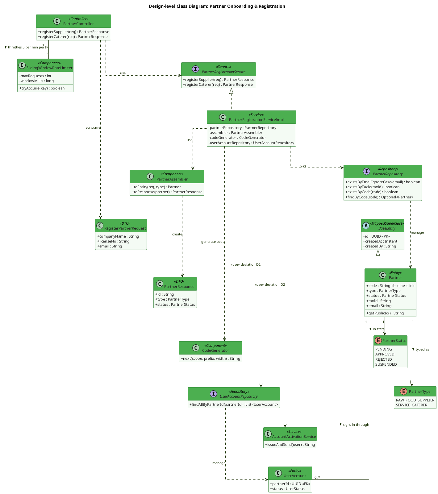

**Description.** Registration is not a separate controller in the implementation: both endpoints live on `PartnerController` and are the only two methods in the module annotated `@SecurityRequirements` with no `@PreAuthorize`, because an anonymous Guest must reach them. Every guard is therefore carried inside the request path itself — a `SlidingWindowRateLimiter` bean (5/min/IP → `SUP-141`/MSG-141, M04-D07) in the controller, and duplicate-detection (`existsByEmailIgnoreCase`, `existsByTaxId` → `SUP-006`) plus manual tax-ID format validation (`SUP-007`/MSG-007, deliberately not Bean Validation so the code is exact) inside `PartnerRegistrationServiceImpl`. `RegisterPartnerRequest` is a **plain JSON body** — no file part — so no `StorageService` participates here; the two mandatory compliance documents of BR-040/BR-046 are uploaded afterwards through Feature 4, and the business code (`SUP-xxx`/`CAT-xxx`) comes from `common/code/CodeGenerator` rather than a read-then-write (ADR-M04-1).

**Deviation from the TDS, drawn as-is (§0-BIS: code outranks the document).** TDS §7 specifies that registration publishes `PartnerRegistered` and lets **MF01** own account creation and the BR-010 verification email — the resolution recorded for **CF-M04-1**. The merged code instead imports `com.sfms.iam.domain.UserAccount`/`RoleRecord`, `UserAccountRepository`, `RoleRecordRepository` and `AccountActivationService` directly and creates the account inline. That contradicts **ADR-M02-5 / ADR-M04-6** ("reference other modules by ID through an event or a port, never by importing their entities"), which is the one class of deviation §0-BIS says to raise as an issue rather than imitate. The diagram shows the real dependency with a warning note; the fix belongs in a follow-up issue, not in this document.

### 2.2 Sequence Diagram — Register Supplier / Service Caterers Account

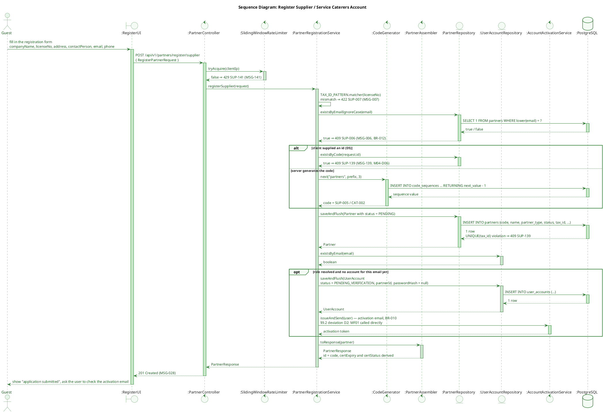

**Description.** Backs UC-071 (Supplier) / UC-067 (Caterer). Two independent uniqueness guards run before any file touches storage, so a duplicate-email submission never wastes a multipart upload. `certExpiry`/`certStatus` in the 201 response are computed by `DocumentStatusCalculator` from the just-inserted `FOOD_SAFETY_CERT` row (ADR-M04-4) — they are never assigned by the service. `UC-067`'s flow is identical except `type = SERVICE_CATERER`, which is why both use cases share one `registerSupplier`/`registerCaterer` pair on the same service rather than two unrelated implementations.

---

## 3. Feature 2 — Partnership Application Lifecycle

Once a Partner is registered, it must submit a **separate application per school** it wants to supply — a Partner and its `PartnershipApplication`s are different lifecycles (ADR-M04-2). Covers submit, track, and resubmit for both actor sides. Backs UC-152, UC-155, UC-169, UC-170 (Supplier) and UC-156, UC-157, UC-158, UC-159 (Service Caterers).

### 3.1 Class Diagram

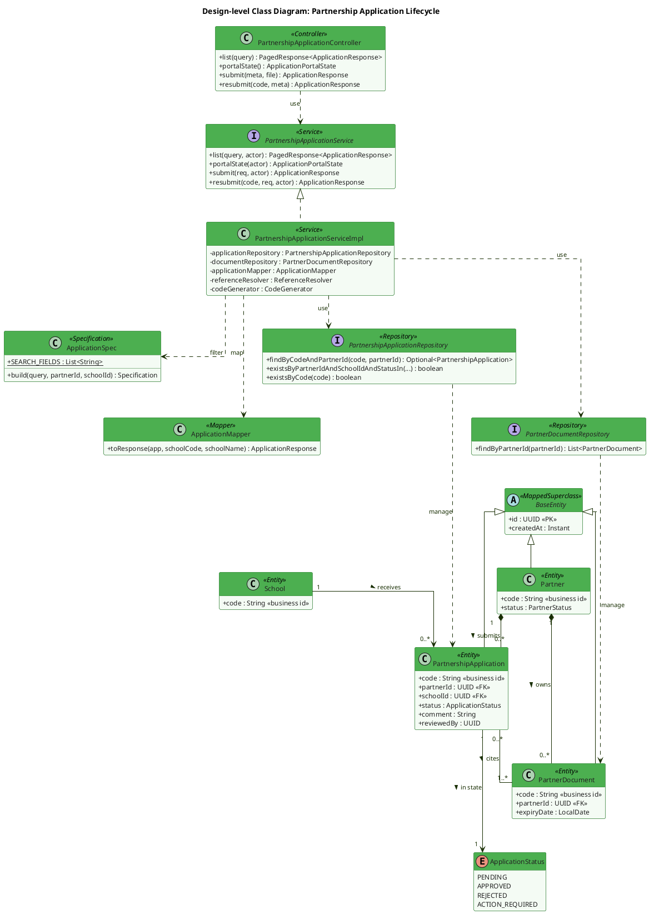

**Description.** `ApplicationPortalState` exists purely because UC-155/UC-159 ("Manage Application") is not a CRUD screen — it is a *state summary* the FE needs in order to decide whether to show "Submit New" or "Track Status," and inferring that client-side was exactly what the mock did (**CF-M04-9**). The implemented record is `{state, applicationId, schoolId, availableActions}` with `state ∈ {NO_APPLICATION, TRACKING, CAN_RESUBMIT}`, i.e. the decision is computed server-side and the FE only renders it. Multi-tenant isolation is not left to each query author: `ApplicationSpec.build(query, scopedPartnerId, scopedSchoolId)` is the single place that appends the owner predicate taken from the JWT, so a Supplier sees only its own applications and a School Admin only those filed with its school (ADR-M04-3). `ReferenceResolver` performs the `code ↔ UUID` translation in both directions, which is what lets the JSON carry `schoolId: "SCH-HN-0042"` while the foreign key on disk stays a UUID (D1/M04-D01).

### 3.2 Sequence Diagram — Submit Application (Precondition Guard)

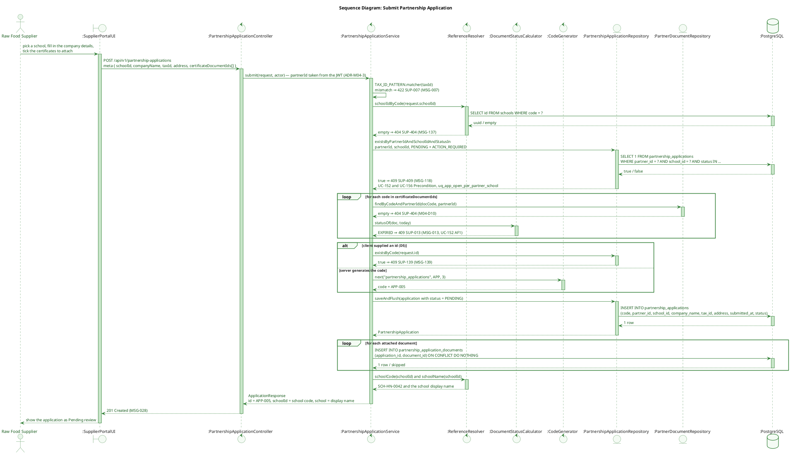

**Description.** Backs UC-152/UC-156. The one-open-application-per-school rule is checked twice — once here for a fast, friendly error message, and again by the database's `uq_app_open_per_partner_school` partial unique index, so a race between two tabs submitting at once still resolves to exactly one `PENDING` row. Citing a `documentId` that belongs to a different partner is treated as **not found**, not forbidden (M04-D10) — the same tenant-isolation rule Feature 6 uses for partner detail lookups.

### 3.3 Sequence Diagram — Resubmit After Rejection / Action-Required

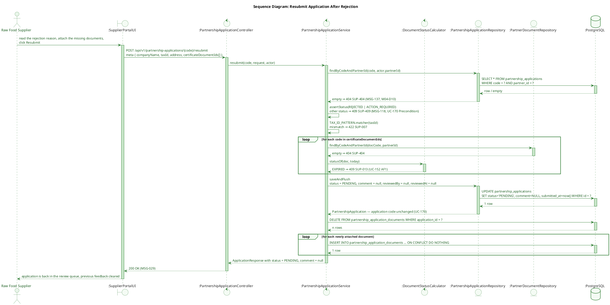

**Description.** Backs UC-170/UC-158. Resubmit deliberately reuses the **same row** rather than inserting a new `PartnershipApplication` — the `code` stays `APP-2026-04` end to end, which is what lets `uq_app_open_per_partner_school` keep working without a separate "supersedes" pointer. Clearing `comment` on resubmit means a stale rejection reason can never be shown next to a freshly re-opened `PENDING` application.

### 3.4 State Chart — `PartnershipApplication` Lifecycle

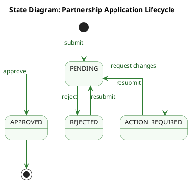

**Description.** The two "open" states — `PENDING` and `ACTION_REQUIRED` — are exactly the set the partial unique index `uq_app_open_per_partner_school` covers, which is why they are drawn as the only states a `resubmit()` can return *into* rather than out of. `APPROVED` is terminal for the application itself: from that point the `SupplierPartnership` row (see §4.5) carries the relationship's state, and the application survives only as the audit record of how the relationship began. Neither `REJECTED` nor `ACTION_REQUIRED` can be entered without a non-blank `comment` (BR-048) — the guard is on the transition, and `ck_app_comment` repeats it at the database level.

---

## 4. Feature 3 — Approval & Suspension Lifecycle

The School Administration side of the module: approve or reject an application (which also activates the underlying `SupplierPartnership`), and — independently — suspend or reinstate an already-approved partner. Backs UC-007, UC-004, plus the suspend/reinstate actions of ADR-M04-6.

### 4.1 Class Diagram

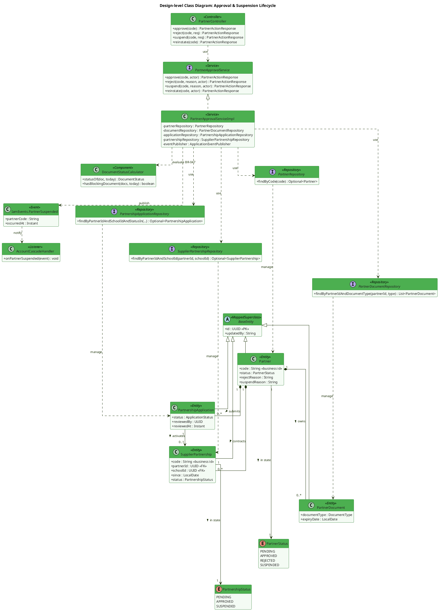

**Description.** `PartnerApprovalService` is the only service in the module allowed to move `Partner.status` after registration, and every one of its four methods is `@Transactional` and locks the target `PartnershipApplication` row `FOR UPDATE` before touching it — this is what makes a School Admin double-clicking "Approve" safe. `DocumentStatusCalculator` is reused unchanged from Feature 4 through its two static predicates: `hasExpiredDocument()` blocks approval the moment any compliance document reads `EXPIRED` (BR-046/BR-048), while `hasUrgentOrExpiredDocument()` additionally blocks *reinstatement* on `URGENT`, because bringing a partner back with a certificate about to lapse would just recreate the same incident days later.

The cascade of ADR-M04-6 is implemented with Spring's `ApplicationEventPublisher`, not with the `UserAccountPort` drawn in TDS §5.1 — that port does not exist in the code. `suspend()` publishes `IamEvents.PartnerSuspended(partnerCode, occurredAt)`, the exact type MF01's `AccountCascadeHandler` already listens for, and the count of accounts locked in the same transaction is returned to the caller as `PartnerActionResponse.suspendedAccounts`. Publishing an event carrying only the business code — rather than calling into MF01 — keeps the "reference other modules by ID" rule intact; the open item is only *where the record lives* (**P8**, TDS §2.6: move it out of `com.sfms.iam.event` into `common/event/`), which is Nam's call, not MF04's.

### 4.2 Sequence Diagram — Approve Application → Activate Partnership

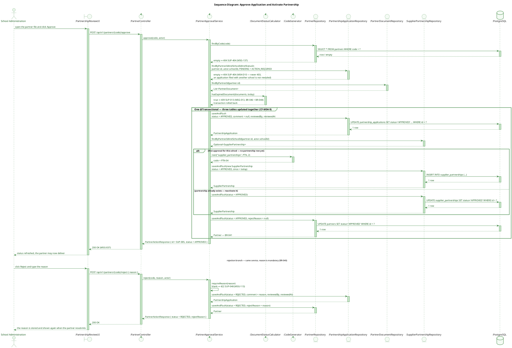

**Description.** Backs UC-007/UC-004. `actor.schoolId` — never a body field — is what scopes `findByPartnerIdAndSchoolIdAndStatusIn`, so a School Admin at School A cannot approve an application addressed to School B even if they somehow learn its code (ADR-M04-3); the result is a 404, not a 403, per M04-D10. Approving is the one moment `SupplierPartnership` gets created or reactivated — everywhere else in the module reads it, only this path writes `APPROVED` into it.

### 4.3 Sequence Diagram — Suspend Partner (Reason-Mandatory Cascade)

```plantuml
@startuml MF04_F3_Suspend
title Sequence Diagram: Suspend Partner with Account Cascade

' Orthogonal connector mode
skinparam linetype ortho

' ==========================================
' GREEN COLOUR SCHEME
' ==========================================
skinparam backgroundColor #FFFFFF

' Stereotype icons
skinparam stereotype {
    CBackgroundColor #E8F5E9
    CBorderColor #2E7D32
    EBackgroundColor #E8F5E9
    EBorderColor #2E7D32
    ABackgroundColor #E8F5E9
    ABorderColor #2E7D32
    IBackgroundColor #E8F5E9
    IBorderColor #2E7D32
}

' ==========================================
' Note
' ==========================================
skinparam NoteBackgroundColor #E8F5E9
skinparam NoteBorderColor #2E7D32
skinparam NoteFontColor #212121

' ==========================================
' Lifelines by UML robustness stereotype
' (boundary / control / entity / database)
' ==========================================
skinparam BoundaryBackgroundColor #F4FBF4
skinparam BoundaryBorderColor #2E7D32
skinparam BoundaryFontColor #212121
skinparam BoundaryFontSize 13

skinparam ControlBackgroundColor #F4FBF4
skinparam ControlBorderColor #2E7D32
skinparam ControlFontColor #212121
skinparam ControlFontSize 13

skinparam EntityBackgroundColor #F4FBF4
skinparam EntityBorderColor #2E7D32
skinparam EntityFontColor #212121
skinparam EntityFontSize 13

skinparam CollectionsBackgroundColor #F4FBF4
skinparam CollectionsBorderColor #2E7D32
skinparam CollectionsFontColor #212121

skinparam DatabaseBackgroundColor #F4FBF4
skinparam DatabaseBorderColor #2E7D32
skinparam DatabaseFontColor #212121
skinparam DatabaseFontSize 13

skinparam sequence {

    ' ==========================================
    ' Actor & Participant
    ' ==========================================
    ActorBackgroundColor #E8F5E9
    ActorBorderColor #2E7D32
    ActorFontColor #1B5E20
    ActorFontSize 13

    ParticipantBackgroundColor #F4FBF4
    ParticipantBorderColor #2E7D32
    ParticipantFontColor #212121
    ParticipantFontSize 13

    ' ==========================================
    ' Message
    ' ==========================================
    ArrowColor #2E7D32
    ArrowFontColor #1B5E20
    ArrowFontSize 12

    ' ==========================================
    ' Activation (Execution)
    ' ==========================================
    LifeLineBackgroundColor #C8E6C9
    LifeLineBorderColor #2E7D32

    ' ==========================================
    ' Group (alt / opt / loop / par...)
    ' ==========================================
    GroupBackgroundColor #F4FBF4
    GroupBorderColor #2E7D32
    GroupHeaderBackgroundColor #4CAF50
    GroupFontColor #212121

}

actor "School Administration" as SA
boundary ":PartnerDetailUI" as UI
control ":PartnerController" as C
control ":PartnerApprovalService" as S
control ":ApplicationEventPublisher" as EV
control ":AccountCascadeHandler" as ACH
control ":ReferenceResolver" as RR
control ":DocumentStatusCalculator" as DSC
entity ":PartnerRepository" as PR
entity ":SupplierPartnershipRepository" as PTR
entity ":UserAccountRepository" as UAR
database ":PostgreSQL" as DB

SA -> UI : click Suspend and type the reason
activate UI
UI -> C : POST /api/v1/partners/{code}/suspend { reason }
activate C
C -> S : suspend(code, reason, actor)
activate S

S -> S : requireReason(reason)\nblank ⇒ 422 SUP-048 (MSG-113, BR-048)
S -> PR : findByCode(code)
activate PR
PR --> S : empty ⇒ 404 SUP-404 (MSG-137)
deactivate PR
S -> PTR : findByPartnerIdAndSchoolId(partner.id, actor.schoolId)
activate PTR
PTR --> S : empty ⇒ 404 SUP-404 (M04-D10)\nthe actor's school has no partnership with this partner
deactivate PTR

group One @Transactional
  S -> PR : saveAndFlush(status = SUSPENDED, suspendReason)
  activate PR
  PR -> DB : UPDATE partners SET status='SUSPENDED', suspend_reason = ? WHERE id = ?
  activate DB
  DB --> PR : 1 row — ck_partner_suspend_reason
  deactivate DB
  PR --> S : Partner
  deactivate PR

  S -> PTR : findByPartnerId(partner.id)
  activate PTR
  PTR --> S : List<SupplierPartnership>
  deactivate PTR
  loop for each partnership of this partner
    S -> PTR : saveAndFlush(status = SUSPENDED)
    activate PTR
    PTR -> DB : UPDATE supplier_partnerships SET status='SUSPENDED' WHERE id = ?
    activate DB
    DB --> PTR : 1 row
    deactivate DB
    PTR --> S : SupplierPartnership
    deactivate PTR
  end

  S -> EV : publishEvent(IamEvents.PartnerSuspended(partnerCode, occurredAt))\nbusiness code, never a UUID — M04-D13
  activate EV
  EV -> ACH : onPartnerSuspended(event) — @EventListener, same transaction
  activate ACH
  ACH -> RR : partnerIdByCode(event.partnerCode)
  activate RR
  RR --> ACH : UUID
  deactivate RR
  ACH -> UAR : findAllByPartnerId(partnerId)
  activate UAR
  UAR --> ACH : List<UserAccount>
  deactivate UAR
  loop for each account not already SUSPENDED
    ACH -> UAR : saveAndFlush(status = SUSPENDED) and revoke refresh tokens
    activate UAR
    UAR -> DB : UPDATE user_accounts SET status='SUSPENDED' WHERE id = ?
    activate DB
    DB --> UAR : 1 row
    deactivate DB
    UAR --> ACH : UserAccount
    deactivate UAR
  end
  ACH --> EV : done — the handler is idempotent
  deactivate ACH
  EV --> S : returns synchronously
  deactivate EV

  S -> DB : SELECT COUNT(*) FROM user_accounts\nWHERE partner_id = ? AND status = 'SUSPENDED'
  activate DB
  DB --> S : suspendedAccounts
  deactivate DB
end

S --> C : PartnerActionResponse { status = SUSPENDED, suspendReason, suspendedAccounts }
deactivate S
C --> UI : 200 OK
deactivate C
UI --> SA : show how many partner accounts were locked
deactivate UI

... reinstate branch ...

SA -> UI : click Reinstate partnership
activate UI
UI -> C : POST /api/v1/partners/{code}/reinstate
activate C
C -> S : reinstate(code, actor)
activate S
S -> DSC : hasUrgentOrExpiredDocument(documents, today)
activate DSC
DSC --> S : true ⇒ 409 SUP-013 (MSG-013) — reinstatement blocked
deactivate DSC
S -> PR : saveAndFlush(status = APPROVED, suspendReason = null)
activate PR
PR --> S : Partner
deactivate PR
loop for each partnership of this partner
  S -> PTR : saveAndFlush(status = APPROVED)
  activate PTR
  PTR --> S : SupplierPartnership
  deactivate PTR
end
S --> C : PartnerActionResponse { status = APPROVED }\n§9.2 deviation: MF01 has no handler to unlock the accounts
deactivate S
C --> UI : 200 OK
deactivate C
UI --> SA : show the reinstatement result
deactivate UI
@enduml
```

**Description.** `suspend()` never deletes anything — `partners`, `partner_documents`, `partnership_applications` and `supplier_partnerships` all stay exactly as they were, because a suspended partner's records are the audit trail a food-safety inspection may need later (§4.2 invariant in the TDS). The two-payload event split — a minimal `IamEvents.PartnerSuspended(partnerCode, occurredAt)` for MF01's already-merged handler versus a full `PartnerSuspended(reason, causedBy, …)` for MF04's own audit log and MF05/MF06 — exists only because MF01's cascade handler was already built and merged against that exact minimal signature (M04-D13); `reinstate()` is the mirror image, additionally gated by `DocumentStatusCalculator` refusing to clear `SUSPENDED` while any document reads `URGENT` or `EXPIRED`.

### 4.4 State Chart — `Partner` Lifecycle

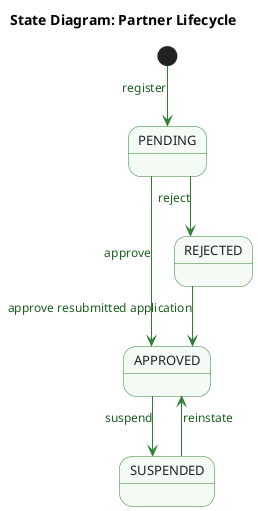

**Description.** The transition table above is the same one `PartnerStatusTransition.assertAllowed()` enforces in code and `MF04-TC-010` tests exhaustively — five legal moves, five explicitly illegal ones. `SUSPENDED` is deliberately *not* reachable from `PENDING` or `REJECTED`: suspension is the withdrawal of an approval that was actually granted, so a partner that was never approved has nothing to suspend. The asymmetry between the two exit guards is intentional too — approval blocks only on `EXPIRED` documents, while reinstatement additionally blocks on `URGENT`, because restoring a partner whose certificate lapses in three weeks just schedules the same incident again.

### 4.5 State Chart — `SupplierPartnership` Lifecycle

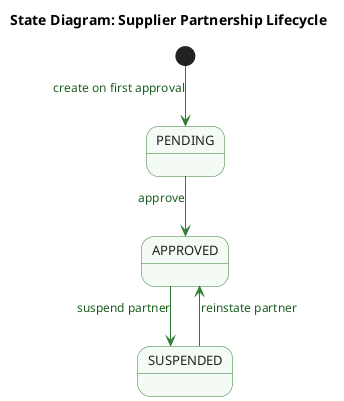

**Description.** `SupplierPartnership` is the row MF06 actually reads at the gate, which is why it has its own lifecycle rather than being folded into `Partner.status`: a supplier can be `APPROVED` module-wide while its partnership with *one particular school* is suspended — for instance after `SchoolDeactivated` from MF02 (BR-021), which suspends the relationship without touching the partner's other schools or its login. The `until` date (M04-D04) is what closes a relationship without deleting it, preserving the traceability chain for deliveries that already happened under that partnership.

---

## 5. Feature 4 — Compliance Document Management

The partner-owned side of certification: list, upload, and — critically — *replace* a compliance document without ever losing the paper trail. Backs UC-167, UC-101, UC-102, UC-091.

### 5.1 Class Diagram

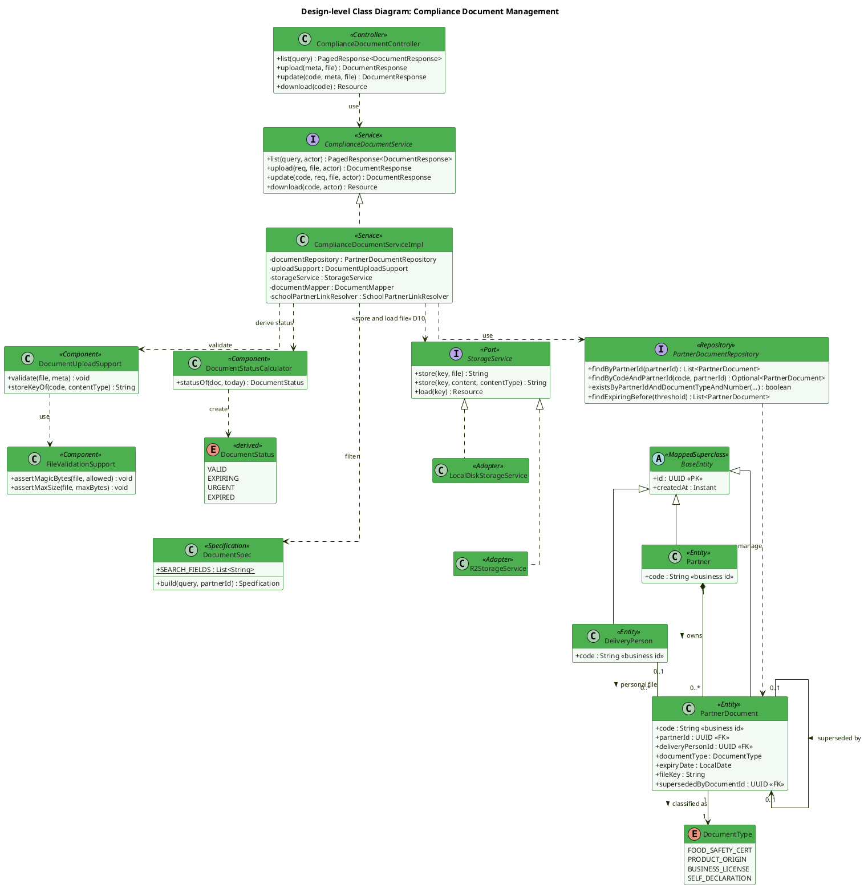

**Description.** The derived-status rule of ADR-M04-4 is enforced structurally, not by convention: `DocumentStatus` and `DocumentStatusCalculator` sit in their own sub-package with no repository dependency and no setter anywhere in the module writes a status column, so `VALID/EXPIRING/URGENT/EXPIRED` can only ever be computed at read time from `expiryDate` against the BR-047 thresholds (180 and 30 days). Note the enum constant is `EXPIRING`, not `EXPIRING_SOON` — the label "Expiring Soon" of BR-047 is an FE display string. `WarningInfo` is attached to `DocumentResponse` only for the `EXPIRING`/`URGENT` cases and is `null` otherwise, which is how MSG-053 reaches the screen without a stored flag. File handling stays inside `DocumentUploadSupport` → `FileValidationSupport` (magic-byte inspection, never the declared `Content-Type`) → `common/storage/StorageService` (D10/M04-D11); `GET /supplier-documents/{code}/file` exists because the stored value is a private `storageKey`, so downloads must pass through an authorised endpoint rather than a guessable public URL (D10-BIS).

`findExpiringBefore(threshold)` is the one repository method in this feature that exists purely for a background job — `ComplianceExpiryScheduler` calls it daily at the 180-day and 30-day thresholds to fire `ComplianceDocumentExpiring` (MSG-053), but that job **only reads**; it never writes a status column back, keeping `ADR-M04-4`'s "no stored status" rule intact even for the notification path. `update()` (UC-091) never overwrites a row — it inserts a new `PartnerDocument` and sets the old row's `supersededByDocumentId`, which is what `ix_doc_expiry`'s BR-047 job query filters out (`WHERE superseded_by_document_id IS NULL`) so a superseded, already-replaced expired certificate never re-triggers an expiry notice.

### 5.2 Sequence Diagram — Upload / Replace Compliance Document

```plantuml
@startuml MF04_F4_Upload
title Sequence Diagram: Upload and Replace Compliance Document

' Orthogonal connector mode
skinparam linetype ortho

' ==========================================
' GREEN COLOUR SCHEME
' ==========================================
skinparam backgroundColor #FFFFFF

' Stereotype icons
skinparam stereotype {
    CBackgroundColor #E8F5E9
    CBorderColor #2E7D32
    EBackgroundColor #E8F5E9
    EBorderColor #2E7D32
    ABackgroundColor #E8F5E9
    ABorderColor #2E7D32
    IBackgroundColor #E8F5E9
    IBorderColor #2E7D32
}

' ==========================================
' Note
' ==========================================
skinparam NoteBackgroundColor #E8F5E9
skinparam NoteBorderColor #2E7D32
skinparam NoteFontColor #212121

' ==========================================
' Lifelines by UML robustness stereotype
' (boundary / control / entity / database)
' ==========================================
skinparam BoundaryBackgroundColor #F4FBF4
skinparam BoundaryBorderColor #2E7D32
skinparam BoundaryFontColor #212121
skinparam BoundaryFontSize 13

skinparam ControlBackgroundColor #F4FBF4
skinparam ControlBorderColor #2E7D32
skinparam ControlFontColor #212121
skinparam ControlFontSize 13

skinparam EntityBackgroundColor #F4FBF4
skinparam EntityBorderColor #2E7D32
skinparam EntityFontColor #212121
skinparam EntityFontSize 13

skinparam CollectionsBackgroundColor #F4FBF4
skinparam CollectionsBorderColor #2E7D32
skinparam CollectionsFontColor #212121

skinparam DatabaseBackgroundColor #F4FBF4
skinparam DatabaseBorderColor #2E7D32
skinparam DatabaseFontColor #212121
skinparam DatabaseFontSize 13

skinparam sequence {

    ' ==========================================
    ' Actor & Participant
    ' ==========================================
    ActorBackgroundColor #E8F5E9
    ActorBorderColor #2E7D32
    ActorFontColor #1B5E20
    ActorFontSize 13

    ParticipantBackgroundColor #F4FBF4
    ParticipantBorderColor #2E7D32
    ParticipantFontColor #212121
    ParticipantFontSize 13

    ' ==========================================
    ' Message
    ' ==========================================
    ArrowColor #2E7D32
    ArrowFontColor #1B5E20
    ArrowFontSize 12

    ' ==========================================
    ' Activation (Execution)
    ' ==========================================
    LifeLineBackgroundColor #C8E6C9
    LifeLineBorderColor #2E7D32

    ' ==========================================
    ' Group (alt / opt / loop / par...)
    ' ==========================================
    GroupBackgroundColor #F4FBF4
    GroupBorderColor #2E7D32
    GroupHeaderBackgroundColor #4CAF50
    GroupFontColor #212121

}

actor "Raw Food Supplier" as SU
boundary ":CertificatesUI" as UI
control ":ComplianceDocumentController" as C
control ":ComplianceDocumentService" as S
control ":DocumentUploadSupport" as US
control ":FileValidationSupport" as FV
control ":StorageService" as ST
control ":CodeGenerator" as CG
control ":DocumentStatusCalculator" as DSC
entity ":PartnerDocumentRepository" as DR
database ":PostgreSQL" as DB
database ":Object storage" as OS

SU -> UI : choose the document type, enter number and expiry, attach the file
activate UI
UI -> C : POST /api/v1/supplier-documents\nmultipart: meta + file
activate C
C -> S : upload(request, file, actor)
activate S
S -> US : upload(partnerId, id, name, type, number, issuedBy,\nissuedDate, expiryDate, file, deliveryPersonId)
activate US

US -> FV : validate(file, 10 MB, PDF + JPEG + PNG)
activate FV
FV -> FV : read the real magic bytes,\nnever trust the extension or Content-Type
FV --> US : oversize ⇒ 413 SUP-008 (MSG-008)\nnot whitelisted ⇒ 415 SUP-009 (MSG-009)
deactivate FV

US -> US : assertExpiryPresent(type)\nFOOD_SAFETY_CERT without expiryDate ⇒ 422 SUP-422 (BR-047)
US -> US : assertNotExpired(type, expiryDate, today)\nFOOD_SAFETY_CERT already expired ⇒ 409 SUP-013 (UC-101 AF1)
US -> US : assertDateOrder(issuedDate, expiryDate)\nexpiry not after issue ⇒ 422 SUP-422 (ck_doc_date_order)

alt client supplied an id (D5)
  US -> DR : existsByCode(clientCode)
  activate DR
  DR --> US : true ⇒ 409 SUP-139 (MSG-139)
  deactivate DR
else server generates the code
  US -> CG : next("partner_documents", DOC, 4)
  activate CG
  CG --> US : code = DOC-0005
  deactivate CG
end

US -> DR : existsByPartnerIdAndDocumentTypeAndNumber(partnerId, type, number)
activate DR
DR -> DB : SELECT 1 FROM partner_documents\nWHERE partner_id = ? AND document_type = ? AND number = ?
activate DB
DB --> DR : true / false
deactivate DB
DR --> US : true ⇒ 409 SUP-409 (MSG-118, UC-101 AF3)
deactivate DR

US -> ST : store("partner-documents/<code>.<ext>", file)
activate ST
ST -> OS : write the file — local ./data/uploads or Cloudflare R2
activate OS
OS --> ST : storage key
deactivate OS
ST --> US : public URL — unused, only the key is persisted
deactivate ST

US -> DR : saveAndFlush(PartnerDocument)
activate DR
DR -> DB : INSERT INTO partner_documents\n(code, partner_id, document_type, number, issued_date, expiry_date, file_key, ...)
activate DB
DB --> DR : 1 row
deactivate DB
DR --> US : PartnerDocument
deactivate DR
US --> S : PartnerDocument
deactivate US

S -> DSC : statusOf(document, today) — derived, no status column (ADR-M04-4)
activate DSC
DSC --> S : VALID / EXPIRING / URGENT / EXPIRED
deactivate DSC
opt fewer than 180 days, or fewer than 30 days, before expiry
  S -> S : warning = MSG-053 with the number of days left (BR-047)
end
S --> C : DocumentResponse + warning
deactivate S
C --> UI : 201 Created
deactivate C
UI --> SU : show the document with its status badge and expiry warning
deactivate UI

... UC-091 — replace with a still-valid document ...

SU -> UI : click Update and upload the replacement
activate UI
UI -> C : PUT /api/v1/supplier-documents/{code}\nmultipart: meta + file
activate C
C -> S : update(code, request, file, actor)
activate S
S -> DR : findByCode(code) then check the scope for the caller's role
activate DR
DR --> S : out of scope ⇒ 404 SUP-404 (M04-D10)
deactivate DR
S -> US : upload(...) — creates a NEW row, keeping the same documentType
activate US
US --> S : replacement PartnerDocument
deactivate US
S -> DR : saveAndFlush(old.supersededByDocumentId = new.id)
activate DR
DR -> DB : UPDATE partner_documents SET superseded_by_document_id = ? WHERE id = ?
activate DB
DB --> DR : 1 row — the old row is NOT deleted (§4.2)
deactivate DB
DR --> S : superseded PartnerDocument
deactivate DR
S --> C : DocumentResponse of the replacement
deactivate S
C --> UI : 200 OK (MSG-029)
deactivate C
UI --> SU : the superseded document stays retrievable as inspection evidence
deactivate UI
@enduml
```

**Description.** Backs UC-091 (update flow shown; UC-101/UC-102 `upload()` is the same body minus the "find old row" step, since there is nothing to supersede on a first upload). The chain of guards runs cheapest-first: ownership check before any file leaves the client's connection wasted on storage, then the cert-must-have-expiry business rule before the multipart upload, then storage-layer size/type errors, and only then the DB-level duplicate check that mirrors `uq_doc_partner_number` — so a request that will fail always fails at the earliest possible point instead of after an expensive file write.

> **No state diagram for the compliance-document status.** `VALID`/`EXPIRING`/`URGENT`/`EXPIRED` are not a state machine: no service method moves a document between them. They are a pure function of `expiry_date` versus today, evaluated by `DocumentStatusCalculator` at read time (ADR-M04-4), which is why `partner_documents` has no `status` column at all. The thresholds are shown where they are actually computed — the `DocumentStatus` enum in the class diagram above and the `statusOf(document, today)` call in the sequence diagram. The one real transition a document has, `replace()` setting `superseded_by_document_id` (UC-091), is already drawn in that sequence.

---

## 6. Feature 5 — Delivery Person & Biometric Verification

Registering a supplier's delivery staff and enrolling/revoking their face-recognition credential for gate access — the module's most sensitive data (PDPD `Restricted`). Backs UC-019, UC-110, UC-068, UC-028.

### 6.1 Class Diagram

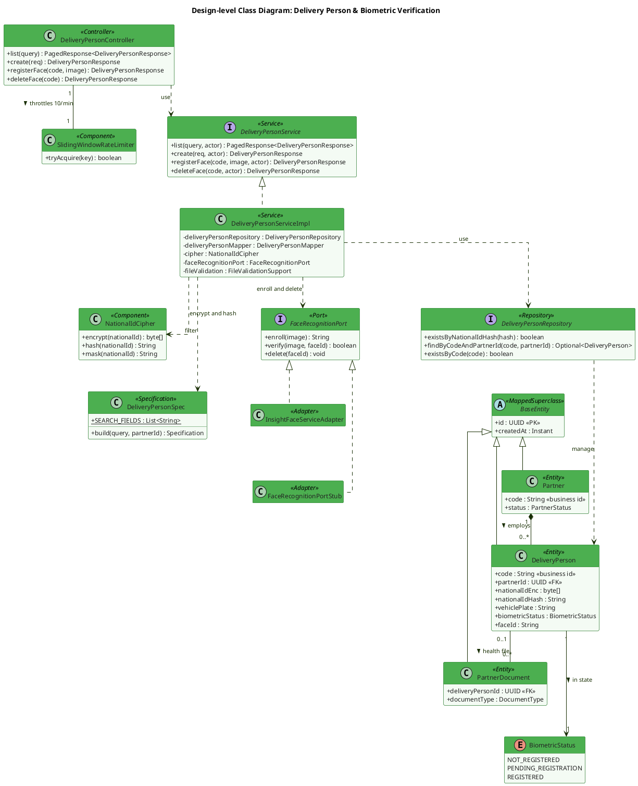

**Description.** This feature is where the `mf04.port` package earns its existence, and the diagram is drawn so the mechanism is visible: `DeliveryPersonServiceImpl` depends on the **interface** `FaceRecognitionPort` only, while two interchangeable adapters implement it — `FaceRecognitionPortStub` (`@Primary`, the dev/test default returning `{match:true, faceId:"mock-uuid"}` per ADR-000) and `InsightFaceServiceAdapter` (`@Profile("prod")`, an HTTP client for the Python/DeepFace Face Recognition Service). Swapping environments therefore changes a Spring profile, never a line of business logic, and `registerFace()` can be unit-tested without standing up an external AI service. The stub was marked `@Primary` on 2026-08-05 for a concrete reason recorded in its Javadoc: with two candidate beans and no container running the microservice in `docker-compose.yml`, the application could not boot from HEAD. `NoFaceDetectedException` is deliberately a subtype of `FaceRecognitionException` so the controller can distinguish a **user** error (HTTP 422 — the detector genuinely found no face) from an **infrastructure** error (HTTP 502, `SUP-014`).

`FaceRecognitionPort` is also the port that makes the module's single most consequential correction real: `business_rules.md`'s canonical **BR-060** is GPS delivery-location verification, not biometric encryption (**CF-M04-3**) — GPS was un-implementable because no `RoleKey` role represents a delivery person as a system actor (BR-028's geofence + BR-073's auto-captured receiving-side GPS already cover that need in MF06), so `GateVerificationPort`/GPS was dropped from MF04 entirely (P4, closed 2026-08-02). What survives is the PDPD `Restricted` requirement itself, grounded in `§4.3 Data Classification` rather than a BR number: `DeliveryPerson` never has a photo column, and `FaceRecognitionPort.enroll()` takes raw bytes in memory and returns only an opaque `faceId`.

### 6.2 Sequence Diagram — Register Face Data (Two-Step, With FRS Failure Path)

```plantuml
@startuml MF04_F5_RegisterFace
title Sequence Diagram: Register Face Data with FRS Failure Paths

' Orthogonal connector mode
skinparam linetype ortho

' ==========================================
' GREEN COLOUR SCHEME
' ==========================================
skinparam backgroundColor #FFFFFF

' Stereotype icons
skinparam stereotype {
    CBackgroundColor #E8F5E9
    CBorderColor #2E7D32
    EBackgroundColor #E8F5E9
    EBorderColor #2E7D32
    ABackgroundColor #E8F5E9
    ABorderColor #2E7D32
    IBackgroundColor #E8F5E9
    IBorderColor #2E7D32
}

' ==========================================
' Note
' ==========================================
skinparam NoteBackgroundColor #E8F5E9
skinparam NoteBorderColor #2E7D32
skinparam NoteFontColor #212121

' ==========================================
' Lifelines by UML robustness stereotype
' (boundary / control / entity / database)
' ==========================================
skinparam BoundaryBackgroundColor #F4FBF4
skinparam BoundaryBorderColor #2E7D32
skinparam BoundaryFontColor #212121
skinparam BoundaryFontSize 13

skinparam ControlBackgroundColor #F4FBF4
skinparam ControlBorderColor #2E7D32
skinparam ControlFontColor #212121
skinparam ControlFontSize 13

skinparam EntityBackgroundColor #F4FBF4
skinparam EntityBorderColor #2E7D32
skinparam EntityFontColor #212121
skinparam EntityFontSize 13

skinparam CollectionsBackgroundColor #F4FBF4
skinparam CollectionsBorderColor #2E7D32
skinparam CollectionsFontColor #212121

skinparam DatabaseBackgroundColor #F4FBF4
skinparam DatabaseBorderColor #2E7D32
skinparam DatabaseFontColor #212121
skinparam DatabaseFontSize 13

skinparam sequence {

    ' ==========================================
    ' Actor & Participant
    ' ==========================================
    ActorBackgroundColor #E8F5E9
    ActorBorderColor #2E7D32
    ActorFontColor #1B5E20
    ActorFontSize 13

    ParticipantBackgroundColor #F4FBF4
    ParticipantBorderColor #2E7D32
    ParticipantFontColor #212121
    ParticipantFontSize 13

    ' ==========================================
    ' Message
    ' ==========================================
    ArrowColor #2E7D32
    ArrowFontColor #1B5E20
    ArrowFontSize 12

    ' ==========================================
    ' Activation (Execution)
    ' ==========================================
    LifeLineBackgroundColor #C8E6C9
    LifeLineBorderColor #2E7D32

    ' ==========================================
    ' Group (alt / opt / loop / par...)
    ' ==========================================
    GroupBackgroundColor #F4FBF4
    GroupBorderColor #2E7D32
    GroupHeaderBackgroundColor #4CAF50
    GroupFontColor #212121

}

actor "Raw Food Supplier" as SU
boundary ":DeliveryStaffUI" as UI
control ":DeliveryPersonController" as C
control ":SlidingWindowRateLimiter" as RL
control ":DeliveryPersonService" as S
control ":FileValidationSupport" as FV
control ":FaceRecognitionPort" as FRP
boundary ":InsightFace Service" as FRS
entity ":DeliveryPersonRepository" as DPR
database ":PostgreSQL" as DB

SU -> UI : pick a delivery person and upload the face photo
activate UI
UI -> C : POST /api/v1/delivery-persons/{code}/face\nmultipart: image
activate C
C -> RL : tryAcquire(clientIp)
activate RL
RL --> C : false ⇒ 429 SUP-141 (MSG-141)
deactivate RL

C -> S : registerFace(code, image, actor)
activate S
S -> DPR : findByCodeAndPartnerId(code, actor.partnerId)
activate DPR
DPR -> DB : SELECT * FROM delivery_persons WHERE code = ? AND partner_id = ?
activate DB
DB --> DPR : row / empty
deactivate DB
DPR --> S : empty ⇒ 404 SUP-404 (M04-D10 — existence is not revealed)
deactivate DPR

S -> FV : validate(image, 5 MB, JPEG + PNG)
activate FV
FV --> S : oversize ⇒ 413 SUP-008 · not whitelisted ⇒ 415 SUP-009
deactivate FV

S -> FRP : enroll(image.getBytes())
activate FRP
FRP -> FRS : POST /enroll — multipart image
activate FRS
FRS --> FRP : faceId / error
deactivate FRS

alt FRS returns a faceId
  FRP --> S : faceId
  S -> DPR : saveAndFlush\nfaceId, biometricStatus = REGISTERED, biometricRegisteredAt = now
  activate DPR
  DPR -> DB : UPDATE delivery_persons\nSET face_id = ?, biometric_status='REGISTERED', biometric_registered_at = ?
  activate DB
  DB --> DPR : 1 row — ck_dp_face
  deactivate DB
  DPR --> S : DeliveryPerson
  deactivate DPR
  S --> C : DeliveryPersonResponse — nationalId returned masked
else no face detected in the photo
  FRP --> S : NoFaceDetectedException
  S --> C : 422 SUP-422 (MSG-138) details { image: no_face_detected }\nrow untouched: still NOT_REGISTERED, face_id NULL
else FRS infrastructure error or timeout
  FRP --> S : FaceRecognitionException
  deactivate FRP
  S --> C : 502 SUP-014 (MSG-014, UC-068 AF1)\nrow untouched: still NOT_REGISTERED, face_id NULL
end
deactivate S
C --> UI : 200 / 422 / 502 response (success ⇒ MSG-038)
deactivate C
UI --> SU : status becomes Registered, the person can be assigned to deliveries
deactivate UI
@enduml
```

**Description.** Backs UC-068. In production the `PENDING_REGISTRATION` window is real time spent waiting on an external service; in the dev/test stub mandated by `ADR-000` the FRS call returns synchronously (`{match:true, faceId:"mock-uuid"}`), so the client only ever observes a single `200`, but `ck_dp_face` still enforces that `face_id` cannot exist while `biometric_status` is anything but `REGISTERED` (M04-D03) — the intermediate state is a genuine, queryable row, not a diagram-only nicety. On any FRS failure the status rolls back to `NOT_REGISTERED` rather than being left at `PENDING_REGISTRATION`, so a retried upload always starts the same well-defined transition.

### 6.3 Sequence Diagram — Delete Face Data (Irreversible, FRS-First Ordering)

```plantuml
@startuml MF04_F5_DeleteFace
title Sequence Diagram: Delete Face Data — FRS First, Irreversible 

' Orthogonal connector mode
skinparam linetype ortho

' ==========================================
' GREEN COLOUR SCHEME
' ==========================================
skinparam backgroundColor #FFFFFF

' Stereotype icons
skinparam stereotype {
    CBackgroundColor #E8F5E9
    CBorderColor #2E7D32
    EBackgroundColor #E8F5E9
    EBorderColor #2E7D32
    ABackgroundColor #E8F5E9
    ABorderColor #2E7D32
    IBackgroundColor #E8F5E9
    IBorderColor #2E7D32
}

' ==========================================
' Note
' ==========================================
skinparam NoteBackgroundColor #E8F5E9
skinparam NoteBorderColor #2E7D32
skinparam NoteFontColor #212121

' ==========================================
' Lifelines by UML robustness stereotype
' (boundary / control / entity / database)
' ==========================================
skinparam BoundaryBackgroundColor #F4FBF4
skinparam BoundaryBorderColor #2E7D32
skinparam BoundaryFontColor #212121
skinparam BoundaryFontSize 13

skinparam ControlBackgroundColor #F4FBF4
skinparam ControlBorderColor #2E7D32
skinparam ControlFontColor #212121
skinparam ControlFontSize 13

skinparam EntityBackgroundColor #F4FBF4
skinparam EntityBorderColor #2E7D32
skinparam EntityFontColor #212121
skinparam EntityFontSize 13

skinparam CollectionsBackgroundColor #F4FBF4
skinparam CollectionsBorderColor #2E7D32
skinparam CollectionsFontColor #212121

skinparam DatabaseBackgroundColor #F4FBF4
skinparam DatabaseBorderColor #2E7D32
skinparam DatabaseFontColor #212121
skinparam DatabaseFontSize 13

skinparam sequence {

    ' ==========================================
    ' Actor & Participant
    ' ==========================================
    ActorBackgroundColor #E8F5E9
    ActorBorderColor #2E7D32
    ActorFontColor #1B5E20
    ActorFontSize 13

    ParticipantBackgroundColor #F4FBF4
    ParticipantBorderColor #2E7D32
    ParticipantFontColor #212121
    ParticipantFontSize 13

    ' ==========================================
    ' Message
    ' ==========================================
    ArrowColor #2E7D32
    ArrowFontColor #1B5E20
    ArrowFontSize 12

    ' ==========================================
    ' Activation (Execution)
    ' ==========================================
    LifeLineBackgroundColor #C8E6C9
    LifeLineBorderColor #2E7D32

    ' ==========================================
    ' Group (alt / opt / loop / par...)
    ' ==========================================
    GroupBackgroundColor #F4FBF4
    GroupBorderColor #2E7D32
    GroupHeaderBackgroundColor #4CAF50
    GroupFontColor #212121

}

actor "Raw Food Supplier" as SU
boundary ":DeliveryStaffUI" as UI
control ":DeliveryPersonController" as C
control ":SlidingWindowRateLimiter" as RL
control ":DeliveryPersonService" as S
control ":FaceRecognitionPort" as FRP
boundary ":InsightFace Service" as FRS
entity ":DeliveryPersonRepository" as DPR
database ":PostgreSQL" as DB

SU -> UI : click Delete face data and confirm the irreversible action
activate UI
UI -> C : DELETE /api/v1/delivery-persons/{code}/face
activate C
C -> RL : tryAcquire(clientIp)
activate RL
RL --> C : false ⇒ 429 SUP-141 (MSG-141)
deactivate RL

C -> S : deleteFace(code, actor)
activate S
S -> DPR : findByCodeAndPartnerId(code, actor.partnerId)
activate DPR
DPR --> S : empty ⇒ 404 SUP-404 (M04-D10)
deactivate DPR

opt a faceId is present
  S -> FRP : delete(faceId) — called BEFORE the database is touched
  activate FRP
  FRP -> FRS : DELETE /faces/{faceId}
  activate FRS
  FRS --> FRP : OK / error
  deactivate FRS
  FRP --> S : FaceRecognitionException ⇒ 502 SUP-014 (MSG-014, UC-028 AF2)\ndatabase left unchanged
  deactivate FRP
end

S -> DPR : saveAndFlush\nfaceId = null, biometricStatus = NOT_REGISTERED, biometricRegisteredAt = null
activate DPR
DPR -> DB : UPDATE delivery_persons\nSET face_id = NULL, biometric_status='NOT_REGISTERED', biometric_registered_at = NULL
activate DB
DB --> DPR : 1 row — ck_dp_face
deactivate DB
DPR --> S : DeliveryPerson
deactivate DPR
S --> C : DeliveryPersonResponse with status = NOT_REGISTERED
deactivate S
C --> UI : 200 OK (MSG-029)
deactivate C
UI --> SU : the person loses gate access at the school (BR-051)
deactivate UI
@enduml
```

**Description.** Backs UC-028. The FRS-before-DB ordering is the entire point of this sequence: reversing it would leave a window where the local row already reads `NOT_REGISTERED` while the FRS still holds the biometric template, silently defeating BR-051's promise that deletion "leads to a loss of gate access." Audit is not optional here (unlike most writes) because BR-051 makes this the one action in the module with no compensating "undo" endpoint — `FaceDataDeleted`'s payload deliberately excludes any biometric identifier (PDPD/ADR-M04-5), carrying only `deliveryPersonId`, `partnerId` and `causedBy` for the trail.

### 6.4 State Chart — `BiometricStatus` Lifecycle

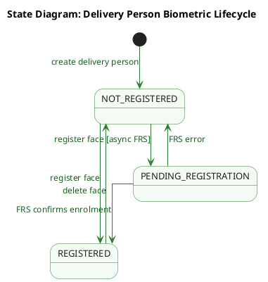

**Description.** The three-state shape is the correction **D6** forced onto the v1.0 draft, which had only `NOT_REGISTERED` and `REGISTERED` and therefore left seed row `DP-03` in a value the model did not admit (`review.md` E4). Making `PENDING_REGISTRATION` a first-class state is what lets `ck_dp_face` state its rule cleanly — `face_id` is non-null **iff** the status is `REGISTERED` — so no row can ever hold a biometric reference that the FRS has not confirmed, and the failure path in §6.2 has a well-defined state to roll back to rather than leaving a half-registered person able to be dispatched.

---

## 7. Feature 6 — Partner Directory & Self-Service Profile

The read-heavy side of the module — School Administration browsing/filtering partners, plus a partner managing its own profile. Backs UC-131, UC-148, UC-127, UC-108, UC-049.

### 7.1 Class Diagram

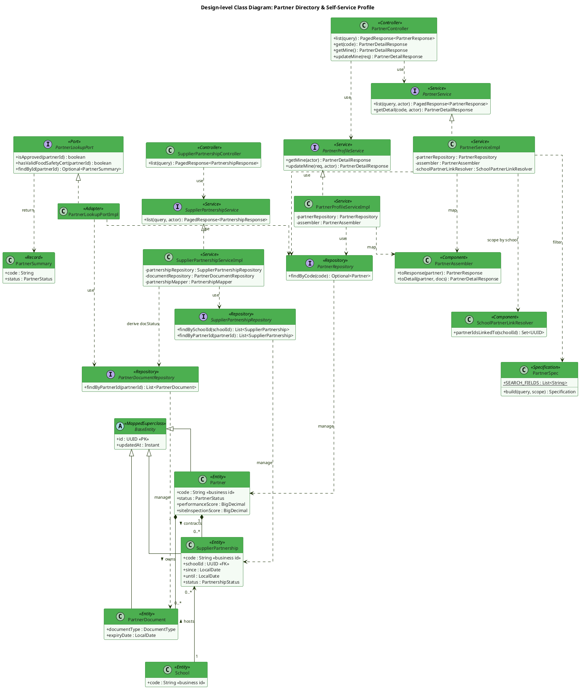

**Description.** Directory reads and self-service profile share one controller and one assembler in the implementation: `PartnerController` carries `GET /partners`, `GET /partners/{code}`, `GET /partners/me` and `PATCH /partners/me` (there is no separate `PartnerProfileController`), and both `PartnerServiceImpl` and `PartnerProfileServiceImpl` delegate response building to `PartnerAssembler`, which is the single place where the derived `certExpiry`/`certStatus` are computed from `PartnerDocument` (ADR-M04-4). `SchoolPartnerLinkResolver` implements M04-D10: a School Admin reaching a partner outside its own school gets **404 `SUP-404`**/MSG-137 rather than 403, so a known code cannot be used to confirm that a record exists.

`PartnerLookupPort` is the seam every other module actually depends on: MF06 calls `isApproved()` before accepting a delivery (BR-070), MF07/MF11 read `findById()` to label a `CorrectiveAction.assigneeSupplierId`, MF13 aggregates `hasValidFoodSafetyCert()` for the compliance report. None of those callers gets a denormalized copy of `Partner.status` — the port always executes a live query, which is what lets a `suspend()` in Feature 3 take effect for every downstream module in the same instant, with no cache-invalidation event to forget. `GET /partners` and `GET /partners/{code}` return `200 items: []` for an empty result set, never `404` — only a *specific* code that does not resolve is a 404 (M04-D10).

### 7.2 Sequence Diagram — View / Update My Profile

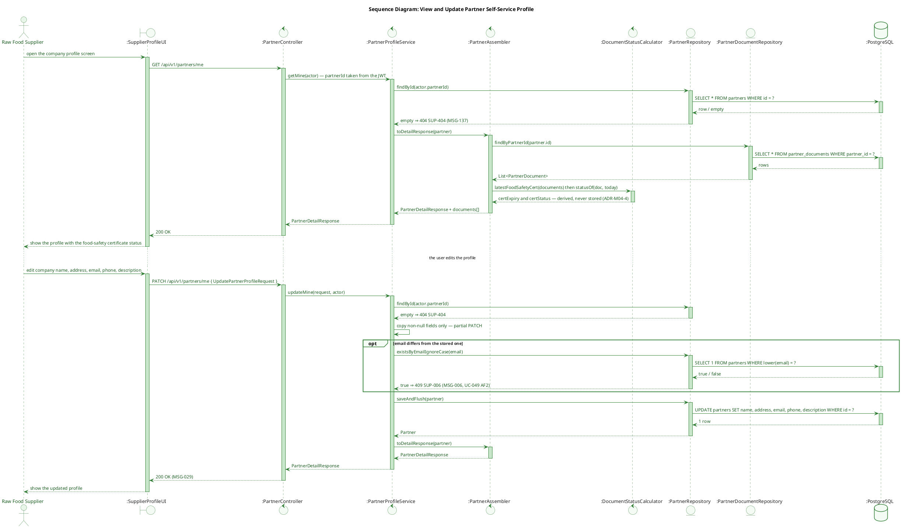

**Description.** Backs UC-049. `actor.partnerId` from the JWT is the only source for *which* partner is being updated — there is no `{code}` path parameter on `/partners/me`, so the endpoint is structurally incapable of editing another partner's profile regardless of what a client sends. The email-uniqueness re-check only runs when the email actually changes, avoiding a needless query on the common case of a supplier just editing its address or phone. This closes **CF-M04-8**: the mock's only profile-shaped screen (`service-caterers/profile`) belonged to the wrong actor and never called an API at all — `PartnerProfileService` is what the real `supplier/profile` screen (owed by the FE workspace, tracked as P9) will call once it exists.

---

## 8. Feature 7 — Partnership Catalog & Price Change Requests

The contracted product list and price of a supplier **for one specific school**, plus the request/approval loop a supplier must go through to change it. Implemented per `Proposal-Partnership-Catalog-Contract.md` — this feature has **no UC/BR code yet** (it is a documented requirement gap awaiting a BA-assigned code), which is why its classes cite the proposal instead of a `UC-xxx`.

### 8.1 Class Diagram

```plantuml
@startuml MF04_F7_ClassDiagram
title Design-level Class Diagram: Partnership Catalog & Price Change Requests

' ==========================================
' CẤU HÌNH BỐ CỤC VÀ MÀU SẮC RATIONAL ROSE
' Dùng skinparam DẠNG TOP-LEVEL (không dùng block lồng
' `skinparam class { ... }`) — mọi phiên bản PlantUML và
' mọi renderer đều hiểu dạng này.
' ==========================================
skinparam classAttributeIconSize 0
skinparam linetype ortho
skinparam nodesep 60
skinparam ranksep 60
skinparam backgroundColor #FFFFFF

' Bố cục theo chiều dọc: web -> service -> repository -> domain
top to bottom direction
hide empty members

' Class / Abstract Class
skinparam classBackgroundColor #F4FBF4
skinparam classBorderColor #2E7D32
skinparam classFontColor #212121
skinparam classFontSize 13
skinparam classHeaderBackgroundColor #4CAF50
skinparam classAttributeFontColor #212121
skinparam classAttributeFontSize 12

' Interface
skinparam interfaceBackgroundColor #f7ed93ff
skinparam interfaceBorderColor #000000ff
skinparam interfaceFontColor #000000ff

' Mũi tên & Liên kết
skinparam arrowColor #162c00ff
skinparam arrowFontColor #162c00ff
skinparam arrowFontSize 11

' Icon Stereotype (C, I, A, E)
skinparam stereotypeCBackgroundColor #f6eedcff
skinparam stereotypeCBorderColor #000000ff
skinparam stereotypeEBackgroundColor #f6eedcff
skinparam stereotypeEBorderColor #000000ff
skinparam stereotypeABackgroundColor #f6eedcff
skinparam stereotypeABorderColor #000000ff
skinparam stereotypeIBackgroundColor #f6eedcff
skinparam stereotypeIBorderColor #000000ff

' ────── mf04.web ────────────────────────────────────
class CatalogController <<Controller>> {
  + listCatalogItems(code, query) : PagedResponse<CatalogItemResponse>
  + listChangeRequests(query) : PagedResponse<ChangeRequestResponse>
  + createChangeRequest(code, req) : ChangeRequestResponse
  + decide(code, req) : ChangeRequestResponse
}

' ────── mf04.service ────────────────────────────────
interface CatalogChangeRequestService <<Service>> {
  + listCatalogItems(code, query, actor) : PagedResponse<CatalogItemResponse>
  + listChangeRequests(query, actor) : PagedResponse<ChangeRequestResponse>
  + createChangeRequest(code, req, actor) : ChangeRequestResponse
  + decide(code, req, actor) : ChangeRequestResponse
}
class CatalogChangeRequestServiceImpl <<Service>> {
  -partnershipRepository : SupplierPartnershipRepository
  -catalogItemRepository : PartnershipCatalogItemRepository
  -changeRequestRepository : CatalogChangeRequestRepository
  -referenceResolver : ReferenceResolver
  -codeGenerator : CodeGenerator
}
class PartnershipCatalogItemSpec <<Specification>> {
  + build(query, partnershipId) : Specification
}
class CatalogChangeRequestSpec <<Specification>> {
  + build(query, scope) : Specification
}

' ────── mf04.repository ─────────────────────────────
interface SupplierPartnershipRepository <<Repository>> {
  + findByCode(code) : Optional<SupplierPartnership>
}
interface PartnershipCatalogItemRepository <<Repository>> {
  + findByPartnershipIdAndIngredientIdAndStatus(...) : Optional<PartnershipCatalogItem>
}
interface CatalogChangeRequestRepository <<Repository>> {
  + findByCode(code) : Optional<CatalogChangeRequest>
}

' ────── mf04.domain ─────────────────────────────────
abstract class BaseEntity <<MappedSuperclass>> {
  +id : UUID <<PK>>
  +createdAt : Instant
}
class SupplierPartnership <<Entity>> {
  +code : String <<business id>>
  +partnerId : UUID <<FK>>
  +schoolId : UUID <<FK>>
  +status : PartnershipStatus
}
class PartnershipCatalogItem <<Entity>> {
  +code : String <<business id>>
  +partnershipId : UUID <<FK>>
  +ingredientId : UUID <<FK>>
  +unit : String
  +approvedUnitPrice : BigDecimal
  +conversionToBase : BigDecimal
  +status : CatalogItemStatus
}
class CatalogChangeRequest <<Entity>> {
  +code : String <<business id>>
  +partnershipId : UUID <<FK>>
  +catalogItemId : UUID <<FK>>
  +requestedUnitPrice : BigDecimal
  +reason : String
  +status : CatalogChangeStatus
  +decidedByUserId : UUID <<FK>>
}
enum CatalogItemStatus {
  ACTIVE
  INACTIVE
}
enum CatalogChangeStatus {
  PENDING
  APPROVED
  REJECTED
}

' ===== Dependency (chiều dọc): Controller -> Service -> Repository -> Entity =====
CatalogController               ..> CatalogChangeRequestService     : «use»
CatalogChangeRequestServiceImpl ..> SupplierPartnershipRepository   : «use»
CatalogChangeRequestServiceImpl ..> PartnershipCatalogItemRepository : «use»
CatalogChangeRequestServiceImpl ..> CatalogChangeRequestRepository  : «use»
CatalogChangeRequestServiceImpl ..> PartnershipCatalogItemSpec      : «filter»
CatalogChangeRequestServiceImpl ..> CatalogChangeRequestSpec        : «filter»
SupplierPartnershipRepository    ..> SupplierPartnership            : «manage»
PartnershipCatalogItemRepository ..> PartnershipCatalogItem         : «manage»
CatalogChangeRequestRepository   ..> CatalogChangeRequest           : «manage»

' ===== Realization / Inheritance =====
CatalogChangeRequestService <|.. CatalogChangeRequestServiceImpl
BaseEntity <|-- SupplierPartnership
BaseEntity <|-- PartnershipCatalogItem
BaseEntity <|-- CatalogChangeRequest
' ===== Composition 1-N: partnership_id NOT NULL =====
SupplierPartnership "1" *-- "0..*" PartnershipCatalogItem : contracts >
SupplierPartnership "1" *-- "0..*" CatalogChangeRequest   : receives >

' ===== Association 0..1: request có thể đề xuất mặt hàng CHƯA có trong catalog =====
CatalogChangeRequest "0..*" --> "0..1" PartnershipCatalogItem : targets >

' ===== Association 1-1 với enum trạng thái =====
PartnershipCatalogItem "1" --> "1" CatalogItemStatus   : in state >
CatalogChangeRequest   "1" --> "1" CatalogChangeStatus : in state >

' ═══════════════════════════════════════════════════════════════
' Layout: liên kết [hidden] xếp các lớp cùng cấp theo CHIỀU DỌC
' (không hiển thị trên hình — chỉ ràng buộc thứ hạng của graphviz)
' ═══════════════════════════════════════════════════════════════

SupplierPartnershipRepository -[hidden]-> PartnershipCatalogItemRepository
PartnershipCatalogItemRepository -[hidden]-> CatalogChangeRequestRepository
CatalogChangeRequestRepository -[hidden]-> BaseEntity
BaseEntity -[hidden]-> SupplierPartnership
SupplierPartnership -[hidden]-> PartnershipCatalogItem
PartnershipCatalogItem -[hidden]-> CatalogChangeRequest
CatalogChangeRequest -[hidden]-> CatalogItemStatus
CatalogItemStatus -[hidden]-> CatalogChangeStatus

PartnershipCatalogItemSpec -[hidden]-> CatalogChangeRequestSpec

@enduml
```

**Description.** `PartnershipCatalogItem` exists because `SupplierProduct` (MF06) is a **global** per-supplier price list, while a real contract is signed per school: the same supplier may sell rice to School A at one price and not sell it at all to School B. Both catalog entities therefore hang off `SupplierPartnership` (composition, `partnership_id NOT NULL`) rather than off `Partner`, and both carry denormalised `partnerId`/`schoolId` so tenant filtering never needs a join (the same CF-M04-6 rule as the rest of the module). `CatalogChangeRequest.catalogItemId` is deliberately **nullable** — `0..1` — which is what lets one entity serve two cases: proposing a change to an existing contracted item, or proposing an item that is not in the catalog yet. Approval (`decide()`) upserts the corresponding `PartnershipCatalogItem`, so the catalog table only ever holds prices a school has actually accepted.

> **Not yet in this document:** sequence and state diagrams for this feature. It is proposal-stage (`_proposed` Flyway migrations V48–V50) and the interaction design should be reviewed together with the BR/UC codes that the BA assigns.

---

## 9. Cross-Feature Notes

- **Identifier discipline (ADR-M04-1 / M04-D01) applies to every diagram above without exception**: `Partner`, `PartnerDocument`, `DeliveryPerson`, `PartnershipApplication` and `SupplierPartnership` all expose their UUID primary key as `code` under the JSON name `"id"`; every path parameter in every controller above is a `code`, and every cross-entity reference inside a DTO (`schoolId`, `partnerId`) is the *target's* code, never a UUID — a client of this module never sees a UUID.
- **Tenant isolation (ADR-M04-3 / M04-D10) is enforced identically in Features 2, 3, 4, 5 and 6**: any lookup scoped by `actor.partnerId` or `actor.schoolId` that finds a row belonging to someone else returns `404 SUP-404`/MSG-137, not `403`. `403 SUP-005` is reserved for the narrower case of the right partner/school but the wrong role.
- **No derived value is ever a stored column (ADR-M04-4)**: `certExpiry`, `certStatus`, every `DocumentResponse.status`, and `SupplierPartnership`'s implicit `docStatus` are computed by `DocumentStatusCalculator` at read time in Features 1, 3, 4 and 6 alike — there is exactly one implementation of the BR-047 threshold logic, not one per feature.
- **Relationship notation is used strictly and identically in all seven class diagrams**, so a reader can tell the database constraint from the drawing alone: **composition (`*--`)** wherever the child row carries a `NOT NULL` owner FK and cannot outlive it (`Partner ◆— PartnerDocument / DeliveryPerson / PartnershipApplication / SupplierPartnership`, and `SupplierPartnership ◆— PartnershipCatalogItem / CatalogChangeRequest`); **aggregation (`o--`)** where both ends exist independently and are merely linked — `PartnershipApplication ◇— PartnerDocument` is **N-N**, realised by the join table `partnership_application_documents`, because one certificate is cited by several applications and survives all of them, and `DeliveryPerson ◇— PartnerDocument` is **1-N with a nullable FK** (a company licence has no delivery person, a driver's health certificate does); **plain association (`-->`)** only for nullable or cross-module references (`CatalogChangeRequest → PartnershipCatalogItem` is `0..1` because `NULL` means "propose a brand-new item", `PartnerDocument → PartnerDocument` is the self-association that keeps a replaced certificate as inspection evidence, and `School → PartnershipApplication` crosses into MF02 by UUID and is never imported as a Java entity). Every entity's `--|>` to `BaseEntity` is the single generalization that explains why no MF04 table declares `id`/`createdAt`/`createdBy` itself (D9).
- **Ports are the module's only outward-facing seams (ADR-M02-5 / ADR-M04-5 / ADR-M04-7)**, and there are exactly two of them: `PartnerLookupPort` (Feature 6) is the *inbound* seam other modules read MF04 through, and `FaceRecognitionPort` (Feature 5) is the *outbound* seam MF04 reaches an external service through. Both are interfaces whose implementations are wired by Spring at runtime, which is what allows the caller on either side to change independently. The `UserAccountPort` drawn in TDS §5.1 was never implemented; the equivalent cascade runs through a published `IamEvents.PartnerSuspended` (Feature 3).

### 9.1 Scope note — what these diagrams intentionally do not cover

The class diagrams above cover the **six feature groups of the 25 approved use cases**, matching the per-feature granularity already used in `MF01`–`MF03_Design_Diagrams.md` (4–5 class diagrams each, one per feature group, not one per use case).

The merged code additionally contains a **partnership product catalogue** (`CatalogController`, `CatalogChangeRequestService`, `PartnershipCatalogItem`, `CatalogChangeRequest`, migrations `V48`–`V53`). It is deliberately **not** drawn here: its only source is `Proposal-Partnership-Catalog-Contract.md`, whose own status line reads *"Proposed — CHƯA duyệt, không phải TDS chính thức"*, and no UC or BR has been issued for it yet (§1 of that proposal asks Huy/Lead Traceability to allocate real identifiers first). Diagramming it in a document that declares itself derived from the Approved TDS would present an unapproved requirement as an approved one. Two smaller pieces of the same proposal do surface in Feature 4 because they physically extend an approved table — `partner_documents.delivery_person_id` and the two extra `DocumentType` constants — and are labelled `PROPOSED` inside the diagram for exactly that reason.

### 9.2 Known deviations between the merged code and TDS v1.1

Per `00_Common_Conventions.md` §0-BIS the diagrams follow the code, with the differences recorded here so the TDS can be reconciled rather than silently diverge.

| # | TDS v1.1 says | Merged code does | Handling |
|---|---|---|---|
| 1 | `PartnerRegistrationController`, `PartnerProfileController` are separate controllers | All partner endpoints live on `PartnerController` | Diagram follows the code — cosmetic, no contract impact |
| 2 | Registration publishes `PartnerRegistered`; MF01 owns account creation + BR-010 email | `PartnerRegistrationServiceImpl` imports `com.sfms.iam` entities/repositories and creates the account inline | **Violates ADR-M02-5/ADR-M04-6 ⇒ raise an issue** (§0-BIS: do not imitate). Drawn with a warning note in F1 |
| 3 | `UserAccountPort` mediates the suspend cascade | `ApplicationEventPublisher` + `IamEvents.PartnerSuspended` | Code is compliant with the ID-only rule; TDS §5.1 should drop the port. P8 (record location) stays open for Nam |
| 4 | `PartnerSummary` exposes `isApproved` / `hasValidFoodSafetyCert` | `record PartnerSummary(id, code, name, type, status)`; the two booleans are `PartnerLookupPort` methods | Diagram follows the code |
| 5 | `DocumentStatus.EXPIRING_SOON`; `DocumentStatus` in a `projection` package | `DocumentStatus.EXPIRING`, declared in `mf04.service` | Diagram follows the code; "Expiring Soon" remains an FE label |
| 6 | `RegisterPartnerRequest` carries `businessLicense`/`foodSafetyCert` files | JSON-only body; documents are uploaded via Feature 4 | Diagram follows the code |
| 7 | TDS §10 assigns **`SUP-138`** to the shared MSG-138 validation failure | `SupError.VALIDATION_FAILED = "SUP-422"` (same MSG-138 text, same 422) | Diagrams follow the code (`SUP-422`). TDS §10 should be reconciled to `SUP-422` — cosmetic, one row |
| 8 | `BiometricStatus` moves `NOT_REGISTERED → PENDING_REGISTRATION → REGISTERED` in two steps (M04-D03) | `registerFace()` calls the FRS synchronously and writes `REGISTERED` in one request; `PENDING_REGISTRATION` is never persisted | Sequence diagram draws the code and labels the gap. The enum value stays — it is the state an asynchronous FRS needs, and `ck_dp_face` already allows it |
| 9 | `StorageService` exposes `store(key, file)` only | Interface also has `store(key, content, contentType)` and **`load(key) : Resource`**, used by `download()` (UC-167) | Class diagram F4 updated to the real interface |
| 10 | `ApplicationStatus.ACTION_REQUIRED` is part of the contract (TDS §6.4, the DB CHECK, and `resubmit()` accepts it) | No endpoint ever writes it — nothing calls `setStatus(ACTION_REQUIRED)` | The state diagram keeps the transition: the value is in the approved contract and `resubmit()` already handles it; only the "request changes" endpoint is missing |
