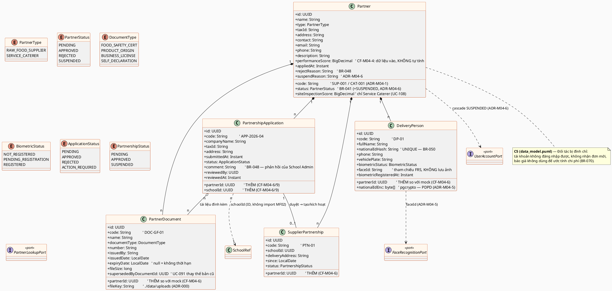
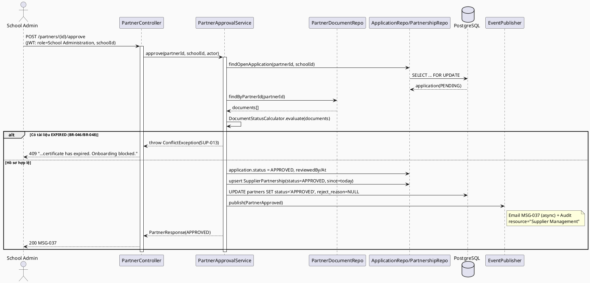
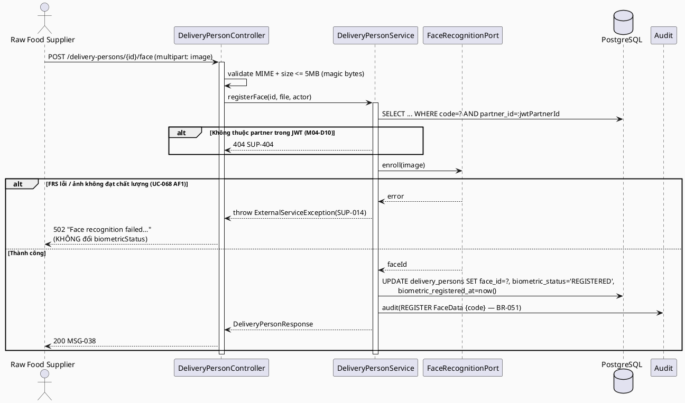
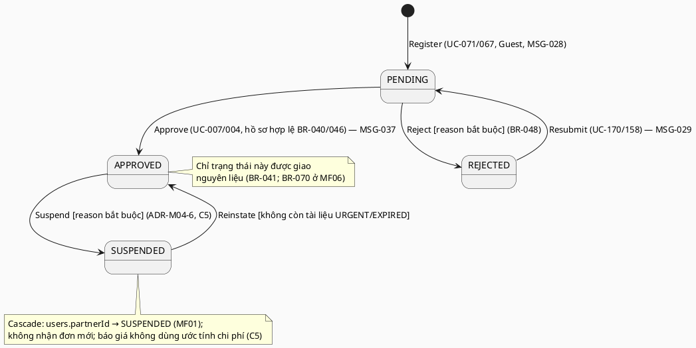
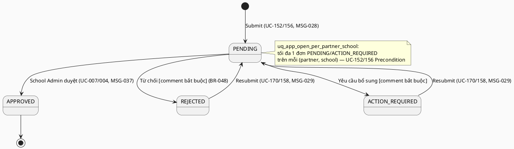
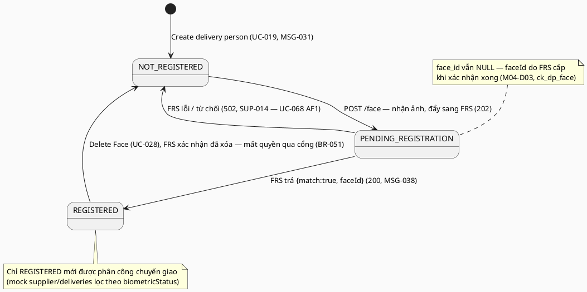

# ENGINEERING DOCUMENTATION STANDARD (EDS) v2.0 — TDS Backend
# MF04 — Supplier & Partner Management

| Field | Value |
|-------|-------|
| **Document ID** | `SFMS-MF04-IMP-001` |
| **Version** | `1.1` |
| **Date** | `2026-08-02` |
| **Status** | **`Approved`** — 2026-08-02 (đóng toàn bộ mục ⛔ của `TestSpec-MF04` §2; xem CHANGELOG) |
| **Document Owner** | Nguyễn Đức Mạnh (ManhNDHE160692) |
| **Author** | Nguyễn Đức Mạnh — Lead Backend & DB Reviewer (chủ MF04, MF08, MF10) |
| **Reviewed by** | `[Huy — §2 Traceability: Pending — 3 mục treo, xem §2.5]` · `[Minh — §8/§9 FE↔BE contract: Pending — 5 mục sync mock, xem §9.3]` · `[Thảo — §13 Test: Pending]` |
| **DPO Sign-off** | `[ ] Pending` — **bắt buộc**: module chứa **dữ liệu sinh trắc học khuôn mặt** + **số CCCD** nhân viên giao hàng (`Restricted`, PDPD) |
| **Approved by** | Nguyễn Đức Mạnh (chủ MF04) — 2026-08-02, theo tiền lệ MF02 (`SFMS-MF02-IMP-001` Approved 2026-07-31). Các mục **treo** ở §2.5 **không chặn Approve** vì không mục nào đổi schema/hợp đồng API. |
| **Last Review** | `2026-08-02` |
| **Based on EDS** | `v2.0` |

> **Stack (ADR-000 / `01_MVP_Backend_Implementation_Plan.md` §3):** Spring Boot **4.1.x (Java 25 LTS)** · PostgreSQL 16 · **Flyway** (V1 = toàn bộ schema, do Nam giữ) · **Spring Security + JWT** (RBAC 7 role, JWT do MF01 phát hành) · springdoc-OpenAPI (Swagger) · MapStruct.
>
> **Convention kế thừa từ MF02 (vertical slice mẫu — `SFMS-MF02-IMP-001`):** `PagedResponse<T>` + `Specification` (§2b `00_Team_Work_Assignment_Plan.md`), `@RestControllerAdvice` + error-code catalog, không lưu field dẫn xuất, tham chiếu module khác bằng ID. MF04 **không** phát minh pattern mới cho các mục này.

---

## CHANGELOG

> **Policy 4.4 — Immutable History:** Không xóa thông tin cũ.

| Ngày | Người thực hiện | Nội dung thay đổi |
|------|-----------------|-------------------|
| 2026-08-02 | Bùi Quang Huy | **Cấp 5 mục treo P2/P3/P4/P6/P7 (§2.6) — nguồn chuẩn đã sửa, MF04 không còn chờ ai ngoài Nam (P1 xong, P8/P10) và Minh (P9).** **P4 quan trọng nhất, làm đổi phạm vi MF04:** `business_rules.md` v1.11 sửa **BR-060** từ *"Xác thực vị trí GPS khi giao hàng"* → **"Mã hóa dữ liệu sinh trắc học (AES-256)"**. Bản GPS không hiện thực được — `RoleKey` chỉ có 7 vai trò, **không có nhân viên giao hàng**; họ là *đối tượng* chứ không phải tác nhân (UC-068/UC-028 do Supplier, UC-079 do Service Caterers quét **tại cổng trường** — BR-051), nên không thiết bị nào của họ nằm trong hệ thống để đọc GPS. GPS khi nhận hàng thì **BR-028** (geofence 200m quanh trường) **+ BR-073** (tự ghi GPS/thiết bị/timestamp khi nhận hàng) đã phủ trọn, và toạ độ đo được là của **thiết bị bên nhận**. ⇒ **MF04 BỎ `GateVerificationPort`/port GPS**; BR-060 nay test ở mức *ảnh không chạm đĩa/DB, chỉ lưu `faceId`* (đúng M04-D11 đã có). §3 bảng BR, §17 CF-M04-3, §21 và Exit Criteria cập nhật theo. **P2:** `traceability_matrix.md` v1.2 gắn `MSG-013`→`UC-101`, `MSG-014`→`UC-068`, `MSG-007`→`UC-158`; **`MSG-025` cố ý không gắn UC** (lỗi hạ tầng dùng chung, không thuộc luồng UC nào). **P3:** `BR-010` bổ sung `UC-067`/`UC-071`. **P6:** `BR-041` bổ sung `Suspended` + ngữ nghĩa cascade — `SUSPENDED` nay có BR chống lưng thay vì chỉ dựa ràng buộc C5. **P7:** chốt seed dùng **`ATTP-HN-2024-1182`** (bản `SUPPLIER_DOCUMENTS`, đủ 8 field khớp thẳng `partner_documents`; bản `PARTNERS[].documents` chỉ 4 field, seed sẽ phải bịa `issuedBy`/`issuedDate`). Hai bản cùng hạn `2027-03-15` nên lớp tương đương BR-047 không đổi. **P5 giữ nguyên**: không có BR định nghĩa `performanceScore` ⇒ backend chỉ lưu/trả giá trị, **không** hiện thực cảnh báo, **không** viết test (bịa công thức = AP-AI-003). |
| 2026-08-02 | Bùi Quang Huy | **Sửa cơ học, không đụng quyết định M04-D01…D15.** Package `com.sfms.partner` → **`com.sfms.mf04`** (§0-BIS — khuôn `com.sfms.mf<NN>`; ngoại lệ duy nhất là `com.sfms.iam` của MF01). Lệnh Flyway `./mvnw -pl app flyway:*` → `mvn flyway:*` — repo **không có Maven wrapper** và là dự án **single-module** (không có module `app`). **Ghi nhận F2/P1 ĐÃ XONG:** MF04 đã được bổ sung vào danh sách module có upload ở `00_Common_Conventions.md` **D10** (commit `67dd1f0` trên `dev`) — Mạnh gạch được mục treo này. **Việc mới cần Mạnh quyết:** §5.2 `file_key` ghi *"giá trị `StorageService.store()` trả về"*, nhưng `R2StorageService.store()` trả **URL công khai** (`cdn.sfsm.io.vn/<key>`) và key theo khuôn đoán được ⇒ tài liệu tuân thủ đối tác có thể bị liệt kê. `00_Common_Conventions.md` **D10-BIS** mục 2 chốt: loại **riêng tư** phải lưu `storageKey` + tải xuống qua endpoint có `@PreAuthorize`. Đổi cột + thêm 1 endpoint tải xuống — để Mạnh làm, không sửa hộ. Đồng thời xác nhận **M04-D11 đúng và đã được nâng thành tiền lệ chung**: ảnh khuôn mặt KHÔNG lưu ở đâu cả (đẩy thẳng FRS, chỉ giữ `faceId`) — D10-BIS bổ sung mục *"loại thứ ba: không lưu gì cả"* cho dữ liệu sinh trắc học, và đã sửa lại chỗ D10-BIS bản đầu xếp nhầm ảnh khuôn mặt vào nhóm "riêng tư" (commit `bf46a87`). |
| 2026-08-02 | Nguyễn Đức Mạnh | **v1.1 — đóng toàn bộ mục ⛔ của `TestSpec-MF04` §2 (L1–L13) + F1/F3/F4/F5 của §8.1, chuyển Status → Approved.** 15 quyết định (**M04-D01…M04-D15**, chi tiết ở §2.5): (1) **ADR-M04-1 viết lại theo D1** — `id` JSON **là** `code`, path param dùng `code`, UUID không lộ ra API; bỏ §9.3 mục 5 (F5/L1). (2) **ADR-M04-3 sửa theo tiền lệ MF01 `StaffService.requireInScope()` + MF02 L7**: cross-partner/cross-school → **404 `SUP-404`/MSG-137**, `403 SUP-005` chỉ còn cho **sai vai trò trong đúng phạm vi** (M04-D10). (3) **§5.2 viết lại**: entity `extends BaseEntity` (D9), migration **`ALTER` bảng `partners` stub đã có ở `V1__init_schema.sql`** — không `CREATE TABLE` lại (M04-D14, cùng cách MF02 làm ở `V3`); `ck_dp_face` nêu rõ 3 nhánh; `supplier_partnerships` thêm cột `until` cho `endDate`. (4) **§6.5/§9.2** đồng bộ `BiometricStatus` 3 giá trị + 2 bước (L3/F3/F1). (5) **§9.2** bỏ nốt 3 chỗ còn `dd/MM/yyyy` (L4/F4) và bỏ khuôn trả **cả** `id` UUID lẫn `code`. (6) **§10** bổ sung `SUP-138`/MSG-138 (validate), `SUP-139`/MSG-139 (D5 — client gửi `id` trùng), `SUP-141`/MSG-141 (429) — **không cần cấp MSG mới**, dùng 3 mã dùng-chung-mọi-module đã có ở `error_message.md` v1.5/v1.6/v1.8; sửa ghi chú "mã cục bộ" đã lỗi thời (`SUP-048/050/409/404` **đã** có MSG chính thức từ v1.5). (7) **§7.3** ghi rõ hợp đồng cascade mà MF01 đang lắng nghe (`IamEvents.PartnerSuspended(partnerCode, occurredAt)`). (8) **§11.1** — **L11 hết blocker**: MF01 đã merge `user_accounts.partner_id` + JWT claim `partnerId` + `AccountCascadeHandler`; upload chuyển sang `common/storage/StorageService` (D10/L9), bỏ `SFMS_UPLOAD_DIR`. Mục **treo** (không chặn Approve): §2.5 — F2 (Nam bổ sung MF04 vào danh sách D10), F6/CF-M04-2 + CF-M04-1 + CF-M04-3 (Huy), F7/CF-M04-4 (Huy/BA), D8 (Nam). |
| 2026-07-28 | Nguyễn Đức Mạnh | Tạo bản đầu (v1.0). Nguồn: UC file `MF04_Supplier_Partner_Management.md`, traceability **§1.4** (25 UC), `business_rules.md` §5 (BR-040..BR-060) + §1 (BR-010), `error_message.md`, mock (`mock-server.ts`/`db.ts`/`mock-data.ts` 1546–1829, 5172–5233), màn FE `school-admin/partnerships*`, `supplier/*`, `(auth)/register/{supplier,caterer}`, `data_model.puml`, `semantic-audit.ts`, ADR-000, MVP plan §3. Toàn bộ ví dụ code viết bằng **Java + JPA + Flyway SQL** (không TypeScript/Prisma). Ghi nhận **9 mâu thuẫn nguồn (CF-M04-1..9)** ở §2.4 — KHÔNG tự chọn bên đúng. |

---

## MỤC LỤC

1. [Tổng quan Module](#1-tổng-quan-module) · 2. [Ma trận Truy vết](#2-ma-trận-truy-vết) · 3. [Architecture Decisions](#3-architecture-decisions-inline-adr) · 4. [NFR & SLA](#4-non-functional-requirements--sla) · 5. [Static Modeling](#5-static-modeling) · 6. [Dynamic Modeling](#6-dynamic-modeling) · 7. [Domain Event Catalog](#7-domain-event-catalog) · 8. [Interface Specification](#8-interface-specification) · 9. [API Specification](#9-api-specification) · 10. [Error Codes](#10-bảng-mã-lỗi) · 11. [Triển khai](#11-quy-trình-triển-khai) · 12. [Rollback Runbook](#12-rollback--incident-runbook) · 13. [Kiểm thử](#13-kịch-bản-kiểm-thử) · 14. [Xác minh](#14-phương-pháp-xác-minh) · 15. [API Samples](#15-mẫu-thử-thực-tế) · 16. [Authorization Matrix](#16-authorization-matrix) · 17. [AI Prompt Constraints](#17-ai-prompt-constraints-case-20)

---

## 1. Tổng quan Module

> MF04 quản lý **vòng đời đối tác** của trường: đăng ký tài khoản Nhà cung cấp / Đơn vị suất ăn (Guest) → nộp đơn hợp tác với từng trường → School Administration phê duyệt / từ chối / đình chỉ → duy trì **hồ sơ tuân thủ** (chứng nhận ATTP, GPKD, tài liệu xuất xứ) còn hiệu lực → quản lý **nhân viên giao hàng** kèm **sinh trắc học khuôn mặt** để xác thực tại cổng trường. MF04 là **cửa vào** của chuỗi truy xuất: chỉ đối tác `APPROVED` mới được nhận đơn và giao nguyên liệu (BR-041, và BR-070 ở MF06).

| Field | Value |
|-------|-------|
| **Module Name** | Supplier & Partner Management (MF04) |
| **Bounded Context** | Partner Onboarding & Compliance |
| **Data Classification** | `Restricted` — **dữ liệu sinh trắc học khuôn mặt** + **số CCCD** nhân viên giao hàng (nhạy cảm hơn MF02/MF03); hồ sơ doanh nghiệp (MST, giấy phép) = `Confidential` |
| **Compliance Scope** | **PDPD** (Nghị định 13/2023 — dữ liệu sinh trắc học là dữ liệu cá nhân **nhạy cảm**) · Luật ATTP 2010 Điều 37 (hiệu lực Giấy chứng nhận ATTP 3 năm, nộp gia hạn trước 6 tháng — căn cứ ngưỡng BR-047) |
| **Upstream Dependencies** | **MF01** (JWT `AuthUser{userId, role, schoolId, partnerId}`; tài khoản đối tác `users.partnerId`; kích hoạt tài khoản BR-010/BR-011) · **MF02** (`schools` — đơn hợp tác nộp vào **một trường** cụ thể; tọa độ/geofence BR-028 dùng khi xác minh vị trí giao hàng) |
| **Downstream Consumers** | **MF06** (BR-070 chặn nhận hàng khi NCC không `APPROVED` / chứng nhận hết hiệu lực; `SupplierProduct`/`SupplierBatch`/`Delivery` tham chiếu `partnerId`, `deliveryPersonId`) · **MF07/MF11** (`CorrectiveAction.assigneeSupplierId`, vi phạm gắn đối tác) · **MF13** (`GET /compliance-report` module `supplier-certificates`: tỉ lệ chứng nhận VALID / cảnh báo URGENT) |
| **Số UC** | **25** (đúng traceability §1.4 — khớp con số ở `00_Team_Work_Assignment_Plan.md` §3) |

**Phạm vi 25 Use Case (nhóm theo luồng nghiệp vụ):**
- **Đăng ký tài khoản (Guest):** UC-071 (Register Supplier Account), UC-067 (Register Service Caterers Account).
- **Đơn hợp tác — phía NCC:** UC-155 (Manage Supplier Application), UC-152 (Submit), UC-169 (Track Status), UC-170 (Update/Resubmit).
- **Đơn hợp tác — phía Đơn vị suất ăn:** UC-159 (Manage Catering Application), UC-156 (Submit), UC-157 (Track Status), UC-158 (Update/Resubmit).
- **Phê duyệt (School Administration):** UC-007 (Approval/Reject Supplier), UC-004 (Approval/Reject Service Caterers).
- **Hồ sơ tuân thủ (NCC):** UC-167 (Manage Compliance Documents), UC-101 (Upload Food Safety Certificates), UC-102 (Upload Product Origin Documents), UC-091 (Update Compliance Documents).
- **Nhân viên giao hàng & sinh trắc học (NCC):** UC-019 (Create Info Delivery Person), UC-110 (View Delivery Person List), UC-068 (Register Face Data), UC-028 (Delete Face Data).
- **Hồ sơ & tra cứu:** UC-049 (Manage Profile — NCC), UC-131 (View List Supplier), UC-148 (View Supplier Detail), UC-127 (View List Service Caterers), UC-108 (View Service Caterers Detail).

**Vai trò liên quan (BR-007):** Guest (đăng ký), Raw Food Supplier, Service Caterers, School Administration (phê duyệt/đình chỉ trong phạm vi trường mình), System Admin (quản trị đối tác toàn nền tảng). Teacher / Medical Staff / Parent **không** có quyền nào trong MF04.

**Thư mục màn hình đã đọc (nguồn 6 — `src/app/(app)` + `(auth)`):**
- `(auth)/register/supplier` — Register Supplier Account (UC-071, Guest); `(auth)/register/caterer` — Register Service Caterers Account (UC-067, Guest). Cả hai dùng chung `components/app/register-form.tsx`, kết thúc bằng **MSG-028**.
- `school-admin/partnerships` — View List Supplier / View List Service Caterers + duyệt/từ chối nhanh (UC-131, UC-127, UC-007, UC-004) + bảng "Lịch sử phê duyệt đối tác" đọc `audit-logs` lọc `resource=Supplier Management`.
- `school-admin/partnerships/[id]` — View Supplier Detail / View Service Caterers Detail + Approve / Reject (kèm lý do) / **Suspend** / **Reinstate** (UC-148, UC-108, UC-007, UC-004).
- `supplier/partnerships` — Manage/Submit/Track/Resubmit Application (UC-155, UC-152, UC-169, UC-170) + bảng "Đối tác hiện tại" (`supplier-partnerships`).
- `supplier/certificates` — Manage/Upload/Update Compliance Documents (UC-167, UC-101, UC-102, UC-091).
- `supplier/delivery-staff` — Create Info Delivery Person + View List + Register Face Data (UC-019, UC-110, UC-068). **UC-028 (Delete Face Data) chưa có nút trên mock** — xem CF-M04-7.
- `supplier/dashboard` — đọc `supplier-documents` cảnh báo hạn (BR-047).
- `service-caterers/profile` — hồ sơ đơn vị suất ăn (đối chiếu UC-049; **không** gọi API — xem CF-M04-8).
- *(Tham chiếu ngoài phạm vi, chỉ đọc:* `service-caterers/orders/new`, `service-caterers/receiving/new`, `service-caterers/inspections/[id]`, `components/app/menu-form.tsx` — đều đọc `partners` để lọc NCC `APPROVED`; thuộc MF05/MF06/MF07.)

**KHÔNG thuộc phạm vi MF04** (dù cùng workspace `supplier/`): `supplier-products`, `supplier-batches`, `deliveries`, `purchase-requests` — các UC-015/039/043/081/083/092/100/107/109/139 nằm ở **traceability §1.5 (MF06 Ingredient & Inventory)**. MF04 chỉ cung cấp **khóa** (`partnerId`, `deliveryPersonId`, `documentId`) cho các resource đó.

---

## 2. Ma trận Truy vết

> **Nguồn:** cột BR/MSG lấy **nguyên văn** `traceability_matrix.md` **§1.4**; tên UC nguyên văn UC file `MF04_Supplier_Partner_Management.md`; nội dung BR tra `business_rules.md` §5 (BR-040..BR-060). **Policy:** chỉ dùng mã có trong §1.4. Mã xuất hiện ở UC file / mock nhưng **không** có trong §1.4 được liệt kê riêng ở **§2.3** và đánh dấu mâu thuẫn ở **§2.4** — KHÔNG tự thêm vào ma trận chính, KHÔNG bịa mã mới.

### 2.1. UC ↔ BR ↔ MSG ↔ Code

| UC ID | Tên UC (nguyên văn) | Actor | Business Rules (§1.4) | System Messages (§1.4) | Thành phần Code (Java) |
|-------|---------------------|-------|-----------------------|------------------------|------------------------|
| UC-071 | Register Supplier Account | Guest | BR-040, BR-046 | MSG-006, MSG-028 | `PartnerRegistrationService.registerSupplier()` |
| UC-152 | Submit Supplier Application | Raw Food Supplier | BR-040, BR-046, BR-047, BR-048 | MSG-008, MSG-009, MSG-028 | `PartnershipApplicationService.submit()` |
| UC-169 | Track Supplier Application Status | Raw Food Supplier | BR-041 | MSG-004, MSG-005 | `PartnershipApplicationService.listMine()` |
| UC-170 | Update/Resubmit Supplier Application | Raw Food Supplier | BR-040, BR-048 | MSG-029 | `PartnershipApplicationService.resubmit()` |
| UC-155 | Manage Supplier Application | Raw Food Supplier | BR-040, BR-041 | MSG-004, MSG-005 | `PartnershipApplicationService.portalState()` |
| UC-007 | Approval / Reject Supplier | School Administration | BR-041, BR-048 | MSG-037 | `PartnerApprovalService.approve()/reject()` |
| UC-067 | Register Service Caterers Account | Guest | BR-040, BR-046 | MSG-006, MSG-028 | `PartnerRegistrationService.registerCaterer()` |
| UC-156 | Submit Catering Application | Service Caterers | BR-040, BR-046 | MSG-028 | `PartnershipApplicationService.submit()` |
| UC-157 | Track Catering Application Status | Service Caterers | BR-041 | MSG-004, MSG-005 | `PartnershipApplicationService.listMine()` |
| UC-158 | Update/Resubmit Catering Application | Service Caterers | BR-040 | MSG-029 | `PartnershipApplicationService.resubmit()` |
| UC-159 | Manage Catering Application | Service Caterers | BR-041 | MSG-004, MSG-005 | `PartnershipApplicationService.portalState()` |
| UC-004 | Approval / Reject Service Caterers | School Administration | BR-041, BR-048 | MSG-037 | `PartnerApprovalService.approve()/reject()` |
| UC-019 | Create Info Delivery Person | Raw Food Supplier | BR-050 | MSG-031 | `DeliveryPersonService.create()` |
| UC-068 | Register Face Data | Raw Food Supplier | BR-051, BR-060 | MSG-038 | `DeliveryPersonService.registerFace()` |
| UC-028 | Delete Face Data | Raw Food Supplier | BR-051 | MSG-029 | `DeliveryPersonService.deleteFace()` |
| UC-167 | Manage Compliance Documents | Raw Food Supplier | BR-046, BR-047 | MSG-008, MSG-009, MSG-053 | `ComplianceDocumentService.list()` |
| UC-091 | Update Compliance Documents | Raw Food Supplier | BR-046, BR-047 | MSG-029, MSG-053 | `ComplianceDocumentService.update()` |
| UC-101 | Upload Food Safety Certificates | Raw Food Supplier | BR-046, BR-047 | MSG-008, MSG-009, MSG-053 | `ComplianceDocumentService.upload(FOOD_SAFETY_CERT)` |
| UC-102 | Upload Product Origin Documents | Raw Food Supplier | BR-046 | MSG-008, MSG-009 | `ComplianceDocumentService.upload(PRODUCT_ORIGIN)` |
| UC-049 | Manage Profile | Raw Food Supplier | — | MSG-029 | `PartnerProfileService.updateMine()` |
| UC-108 | View Service Caterers Detail | School Administration | — | MSG-004, MSG-005 | `PartnerService.getDetail()` |
| UC-110 | View Delivery Person List | Raw Food Supplier | BR-050 | MSG-004, MSG-005 | `DeliveryPersonService.list()` |
| UC-127 | View List Service Caterers | School Administration | — | MSG-004, MSG-005 | `PartnerService.list(type=SERVICE_CATERER)` |
| UC-131 | View List Supplier | School Administration | — | MSG-004, MSG-005 | `PartnerService.list(type=RAW_FOOD_SUPPLIER)` |
| UC-148 | View Supplier Detail | School Administration | — | MSG-004, MSG-005 | `PartnerService.getDetail()` |

### 2.2. Business Rules — nội dung (nguyên văn `business_rules.md` §5)

| BR | Nội dung (rút gọn nguyên văn) | Áp ở |
|----|-------------------------------|------|
| **BR-040** | NCC phải **nộp đầy đủ hồ sơ**: hồ sơ công ty, giấy phép kinh doanh, chứng nhận ATTP, thông tin sản phẩm. Hồ sơ phải được **School Administration xem xét và phê duyệt** trước khi NCC được phép hoạt động. | `submit()`, `resubmit()`, `approve()` |
| **BR-041** | Trạng thái NCC: **Pending → Approved / Rejected**. **Chỉ NCC `Approved`** mới có thể giao nguyên liệu cho trường. | `PartnerStatus` state machine, guard MF06 |
| **BR-046** | NCC phải **duy trì tài liệu tuân thủ hợp lệ**: chứng nhận ATTP, giấy phép kinh doanh, tài liệu xuất xứ sản phẩm. Tài liệu quá hạn **được cảnh báo và có thể ảnh hưởng trạng thái hợp tác**. | `ComplianceDocumentService.*`, `PartnerComplianceEvaluator` |
| **BR-047** | Cảnh báo **"Expiring Soon"** khi Giấy chứng nhận ATTP (hoặc tài liệu tuân thủ khác) còn **dưới 6 tháng (180 ngày)** — khớp Điều 37 Luật ATTP 2010 (giấy hiệu lực 3 năm, nộp gia hạn trước 6 tháng). Nâng lên **"Urgent"** khi còn **dưới 30 ngày** và chưa gia hạn. | `DocumentStatusCalculator` (runtime, ADR-M04-4) |
| **BR-048** | Khi từ chối, **lý do từ chối phải được ghi lại** trong hệ thống và **gửi thông báo** cho NCC. | `reject()`, `resubmit()` (đọc lại `comment`) |
| **BR-050** | Mỗi nhân viên giao hàng phải đăng ký: **họ tên, số CMND/CCCD, số điện thoại, biển số xe**. Mã CMND/CCCD phải **duy nhất trong hệ thống**. | `DeliveryPersonService.create()` |
| **BR-051** | Nhân viên giao hàng phải **đăng ký dữ liệu khuôn mặt** để được xác thực tại cổng trường. Dữ liệu sinh trắc học **có thể bị NCC xóa**, dẫn tới **mất quyền truy cập cổng**. **Không** áp dụng sinh trắc học với học sinh (PDPD). | `registerFace()`, `deleteFace()` |
| **BR-060** | Dữ liệu sinh trắc học khuôn mặt phải **mã hóa AES-256** khi lưu trữ và khi truyền; **không lưu ảnh gốc**, chỉ giữ định danh do FRS trả về. | `FaceRecognitionPort` + ADR-M04-5 (M04-D11: ảnh không chạm đĩa/DB) — **CF-M04-3 đã đóng 2026-08-02**, xem §2.5 M04-D16 |

### 2.3. Mã xuất hiện ở nguồn khác nhưng KHÔNG có trong §1.4 (dùng có điều kiện, đánh dấu rõ)

> Các mã dưới đây **có thật** trong `business_rules.md` / `error_message.md` (không phải mã bịa) và **được UC file hoặc mock FE trích dẫn**, nhưng **không** xuất hiện ở cột tương ứng của traceability §1.4. Theo quy tắc §2c (traceability là nguồn chuẩn), TDS **không** đưa chúng vào §2.1; chúng chỉ được nhắc ở §10 với nhãn *(ngoài §1.4)* để backend vẫn trả đúng thông điệp mà FE đang hiển thị. **Chờ Huy (Lead Traceability) quyết định bổ sung vào §1.4 hay gỡ khỏi UC file/mock.**

| Mã | Định nghĩa canonical | Nguồn trích dẫn nó | Vì sao đáng chú ý |
|----|----------------------|--------------------|-------------------|
| **BR-010** | Xác minh email trước khi đăng nhập (`business_rules.md` §1) | UC file UC-071/152/156/158/170 ("sends verification email (BR-010)"); mock toast UC-152 | Luồng đăng ký MF04 **thực sự** gửi email xác minh; nhưng §1.4 không liệt kê BR-010 cho bất kỳ UC nào của MF04 (§1.1 gán BR-010 cho MF01). → CF-M04-1 |
| **MSG-013** | *"Supplier food safety certificate has expired. Onboarding blocked."* (BR-046/BR-048) | UC file UC-007/152/156/101/102/167; mock `supplier/certificates`, `supplier/partnerships`, `school-admin/partnerships` | Nội dung MSG-013 **đúng nghĩa đen là của MF04**, `error_message.md` §4 xếp nó vào module "Supplier & Partner Management", nhưng **không** UC nào ở §1.4 liệt kê MSG-013. → CF-M04-2 |
| **MSG-014** | *"Face recognition failed: Biometric identity could not be verified."* (BR-051) | UC file UC-019/028/068/110 | `error_message.md` §4 xếp MSG-014 vào MF04; §1.4 không liệt kê. → CF-M04-2 |
| **MSG-007** | *"Invalid tax ID format."* | UC file UC-152/156/158/170; mock `ApplicationDialog` (regex `^\d{10}(-\d{3})?$`) | §1.4 không liệt kê cho MF04 (§1.2 gán cho UC-070 MF02). → CF-M04-2 |
| **MSG-025** | *"Database transaction failed. Rollback executed."* | UC file UC-152/156/158/170 (Exceptions) | Lỗi hạ tầng chung, xử lý ở `@RestControllerAdvice` của `common/`. |
| **MSG-060** | *"Supplier monthly performance index score has dropped below 70%."* (Warning) | `error_message.md` §4 (module Supplier); mock `school-admin/partnerships` badge "Performance Warning" khi `performanceScore < 70`; UC-148 Normal Flow bước 4 | Cảnh báo hiệu suất **đang hiển thị trên FE** nhưng không có UC/BR nào ở §1.4 gắn nó. → CF-M04-4 |

### 2.4. ⚠️ Mâu thuẫn giữa các nguồn (ghi rõ, KHÔNG tự chọn bên đúng)

| # | Mô tả mâu thuẫn | Xử lý trong TDS |
|---|-----------------|-----------------|
| **CF-M04-1** | **BR-010 (email verification)** được UC file MF04 trích ở 5 UC (UC-071/152/156/158/170) và là **hậu điều kiện bắt buộc** ("Verification email sent (BR-010)"), nhưng traceability §1.4 **không** liệt kê BR-010 cho UC nào của MF04. | Ma trận §2.1 giữ đúng §1.4 (không thêm BR-010). Thiết kế vẫn **phát event `PartnerRegistered` → gửi email xác minh** vì đó là hậu điều kiện tường minh của UC-071/067 và luồng kích hoạt tài khoản do **MF01** sở hữu (BR-010/BR-011). Ghi nhận để Huy quyết định bổ sung BR-010 vào §1.4 hay ghi chú "kế thừa từ MF01". |
| **CF-M04-2** | **MSG-013 / MSG-014 / MSG-007** có nội dung **đúng nghiệp vụ MF04** và được `error_message.md` §4 xếp vào module Supplier & Partner Management (MSG-013, MSG-014), nhưng **không** xuất hiện trong cột System Messages của bất kỳ UC nào ở §1.4. | Không đưa vào §2.1. §10 vẫn ánh xạ `SUP-013`/`SUP-014`/`SUP-007` về đúng nguyên văn 3 MSG này, gắn nhãn ***(ngoài §1.4 — chờ Huy)***. Không sửa `traceability_matrix.md`, không đổi nội dung MSG. |
| **CF-M04-3** | **BR-060**: §1.4 gán BR-060 cho UC-068 (Register Face Data) và UC file viết *"biometric face data registered, **encrypted with AES-256 (BR-060)**"*. Nhưng `business_rules.md` **BR-060 = "Xác thực vị trí GPS khi giao hàng"** — hoàn toàn không nói về mã hóa. | Dùng **nội dung canonical** (`business_rules.md`): BR-060 = xác minh GPS. Yêu cầu **mã hóa dữ liệu sinh trắc học vẫn được thực hiện** nhưng gắn căn cứ **PDPD + `Data Classification: Restricted`** (§4.3), **không** gắn nhãn BR-060. Ghi nhận để Huy đối chiếu: hoặc bổ sung một BR mã hóa riêng, hoặc sửa câu trích trong UC file. |
| **CF-M04-4** | **Ngưỡng hiệu suất 70%**: UC-131/UC-148 mô tả "Performance Warning" khi chỉ số hiệu suất < 70% hai tháng liên tiếp; mock hiển thị badge khi `performanceScore < 70`; `MSG-060` tồn tại. Nhưng **không có BR nào** định nghĩa cách **tính** `performanceScore`, và §1.4 để trống cột BR cho UC-131/UC-148. | Backend **lưu `performance_score` như dữ liệu đầu vào do nghiệp vụ ghi nhận** (không tự tính, không bịa công thức) và **chỉ** trả về cho FE hiển thị. Điều kiện "2 tháng liên tiếp" **không** hiện thực hóa ở MF04 vì thiếu BR + thiếu bảng lịch sử điểm theo tháng. Ghi rõ là **gap nghiệp vụ**, cần Huy/BA bổ sung BR trước khi code phần cảnh báo. |
| **CF-M04-5** | **Hai mô hình tài liệu tuân thủ trùng nhau trong mock:** `PARTNERS[].documents` (`PartnerDocument{name, number, expiry, status}` — School Admin xem) và `SUPPLIER_DOCUMENTS` (`SupplierDocument{id, documentType, number, issuedBy, issuedDate, expiryDate, status}` — NCC quản lý). Với **cùng một công ty** (`CURRENT_SUPPLIER_ID = "SUP-001"` = GreenFarm), chứng nhận ATTP tồn tại **hai bản số hiệu khác nhau**: `ATTP-2025-1123` (PARTNERS) vs `ATTP-HN-2024-1182` (SUPPLIER_DOCUMENTS), cùng hạn 15/03/2027. | Backend **hợp nhất về MỘT bảng `partner_documents`** (khóa `partner_id`, có `document_type`): màn School Admin và màn NCC đọc **cùng nguồn**, khác nhau ở bộ lọc + quyền. Response giữ nguyên **cả hai shape** đang dùng để không phá FE (`GET /partners/{id}` vẫn có mảng `documents` rút gọn; `GET /supplier-documents` vẫn đủ 8 field). Đây là **backend làm khác mock có chủ đích** → theo quy tắc chống lệch (§0 kế hoạch) phải **sửa mock FE cùng lúc khi triển khai**. |
| **CF-M04-6** | **Thiếu khóa chủ sở hữu (multi-tenant leak) trong mock:** `SUPPLIER_DOCUMENTS`, `DELIVERY_PERSONS`, `SUPPLIER_PARTNERSHIPS`, `PARTNERSHIP_APPLICATIONS` **không có** field `supplierId`/`partnerId` (danh tính chỉ ngầm định qua tiền tố mã `DOC-GF-*` và hằng `CURRENT_SUPPLIER_ID`). `PARTNERSHIP_APPLICATIONS` cũng **không có** `schoolId` (chỉ có tên trường dạng chuỗi). | Backend **bắt buộc** thêm `partner_id` (4 bảng) + `school_id` (2 bảng), lọc theo `partnerId` trong JWT ở **mọi** truy vấn (ADR-M04-3). Không có cột này thì NCC A đọc được tài liệu/nhân viên của NCC B. Cần sync mock FE. |
| **CF-M04-7** | **UC-028 (Delete Face Data)** có trong §1.4 (BR-051, MSG-029) và có UC spec đầy đủ, nhưng **màn `supplier/delivery-staff` không có nút xóa dữ liệu khuôn mặt** — chỉ có "Đăng ký sinh trắc học" khi `biometricStatus !== "REGISTERED"`. Quy tắc BR-051 ("dữ liệu có thể bị NCC xóa, dẫn tới mất quyền truy cập cổng") **không có đường vào từ giao diện**. | Backend **vẫn hiện thực** `DELETE /delivery-persons/{id}/face` (UC-028) vì UC + BR-051 là nguồn chuẩn. Ghi nhận để **Minh** bổ sung nút + dialog xác nhận "không thể hoàn tác" (Normal Flow bước 4 của UC-028) vào mock FE. |
| **CF-M04-8** | **UC-049 (Manage Profile)** thuộc actor **Raw Food Supplier**, nhưng workspace `supplier/` **không có** màn hồ sơ; màn duy nhất tương tự là `service-caterers/profile` (**sai actor**) và màn đó **không gọi API** — toàn bộ giá trị nằm trong `useState`, danh sách tài liệu là hằng `COMPLIANCE_DOCS` hard-code, không thuộc mock DB. | Backend hiện thực `GET/PATCH /api/v1/partners/me` (UC-049) theo UC spec (companyName, email, phone, address, description; validate BR-012 định dạng, email duy nhất → MSG-006). Ghi nhận để Minh bổ sung màn `supplier/profile` **và** chuyển `service-caterers/profile` sang dùng API. |
| **CF-M04-9** | **Đơn hợp tác không nối được với hồ sơ đối tác trong mock:** `POST /partnership-applications` chỉ ghi `{school, submittedAt, status}` — **bỏ toàn bộ** dữ liệu form đã nhập (`companyName`, `taxId`, `address`, file GPKD, `certIds`); và duyệt hồ sơ ở `school-admin/partnerships` lại `PUT /partners/:id` — **không** đụng tới bản ghi `partnership-applications` tương ứng. Kết quả: duyệt xong, đơn của NCC vẫn `PENDING`. | Backend chuẩn hóa: `partnership_applications` lưu **đủ** dữ liệu nộp (+ `partner_id`, `school_id`, danh sách `document_id` đính kèm); `approve()/reject()` chạy **một transaction** cập nhật **đồng thời** `partnership_applications.status` + `supplier_partnerships` + `partners.status` (ADR-M04-2). Cần sync mock FE. |

### 2.5. Quyết định chốt 2026-08-02 (đóng mục ⛔ của `TestSpec-MF04` §2)

> Bảng này là **bản ghi quyết định**, không thay thế §2.4 (9 mâu thuẫn nguồn vẫn giữ nguyên để truy vết). Mỗi dòng ghi: quyết định · căn cứ · tiền lệ module khác · mục nào của TestSpec §2/§8.1 được đóng.

| # | Quyết định (đã chốt) | Căn cứ + tiền lệ | Đóng mục |
|---|---|---|---|
| **M04-D01** | **`id` công khai = `code`.** Path param dùng `code` (`GET /api/v1/partners/SUP-001`); DTO expose `code` qua `@JsonProperty("id")`; **không** trả song song `id` UUID + `code`. FK trong JSON là `code` bảng đích (`partnerId: "SUP-001"`, `schoolId: "SCH-HN-0042"`), FK trong DB vẫn UUID. | **D1** (Approved 30/07, ghi đích danh MF04). Tiền lệ đã chạy: `common/reference/ReferenceResolver` (MF01) có sẵn `partnerCode()`/`partnerIdByCode()` đúng cho cặp dịch này. | §2 **L1** · §8.1 **F5** |
| **M04-D02** | Enum lấy từ `common/enums/`: `PartnerType`, `BiometricStatus`, `RoleKey`. Enum riêng của module (`PartnerStatus`, `DocumentType`, `ApplicationStatus`, `PartnershipStatus`) khai trong `com.sfms.mf04` — chúng **không** nằm trong 8 enum của D6 nên không đụng sở hữu của Nam. Vai trò trong §16 đọc theo `RoleKey` kebab-case (`school-admin`, `supplier`, `service-caterers`), nhãn BR-007 chỉ để đọc. | **D6**. Cả 3 enum đã tồn tại trong code (`com/sfms/common/enums/`), `RoleKey.from()` đã từ chối nhãn BR-007. | §2 **L2** · §8.1 **F4** |
| **M04-D03** | `BiometricStatus` **3 giá trị, 2 bước**. `face_id` **chỉ tồn tại sau khi FRS xác nhận** ⇒ `PENDING_REGISTRATION` có `face_id IS NULL`. Vì vậy `ck_dp_face` **giữ nguyên công thức**, chỉ siết thêm `biometric_registered_at IS NULL` ở nhánh khác `REGISTERED`. | **D6** (bảng `BiometricStatus`) + ADR-M04-5 (faceId do FRS cấp). ⚠️ Ghi chú F1 của TestSpec giả định "PENDING đã có faceId" — **tiền đề sai**, nên F1 đóng bằng cách làm rõ ngữ nghĩa chứ **không** nới ràng buộc. | §2 **L3** · §8.1 **F1**, **F3** |
| **M04-D04** | Mọi ngày/giờ trong JSON là ISO-8601. `LocalDate` → `"2026-07-28"`; `Instant` → `"2026-07-28T02:15:00Z"`. Sửa 3 chỗ còn sót ở §9.2 (`documents[].expiry`, `issuedDate`/`expiryDate` của `POST /supplier-documents`, `submittedAt` của `POST /partnership-applications`). | **D4** (ghi đích danh MF04 là *"TDS nói cả hai"*). | §2 **L4** |
| **M04-D05** | Envelope lỗi đủ **3 khóa**; `details` là **mảng, rỗng thì `[]`, không bao giờ `null`**. Mọi ví dụ lỗi ở §9.2/§10/§15.2 bổ sung `"details": []`. | **D2** + `common/dto/ErrorResponse` đã hiện thực đúng khuôn này. | §2 **L5** |
| **M04-D06** | **D5 (client gửi `id`) dùng mã riêng `SUP-139` → MSG-139** *"A record with this value already exists."*, HTTP 409. **Không** dùng chung `SUP-409`: `SUP-409`/MSG-118 mang nghĩa nghiệp vụ (đã có đơn đang mở / trùng `(partner, type, number)`), một `error.code` không được mang 2 nghĩa (D7). | **D5** + `error_message.md` **v1.6** (MSG-139 *"dùng chung mọi module"*). Tiền lệ: MF02 gán `SCH-409`/MSG-139 cho đúng tình huống này. **Không cần cấp MSG mới.** | §2 **L6** |
| **M04-D07** | Rate limit vượt ngưỡng (§9.1) → **`SUP-141`/MSG-141**, HTTP **429**. | `error_message.md` **v1.8** (MSG-141 dùng chung mọi module). Tiền lệ: MF02 `SCH-014`/MSG-141 cho `POST /schools/register`. | Gap `MF04-TC-SEC-007` |
| **M04-D08** | Lỗi Bean Validation chung (thiếu field, sai regex CCCD/SĐT/biển số) → **`SUP-138`/MSG-138**, HTTP **422**. `SUP-007` (mã số thuế) và `SUP-048` (thiếu lý do) vẫn giữ mã riêng vì có nội dung MSG riêng. | `error_message.md` v1.5 (MSG-138 dùng chung mọi module). Tiền lệ MF02 dùng MSG-138 cho toàn bộ validate. | Gap `MF04-TC-002` |
| **M04-D09** | Bỏ nhãn *"mã cục bộ TDS"* của `SUP-048/050/409/404` — từ `error_message.md` **v1.5** chúng đã có MSG chính thức (**MSG-113 / MSG-117 / MSG-118 / MSG-137**). §10 và bảng oracle của TestSpec cập nhật theo. | `error_message.md` v1.5 §1.1 + §4 (dòng *Supplier & Partner Management*). | §2 **L7** |
| **M04-D10** | **Ngoài phạm vi dữ liệu ⇒ 404, không 403.** Truy cập tài nguyên của partner khác / trường khác **bằng mã đã biết** → **404 `SUP-404`/MSG-137** (không lộ sự tồn tại). **403 `SUP-005`/MSG-005** chỉ dành cho **sai vai trò** khi actor **đúng** phạm vi dữ liệu. Danh sách vẫn trả `200` với `items: []`. | Tiền lệ **đã triển khai**: MF01 `StaffService.requireInScope()` (*"Ngoài phạm vi dữ liệu được phép đọc ⇒ 404 MSG-137, không 403"*) và MF02 §2 **L7** chốt 2026-07-31. OWASP tenant isolation. | §2 (ADR-M04-3 vs MF01/MF02) |
| **M04-D11** | Upload tài liệu tuân thủ đi qua **`common/storage/StorageService`** với key `"partner-documents/<code>.<ext>"`; `file_key` lưu giá trị `store()` trả về. **Ảnh khuôn mặt KHÔNG đi qua StorageService** — đẩy thẳng `FaceRecognitionPort`, không ghi đĩa, không vào PostgreSQL (ADR-M04-5/PDPD). Bỏ `SFMS_UPLOAD_DIR` khỏi §11.1, dùng `sfms.storage.provider`. | **D10** + `common/storage/{StorageService, LocalDiskStorageService, R2StorageService}` đã có trong code. ⚠️ Danh sách module ở D10 vẫn thiếu MF04 → **F2, việc của Nam** (§2.6). | §2 **L9** |
| **M04-D12** | Mọi entity MF04 `extends BaseEntity` — **không** tự khai `id`, `created_at`, `updated_at`, `created_by`, `updated_by` trong Java. DDL vẫn có 4 cột đó (BaseEntity map vào). | **D9** + `common/domain/BaseEntity` đã có (`@CreatedDate/@LastModifiedDate/@CreatedBy/@LastModifiedBy`). | §2 **L10** |
| **M04-D13** | **L11 hết blocker.** MF01 đã merge: `user_accounts.partner_id UUID REFERENCES partners(id)` (`V1__init_schema.sql` dòng 141), claim JWT `partnerId` (`JwtService.CLAIM_PARTNER_ID`), `AuthUser.partnerId`, và `AccountCascadeHandler.onPartnerSuspended()`. Entry Criteria của TestSpec chuyển sang ✅. | Đọc trực tiếp `04_Development/Backend/src/main/java/com/sfms/iam/**`. | §2 **L11** |
| **M04-D14** | **Migration MF04 `ALTER` bảng `partners` đã tồn tại**, không `CREATE TABLE` lại. `V1` (Nam) đã tạo stub `partners` với `code VARCHAR(32)`, `name VARCHAR(200)`, **`partner_type`** (không phải `type`), `status DEFAULT 'ACTIVE'`, **thiếu** `created_by`/`updated_by`. MF04 giữ **tên cột `partner_type`** của stub (đổi tên là phá `ck_partner_type` + `ReferenceResolver` của Nam), đổi `status` sang `DEFAULT 'PENDING'` + CHECK 4 giá trị, thêm `created_by`/`updated_by`, và giữ độ dài của stub (32/200). 5 bảng còn lại của §5.2 là `CREATE TABLE` mới. | Tiền lệ nguyên xi: `V3__mf02_school_class_academic_year.sql` ALTER `schools` stub (kể cả việc đổi `DEFAULT 'ACTIVE'` → `'PENDING'`). | Phát hiện mới khi rà (không có trong §2 TestSpec) |
| **M04-D15** | **D8 (Swagger) vẫn `⏳ chờ Nam approve`** ⇒ `MF04-TC-SEC-009` giữ `@Disabled`. Việc này **không chặn** Approve TDS/TestSpec. | Tiền lệ MF02: Approved 2026-07-31 trong khi D8 vẫn pending. | §2 (TC-COND-029) |

### 2.6. Việc **của người khác** — không tự quyết, không chặn Approve

| # | Việc | Ai | Vì sao không tự quyết |
|---|---|---|---|
| **P1** | Bổ sung **MF04** vào danh sách module của **D10** trong `00_Common_Conventions.md` (*"MF03, MF07, MF08, MF10, MF11"* — thiếu MF04 dù MF04 có luồng upload tài liệu tuân thủ UC-101/102/091) | **Nam** | `00_Common_Conventions.md` là hợp đồng D1–D10, sửa phải qua quy trình ADR (ghi changelog + Nam approve). MF04 đã **tuân thủ** D10 sẵn (M04-D11) nên chỉ là đồng bộ tài liệu. |
| ~~**P2**~~ | ✅ **ĐÓNG 2026-08-02 (Huy).** `traceability_matrix.md` đã bổ sung: **MSG-013** → §1.4 `UC-101` + bảng ngược; **MSG-014** → §1.4 `UC-068` (vốn đã có ở `UC-079`); **MSG-007** → §1.4 `UC-158` + bảng ngược. **MSG-025** giữ nguyên **không gắn UC** — nó là lỗi hạ tầng dùng chung (`error_message.md` §4 xếp vào *AI & System Services*), phát sinh ở mọi module khi transaction rollback, không thuộc luồng nghiệp vụ UC nào. Bỏ nhãn *(ngoài §1.4)* ở §10 cho 3 mã đầu. | Huy | — |
| ~~**P3**~~ | ✅ **ĐÓNG 2026-08-02 (Huy).** `traceability_matrix.md` BR-010 nay gồm **UC-067** (Register Service Caterers Account) và **UC-071** (Register Supplier Account) — hai UC MF04 thực sự tạo tài khoản nên phải qua xác minh email. Hành vi không đổi (event `PartnerRegistered` → MF01). | Huy | — |
| ~~**P4**~~ | ✅ **ĐÓNG 2026-08-02 (Huy).** `business_rules.md` **BR-060 đổi thành "Mã hóa dữ liệu sinh trắc học (AES-256)"**, bỏ hẳn câu GPS. Hai căn cứ: (1) bản GPS **không hiện thực được** — `RoleKey` chỉ có 7 vai trò, **không có** nhân viên giao hàng; họ là *đối tượng* chứ không phải tác nhân (UC-068/UC-028 do Supplier, UC-079 do Service Caterers quét **tại cổng trường** — BR-051), nên không có thiết bị nào của họ để đọc GPS; (2) GPS khi nhận hàng **đã được BR-028** (toạ độ trung tâm trường + geofence 200m, cấu hình 50–500m) **+ BR-073** (tự động ghi GPS/thiết bị/timestamp khi nhận hàng) phủ trọn — toạ độ đo được là của **thiết bị bên nhận**. Bản mới cũng khớp `traceability_matrix.md` và cả 2 UC trích BR-060 đều là UC sinh trắc học. **⇒ MF04 bỏ `GateVerificationPort`/port GPS.** | Huy | — |
| **P5** | **CF-M04-4 / F7** — `performanceScore` và ngưỡng "70% hai tháng liên tiếp" **không có BR nào** định nghĩa công thức | **Huy** + BA | Bịa công thức = **AP-AI-003**. Backend chỉ lưu và trả giá trị; phần cảnh báo hiệu suất **không** hiện thực, **không** viết test. |
| ~~**P6**~~ | ✅ **ĐÓNG 2026-08-02 (Huy).** `business_rules.md` **BR-041 nay liệt kê cả `Suspended`** kèm ngữ nghĩa cascade (đối tác mất quyền giao hàng ngay + mọi tài khoản thuộc đối tác bị khóa theo, thu hồi refresh token). Không còn là "mở rộng" — `SUSPENDED` vốn đã có ở `data_model.puml` (C5) và `AccountCascadeHandler` của MF01, nay có BR chống lưng chính thức. Ma trận cập nhật theo. | Huy | — |
| ~~**P7**~~ | ✅ **ĐÓNG 2026-08-02 (Huy).** Chốt dùng **`ATTP-HN-2024-1182`** (bản `SUPPLIER_DOCUMENTS`) — đúng lựa chọn §11.2 đã tạm dùng. Lý do: bản này có **đủ 8 field** (`documentType`/`issuedBy`/`issuedDate`/`expiryDate`…) khớp thẳng bảng `partner_documents` hợp nhất, còn bản `PARTNERS[].documents` chỉ có 4 field rút gọn và sẽ phải bịa `issuedBy`/`issuedDate` khi seed. Hai bản cùng hạn `2027-03-15` nên không đổi lớp tương đương của BR-047. **Bản `ATTP-2025-1123` bỏ**; Minh sync mock FE theo (gộp vào P9). | Huy | — |
| **P8** | **Vị trí record `PartnerSuspended`** — MF01 (`AccountCascadeHandler`) đang lắng nghe `com.sfms.iam.event.IamEvents.PartnerSuspended(partnerCode, occurredAt)`. Đề xuất chuyển record sang `common/event/` để MF04 không phải import gói `iam` | **Nam** | Là code đã merge của Nam. Trong lúc chờ, MF04 publish **đúng type MF01 đang nghe** (xem §7.3) — chạy được ngay, không cần ai sửa gì. |
| **P9** | 5 mục sync mock FE ở §9.3 (nút xóa dữ liệu khuôn mặt UC-028, màn `supplier/profile` UC-049, ngưỡng 30→180 ngày, `useAction` cho 4 hành động trạng thái, gọi API thật ở form đăng ký) | **Minh** | Thuộc workspace FE. |
| **P10** | **D8 (Swagger)** duyệt hay không | **Nam** | Chưa approve thì `MF04-TC-SEC-009` giữ `@Disabled` (M04-D15). |

---

## 3. Architecture Decisions (inline ADR)

> ### ⚠️ Quy ước chung bắt buộc — `07_implement/00_Common_Conventions.md` (D1–D7 + D9/D10 Approved · D8 chờ approve)
>
> Áp dụng **D1–D7 và D9/D10** của `00_Common_Conventions.md` cho toàn bộ tài liệu này. Các ADR bên dưới chỉ ghi phần **riêng của module**; khi xung đột, thứ tự ưu tiên là: **`00_Common_Conventions.md` > ADR module (§3) > hợp đồng mock FE**.
>
> | | Quy ước | Ảnh hưởng tới tài liệu này |
> |---|---|---|
> | **D1** | `id` trong JSON **và** path param = **mã nghiệp vụ**; UUID chỉ là PK nội bộ | §5.2 phải có `code VARCHAR(32)` + `UNIQUE(school_id, code)`; §9.2 path param dùng `{code}` |
> | **D2** | Envelope lỗi `{ "error": { "code", "message", "details" } }` ở `@RestControllerAdvice` | §10 — mã module là `error.code` |
> | **D3** | `baseURL` = `/api/v1` | §9 — mọi path |
> | **D4** | JSON ngày/giờ **luôn ISO-8601** (`LocalDate` / `Instant`) | §9.2 — **bỏ** mọi `@JsonFormat("dd/MM/yyyy")` |
> | **D5** | Nhận `body.id` client gửi → kiểm trùng → **409**; vắng thì server sinh | §9.2 — mọi `POST` |
> | **D6** | 8 enum dùng chung ở `common/enums/`, tất cả **SCREAMING_SNAKE** | §5.1, §5.2, §9.2 — không tự khai lại enum đã có ở D6 |
> | **D7** | Backend trả `code` + `message` **tiếng Anh** (nguyên văn `error_message.md`); FE tra bảng nhãn | §10 |
> | **D9** | `created_by`/`updated_by` là cột **reserved** của `common/domain/BaseEntity`, tự điền qua `AuditorAware` | §5.2 — entity `extends BaseEntity`, **không** tự khai lại (M04-D12) |
> | **D10** | File/ảnh lưu qua `common/storage/StorageService`, không tự viết I/O | §5.2 `file_key`, §9.2 upload, §11.1 (M04-D11) |
>
> *Bổ sung 2026-07-29 theo `review.md` mục A — 7 mismatch xuyên module, phần lớn là lệch **giữa các TDS với nhau** chứ không phải lệch FE↔BE. Bổ sung D9/D10 ngày 2026-08-02 (`00_Common_Conventions.md` changelog 2026-07-31).*
> **D8 (Swagger)** vẫn `⏳ chờ Nam approve` — chưa ràng buộc tài liệu này (M04-D15).


> Áp dụng nguyên **ADR-000** (stack, dev/stub external services — Face Recognition trả `{match:true, faceId:"mock-uuid"}`, file lưu `./data/uploads` thay Cloudflare R2). Kế thừa **ADR-M02-1/2/5** (PagedResponse + Specification, không lưu field dẫn xuất, tham chiếu bằng ID). Các quyết định dưới đây **inline** (chỉ ảnh hưởng MF04) — không tách file `ADR-MF04_*.md` (quy ước §2c-5: chỉ tách khi ảnh hưởng > 1 module).

### ADR-M04-1 — Định danh: `id` công khai **là** mã nghiệp vụ, UUID là PK nội bộ
> ⚠️ **Viết lại 2026-08-02 (M04-D01).** Bản v1.0 chốt *"path param dùng UUID, `code` chỉ để hiển thị"* — đã bị **D1 ghi đè** (D1 §"Việc phải làm ở từng TDS" gọi đích danh MF04). Bản cũ giữ trong CHANGELOG, không dùng để code.

- **Bối cảnh:** mã đối tác (`SUP-001`, `CAT-001`), tài liệu (`DOC-GF-01`), nhân viên giao (`DP-01`), đơn (`APP-2026-04`) **in trên hồ sơ giấy** và **được module khác tham chiếu bằng chuỗi** (`users.partnerId`, `CorrectiveAction.assigneeSupplierId`, `SupplierProduct.supplierId`, `SupplierBatch.certificates[]`).
- **Quyết định (D1):**
  - PK = `UUID` (kế thừa `BaseEntity`, D9), **không lộ ra API**.
  - Cột `code` UNIQUE — sinh qua `common/code/CodeGenerator` (`code_sequences`, `INSERT … RETURNING`), **không** đọc-rồi-ghi.
  - DTO expose `code` dưới tên `id`: `@JsonProperty("id") public String getPublicId() { return code; }`. **Không** trả song song `id` UUID và `code`.
  - **Path param dùng `code`**: `GET /api/v1/partners/SUP-001`. Gọi bằng UUID → **404** (UUID không phải định danh công khai).
  - **FK trong JSON dùng `code` bảng đích** (`partnerId: "SUP-001"`, `schoolId: "SCH-HN-0042"`); **FK trong DB vẫn UUID** — dịch hai chiều bằng `common/reference/ReferenceResolver` (`partnerCode()`/`partnerIdByCode()`/`schoolCode()`/`schoolIdByCode()`, đã có sẵn từ MF01).
  - Khuôn mã giữ nguyên như FE đang dùng (`SUP-001`, `CAT-001`, `DOC-GF-01`, `DP-01`, `APP-2026-04`, `PTN-01`) — D1 cho phép giữ khuôn sẵn có, không ép về `<PREFIX>-<năm>-<số>`.
- **Hệ quả:** yêu cầu cũ ở §9.3 (*"FE đổi `{p.id}` → `{p.code}`"*) **không còn cần** — FE giữ nguyên `p.id`. Đây là điểm quan trọng nhất của MF04 vì `partnerId` là **khóa cách ly đa-tenant**: đổi sang UUID mà sót một chỗ là rò dữ liệu chéo giữa các nhà cung cấp (D1 §Lý do mục 3).

### ADR-M04-2 — Vòng đời đối tác: `Partner` (hồ sơ công ty) tách khỏi `PartnershipApplication` (đơn theo từng trường)
- **Bối cảnh:** một NCC hợp tác với **nhiều trường** (`SUPPLIER_PARTNERSHIPS` có 3 trường cho GreenFarm), mỗi trường duyệt độc lập; nhưng hồ sơ công ty (MST, giấy phép, chứng nhận) chỉ có **một**.
- **Quyết định:** ba bảng, ba vòng đời:
  1. `partners` — hồ sơ công ty, `status ∈ {PENDING, APPROVED, REJECTED, SUSPENDED}` (BR-041 + SUSPENDED của mock).
  2. `partnership_applications` — **đơn** (partner × school), `status ∈ {PENDING, APPROVED, REJECTED, ACTION_REQUIRED}`.
  3. `supplier_partnerships` — **quan hệ hợp tác đang hiệu lực** (partner × school) sinh ra khi đơn được duyệt.
- **Quyết định (transaction):** `approve(applicationId)` chạy **một `@Transactional`**: `application.status=APPROVED` → upsert `supplier_partnerships(status=APPROVED)` → nếu đây là trường đầu tiên duyệt thì `partners.status=APPROVED` (BR-041) → phát `PartnerApproved` (email MSG-037 + audit). `reject()` bắt buộc `reason` (BR-048), ghi vào `application.comment` để UC-170/158 hiển thị lại khi nộp lại.
- **Hệ quả:** sửa được CF-M04-9. FE `supplier/partnerships` không đổi shape (vẫn 2 bảng), chỉ được thêm field.

### ADR-M04-3 — Cách ly theo chủ sở hữu: `partnerId` từ JWT, không tin body/query
- **Quyết định:** mọi resource NCC (`supplier-documents`, `delivery-persons`, `supplier-partnerships`, `partnership-applications`) mang cột `partner_id NOT NULL`; Specification **luôn** thêm `partner_id = :jwtPartnerId` khi actor là Raw Food Supplier / Service Caterers. School Administration đọc theo `school_id` của mình (BR-022 style). System Admin đọc toàn nền tảng.
- **Quyết định (bổ sung 2026-08-02 — M04-D10): ngoài phạm vi dữ liệu ⇒ 404, không 403.**

  | Tình huống | Kết quả |
  |---|---|
  | Danh sách bị lọc hết (`GET` list) | **200** `{items:[], total:0, page:1, pageSize:8, pageCount:1}` — §2b, không 404 |
  | Đọc/ghi tài nguyên **của partner khác** bằng mã đã biết (`GET /supplier-documents/DOC-GF-01` với JWT `SUP-003`) | **404 `SUP-404`** / MSG-137 |
  | School Admin trường B thao tác trên đơn nộp vào trường A | **404 `SUP-404`** / MSG-137 |
  | Actor **đúng** phạm vi nhưng **sai vai trò** (VD `supplier` gọi `POST /partners/{code}/approve`) | **403 `SUP-005`** / MSG-005 |
  | Không có JWT | **401 `SUP-004`** / MSG-004 |

  Lý do: 403 xác nhận **bản ghi có tồn tại**, cho phép NCC dò danh mục đối thủ bằng cách quét mã (`DOC-GF-01`, `DP-02`…) — chính rủi ro D1 §Lý do mục 3 nêu. Nhất quán với **tiền lệ đã triển khai** ở MF01 (`StaffService.requireInScope()` → 404 MSG-137) và MF02 (§2 L7, chốt 2026-07-31).
- **Hệ quả:** vá CF-M04-6. Không có endpoint nào cho phép truyền `partnerId` qua query để "xem giúp"; giá trị `partnerId`/`schoolId` gửi kèm body/query bị **bỏ qua** (không phải báo lỗi) — quyền sở hữu luôn lấy từ JWT.

### ADR-M04-4 — Trạng thái tài liệu (`VALID/EXPIRING/URGENT/EXPIRED`) là **dẫn xuất**, tính runtime từ `expiry_date`
- **Bối cảnh:** mock **lưu** `status` của tài liệu và `Partner.certStatus`/`certExpiry` như cột thật; FE `supplier/certificates` lại tự tính ngưỡng **30 ngày** khi upload. BR-047 quy định **180 ngày → EXPIRING**, **30 ngày → URGENT**.
- **Quyết định:** **không lưu** `status`, `certStatus`, `certExpiry` (kế thừa ADR-M02-2). `DocumentStatusCalculator` tính tại thời điểm đọc:
  ```
  expiryDate == null (vô thời hạn)      -> VALID
  expiryDate <  today                    -> EXPIRED
  expiryDate <= today + 30 ngày          -> URGENT     (BR-047)
  expiryDate <= today + 180 ngày         -> EXPIRING   (BR-047)
  ngược lại                              -> VALID
  ```
  `Partner.certExpiry`/`certStatus` = dẫn xuất từ **tài liệu `FOOD_SAFETY_CERT` còn hiệu lực xa nhất** của partner đó; vẫn **trả trong response** để giữ hợp đồng FE.
- **Hệ quả:** ⚠️ **Backend khác mock có chủ đích** — mock cảnh báo EXPIRING ở 30 ngày, backend ở **180 ngày** theo BR-047; ngưỡng 30 ngày chuyển thành **URGENT**. Phải sync `supplier/certificates` (hằng `DAY_MS * 30`) khi triển khai. Cảnh báo gửi đi dùng **MSG-053** (đúng §1.4).

### ADR-M04-5 — Sinh trắc học: chỉ lưu **tham chiếu** `faceId`, không lưu ảnh/template trong DB nghiệp vụ
- **Bối cảnh:** BR-051 yêu cầu đăng ký khuôn mặt; PDPD xếp sinh trắc học là **dữ liệu cá nhân nhạy cảm**; ADR-000 stub Face Recognition Service trả `{match:true, faceId:"mock-uuid"}`.
- **Quyết định:** `delivery_persons` chỉ lưu `face_id` (chuỗi tham chiếu do FRS cấp), `biometric_status`, `biometric_registered_at`. Ảnh gốc **không** đi vào PostgreSQL: đẩy thẳng sang FRS qua `FaceRecognitionPort` (dev: stub theo ADR-000; prod: service thật, lưu R2 mã hóa). `deleteFace()` (UC-028) gọi FRS xóa **trước**, chỉ khi FRS trả OK mới đặt `biometric_status=NOT_REGISTERED` + xóa `face_id` (nếu FRS lỗi → **SUP-014**, không đổi trạng thái — đúng AF2 của UC-028).
- **Hệ quả:** xóa dữ liệu sinh trắc là **không hoàn tác** (UC-028 Other Information) → bắt buộc audit `actor + timestamp + deliveryPersonId`. Số CCCD lưu **mã hóa** (`pgcrypto`) + cột `national_id_hash` (SHA-256) để enforce **unique** (BR-050) mà không cần giải mã; API trả **dạng che** `0010859xxxxx` (UC-110 "national ID (masked)").

### ADR-M04-6 — Đình chỉ đối tác (`SUSPENDED`) là hành động server-side, cascade khóa tài khoản
- **Bối cảnh:** ràng buộc **C5** của `data_model.puml`: *"Đối tác bị đình chỉ: tài khoản không đăng nhập được, không nhận đơn mới, báo giá không dùng để ước tính chi phí (BR-070)"*. Mock hiện thực bằng **vòng lặp phía client** (`school-admin/partnerships/[id]` duyệt `users` rồi gọi `useUpdate` từng người) — không nguyên tử, chạy nửa chừng là dữ liệu lệch.
- **Quyết định:** `POST /partners/{id}/suspend {reason}` (reason **bắt buộc**) chạy một transaction: `partners.status=SUSPENDED` + `suspend_reason` → phát `PartnerSuspended` → **MF01** khóa mọi `users.partnerId = {id}` sang `SUSPENDED` (qua event/port theo ID, **không** import entity MF01) → thông báo tới `service-caterers`/`supplier`. `reinstate` đảo ngược, và **chặn** nếu còn tài liệu `URGENT/EXPIRED` (khớp mock: nút "Khôi phục hợp tác" `disabled` khi `hasExpiredDoc`).
- **Hệ quả:** `SUSPENDED` **không** có trong BR-041 (BR-041 chỉ nêu Pending/Approved/Rejected) nhưng có trong mock, `STATUS_BADGE`, seed (`SUP-004`) và ràng buộc C5 → giữ, và ghi rõ ở §2.4/§17.5 là **mở rộng so với BR-041**, chờ Huy xác nhận có cần cập nhật BR-041 hay không.

### ADR-M04-7 — Trạng thái đối tác **không** được sao chép sang module khác
- **Bối cảnh:** luật `PHIEU_GHI_SAI_TRANG_THAI_NCC` trong `semantic-audit.ts` bắt được `ReceivingSession.supplierStatus` lệch `Partner.status`; luật `NCC_LO_KHAC_NCC_PHIEU_NHAN` bắt lô nối NCC **bằng tên chuỗi**.
- **Quyết định:** MF04 là **nguồn sự thật duy nhất** của `partner.status`. Module khác **không** lưu bản sao — đọc qua `PartnerLookupPort.isApproved(partnerId)` tại thời điểm cần (BR-070). Mọi liên kết dùng **UUID**, không dùng `name`/`supplier` chuỗi (ràng buộc **C6** của `data_model.puml`).

---

## 4. Non-Functional Requirements & SLA

### 4.1. Performance & Availability
| Category | Requirement | Target | Đo |
|----------|-------------|--------|-----|
| Latency | `GET /partners`, `/supplier-documents`, `/delivery-persons` (p99) | `< 300ms` | k6 |
| Latency | `POST /partners/{id}/approve` (transaction + email async) | `< 500ms` | k6 |
| Latency | `POST /delivery-persons/{id}/face` (gọi FRS ngoài) | `< 2000ms` (timeout 5s → SUP-014) | k6 + trace |
| Availability | Uptime tháng | `99.9%` | Uptime monitor |
| Degradation | FRS không khả dụng | Chỉ chặn UC-068/UC-028; **không** chặn UC-019/110 | Circuit breaker |

### 4.2. Data Integrity & Retention
| Category | Requirement | Target | Compliance |
|----------|-------------|--------|------------|
| Invariant | `national_id_hash` **duy nhất toàn hệ thống** | 100% | BR-050 |
| Invariant | Từ chối/đình chỉ **luôn** có lý do (`reject_reason`/`suspend_reason` NOT NULL khi ở trạng thái đó) | 100% | BR-048, ADR-M04-6 |
| Invariant | Mọi tài liệu/nhân viên/đơn đều có `partner_id` | 100% | ADR-M04-3 (CF-M04-6) |
| Invariant | Không lưu `status`/`certStatus` dẫn xuất của tài liệu | 100% | ADR-M04-4 |
| Retention | Hồ sơ đối tác + tài liệu tuân thủ + đơn: **không xóa vật lý** (chứng cứ thanh tra ATTP) | ∞ | BR-046, Luật ATTP 2010 |
| Retention | Dữ liệu sinh trắc học: xóa **ngay** khi UC-028 chạy; không backup riêng | tức thời | PDPD, BR-051 |
| Audit | Approve/Reject/Suspend/Reinstate/Upload/Update doc/Register-Delete face | 100% | UC-004/007 ("logs the action in the audit trail"), UC-028 |

### 4.3. Security
| Category | Requirement | Compliance |
|----------|-------------|------------|
| Access control | `@PreAuthorize` theo §16; NCC chỉ thấy dữ liệu `partnerId` của mình | BR-007, ADR-M04-3 |
| Sensitive data | Số CCCD **mã hóa at-rest** (`pgcrypto`), API trả dạng che; ảnh khuôn mặt **không** vào DB nghiệp vụ | PDPD (`Restricted`) — xem CF-M04-3 |
| File upload | Chỉ `PDF/JPG/PNG`, **≤ 10MB** (tài liệu) và `JPG/PNG` **≤ 5MB** (ảnh khuôn mặt); kiểm **magic bytes**, không tin `Content-Type`/đuôi file | MSG-008, MSG-009 |
| Anti-enumeration | Đăng ký công khai (UC-071/067) rate-limit 5/min/IP; trả **MSG-006** thống nhất, không tiết lộ tài khoản nào tồn tại | BR-012 |
| Irreversible action | Xóa sinh trắc học yêu cầu xác nhận tường minh + audit bắt buộc | BR-051, UC-028 |

### 4.4. Scalability & Capacity Planning
> 12 tháng: ~100 trường × ~10 đối tác = ~1.000 `partners`; mỗi NCC ~5 tài liệu + ~5 nhân viên giao → ~5.000 `partner_documents`, ~5.000 `delivery_persons`, ~3.000 `partnership_applications`. Quy mô nhỏ; chi phí thật nằm ở **job quét hạn tài liệu hằng ngày** (BR-047) — chạy 1 query có index `(expiry_date)` thay vì N+1 theo từng partner. Index: `partners(status)`, `partner_documents(partner_id, document_type)`, `partner_documents(expiry_date)`, `delivery_persons(partner_id)`, `partnership_applications(partner_id, school_id, status)`.

---

## 5. Static Modeling

### 5.1. Class Diagram (PlantUML)



### 5.2. Data Structure — JPA Entity + Flyway migration (Java 25 / Spring Boot 4.1)

> **Flyway `V1__init_schema.sql` do Nam giữ (MVP plan §3).** Dưới đây là entity MF04 + đoạn SQL tương ứng. **Không dùng Prisma.**
>
> ### ⚠️ Cập nhật 2026-08-02 — 3 điểm áp dụng cho toàn bộ §5.2
>
> 1. **(M04-D12 / D9)** Mọi entity `extends BaseEntity` ⇒ **không** khai lại `id`, `created_at`, `updated_at`, `created_by`, `updated_by` trong Java. Bốn cột vẫn có trong DDL (BaseEntity map vào), `created_by`/`updated_by` do `AuditorAware` tự điền — service **không** set tay.
> 2. **(M04-D01 / D1)** Mỗi entity có `code` UNIQUE, expose qua `@JsonProperty("id")` ở tầng DTO/mapper. UUID **không** lộ ra API.
> 3. **(M04-D14)** Bảng **`partners` ĐÃ TỒN TẠI** — `V1__init_schema.sql` dòng 57–66 tạo stub để MF01 có FK `user_accounts.partner_id`. Migration MF04 **`ALTER TABLE partners`**, tuyệt đối **không** `CREATE TABLE partners` lại (checksum V1 là của Nam). Ba điểm phải theo stub, không theo bản v1.0 của tài liệu này:
>
>    | Thuộc tính | Stub V1 (giữ) | Bản v1.0 (bỏ) | Lý do |
>    |---|---|---|---|
>    | tên cột loại đối tác | **`partner_type`** | `type` | Đổi tên phá `ck_partner_type` của V1 |
>    | `code` | **`VARCHAR(32)`** | `VARCHAR(20)` | Khớp `schools.code` và khuôn D1 |
>    | `name` | **`VARCHAR(200)`** | `VARCHAR(180)` | Khớp stub, không cần thu hẹp |
>
>    Cùng cách MF02 đã làm với `schools` ở `V3__mf02_school_class_academic_year.sql`.
>
> ⚠️ `data_model.puml` hiện **chỉ có** `Partner` + `PartnerDocument` trong package "Đối tác & Mua sắm"; **thiếu** `DeliveryPerson`, `PartnershipApplication`, `SupplierPartnership` (mock DB có, sơ đồ không có) → phần schema dưới đây là **đề xuất bổ sung**, cần cập nhật `data_model.puml` cùng lúc (CF-M04-6).

```java
// Partner.java
@Entity @Table(name = "partners",
  indexes = { @Index(name="ix_partner_status", columnList="status"),
              @Index(name="ix_partner_type",   columnList="type"),
              @Index(name="ux_partner_code",   columnList="code",   unique=true),
              @Index(name="ux_partner_taxid",  columnList="tax_id", unique=true) })
public class Partner extends BaseEntity {              // D9 — id/created_at/updated_at/created_by/updated_by kế thừa
  @Column(nullable = false, unique = true, length = 32) private String code;   // SUP-001 (ADR-M04-1, D1)
  @JsonProperty("id") public String getPublicId() { return code; }             // D1 — id công khai = code
  @Column(nullable = false, length = 200) private String name;                 // SEARCH_FIELDS
  @Enumerated(EnumType.STRING) @Column(name = "partner_type", nullable = false, length = 32)
  private PartnerType type;                            // BR-040 · D6 common/enums · cột stub V1 = partner_type
  @Enumerated(EnumType.STRING) @Column(nullable = false, length = 16)
  private PartnerStatus status = PartnerStatus.PENDING;                        // BR-041
  @Column(name="tax_id", nullable = false, unique = true, length = 20) private String taxId;
  @Column(nullable = false, length = 255) private String address;
  @Column(nullable = false, length = 180) private String contact;              // "Lý Thái Sơn — 0913 222 333"
  @Column(nullable = false, length = 180) private String email;                // UC-049: unique (MSG-006)
  @Column(length = 20)  private String phone;                                  // BR-012
  @Column(length = 1000) private String description;                           // UC-049
  @Column(name="performance_score", precision = 5, scale = 2)
  private BigDecimal performanceScore;                                         // CF-M04-4: dữ liệu vào
  @Column(name="site_inspection_score", precision = 5, scale = 2)
  private BigDecimal siteInspectionScore;                                      // UC-108 (chỉ Caterer)
  @Column(name="applied_at", nullable = false) private Instant appliedAt = Instant.now();
  @Column(name="reject_reason", length = 1000)  private String rejectReason;   // BR-048
  @Column(name="suspend_reason", length = 1000) private String suspendReason;  // ADR-M04-6
  // KHÔNG khai created_at/updated_at/created_by/updated_by — BaseEntity (D9, M04-D12)
  // KHÔNG có certExpiry / certStatus — dẫn xuất (ADR-M04-4)
}
// D6 — PartnerType lấy từ common/enums/PartnerType (Nam sở hữu), MF04 KHÔNG khai lại:
//   import com.sfms.common.enums.PartnerType;   // RAW_FOOD_SUPPLIER | SERVICE_CATERER
public enum PartnerStatus { PENDING, APPROVED, REJECTED, SUSPENDED }   // riêng MF04, ngoài 8 enum D6

// PartnerDocument.java — hợp nhất PARTNERS[].documents + SUPPLIER_DOCUMENTS (CF-M04-5)
@Entity @Table(name = "partner_documents",
  indexes = { @Index(name="ix_doc_partner", columnList="partner_id"),
              @Index(name="ix_doc_partner_type", columnList="partner_id,document_type"),
              @Index(name="ix_doc_expiry",  columnList="expiry_date") })   // job quét hạn BR-047
public class PartnerDocument extends BaseEntity {      // D9
  @Column(nullable = false, unique = true, length = 32) private String code;   // DOC-GF-01
  @JsonProperty("id") public String getPublicId() { return code; }             // D1
  @Column(name="partner_id", nullable = false) private UUID partnerId;         // THÊM (CF-M04-6); JSON trả code (D1)
  @Column(nullable = false, length = 180) private String name;                 // SEARCH_FIELDS
  @Enumerated(EnumType.STRING) @Column(name="document_type", nullable = false, length = 24)
  private DocumentType documentType;                                           // UC-101/102
  @Column(nullable = false, length = 60) private String number;                // SEARCH_FIELDS
  @Column(name="issued_by",   nullable = false, length = 180) private String issuedBy;
  @Column(name="issued_date", nullable = false) private LocalDate issuedDate;
  @Column(name="expiry_date") private LocalDate expiryDate;                    // null = "Không thời hạn"
  @Column(name="file_key",  nullable = false, length = 255) private String fileKey;
  // ⬆ D10/M04-D11: giá trị do common/storage/StorageService.store("partner-documents/<code>.<ext>", file) TRẢ VỀ.
  //   Service MF04 KHÔNG gọi MultipartFile.transferTo()/AWS SDK, KHÔNG tự ghép đường dẫn đĩa.
  @Column(name="file_size", nullable = false) private long fileSize;           // MSG-008 (<=10MB)
  @Column(name="content_type", nullable = false, length = 60) private String contentType; // MSG-009
  @Column(name="superseded_by_document_id") private UUID supersededByDocumentId;// UC-091
  @Column(name="uploaded_at", nullable = false) private Instant uploadedAt;    // D4 — Instant, khác created_at của BaseEntity
  // KHÔNG có status — dẫn xuất theo BR-047 (ADR-M04-4)
}
public enum DocumentType { FOOD_SAFETY_CERT, PRODUCT_ORIGIN, BUSINESS_LICENSE, SELF_DECLARATION }  // riêng MF04

// DeliveryPerson.java
@Entity @Table(name = "delivery_persons",
  indexes = { @Index(name="ix_dp_partner", columnList="partner_id"),
              @Index(name="ux_dp_nid_hash", columnList="national_id_hash", unique=true) }) // BR-050
public class DeliveryPerson extends BaseEntity {       // D9
  @Column(nullable = false, unique = true, length = 32) private String code;   // DP-01
  @JsonProperty("id") public String getPublicId() { return code; }             // D1
  @Column(name="partner_id", nullable = false) private UUID partnerId;         // THÊM (CF-M04-6)
  @Column(name="full_name", nullable = false, length = 120) private String fullName;  // SEARCH_FIELDS
  @Column(name="national_id_enc", nullable = false) private byte[] nationalIdEnc;     // pgcrypto (PDPD)
  @Column(name="national_id_hash", nullable = false, unique = true, length = 64)
  private String nationalIdHash;                                               // BR-050 duy nhất
  @Column(nullable = false, length = 20) private String phone;                 // BR-012
  @Column(name="vehicle_plate", nullable = false, length = 16) private String vehiclePlate; // SEARCH_FIELDS
  @Enumerated(EnumType.STRING) @Column(name="biometric_status", nullable = false, length = 24)
  private BiometricStatus biometricStatus = BiometricStatus.NOT_REGISTERED;    // BR-051 · D6 common/enums
  @Column(name="face_id", length = 64) private String faceId;                  // ADR-M04-5 — chỉ có SAU khi FRS xác nhận
  @Column(name="biometric_registered_at") private Instant biometricRegisteredAt;
  // created_at kế thừa BaseEntity (D9)
}
// D6 — BiometricStatus lấy từ common/enums/BiometricStatus (3 giá trị), MF04 KHÔNG khai lại:
//   import com.sfms.common.enums.BiometricStatus;  // NOT_REGISTERED | PENDING_REGISTRATION | REGISTERED

// PartnershipApplication.java
@Entity @Table(name = "partnership_applications",
  indexes = { @Index(name="ix_app_partner_school", columnList="partner_id,school_id"),
              @Index(name="ix_app_school_status",  columnList="school_id,status") })
public class PartnershipApplication extends BaseEntity {   // D9
  @Column(nullable = false, unique = true, length = 32) private String code;   // APP-2026-04
  @JsonProperty("id") public String getPublicId() { return code; }             // D1
  @Column(name="partner_id", nullable = false) private UUID partnerId;         // THÊM (CF-M04-9)
  @Column(name="school_id",  nullable = false) private UUID schoolId;          // THÊM (CF-M04-9)
  @Column(name="company_name", nullable = false, length = 180) private String companyName;
  @Column(name="tax_id",  nullable = false, length = 20)  private String taxId;   // MSG-007 (ngoài §1.4)
  @Column(nullable = false, length = 255) private String address;
  @Column(name="submitted_at", nullable = false) private Instant submittedAt = Instant.now();
  @Enumerated(EnumType.STRING) @Column(nullable = false, length = 20)
  private ApplicationStatus status = ApplicationStatus.PENDING;                // BR-041
  @Column(length = 1000) private String comment;                               // BR-048
  @Column(name="reviewed_by") private UUID reviewedBy;
  @Column(name="reviewed_at") private Instant reviewedAt;
}
public enum ApplicationStatus { PENDING, APPROVED, REJECTED, ACTION_REQUIRED }

// SupplierPartnership.java
@Entity @Table(name = "supplier_partnerships",
  indexes = { @Index(name="ux_ptn_partner_school", columnList="partner_id,school_id", unique=true) })
public class SupplierPartnership extends BaseEntity {      // D9
  @Column(nullable = false, unique = true, length = 32) private String code;   // PTN-01
  @JsonProperty("id") public String getPublicId() { return code; }             // D1
  @Column(name="partner_id", nullable = false) private UUID partnerId;         // THÊM (CF-M04-6)
  @Column(name="school_id",  nullable = false) private UUID schoolId;
  @Column(name="delivery_address", length = 255) private String deliveryAddress;
  @Column private LocalDate since;                        // JSON: startDate (D4 — LocalDate)
  @Column private LocalDate until;                        // JSON: endDate — null = còn hiệu lực (M04-D04)
  @Enumerated(EnumType.STRING) @Column(nullable = false, length = 16)
  private PartnershipStatus status = PartnershipStatus.PENDING;
  // KHÔNG có docStatus — dẫn xuất (ADR-M04-4)
}
public enum PartnershipStatus { PENDING, APPROVED, SUSPENDED }
```

```sql
-- ═══════════════════════════════════════════════════════════════════════════════
-- V{n}__mf04_supplier_partner.sql — MF04 (Flyway)
-- ⚠️ M04-D14: bảng `partners` ĐÃ TỒN TẠI (stub V1 dòng 57-66, để MF01 có FK
--    user_accounts.partner_id) — KHÔNG CREATE TABLE lại, chỉ ALTER. Cùng cách
--    V3 của MF02 đã làm với `schools`.
--    Giữ tên cột stub `partner_type` (KHÔNG đổi thành `type`: sẽ phá ck_partner_type
--    của V1); giữ code VARCHAR(32) / name VARCHAR(200) của stub.
-- ═══════════════════════════════════════════════════════════════════════════════
ALTER TABLE partners
  ALTER COLUMN status SET DEFAULT 'PENDING',                          -- stub V1 để 'ACTIVE'
  ADD COLUMN tax_id VARCHAR(20) NOT NULL DEFAULT '',
  ADD COLUMN address VARCHAR(255),
  ADD COLUMN contact VARCHAR(180),                                    -- "Lý Thái Sơn — 0913 222 333"
  ADD COLUMN email VARCHAR(180),                                      -- MSG-006 (BR-012)
  ADD COLUMN phone VARCHAR(20),                                       -- BR-012
  ADD COLUMN description VARCHAR(1000),                               -- UC-049
  ADD COLUMN performance_score NUMERIC(5,2),                          -- CF-M04-4: chỉ lưu, không tự tính
  ADD COLUMN site_inspection_score NUMERIC(5,2),                      -- UC-108 (chỉ Caterer)
  ADD COLUMN applied_at TIMESTAMPTZ NOT NULL DEFAULT now(),           -- D4
  ADD COLUMN reject_reason  VARCHAR(1000),                            -- BR-048
  ADD COLUMN suspend_reason VARCHAR(1000),                            -- ADR-M04-6
  ADD COLUMN created_by VARCHAR(180),                                 -- D9 BaseEntity (stub thiếu)
  ADD COLUMN updated_by VARCHAR(180);                                 -- D9 BaseEntity (stub thiếu)

-- Bảng rỗng ở thời điểm migration này chạy (V1 chỉ tạo cấu trúc) ⇒ siết NOT NULL an toàn.
ALTER TABLE partners ALTER COLUMN tax_id DROP DEFAULT;
ALTER TABLE partners
  ALTER COLUMN address SET NOT NULL,
  ALTER COLUMN contact SET NOT NULL,
  ALTER COLUMN email   SET NOT NULL;

CREATE UNIQUE INDEX ux_partner_tax_id ON partners(tax_id) WHERE tax_id <> '';
CREATE UNIQUE INDEX ux_partner_email  ON partners(email);             -- MSG-006

ALTER TABLE partners
  -- BR-041 + ADR-M04-6 (stub V1 không có CHECK trên status)
  ADD CONSTRAINT ck_partner_status CHECK (status IN ('PENDING','APPROVED','REJECTED','SUSPENDED')),
  -- BR-048 / ADR-M04-6: trạng thái loại trừ luôn phải kèm lý do
  ADD CONSTRAINT ck_partner_reject_reason  CHECK (status <> 'REJECTED'  OR reject_reason  IS NOT NULL),
  ADD CONSTRAINT ck_partner_suspend_reason CHECK (status <> 'SUSPENDED' OR suspend_reason IS NOT NULL),
  -- siteInspectionScore chỉ có nghĩa với Service Caterer (UC-108)
  ADD CONSTRAINT ck_partner_site_score
      CHECK (site_inspection_score IS NULL OR partner_type = 'SERVICE_CATERER');

CREATE INDEX ix_partner_status ON partners(status);
CREATE INDEX ix_partner_type   ON partners(partner_type);

-- 5 bảng dưới đây là CREATE mới (chưa có ở V1). Cột created_at/updated_at/created_by/
-- updated_by có mặt ở MỌI bảng vì entity extends BaseEntity (D9, M04-D12).
CREATE TABLE partner_documents (
  id UUID PRIMARY KEY DEFAULT gen_random_uuid(),
  code VARCHAR(32) NOT NULL UNIQUE,                                   -- D1
  partner_id UUID NOT NULL REFERENCES partners(id),                   -- CF-M04-6
  name VARCHAR(180) NOT NULL,
  document_type VARCHAR(24) NOT NULL
    CHECK (document_type IN ('FOOD_SAFETY_CERT','PRODUCT_ORIGIN','BUSINESS_LICENSE','SELF_DECLARATION')),
  number VARCHAR(60) NOT NULL,
  issued_by VARCHAR(180) NOT NULL,
  issued_date DATE NOT NULL,
  expiry_date DATE,                                                   -- NULL = "Không thời hạn"
  file_key VARCHAR(255) NOT NULL,                                     -- D10: giá trị StorageService.store() trả về
  file_size BIGINT NOT NULL CHECK (file_size <= 10485760),            -- MSG-008: 10MB
  content_type VARCHAR(60) NOT NULL
    CHECK (content_type IN ('application/pdf','image/jpeg','image/png')),  -- MSG-009
  superseded_by_document_id UUID REFERENCES partner_documents(id),    -- UC-091
  uploaded_at TIMESTAMPTZ NOT NULL DEFAULT now(),
  created_at  TIMESTAMPTZ NOT NULL DEFAULT now(), updated_at TIMESTAMPTZ,   -- D9 BaseEntity
  created_by  VARCHAR(180), updated_by VARCHAR(180),                        -- D9 BaseEntity
  -- UC-101 AF1: chứng nhận ATTP bắt buộc có hạn và KHÔNG được nhập hạn đã qua
  CONSTRAINT ck_doc_cert_expiry CHECK (document_type <> 'FOOD_SAFETY_CERT' OR expiry_date IS NOT NULL),
  CONSTRAINT ck_doc_date_order  CHECK (expiry_date IS NULL OR expiry_date > issued_date),
  -- UC-101 AF3: trùng (loại + cơ quan cấp + số hiệu) trong cùng 1 partner
  CONSTRAINT uq_doc_partner_number UNIQUE (partner_id, document_type, number)
);
CREATE INDEX ix_doc_partner_type ON partner_documents(partner_id, document_type);
CREATE INDEX ix_doc_expiry       ON partner_documents(expiry_date);  -- job BR-047

CREATE TABLE delivery_persons (
  id UUID PRIMARY KEY DEFAULT gen_random_uuid(),
  code VARCHAR(32) NOT NULL UNIQUE,                                   -- D1
  partner_id UUID NOT NULL REFERENCES partners(id),                   -- CF-M04-6
  full_name VARCHAR(120) NOT NULL,
  national_id_enc BYTEA NOT NULL,                                     -- pgcrypto (PDPD, ADR-M04-5)
  national_id_hash CHAR(64) NOT NULL UNIQUE,                          -- BR-050: duy nhất toàn hệ thống
  phone VARCHAR(20) NOT NULL,
  vehicle_plate VARCHAR(16) NOT NULL,
  biometric_status VARCHAR(24) NOT NULL DEFAULT 'NOT_REGISTERED'
    CHECK (biometric_status IN ('NOT_REGISTERED','PENDING_REGISTRATION','REGISTERED')),  -- BR-051
  face_id VARCHAR(64),
  biometric_registered_at TIMESTAMPTZ,
  created_at TIMESTAMPTZ NOT NULL DEFAULT now(), updated_at TIMESTAMPTZ,     -- D9 BaseEntity
  created_by VARCHAR(180), updated_by VARCHAR(180),                          -- D9 BaseEntity
  -- BR-051 (M04-D03): `face_id` do FRS cấp ⇒ CHỈ tồn tại ở REGISTERED.
  --   NOT_REGISTERED        : chưa gửi ảnh, hoặc đã xóa (UC-028)      → face_id NULL
  --   PENDING_REGISTRATION  : đã gửi ảnh, FRS CHƯA trả faceId (D6)     → face_id NULL
  --   REGISTERED            : FRS đã trả faceId (MSG-038)              → face_id NOT NULL
  -- Công thức giữ nguyên như v1.0, chỉ siết thêm biometric_registered_at ở nhánh 2.
  CONSTRAINT ck_dp_face CHECK (
    (biometric_status =  'REGISTERED' AND face_id IS NOT NULL AND biometric_registered_at IS NOT NULL) OR
    (biometric_status <> 'REGISTERED' AND face_id IS NULL     AND biometric_registered_at IS NULL)
  )
);
CREATE INDEX ix_dp_partner ON delivery_persons(partner_id);

CREATE TABLE partnership_applications (
  id UUID PRIMARY KEY DEFAULT gen_random_uuid(),
  code VARCHAR(32) NOT NULL UNIQUE,                                   -- D1
  partner_id UUID NOT NULL REFERENCES partners(id),                   -- CF-M04-9
  school_id  UUID NOT NULL REFERENCES schools(id),                    -- CF-M04-9 (MF02)
  company_name VARCHAR(180) NOT NULL,
  tax_id VARCHAR(20) NOT NULL,
  address VARCHAR(255) NOT NULL,
  submitted_at TIMESTAMPTZ NOT NULL DEFAULT now(),
  status VARCHAR(20) NOT NULL DEFAULT 'PENDING'
    CHECK (status IN ('PENDING','APPROVED','REJECTED','ACTION_REQUIRED')),
  comment VARCHAR(1000),                                              -- BR-048
  -- D9: `reviewed_by` là field NGHIỆP VỤ (School Admin nào duyệt, hiển thị ở UC-155/169),
  --     tên khác `updated_by` reserved của BaseEntity nên không đụng nhau.
  reviewed_by UUID, reviewed_at TIMESTAMPTZ,
  created_at TIMESTAMPTZ NOT NULL DEFAULT now(), updated_at TIMESTAMPTZ,   -- D9 BaseEntity
  created_by VARCHAR(180), updated_by VARCHAR(180),                        -- D9 BaseEntity
  -- BR-048: từ chối / yêu cầu bổ sung luôn phải có phản hồi
  CONSTRAINT ck_app_comment CHECK (status NOT IN ('REJECTED','ACTION_REQUIRED') OR comment IS NOT NULL)
);
-- UC-152/156 Preconditions: "does not have an active application" — 1 đơn đang mở / (partner, school)
CREATE UNIQUE INDEX uq_app_open_per_partner_school
  ON partnership_applications(partner_id, school_id)
  WHERE status IN ('PENDING','ACTION_REQUIRED');
CREATE INDEX ix_app_school_status ON partnership_applications(school_id, status);

-- Tài liệu đính kèm đơn (mock: mảng certIds trong form, bị bỏ khi POST — CF-M04-9)
CREATE TABLE partnership_application_documents (
  application_id UUID NOT NULL REFERENCES partnership_applications(id) ON DELETE CASCADE,
  document_id    UUID NOT NULL REFERENCES partner_documents(id),
  PRIMARY KEY (application_id, document_id)
);

CREATE TABLE supplier_partnerships (
  id UUID PRIMARY KEY DEFAULT gen_random_uuid(),
  code VARCHAR(32) NOT NULL UNIQUE,                                   -- D1
  partner_id UUID NOT NULL REFERENCES partners(id),                   -- CF-M04-6
  school_id  UUID NOT NULL REFERENCES schools(id),
  delivery_address VARCHAR(255),
  since DATE,                                                         -- JSON: startDate (D4)
  until DATE,                                                         -- JSON: endDate; NULL = còn hiệu lực (M04-D04)
  status VARCHAR(16) NOT NULL DEFAULT 'PENDING'
    CHECK (status IN ('PENDING','APPROVED','SUSPENDED')),
  created_at TIMESTAMPTZ NOT NULL DEFAULT now(), updated_at TIMESTAMPTZ,   -- D9 BaseEntity
  created_by VARCHAR(180), updated_by VARCHAR(180),                        -- D9 BaseEntity
  CONSTRAINT ck_ptn_date_order CHECK (until IS NULL OR since IS NULL OR until >= since),
  CONSTRAINT uq_ptn_partner_school UNIQUE (partner_id, school_id)     -- 1 quan hệ / cặp
);
```

> **Bất biến DB (không chỉ ở service):** `ux_dp_nid_hash` (BR-050), `uq_app_open_per_partner_school` (UC-152/156 precondition), `ck_partner_reject_reason`/`ck_partner_suspend_reason` (BR-048/ADR-M04-6), `ck_dp_face` (BR-051 — không tồn tại trạng thái "REGISTERED mà không có faceId"), `ck_doc_cert_expiry` (UC-101), `file_size <= 10485760` + whitelist `content_type` (MSG-008/009). Service vẫn kiểm trước để trả **đúng mã MSG**, nhưng DB là chốt chặn cuối.

---

## 6. Dynamic Modeling

### 6.1. Sequence — Approve Supplier/Caterer Application Happy Path (UC-007/UC-004, BR-040/041/048)



> **Cách ly:** `findOpenApplication(partnerId, schoolId)` lấy `schoolId` **từ JWT**, không từ body — School Admin trường A không duyệt được đơn nộp vào trường B (ADR-M04-3). Partner chưa có đơn mở với trường này → **404 `SUP-404`**, không phải 200.

### 6.2. Sequence — Register Face Data + Error Path (UC-068, BR-051)



> **UC-028 (Delete Face Data)** đi ngược đúng thứ tự này: gọi `FaceRecognitionPort.delete(faceId)` **trước**; chỉ khi FRS xác nhận mới `UPDATE ... SET face_id=NULL, biometric_status='NOT_REGISTERED'` + audit. FRS lỗi → **SUP-014**, giữ nguyên trạng thái (UC-028 AF2). `ck_dp_face` bảo đảm không có trạng thái nửa vời.

### 6.3. State Machine — Partner (BR-041 + ADR-M04-6)



### 6.4. State Machine — PartnershipApplication (UC-152/155/169/170 · UC-156/157/158/159)



### 6.5. State Machine — BiometricStatus (BR-051)



> ⚠️ **Sửa 2026-08-02 (M04-D03 — đóng L3/F1/F3).** Bản v1.0 có cạnh `NOT_REGISTERED → REGISTERED` trực tiếp và cạnh *"đặt lịch đăng ký (tùy chọn)"* — cả hai bị **D6** ghi đè: đăng ký sinh trắc học đi **đúng 2 bước** qua `PENDING_REGISTRATION`. Ở môi trường **dev**, `FaceRecognitionPortStub` trả đồng bộ nên hai bước xảy ra trong một request (client thấy thẳng **200**); trạng thái trung gian vẫn tồn tại thật trong DB và **có chỗ chứa** cho seed `DP-03`.

> **⚠️ Invariant:** (1) Không transition nào **xóa** `partners`/`partner_documents`/`partnership_applications` — chỉ đổi trạng thái (chứng cứ thanh tra ATTP, §4.2). (2) Mọi transition sang `REJECTED`/`SUSPENDED`/`ACTION_REQUIRED` **bắt buộc** có lý do (BR-048). (3) `REGISTERED ⇔ face_id IS NOT NULL AND biometric_registered_at IS NOT NULL`; **cả `NOT_REGISTERED` lẫn `PENDING_REGISTRATION` đều `face_id IS NULL`** (`ck_dp_face`, M04-D03).

---

## 7. Domain Event Catalog

### 7.1. Events Published
| Event | Trigger | Publisher | Subscriber(s) | Async? |
|-------|---------|-----------|---------------|--------|
| `PartnerRegistered` | UC-071/067 tạo partner `PENDING` | `PartnerRegistrationService` | **MF01** (tạo tài khoản chờ kích hoạt + email xác minh — BR-010, xem CF-M04-1), Audit | Yes |
| `PartnershipApplicationSubmitted` | UC-152/156 | `PartnershipApplicationService` | Email xác nhận NCC (MSG-028) + thông báo School Administration, Audit | Yes |
| `PartnershipApplicationResubmitted` | UC-170/158 | `PartnershipApplicationService` | Thông báo School Administration (MSG-029), Audit | Yes |
| `PartnerApproved` | UC-007/004 duyệt | `PartnerApprovalService` | Email MSG-037, **MF06** (mở khóa nhận đơn — BR-041/070), Audit `resource="Supplier Management"` | Yes |
| `PartnerRejected` | UC-007/004 từ chối | `PartnerApprovalService` | Email kèm **lý do** (BR-048), Audit | Yes |
| `PartnerSuspended` | Đình chỉ (ADR-M04-6) | `PartnerApprovalService` | **MF01** (khóa `users.partnerId`), **MF05/MF06** (không nhận đơn mới, loại báo giá khỏi ước tính — **C5**), Notification `service-caterers`/`supplier`, Audit | Yes |
| `PartnerReinstated` | Khôi phục hợp tác | `PartnerApprovalService` | MF01 (mở khóa tài khoản), Notification, Audit | Yes |
| `ComplianceDocumentUploaded` | UC-101/102 | `ComplianceDocumentService` | Audit; đánh giá lại tuân thủ (BR-046) | No |
| `ComplianceDocumentUpdated` | UC-091 | `ComplianceDocumentService` | Audit; thay bản hết hạn bằng bản hợp lệ → gỡ chặn (UC-091 AF1, BR-046/048) | No |
| `ComplianceDocumentExpiring` | Job hằng ngày, `expiry_date` ≤ 180/30 ngày | `ComplianceExpiryScheduler` | Notification NCC + School Administration (**MSG-053**), Audit | Yes |
| `DeliveryPersonRegistered` | UC-019 | `DeliveryPersonService` | Audit (MSG-031) | No |
| `FaceDataRegistered` | UC-068 | `DeliveryPersonService` | **MF06** (cho phép xác thực cổng khi giao — BR-051/060), Audit | No |
| `FaceDataDeleted` | UC-028 | `DeliveryPersonService` | **MF06** (thu hồi quyền qua cổng), Audit **bắt buộc** (không hoàn tác) | No |

### 7.2. Events Consumed
| Event | Source | Handler | Action |
|-------|--------|---------|--------|
| `SchoolDeactivated` | MF02 (BR-021) | `PartnershipDeactivationHandler` | `supplier_partnerships` của trường đó → `SUSPENDED`; đơn `PENDING` → `ACTION_REQUIRED` kèm comment; **không** đụng `partners.status` (đối tác vẫn hợp tác trường khác) |
| `UserDeactivated` (tài khoản đối tác) | MF01 | `PartnerAccountHandler` | Ghi audit; **không** tự đổi `partners.status` — khóa tài khoản ≠ đình chỉ đối tác (ADR-M04-6) |
| `IngredientBatchRejected` | MF06 (BR-078) | `PartnerComplianceHandler` | Ghi nhận vào hồ sơ đối tác để School Administration cân nhắc đình chỉ; **không** tự đình chỉ (thiếu BR ngưỡng — CF-M04-4) |

### 7.3. Payload Schema (Java record)

```java
// PartnerApproved.java
public record PartnerApproved(
    UUID    eventId,        // dedup
    String  eventType,      // "PartnerApproved"
    Instant occurredAt,     // ISO-8601
    String  version,        // "1.0"
    UUID    partnerId,
    String  partnerCode,    // "SUP-005"
    UUID    schoolId,       // trường đã duyệt
    UUID    applicationId,
    String  partnerType,    // RAW_FOOD_SUPPLIER | SERVICE_CATERER
    String  causedBy        // userId (từ JWT)
) {}

// ⚠️ Chốt 2026-08-02 (M04-D13 / P8) — HỢP ĐỒNG CASCADE VỚI MF01 ĐÃ CỐ ĐỊNH:
//   MF01 (đã merge) lắng nghe đúng type sau, KHÔNG phải record 8 field bên dưới:
//       com.sfms.iam.event.IamEvents.PartnerSuspended(String partnerCode, Instant occurredAt)
//       → AccountCascadeHandler.onPartnerSuspended(): refs.partnerIdByCode(partnerCode)
//         → mọi user_accounts.partner_id = đó chuyển SUSPENDED + revoke refresh token (BR-004).
//   ⇒ `PartnerApprovalService.suspend()` PHẢI publish đúng type đó. `partnerCode` là MÃ (D1),
//     không phải UUID. `reason`/`causedBy` vẫn được ghi, nhưng ở AUDIT LOG của MF04 —
//     không nhét vào payload MF01 đang nghe.
//   Đề xuất chuyển record sang common/event/ để MF04 khỏi import gói `iam`: việc của Nam (§2.6 P8),
//     không chặn triển khai vì cách trên chạy được ngay.
// PartnerSuspended.java — khuôn ĐẦY ĐỦ dùng cho audit + subscriber nội bộ MF04/MF05/MF06
public record PartnerSuspended(
    UUID    eventId,
    String  eventType,      // "PartnerSuspended"
    Instant occurredAt,
    String  version,        // "1.0"
    UUID    partnerId,
    String  partnerCode,
    String  reason,         // BẮT BUỘC — không null/blank (BR-048)
    String  causedBy
) {}

// FaceDataDeleted.java — hành động không hoàn tác (UC-028, BR-051)
public record FaceDataDeleted(
    UUID    eventId,
    String  eventType,      // "FaceDataDeleted"
    Instant occurredAt,
    String  version,        // "1.0"
    UUID    deliveryPersonId,
    UUID    partnerId,
    String  causedBy        // audit bắt buộc: ai xóa, lúc nào
    // KHÔNG kèm faceId/ảnh trong payload — PDPD (ADR-M04-5)
) {}
```

---

## 8. Interface Specification

> **Policy:** interface khai `@version`; breaking change → ADR mới. Viết **Java** (không TypeScript). Mọi phương thức nhận `AuthUser` đọc `partnerId`/`schoolId`/`role` **từ JWT** (ADR-M04-3).

### 8.1. Service Interfaces

```java
// PartnerService.java — @version 1.0 (UC-127/131/108/148)
public interface PartnerService {
  PagedResponse<PartnerResponse> list(Map<String,String> params, AuthUser actor);  // UC-127/131
  PartnerDetailResponse getDetail(UUID id, AuthUser actor);                        // UC-108/148
}

// PartnerRegistrationService.java — @version 1.0 (UC-071/067, public)
public interface PartnerRegistrationService {
  PartnerResponse registerSupplier(RegisterPartnerRequest req);   // UC-071 -> PENDING (MSG-028 / MSG-006)
  PartnerResponse registerCaterer(RegisterPartnerRequest req);    // UC-067 -> PENDING (MSG-028 / MSG-006)
}

// PartnerProfileService.java — @version 1.0 (UC-049)
public interface PartnerProfileService {
  PartnerDetailResponse getMine(AuthUser actor);
  PartnerDetailResponse updateMine(UpdatePartnerProfileRequest req, AuthUser actor); // MSG-029 / MSG-006
}

// PartnerApprovalService.java — @version 1.0 (UC-007/004 + ADR-M04-6)
public interface PartnerApprovalService {
  PartnerResponse approve(UUID partnerId, AuthUser actor);                    // MSG-037
  PartnerResponse reject(UUID partnerId, String reason, AuthUser actor);      // BR-048
  PartnerResponse suspend(UUID partnerId, String reason, AuthUser actor);     // C5
  PartnerResponse reinstate(UUID partnerId, AuthUser actor);                  // chặn nếu doc URGENT/EXPIRED
}

// PartnershipApplicationService.java — @version 1.0 (UC-152/155/169/170 · UC-156/157/158/159)
public interface PartnershipApplicationService {
  PagedResponse<ApplicationResponse> listMine(Map<String,String> params, AuthUser actor);      // UC-169/157
  PagedResponse<ApplicationResponse> listForSchool(Map<String,String> params, AuthUser actor);
  ApplicationPortalState portalState(AuthUser actor);                                          // UC-155/159
  ApplicationResponse submit(SubmitApplicationRequest req, AuthUser actor);                    // UC-152/156
  ApplicationResponse resubmit(UUID id, SubmitApplicationRequest req, AuthUser actor);         // UC-170/158
}

// ComplianceDocumentService.java — @version 1.0 (UC-167/101/102/091)
public interface ComplianceDocumentService {
  PagedResponse<DocumentResponse> list(Map<String,String> params, AuthUser actor);             // UC-167
  DocumentResponse upload(UploadDocumentRequest req, MultipartFile file, AuthUser actor);      // UC-101/102
  DocumentResponse update(UUID id, UpdateDocumentRequest req, MultipartFile file, AuthUser actor); // UC-091
  DocumentStatus statusOf(PartnerDocument doc, LocalDate today);   // BR-047 — dẫn xuất (ADR-M04-4)
}

// DeliveryPersonService.java — @version 1.0 (UC-019/110/068/028)
public interface DeliveryPersonService {
  PagedResponse<DeliveryPersonResponse> list(Map<String,String> params, AuthUser actor); // UC-110
  DeliveryPersonResponse create(CreateDeliveryPersonRequest req, AuthUser actor);        // UC-019 (BR-050)
  DeliveryPersonResponse registerFace(UUID id, MultipartFile image, AuthUser actor);     // UC-068 (MSG-038)
  DeliveryPersonResponse deleteFace(UUID id, AuthUser actor);                            // UC-028 (BR-051)
}

// ==== PORTS (cross-module, tham chiếu bằng ID — ADR-M02-5 / ADR-M04-7) ====

// FaceRecognitionPort.java — dev stub theo ADR-000: { match:true, faceId:"mock-uuid" }
public interface FaceRecognitionPort {
  String enroll(byte[] image);   // -> faceId; ném ExternalServiceException nếu lỗi/ảnh kém chất lượng
  void   delete(String faceId);  // UC-028: xóa ở FRS TRƯỚC khi đổi trạng thái DB
}

// PartnerLookupPort.java — MF05/06/07/11/13 dùng; KHÔNG lưu bản sao trạng thái (ADR-M04-7)
public interface PartnerLookupPort {
  boolean isApproved(UUID partnerId);                 // BR-041 / BR-070
  boolean hasValidFoodSafetyCert(UUID partnerId);     // BR-046/047 (dẫn xuất runtime)
  Optional<PartnerSummary> findById(UUID partnerId);
}
```

### 8.2. Repository Interfaces (Spring Data JPA)

```java
public interface PartnerRepository extends JpaRepository<Partner, UUID>,
                                           JpaSpecificationExecutor<Partner> {
  boolean existsByEmailIgnoreCase(String email);   // UC-071/067/049 -> MSG-006
  boolean existsByTaxId(String taxId);
  Optional<Partner> findByCode(String code);
}

public interface PartnerDocumentRepository extends JpaRepository<PartnerDocument, UUID>,
                                                   JpaSpecificationExecutor<PartnerDocument> {
  List<PartnerDocument> findByPartnerId(UUID partnerId);                     // UC-167
  Optional<PartnerDocument> findByIdAndPartnerId(UUID id, UUID partnerId);   // isolation
  List<PartnerDocument> findByPartnerIdAndDocumentType(UUID partnerId, DocumentType type);
  // BR-047 job: quét tài liệu tới hạn (180/30 ngày) — 1 query, không N+1
  @Query("""
         SELECT d FROM PartnerDocument d
         WHERE d.supersededByDocumentId IS NULL
           AND d.expiryDate IS NOT NULL
           AND d.expiryDate <= :threshold
         """)
  List<PartnerDocument> findExpiringBefore(@Param("threshold") LocalDate threshold);
}

public interface DeliveryPersonRepository extends JpaRepository<DeliveryPerson, UUID>,
                                                  JpaSpecificationExecutor<DeliveryPerson> {
  boolean existsByNationalIdHash(String hash);                               // BR-050
  Optional<DeliveryPerson> findByIdAndPartnerId(UUID id, UUID partnerId);    // isolation
}

public interface PartnershipApplicationRepository extends JpaRepository<PartnershipApplication, UUID>,
                                                          JpaSpecificationExecutor<PartnershipApplication> {
  @Lock(LockModeType.PESSIMISTIC_WRITE)
  Optional<PartnershipApplication> findByPartnerIdAndSchoolIdAndStatusIn(
      UUID partnerId, UUID schoolId, Collection<ApplicationStatus> statuses);  // FOR UPDATE khi duyệt
  boolean existsByPartnerIdAndSchoolIdAndStatusIn(
      UUID partnerId, UUID schoolId, Collection<ApplicationStatus> statuses);  // UC-152/156 precondition
}

public interface SupplierPartnershipRepository extends JpaRepository<SupplierPartnership, UUID>,
                                                       JpaSpecificationExecutor<SupplierPartnership> {
  Optional<SupplierPartnership> findByPartnerIdAndSchoolId(UUID partnerId, UUID schoolId);
  List<SupplierPartnership> findBySchoolId(UUID schoolId);
}
```

### 8.3. `SEARCH_FIELDS` theo resource (§2b — KHÔNG OR mọi cột String)

| Resource | `SEARCH_FIELDS` | Ghi chú lệch §2b |
|----------|-----------------|------------------|
| `partners` | `name`, `taxId`, `address`, `contact` | §2b gợi ý `name, contactPerson, phone, email`. Mock `Partner` **không có** `contactPerson`; thông tin liên hệ gộp trong **một** cột `contact` (`"Lý Thái Sơn — 0913 222 333"`). Backend dùng cột **có thật** — cùng cách xử lý ADR-M02-1 với `principalName`. |
| `supplier-documents` (`partner_documents`) | `name`, `number`, `issuedBy` | Khớp placeholder mock *"Tìm theo tên tài liệu, số hiệu…"* |
| `delivery-persons` | `fullName`, `vehiclePlate`, `phone` | Khớp placeholder mock *"Tìm theo họ tên, biển số xe…"*. **KHÔNG** search `national_id` (đã mã hóa — ADR-M04-5). |
| `partnership-applications` | `code`, `companyName` | Tên trường tra qua `school_id` (join), không search chuỗi tự do. |
| `supplier-partnerships` | `deliveryAddress` | Tên trường qua `school_id`. |

---

## 9. API Specification

### 9.1. Endpoints Table

> Cột **Mock?**: `mock-server.ts` phục vụ MF04 **hoàn toàn bằng generic REST** (`GET/POST/PUT /:resource`) trên 5 resource `partners`, `supplier-documents`, `delivery-persons`, `supplier-partnerships`, `partnership-applications` — **không có handler nghiệp vụ riêng nào** cho MF04 (khác MF02 có `/academic-years/:id/activate`). Vì vậy mọi hành động trạng thái ở mock đều là `PUT /:resource/:id` với body chứa `status`. Path thật thêm tiền tố `/api/v1`.

| Method | Path | Auth | Roles | Rate Limit | Mock? |
|--------|------|------|-------|------------|-------|
| `POST` | `/api/v1/partners/register/supplier` | Public | Guest | 5/min/IP | ❌ (mock `(auth)/register/supplier` chỉ hiện MSG-028, không gọi API — CF ghi ở §9.3) |
| `POST` | `/api/v1/partners/register/caterer` | Public | Guest | 5/min/IP | ❌ (tương tự UC-067) |
| `GET` | `/api/v1/partners` | JWT | School Administration, System Admin | 300/min | ✅ `GET /partners` |
| `GET` | `/api/v1/partners/{id}` | JWT | School Administration, System Admin | 300/min | ✅ `GET /partners/:id` |
| `GET` | `/api/v1/partners/me` | JWT | Raw Food Supplier, Service Caterers | 300/min | ❌ (MỚI, UC-049 — CF-M04-8) |
| `PATCH` | `/api/v1/partners/me` | JWT | Raw Food Supplier, Service Caterers | 30/min | ❌ (MỚI, UC-049) |
| `POST` | `/api/v1/partners/{id}/approve` | JWT | School Administration | 30/min | ✅ tương đương `PUT /partners/:id {status:"APPROVED"}` |
| `POST` | `/api/v1/partners/{id}/reject` | JWT | School Administration | 30/min | ✅ `PUT /partners/:id {status:"REJECTED", rejectReason}` |
| `POST` | `/api/v1/partners/{id}/suspend` | JWT | School Administration | 30/min | ✅ `PUT /partners/:id {status:"SUSPENDED", suspendReason}` |
| `POST` | `/api/v1/partners/{id}/reinstate` | JWT | School Administration | 30/min | ✅ `PUT /partners/:id {status:"APPROVED", suspendReason:undefined}` |
| `GET` | `/api/v1/supplier-documents` | JWT | Raw Food Supplier, Service Caterers (của mình); School Administration (theo `partnerId` đã hợp tác) | 300/min | ✅ `GET /supplier-documents` |
| `POST` | `/api/v1/supplier-documents` | JWT | Raw Food Supplier, Service Caterers | 30/min | ✅ `POST /supplier-documents` (multipart là phần MỚI) |
| `PUT` | `/api/v1/supplier-documents/{id}` | JWT | Raw Food Supplier, Service Caterers | 30/min | ✅ `PUT /supplier-documents/:id` |
| `GET` | `/api/v1/delivery-persons` | JWT | Raw Food Supplier | 300/min | ✅ `GET /delivery-persons` |
| `POST` | `/api/v1/delivery-persons` | JWT | Raw Food Supplier | 30/min | ✅ `POST /delivery-persons` |
| `PUT` | `/api/v1/delivery-persons/{id}` | JWT | Raw Food Supplier | 30/min | ✅ `PUT /delivery-persons/:id` |
| `POST` | `/api/v1/delivery-persons/{id}/face` | JWT | Raw Food Supplier | 10/min | ✅ (mock gộp vào `PUT`, đặt `biometricStatus:"REGISTERED"`) |
| `DELETE` | `/api/v1/delivery-persons/{id}/face` | JWT | Raw Food Supplier | 10/min | ❌ (**MỚI** — UC-028 chưa có nút trên mock, CF-M04-7) |
| `GET` | `/api/v1/partnership-applications` | JWT | Raw Food Supplier, Service Caterers (của mình), School Administration (của trường mình) | 300/min | ✅ `GET /partnership-applications` |
| `POST` | `/api/v1/partnership-applications` | JWT | Raw Food Supplier, Service Caterers | 20/min | ✅ `POST /partnership-applications` (mock **bỏ mất** phần lớn payload — CF-M04-9) |
| `POST` | `/api/v1/partnership-applications/{id}/resubmit` | JWT | Raw Food Supplier, Service Caterers | 20/min | ❌ (MỚI, UC-170/158 — mock nộp lại bằng cách tạo đơn mới) |
| `GET` | `/api/v1/partnership-applications/portal-state` | JWT | Raw Food Supplier, Service Caterers | 300/min | ❌ (MỚI, UC-155/159 — mock suy ra ở client) |
| `GET` | `/api/v1/supplier-partnerships` | JWT | Raw Food Supplier, Service Caterers | 300/min | ✅ `GET /supplier-partnerships` |

> **Response list bất biến (§2b kế hoạch):** mọi `GET` danh sách trả `{ items, total, page, pageSize, pageCount }` — không wrapper, đủ 5 field, `pageCount ≥ 1` kể cả khi rỗng, `page` đã clamp. Tập rỗng → **200**, không 404.

### 9.2. Request / Response Schemas

> ### ⚠️ 4 luật áp cho **mọi** schema dưới đây (chốt 2026-08-02)
> 1. **(M04-D01 / D1)** `id` trong JSON **là mã nghiệp vụ**; **không** có field `code` riêng, **không** có UUID ở bất kỳ `id`/`*Id` nào. Path param dùng mã. Chỗ nào bản v1.0 viết `{"id": "…", "code": "DOC-GF-05"}` thì đọc là `{"id": "DOC-GF-05"}`.
> 2. **(M04-D04 / D4)** Mọi ngày là ISO-8601 — `LocalDate` `"2026-07-28"`, `Instant` `"2026-07-28T02:15:00Z"`. **Không** `dd/MM/yyyy` ở bất kỳ đâu.
> 3. **(M04-D05 / D2)** Envelope lỗi luôn đủ 3 khóa; `details` là mảng, rỗng thì `[]`. Ví dụ nào dưới đây viết gọn 2 khóa thì hiểu là còn `"details": []`.
> 4. **(M04-D10)** Ngoài phạm vi dữ liệu (partner khác / trường khác) → **404 `SUP-404`**; **403 `SUP-005`** chỉ cho sai vai trò trong đúng phạm vi.

#### `POST /api/v1/partners/register/supplier` (UC-071) · `…/caterer` (UC-067)
**Request** *(field khớp `(auth)/register/supplier` + `register/caterer`)*:
```json
{ "companyName": "Cty TNHH Nông sản Tây Bắc", "licenseNo": "0109210987",
  "address": "Mộc Châu, Sơn La", "contactPerson": "Vàng A Chứ",
  "email": "lienhe@taybac.vn", "phone": "0966010203" }
```
*(multipart kèm 2 file bắt buộc: `businessLicense`, `foodSafetyCert` — BR-040/BR-046)*

**201 (MSG-028):**
```json
{ "id": "SUP-005", "name": "Cty TNHH Nông sản Tây Bắc",
  "type": "RAW_FOOD_SUPPLIER", "status": "PENDING", "taxId": "0109210987",
  "address": "Mộc Châu, Sơn La", "contact": "Vàng A Chứ — 0966 010 203",
  "appliedAt": "2026-07-28T02:15:00Z", "performanceScore": null,
  "certExpiry": "2027-09-18", "certStatus": "VALID", "documents": [ /* 2 tài liệu vừa nộp */ ] }
```
**409 (MSG-006):** `{ "error": { "code": "SUP-006", "message": "Registration failed: The email address is already in use.", "details": [] } }`
**413 (MSG-008):** `{ "error": { "code": "SUP-008", "message": "File upload failed: File size exceeds the maximum limit of 10MB.", "details": [{ "field": "businessLicense", "value": 12582912 }] } }`
**415 (MSG-009):** `{ "error": { "code": "SUP-009", "message": "File upload failed: Unsupported file type. Only PDF, JPG, and PNG are allowed.", "details": [] } }`
**422 (MSG-138):** `{ "error": { "code": "SUP-138", "message": "Validation failed: one or more required fields are missing or invalid.", "details": [{ "field": "phone", "value": "12345" }] } }`
**429 (MSG-141):** `{ "error": { "code": "SUP-141", "message": "Too many requests. Please try again later.", "details": [] } }` — vượt `5/min/IP` (M04-D07)

> `certExpiry`/`certStatus`/`documents[].status` trong response là **dẫn xuất runtime** (ADR-M04-4), giữ nguyên tên field để không phá FE.

#### `GET /api/v1/partners?type=RAW_FOOD_SUPPLIER&status=PENDING&page=1&pageSize=8` (UC-131/127)
**200:**
```json
{ "items": [
    { "id": "SUP-005", "name": "Cty TNHH Nông sản Tây Bắc",
      "type": "RAW_FOOD_SUPPLIER", "status": "PENDING",
      "certExpiry": "2027-09-18", "certStatus": "VALID",
      "performanceScore": 0, "appliedAt": "2026-06-28T00:00:00Z" } ],
  "total": 1, "page": 1, "pageSize": 8, "pageCount": 1 }
```
> Lọc `type`/`status` đi qua **exact filter** của `Map<String,String> allParams` (§2b) — khớp đúng 2 `Select` trên `school-admin/partnerships`.

> ⚠️ **Sửa 2026-07-29 (review mục E1/E3 + A4) — bản trước tự mâu thuẫn ở 3 chỗ:**
> 1. **`type`** — §5.1 khai `enum PartnerType { RAW_FOOD_SUPPLIER, SERVICE_CATERER }` nhưng §9.2 lại dùng chuỗi hiển thị `"Raw Food Supplier"` cả trong query param lẫn response. Đã thống nhất về **SCREAMING_SNAKE** theo `00_Common_Conventions.md` **D6**; FE map nhãn ở `lib/labels.ts`.
>    ⚠️ Lưu ý dễ nối nhầm: **vai trò** trong BR-007 là `"Service Caterers"` (**số nhiều**), còn **loại đối tác** là `SERVICE_CATERER` (**số ít**) — hai chuỗi gần giống nhau nhưng khác nghĩa hoàn toàn.
> 2. **`id` / `code`** — bản trước trả **cả hai** (`"id": "6f1c…"` UUID + `"code": "SUP-005"`), buộc FE phải đổi mọi chỗ dùng `id` làm khóa. Theo **D1**, `id` trong JSON **chính là** mã nghiệp vụ (`SUP-005`), UUID chỉ là PK nội bộ không lộ ra API. Điều này đặc biệt quan trọng ở MF04 vì `partnerId` là **khóa cách ly dữ liệu đa-tenant** (`UserAccount.partnerId`, `CURRENT_SUPPLIER_ID`) — đổi sang UUID mà sót một chỗ là rò dữ liệu giữa các nhà cung cấp. Yêu cầu cũ ở §9.3.5 (*"đổi `{p.id}` → `{p.code}` ở detail header"*) **không còn cần thiết**.
> 3. **Ngày** — bản trước trả `appliedAt` kiểu ISO (`"2026-07-28T02:15:00Z"`) ở endpoint tạo nhưng `"28/06/2026"` ở endpoint danh sách, và `certExpiry` kiểu `"18/09/2027"`. Đã thống nhất **ISO-8601** theo **D4**.

#### `GET /api/v1/partners/{code}` (UC-148/108) — path param là **mã** (`/partners/SUP-005`)
**200:** như trên, bổ sung `taxId`, `address`, `contact`, `siteInspectionScore` *(chỉ Service Caterer)*, `rejectReason`, `suspendReason`, và mảng
```json
"documents": [ { "id": "DOC-GF-01", "name": "Giấy chứng nhận ATTP", "number": "ATTP-2026-0412",
                 "expiry": "2027-09-18", "status": "VALID" } ]
```
> ⚠️ **Sửa 2026-08-02:** `"expiry"` bản v1.0 viết `"18/09/2027"` — vi phạm **D4**, đã đổi ISO (M04-D04). Giữ **tên field** `expiry` để không phá FE; chỉ đổi **định dạng giá trị**.

**404:** `{ "error": { "code": "SUP-404", "message": "Resource not found.", "details": [] } }` — dùng cho **cả hai**: bản ghi không tồn tại (AF1 "Record Not Found" của UC-148/108) **và** bản ghi thuộc phạm vi dữ liệu khác (M04-D10). Gọi bằng **UUID** cũng rơi vào nhánh này (D1).

#### `POST /api/v1/partners/{code}/approve` (UC-007/UC-004, BR-040/041)
**200 (MSG-037):** `{ "id": "SUP-005", "status": "APPROVED" }`
**409 *(SUP-013 — ngoài §1.4, xem CF-M04-2)*:**
```json
{ "error": { "code": "SUP-013", "details": [],
             "message": "Supplier food safety certificate has expired. Onboarding blocked." } }
```
**404 (MSG-137):** duyệt đối tác **không có đơn với trường của mình** → `SUP-404` (ADR-M04-3, **M04-D10** — bản v1.0 ghi 403, đã đổi theo tiền lệ MF01 `requireInScope()`/MF02 L7).
**403 (MSG-005):** actor **đúng trường** nhưng **sai vai trò** (VD `supplier`, `teacher`) → `SUP-005`.

#### `POST /api/v1/partners/{code}/reject` (BR-048)
**Request:** `{ "reason": "Giấy chứng nhận ATTP đính kèm đã hết hạn — bổ sung bản còn hiệu lực trước khi nộp lại." }`
**200 (MSG-029):** `{ "id": "SUP-005", "status": "REJECTED", "rejectReason": "…" }` *(email kèm lý do — BR-048)*
**422 (MSG-113):** `reason` rỗng/thiếu → `{ "error": { "code": "SUP-048", "message": "A reason is required for this action.", "details": [{ "field": "reason", "value": null }] } }`

#### `POST /api/v1/partners/{code}/suspend` (ADR-M04-6, C5)
**Request:** `{ "reason": "Lô tôm BATCH-DD-1092 không đạt kiểm tra tiếp nhận 30/06; chứng nhận ATTP hết hiệu lực 22/06/2026." }`
**200:** `{ "id": "SUP-004", "status": "SUSPENDED", "suspendReason": "…", "suspendedAccounts": 1 }`
> `suspendedAccounts` = số tài khoản `users.partnerId` bị khóa **trong cùng transaction** (thay vòng lặp client của mock).

#### `POST /api/v1/supplier-documents` (UC-101/UC-102) — `multipart/form-data`
**Part `meta` (JSON):**
```json
{ "name": "Chứng nhận VietGAP — Rau củ", "documentType": "PRODUCT_ORIGIN",
  "number": "VG-2026-0088", "issuedBy": "TT Chứng nhận VietCert",
  "issuedDate": "2026-07-01", "expiryDate": "2029-07-01" }
```
**Part `file`:** PDF/JPG/PNG ≤ 10MB — lưu qua **`common/storage/StorageService`** với key `"partner-documents/<code>.<ext>"` (**D10 / M04-D11**); service MF04 **không** tự gọi `MultipartFile.transferTo()`/AWS SDK.
**201:**
```json
{ "id": "DOC-GF-05", "partnerId": "SUP-001", "name": "Chứng nhận VietGAP — Rau củ",
  "documentType": "PRODUCT_ORIGIN", "number": "VG-2026-0088",
  "issuedBy": "TT Chứng nhận VietCert", "issuedDate": "2026-07-01",
  "expiryDate": "2029-07-01", "status": "VALID" }
```
> ⚠️ **Sửa 2026-08-02:** bản v1.0 trả **cả** `id` (UUID) lẫn `code`, và ngày dạng `dd/MM/yyyy` — vi phạm D1 + D4. Nay `id` **là** mã tài liệu, ngày ISO (M04-D01/D04).
**Warning kèm 201 khi `expiryDate ≤ today+180d` (BR-047):** header `X-Warning: MSG-053` + body thêm `"warning": { "code": "MSG-053", "message": "Supplier food safety certificate is expiring in 21 days." }`
**409 *(SUP-013, UC-101 AF1)*:** `documentType=FOOD_SAFETY_CERT` và `expiryDate < today` → chặn upload.
**409 *(UC-101 AF3)*:** trùng `(partnerId, documentType, number)` → `SUP-409`/MSG-118 kèm gợi ý dùng `PUT` (thay thế) thay vì tạo mới.
**409 *(D5 — client gửi `id` trùng)*:** `SUP-139`/MSG-139 — **khác** `SUP-409` ở trên (M04-D06: một `error.code` không mang 2 nghĩa, D7).
**422 (MSG-138):** `documentType=FOOD_SAFETY_CERT` thiếu `expiryDate` (BR-047) → `SUP-138`, `details=[{"field":"expiryDate","value":null}]`.
> ⚠️ `SUP-007`/MSG-007 (*"Invalid tax ID format"*) **chỉ** dùng cho `taxId` sai khuôn ở `POST /partnership-applications`; không mượn cho trường hợp thiếu `expiryDate` (D7 — nội dung MSG phải mô tả đúng nguyên nhân, cùng lý do MF02 tách `SCH-409` khỏi `SCH-007`).

#### `PUT /api/v1/supplier-documents/{id}` (UC-091)
**Request:** multipart `file` (bản thay thế) + `{ "expiryDate": "2029-07-01" }`
**200 (MSG-029):** bản ghi mới; bản cũ được đặt `supersededByDocumentId` (**không xóa** — §4.2).
> UC-091 AF1: nếu bản cũ `EXPIRED` và bản mới hợp lệ → phát `ComplianceDocumentUpdated`; `PartnerComplianceEvaluator` gỡ chặn nhận đơn (BR-046/048).

#### `POST /api/v1/delivery-persons` (UC-019, BR-050)
**Request:** `{ "fullName": "Lê Thị Hòa", "nationalId": "001099212345", "phone": "0905112233", "vehiclePlate": "29E-246.80" }`
*(D5: body **có thể** kèm `"id": "DP-03"` → dùng làm `code`; trùng → **409 `SUP-139`**. Vắng → server sinh qua `CodeGenerator`.)*
**201 (MSG-031):**
```json
{ "id": "DP-03", "partnerId": "SUP-001", "fullName": "Lê Thị Hòa", "nationalId": "0010992xxxxx",
  "phone": "0905 112 233", "vehiclePlate": "29E-246.80",
  "biometricStatus": "NOT_REGISTERED", "biometricRegisteredAt": null }
```
> `nationalId` **luôn** trả dạng che (UC-110 "national ID (masked)"), giá trị thật mã hóa at-rest (ADR-M04-5).
**409 (UC-019 AF1, BR-050 · MSG-117):** `{ "error": { "code": "SUP-050", "message": "This national ID is already registered for another delivery person.", "details": [] } }`
**422 (BR-012 · MSG-138):** `phone`/`vehiclePlate`/`nationalId` sai định dạng → `SUP-138`, `details` liệt kê từng field vi phạm. Regex khớp mock: `^(\+84|0)[\d\s.]{9,12}$`, `^\d{2}[A-Z]{1,2}[-\s]?\d{3}\.?\d{2}$`, CCCD `^\d{12}$`.

#### `POST /api/v1/delivery-persons/{id}/face` (UC-068, BR-051) — `multipart/form-data`
**202 (nhận ảnh, chờ FRS xác nhận):** `{ "id": "DP-03", "biometricStatus": "PENDING_REGISTRATION", "biometricRegisteredAt": null }`
**200 (MSG-038 — FRS xác nhận xong):** `{ "id": "DP-03", "biometricStatus": "REGISTERED", "biometricRegisteredAt": "2026-03-12T00:00:00Z" }`
**502 *(SUP-014 — ngoài §1.4, UC-068 AF1)*:** `{ "error": { "code": "SUP-014", "message": "Face recognition failed: Biometric identity could not be verified.", "details": [] } }` — trạng thái quay về `NOT_REGISTERED`, `face_id` vẫn `NULL`.
**413 (`SUP-008`):** ảnh > 5MB · **415 (`SUP-009`):** không phải JPG/PNG.
> **D10 (M04-D11):** ảnh khuôn mặt **KHÔNG** đi qua `StorageService` và **không** ghi xuống đĩa/PostgreSQL — đẩy thẳng `FaceRecognitionPort`, chỉ giữ lại `faceId` do FRS trả (ADR-M04-5, PDPD). MF04 vì vậy có **1** luồng lưu trữ (tài liệu tuân thủ) chứ không phải 2.

> ⚠️ **Sửa 2026-07-29 (review mục E4) — `biometricStatus` có 3 giá trị, không phải 2.**
> §5.1, §5.2 (`CHECK (biometric_status IN (...))`) và `enum BiometricStatus` đều khai **3** giá trị, và seed FE `DP-03` **đang ở** `PENDING_REGISTRATION` — nhưng §9.2 bản trước chỉ mô tả 2 (`NOT_REGISTERED` → `REGISTERED`), tức là trạng thái thứ ba **không có ai chuyển vào và không có chỗ chứa**.
>
> Chốt vòng đời (khớp `00_Common_Conventions.md` **D6**):
>
> | Từ | Sự kiện | Sang |
> |---|---|---|
> | `NOT_REGISTERED` | `POST /face` nhận ảnh, đẩy sang FRS | `PENDING_REGISTRATION` (**202**) |
> | `PENDING_REGISTRATION` | FRS trả `{match:true, faceId}` | `REGISTERED` (**200**, MSG-038) |
> | `PENDING_REGISTRATION` | FRS lỗi/từ chối | `NOT_REGISTERED` (**502**, SUP-014) |
> | `REGISTERED` | `DELETE /face`, FRS xác nhận đã xóa | `NOT_REGISTERED` |
>
> Ở môi trường **dev**, `FaceRecognitionPortStub` trả kết quả đồng bộ nên hai bước gộp làm một (trả thẳng **200**); `PENDING_REGISTRATION` chỉ xuất hiện thực sự khi FRS thật chạy bất đồng bộ (ADR-000 §Mock Strategy).

#### `DELETE /api/v1/delivery-persons/{id}/face` (UC-028, BR-051) — **MỚI, chưa có mock**
**200 (MSG-029):** `{ "id": "DP-03", "biometricStatus": "NOT_REGISTERED", "biometricRegisteredAt": null }`
**502 (SUP-014, UC-028 AF2):** FRS không phản hồi → **không** đổi trạng thái, yêu cầu thử lại.

#### `GET /api/v1/supplier-partnerships` (UC-155) — **bổ sung 2026-07-29, bản trước §9.2 thiếu hẳn schema**
**200:**
```json
{ "items": [
    { "id": "PTN-01", "partnerId": "SUP-001", "schoolId": "SCH-HN-0042",
      "school": "TH Đoàn Thị Điểm", "deliveryAddress": "15 Nguyễn Chí Thanh, Ba Đình, Hà Nội",
      "status": "APPROVED", "docStatus": "VALID",
      "startDate": "2026-01-15", "endDate": null } ],
  "total": 3, "page": 1, "pageSize": 8, "pageCount": 1 }
```
> **Ánh xạ cột (M04-D04):** `startDate` ← `supplier_partnerships.since`, `endDate` ← `until` (cột **thêm 2026-08-02**; bản v1.0 trả `endDate` mà không có cột nào chứa). `partnerId`/`schoolId` là **mã** (D1) — dịch từ UUID bằng `ReferenceResolver`.
> Endpoint này **có** trong bảng §9.1 và trong ma trận phân quyền §16, nhưng §9.2 chưa từng khai request/response — màn `supplier/partnerships` vẫn đang render từ shape mock mà không có hợp đồng nào bảo chứng.
>
> - **`docStatus`** là **field dẫn xuất**, tính runtime từ `partner_documents` theo cùng công thức của ADR-M04-4 (`VALID`/`EXPIRING`/`URGENT`/`EXPIRED`) — **không lưu cột**. Class diagram đã đánh dấu `docStatus = DERIVED từ PartnerDocument`; đây chỉ là ghi lại vào §9.2 cho khớp.
> - **`school`** trả kèm `schoolId` (nhãn + khóa) theo cùng nguyên tắc đã áp cho `POST /users` của MF01 — FE hiện chỉ có tên trường nên không nối được gì.
> - `endDate: null` = hợp tác còn hiệu lực, không có hạn kết thúc.

#### `POST /api/v1/partnership-applications` (UC-152/UC-156) — `multipart/form-data`
**Part `meta` (JSON)** *(khớp form `ApplicationDialog`, bổ sung khóa còn thiếu — CF-M04-9)*:
```json
{ "schoolId": "SCH-HN-0042", "companyName": "Cty CP Thực phẩm sạch GreenFarm",
  "taxId": "0109988776", "address": "KCN Phú Nghĩa, Chương Mỹ, Hà Nội",
  "certificateDocumentIds": ["DOC-GF-01", "DOC-GF-04"] }
```
**Part `businessLicense`:** PDF/JPG/PNG ≤ 10MB (BR-040).
**201 (MSG-028):**
```json
{ "id": "APP-2026-05", "partnerId": "SUP-001",
  "schoolId": "SCH-HN-0051", "school": "TH Nguyễn Bỉnh Khiêm",
  "submittedAt": "2026-07-28T02:15:00Z", "status": "PENDING", "comment": null }
```
> ⚠️ **Sửa 2026-08-02:** (a) bỏ cặp `id` UUID + `code`, `id` **là** mã đơn (D1); (b) `submittedAt` bản v1.0 là `"28/07/2026"` — cột là `TIMESTAMPTZ`/`Instant` nên JSON phải có phần giờ + `Z` (D4, cùng lỗi MF02 §2 L5 đã sửa); (c) trả **cả** `schoolId` (mã trường — khóa) **lẫn** `school` (tên — nhãn), theo `review_fix_plan.md` E7 và đúng cách MF01 làm với `POST /users`.

**409 (UC-152/156 Precondition "does not have an active application" · MSG-118):** `SUP-409` — đã có đơn `PENDING`/`ACTION_REQUIRED` với trường này.
**409 *(SUP-013)*:** `certificateDocumentIds` chứa tài liệu đã hết hạn (UC-152 AF1, BR-048).
**409 *(SUP-139 — D5)*:** client gửi `id` trùng mã đơn đã có (M04-D06).
**422 *(SUP-007 — ngoài §1.4)*:** `taxId` không khớp `^\d{10}(-\d{3})?$`. Các field khác sai/thiếu → **`SUP-138`**.

#### `POST /api/v1/partnership-applications/{id}/resubmit` (UC-170/UC-158) — **MỚI**
**200 (MSG-029):** `{ "id": "APP-2026-01", "status": "PENDING", "comment": null }`
> Chỉ hợp lệ khi đơn đang `REJECTED`/`ACTION_REQUIRED` (UC-170 Precondition); đơn `PENDING`/`APPROVED` → **409**. Nộp lại **giữ nguyên mã đơn** (đúng nút "Nộp lại (UC-170)" trên mock, thay vì tạo mã mới như mock đang làm).

#### `GET /api/v1/partnership-applications/portal-state` (UC-155/UC-159) — **MỚI**
**200:** `{ "state": "CAN_RESUBMIT", "applicationId": "APP-2026-01", "schoolId": "SCH-HN-0042", "availableActions": ["RESUBMIT", "TRACK"] }`
> `state ∈ {NO_APPLICATION, TRACKING, CAN_RESUBMIT}` ↔ đúng 3 nhánh Normal Flow bước 3 của UC-155/UC-159 (Submit / View Status / Edit-Resubmit).

### 9.3. Ghi chú hợp đồng FE↔BE (cho Minh review)

1. **Hành động trạng thái**: mock dùng `PUT /partners/:id`; backend dùng 4 endpoint hành động. FE chỉ cần đổi `useUpdate("partners")` → `useAction("partners")` với `action ∈ {approve, reject, suspend, reinstate}` (hook `useAction` **đã có sẵn** trong `hooks.ts`, đang dùng cho `academic-years`).
2. **Cascade khóa tài khoản** (`school-admin/partnerships/[id]`): xóa vòng lặp `setPartnerAccounts()` phía client — backend làm trong transaction và trả `suspendedAccounts`.
3. **Đăng ký Guest (UC-071/067)**: `register-form.tsx` hiện chỉ hiển thị MSG-028 tại chỗ, **không** gọi API. Cắm backend thật cần thêm `useCreate` + xử lý MSG-006/008/009.
4. **Ngưỡng cảnh báo hạn**: FE `supplier/certificates` đang dùng **30 ngày**; backend theo **BR-047** = 180 ngày (EXPIRING) / 30 ngày (URGENT) — sửa cùng lúc (ADR-M04-4).
5. ~~**`id` hiển thị**: đổi `{p.id}` → `{p.code}` ở detail header (ADR-M04-1).~~ **GỠ 2026-08-02 (M04-D01 / D1 §"Việc phải làm ở từng TDS": *"bỏ yêu cầu §9.3.5"*).** `id` trong JSON **chính là** mã nghiệp vụ ⇒ FE **giữ nguyên** `{p.id}`, không phải sửa gì. Đây là mục FE tưởng phải làm nhưng **không** — ghi lại để Minh không sửa nhầm.
6. **Ngày tháng**: mọi giá trị ngày trong response là ISO-8601; FE format khi render bằng `lib/format.ts` (`formatVnDate`/`formatVnDateTime`), **không** lưu chuỗi đã format vào state/payload (D4).
7. **Envelope lỗi**: `data?.error?.message ?? data?.message` — interceptor khoan dung cả 2 shape theo D2, `error.details` **luôn** là mảng nên `.map()` được ngay.

---

## 10. Bảng mã lỗi

> Tiền tố `SUP-`. Ánh xạ về `error_message.md` — **không đổi nội dung MSG gốc**. Cột **§1.4?** cho biết mã MSG nguồn có nằm trong traceability §1.4 của MF04 hay không (xem §2.3/CF-M04-2).
>
> **Envelope (D2/M04-D05):** mọi response lỗi có dạng `{ "error": { "code", "message", "details" } }` — `code` là cột đầu bảng dưới, `message` là **tiếng Anh nguyên văn** `error_message.md` (D7), `details` là **mảng** (rỗng thì `[]`, **không bao giờ `null`**). Hiện thực dùng `common/dto/ErrorResponse` + `@RestControllerAdvice` của `common/`, MF04 **không** khai lại.

| Code | HTTP | MSG nguồn | §1.4? | Message (nguyên văn) | Trigger | BR |
|------|------|-----------|-------|----------------------|---------|-----|
| SUP-004 | 401 | MSG-004 | ✅ | Session expired. Please log in again. | Access token hết hạn | BR-004 (MF01) |
| SUP-005 | 403 | MSG-005 | ✅ | Access denied: You do not have permission to access this resource. | **Sai vai trò** (RBAC §16) — VD `supplier`/`teacher` gọi endpoint duyệt. ⚠️ **Sửa 2026-08-02 (M04-D10):** "NCC đọc dữ liệu NCC khác" và "School Admin duyệt đơn trường khác" **chuyển sang `SUP-404`** | BR-007, ADR-M04-3 |
| SUP-006 | 409 | MSG-006 | ✅ | Registration failed: The email address is already in use. | Email trùng khi UC-071/067/049 | BR-012 |
| SUP-008 | 413 | MSG-008 | ✅ | File upload failed: File size exceeds the maximum limit of 10MB. | Upload tài liệu > 10MB (UC-152/167/101/102) | BR-046 |
| SUP-009 | 415 | MSG-009 | ✅ | File upload failed: Unsupported file type. Only PDF, JPG, and PNG are allowed. | Sai định dạng file (UC-152/167/101/102/091) | BR-046 |
| SUP-013 | 409 | MSG-013 | ⚠️ **ngoài §1.4** | Supplier food safety certificate has expired. Onboarding blocked. | Duyệt/nộp đơn/upload khi chứng nhận ATTP đã hết hạn (UC-007/152/156/101) | BR-046, BR-048 |
| SUP-014 | 502 | MSG-014 | ⚠️ **ngoài §1.4** | Face recognition failed: Biometric identity could not be verified. | FRS lỗi/ảnh không đạt (UC-068 AF1, UC-028 AF2) | BR-051 |
| SUP-007 | 422 | MSG-007 | ⚠️ **ngoài §1.4** | Invalid tax ID format. Please verify and try again. | `taxId` sai `^\d{10}(-\d{3})?$` (UC-152/156/158/170) | BR-040 |
| SUP-025 | 500 | MSG-025 | ⚠️ **ngoài §1.4** | Database transaction failed. Rollback executed. | Transaction duyệt/đình chỉ thất bại (UC-152/156/158/170) | — |
| SUP-048 | 422 | **MSG-113** | ✅ v1.5 | A reason is required for this action. | Từ chối/đình chỉ không kèm lý do | BR-048, ADR-M04-6 |
| SUP-050 | 409 | **MSG-117** | ✅ v1.5 | This national ID is already registered for another delivery person. | CCCD trùng (UC-019 AF1) | BR-050 |
| SUP-409 | 409 | **MSG-118** | ✅ v1.5 | An open application already exists, or this document has already been submitted. | Đã có đơn PENDING·ACTION_REQUIRED (UC-152/156); trùng `(partner, type, number)` (UC-101 AF3) | BR-040 |
| SUP-404 | 404 | **MSG-137** | ✅ v1.5 | Resource not found. | (a) partner/document/delivery-person/application **không tồn tại** (UC-148/108 AF1); (b) **ngoài phạm vi dữ liệu** — NCC khác / trường khác (**M04-D10**); (c) gọi bằng **UUID** thay vì mã (D1) | ADR-M04-3 |
| **SUP-138** | 422 | **MSG-138** | ✅ v1.5 *(dùng chung mọi module)* | Validation failed: one or more required fields are missing or invalid. | Bean Validation: thiếu field bắt buộc, sai regex CCCD/SĐT/biển số (BR-050/012), `FOOD_SAFETY_CERT` thiếu `expiryDate` (BR-047). `details[]` liệt kê từng field | BR-012, BR-047, BR-050 |
| **SUP-139** | 409 | **MSG-139** | ✅ v1.6 *(dùng chung mọi module)* | A record with this value already exists. | **D5** — client gửi `id` trùng ở mọi `POST` của MF04 (`supplier-documents`, `delivery-persons`, `partnership-applications`, `partners`). **Khác** `SUP-409` (nghiệp vụ: đơn đang mở / trùng `(partner,type,number)`) — D7: một `code` không mang 2 nghĩa | — |
| **SUP-141** | 429 | **MSG-141** | ✅ v1.8 *(dùng chung mọi module)* | Too many requests. Please try again later. | Vượt rate limit §9.1: `5/min/IP` ở 2 endpoint đăng ký Guest, `10/min` ở `POST`/`DELETE /delivery-persons/{code}/face` | — |

**Success MSG liên quan (đúng §1.4):** MSG-028 (Registration request submitted — UC-071/067/152/156), MSG-029 (Profile updated — UC-049/091/170/158/028), MSG-031 (User account created — UC-019), MSG-037 (Supplier onboarding application approved — UC-007/004), MSG-038 (Delivery staff face biometrics registered — UC-068).
**Warning MSG (đúng §1.4):** MSG-053 (*Supplier food safety certificate is expiring in [Number] days.* — UC-167/091/101, BR-047).

> ⚠️ **Cập nhật 2026-08-02 (M04-D09) — ghi chú cũ đã lỗi thời.** Bản v1.0 viết *"`SUP-048`/`SUP-050`/`SUP-409`/`SUP-404` là **mã cục bộ TDS**, không phải mã MSG chính thức"*. Từ `error_message.md` **v1.5** (29/07) cả 4 **đã được cấp MSG chính thức**: `SUP-048`→**MSG-113**, `SUP-050`→**MSG-117**, `SUP-409`→**MSG-118**, `SUP-404`→**MSG-137**. Test vì vậy assert `message` **byte-for-byte** theo `error_message.md`, không còn dòng nào "chưa có oracle chuỗi".
>
> **MF04 không cần cấp BR/MSG mới nào.** Ba mã bổ sung hôm nay (`SUP-138`/`SUP-139`/`SUP-141`) đều trỏ về MSG **dùng chung mọi module** đã tồn tại — khác trường hợp MF02 phải xin BR-219/MSG-140 vì luật "capacity ≥ sĩ số" không có BR chống lưng. Việc gán mã cục bộ `SUP-*` là quyền của chủ module (tiền lệ MF02 tự gán `SCH-409`/`SCH-014`).
>
> **Còn chờ Huy (§2.6 P2):** `SUP-013`/`SUP-014`/`SUP-007`/`SUP-025` ánh xạ về MSG **có thật** nhưng **chưa** được §1.4 gắn cho UC nào của MF04 (CF-M04-2) — cần quyết định bổ sung vào traceability hay gỡ khỏi UC file/mock. Test assert theo **`code`** nên quyết định của Huy **không** làm phải viết lại test.

---

## 11. Quy trình Triển khai

### 11.1. Prerequisites
- [ ] ADR-000 (stack) Accepted; quyết định §3 (ADR-M04-1..7) đã chốt với Nam.
- [x] ✅ **MF01 đã sẵn sàng (xác nhận 2026-08-02 — M04-D13, đóng blocker L11 của TestSpec):** `user_accounts.partner_id UUID REFERENCES partners(id)` (`V1__init_schema.sql`), claim JWT `partnerId` (`JwtService.CLAIM_PARTNER_ID`, dịch mã↔UUID qua `ReferenceResolver`), `AuthUser{userId, role, schoolId, partnerId}`, `AccountCascadeHandler.onPartnerSuspended()` (cascade `SUSPENDED` + revoke refresh token). Nền chung đã có: `common/dto/{PagedResponse, ErrorResponse}`, `common/error/GlobalExceptionHandler`, `common/domain/BaseEntity`, `common/code/CodeGenerator`, `common/storage/StorageService`, `common/enums/{PartnerType, BiometricStatus, RoleKey}`, `common/reference/ReferenceResolver`.
- [ ] **MF02** sẵn sàng: bảng `schools` có dữ liệu (FK `partnership_applications.school_id`, `supplier_partnerships.school_id`). *(`V3__mf02_*` đã merge.)*
- [x] ✅ Extension PostgreSQL `pgcrypto` **đã bật ở `V1`** dòng 25 (`CREATE EXTENSION IF NOT EXISTS pgcrypto;`) — dùng cho `gen_random_uuid()` và mã hóa CCCD (ADR-M04-5).
- [ ] Lưu file qua **`common/storage/StorageService`** (**D10 / M04-D11**): dev `sfms.storage.provider=local` (`./data/uploads`, phục vụ qua `/media/**`), prod `=r2`. ⚠️ **Bỏ** biến `SFMS_UPLOAD_DIR` của bản v1.0 — MF04 **không** tự quản thư mục upload.
- [ ] Stub Face Recognition Service chạy (`{ match:true, faceId:"mock-uuid" }`) hoặc profile `dev` bật `FaceRecognitionPortStub`.

### 11.2. Pre-Migration Checklist
- [ ] Backup DB: `pg_dump -h [host] -U sfms sfms > backup_20260728.sql`
- [ ] ⚠️ **Sửa 2026-08-02 (M04-D14) — KHÔNG sửa `V1`.** `V1__init_schema.sql` đã chạy trên mọi máy dev/CI; sửa nó là **đổi checksum Flyway** → migrate fail. MF04 thêm **migration mới** `V{n}__mf04_supplier_partner.sql`: **`ALTER TABLE partners`** (stub V1 dòng 57–66) + `CREATE TABLE` **5** bảng còn lại. Seed để `V{n+1}__seed_mf04.sql`. Cùng cách MF02 đã làm ở `V3`.
- [ ] Seed từ `mock-data.ts`: **6** `PARTNERS` (SUP-001..005, CAT-001), **4** `SUPPLIER_DOCUMENTS` (DOC-GF-01..04), **3** `DELIVERY_PERSONS` (DP-01..03), **3** `SUPPLIER_PARTNERSHIPS` (PTN-01..03), **4** `PARTNERSHIP_APPLICATIONS` (APP-2026-01..04).
- [ ] ⚠️ **Seed phải bổ sung khóa mock không có** (CF-M04-6/9): `partner_id` cho documents/delivery-persons/partnerships/applications (tất cả = `SUP-001` GreenFarm theo `CURRENT_SUPPLIER_ID`), `school_id` tra từ tên trường trong seed MF02.
- [ ] ⚠️ **Xử lý CF-M04-5 khi seed**: chứng nhận ATTP của SUP-001 tồn tại 2 số hiệu (`ATTP-2025-1123` ở `PARTNERS[].documents` vs `ATTP-HN-2024-1182` ở `SUPPLIER_DOCUMENTS`). Seed **chọn bản của `SUPPLIER_DOCUMENTS`** (đầy đủ `issuedBy`/`issuedDate`) và ghi chú trong migration; hỏi Huy/BA trước khi coi là chốt.
- [ ] ⚠️ Seed `SUP-004` (Đại Dương) đang `SUSPENDED` với `certExpiry = 22/06/2026` (**đã quá hạn** so với ngày hệ thống) — đúng ý đồ để test BR-046/048; kiểm tra `ck_partner_suspend_reason` không fail (seed **có** `suspendReason`).

### 11.3. Implementation Steps (Flyway — KHÔNG dùng `npx prisma`)

**Chặng 1 — Schema & seed:**
```bash
mvn flyway:migrate
# V1__init_schema.sql              (Nam giữ — ĐÃ CHẠY, chứa stub `partners`. KHÔNG sửa: đổi checksum)
# V3__mf02_school_class_...sql     (MF02 — schools/academic_years/classrooms)
# V{n}__mf04_supplier_partner.sql  (MỚI: ALTER partners + CREATE partner_documents/delivery_persons/
#                                   partnership_applications/partnership_application_documents/
#                                   supplier_partnerships)
# V{n+1}__seed_mf04.sql            (6 partner, 4 tài liệu, 3 NV giao, 3 hợp tác, 4 đơn —
#                                   kèm partner_id/school_id, ngày ISO)
```
> ⚠️ **Bất biến DB bắt buộc:** `ux_dp_nid_hash` (BR-050), `uq_app_open_per_partner_school`, `ck_partner_reject_reason`/`ck_partner_suspend_reason` (BR-048), `ck_dp_face` (BR-051), `ck_doc_cert_expiry` (UC-101), `file_size ≤ 10MB` + whitelist `content_type` (MSG-008/009). Seed vi phạm → migration **fail** (đúng mục đích).

**Chặng 2 — Service + validate (port từ BR/semantic-audit):**
```
- PartnerSpec/DocumentSpec/DeliveryPersonSpec: SEARCH_FIELDS cố định (§8.3),
  lọc exact/not:/dateFrom-To theo §2b — KHÔNG OR mọi cột String
- ADR-M04-3: mọi Spec của resource NCC thêm predicate partner_id = jwt.partnerId
- BR-040/041: approve() trong @Transactional + PESSIMISTIC_WRITE trên application
              (chống 2 School Admin duyệt song song); cập nhật đồng thời
              application + supplier_partnership + partner (CF-M04-9)
- BR-048: reject()/suspend() bắt buộc reason (service kiểm trước → SUP-048; DB chốt chặn)
- BR-046/047: DocumentStatusCalculator (180d EXPIRING / 30d URGENT) — KHÔNG lưu cột status;
              ComplianceExpiryScheduler @Scheduled(cron="0 0 7 * * *") gửi MSG-053
- BR-050: create() hash CCCD (SHA-256) kiểm existsByNationalIdHash trước; lưu bản mã hóa pgcrypto
- BR-051: registerFace()/deleteFace() gọi FaceRecognitionPort TRƯỚC khi đổi trạng thái DB
- ADR-M04-6: suspend() phát PartnerSuspended → MF01 khóa users.partnerId (qua event, không JOIN)
- ADR-M04-7: PartnerLookupPort cho MF05/06/07/11/13 — module khác KHÔNG lưu bản sao partner.status
```

**Chặng 3 — Verification sau deploy:**
```bash
curl -s "$H/api/v1/partners?page=1&pageSize=8" -H "Authorization: Bearer $JWT" | jq '{total, pageCount}'
curl -s "$H/api/v1/supplier-documents" -H "Authorization: Bearer $JWT_SUPPLIER" | jq '.items | length'
```

### 11.4. Deployment Checklist
- [ ] Migration OK; 5 field paged response đúng shape trên cả 5 resource MF04.
- [ ] `POST /partners/{id}/approve` trả **409 SUP-013** khi còn tài liệu hết hạn; **200 MSG-037** khi hợp lệ.
- [ ] `POST /partners/{id}/suspend` khóa **đồng thời** tài khoản `users.partnerId` trong một transaction (kiểm `suspendedAccounts` > 0 với SUP-004).
- [ ] NCC A **không** đọc được `supplier-documents` / `delivery-persons` của NCC B — **404 SUP-404** (M04-D10), danh sách trả `200 {items:[]}`.
- [ ] `nationalId` trong mọi response đều ở dạng che; `SELECT national_id_enc` không đọc được bằng mắt.
- [ ] Audit log sinh cho approve/reject/suspend/reinstate/upload/update-doc/register-face/**delete-face**.
- [ ] Job `ComplianceExpiryScheduler` chạy 1 lần/ngày, gửi MSG-053 đúng ngưỡng 180/30 ngày (BR-047).

---

## 12. Rollback & Incident Runbook

### 12.1. Trigger Conditions
| Điều kiện | Ngưỡng | Người quyết định |
|-----------|--------|------------------|
| Rò rỉ cross-partner (NCC đọc được tài liệu/nhân viên NCC khác) | **bất kỳ** | Tech Lead + **DPO** (dữ liệu `Restricted`) |
| Dữ liệu sinh trắc học bị xóa nhầm (UC-028 chạy sai đối tượng) | **bất kỳ** | Tech Lead + DPO — **không khôi phục được**, phải đăng ký lại (UC-068) |
| Đối tác `SUSPENDED` vẫn nhận được đơn mới (vi phạm C5/BR-070) | bất kỳ | Tech Lead |
| Duyệt đối tác khi chứng nhận ATTP đã hết hạn (vi phạm BR-046/048) | bất kỳ | Tech Lead |
| Error rate `/partners/*`, `/supplier-documents/*` | > 5% / 5 phút | On-call |
| FRS timeout | > 20% request trong 10 phút | On-call (bật circuit breaker, **không** rollback toàn module) |

### 12.2. Rollback Procedure (Flyway)
```bash
# Nếu V{n} MF04 lỗi:
mvn flyway:undo   # hoặc restore backup_20260728.sql nếu undo không khả dụng
kubectl rollout undo deployment/sfms-api
curl -s "$H/api/v1/partners" -H "Authorization: Bearer $JWT" | jq '.total'   # Expected: 6 (seed)
```
> ⚠️ **Không rollback được:** (1) dữ liệu sinh trắc học đã xóa ở FRS (UC-028) — rollback DB **không** khôi phục `faceId`; (2) email đã gửi (MSG-037/MSG-028). Với (1) phải chạy lại UC-068 cho từng nhân viên bị ảnh hưởng và ghi PIR.
> Nếu bỏ index khi rollback, chạy job đối soát: `SELECT national_id_hash, COUNT(*) FROM delivery_persons GROUP BY 1 HAVING COUNT(*) > 1;` (phải rỗng — BR-050).

### 12.3. Notification Protocol
| Thời điểm | Người nhận | Kênh |
|-----------|------------|------|
| Ngay khi phát hiện | On-call | Slack `#incident` |
| Rò rỉ cross-partner / mất dữ liệu sinh trắc học | **DPO + Tech Lead** (≤ 1h) | Email + điện thoại — PDPD |
| Đối tác bị đình chỉ/khôi phục nhầm | School Administration + đối tác liên quan | Email (BR-048 yêu cầu thông báo kèm lý do) |

### 12.4. Post-Incident Review
PIR trong 48h: Timeline · Root Cause (5 Whys) · Impact (số đối tác/nhân viên giao/tài liệu, **có PII bị lộ không**) · Remediation · Prevention. Sự cố liên quan dữ liệu sinh trắc học/CCCD **bắt buộc** có mục đánh giá nghĩa vụ thông báo theo PDPD.

---

## 13. Kịch bản Kiểm thử

> Test Data Classification: **SYNTHETIC** (seed từ `mock-data.ts`). Oracle mọi expected lấy từ **BR/MSG/UC** — không giả định. Ảnh khuôn mặt test dùng ảnh sinh tổng hợp, **không** dùng ảnh người thật (PDPD).

### 13.1. Unit Tests

#### TC-UNIT-001 — BR-050 CCCD duy nhất (UC-019)
```gherkin
Feature: Create Info Delivery Person
  Scenario: CCCD đã đăng ký cho nhân viên khác
    Given test data classification: SYNTHETIC
    And DP-01 đã đăng ký nationalId "001085912345"
    When DeliveryPersonService.create(fullName="Nguyễn Văn X", nationalId="001085912345")
    Then throw ConflictException code SUP-050 (BR-050, UC-019 AF1)
  Scenario: CCCD không đủ 12 chữ số
    When DeliveryPersonService.create(nationalId="00108591")
    Then throw ValidationException (BR-050 — CCCD 12 chữ số, khớp regex mock)
  Scenario: lưu xong KHÔNG đọc được CCCD dạng thô
    When DeliveryPersonService.create(nationalId="001099212345")
    Then response.nationalId == "0010992xxxxx"        # UC-110 masked
    And  DB column national_id_enc là BYTEA đã mã hóa  # ADR-M04-5
```
**Hàm test:** `DeliveryPersonService.create()` · **Invariant:** `ux_dp_nid_hash`.

#### TC-UNIT-002 — BR-047 ngưỡng cảnh báo hạn tài liệu (UC-167/101/091)
```gherkin
Feature: Document status calculation (dẫn xuất — ADR-M04-4)
  Scenario Outline: ngưỡng theo BR-047
    Given today = 2026-07-28
    When DocumentStatusCalculator.statusOf(expiryDate=<expiry>)
    Then kết quả = <status>
    Examples:
      | expiry     | status   |
      | (null)     | VALID    |   # "Không thời hạn" — DOC-GF-02
      | 2026-07-01 | EXPIRED  |
      | 2026-08-10 | URGENT   |   # < 30 ngày  (BR-047)
      | 2026-11-30 | EXPIRING |   # < 180 ngày (BR-047)
      | 2027-03-15 | VALID    |   # DOC-GF-01
  Scenario: DOC-GF-04 (VietGAP, hết hạn 28/07/2026) tại ngày 2026-07-28
    Then status = URGENT   # mock seed ghi "EXPIRING" — lệch BR-047, xem ADR-M04-4
```
**Oracle:** BR-047 nguyên văn (180 ngày / 30 ngày). ⚠️ Test này **cố tình** khác giá trị `status` seed trong mock — điểm phải sync FE.

#### TC-UNIT-003 — BR-048 từ chối/đình chỉ bắt buộc lý do (UC-007/004)
```gherkin
  Scenario: từ chối không kèm lý do
    When PartnerApprovalService.reject(partnerId=SUP-005, reason="")
    Then throw ValidationException code SUP-048 (BR-048)
    And  partners.status vẫn PENDING
  Scenario: từ chối kèm lý do
    When PartnerApprovalService.reject(SUP-005, "Chứng nhận ATTP đã hết hạn")
    Then partners.status = REJECTED AND reject_reason lưu nguyên văn
    And  phát PartnerRejected (email kèm lý do — BR-048)
```

#### TC-UNIT-004 — BR-051 xóa sinh trắc học gọi FRS trước (UC-028)
```gherkin
  Scenario: FRS lỗi khi xóa (UC-028 AF2)
    Given DP-01 biometricStatus=REGISTERED, faceId="mock-uuid"
    And FaceRecognitionPort.delete() ném ExternalServiceException
    When DeliveryPersonService.deleteFace(DP-01)
    Then throw ExternalServiceException code SUP-014
    And  DP-01.biometricStatus vẫn REGISTERED AND face_id không đổi
  Scenario: FRS xóa thành công
    Then DP-01.biometricStatus = NOT_REGISTERED AND face_id = null
    And  audit ghi actor + timestamp (hành động không hoàn tác)
```

### 13.2. Integration Tests

> **Mock strategy:** Testcontainers PostgreSQL 16 (chạy thật các ràng buộc `ux_dp_nid_hash`, `uq_app_open_per_partner_school`, `ck_*`) + `FaceRecognitionPortStub` theo ADR-000.

#### TC-INT-001 — BR-046/048: chặn duyệt khi chứng nhận hết hạn (UC-007)
```gherkin
  Scenario: duyệt NCC còn tài liệu EXPIRED
    Given database seed: SUP-004 có tài liệu ATTP hết hạn 22/06/2026, đơn PENDING với trường của actor
    When POST /api/v1/partners/{SUP-004}/approve (JWT School Administration)
    Then response 409 với message MSG-013 (code SUP-013)
    And  partners.status vẫn không phải APPROVED
    And  partnership_applications.status vẫn PENDING
```

#### TC-INT-002 — CF-M04-9: duyệt cập nhật ĐỒNG THỜI 3 bảng (UC-007/004)
```gherkin
  Scenario: duyệt đơn hợp lệ
    Given SUP-005 (PENDING) có đơn APP-2026-05 (PENDING) với trường SCH-HN-0042, tài liệu đều VALID
    When POST /api/v1/partners/{SUP-005}/approve (JWT School Admin schoolId=SCH-HN-0042)
    Then response 200 MSG-037
    And  partnership_applications[APP-2026-05].status = APPROVED
    And  supplier_partnerships(partner=SUP-005, school=SCH-HN-0042).status = APPROVED
    And  partners[SUP-005].status = APPROVED
    And  audit_logs có bản ghi resource="Supplier Management"
```
> Đây chính là lỗ hổng của mock (duyệt `partners` nhưng đơn vẫn PENDING) — test này chốt chặn.

#### TC-INT-003 — ADR-M04-3: cách ly theo `partnerId` trong JWT (CF-M04-6)
```gherkin
  Scenario: NCC B đọc tài liệu của NCC A
    Given DOC-GF-01 thuộc SUP-001
    When GET /api/v1/supplier-documents (JWT Raw Food Supplier partnerId=SUP-003)
    Then response 200 AND items KHÔNG chứa DOC-GF-01
  Scenario: NCC B mở trực tiếp tài liệu của NCC A
    When PUT /api/v1/supplier-documents/DOC-GF-01 (JWT partnerId=SUP-003)
    Then response 404 code SUP-404      # M04-D10: ngoài phạm vi dữ liệu ⇒ 404, không 403
  Scenario: NCC B xem nhân viên giao hàng của NCC A
    When GET /api/v1/delivery-persons (JWT partnerId=SUP-003)
    Then items = [] AND total = 0 AND pageCount = 1   # §2b: tập rỗng vẫn 200
```

#### TC-INT-004 — UC-152/156 Precondition: một đơn đang mở / (partner, school)
```gherkin
  Scenario: nộp đơn thứ hai khi đơn cũ còn PENDING
    Given SUP-001 đã có APP-2026-04 (PENDING) với TH Nguyễn Bỉnh Khiêm
    When POST /api/v1/partnership-applications {schoolId: <TH Nguyễn Bỉnh Khiêm>, …}
    Then response 409 code SUP-409
  Scenario: nộp lại sau khi bị từ chối (UC-170)
    Given APP-2026-01 status=REJECTED, comment="Chứng nhận ATTP đính kèm đã hết hạn…"
    When POST /api/v1/partnership-applications/{APP-2026-01}/resubmit {…}
    Then response 200 MSG-029 AND status=PENDING AND comment=null AND code KHÔNG đổi
```

#### TC-INT-005 — ADR-M04-6/C5: đình chỉ cascade khóa tài khoản
```gherkin
  Scenario: đình chỉ đối tác kèm lý do
    Given SUP-004 APPROVED và tài khoản U-0007 (users.partnerId=SUP-004) đang ACTIVE
    When POST /api/v1/partners/{SUP-004}/suspend {"reason":"Lô tôm không đạt kiểm tra tiếp nhận"}
    Then response 200 AND partners.status=SUSPENDED AND suspend_reason lưu nguyên văn
    And  users[U-0007].status = SUSPENDED   (cùng transaction — MF01 qua event)
    And  PartnerLookupPort.isApproved(SUP-004) = false   # MF06 chặn nhận hàng (BR-070)
  Scenario: khôi phục khi còn tài liệu URGENT
    Given SUP-004 SUSPENDED và còn tài liệu status=URGENT
    When POST /api/v1/partners/{SUP-004}/reinstate
    Then response 409 code SUP-013 AND status vẫn SUSPENDED
```

#### TC-INT-006 — BR-047 job cảnh báo hạn (MSG-053)
```gherkin
  Scenario: quét tài liệu tới hạn
    Given today = 2026-07-28; DOC-GF-04 hết hạn 28/07/2026; DOC-GF-01 hết hạn 15/03/2027
    When ComplianceExpiryScheduler.run()
    Then gửi đúng 1 notification MSG-053 cho DOC-GF-04 (URGENT)
    And  KHÔNG gửi cho DOC-GF-01 (còn > 180 ngày)
    And  tài liệu đã bị supersededByDocumentId KHÔNG được quét
```

### 13.3. E2E / Security Tests

#### TC-E2E-001 — Port luật `semantic-audit.ts` sang integration test
> 5 luật của `semantic-audit.ts` chạm MF04. Luật thuộc miền MF06/MF07 vẫn liệt kê ở đây vì **oracle nằm ở dữ liệu MF04** (`partners`), và MF04 là nơi cung cấp `PartnerLookupPort` để chặn.

```gherkin
  Scenario: MUA_HANG_SAU_KHI_GIAY_TO_HET_HAN (semantic-audit dòng 321-328)
    Given SUP-004 có certExpiry = 22/06/2026
    When tạo PurchaseRequest(supplierId=SUP-004, deliveryDate=30/06/2026)
    Then bị chặn — PartnerLookupPort.hasValidFoodSafetyCert(SUP-004) = false (BR-046/BR-070)

  Scenario: NHAN_HANG_SAU_KHI_CHUNG_NHAN_HET_HAN (dòng 347-354, BR-070)
    When ReceivingSession(supplier=SUP-004, deliveryDate sau certExpiry, status=RECEIVED)
    Then bị chặn tại MF06 bằng PartnerLookupPort (MF04 là nguồn sự thật)

  Scenario: PHIEU_GHI_SAI_TRANG_THAI_NCC (dòng 355-357, ADR-M04-7)
    Then KHÔNG bảng nào ngoài `partners` lưu cột trạng thái đối tác
    And  truy vấn `SELECT column_name FROM information_schema.columns
          WHERE column_name IN ('supplier_status','partner_status') AND table_name <> 'partners'`
          trả về 0 dòng

  Scenario: CAPA_GIAO_NCC_KHONG_TON_TAI (dòng 254-258)
    When CorrectiveAction.assigneeSupplierId trỏ UUID không có trong partners
    Then FK/validate từ chối (tham chiếu bằng ID có thật — C6)

  Scenario: NCC_LO_KHAC_NCC_PHIEU_NHAN (dòng 341-343, C6)
    Then liên kết lô ↔ NCC dùng partner UUID, KHÔNG so khớp chuỗi tên
```

#### TC-E2E-002 — RBAC 7 role trên endpoint MF04 (BR-007, §16)
```gherkin
  Scenario Outline: role không có quyền duyệt đối tác
    When POST /api/v1/partners/SUP-005/approve với JWT role=<role>
    Then response 403 code SUP-005      # sai vai trò ⇒ 403 (M04-D10)
    Examples: | role |                  # giá trị RoleKey kebab-case (D6), không dùng nhãn BR-007
              | supplier | service-caterers | teacher | medical-staff | parent |
  Scenario: School Admin trường B duyệt đơn nộp vào trường A
    When POST /api/v1/partners/SUP-005/approve với JWT role=school-admin, schoolId=SCH-HN-0051
    Then response 404 code SUP-404      # đúng vai trò, sai phạm vi ⇒ 404 (M04-D10)
  Scenario: Guest gọi endpoint nội bộ
    When GET /api/v1/partners (không JWT)
    Then response 401 code SUP-004
  Scenario: Parent/Teacher đọc danh sách đối tác
    When GET /api/v1/partners với JWT role=parent
    Then response 403 code SUP-005    # MF04 không cấp quyền nào cho Parent/Teacher
```

#### TC-E2E-003 — Upload file: kiểm nội dung thật, không tin phần mở rộng (MSG-008/009)
```gherkin
  Scenario: file .pdf nhưng nội dung là executable
    When POST /api/v1/supplier-documents với file tên "cert.pdf", magic bytes = MZ
    Then response 415 code SUP-009 (MSG-009)
  Scenario: file 12MB
    Then response 413 code SUP-008 (MSG-008)
  Scenario: ảnh khuôn mặt 6MB (UC-068)
    Then response 413 — giới hạn 5MB theo mock `supplier/delivery-staff`
```

#### TC-E2E-004 — Hợp đồng phân trang §2b trên 5 resource MF04
```gherkin
  Scenario Outline: shape bất biến
    When GET /api/v1/<resource>?page=99&pageSize=8 (JWT hợp lệ)
    Then response 200 với đúng 5 khóa: items,total,page,pageSize,pageCount
    And  page đã clamp (page <= pageCount) AND pageCount >= 1
    Examples: | resource |
              | partners | supplier-documents | delivery-persons |
              | partnership-applications | supplier-partnerships |
```

---

## 14. Phương pháp Xác minh

### 14.1. Database Inspection
```sql
-- BR-050: không CCCD nào trùng
SELECT national_id_hash, COUNT(*) FROM delivery_persons
GROUP BY national_id_hash HAVING COUNT(*) > 1;                 -- Expected: 0 rows

-- BR-051 / ck_dp_face: không có trạng thái nửa vời
SELECT id, code FROM delivery_persons
WHERE (biometric_status = 'REGISTERED' AND face_id IS NULL)
   OR (biometric_status <> 'REGISTERED' AND face_id IS NOT NULL);   -- Expected: 0 rows

-- BR-048 / ADR-M04-6: mọi trạng thái loại trừ đều có lý do
SELECT id, code, status FROM partners
WHERE (status = 'REJECTED'  AND reject_reason  IS NULL)
   OR (status = 'SUSPENDED' AND suspend_reason IS NULL);       -- Expected: 0 rows

-- ADR-M04-3 / CF-M04-6: không bản ghi nào mồ côi chủ sở hữu
SELECT 'documents' AS t, COUNT(*) FROM partner_documents        WHERE partner_id IS NULL
UNION ALL SELECT 'delivery',   COUNT(*) FROM delivery_persons   WHERE partner_id IS NULL
UNION ALL SELECT 'apps',       COUNT(*) FROM partnership_applications WHERE partner_id IS NULL OR school_id IS NULL
UNION ALL SELECT 'ptn',        COUNT(*) FROM supplier_partnerships   WHERE partner_id IS NULL;  -- Expected: 0 mọi dòng

-- ADR-M04-4: KHÔNG tồn tại cột trạng thái/hạn dẫn xuất trên partners
SELECT column_name FROM information_schema.columns
WHERE table_name = 'partners' AND column_name IN ('cert_status','cert_expiry');   -- Expected: 0 rows

-- ADR-M04-7: không module nào lưu bản sao trạng thái đối tác
SELECT table_name, column_name FROM information_schema.columns
WHERE column_name IN ('supplier_status','partner_status') AND table_name <> 'partners'; -- Expected: 0 rows

-- UC-152/156 Precondition: tối đa 1 đơn đang mở / (partner, school)
SELECT partner_id, school_id, COUNT(*) FROM partnership_applications
WHERE status IN ('PENDING','ACTION_REQUIRED')
GROUP BY partner_id, school_id HAVING COUNT(*) > 1;             -- Expected: 0 rows
```

### 14.2. Log / Audit Verification
```bash
# UC-004/007/028 "logs the action in the audit trail" — thao tác nhạy cảm có audit
kubectl logs -l app=sfms-api | grep -E 'APPROVE Partner|REJECT Partner|SUSPEND Partner|REINSTATE Partner|REGISTER FaceData|DELETE FaceData|UPLOAD PartnerDocument'

# PDPD: log KHÔNG được chứa CCCD thô (12 số liền) hay base64 ảnh khuôn mặt
kubectl logs -l app=sfms-api | grep -E '[^0-9][0-9]{12}[^0-9]|data:image/'
# Expected: No output
```

### 14.3. Tool-based Verification
```bash
# Shape paged response đủ 5 field (§2b) + page đã clamp
curl -s "$H/api/v1/partners?page=99&pageSize=8" -H "Authorization: Bearer $JWT" \
 | jq 'keys, .page, .pageCount'   # Expected: ["items","page","pageCount","pageSize","total"], page == pageCount

# Cách ly cross-partner (ADR-M04-3): 2 JWT khác partnerId phải ra 2 tập rời nhau
diff <(curl -s "$H/api/v1/supplier-documents" -H "Authorization: Bearer $JWT_SUP001" | jq -r '.items[].code' | sort) \
     <(curl -s "$H/api/v1/supplier-documents" -H "Authorization: Bearer $JWT_SUP003" | jq -r '.items[].code' | sort)
# Expected: không dòng nào chung

# Mã hóa at-rest CCCD (ADR-M04-5) — đọc thẳng cột phải là nhị phân, không phải chữ số
psql -h $DB -U sfms -c "SELECT encode(national_id_enc,'hex') FROM delivery_persons LIMIT 1;"
```

---

## 15. Mẫu thử thực tế

### 15.1. Happy Path
```bash
# Duyệt hồ sơ nhà cung cấp (UC-007)
curl -X POST "$H/api/v1/partners/$SUP005_ID/approve" -H "Authorization: Bearer $JWT_SCHOOL_ADMIN"
```
**200 (MSG-037):** `{ "id":"…", "code":"SUP-005", "status":"APPROVED" }`

```bash
# Đăng ký sinh trắc học cho nhân viên giao hàng (UC-068)
curl -X POST "$H/api/v1/delivery-persons/$DP03_ID/face" \
  -H "Authorization: Bearer $JWT_SUPPLIER" -F "image=@face.jpg"
```
**200 (MSG-038):** `{ "id":"…", "code":"DP-03", "biometricStatus":"REGISTERED", "biometricRegisteredAt":"28/07/2026" }`

```bash
# Nộp đơn hợp tác trường mới (UC-152)
curl -X POST "$H/api/v1/partnership-applications" -H "Authorization: Bearer $JWT_SUPPLIER" \
  -F 'meta={"schoolId":"'"$SCH_NBK"'","companyName":"Cty CP Thực phẩm sạch GreenFarm","taxId":"0109988776","address":"KCN Phú Nghĩa, Chương Mỹ, Hà Nội","certificateDocumentIds":["'"$DOC_GF_01"'"]};type=application/json' \
  -F "businessLicense=@gpkd.pdf"
```
**201 (MSG-028):** `{ "id":"…", "code":"APP-2026-05", "status":"PENDING", "submittedAt":"28/07/2026" }`

### 15.2. Error Paths
```bash
# Duyệt khi chứng nhận ATTP đã hết hạn → 409 (MSG-013, ngoài §1.4)
curl -X POST "$H/api/v1/partners/$SUP004_ID/approve" -H "Authorization: Bearer $JWT_SCHOOL_ADMIN"
```
**409:** `{ "error": { "code":"SUP-013", "message":"Supplier food safety certificate has expired. Onboarding blocked." } }`

```bash
# Từ chối không kèm lý do → 422 (BR-048)
curl -X POST "$H/api/v1/partners/$SUP005_ID/reject" -H "Authorization: Bearer $JWT_SCHOOL_ADMIN" \
  -H "Content-Type: application/json" -d '{"reason":""}'
```
**422:** `{ "error": { "code":"SUP-048", "message":"Rejection reason is required." } }`

```bash
# CCCD trùng → 409 (BR-050, UC-019 AF1)
curl -X POST "$H/api/v1/delivery-persons" -H "Authorization: Bearer $JWT_SUPPLIER" \
  -H "Content-Type: application/json" \
  -d '{"fullName":"Nguyễn Văn X","nationalId":"001085912345","phone":"0912345678","vehiclePlate":"29C-123.45"}'
```
**409:** `{ "error": { "code":"SUP-050", "message":"This national ID is already registered for another delivery person.", "details": [] } }`

```bash
# NCC khác đọc tài liệu không thuộc mình → 404 (ADR-M04-3, M04-D10)
curl -X PUT "$H/api/v1/supplier-documents/DOC-GF-01" -H "Authorization: Bearer $JWT_SUP003"
```
**404:** `{ "error": { "code":"SUP-404", "message":"Resource not found.", "details": [] } }`

```bash
# Sai vai trò (NCC tự duyệt hồ sơ của mình) → 403
curl -X POST "$H/api/v1/partners/SUP-001/approve" -H "Authorization: Bearer $JWT_SUPPLIER"
```
**403:** `{ "error": { "code":"SUP-005", "message":"Access denied: You do not have permission to access this resource.", "details": [] } }`

```bash
# Không JWT → 401
curl -X GET "$H/api/v1/partners"
```
**401:** `{ "error": { "code":"SUP-004", "message":"Session expired. Please log in again." } }`

---

## 16. Authorization Matrix

> Least Privilege — 7 role (BR-007). **`Own`** = chỉ dữ liệu của `partnerId` trong JWT (ADR-M04-3). **`School`** = chỉ đối tác/đơn gắn với `schoolId` trong JWT. **`All`** = toàn nền tảng.

| Endpoint | SYS ADMIN | SCHOOL ADMIN | RAW FOOD SUPPLIER | SERVICE CATERERS | TEACHER / MEDICAL / PARENT | GUEST |
|----------|-----------|--------------|-------------------|------------------|-----------------------------|-------|
| `POST /partners/register/supplier` (UC-071) | ➖ | ➖ | ➖ | ➖ | ❌ | ✅ |
| `POST /partners/register/caterer` (UC-067) | ➖ | ➖ | ➖ | ➖ | ❌ | ✅ |
| `GET /partners` (UC-131/127) | ✅ All | ✅ School | ❌ | ❌ | ❌ | ❌ |
| `GET /partners/{id}` (UC-148/108) | ✅ All | ✅ School | ❌ | ❌ | ❌ | ❌ |
| `GET`/`PATCH` `/partners/me` (UC-049) | ❌ | ❌ | ✅ Own | ✅ Own | ❌ | ❌ |
| `POST /partners/{id}/approve` · `/reject` (UC-007/004) | ❌ | ✅ School | ❌ | ❌ | ❌ | ❌ |
| `POST /partners/{id}/suspend` · `/reinstate` (ADR-M04-6) | ❌ | ✅ School | ❌ | ❌ | ❌ | ❌ |
| `GET /supplier-documents` (UC-167) | ✅ All | ✅ School *(chỉ đối tác đã/đang hợp tác)* | ✅ Own | ✅ Own | ❌ | ❌ |
| `POST`/`PUT` `/supplier-documents` (UC-101/102/091) | ❌ | ❌ | ✅ Own | ✅ Own | ❌ | ❌ |
| `GET`/`POST`/`PUT` `/delivery-persons` (UC-110/019) | ✅ All *(chỉ đọc)* | ❌ | ✅ Own | ❌ | ❌ | ❌ |
| `POST`/`DELETE` `/delivery-persons/{id}/face` (UC-068/028) | ❌ | ❌ | ✅ Own | ❌ | ❌ | ❌ |
| `GET /partnership-applications` (UC-169/157) | ✅ All | ✅ School | ✅ Own | ✅ Own | ❌ | ❌ |
| `POST /partnership-applications` (UC-152/156) | ❌ | ❌ | ✅ Own | ✅ Own | ❌ | ❌ |
| `POST /partnership-applications/{id}/resubmit` (UC-170/158) | ❌ | ❌ | ✅ Own | ✅ Own | ❌ | ❌ |
| `GET /partnership-applications/portal-state` (UC-155/159) | ❌ | ❌ | ✅ Own | ✅ Own | ❌ | ❌ |
| `GET /supplier-partnerships` | ✅ All | ✅ School | ✅ Own | ✅ Own | ❌ | ❌ |

> **Giá trị `role` (D6 / M04-D02):** cột trong bảng trên ghi nhãn BR-007 cho dễ đọc; **giá trị thật** trong JWT/JSON/`@PreAuthorize` là `RoleKey` **kebab-case**: `system-admin` · `school-admin` · `supplier` (**= Raw Food Supplier**, D6 chốt vậy vì FE không có key riêng) · `service-caterers` (**số nhiều** — vai trò; phân biệt `SERVICE_CATERER` **số ít** là `PartnerType`) · `teacher` · `medical-staff` · `parent`. `RoleKey.from()` **từ chối** nhãn BR-007 và PascalCase.
> **BR-007:** MF04 **không** cấp quyền nào cho Teacher / Medical Staff / Parent — mọi truy cập → **403 SUP-005** (sai vai trò).
> **ADR-M04-3 / M04-D10:** `Own` và `School` được ép ở tầng Specification (predicate `partner_id = jwt.partnerId` / `school_id = jwt.schoolId`), **không** phụ thuộc tham số client gửi lên. Ô ❌ trong bảng nghĩa là **sai vai trò → 403**; còn **đúng vai trò nhưng sai chủ sở hữu/sai trường → 404 SUP-404**, không phải 403.
> **Ghi chú `School` cho `GET /supplier-documents`:** School Admin cần xem tài liệu tuân thủ khi duyệt hồ sơ (UC-007 bước 4, UC-148) — chỉ đọc tài liệu của đối tác **có đơn/quan hệ hợp tác với trường mình**, không phải toàn bộ nền tảng.
> ➖ = không áp dụng (đã đăng nhập thì không dùng luồng đăng ký Guest).

---

## 17. AI Prompt Constraints (CASE 2.0)

> MF04 **kế thừa** convention MF02 (`PagedResponse`/`Specification`, không lưu field dẫn xuất, tham chiếu bằng ID) và **bổ sung** 3 nhóm ràng buộc riêng: cách ly theo `partnerId`, dữ liệu nhạy cảm (CCCD/sinh trắc học), và tính dẫn xuất trạng thái tài liệu theo BR-047. Stack = Java 25 / Spring Boot 4.1.x / Flyway / Spring Security + JWT.

### 17.1 Constraint Summary Table

| # | Constraint | Source | Last Verified |
|---|-----------|--------|---------------|
| C1 | Mọi `GET` danh sách **PHẢI** trả `PagedResponse<T>{items,total,page,pageSize,pageCount}` (đủ 5 field, không wrapper, `pageCount≥1`, `page` clamp, tập rỗng vẫn 200). `search` chỉ chạy trên `SEARCH_FIELDS` §8.3 — **KHÔNG** OR mọi cột String. Lọc exact/`not:`/`dateFrom`/`dateTo` theo §2b. | §2b kế hoạch, ADR-M02-1 | 2026-07-28 |
| C2 | `partnerId`/`schoolId`/`role`/`userId` **PHẢI** đọc từ JWT (`AuthUser`) — KHÔNG tin body/query. Mọi Specification của resource NCC thêm predicate `partner_id = jwt.partnerId`; School Admin giới hạn theo `school_id`. **cross-partner/cross-school → 404 `SUP-404`** (không lộ sự tồn tại); **403 `SUP-005`** chỉ cho **sai vai trò**. `id` công khai là **mã nghiệp vụ**, path param dùng mã, UUID không lộ ra API. | BR-007, ADR-M04-1/M04-3, **D1**, **M04-D10** (tiền lệ MF01 `requireInScope()`, MF02 L7), CF-M04-6 | **2026-08-02** |
| C3 | Trạng thái tài liệu (`VALID/EXPIRING/URGENT/EXPIRED`), `certStatus`, `certExpiry`, `docStatus` là **DẪN XUẤT** — tính runtime theo BR-047 (**180 ngày → EXPIRING**, **30 ngày → URGENT**), **KHÔNG** tạo cột vật lý. Response vẫn trả các field này để giữ hợp đồng FE. | BR-047, ADR-M04-2/M04-4 | 2026-07-28 |
| C4 | Duyệt/từ chối/đình chỉ chạy **một `@Transactional`** cập nhật đồng thời `partnership_applications` + `supplier_partnerships` + `partners` (+ khóa `users.partnerId` qua **event**, KHÔNG import entity MF01). Từ chối/đình chỉ **bắt buộc** `reason` (BR-048) — enforce cả service (SUP-048) lẫn DB (`ck_*_reason`). Duyệt khi còn tài liệu `EXPIRED` → **409 SUP-013**. | BR-040/041/046/048, ADR-M04-2/M04-6, CF-M04-9 | 2026-07-28 |
| C5 | Nhân viên giao hàng: CCCD **mã hóa at-rest** (`pgcrypto`) + `national_id_hash` UNIQUE (BR-050); API **luôn** trả dạng che. Sinh trắc học: **chỉ lưu `faceId`** do `FaceRecognitionPort` cấp — **KHÔNG** lưu ảnh/template trong PostgreSQL; `deleteFace()` gọi FRS **trước**, FRS lỗi → SUP-014 và **không** đổi trạng thái. `REGISTERED ⇔ face_id IS NOT NULL` (`ck_dp_face`). | BR-050/051, PDPD, ADR-M04-5, ADR-000 | 2026-07-28 |
| C6 | `partners` là **nguồn sự thật duy nhất** của trạng thái đối tác. Module khác **KHÔNG** lưu bản sao (`supplier_status`, `partner_status`) và **KHÔNG** nối bằng tên chuỗi — dùng `PartnerLookupPort.isApproved(partnerId)` + UUID (ràng buộc **C5/C6** `data_model.puml`, luật `PHIEU_GHI_SAI_TRANG_THAI_NCC`, `NCC_LO_KHAC_NCC_PHIEU_NHAN`). | BR-041/070, ADR-M04-7, `semantic-audit.ts` | 2026-07-28 |
| C7 | Upload: whitelist `PDF/JPG/PNG` **≤10MB** (tài liệu) và `JPG/PNG` **≤5MB** (ảnh khuôn mặt), kiểm **magic bytes** không tin đuôi/`Content-Type` → MSG-008/MSG-009. **Tài liệu lưu qua `common/storage/StorageService` (key `partner-documents/<code>.<ext>`) — KHÔNG gọi `MultipartFile.transferTo()`/AWS SDK trong service MF04; ảnh khuôn mặt KHÔNG lưu, đẩy thẳng `FaceRecognitionPort`.** Tài liệu **không xóa vật lý** — thay bằng `superseded_by_document_id` (UC-091). Chứng nhận ATTP bắt buộc `expiryDate` và không nhận hạn đã qua (UC-101 AF1). | BR-046, UC-091/101, §4.2, **D10 / M04-D11** | **2026-08-02** |
| C8 | Entity `extends common/domain/BaseEntity`: `id`/`created_at`/`updated_at`/`created_by`/`updated_by` **kế thừa**, service **KHÔNG** set tay `created_by`/`updated_by` (`AuditorAware` điền = email actor). Migration MF04 **`ALTER`** bảng `partners` đã có ở `V1`, **không** `CREATE TABLE` lại. | **D9 / M04-D12**, **M04-D14** (tiền lệ `V3` của MF02) | **2026-08-02** |

### 17.2 Constraint Injection Block (Copy-Paste)

```
[CONSTRAINT BLOCK — Module: MF04 Supplier & Partner Management]
Stack: Java 25 / Spring Boot 4.1.x / PostgreSQL 16 / Flyway (V so ke tiep con trong — xem 00_Common_Conventions.md §0-BIS) /
       Spring Security + JWT / MapStruct / springdoc-OpenAPI.
Theo TDS SFMS-MF04-IMP-001 + ADR-000 (+ convention MF02 SFMS-MF02-IMP-001):

1. GET danh sách trả PagedResponse{items,total,page,pageSize,pageCount}; search chỉ trên SEARCH_FIELDS (§8.3);
   lọc exact/not:/dateFrom/dateTo theo §2b bằng Specification — không OR mọi cột; tập rỗng vẫn 200.
2. Đọc partnerId/schoolId/role TỪ JWT; mọi query resource NCC ép predicate partner_id = jwt.partnerId;
   School Admin giới hạn theo school_id; cross-partner/cross-school → 404 SUP-404 (KHÔNG 403);
   403 SUP-005 chỉ khi sai vai trò. id công khai = mã nghiệp vụ (D1), path param dùng mã, không lộ UUID.
8. Entity extends common/domain/BaseEntity (D9) — không tự khai id/created_at/updated_at/created_by/updated_by;
   file lưu qua common/storage/StorageService (D10); enum lấy từ common/enums (D6);
   migration ALTER bảng partners đã có ở V1, KHÔNG CREATE TABLE lại.
3. KHÔNG lưu trạng thái/hạn dẫn xuất (document status, certStatus, certExpiry, docStatus) — tính runtime
   theo BR-047: <=180 ngày EXPIRING, <=30 ngày URGENT, quá hạn EXPIRED; vẫn trả trong response.
4. approve/reject/suspend/reinstate: một @Transactional cập nhật application + partnership + partner,
   cascade khóa tài khoản qua event (không import entity MF01); reason bắt buộc khi reject/suspend (BR-048);
   duyệt khi còn tài liệu EXPIRED → 409 SUP-013.
5. CCCD mã hóa pgcrypto + hash UNIQUE (BR-050), API trả dạng che; sinh trắc học chỉ lưu faceId qua
   FaceRecognitionPort (dev stub {match:true,faceId:"mock-uuid"}); deleteFace gọi FRS trước, lỗi → SUP-014.
6. partners là nguồn sự thật duy nhất của trạng thái đối tác; module khác dùng PartnerLookupPort + UUID,
   không lưu bản sao trạng thái, không nối bằng tên chuỗi.
7. Upload whitelist PDF/JPG/PNG ≤10MB (ảnh khuôn mặt JPG/PNG ≤5MB), kiểm magic bytes → MSG-008/009;
   tài liệu không xóa vật lý, thay thế bằng superseded_by_document_id.

[CONTEXT BLOCK]
- Bounded Context: Partner Onboarding & Compliance · Data Classification: Restricted (CCCD + sinh trắc học)
- Compliance: PDPD; Luật ATTP 2010 Điều 37 (căn cứ ngưỡng BR-047)
- Interfaces: §8 (Java) · Error codes: §10 (SUP-) · Auth matrix: §16
- Migration: Flyway V{n}__<mo_ta>.sql (KHÔNG npx prisma)

[TASK BLOCK]
Implement {feature} thỏa constraints trên. Output Java theo §8. Test JUnit5 + Testcontainers cover §13.
```

### 17.3 Constraint Quality Checklist
- [x] Mỗi constraint traceable BR/ADR cụ thể (C1→§2b/ADR-M02-1, C2→BR-007/ADR-M04-3, C3→BR-047, C4→BR-040/041/048, C5→BR-050/051, C6→BR-041/070, C7→BR-046).
- [x] Không constraint generic ("viết code sạch", "bảo mật tốt").
- [x] Last Verified ≤ 2 sprints (2026-07-28).
- [x] ≥ 3 constraint cụ thể; reference §8 + §16.
- [x] Ràng buộc stack (Java/Flyway) nêu tường minh; cấm Prisma/TypeScript.

### 17.4 Anti-Pattern Detection
| AP-ID | Anti-Pattern | Dấu hiệu | Hành động |
|-------|-------------|----------|-----------|
| AP-AI-001 | Unconstrained Gen | Code không match C1–C7 | Reject — inject lại |
| AP-AI-003 | Implicit Decision | Tự chọn ngưỡng cảnh báo / công thức `performanceScore` ngoài §3 | Reject — vi phạm CF-M04-4, bổ sung decision §3 trước |
| AP-AI-005 | Hallucinated Contract | Import service/type ngoài §8 | Reject — verify contract |
| AP-AI-006 | Trust FE identity | Đọc `partnerId`/`schoolId` từ body/query thay vì JWT | Reject — vi phạm C2 |
| AP-AI-007 | Wrong stack | Sinh Prisma/TypeScript | Reject — sai stack |
| AP-AI-009 | Store derived field | Thêm cột `cert_status`/`cert_expiry`/`doc_status` vật lý | Reject — vi phạm C3/ADR-M04-4 |
| AP-AI-011 | **Leak PII** | Lưu ảnh khuôn mặt/CCCD thô vào DB hoặc log; trả `nationalId` đầy đủ | Reject — vi phạm C5/PDPD, báo DPO |
| AP-AI-012 | **Client-side cascade** | Vòng lặp phía client để khóa tài khoản khi đình chỉ (như mock) | Reject — vi phạm C4/ADR-M04-6 |
| AP-AI-013 | **Denormalized partner status** | Thêm cột trạng thái đối tác ở bảng module khác, hoặc join bằng `supplier` name | Reject — vi phạm C6, tái tạo lỗi `PHIEU_GHI_SAI_TRANG_THAI_NCC` |
| AP-AI-014 | Delete-then-verify | Đổi `biometric_status` trong DB trước khi FRS xác nhận xóa | Reject — vi phạm C5, UC-028 AF2 |

### 17.5 ⚠️ Ghi chú mâu thuẫn cho reviewer (nhắc lại từ §2.4)
- **CF-M04-1:** BR-010 (email xác minh) được UC file MF04 trích 5 lần nhưng vắng ở §1.4 — TDS giữ hành vi, không thêm mã vào §2.1.
- **CF-M04-2:** MSG-013 / MSG-014 / MSG-007 đúng nghiệp vụ MF04, `error_message.md` §4 xếp vào module này, nhưng **không** UC nào ở §1.4 liệt kê → §10 đánh dấu *(ngoài §1.4)*.
- ~~**CF-M04-3:** BR-060 canonical = **xác minh GPS**, nhưng UC-068 trích BR-060 cho **mã hóa AES-256**~~ → **ĐÓNG 2026-08-02 (Huy)**: `business_rules.md` BR-060 đã sửa thành **mã hóa AES-256** — bản GPS không hiện thực được (nhân viên giao hàng không có tài khoản/thiết bị trong hệ thống) và đã được BR-028 (geofence trường) + BR-073 (ghi GPS khi nhận hàng) phủ trọn. **MF04 KHÔNG cần `GateVerificationPort`/port GPS nữa.**
- **CF-M04-4:** `performanceScore` + ngưỡng 70%/2 tháng liên tiếp **không có BR** → backend chỉ lưu và trả, **không** tự tính, **không** cảnh báo tự động.
- **CF-M04-5:** hai mô hình tài liệu trùng nhau, cùng công ty hai số hiệu ATTP khác nhau → hợp nhất `partner_documents`, cần sync mock.
- **CF-M04-6:** 4 resource mock thiếu `partnerId`/`schoolId` → backend bắt buộc thêm, nếu không là rò rỉ cross-partner.
- **CF-M04-7:** UC-028 có UC + BR nhưng **không có nút** trên mock → backend vẫn hiện thực, Minh bổ sung UI.
- **CF-M04-8:** UC-049 thuộc Raw Food Supplier nhưng chỉ có màn `service-caterers/profile` (sai actor, không gọi API).
- **CF-M04-9:** đơn hợp tác không nối với hồ sơ đối tác; duyệt xong đơn vẫn PENDING → backend chuẩn hóa bằng transaction 3 bảng.

---

## PHỤ LỤC

### A. Glossary
| Thuật ngữ | Định nghĩa |
|-----------|------------|
| Partner | Hồ sơ **công ty** đối tác (Raw Food Supplier hoặc Service Caterer) — một hồ sơ, nhiều trường hợp tác |
| PartnershipApplication | **Đơn** xin hợp tác của một partner với **một trường** cụ thể (UC-152/156) |
| SupplierPartnership | Quan hệ hợp tác **đang hiệu lực** (partner × school), sinh ra khi đơn được duyệt |
| Compliance document | Tài liệu tuân thủ: chứng nhận ATTP, GPKD, tài liệu xuất xứ, số tự công bố (BR-046) |
| Expiring Soon / Urgent | Trạng thái **dẫn xuất** của tài liệu: còn < 180 ngày / < 30 ngày trước hạn (BR-047) |
| Suspend (đình chỉ) | Đối tác mất quyền nhận đơn + tài khoản bị khóa; khác `REJECTED` (chưa từng được duyệt) — ADR-M04-6, C5 |
| faceId | Chuỗi tham chiếu do Face Recognition Service cấp; hệ thống **không** lưu ảnh/template (ADR-M04-5) |
| National ID masked | CCCD hiển thị dạng che `0010859xxxxx` (UC-110); bản thật mã hóa at-rest |
| `PartnerLookupPort` | Cổng cho module khác hỏi trạng thái đối tác theo UUID, thay vì lưu bản sao (ADR-M04-7) |
| Superseded document | Tài liệu bị thay bằng bản mới (UC-091) — giữ lại làm chứng cứ, không xóa |

### B. Tài liệu tham chiếu
| Document | Path |
|----------|------|
| UC MF04 (25 UC) | `02_Requirements/02_UseCases/MF04_Supplier_Partner_Management.md` |
| Traceability §1.4 | `02_Requirements/03_TraceabilityMatrix/traceability_matrix.md` |
| Business Rules §5 (BR-040..BR-060) + §1 (BR-010, BR-012) | `02_Requirements/00_BusinessRules/business_rules.md` |
| Error/System Messages | `02_Requirements/00_BusinessRules/error_message.md` |
| Mock API + seed | `03_Design/08_FrontEnd/Web/src/lib/api/mock-server.ts`, `db.ts`, `mock-data.ts` (1546–1829, 5172–5233) |
| Màn hình FE | `src/app/(app)/school-admin/partnerships[/[id]]`, `src/app/(app)/supplier/{partnerships,certificates,delivery-staff,dashboard}`, `src/app/(auth)/register/{supplier,caterer}` |
| Data Model (Partner, PartnerDocument; **thiếu** 4 bảng — CF-M04-6) | `03_Design/01_Diagrams/01_Class_Diagram/data_model.puml` (C5, C6) |
| Test rule (5 luật chạm MF04) | `03_Design/08_FrontEnd/Web/scripts/semantic-audit.ts` (dòng 254–258, 310–320, 321–328, 341–343, 347–358) |
| Hợp đồng phân trang/search/filter | `07_implement/00_Team_Work_Assignment_Plan.md` §2b |
| Convention TDS mẫu (P0) | `07_implement/MF02_School_Class_Management/TDS-MF02_Backend.md` (`SFMS-MF02-IMP-001`) |
| ADR nền (stack, stub FRS/upload) | `03_Design/02_ADR/ADR-000.md` |
| Stack & Flyway V1 | `07_implement/01_MVP_Backend_Implementation_Plan.md` §3 |
| Căn cứ pháp lý ngưỡng BR-047 | `02_Requirements/00_Policies/55_2010_QH12…` Điều 37 (Luật ATTP 2010) |

---

## ✅ DANH SÁCH MÃ ĐÃ TRÍCH DẪN (đối chiếu nhanh khi review)

**Use Cases (25) — nguồn UC file + traceability §1.4:**
UC-004, UC-007, UC-019, UC-028, UC-049, UC-067, UC-068, UC-071, UC-091, UC-101, UC-102, UC-108, UC-110, UC-127, UC-131, UC-148, UC-152, UC-155, UC-156, UC-157, UC-158, UC-159, UC-167, UC-169, UC-170.
*(Đủ 25/25 dòng của §1.4 — khớp con số "25 UC" ở `00_Team_Work_Assignment_Plan.md` §3.)*

**Business Rules (8) — nguồn `business_rules.md` §5, đúng theo traceability §1.4:**
BR-040, BR-041, BR-046, BR-047, BR-048, BR-050, BR-051, BR-060.
*(BR-060 **đã sửa 2026-08-02** thành "Mã hóa dữ liệu sinh trắc học (AES-256)" — trùng khớp `traceability_matrix.md` và UC-068/UC-079. Nội dung GPS cũ bị bỏ vì nhân viên giao hàng không phải người dùng hệ thống và BR-028+BR-073 đã phủ; xem CF-M04-3 đã đóng.)*

**Business Rules được nhắc nhưng KHÔNG thuộc §1.4 của MF04 (chỉ tham chiếu, không phải BR chính):**
BR-010 (email xác minh — MF01, xem CF-M04-1), BR-012 (định dạng email/SĐT — MF01, dùng khi validate), BR-007 (RBAC — nền), BR-022 (cách ly theo trường — MF02, áp dụng tương tự), BR-028 (geofence — MF02, dùng khi xác minh vị trí giao), BR-070 (chặn nhận hàng khi NCC không Approved — **MF06**, tiêu thụ `PartnerLookupPort`).

**System Messages — nguồn `error_message.md`, đúng theo traceability §1.4:**
Error/Blocking: MSG-004, MSG-005, MSG-006, MSG-008, MSG-009.
Success: MSG-028, MSG-029, MSG-031, MSG-037, MSG-038.
Warning: MSG-053.

**System Messages dùng ở §10 nhưng NGOÀI §1.4 (đánh dấu rõ, chờ Huy — CF-M04-2):**
MSG-007, MSG-013, MSG-014, MSG-025. *(MSG-060 được nhắc ở §2.3/CF-M04-4 nhưng **không** hiện thực hóa vì thiếu BR định nghĩa công thức.)*

**Mã lỗi cục bộ TDS (không phải MSG chính thức, dẫn xuất từ BR/ràng buộc DB):**
SUP-048 (BR-048), SUP-050 (BR-050), SUP-409 (UC-152/156 precondition + UC-101 AF3), SUP-404.

**Quyết định kiến trúc (inline §3, KHÔNG tách file):** ADR-M04-1 (UUID PK + `code`), ADR-M04-2 (tách Partner / Application / Partnership + transaction duyệt), ADR-M04-3 (cách ly theo `partnerId` từ JWT), ADR-M04-4 (trạng thái tài liệu dẫn xuất theo BR-047), ADR-M04-5 (chỉ lưu `faceId`, CCCD mã hóa), ADR-M04-6 (đình chỉ server-side + cascade khóa tài khoản), ADR-M04-7 (không sao chép trạng thái đối tác sang module khác). Trích stack nền từ **ADR-000**; kế thừa **ADR-M02-1/2/5** từ `SFMS-MF02-IMP-001`.

**Mâu thuẫn nguồn cần Huy/Minh xử lý:** CF-M04-1 … CF-M04-9 (§2.4, nhắc lại §17.5).