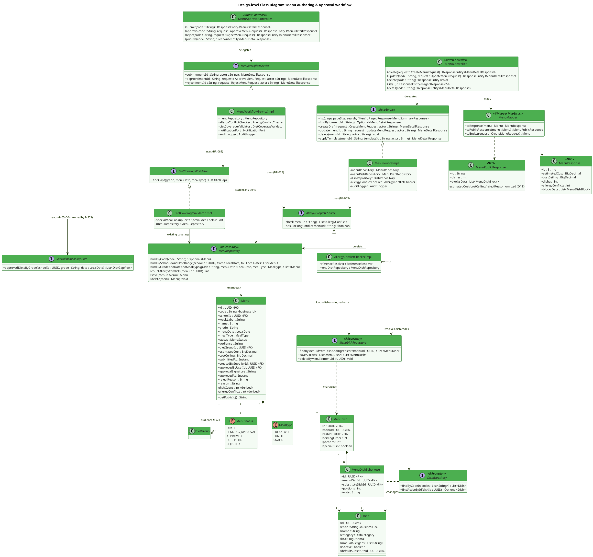
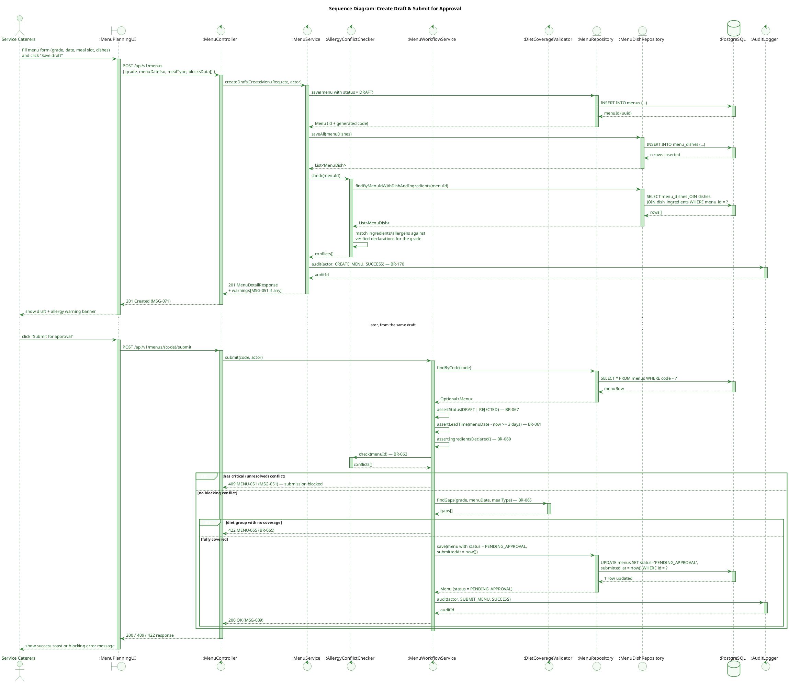
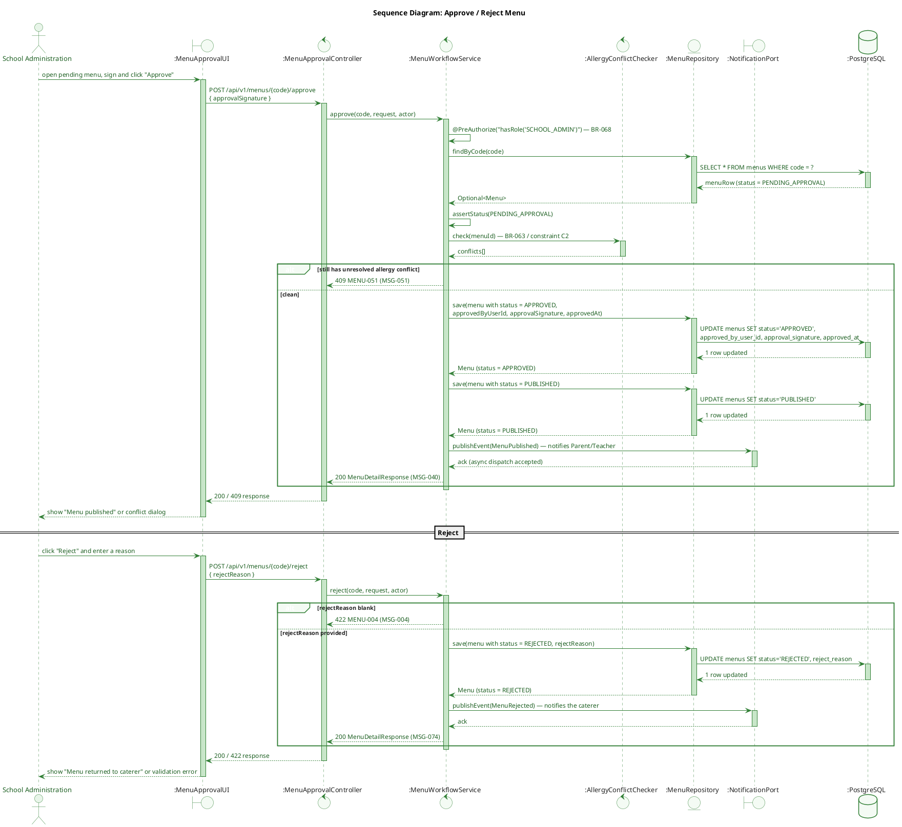
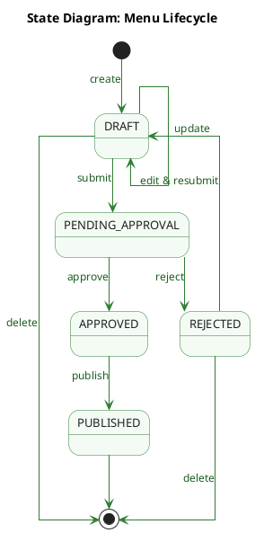
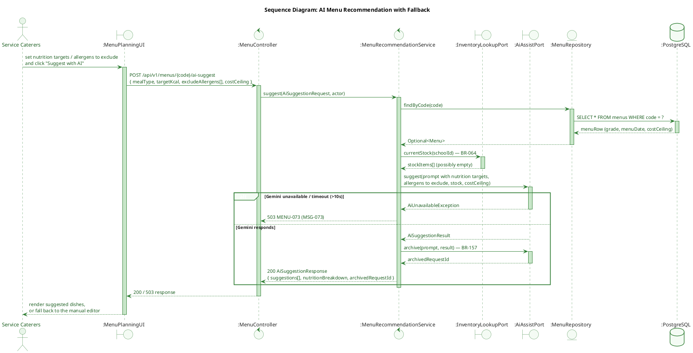
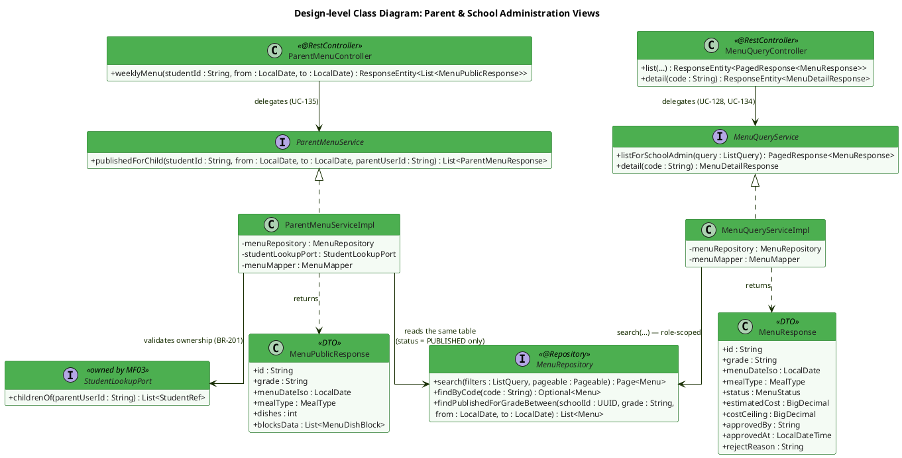
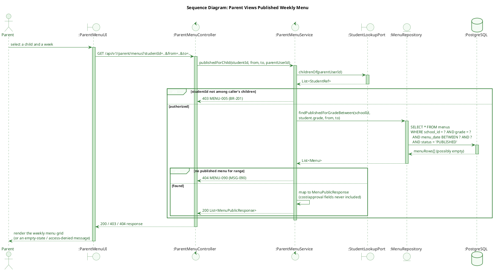

# MF05 — Menu & Diet Management
## Design Diagrams (Database, Class, Sequence, State)

> **Stack:** Spring Boot 4.1.x (Java 25) · PostgreSQL 16 · Flyway · Spring Security + JWT · springdoc-OpenAPI · MapStruct
> **Bounded Context:** Menu Planning & Nutrition
> **Based on:** TDS `SFMS-MF05-IMP-001 v1.2` (Approved 2026-08-03)
> **Notation:** class diagrams use standard UML (`+` public / `-` private / `~` package, `<<interface>>`, `<<enumeration>>`, association multiplicities `1`, `0..1`, `n`); sequence diagrams use standard UML lifelines named in object notation `:ClassName` (anonymous instance of that class) and typed with the UML robustness stereotypes — `actor` (human), `boundary` (UI screen or cross-module port), `control` (controller / service / validator), `entity` (Spring Data repository — the only component allowed to touch the database), `database` (persistent store) — with synchronous calls (solid arrow) always paired with a reply (dashed arrow), activation bars, and `alt`/`else`/`opt` combined fragments; the state diagram uses UML state-machine notation (`[*]` initial/final pseudo-states, `event [guard] / action` transition labels, `entry /` activities).

---

## Database Architecture (DBML)

> Reflects Flyway `V8__mf05_menu_diet.sql` (+ seed `V9__seed_mf05.sql`) owned by MF05 (M05-D11). All MF05-owned tables use UUID primary keys generated server-side plus a business `code` column exposed as `id` in JSON (M05-D01). `special_meal_requests` is **owned by MF03** (`V4__mf03_student_parent.sql`) and is intentionally **not** redefined here — MF05 only reads it through `SpecialMealLookupPort` (M05-D04).

```dbml
// Use DBML to define your database structure
// Docs: https://dbml.dbdiagram.io/docs
// Module: MF05 — Menu & Diet Management
// Source: TDS SFMS-MF05-IMP-001 v1.2 | Flyway V8__mf05_menu_diet.sql + V9__seed_mf05.sql

Table menus {
  id                     uuid          [pk, default: `gen_random_uuid()`, note: 'Internal PK']
  code                   varchar(32)   [not null, note: "Business id, e.g. 'MENU-2026-30' or '{menuCode}--{dietGroupCode}' for special menus (M05-D01)"]
  school_id              uuid          [not null, note: 'UUID ref -> schools(id) in MF02']
  week_label             varchar(64)   [not null, note: 'Display label, JSON field name: week']
  name                   varchar(160)  [not null]
  grade                  varchar(16)   [not null, note: 'BR-062: nutrition targets are age/grade based']
  menu_date              date          [not null, note: 'JSON field name: menuDateIso']
  meal_type              varchar(16)   [not null, note: 'BREAKFAST | LUNCH | SNACK (common/enums/MealType, D6)']
  status                 varchar(24)   [not null, default: 'DRAFT', note: 'DRAFT|PENDING_APPROVAL|APPROVED|PUBLISHED|REJECTED (BR-068)']
  audience               varchar(32)   [not null, default: 'ALL', note: "'ALL' or DietGroup.code — ADR-M05-01: one table, no menu_variants"]
  diet_group_id          uuid          [null, ref: > diet_groups.id]
  estimated_cost         numeric(12,2) [null]
  cost_ceiling           numeric(12,2) [null, note: 'Copied from school_config.cost_ceiling (MF02) at creation time — read-only for FE (M05-D09)']
  submitted_at           timestamptz   [null]
  created_by_supplier_id uuid          [null, note: 'UUID ref -> partners(id) in MF04. Ownership check for Service Caterers (M05-D02)']
  approved_by_user_id    uuid          [null, note: 'UUID ref -> user_accounts(id) in MF01']
  approval_signature     varchar(256)  [null]
  approved_at            timestamptz   [null]
  reject_reason          varchar(1000) [null]
  reason                 varchar(500)  [null, note: 'Required when a special menu is added after the general menu is already published']
  created_at             timestamptz   [not null, default: `now()`]
  updated_at             timestamptz   [null]
  created_by             varchar(180)  [null]
  updated_by             varchar(180)  [null]

  indexes {
    (school_id, code) [unique, name: "uq_menus_school_code"]
    (school_id, menu_date, grade) [name: "ix_menus_school_date_grade"]
    status   [name: "ix_menus_status"]
    audience [name: "ix_menus_audience"]
  }

  Note: 'One row per (day x grade x meal slot x audience). Derived fields dishes(count)/allergyConflicts are computed at read time (ADR-M05-02) — never stored. PUBLISHED rows are immutable (BR-067).'
}

Table dishes {
  id                     uuid          [pk, default: `gen_random_uuid()`]
  code                   varchar(64)   [unique, not null, note: "Slug, e.g. 'ca-basa-sot-ca-chua'"]
  name                   varchar(160)  [not null]
  category               varchar(24)   [not null, note: 'MON_CHINH|MON_MAN|CANH|RAU|BUA_PHU|TRANG_MIENG']
  kcal                   numeric(8,2) [not null]
  protein                numeric(8,2) [not null]
  fat                    numeric(8,2) [not null]
  carb                   numeric(8,2) [not null]
  manual_allergens       text[]      [not null, default: '{}']
  is_active              boolean       [not null, default: true]
  default_substitute_id  uuid          [null, ref: > dishes.id, note: 'Self-reference; cannot equal id (ck_dish_no_self_substitute)']
  created_at             timestamptz   [not null, default: `now()`]
  updated_at             timestamptz   [null]
  created_by             varchar(180)  [null]
  updated_by             varchar(180)  [null]

  Note: 'System-wide catalog (no school_id) — UNIQUE(code) not UNIQUE(school_id, code). Deactivated via isActive=false, never hard-deleted while referenced by a menu.'
}

Table dish_ingredients {
  id               uuid          [pk, default: `gen_random_uuid()`]
  dish_id          uuid          [not null, ref: > dishes.id]
  ingredient_code  varchar(64)   [null, note: 'M05-D15: catalog_ingredients table belongs to MF06 and does not exist yet -> code only, NO FK. MF06 will ADD CONSTRAINT later.']
  name             varchar(160)  [not null]
  quantity         varchar(32)   [not null]
  unit             varchar(16)   [not null, default: 'g']
  created_at       timestamptz   [not null, default: `now()`]
  updated_at       timestamptz   [null]
  created_by       varchar(180)  [null]
  updated_by       varchar(180)  [null]

  indexes {
    dish_id [name: "ix_dish_ing_dish"]
  }

  Note: 'BR-069: every dish must declare all ingredients and potential allergens before submission.'
}

Table menu_dishes {
  id              uuid          [pk, default: `gen_random_uuid()`]
  menu_id         uuid          [not null, ref: > menus.id]
  dish_id         uuid          [not null, ref: > dishes.id]
  serving_order   int           [not null, default: 0]
  portions        int           [not null, default: 0]
  is_special_dish boolean       [not null, default: false]
  created_at      timestamptz   [not null, default: `now()`]
  updated_at      timestamptz   [null]
  created_by      varchar(180)  [null]
  updated_by      varchar(180)  [null]

  indexes {
    (menu_id, dish_id) [unique, name: "uq_menu_dish"]
  }

  Note: "JSON: exposed both ways through blocksData (CF-12); the menu's `dishes` field is a derived COUNT, never the array itself (M05-D09/D12)."
}

Table menu_dish_substitutes {
  id                 uuid         [pk, default: `gen_random_uuid()`]
  menu_dish_id       uuid         [not null, ref: > menu_dishes.id]
  substitute_dish_id uuid         [not null, ref: > dishes.id]
  portions           int          [not null, default: 0]
  note               varchar(300) [null]
  created_at         timestamptz  [not null, default: `now()`]
  updated_at         timestamptz  [null]
  created_by         varchar(180) [null]
  updated_by         varchar(180) [null]

  Note: 'Per-dish allergy substitution (not a whole-menu variant) — resolves AllergyConflictChecker findings.'
}

Table diet_groups {
  id                          uuid          [pk, default: `gen_random_uuid()`]
  code                        varchar(32)   [unique, not null, note: 'VEGETARIAN | HALAL | DIABETIC | GLUTEN_FREE | NUT_FREE ...']
  label                       varchar(64)   [not null]
  match_diet                  varchar(64)   [null, note: 'Matches special_meal_requests.dietary_type (MF03) — open catalog, BR-220']
  exclude_allergens           text[]      [not null, default: '{}']
  exclude_ingredient_keywords text[]      [not null, default: '{}']
  note                        varchar(300)  [null]
  created_at                  timestamptz   [not null, default: `now()`]
  updated_at                  timestamptz   [null]
  created_by                  varchar(180)  [null]
  updated_by                  varchar(180)  [null]

  Note: 'System-wide catalog, 5 rows seeded in V9. The list of STANDARD diet names itself is MF03 configuration (StandardDietCatalog, M05-D05), not enforced here.'
}

Table menu_templates {
  id         uuid          [pk, default: `gen_random_uuid()`]
  code       varchar(32)   [not null]
  school_id  uuid          [not null, note: 'UUID ref -> schools(id) in MF02']
  name       varchar(160)  [not null]
  meal_type  varchar(16)   [not null, note: 'BREAKFAST | LUNCH | SNACK']
  audience   varchar(32)   [not null, default: 'ALL']
  note       varchar(300)  [null]
  is_active  boolean       [not null, default: true]
  created_at timestamptz   [not null, default: `now()`]
  updated_at timestamptz   [null]
  created_by varchar(180)  [null]
  updated_by varchar(180)  [null]

  indexes {
    (school_id, code) [unique, name: "uq_menu_templates_school_code"]
  }

  Note: 'Applied to a (date x meal slot) cell in the planning grid; editing a template does NOT cascade into menus already built from it (§9.3.7).'
}

Table menu_template_dishes {
  id            uuid         [pk, default: `gen_random_uuid()`]
  template_id   uuid         [not null, ref: > menu_templates.id]
  dish_id       uuid         [not null, ref: > dishes.id]
  serving_order int          [not null, default: 0]
  created_at    timestamptz  [not null, default: `now()`]
  updated_at    timestamptz  [null]
  created_by    varchar(180) [null]
  updated_by    varchar(180) [null]

  indexes {
    (template_id, dish_id) [unique, name: "uq_template_dish"]
  }
}

// ── Owned by MF03 — shown read-only for context, NOT created by MF05 (M05-D04) ──
Table special_meal_requests {
  id            uuid         [pk, note: 'Owned by MF03 — V4__mf03_student_parent.sql. MF05 never issues DDL for this table.']
  student_id    uuid         [not null, note: 'UUID ref -> students(id) in MF03, no FK (cross-module, same as school_id/created_by_supplier_id above)']
  dietary_type  varchar(64)  [note: 'Open catalog (BR-220) — matched against diet_groups.match_diet']
  status        varchar(16)  [note: 'PENDING|APPROVED|REJECTED|NEEDS_INFO']

  Note: 'MF05 reads this ONLY through SpecialMealLookupPort.approvedDietsByGrade(schoolId, grade, date) — no entity/repository import across module boundary (ADR-M02-5).'
}

// ── Relationships summary ──────────────────────────────────────────────────
// menus.diet_group_id                  -> diet_groups.id           (ADR-M05-01, audience != 'ALL')
// menus.school_id                      -> schools.id (MF02, UUID-only, no FK)
// menus.created_by_supplier_id         -> partners.id (MF04, UUID-only, no FK)
// menus.approved_by_user_id            -> user_accounts.id (MF01, UUID-only, no FK)
// menu_dishes.menu_id                  -> menus.id
// menu_dishes.dish_id                  -> dishes.id
// menu_dish_substitutes.menu_dish_id   -> menu_dishes.id
// menu_dish_substitutes.substitute_dish_id -> dishes.id
// dish_ingredients.dish_id             -> dishes.id
// dishes.default_substitute_id         -> dishes.id (self)
// menu_templates.school_id             -> schools.id (MF02, UUID-only, no FK)
// menu_template_dishes.template_id     -> menu_templates.id
// menu_template_dishes.dish_id         -> dishes.id
// special_meal_requests.student_id     -> students.id (MF03, UUID-only, no FK, read-only via port)
```

---

## 1. Menu Authoring & Approval Workflow

### 1.1 Class Diagram



**Description:**
This diagram covers the core planning/approval domain of MF05. `Menu` is the aggregate root: one row represents a single (day × grade × meal slot × audience) slice, following ADR-M05-01 (a single `menus` table distinguished by `audience`, replacing the older `MenuVariant` model). `MenuServiceImpl` owns CRUD and draft creation, while state transitions are isolated in `MenuWorkflowServiceImpl` to keep the BR-068 state machine in one place. `AllergyConflictChecker` (BR-063) and `DietCoverageValidator` (BR-065) are both consulted at create/update/submit/approve — the latter reads special-diet requests through `SpecialMealLookupPort`, an interface **owned by MF03** (M05-D04); MF05 never imports MF03's entity or repository directly. Two response DTOs are produced from the same entity through `MenuMapper`: `MenuResponse` (Caterer/SchoolAdmin/Medical — full detail) and `MenuPublicResponse` (Parent/Teacher — cost fields stripped, M05-D08). The derived fields `dishes` (count) and `allergyConflicts` are never persisted — always computed at read time (ADR-M05-02).

---

### 1.2 Sequence Diagram — Create Draft & Submit for Approval (UC-020 → UC-087)



**Description:**
Covers the happy path of drafting a menu (UC-020) through submission for approval (UC-087). Draft creation never blocks on allergy conflicts — it only surfaces them as warnings (MSG-051) so the caterer can keep working. Submission is where BR-061 (≥3-day lead time), BR-069 (ingredients/allergens fully declared) and BR-063 (no unresolved critical allergy conflict) become hard gates, followed by BR-065 diet-group coverage via `DietCoverageValidator`. Any failure returns a 409/422 without changing `status`; success moves the menu to `PENDING_APPROVAL` and writes an audit record (BR-170).

---

### 1.3 Sequence Diagram — Approve / Reject Menu (UC-006)



**Description:**
Only School Administration may transition a `PENDING_APPROVAL` menu (BR-068, enforced by `@PreAuthorize`). Approval re-runs the BR-063 allergy check as a final gate (constraint C2: a menu can never reach `PUBLISHED` with an unresolved conflict) — if conflicts remain, the admin is told to reject rather than approve. In Phase 1, `approve` performs `APPROVED → PUBLISHED` atomically to match the current mock behaviour (M05-D13/CF-8); Phase 2 will split this into the dedicated `publish` action once the frontend adopts action endpoints. A successful publish raises `MenuPublished` so Parent/Teacher views can pick it up. Rejection always requires a non-blank `rejectReason` (also enforced by the `ck_menu_rejected_has_reason` DB constraint).

---

### 1.4 State Diagram — `Menu` Lifecycle (BR-067, BR-068)



**Description:**
This state machine is the authority behind `MenuWorkflowService`; the `status` column carries the same five values and is protected at the database level by a `CHECK` constraint. The guard on `DRAFT → PENDING_APPROVAL` is exactly the set of pre-conditions asserted in sequence diagram §1.2 (BR-061 lead time ≥ 3 days, BR-063 allergy check, BR-069 ingredient declarations); the guard on `PENDING_APPROVAL → APPROVED` is the RBAC check of BR-068 (`@PreAuthorize`, otherwise 403 `MENU-005`) plus the final allergy re-check from §1.3. Write permissions follow the state — only `DRAFT` and `REJECTED` accept `PUT`/`DELETE`, any attempt on `APPROVED`/`PUBLISHED` returns 409 `MENU-067` — so a rejected menu must travel back through `DRAFT` before it can be resubmitted. Each transition emits the corresponding domain event (`MenuSubmittedForApproval`, `MenuApproved`, `MenuRejected`, `MenuPublished`) listed in the TDS event catalog. In Phase 1 `approve` executes `APPROVED → PUBLISHED` atomically in one transaction (M05-D13 / CF-8); Phase 2 splits it into a dedicated `POST /menus/{id}/publish` action.

---

## 2. Special Diet Menus & AI Recommendation

### 2.1 Class Diagram

```plantuml
@startuml MF05_DietAndAI_ClassDiagram
title Design-level Class Diagram: Special Diet Menus & AI Recommendation

' ==========================================
' CẤU HÌNH BỐ CỤC VÀ MÀU SẮC RATIONAL ROSE
' ==========================================
skinparam classAttributeIconSize 0
skinparam linetype ortho
skinparam nodesep 60
skinparam ranksep 60
skinparam backgroundColor #FFFFFF

' Định dạng cho Class / Interface / Abstract Class
skinparam class {
    BackgroundColor #F4FBF4
    BorderColor #2E7D32
    FontColor #212121
    FontName Arial
    FontSize 13

    HeaderBackgroundColor #4CAF50
    HeaderFontColor #FFFFFF

    AttributeFontColor #212121
    AttributeFontName Arial
    AttributeFontSize 12
}

skinparam interface {
    BackgroundColor #f7ed93ff
    BorderColor #000000ff
    FontColor #000000ff
    FontName Arial
}

' Định dạng Mũi tên & Liên kết (Relationships & Arrows)
skinparam arrow {
    Color #162c00ff
    FontColor #162c00ff
    FontName Arial
    FontSize 11
}

' Định dạng Icon Stereotype (C, I, A, E)
skinparam stereotype {
    CBackgroundColor #f6eedcff
    CBorderColor #000000ff
    EBackgroundColor #f6eedcff
    EBorderColor #000000ff
    ABackgroundColor #f6eedcff
    ABorderColor #000000ff
    IBackgroundColor #f6eedcff
    IBorderColor #000000ff
}

hide empty members

class DietGroup {
  +id : UUID <<PK>>
  +code : String <<business id>>
  +label : String
  +matchDiet : String
  +excludeAllergens : List<String>
  +excludeIngredientKeywords : List<String>
  +note : String
}

class Menu {
  +code : String
  +audience : String
  +dietGroupId : UUID <<FK>>
  +status : MenuStatus
}

interface SpecialMenuService {
  +createForDietGroup(request : CreateSpecialMenuRequest, actor : String) : MenuDetailResponse
}

class SpecialMenuServiceImpl {
  -menuRepository : MenuRepository
  -dietGroupRepository : DietGroupRepository
  -dietCoverageValidator : DietCoverageValidator
}

interface DietCoverageValidator {
  +findGaps(grade, menuDate, mealType) : List<DietGap>
}

interface SpecialMealLookupPort {
  +approvedDietsByGrade(schoolId : UUID, grade : String, date : LocalDate) : List<DietGapView>
}

class DietGapView <<record, owned by MF03>> {
  +studentCount : int
  +dietGroupCode : String
  +grade : String
}

interface AiAssistPort <<owned by MF12>> {
  +suggest(prompt : AiPromptRequest) : AiSuggestionResult
}

interface MenuRecommendationService {
  +suggest(request : AiSuggestionRequest, actor : String) : AiSuggestionResponse
}

class MenuRecommendationServiceImpl {
  -aiAssistPort : AiAssistPort
  -inventoryLookupPort : InventoryLookupPort
  -schoolConfigPort : SchoolConfigPort
  -menuRepository : MenuRepository
}

class AiSuggestionRequest <<DTO>> {
  +mealType : MealType
  +targetKcal : int
  +excludeAllergens : List<String>
  +costCeiling : BigDecimal
}

class AiSuggestionResponse <<DTO>> {
  +model : String
  +suggestions : List<DishSuggestion>
  +nutritionBreakdown : NutritionBreakdown
  +archivedRequestId : String
}

class MenuController <<@RestController>> {
  +createSpecialMenu(request) : ResponseEntity<MenuDetailResponse>
  +aiSuggest(code : String, request : AiSuggestionRequest) : ResponseEntity<AiSuggestionResponse>
}

interface MenuRepository <<@Repository>> {
  +findByCode(code : String) : Optional<Menu>
  +existsByGradeAndDateAndAudience(grade : String, menuDate : LocalDate, audience : String) : boolean
  +save(menu : Menu) : Menu
}

interface DietGroupRepository <<@Repository>> {
  +findByCode(code : String) : Optional<DietGroup>
  +findAllActive() : List<DietGroup>
}

SpecialMenuService <|.. SpecialMenuServiceImpl
MenuRecommendationService <|.. MenuRecommendationServiceImpl

MenuController --> SpecialMenuService : delegates (UC-023)
MenuController --> MenuRecommendationService : delegates (UC-075)

SpecialMenuServiceImpl --> DietCoverageValidator : validates coverage
SpecialMenuServiceImpl --> MenuRepository : persists
SpecialMenuServiceImpl --> DietGroupRepository : resolves dietGroupCode
SpecialMenuServiceImpl --> Menu : creates (audience = DietGroup.code)
MenuRepository ..> Menu : <<manages>>
DietGroupRepository ..> DietGroup : <<manages>>
DietCoverageValidator --> SpecialMealLookupPort : reads (owned by MF03)
SpecialMealLookupPort ..> DietGapView : returns

MenuRecommendationServiceImpl --> AiAssistPort : delegates (ADR-M05-03, owned by MF12)
MenuRecommendationServiceImpl --> MenuRepository : loads menu context (grade, date)
MenuRecommendationServiceImpl ..> AiSuggestionRequest
MenuRecommendationServiceImpl ..> AiSuggestionResponse

Menu "n" --> "1" DietGroup : audience

@enduml
```



**Description:**
Two loosely related capabilities share this diagram because both depend on external ports owned by other modules. `SpecialMenuServiceImpl` (UC-023) creates a `Menu` row with `audience = DietGroup.code` instead of `ALL` — it is a first-class menu with its own approval lifecycle, not a delta on top of the general menu (ADR-M05-01). It consults `DietCoverageValidator`, which in turn reads approved special-meal requests through `SpecialMealLookupPort` — an interface **owned by MF03** since the underlying `special_meal_requests` table and its approval workflow belong to that module (M05-D04); MF05 never queries that table directly. `MenuRecommendationServiceImpl` (UC-075) similarly never talks to Gemini directly — it goes through `AiAssistPort`, owned by MF12, keeping API credentials and conversation archiving (BR-157) in a single place (ADR-M05-03).

---

### 2.2 Sequence Diagram — Create Special Diet Menu (UC-023)

```plantuml
@startuml MF05_CreateSpecialMenu
title Sequence Diagram: Create Special Diet Menu

' Bật chế độ liên kết vuông góc (Orthogonal lines)
skinparam linetype ortho

' ==========================================
' CẤU HÌNH MÀU SẮC TÔNG XANH LÁ
' ==========================================
skinparam backgroundColor #FFFFFF

' Định dạng chung cho Stereotype
skinparam stereotype {
    CBackgroundColor #E8F5E9
    CBorderColor #2E7D32
    EBackgroundColor #E8F5E9
    EBorderColor #2E7D32
    ABackgroundColor #E8F5E9
    ABorderColor #2E7D32
    IBackgroundColor #E8F5E9
    IBorderColor #2E7D32
}

' ==========================================
' Note
' ==========================================
skinparam NoteBackgroundColor #E8F5E9
skinparam NoteBorderColor #2E7D32
skinparam NoteFontColor #212121
skinparam NoteFontName Arial

' ==========================================
' Lifeline theo stereotype robustness UML
' (boundary / control / entity / database)
' ==========================================
skinparam BoundaryBackgroundColor #F4FBF4
skinparam BoundaryBorderColor #2E7D32
skinparam BoundaryFontColor #212121
skinparam BoundaryFontName Arial
skinparam BoundaryFontSize 13

skinparam ControlBackgroundColor #F4FBF4
skinparam ControlBorderColor #2E7D32
skinparam ControlFontColor #212121
skinparam ControlFontName Arial
skinparam ControlFontSize 13

skinparam EntityBackgroundColor #F4FBF4
skinparam EntityBorderColor #2E7D32
skinparam EntityFontColor #212121
skinparam EntityFontName Arial
skinparam EntityFontSize 13

skinparam CollectionsBackgroundColor #F4FBF4
skinparam CollectionsBorderColor #2E7D32
skinparam CollectionsFontColor #212121

skinparam DatabaseBackgroundColor #F4FBF4
skinparam DatabaseBorderColor #2E7D32
skinparam DatabaseFontColor #212121
skinparam DatabaseFontName Arial
skinparam DatabaseFontSize 13

skinparam sequence {

    ' ==========================================
    ' Actor & Participant
    ' ==========================================
    ActorBackgroundColor #E8F5E9
    ActorBorderColor #2E7D32
    ActorFontColor #1B5E20
    ActorFontName Arial
    ActorFontSize 13

    ParticipantBackgroundColor #F4FBF4
    ParticipantBorderColor #2E7D32
    ParticipantFontColor #212121
    ParticipantFontName Arial
    ParticipantFontSize 13

    ' ==========================================
    ' Message
    ' ==========================================
    ArrowColor #2E7D32
    ArrowFontColor #1B5E20
    ArrowFontName Arial
    ArrowFontSize 12

    ' ==========================================
    ' Activation (Execution)
    ' ==========================================
    LifeLineBackgroundColor #C8E6C9
    LifeLineBorderColor #2E7D32

    ' ==========================================
    ' Group (alt / opt / loop / par...)
    ' ==========================================
    GroupBackgroundColor #F4FBF4
    GroupBorderColor #2E7D32
    GroupHeaderFontColor #FFFFFF
    GroupHeaderBackgroundColor #4CAF50
    GroupFontColor #212121
    GroupFontName Arial

}

actor "Service Caterers" as SC
boundary ":SpecialMenuUI" as UI
control ":MenuController" as C
control ":SpecialMenuService" as S
control ":DietCoverageValidator" as DCV
boundary ":SpecialMealLookupPort" as P
entity ":DietGroupRepository" as DGR
entity ":MenuRepository" as MR
entity ":MenuDishRepository" as MDR
database ":PostgreSQL" as DB

SC -> UI : pick a diet group, add dishes,\nenter reason and click "Create special menu"
activate UI
UI -> C : POST /api/v1/menus\n{ audience: dietGroupCode, grade, menuDateIso,\n  mealType, blocksData[], reason }
activate C
C -> S : createForDietGroup(CreateSpecialMenuRequest, actor)
activate S

S -> DGR : findByCode(dietGroupCode)
activate DGR
DGR -> DB : SELECT * FROM diet_groups WHERE code = ?
activate DB
DB --> DGR : dietGroupRow | none
deactivate DB
DGR --> S : Optional<DietGroup>
deactivate DGR

alt diet group code not found
  S --> C : 404 MENU-404 (MSG-137)
else diet group found
  S -> DCV : findGaps(grade, menuDate, mealType) — BR-065
  activate DCV
  DCV -> P : approvedDietsByGrade(schoolId, grade, menuDate)
  activate P
  P --> DCV : List<DietGapView>
  deactivate P
  DCV --> S : gaps[]
  deactivate DCV

  S -> MR : save(menu with audience = dietGroupCode,\ndietGroupId, status = DRAFT)
  activate MR
  MR -> DB : INSERT INTO menus (...)
  activate DB
  DB --> MR : menuId (uuid)
  deactivate DB
  MR --> S : Menu (id + generated code)
  deactivate MR

  S -> MDR : saveAll(menuDishes from blocksData)
  activate MDR
  MDR -> DB : INSERT INTO menu_dishes (...)
  activate DB
  DB --> MDR : n rows inserted
  deactivate DB
  MDR --> S : List<MenuDish>
  deactivate MDR

  S --> C : 201 MenuDetailResponse (MSG-072)
end
deactivate S
C --> UI : 201 / 404 response
deactivate C
UI --> SC : show the new special menu or "diet group not found"
deactivate UI
@enduml
```



**Description:**
When a student's verified allergy or approved special diet leaves a diet group with "nothing to eat" for a slot (BR-065), the caterer creates a dedicated menu scoped to that `DietGroup` instead of editing the general menu. The check for which diet groups actually need coverage is delegated to `DietCoverageValidator`, which reads MF03's approved special-meal requests exclusively through `SpecialMealLookupPort` — this keeps the module boundary intact even though the business data (which students need what) lives in MF03. The resulting `Menu` row follows the exact same `menus` table and BR-068 lifecycle as a general menu; only `audience`/`dietGroupId` distinguish it (ADR-M05-01).

---

### 2.3 Sequence Diagram — AI Menu Recommendation with Fallback (UC-075)



**Description:**
`MenuRecommendationService` composes the AI prompt from two required inputs per BR-064: current inventory stock (via a port into MF06 — returned empty until MF06 ships, per M05-D15) and the school's cost ceiling. The actual model call goes through `AiAssistPort`, owned by MF12, with a dev-profile stub per ADR-000. The critical design point is the fallback path (ADR-M05-03): any timeout (10s SLA) or provider error surfaces as `503 MENU-073` / MSG-073 but never blocks manual menu creation — UC-075's alternate flow AF1 is a first-class, tested path (`TC-014`), not just an error case.

---

## 3. Parent & School Administration Views

### 3.1 Class Diagram



**Description:**
Read-only views are intentionally split from the mutating `MenuService`/`MenuWorkflowService` used by Service Caterers, but both query paths read from the **same** `MenuRepository`/`menus` table — they are not disconnected data sources, only disconnected *access policies*. `MenuQueryServiceImpl` backs the School Administration list/detail screens (UC-128, UC-134) with the full `MenuResponse` shape. `ParentMenuServiceImpl` backs UC-135 and enforces two rules server-side, not just client-side: only `status = PUBLISHED` rows are ever returned, and the requested `studentId` must belong to the calling parent's own children (BR-201, max 5), checked via `StudentLookupPort` (owned by MF03). `MenuResponse` and `MenuPublicResponse` are mapped from the same `Menu` entity by `MenuMapper` but declared as independent `oneOf` schemas (M05-D08) rather than a base/subclass pair, because OpenAPI response-shape inheritance would still expose the narrower type as structurally compatible with the wider one — declaring them as siblings guarantees cost/approval fields are structurally absent from the parent-facing response, not just omitted by convention.

---

### 3.2 Sequence Diagram — Parent Views Published Weekly Menu (UC-135)



**Description:**
This flow demonstrates the server-side security boundary called out explicitly in the TDS (§9.3.11): even though the mock frontend currently fetches `GET /menus?grade=` and filters `PUBLISHED` client-side, the backend implementation never trusts that — it filters by `status = PUBLISHED` and validates that `studentId` is one of the caller's own children (BR-201, ≤5 children per parent account) before returning anything. An empty result for the requested date range returns `404 MSG-090` (UC-135 EX1) rather than an empty 200, so the frontend can distinguish "no menu published yet" from a real error.

---

*Document generated from TDS `SFMS-MF05-IMP-001 v1.2` (Approved 2026-08-03).*
