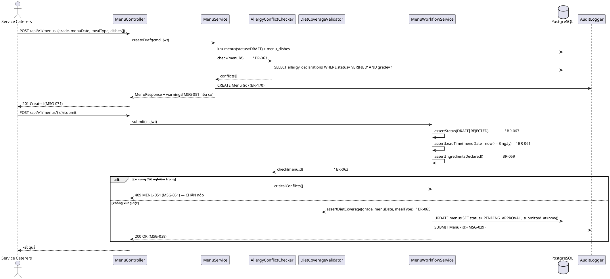
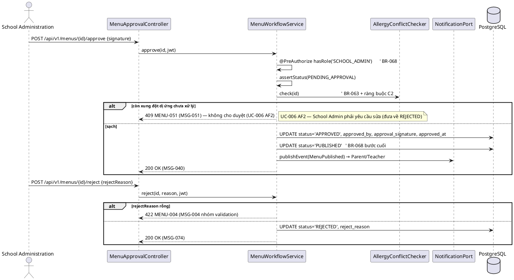
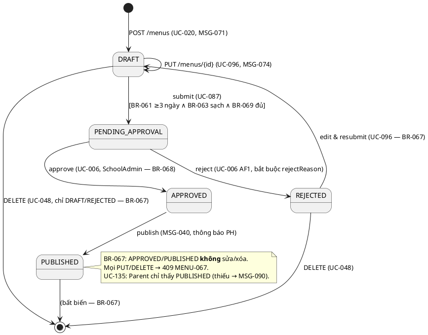

# ENGINEERING DOCUMENTATION STANDARD (EDS) v2.0 — TDS Backend
# MF05 — Menu & Diet Management

| Field | Value |
|-------|-------|
| **Document ID** | `SFMS-MF05-IMP-001` |
| **Version** | `1.2` |
| **Date** | `2026-08-03` |
| **Status** | **`Approved`** — 2026-08-03 (đóng toàn bộ mục ⛔ của `TestSpec-MF05` §2; 16 quyết định **M05-D01…M05-D16** ở §2.4) |
| **Document Owner** | Nguyễn Phương Thảo (ThaoNP) |
| **Author** | Nguyễn Phương Thảo — chủ module MF05/MF07/MF12, Lead Test/QA Reviewer |
| **Reviewed by** | `[Mạnh — §5/§9: Pending]` · `[Minh — §8/§9 JSON + 3 việc Bước 3: Pending — §2.5]` · `[Huy — §2 Traceability + 4 MSG mới: Pending — §2.5]` |
| **DPO Sign-off** | `[ ] Pending` *(module chạm PII gián tiếp: hồ sơ dị ứng học sinh dùng cho BR-063; cảnh báo dị ứng chỉ trả **số đếm**, không trả danh tính HS — xem M05-D14)* |
| **Approved by** | Nguyễn Phương Thảo (chủ MF05) — 2026-08-03, theo tiền lệ MF02 (`SFMS-MF02-IMP-001` Approved 2026-07-31) và MF04 (Approved 2026-08-02). Các mục **treo** ở §2.5 **không chặn Approve** vì không mục nào đổi schema hay hợp đồng API. |
| **Last Review** | `2026-08-03` |
| **Based on EDS** | `v2.0` |

> **Stack (ADR-000 / `01_MVP_Backend_Implementation_Plan.md` §3):** Spring Boot **4.1.x (Java 25 LTS)** · PostgreSQL 16 · **Flyway** · Spring Security + JWT · springdoc-OpenAPI (Swagger) · MapStruct.
>
> ⚠️ **Sửa 2026-08-03:** dòng stack cũ ghi *"Flyway (V1 = toàn bộ schema, do Nam giữ)"* — mô hình đó **đã bị bỏ** từ khi MF02 dùng `V3` (`00_Common_Conventions.md` §0-BIS). MF05 lấy **số V kế tiếp còn trống** — xem M05-D11.
>
> **Convention:** kế thừa nguyên bản mẫu `TDS-MF01_Backend.md` và `TDS-MF02_Backend.md` (đặt tên, format §2, shape §9, hợp đồng phân trang `00_Team_Work_Assignment_Plan.md` §2b) và **code thật đã merge** ở `04_Development/Backend/` — `com.sfms.mf02` là module mẫu (§0-BIS).

---

## CHANGELOG

> **Policy 4.4 — Immutable History:** Không xóa thông tin cũ.

| Ngày | Người thực hiện | Nội dung thay đổi |
|------|-----------------|-------------------|
| 2026-08-03 | Nguyễn Phương Thảo | **v1.2 — Bước 1 (`02_Module_Completion_Workflow.md` §7): đóng toàn bộ mục ⛔ của `TestSpec-MF05` §2 (L1–L18) + 10 lệch mới phát hiện khi đối chiếu **code thật đã merge**, chuyển Status → Approved.** 16 quyết định **M05-D01…M05-D16** (§2.4). Điểm nặng nhất: **M05-D04 — `special_meal_requests` và `/api/v1/special-meals` KHÔNG thuộc MF05.** MF03 đã `CREATE TABLE special_meal_requests` ở `V4__mf03_student_parent.sql:120`, có `mf03/web/SpecialMealRequestController` (`/api/v1/special-meals`, 4 endpoint) và `ModuleCodeResolver` đã gán prefix `special-meals → STU`; bản v1.1 của tài liệu này đặc tả lại **cùng bảng, cùng path** ⇒ nếu code theo v1.1 sẽ `CREATE TABLE` trùng (Flyway đỏ) và ánh xạ 2 controller vào 1 path. MF05 chuyển sang **chỉ đọc** qua `SpecialMealLookupPort`. Kéo theo: §5.2 bỏ bảng, §9.2 bỏ 4 endpoint (#16–19), §16 bỏ 2 hàng, §10 bỏ `MENU-066`, §2.2 BR-066 trỏ **BR-220 + `StandardDietCatalog`** của MF03, và **L14 đóng** (danh mục chế độ ăn là **cấu hình**, không phải enum — `mf03/service/StandardDietCatalog.java`). Các quyết định còn lại: §5.2 viết lại theo **D1** (PK UUID + `code` + `UNIQUE(school_id, code)`), **D9** (`extends BaseEntity`, bỏ `created_by VARCHAR(128)`, dùng `created_by_supplier_id`/`approved_by_user_id`), **D6** (bỏ `MealType` khai lại trong module, dùng `common/enums/MealType`), FK đổi sang `UUID` (bảng thật dùng UUID PK, không phải `VARCHAR(32)`); **D4** ghi đè C9 — response trả **ISO-8601**, bỏ `dd/MM/yyyy`; §10 ánh xạ 4 mã "không có MSG" sang **MSG-137/138/139/141 dùng chung** + đề xuất **4 MSG mới** cho Huy; **D11** tách `MenuResponse`/`MenuPublicResponse` (Parent/Teacher không thấy giá); **D12** đóng bẫy `dishes` vừa là *số đếm* (response) vừa là *mảng món* (payload §15.1) — mảng chỉ đi qua `blocksData`; **D13** xác nhận đủ 7 role trong seed (`V900`, gồm `U-0022` service-caterers **có `partner_id=CAT-001`**). Migration đổi **`V7`/`V8` → `V8`/`V9`** (V6/V7 đã cấp cho MF04). Package `com.sfms.menu` → **`com.sfms.mf05`** (§0-BIS, mục treo #2 của Thảo — đóng). |
| 2026-07-28 | Nguyễn Phương Thảo | Tạo bản đầu (v1.0). Nguồn: UC `MF05_Menu_Diet_Management.md`; traceability §1.6; `business_rules.md` §7 + BR-156/157/201; `error_message.md`; mock `mock-server.ts` + `db.ts` + `mock-data.ts`; màn FE `service-caterers/{menus,menu-templates,dishes,special-meals}`, `school-admin/menu-approval`, `parent/{weekly-menu,school-meals}`; `data_model.puml` package "Thực đơn & Món ăn"; `semantic-audit.ts` §11/§11b; ADR-000. Ghi nhận 7 mâu thuẫn nguồn CF-1…CF-7 (§2.3) — **không tự chọn bên đúng**. |
| 2026-07-28 | Nguyễn Phương Thảo | **v1.1 — viết lại toàn bộ §9 API Specification theo Frontend.** Đọc `client.ts` + `hooks.ts` + **54 call-site** chạm 4 resource MF05 trong `src/app/(app)/**` và `src/components/app/{menu-form,special-meal-dialog}.tsx`. Bổ sung: §9.0 hợp đồng hook→HTTP (**`PUT` = partial merge**), §9.1 bản đồ Màn hình FE → Endpoint (3 nhóm role), §9.2 bảng 26 endpoint kèm cột "FE dùng?", §9.3 schema theo **từng thao tác thật** (6 biến thể payload của `PUT /menus/{id}`), §9.4 resource ngoài MF05 mà màn MF05 gọi kèm, §9.5 bảng khoảng cách FE↔BE (11 mục, kèm người chịu trách nhiệm). Phát hiện thêm **6 mâu thuẫn CF-8…CF-13** (§2.3). |

---

## MỤC LỤC

1. [Tổng quan Module](#1-tổng-quan-module) · 2. [Ma trận Truy vết](#2-ma-trận-truy-vết) · 3. [Architecture Decisions](#3-architecture-decisions-inline-adr) · 4. [NFR & SLA](#4-non-functional-requirements--sla) · 5. [Static Modeling](#5-static-modeling) · 6. [Dynamic Modeling](#6-dynamic-modeling) · 7. [Domain Event Catalog](#7-domain-event-catalog) · 8. [Interface Specification](#8-interface-specification) · 9. [API Specification](#9-api-specification) · 10. [Error Codes](#10-bảng-mã-lỗi) · 11. [Triển khai](#11-quy-trình-triển-khai) · 12. [Rollback Runbook](#12-rollback--incident-runbook) · 13. [Kiểm thử](#13-kịch-bản-kiểm-thử) · 14. [Xác minh](#14-phương-pháp-xác-minh) · 15. [API Samples](#15-mẫu-thử-thực-tế) · 16. [Authorization Matrix](#16-authorization-matrix) · 17. [AI Prompt Constraints](#17-ai-prompt-constraints-case-20)

---

## 1. Tổng quan Module

> MF05 quản lý vòng đời **thực đơn theo (ngày × khối × buổi)**: Service Caterers lập nháp → nộp duyệt → School Administration duyệt/từ chối → công bố cho Phụ huynh/Giáo viên. Kèm **thư viện món** (`Dish`), **thực đơn mẫu** (`MenuTemplate`), **thực đơn riêng theo nhóm chế độ ăn** (`Menu.audience`), và **yêu cầu bữa ăn đặc biệt** của học sinh (`SpecialMealRequest`).

| Field | Value |
|-------|-------|
| **Module Name** | Menu & Diet Management (MF05) |
| **Bounded Context** | Menu Planning & Nutrition |
| **Data Classification** | `Internal` + tham chiếu `PII` gián tiếp (hồ sơ dị ứng học sinh khi chạy BR-063) |
| **Compliance Scope** | PDPD (không lộ danh tính HS ra thực đơn công bố); BR-062 mục tiêu dinh dưỡng theo nhóm tuổi |
| **Upstream Dependencies** | MF01 (JWT/RBAC), MF02 (Classroom → sĩ số/khối, `SchoolConfig.costCeiling`), MF03 (`Student.allergies`, `Student.specialDiet` — BR-063/BR-065), MF06 (`InventoryBatch` cho AI gợi ý theo tồn kho — BR-064), MF12 (Gemini AI stub — BR-156/157) |
| **Downstream Consumers** | MF06 (dự trù nguyên liệu theo `menuDateIso`), MF07 (phiên kiểm thực gắn `Menu`/`dishId`), MF08 (mẫu lưu gắn món), MF09 (phát suất phải trỏ thực đơn có thật — ràng buộc C3), MF13 (báo cáo dinh dưỡng/chi phí) |
| **Ưu tiên** | **P1** — trục xương sống (`Login theo role → Menu theo khối → phân suất & thống kê theo món`) |

**Phạm vi 10 Use Case (đúng traceability_matrix.md §1.6 — KHÔNG lấy số từ `Report 3.md` phụ lục):**
UC-020, UC-096, UC-075, UC-023, UC-087, UC-006, UC-048, UC-128, UC-134, UC-135.

**Thư mục màn hình FE đã đọc (nguồn 6):**

| Role | Thư mục | Vai trò |
|---|---|---|
| Service Caterers | `(app)/service-caterers/menus`, `menus/create`, `menus/[id]`, `menus/[id]/edit` | UC-020, UC-048, UC-087, UC-096 |
| Service Caterers | `(app)/service-caterers/menu-templates` | Thực đơn mẫu (áp vào ô ngày × buổi) |
| Service Caterers | `(app)/service-caterers/dishes` | Thư viện món dùng chung |
| Service Caterers | `(app)/service-caterers/special-meals` | Suất riêng theo nhóm chế độ ăn (UC-023) |
| School Administration | `(app)/school-admin/menu-approval`, `menu-approval/[id]` | UC-006, UC-128, UC-134 |
| Parent | `(app)/parent/weekly-menu`, `parent/school-meals` | UC-135 |

---

## 2. Ma trận Truy vết

> **Nguồn chuẩn:** cột Business Rules & System Messages lấy **nguyên văn** `traceability_matrix.md` **§1.6**; tên UC nguyên văn `02_Requirements/02_UseCases/MF05_Menu_Diet_Management.md`; nội dung BR tra `business_rules.md` §7 (+ BR-156/157 §14, BR-201 §4).
> **Policy:** chỉ dùng mã có trong §1.6. Mọi BR mà UC file nêu thêm nhưng §1.6 không có → ghi ở §2.3, **không** đưa vào bảng §2.1.

### 2.1. UC ↔ BR ↔ MSG ↔ Code

| UC ID | Tên UC (nguyên văn UC file) | Actor | Business Rules (§1.6) | System Messages (§1.6) | Thành phần Code (Java) |
|-------|------------------------------|-------|------------------------|------------------------|------------------------|
| UC-020 | Create Menu | Service Caterers | BR-061, BR-062, BR-063, BR-064, BR-069 | MSG-039, MSG-051, MSG-067, MSG-071 | `MenuService.createDraft()`, `AllergyConflictChecker.check()`, `MenuController#create` |
| UC-096 | Update Menu | Service Caterers | BR-061, BR-062, BR-063, BR-067, BR-068 | MSG-029, MSG-074, MSG-075 | `MenuService.update()`, `DishRotationValidator.validate()` |
| UC-075 | Request AI Menu Recommendations | Service Caterers | BR-156, BR-064 | MSG-039, MSG-067, MSG-073 | `MenuRecommendationService.suggest()` (gọi Gemini stub — MF12) |
| UC-023 | Create Special Meal Plan | Service Caterers | BR-065, BR-066, BR-071, BR-073 | MSG-072 | `SpecialMenuService.createForDietGroup()`, `DietCoverageValidator` *(đọc yêu cầu đã duyệt qua `SpecialMealLookupPort` — **M05-D04**; việc **duyệt** yêu cầu là của MF03)* |
| UC-087 | Submit Menu For Approval | Service Caterers | BR-061, BR-063, BR-067, BR-068 | MSG-039, MSG-051 | `MenuWorkflowService.submit()` |
| UC-006 | Approval / Reject Menu | School Administration | BR-067, BR-068 | MSG-040, MSG-074 | `MenuWorkflowService.approve()/reject()/publish()` |
| UC-048 | Manage Menus | Service Caterers | BR-061, BR-067, BR-068 | MSG-039, MSG-040, MSG-074 | `MenuService.list()/delete()` |
| UC-128 | View List Menu | School Administration | — | MSG-004, MSG-005 | `MenuQueryService.listForSchoolAdmin()` |
| UC-134 | View Menu Detail | School Administration | — | MSG-004, MSG-005 | `MenuQueryService.detail()` |
| UC-135 | View Menu Information | Parent | BR-201 | MSG-004, MSG-005, MSG-090 | `ParentMenuService.publishedForChild()` |

### 2.2. Business Rules — nội dung (nguyên văn `business_rules.md`)

| BR | § nguồn | Tóm tắt nguyên văn | Điểm enforce trong backend |
|----|---------|--------------------|-----------------------------|
| BR-061 | §7 | Thực đơn phải được nộp để phê duyệt **ít nhất 3 ngày** trước tuần sử dụng dự kiến. | `MenuWorkflowService.submit()` — so `menuDateIso` với `now()` |
| BR-062 | §7 | Thực đơn phải đáp ứng **chỉ tiêu dinh dưỡng theo nhóm tuổi** (calo, đa dạng, cân bằng). | `NutritionEvaluator` — cảnh báo MSG-067 khi <3 nhóm dinh dưỡng |
| BR-063 | §7 | **Bắt buộc kiểm tra xung đột dị ứng** giữa thành phần thực đơn và hồ sơ dị ứng HS trước khi phê duyệt; xung đột nghiêm trọng → **chặn** nộp. | `AllergyConflictChecker` — chạy ở create/update/submit/approve |
| BR-064 | §7 | Đề xuất AI phải ưu tiên nguyên liệu **đang có trong kho** và tuân thủ **giới hạn chi phí**. | `MenuRecommendationService` — prompt kèm tồn kho + `costCeiling` |
| BR-065 | §7 | HS có dị ứng đã xác minh/chế độ ăn đặc biệt → **bắt buộc** Service Caterers tạo **kế hoạch bữa ăn riêng**. | `DietCoverageValidator` — chặn submit khi còn nhóm chế độ ăn "không có gì ăn" |
| BR-066 | §7 | Danh mục chế độ ăn đặc biệt: **Halal, Vegetarian, Gluten-Free, Nut-Free**, và các loại khác. | ⛔ **Không enforce ở MF05** (M05-D04/D05). Danh mục là **MỞ** (*"và các loại khác"*) ⇒ MF03 chốt **BR-220** + `StandardDietCatalog` (cấu hình `sfms.mf03.standard-diets`); ngoài danh mục ⇒ **`NEEDS_INFO` + MSG-144**, không phải từ chối. MF05 chỉ dùng `diet_groups.match_diet` để ghép suất riêng. |
| BR-067 | §7 | Thực đơn **Approved/Published không thể sửa/xóa**; chỉ **Draft/Rejected** mới được sửa. | `MenuService.assertEditable()` |
| BR-068 | §7 | Quy trình **Draft → Pending Approval → Approved / Rejected → Published**; chỉ **School Administration** được duyệt/từ chối. | `MenuWorkflowService` state machine (§6.3) + `@PreAuthorize` |
| BR-069 | §7 | Phải khai báo **toàn bộ nguyên liệu và chất gây dị ứng tiềm ẩn** của mọi món trước khi nộp duyệt. | `IngredientDeclarationValidator` |
| BR-071 | §6 | *(nguyên văn canonical)* **Chứng nhận lô hàng bắt buộc** — thuộc Ingredient & Inventory. | **Xem CF-1** — ngữ nghĩa lệch với UC-023 |
| BR-073 | §6 | *(nguyên văn canonical)* **Ghi tọa độ GPS và timestamp tự động** — thuộc Ingredient & Inventory. | **Xem CF-1** |
| BR-156 | §14 | Gemini AI phân tích dinh dưỡng, dị ứng, tồn kho, trần chi phí để **đề xuất thực đơn tối ưu**; hiển thị kèm phân tích dinh dưỡng, danh sách nguyên liệu, cờ dị ứng. | `MenuRecommendationService` |
| BR-201 | §4 | Một tài khoản phụ huynh liên kết tối đa **5 hồ sơ học sinh**. | `ParentMenuService` — validate `studentId` thuộc danh sách con của PH |
| BR-080 | §7 | *(không có trong §1.6 — xem CF-2)* Thực đơn phải tuân thủ **giới hạn chi phí** do School Administration thiết lập. | `CostCeilingValidator` (cảnh báo, chặn ở bước duyệt) |
| BR-082 | §7 | *(không có trong §1.6 — xem CF-1)* Bữa ăn đặc biệt phải chế biến **riêng biệt**, dụng cụ riêng, tránh nhiễm chéo. | Ghi vào `Menu.reason`/`MenuTemplate.note`; không enforce tự động |

### 2.3. ⚠️ Mâu thuẫn giữa các nguồn (ghi rõ, KHÔNG tự chọn bên đúng)

| # | Mô tả mâu thuẫn | Nguồn A | Nguồn B | Xử lý trong TDS |
|---|-----------------|---------|---------|-----------------|
| **CF-1** | **Lệch số hiệu BR-070…BR-075 giữa UC file MF05 và `business_rules.md`.** UC file dùng BR-070 = "menu Published", BR-071 = "chế biến riêng", BR-072 = "trần chi phí", BR-073 = "món thay thế cho 5 dị ứng phổ biến", BR-074 = "lý do từ chối", BR-075 = "thông báo cho PH". Nhưng canonical §6: BR-070 = trạng thái NCC khi nhận hàng, BR-071 = chứng nhận lô, BR-072 = ảnh bằng chứng nhận hàng, BR-073 = GPS nhận hàng, BR-074 = xác minh vị trí nhận hàng, BR-075 = FEFO. Nghĩa Menu tương ứng thực tế nằm ở **BR-067/BR-082/BR-080/BR-081(đã xoá)**. | `MF05_Menu_Diet_Management.md` (UC-006, UC-023, UC-075, UC-096) | `business_rules.md` §6/§7 + `traceability_matrix.md` §1.6 | §2.1 bám **traceability §1.6** (giữ nguyên mã BR-071/BR-073 cho UC-023 vì §1.6 ghi vậy) nhưng §2.2 ghi rõ nội dung canonical KHÁC nghĩa UC file. **Không** tự sửa traceability_matrix.md, **không** tự thay bằng BR-082/BR-080. Chờ **Huy (Lead Traceability)** xác nhận. |
| **CF-2** | **BR-080 (trần chi phí)** được mock enforce thật (`Menu.costCeiling`, `SchoolConfig`, luật `DA_DUYET_MA_VAN_VUOT_TRAN` trong `semantic-audit.ts`) nhưng **không** xuất hiện trong cột BR của bất kỳ UC nào tại §1.6. | mock + semantic-audit | traceability §1.6 | §2.1 không thêm BR-080. Ràng buộc trần chi phí đặc tả ở §13 (test) và §5.2 (cột `cost_ceiling`) như **ràng buộc dữ liệu**, ghi rõ nguồn là mock. |
| **CF-3** | **BR-081 "Món thay thế cho 5 dị ứng phổ biến" ĐÃ XOÁ 2026-07-01** nhưng UC-023 Normal Flow bước 6 vẫn yêu cầu "validate alternative dishes cho top 5 allergen". | UC file UC-023 | `business_rules.md` §7 (BR-081 đã xoá) | Backend **KHÔNG** implement luật top-5-allergen. Thay bằng cơ chế đã có: Special Meal Plan (BR-065) + `Dish.defaultSubstituteId`. Ghi lại để Huy đối chiếu. |
| **CF-4** | **`MenuVariant`/`MenuVariantDish` vẫn còn trong `data_model.puml`** nhưng mock đã **gộp vào `Menu.audience`** từ 22/07/2026 (`db.ts` dòng 78–81: *"một bảng menus, lọc theo cột audience"*). | `data_model.puml` package "Thực đơn & Món ăn" | `mock-data.ts` / `db.ts` (22/07/2026) | §5.2 theo **mock** (một bảng `menus` + cột `audience`), **không** tạo bảng `menu_variants`. Cần Mạnh cập nhật `data_model.puml` ở Tuần 0 (nút cổ chai schema). |
| **CF-5** | **`MenuTemplate` (thực đơn mẫu, mock 25/07/2026) không có entity trong `data_model.puml`.** | `mock-data.ts` `MENU_TEMPLATES` + màn `service-caterers/menu-templates` | `data_model.puml` | §5.2 bổ sung bảng `menu_templates` + `menu_template_dishes`; đánh dấu **cần bổ sung vào `data_model.puml`** (Mạnh xác nhận). |
| **CF-6** | **`Dish.supplier`/`Dish.kitchen` còn trong `data_model.puml`** nhưng mock đã bỏ 23/07/2026 (*"nguồn gốc suy từ nguyên liệu"*). Ngược lại `Dish.defaultSubstituteId` có trong mock (25/07) nhưng chưa có trong puml. | `data_model.puml` | `mock-data.ts` interface `Dish` | §5.2 theo mock: **không** tạo cột `supplier`/`kitchen`; **có** bảng `dish_substitute_default`. |
| **CF-7** | **`SEARCH_FIELDS` gợi ý ở `00_Team_Work_Assignment_Plan.md` §2b-3 cho MF05 Menu là `name`, `description`** nhưng entity `MenuItem` **không có field `description`**. | plan §2b-3 | `mock-data.ts` interface `MenuItem` | §9 dùng `SEARCH_FIELDS = {name, grade, createdBy, week}` (field có thật). Đề nghị sửa bảng trong plan §2b-3 — Minh/Mạnh xác nhận. |
| **CF-8** | **FE bỏ qua trạng thái `APPROVED`, và 2 màn duyệt không nhất quán.** Màn duyệt thực đơn chung (`menu-approval/page.tsx:178`, `[id]/page.tsx:132`) chuyển thẳng `PENDING_APPROVAL → PUBLISHED`. Màn duyệt suất riêng bổ sung (`school-admin/special-meals/page.tsx:96`) lại set `APPROVED`. BR-068 quy định đủ 4 bước `Draft → Pending Approval → Approved/Rejected → Published`. | mock FE (2 màn, 2 kiểu) | `business_rules.md` BR-068 | Backend **chấp nhận cả hai** ở giai đoạn 1 (tự sinh `approvedAt`, ghi log lệch), tách `approve` ↔ `publish` ở giai đoạn 2 (§9.3.9, §9.5 mục 2). **Không tự sửa mock**, chờ Huy/Nam chốt. |
| **CF-9** | **FE GỬI field dẫn xuất trong payload.** `POST`/`PUT /menus` gửi kèm `dishes` (đếm món) và `allergyConflicts` (đếm xung đột) — nhưng `data_model.puml` đánh dấu cả hai là `/field <<derived>>` (*"KHÔNG tạo cột, tính lúc đọc"*). | `menu-form.tsx:1280–1288`, `menus/page.tsx:329–341` | `data_model.puml` quy ước `<<derived>>` + ADR-M05-02 | Backend **nhận nhưng bỏ qua** giá trị FE gửi, **tự tính lại** theo BR-063, và **vẫn trả về** đúng 2 tên field đó (FE 14 màn đang đọc). Ngược lại `estimatedCost`/`costCeiling` **là cột LƯU** — mock ghi rõ lý do (giá và trần đổi theo thời gian, thực đơn đã duyệt phải giữ số tại thời điểm duyệt). |
| **CF-10** | **Định dạng ngày trong payload là chuỗi locale `vi-VN`, không phải ISO.** `submittedAt`/`date` = `"28/07/2026"` (`toLocaleDateString`), `approvedAt`/`createdAt` = `"05/08/2026, 10:30:00"` (`toLocaleString`). Trái quy ước `01_MVP_Backend_Implementation_Plan.md` §3: *"Ngày = ISO/Instant"*. Riêng `menuDateIso` thì đúng ISO. | mock FE (7 call-site) | `01_MVP…` §3 nguyên tắc dữ liệu | Backend lưu `Instant`/`LocalDate`, **parse cả 2 dạng** khi nhận và **format ra `dd/MM/yyyy` ở tầng response** (MapStruct) để FE không gãy. Giai đoạn 2 chuyển FE sang ISO. |
| **CF-11** | **ID do client sinh, không phải server.** `MENU-2026-${Date.now().slice(-4)}`, `SMR-${Date.now().slice(-6)}`, `TPL-${slug}`, `dishId` = slug tên món. Trái quy ước `01_MVP…` §3 (*"`nextId()`/sequence tập trung"*). Đặc biệt thực đơn riêng **bắt buộc** đúng khuôn `{menuId}--{dietGroupId}` vì FE dùng chính chuỗi này để tra cứu. | `menu-form.tsx:1276`, `special-meal-dialog.tsx:275`, `dishes/page.tsx:206`, `menu-templates/page.tsx:169` | `01_MVP…` §3 | Backend **chấp nhận `id` client gửi** (khớp mock `body.id ?? nextId(...)`), **kiểm trùng → 409**, tự sinh khi vắng. Quy ước `--` là hợp đồng cứng, **không được đổi một phía**. |
| **CF-12** | **`blocksData` và `servings` không có trong `data_model.puml` lẫn interface `MenuItem`** (chỉ có ở `SeedMenu`/`PersistedMenu` phía FE) — nhưng đây là **nội dung thật của thực đơn** mà FE lưu và render. | `menu-form.tsx:237` (`PersistedMenu`), payload §9.3.3 | `data_model.puml` + `MenuItem` | §5.2 chuẩn hoá thành `menu_dishes` + `menu_dish_substitutes` + `dish_ingredients`; backend **map hai chiều**, response **luôn có** `blocksData`. Cần Mạnh bổ sung vào `data_model.puml`. |
| **CF-13** | **UC-075 (Request AI Menu Recommendations) KHÔNG có call-site nào trong mock** — không nút "AI Assist", không endpoint, không resource. Nhưng §1.6 vẫn liệt kê UC-075 với BR-156/BR-064 và MSG-073. | mock FE (không có gì) | `traceability_matrix.md` §1.6 + UC file | §9.3.10 đặc tả endpoint **MỚI** `POST /menus/{id}/ai-suggest`. Theo `00_` §0 (chống lệch), **Minh phải bổ sung nút + resource mock cùng lúc** backend mở endpoint. |

### 2.4. ✅ Quyết định chốt ở Bước 1 (2026-08-03) — M05-D01…M05-D16

> **Nguồn của mục này:** `02_Module_Completion_Workflow.md` §7 Bước 1 (rà & chốt tài liệu, **không sinh code**).
> **Thứ tự ưu tiên đã áp:** **code thật `04_Development/Backend/`** > `00_Common_Conventions.md` D1–D10 + workflow §6 D11–D13 > ADR module §3 > mock FE.
> Mọi dòng dưới đây **thay thế** phần tương ứng của v1.1. Bản v1.1 giữ nguyên trong lịch sử (Policy 4.4) — đọc §2.3 để biết vấn đề, đọc mục này để biết **kết luận**.

| # | Vấn đề | Quyết định chốt | Neo | Đóng |
|---|---|---|---|---|
| **M05-D01** | §5.2 khai PK `VARCHAR(32)` = chính mã nghiệp vụ | Mọi bảng gốc của MF05 (`menus`, `dishes`, `menu_templates`, `diet_groups`): **PK `UUID DEFAULT gen_random_uuid()`** + cột `code VARCHAR(32/64) NOT NULL`. `menus`/`menu_templates` có `UNIQUE(school_id, code)`; `dishes`/`diet_groups` là danh mục **toàn hệ thống** nên `UNIQUE(code)`. JSON trả `code` dưới tên `id` qua `@JsonProperty("id")`; path param nhận `code`. Khoá ngoại **trong DB** là UUID, **trong JSON** là `code`. | **D1** · §0-BIS lỗi #2/#3 | L15 |
| **M05-D02** | Entity tự khai `created_at`/`updated_at`; cột `created_by VARCHAR(128) NOT NULL` dùng để check quyền | Entity **`extends BaseEntity`** — KHÔNG khai lại 4 cột audit trong Java, nhưng **DDL vẫn tạo đủ 4 cột** theo khuôn §0-BIS. Cột `created_by VARCHAR(128)` (nhãn hiển thị) **bị xoá**: quyền sở hữu dùng **`created_by_supplier_id UUID REFERENCES partners(id)`** đối chiếu claim `partnerId` trong JWT (MF01 đã phát hành — xem `V900` `U-0022` có `partner_id=CAT-001`); JSON `createdBy` là **nhãn dẫn xuất**, lấy qua `ReferenceResolver.partnerName()`. Tương tự `approved_by VARCHAR(128)` → **`approved_by_user_id UUID`**, JSON `approvedBy` dẫn xuất qua `ReferenceResolver.userById()`. | **D9** (bảng "việc phải làm" ghi đích danh MF05) · §0-BIS lỗi #1 | ⛔ build đỏ |
| **M05-D03** | §5.2 khai lại `public enum MealType` trong `com.sfms.menu.domain` | Dùng **`com.sfms.common.enums.MealType`** (`BREAKFAST/LUNCH/SNACK`, nhãn `SNACK` = "Bữa phụ") — file đã tồn tại, Nam sở hữu. `MenuStatus` và `DishCategory` **không** thuộc 8 enum của D6 ⇒ giữ trong `com.sfms.mf05.domain`, giá trị **SCREAMING_SNAKE**. | **D6** · §0-BIS lỗi #4 | L18 |
| **M05-D04** | ⛔ **`special_meal_requests` + `/api/v1/special-meals` đã thuộc MF03 và ĐÃ MERGE** | **MF05 bỏ hoàn toàn** bảng `special_meal_requests` khỏi §5.2, 4 endpoint `special-meals` khỏi §9.2 (#16–19), 2 hàng khỏi §16, mã `MENU-066` khỏi §10. MF05 **chỉ đọc** qua **`SpecialMealLookupPort`** (interface do **MF03 sở hữu**, đặt ở `mf03/port/`, MF05 inject interface — không import entity/repository, ADR-M02-5). Port cần đúng **1 method** cho BR-065: `List<DietGapView> approvedDietsByGrade(UUID schoolId, String grade, LocalDate date)`. Bằng chứng: `V4__mf03_student_parent.sql:118–135`, `mf03/web/SpecialMealRequestController.java:36`, `mf03/service/SpecialMealRequestServiceImpl`, `ModuleCodeResolver` dòng `special-meals → STU`. | §0-BIS "cấm import module khác" · workflow §5 | ⛔ trùng bảng + trùng path |
| **M05-D05** | BR-066 "danh mục chế độ ăn chuẩn" — 4 hay 5 giá trị, hardcode ở đâu | **Không phải việc của MF05.** MF03 đã chốt **BR-220** (2026-08-02) + `mf03/service/StandardDietCatalog.java`: danh mục là **cấu hình** (`sfms.mf03.standard-diets`, mặc định 5 giá trị khớp `mock-data.ts:2862`), **danh mục MỞ** ⇒ giá trị ngoài danh mục **không bị từ chối** mà chuyển `NEEDS_INFO` kèm **MSG-144**. `error_message.md` v1.9 ghi rõ *"Nếu MF05 đang dùng MSG-114 thì chuyển sang MSG-144"*. MF05 **không** khai enum `STANDARD_DIETS`, **không** viết TC cho luật này. | BR-220 · MSG-144 · `error_message.md` v1.9 | **L14** |
| **M05-D06** | C9 chốt *"format ngày ra `dd/MM/yyyy` ở tầng response"* | **D4 ghi đè.** Response **luôn ISO-8601**: `submittedAt`/`approvedAt`/`createdAt` = `Instant` (`"2026-07-29T02:15:00Z"`), `menuDateIso` = `LocalDate`. Khi **nhận**, backend dung nạp cả `dd/MM/yyyy` lẫn ISO trong giai đoạn chuyển tiếp (mock đang cố ý đóng băng — §0 Team Plan). Format hiển thị là việc của `lib/format.ts` phía FE (Minh, Bước 3). Bỏ mọi `@JsonFormat("dd/MM/yyyy")` khỏi §9. | **D4** | L10/L17, CF-10 |
| **M05-D07** | §10 có 6 mã "không có MSG riêng" — vi phạm luật *"mọi mã lỗi phải trỏ một MSG có thật"* | Chia 3 nhóm: (a) **dùng MSG dùng-chung-mọi-module đã có**: `MENU-404`/MSG-137, `MENU-422`/MSG-138, `MENU-409`/MSG-139 (D5 trùng `id`), `MENU-429`/MSG-141 (rate limit AI 5/min); (b) **`MENU-066` bị xoá** theo M05-D04; (c) **4 mã còn lại cần MSG mới** — `MENU-067` (sửa thực đơn đã duyệt), `MENU-061` (nộp trễ hạn 3 ngày), `MENU-069` (thiếu khai BOM/allergen), `MENU-065` (nhóm chế độ ăn không có suất) — soạn sẵn ở §10, **Huy cấp số** vào `error_message.md` y hệt cách MF02 làm BR-219/MSG-140. **Không chặn Approve**: 4 mã này không đổi schema/hợp đồng; test assert `$.error.code`, chuỗi `message` chốt sau. | **D2**, **D7** · `error_message.md` v1.9 | L16 |
| **M05-D08** | `GET /menus` trả **cùng một shape** cho cả 7 role, trong khi Parent/Teacher không được thấy giá | **D11 áp cho MF05.** Hai record: **`MenuResponse`** (Caterer/SchoolAdmin/Medical — đủ field) và **`MenuPublicResponse`** (Parent/Teacher — **bỏ** `estimatedCost`, `costCeiling`, `createdBySupplierId`, `approvalSignature`, `rejectReason`; chỉ trả bản ghi `PUBLISHED`). Controller trả `PagedResponse<?>` **phải khai `oneOf`** với `PagedResponseMenuResponse` / `PagedResponseMenuPublicResponse` — giữ **tiền tố `PagedResponse`** (S7, `OpenApiMetaContractIT`). **KHÔNG** đặt lại `name=` cho `@Schema` của `PagedResponse` (workflow §5). | **D11** | ⛔ mới |
| **M05-D09** | ⛔ **`dishes` mang hai kiểu khác nhau**: response §9.3.1 trả `"dishes": 4` (**số**), payload mẫu §15.1 gửi `"dishes":[{dishId,portions,…}]` (**mảng**) | Đúng lớp lỗi **D12** (`GET` trả key mà `POST/PATCH` không nhận ⇒ Jackson im lặng bỏ, 200 mà không lưu). Chốt: **`dishes` là field DẪN XUẤT, read-only, luôn là số**. Nội dung món **chỉ** đi qua **`blocksData`** ở cả hai chiều. §15.1 sửa theo. Danh sách **read-only đầy đủ** (FE không được gửi): `dishes`, `allergyConflicts`, `createdBy`, `createdBySupplierId`, `approvedBy`, `approvedAt`, `submittedAt`, `costCeiling` *(server chép từ `school_config.cost_ceiling` của MF02 lúc tạo)*. Field **sửa được** phải **cùng tên JSON hai chiều**: `week`, `name`, `grade`, `menuDateIso`, `mealType`, `audience`, `dietGroupId`, `blocksData`, `servings`, `estimatedCost`, `reason`, và (giai đoạn 1) `status`/`approvalSignature`/`rejectReason` dưới phân quyền theo field (C12). | **D12** | ⛔ mới |
| **M05-D10** | Seed có đủ tài khoản cho mọi role trong `@PreAuthorize` không | **Đủ — không phải làm gì.** `V900__test_fixtures.sql` có cả 7 role: `school-admin` (U-0001), `medical-staff` (U-0002), `service-caterers` (U-0003/U-0013/U-0014), `teacher` (U-0004…), `parent` (U-0005…), `system-admin` (U-9000/9001), và **`U-0022` = service-caterers có `partner_id = CAT-001`** — đúng thứ MF05 cần để test luật "Caterer chỉ sửa thực đơn của đơn vị mình". Mật khẩu chung `P@ssw0rd123`. | **D13** | ✅ đã đạt |
| **M05-D11** | §11.3/§12.2 đặt migration `V7`/`V8`/`V9` | **V6/V7 đã cấp cho MF04** (`V6__mf04_supplier_partner.sql`, `V7__seed_mf04.sql`). MF05 dùng **`V8__mf05_menu_diet.sql`** + **`V9__seed_mf05.sql`**; migration bù rollback là **`V10__mf05_rollback.sql`**. Trước khi đặt số, **chạy lại** `ls 04_Development/Backend/src/main/resources/db/migration/` — có thể MF06 chen vào trước. **Tuyệt đối không sửa file V đã merge.** | §0-BIS Flyway | ⛔ Flyway checksum |
| **M05-D12** | Package `com.sfms.menu.*` (~10 chỗ trong TDS + TestSpec) | **`com.sfms.mf05.{domain, repository, dto, mapper, service, web, port}`**. `com.sfms.iam` (MF01) là ngoại lệ lịch sử, không bắt chước. Đóng **mục treo #2** trong bảng "Việc tồn đọng" cuối `00_Common_Conventions.md`. | §0-BIS | ✅ |
| **M05-D13** | CF-8 — FE nhảy `PENDING_APPROVAL → PUBLISHED`, màn suất riêng lại set `APPROVED` | Backend hiện thực **đủ 4 bước BR-068** và mở **4 action endpoint** `POST /menus/{code}/{submit\|approve\|reject\|publish}` làm đường **chuẩn** (đúng pattern MF03 `special-meals/{id}/approve` — workflow §7 Bước 3 mục 3). Giai đoạn 1 vẫn nhận `PUT` với **phân quyền theo field** (C12); bước nhảy `PENDING_APPROVAL → PUBLISHED` được xử lý như **approve + publish nguyên tử**, `approved_by_user_id`/`approved_at` lấy từ JWT, kèm 1 dòng audit `MENU_STATE_JUMP` để đối chiếu. **Không** chặn đường nhảy ở giai đoạn 1. Nam ratify khi Minh đổi FE sang action endpoint (giai đoạn 2) — **không chặn Approve**. | BR-068 · CF-8 | L8 |
| **M05-D14** | BR-063 cần đọc `AllergyDeclaration(VERIFIED)` của MF03 — cách đọc chưa chốt | Đây là **tra cứu thuần**, không phải hành vi ⇒ **mở rộng `common/reference/ReferenceResolver`** bằng native query (bổ sung thuần, tự làm, **Mạnh review** — §0-BIS). Chữ ký: `Map<String,Integer> verifiedAllergenCountsByGrade(UUID schoolId, String grade)` — **chỉ trả allergen → SỐ ĐẾM**, không trả `studentId`/tên. Điều này khoá luôn ràng buộc PDPD: MSG-051 chỉ có `[Number]`, không có chỗ để lộ danh tính. Xung đột vẫn **tính runtime**, không lưu cột (ADR-M05-02 giữ nguyên). | ADR-M05-02 · §0-BIS · PDPD | CF-9 |
| **M05-D15** | `dish_ingredients.ingredient_id REFERENCES catalog_ingredients(id)` — bảng của **MF06 chưa tồn tại** | Khai **`ingredient_code VARCHAR(64)`, KHÔNG FK** trong `V8`, kèm comment `-- FK sang catalog_ingredients khi MF06 lên (Huy)`. MF06 tự `ALTER TABLE … ADD CONSTRAINT` khi bảng của họ tồn tại. Cùng lý do, đầu vào tồn kho của BR-064 (`GET /inventory`) **hoãn** tới khi MF06 chạy — MF05 truyền danh sách rỗng và ghi rõ trong prompt AI. | §0-BIS · workflow §4 (MF06 cùng Sóng 1) | ⛔ FK bảng không tồn tại |
| **M05-D16** | CF-13 — UC-075 (AI) không có call-site, `AiAssistPort` thuộc MF12 (Sóng 3) | `POST /menus/{code}/ai-suggest` **giữ trong đặc tả** nhưng **ngoài phạm vi Bước 2 của MF05**: khai `AiAssistPort` là interface **của MF12**, MF05 chỉ inject; khi chưa có bean, endpoint trả **503 `MENU-073`/MSG-073** — đúng hành vi fallback bắt buộc của ADR-M05-03 (AI lỗi ⇒ vẫn lập thủ công được). Test `TC-014` assert **đúng nhánh fallback này**, không assert nội dung gợi ý. Minh bổ sung nút mock cùng lúc MF12 lên. | ADR-M05-03 · CF-13 | L13 |

### 2.5. Việc cần người khác xác nhận (KHÔNG chặn Approve)

| # | Việc | Ai | Vì sao không chặn |
|---|---|---|---|
| 1 | Cấp số cho **4 MSG mới** đã soạn ở §10 (thực đơn đã duyệt · nộp trễ hạn · thiếu khai BOM · nhóm chế độ ăn không có suất) | **Huy** (chủ `error_message.md`) | Không đổi schema/hợp đồng; test assert `error.code`, chuỗi `message` gắn sau đúng như MF02 làm với MSG-140 |
| 2 | **CF-1** — UC file MF05 dùng BR-070…BR-075 theo nghĩa Menu, canonical là nghĩa Ingredient (BR-071/BR-073 trong §2.1 giữ theo traceability §1.6) | **Huy** (Lead Traceability) | §2.1 bám §1.6; không TC nào assert nội dung BR-071/BR-073 (L1) |
| 3 | **CF-2** — BR-080 (trần chi phí) enforce trong mock nhưng vắng ở §1.6 | **Huy** | Cột `cost_ceiling` giữ như **ràng buộc dữ liệu**, oracle của TC-017 là luật `semantic-audit.ts`, không cite BR-080 |
| 4 | **CF-4/CF-5/CF-6/CF-12** — `data_model.puml` còn `MenuVariant`, thiếu `MenuTemplate`/`defaultSubstituteId`/`blocksData` | **Mạnh** | §5.2 đã theo mock + ADR-M05-01; puml là tài liệu thiết kế, không sinh code |
| 5 | **CF-7** — sửa bảng `SEARCH_FIELDS` ở Team Plan §2b-3 cho MF05 | **Minh/Mạnh** | Team Plan §2b bản 30/07 **đã sửa**: `menus` = `name, grade, week`; TDS dùng `{name, grade, createdBy, weekLabel}` — `createdBy` nay là **dẫn xuất** (M05-D02) ⇒ **bỏ khỏi SEARCH_FIELDS**, chốt `{name, grade, week_label}` |
| 6 | **Bước 3 (FE)** — `lib/format.ts` cho ngày ISO · nhãn `DishCategory` · nút "AI Assist" | **Minh** | Mock đang cố ý đóng băng (§0 Team Plan); FE nối thật ở Bước 3 |
| 7 | **`SpecialMealLookupPort`** — interface đặt ở `mf03/port/`, 1 method (M05-D04) | **Huy** (chủ MF03), Mạnh review | MF05 chỉ cần cho **DietCoverageValidator** (BR-065); nếu Port chưa có khi code Bước 2, dùng `ReferenceResolver` native query tạm và ghi nợ |
| 8 | **D8** (annotation OpenAPI) ký chính thức | **Nam** | Đang áp dụng thực tế trên 11/11 controller MF01+MF02; MF05 làm theo, không chờ |

---

## 3. Architecture Decisions (inline ADR)

> ### ⚠️ Quy ước chung bắt buộc — `07_implement/00_Common_Conventions.md` (D1–D10) + `02_Module_Completion_Workflow.md` §6 (D11–D13)
>
> Áp dụng **D1–D10** của `00_Common_Conventions.md` và **D11–D13** của `02_Module_Completion_Workflow.md` §6 cho toàn bộ tài liệu này. Các ADR bên dưới chỉ ghi phần **riêng của module**; khi xung đột, thứ tự ưu tiên là: **code thật `04_Development/Backend/` (§0-BIS) > `00_Common_Conventions.md` > ADR module (§3) > hợp đồng mock FE**.
>
> | | Quy ước | Ảnh hưởng tới tài liệu này |
> |---|---|---|
> | **D1** | `id` trong JSON **và** path param = **mã nghiệp vụ**; UUID chỉ là PK nội bộ | §5.2 phải có `code VARCHAR(32)` + `UNIQUE(school_id, code)`; §9.2 path param dùng `{code}` |
> | **D2** | Envelope lỗi `{ "error": { "code", "message", "details" } }` ở `@RestControllerAdvice` | §10 — mã module là `error.code` |
> | **D3** | `baseURL` = `/api/v1` | §9 — mọi path |
> | **D4** | JSON ngày/giờ **luôn ISO-8601** (`LocalDate` / `Instant`) | §9.2 — **bỏ** mọi `@JsonFormat("dd/MM/yyyy")` |
> | **D5** | Nhận `body.id` client gửi → kiểm trùng → **409**; vắng thì server sinh | §9.2 — mọi `POST` |
> | **D6** | 8 enum dùng chung ở `common/enums/`, tất cả **SCREAMING_SNAKE** | §5.1, §5.2, §9.2 — không tự khai lại enum đã có ở D6 |
> | **D7** | Backend trả `code` + `message` **tiếng Anh** (nguyên văn `error_message.md`); FE tra bảng nhãn | §10 |
> | **D8** | Annotation springdoc S1–S8 (`@Tag`/`@Operation` có UC+BR/`@ApiResponse` trỏ `ErrorResponse`) | §9.2 — mọi endpoint; §13 contract test đọc `/v3/api-docs` |
> | **D9** | `created_by`/`updated_by` là cột **reserved** của `BaseEntity`; field nghiệp vụ "ai làm" đặt tên `<hành_động>_by_<loại>_id` | §5.2 — xem **M05-D02** (D9 gọi đích danh MF05) |
> | **D10** | Upload file qua `common/storage/StorageService`; công khai lưu URL, riêng tư lưu `storageKey` | **MF05 không có UC upload nào** — tài liệu đính kèm yêu cầu chế độ ăn thuộc **MF03** (`health_documents`), xem M05-D04 |
> | **D11** | Response đổi shape theo vai trò phải khai `oneOf` | §9.3.1 — xem **M05-D08** (`MenuResponse` vs `MenuPublicResponse`) |
> | **D12** | Read DTO ≠ Write DTO nhưng **key JSON phải khớp hai chiều**; field dẫn xuất ghi rõ read-only | §9.3 — xem **M05-D09** (bẫy `dishes` số vs mảng) |
> | **D13** | Seed phải có tài khoản cho **mọi** role trong `@PreAuthorize` | §16 — xem **M05-D10** (đã đủ 7 role trong `V900`) |
>
> *Bổ sung 2026-07-29 theo `review.md` mục A — 7 mismatch xuyên module, phần lớn là lệch **giữa các TDS với nhau** chứ không phải lệch FE↔BE.*
> *Bổ sung 2026-08-03 (Bước 1): D8–D10 từ `00_Common_Conventions.md`, D11–D13 từ `02_Module_Completion_Workflow.md` §6.*


> Theo quy ước đã chốt ở MF01: **KHÔNG tạo file `ADR-MF05_*.md` riêng** — quyết định kiến trúc trong phạm vi 1 module viết inline dưới đây. Chỉ tách file ADR riêng nếu quyết định ảnh hưởng > 1 module.
> Trích ADR-000 §Mock Strategy: *"Gemini AI: trả mock JSON đúng schema"* — MF05 gọi AI qua cổng của MF12, không tự tích hợp SDK.

### ADR-M05-01 — Một bảng `menus` + cột `audience` (KHÔNG tách `menu_variants`)

| Option | Mô tả | Ưu | Nhược |
|--------|-------|----|-------|
| A | Giữ `MenuItem` + `MenuVariant` (delta theo món) như `data_model.puml` | Khớp puml cũ | Mock đã bỏ; "thực đơn riêng" thực chất **tự thân trọn vẹn**, không phải delta → mô hình delta sai nghiệp vụ |
| **B (chọn)** | Một bảng `menus`, phân biệt bằng `audience` (`ALL` hoặc `DietGroup.id`) | Khớp mock 22/07/2026; truy vấn 1 bảng; suất riêng có đủ vòng đời duyệt riêng | Phải cập nhật `data_model.puml` (CF-4) |

**Decision:** B. **Rationale:** `db.ts` ghi rõ *"Backend: một bảng menus, lọc theo cột audience"*; FE nhìn per-buổi qua projection `specialMenuMeals(menus)`. Thay món do **dị ứng** vẫn ở mức TỪNG MÓN (`DishForm.substitutes`), không phải ở mức thực đơn.

### ADR-M05-02 — Xung đột dị ứng (BR-063) tính **runtime**, không lưu cột dẫn xuất

| Option | Mô tả | Ưu | Nhược |
|--------|-------|----|-------|
| A | Lưu cột `allergy_conflicts` trong `menus` | Đọc nhanh | `data_model.puml` đánh dấu `/allergyConflicts <<derived>>`; hai nguồn sự thật, không cơ chế đồng bộ khi HS khai dị ứng mới |
| **B (chọn)** | Tính lúc đọc từ `Dish.allergens ∪ manualAllergens` × `AllergyDeclaration(status=VERIFIED)` của khối | Luôn đúng; khớp quy ước `01_MVP_Backend_Implementation_Plan.md` §3 *"Không lưu field dẫn xuất"* | Chi phí query — giảm bằng cache theo (menuId, updatedAt) |

**Decision:** B. Áp dụng tương tự cho `/dishes` (đếm số món).

### ADR-M05-03 — Gọi Gemini qua cổng MF12, dev = stub

| Option | Mô tả | Ưu | Nhược |
|--------|-------|----|-------|
| A | `MenuRecommendationService` gọi thẳng Gemini SDK | Ít lớp | Trùng lặp cấu hình/credential với MF12 (BR-163/164); vi phạm "credential mã hoá tập trung" |
| **B (chọn)** | Gọi qua interface `AiAssistPort` do MF12 cung cấp; dev profile trả mock JSON đúng schema (ADR-000) | Một chỗ giữ key; archive hội thoại (BR-157) do MF12 lo | Phụ thuộc MF12 xong trước |

**Decision:** B. **Fallback bắt buộc:** AI lỗi/timeout → trả **MSG-073** (Warning), **không** chặn lập thực đơn thủ công (UC-075 AF1).

### ADR-M05-04 — Trạng thái `Menu` là enum riêng, không union phẳng

Theo `01_MVP_Backend_Implementation_Plan.md` §3 (*"status union riêng theo thực thể"*): `MenuStatus { DRAFT, PENDING_APPROVAL, APPROVED, PUBLISHED, REJECTED }`. Nhãn/màu (`STATUS_BADGE`) chỉ tra ở tầng hiển thị, **không** lưu DB.

---

## 4. Non-Functional Requirements & SLA

### 4.1. Performance & Availability

| Metric | Target | Ghi chú |
|---|---|---|
| `GET /api/v1/menus` (phân trang 8/trang) | p95 < 200ms · p99 < 300ms | Index `(school_id, menu_date, grade, audience)` |
| `GET /api/v1/menus/{id}` (detail + món + dinh dưỡng + xung đột dị ứng) | p99 < 500ms | Xung đột tính runtime (ADR-M05-02) |
| `POST /api/v1/menus/{id}/ai-suggest` (UC-075) | p95 < 8s; timeout **10s** → MSG-073 | Khớp `ERROR_LOGS` ERR-5521 (*"Gemini AI request timeout sau 10s"*) |
| Uptime | 99.9% | Chuẩn hệ thống trường học |
| Đọc thực đơn của Phụ huynh (UC-135) | p99 < 300ms | Cache 5 phút cho thực đơn `PUBLISHED` |

### 4.2. Data Integrity & Retention

- Thực đơn `PUBLISHED` **bất biến** (BR-067) — sửa = tạo bản mới, không update tại chỗ.
- Lịch sử duyệt/từ chối (`approvedBy`, `approvalSignature`, `approvedAt`, `rejectReason`) lưu **vĩnh viễn** phục vụ UC-134 và thanh tra.
- Retention: thực đơn giữ tối thiểu **12 tháng** (đồng bộ BR-177 của MF13).
- **Không** lưu field dẫn xuất: `dishes` (đếm món), `allergyConflicts` — tính runtime.

### 4.3. Security

- Mọi endpoint (trừ health) yêu cầu JWT hợp lệ; `schoolId` lấy từ JWT, **không** tin query param.
- Parent chỉ đọc thực đơn `PUBLISHED` của **khối con mình** (BR-201: ≤ 5 con).
- Service Caterers chỉ thao tác thực đơn do **đơn vị mình** lập (`created_by_supplier_id` = partnerId trong JWT).
- Ghi audit (BR-170) cho: create/update/delete/submit/approve/reject/publish + mọi lần gọi AI (BR-157).

### 4.4. Scalability

- Khối lượng thực tế: 5 khối × ~9 ngày học/2 tuần × 3 buổi ≈ **135 bản ghi/2 tuần/trường** → ~3.500 bản ghi/năm/trường. Không cần phân vùng ở MVP.
- Thư viện món `dishes` ~ vài trăm bản ghi → cache in-memory (caffeine, ADR-000 dev không dùng Redis).

---

## 5. Static Modeling

### 5.1. Class Diagram (PlantUML)

```plantuml
@startuml MF05_Menu_Diet
skinparam classAttributeIconSize 0
hide methods

package "MF05 — Menu & Diet Management" #FEFCE8 {
  class Menu {
    +id : String <<PK>>
    +schoolId : String <<FK>>
    +weekLabel : String
    +name : String
    +grade : String
    +menuDate : LocalDate
    +mealType : MealType
    +status : MenuStatus
    +audience : String
    +dietGroupId : String <<FK>>
    +estimatedCost : BigDecimal
    +costCeiling : BigDecimal
    +submittedAt : Instant
    +createdBySupplierId : String <<FK>>
    +approvedBy : String
    +approvalSignature : String
    +approvedAt : Instant
    +rejectReason : String
    +reason : String
    /dishCount : int <<derived>>
    /allergyConflicts : int <<derived>>
  }
  class MenuDish {
    +id : Long <<PK>>
    +menuId : String <<FK>>
    +dishId : String <<FK>>
    +servingOrder : int
    +portions : int
    +isSpecialDish : boolean
  }
  class MenuDishSubstitute {
    +id : Long <<PK>>
    +menuDishId : Long <<FK>>
    +substituteDishId : String <<FK>>
    +portions : int
    +note : String
  }
  class Dish {
    +id : String <<PK>>
    +name : String
    +category : DishCategory
    +kcal : BigDecimal
    +protein : BigDecimal
    +fat : BigDecimal
    +carb : BigDecimal
    +manualAllergens : List<String>
    +isActive : boolean
    +defaultSubstituteId : String <<FK>>
  }
  class DishIngredient {
    +id : Long <<PK>>
    +dishId : String <<FK>>
    +ingredientId : String <<FK>>
    +name : String
    +quantity : String
    +unit : String
  }
  class MenuTemplate {
    +id : String <<PK>>
    +name : String
    +mealType : MealType
    +audience : String
    +note : String
    +isActive : boolean
  }
  class MenuTemplateDish {
    +templateId : String <<FK>>
    +dishId : String <<FK>>
    +servingOrder : int
  }
  class DietGroup {
    +id : String <<PK>>
    +label : String
    +matchDiet : String
    +excludeAllergens : List<String>
    +excludeIngredientKeywords : List<String>
    +note : String
  }
  class SpecialMealRequest {
    +id : String <<PK>>
    +studentId : String <<FK>>
    +dietaryType : String
    +duration : String
    +justification : String
    +documentName : String
    +requestedBy : String
    +requestedAt : LocalDate
    +status : SpecialMealRequestStatus
    +reviewNote : String
    +reviewedBy : String
  }
  enum MenuStatus { DRAFT · PENDING_APPROVAL · APPROVED · PUBLISHED · REJECTED }
  enum MealType { BREAKFAST · LUNCH · SNACK }
  enum SpecialMealRequestStatus { PENDING · APPROVED · REJECTED · NEEDS_INFO }
}

Menu "1" *-- "n" MenuDish
MenuDish "1" *-- "n" MenuDishSubstitute
MenuDish "n" --> "1" Dish
MenuDishSubstitute "n" --> "1" Dish
Dish "1" *-- "n" DishIngredient
Dish "n" --> "0..1" Dish : defaultSubstitute
MenuTemplate "1" *-- "n" MenuTemplateDish
MenuTemplateDish "n" --> "1" Dish
Menu "n" --> "0..1" DietGroup : audience khác ALL
SpecialMealRequest "n" --> "1" Student

note as C2
  **BR-063 / ràng buộc C2 (`data_model.puml`)**
  Thực đơn chỉ chuyển PUBLISHED khi KHÔNG còn
  xung đột dị ứng chưa xử lý.
end note
C2 .. Menu
@enduml
```

### 5.2. Data Structure — JPA Entity + Flyway migration (Java 25 / Spring Boot 4.1)

> ⚠️ **KHÔNG dùng Prisma.** Template `PHASE-3_TDS.md` §5.2 minh hoạ bằng Prisma — đã dịch sang JPA + SQL theo ràng buộc stack.
>
> 🔴 **Viết lại 2026-08-03 (Bước 1).** Bản v1.1 mắc **cả 4 lỗi** ở `00_Common_Conventions.md` §0-BIS. Sửa theo **M05-D01** (PK UUID + `code`), **M05-D02** (`extends BaseEntity`, bỏ `created_by VARCHAR(128)`), **M05-D03** (dùng `common/enums/MealType`), **M05-D04** (bỏ `special_meal_requests` — của MF03), **M05-D15** (không FK sang bảng MF06 chưa tồn tại). Khoá ngoại đổi sang **`UUID`** vì các bảng đích thật (`schools`, `partners`, `students`) đều dùng **UUID PK** — bản v1.1 khai `VARCHAR(32) REFERENCES schools(id)` là **không tạo được**.

```java
package com.sfms.mf05.domain;                 // M05-D12 — KHÔNG dùng com.sfms.menu

import com.sfms.common.domain.BaseEntity;     // D9 — id UUID + created_at/updated_at/created_by/updated_by
import com.sfms.common.enums.MealType;        // D6/M05-D03 — KHÔNG khai lại trong module
import com.fasterxml.jackson.annotation.JsonProperty;
import jakarta.persistence.*;
import java.math.BigDecimal;
import java.time.Instant;
import java.time.LocalDate;
import java.util.ArrayList;
import java.util.List;
import java.util.UUID;

@Entity
@Table(
    name = "menus",
    uniqueConstraints = @UniqueConstraint(name = "uq_menus_school_code", columnNames = {"school_id", "code"}),
    indexes = {
        @Index(name = "ix_menus_school_date_grade", columnList = "school_id,menu_date,grade"),
        @Index(name = "ix_menus_status",            columnList = "status"),
        @Index(name = "ix_menus_audience",          columnList = "audience")
    }
)
public class Menu extends BaseEntity {        // BaseEntity giữ: id (UUID PK), createdAt/updatedAt/createdBy/updatedBy

    /** Mã nghiệp vụ — "MENU-2026-30", hoặc "{menuCode}--{dietGroupCode}" với thực đơn riêng (D1, C10). */
    @Column(nullable = false, length = 32)
    private String code;

    /** D1 — JSON lộ `code` dưới tên `id`; UUID PK KHÔNG bao giờ ra API. */
    @JsonProperty("id")
    public String getPublicId() { return code; }

    @Column(name = "school_id", nullable = false)
    private UUID schoolId;                   // FK -> schools(id) — UUID, lấy từ JWT

    /** Nhãn ngày hiển thị: "Thứ 2 — 13/07/2026" (JSON giữ tên nghiệp vụ của mock: `week`). */
    @Column(name = "week_label", length = 64, nullable = false)
    private String weekLabel;

    @Column(nullable = false, length = 160)
    private String name;

    /** "Khối 1".."Khối 5" — BR-062 mục tiêu dinh dưỡng theo nhóm tuổi. */
    @Column(nullable = false, length = 16)
    private String grade;

    /** Ngày áp dụng (JSON: `menuDateIso`, yyyy-MM-dd — D4). */
    @Column(name = "menu_date", nullable = false)
    private LocalDate menuDate;

    @Enumerated(EnumType.STRING)
    @Column(name = "meal_type", nullable = false, length = 16)
    private MealType mealType;               // common/enums — D6

    @Enumerated(EnumType.STRING)
    @Column(nullable = false, length = 24)
    private MenuStatus status = MenuStatus.DRAFT;   // BR-068

    /** "ALL" = thực đơn chung của khối; hoặc DietGroup.code = thực đơn riêng (ADR-M05-01). */
    @Column(nullable = false, length = 32)
    private String audience = "ALL";

    @Column(name = "diet_group_id")
    private UUID dietGroupId;                // FK -> diet_groups(id); JSON trả `dietGroupId` = code (D1)

    @Column(name = "estimated_cost", precision = 12, scale = 2)
    private BigDecimal estimatedCost;

    /** Trần chi phí chép từ `school_config.cost_ceiling` (MF02) lúc TẠO — read-only với FE (M05-D09). */
    @Column(name = "cost_ceiling", precision = 12, scale = 2)
    private BigDecimal costCeiling;

    @Column(name = "submitted_at")
    private Instant submittedAt;             // D4 — JSON ISO-8601

    /**
     * Chủ sở hữu bản ghi — dùng để check quyền "Caterer chỉ sửa thực đơn của đơn vị mình".
     * D9/M05-D02: KHÔNG đặt tên `created_by` (reserved cho BaseEntity). Đối chiếu claim
     * `partnerId` trong JWT; JSON `createdBy` là NHÃN dẫn xuất qua ReferenceResolver.
     */
    @Column(name = "created_by_supplier_id")
    private UUID createdBySupplierId;        // FK -> partners(id)

    /** BR-068: chỉ School Administration ghi được 4 cột dưới đây. */
    @Column(name = "approved_by_user_id")
    private UUID approvedByUserId;           // D9 — JSON `approvedBy` là nhãn dẫn xuất

    @Column(name = "approval_signature", length = 256)
    private String approvalSignature;

    @Column(name = "approved_at")
    private Instant approvedAt;              // D4 — ISO-8601

    @Column(name = "reject_reason", length = 1000)
    private String rejectReason;

    /** Bắt buộc khi thực đơn riêng thêm SAU khi thực đơn chung đã công bố. */
    @Column(length = 500)
    private String reason;

    @OneToMany(mappedBy = "menu", cascade = CascadeType.ALL, orphanRemoval = true)
    @OrderBy("servingOrder ASC")
    private List<MenuDish> menuDishes = new ArrayList<>();
    // ⚠️ KHÔNG đặt tên field này là `dishes`: JSON `dishes` là SỐ ĐẾM dẫn xuất (M05-D09/D12).
    // Nội dung món đi qua `blocksData` ở cả hai chiều.

    // getters/setters bỏ qua cho ngắn gọn — dùng Lombok @Getter/@Setter ở code thật
}
```

```java
package com.sfms.mf05.domain;

// MenuStatus và DishCategory KHÔNG thuộc 8 enum dùng chung của D6 ⇒ giữ trong module (M05-D03).
public enum MenuStatus { DRAFT, PENDING_APPROVAL, APPROVED, PUBLISHED, REJECTED }

public enum DishCategory { MON_CHINH, MON_MAN, CANH, RAU, BUA_PHU, TRANG_MIENG }
// MealType: dùng com.sfms.common.enums.MealType — KHÔNG khai lại ở đây (D6, lỗi §0-BIS #4).
```

```java
@Entity
@Table(name = "menu_dishes",
       uniqueConstraints = @UniqueConstraint(name = "uq_menu_dish", columnNames = {"menu_id", "dish_id"}))
public class MenuDish extends BaseEntity {    // D9 — PK UUID + audit từ BaseEntity

    @ManyToOne(fetch = FetchType.LAZY) @JoinColumn(name = "menu_id", nullable = false)
    private Menu menu;

    /**
     * BẮT BUỘC tham chiếu món bằng khoá, KHÔNG lưu tên món (ràng buộc C5).
     * DB giữ UUID FK; JSON `dishId` trả `dishes.code` (slug "ca-basa-sot-ca-chua") theo D1.
     */
    @ManyToOne(fetch = FetchType.LAZY) @JoinColumn(name = "dish_id", nullable = false)
    private Dish dish;

    @Column(name = "serving_order", nullable = false)
    private int servingOrder;

    @Column(nullable = false)
    private int portions;

    /** true khi món có ≥1 suất riêng (mock: `SeedDish.isSpecialDish`). */
    @Column(name = "is_special_dish", nullable = false)
    private boolean specialDish;
}
```

> **Bảng con không lộ ra API** (`menu_dishes`, `menu_dish_substitutes`, `menu_template_dishes`, `dish_ingredients`) **không cần cột `code`** — D1 chỉ ràng buộc tài nguyên có path param. Chúng vẫn `extends BaseEntity` để có PK UUID + audit.

**Flyway migration — `V8__mf05_menu_diet.sql`** *(M05-D11 — `V6`/`V7` đã cấp cho MF04; **chạy `ls src/main/resources/db/migration/` ngay trước khi đặt số**, MF06 có thể chen vào. Tuyệt đối không sửa file V đã merge — §0-BIS)*

```sql
-- =========================================================
-- MF05 — Menu & Diet Management
-- Nguồn: mock-data.ts (MenuItem/Dish/MenuTemplate/DietGroup)
--        + data_model.puml package "Thực đơn & Món ăn" (đã trừ MenuVariant — CF-4)
-- KHÔNG có special_meal_requests: bảng đó thuộc MF03, đã tạo ở V4 (M05-D04).
-- 4 cột audit created_at/updated_at/created_by/updated_by theo khuôn §0-BIS (D9) —
-- entity KHÔNG khai lại trong Java, nhưng DDL BẮT BUỘC tạo đủ.
-- =========================================================

CREATE TABLE menus (
    id                      UUID         PRIMARY KEY DEFAULT gen_random_uuid(),   -- D1
    code                    VARCHAR(32)  NOT NULL,                                -- D1 — "MENU-2026-30"
    school_id               UUID         NOT NULL REFERENCES schools(id),
    week_label              VARCHAR(64)  NOT NULL,
    name                    VARCHAR(160) NOT NULL,
    grade                   VARCHAR(16)  NOT NULL,
    menu_date               DATE         NOT NULL,
    meal_type               VARCHAR(16)  NOT NULL
                            CHECK (meal_type IN ('BREAKFAST','LUNCH','SNACK')),   -- common/enums/MealType (D6)
    status                  VARCHAR(24)  NOT NULL DEFAULT 'DRAFT'
                            CHECK (status IN ('DRAFT','PENDING_APPROVAL','APPROVED','PUBLISHED','REJECTED')),
    audience                VARCHAR(32)  NOT NULL DEFAULT 'ALL',
    diet_group_id           UUID         REFERENCES diet_groups(id),
    estimated_cost          NUMERIC(12,2),
    cost_ceiling            NUMERIC(12,2),
    submitted_at            TIMESTAMPTZ,
    created_by_supplier_id  UUID         REFERENCES partners(id),                 -- D9 — chủ sở hữu (nghiệp vụ)
    approved_by_user_id     UUID         REFERENCES user_accounts(id),            -- D9
    approval_signature      VARCHAR(256),
    approved_at             TIMESTAMPTZ,
    reject_reason           VARCHAR(1000),
    reason                  VARCHAR(500),
    created_at              TIMESTAMPTZ  NOT NULL DEFAULT now(),   -- D9 BaseEntity
    updated_at              TIMESTAMPTZ,                           -- D9 (KHÔNG NOT NULL/DEFAULT)
    created_by              VARCHAR(180),                          -- D9
    updated_by              VARCHAR(180),                          -- D9
    CONSTRAINT uq_menus_school_code UNIQUE (school_id, code),      -- D1
    -- BR-068: đã duyệt/công bố thì bắt buộc có người duyệt
    CONSTRAINT ck_menu_approved_has_approver
        CHECK (status NOT IN ('APPROVED','PUBLISHED') OR approved_by_user_id IS NOT NULL),
    -- BR-067 + luật semantic-audit "DA_DUYET_MA_THIEU_NGUOI_DUYET"
    CONSTRAINT ck_menu_rejected_has_reason
        CHECK (status <> 'REJECTED' OR reject_reason IS NOT NULL),
    -- audience khác ALL thì phải chỉ rõ nhóm chế độ ăn (ADR-M05-01)
    CONSTRAINT ck_menu_audience_dietgroup
        CHECK (audience = 'ALL' OR diet_group_id IS NOT NULL)
);
CREATE INDEX ix_menus_school_date_grade ON menus (school_id, menu_date, grade);
CREATE INDEX ix_menus_status            ON menus (status);
CREATE INDEX ix_menus_audience          ON menus (audience);
-- Một khối chỉ có ĐÚNG MỘT thực đơn chung cho mỗi (ngày, buổi)
CREATE UNIQUE INDEX ux_menu_all_per_slot
    ON menus (school_id, menu_date, grade, meal_type)
    WHERE audience = 'ALL' AND status <> 'REJECTED';

-- dishes / diet_groups là DANH MỤC TOÀN HỆ THỐNG (không gắn school_id) ⇒ UNIQUE(code) chứ
-- không phải UNIQUE(school_id, code). D1 chỉ đòi `code` là khoá công khai, không đòi tenant hoá.
CREATE TABLE dishes (
    id                     UUID         PRIMARY KEY DEFAULT gen_random_uuid(),
    code                   VARCHAR(64)  NOT NULL UNIQUE,   -- slug: "ca-basa-sot-ca-chua"
    name                   VARCHAR(160) NOT NULL,
    category               VARCHAR(24)  NOT NULL
                           CHECK (category IN ('MON_CHINH','MON_MAN','CANH','RAU','BUA_PHU','TRANG_MIENG')),
    kcal                   NUMERIC(8,2) NOT NULL,
    protein                NUMERIC(8,2) NOT NULL,
    fat                    NUMERIC(8,2) NOT NULL,
    carb                   NUMERIC(8,2) NOT NULL,
    manual_allergens       TEXT[]       NOT NULL DEFAULT '{}',
    is_active              BOOLEAN      NOT NULL DEFAULT TRUE,
    default_substitute_id  UUID         REFERENCES dishes(id),
    created_at             TIMESTAMPTZ  NOT NULL DEFAULT now(),   -- D9
    updated_at             TIMESTAMPTZ,                           -- D9
    created_by             VARCHAR(180),                          -- D9
    updated_by             VARCHAR(180),                          -- D9
    CONSTRAINT ck_dish_no_self_substitute CHECK (default_substitute_id <> id)
);

CREATE TABLE dish_ingredients (
    id               UUID         PRIMARY KEY DEFAULT gen_random_uuid(),
    dish_id          UUID         NOT NULL REFERENCES dishes(id) ON DELETE CASCADE,
    -- M05-D15: catalog_ingredients là bảng của MF06, CHƯA TỒN TẠI ⇒ lưu mã, KHÔNG khai FK.
    -- MF06 tự ALTER TABLE ... ADD CONSTRAINT khi bảng của họ lên (Huy).
    ingredient_code  VARCHAR(64),                                 -- NULL = ngoài danh mục
    name             VARCHAR(160) NOT NULL,
    quantity         VARCHAR(32)  NOT NULL,
    unit             VARCHAR(16)  NOT NULL DEFAULT 'g',
    created_at       TIMESTAMPTZ  NOT NULL DEFAULT now(),
    updated_at       TIMESTAMPTZ,
    created_by       VARCHAR(180),
    updated_by       VARCHAR(180)
);
CREATE INDEX ix_dish_ing_dish ON dish_ingredients (dish_id);

CREATE TABLE menu_dishes (
    id              UUID         PRIMARY KEY DEFAULT gen_random_uuid(),
    menu_id         UUID         NOT NULL REFERENCES menus(id) ON DELETE CASCADE,
    dish_id         UUID         NOT NULL REFERENCES dishes(id),
    serving_order   INT          NOT NULL DEFAULT 0,
    portions        INT          NOT NULL DEFAULT 0,
    is_special_dish BOOLEAN      NOT NULL DEFAULT FALSE,
    created_at      TIMESTAMPTZ  NOT NULL DEFAULT now(),
    updated_at      TIMESTAMPTZ,
    created_by      VARCHAR(180),
    updated_by      VARCHAR(180),
    CONSTRAINT uq_menu_dish UNIQUE (menu_id, dish_id),
    CONSTRAINT ck_menu_dish_portions CHECK (portions >= 0)
);

CREATE TABLE menu_dish_substitutes (
    id                 UUID        PRIMARY KEY DEFAULT gen_random_uuid(),
    menu_dish_id       UUID        NOT NULL REFERENCES menu_dishes(id) ON DELETE CASCADE,
    substitute_dish_id UUID        NOT NULL REFERENCES dishes(id),
    portions           INT         NOT NULL DEFAULT 0,
    note               VARCHAR(300),
    created_at         TIMESTAMPTZ NOT NULL DEFAULT now(),
    updated_at         TIMESTAMPTZ,
    created_by         VARCHAR(180),
    updated_by         VARCHAR(180)
);

CREATE TABLE diet_groups (
    id                           UUID         PRIMARY KEY DEFAULT gen_random_uuid(),
    code                         VARCHAR(32)  NOT NULL UNIQUE,   -- VEGETARIAN | HALAL | DIABETIC ...
    label                        VARCHAR(64)  NOT NULL,
    match_diet                   VARCHAR(64),
    exclude_allergens            TEXT[]       NOT NULL DEFAULT '{}',
    exclude_ingredient_keywords  TEXT[]       NOT NULL DEFAULT '{}',
    note                         VARCHAR(300),
    created_at                   TIMESTAMPTZ  NOT NULL DEFAULT now(),
    updated_at                   TIMESTAMPTZ,
    created_by                   VARCHAR(180),
    updated_by                   VARCHAR(180)
);
-- ⚠️ `match_diet` khớp với `special_meal_requests.dietary_type` của MF03 (danh mục MỞ, BR-220 —
-- M05-D05). KHÔNG khai CHECK/enum trên cột này: danh mục là CẤU HÌNH ở `StandardDietCatalog`.

CREATE TABLE menu_templates (
    id         UUID         PRIMARY KEY DEFAULT gen_random_uuid(),
    code       VARCHAR(32)  NOT NULL,
    school_id  UUID         NOT NULL REFERENCES schools(id),
    name       VARCHAR(160) NOT NULL,
    meal_type  VARCHAR(16)  NOT NULL CHECK (meal_type IN ('BREAKFAST','LUNCH','SNACK')),
    audience   VARCHAR(32)  NOT NULL DEFAULT 'ALL',
    note       VARCHAR(300),
    is_active  BOOLEAN      NOT NULL DEFAULT TRUE,
    created_at TIMESTAMPTZ  NOT NULL DEFAULT now(),
    updated_at TIMESTAMPTZ,
    created_by VARCHAR(180),
    updated_by VARCHAR(180),
    CONSTRAINT uq_menu_templates_school_code UNIQUE (school_id, code)   -- D1
);

CREATE TABLE menu_template_dishes (
    id            UUID        PRIMARY KEY DEFAULT gen_random_uuid(),
    template_id   UUID        NOT NULL REFERENCES menu_templates(id) ON DELETE CASCADE,
    dish_id       UUID        NOT NULL REFERENCES dishes(id),
    serving_order INT         NOT NULL DEFAULT 0,
    created_at    TIMESTAMPTZ NOT NULL DEFAULT now(),
    updated_at    TIMESTAMPTZ,
    created_by    VARCHAR(180),
    updated_by    VARCHAR(180),
    CONSTRAINT uq_template_dish UNIQUE (template_id, dish_id)
);

-- ❌ KHÔNG tạo `special_meal_requests` ở đây — M05-D04.
--    Bảng đã tồn tại từ V4__mf03_student_parent.sql:120 (MF03, đã merge vào dev).
--    `CREATE TABLE` lại = Flyway đỏ ngay lần migrate đầu.
--    MF05 chỉ ĐỌC qua SpecialMealLookupPort (mf03/port/), không import entity/repository MF03.
```

**Seed (`V9__seed_mf05.sql`)** — 5 `diet_groups` (`VEGETARIAN`, `DIABETIC`, `HALAL`, `GLUTEN_FREE`, `NUT_FREE` theo `DIET_GROUPS`), thư viện món seed từ `DISH_LIBRARY`, 8 `menu_templates` seed từ `MENU_TEMPLATES`.

> ⚠️ **Bỏ khỏi seed:** *"5 giá trị `STANDARD_DIETS`"* của bản v1.1 — danh mục chế độ ăn chuẩn là **cấu hình của MF03** (`sfms.mf03.standard-diets`, `StandardDietCatalog`), không phải dữ liệu của MF05 (**M05-D05**).
> **Chuyển đổi định dạng khi sinh seed:** `mock-data.ts` để ngày ở `dd/MM/yyyy` và nhãn enum tiếng Việt — chuyển sang ISO + SCREAMING_SNAKE **một lần ở đây** (D4 "Không sửa seed mock ở đợt này").

---

## 6. Dynamic Modeling

### 6.1. Sequence — Lập & nộp thực đơn (UC-020 → UC-087), Happy Path



### 6.2. Sequence — Duyệt / Từ chối thực đơn (UC-006), gồm Error Path



### 6.3. State Machine — Vòng đời `Menu` (BR-067, BR-068)



---

## 7. Domain Event Catalog

### 7.1. Events Published

| Event | Trigger | Payload chính | Consumer | BR |
|---|---|---|---|---|
| `MenuDraftCreated` | UC-020 tạo nháp | `menuId, grade, menuDate, mealType, conflicts[]` | MF13 (thống kê) | BR-170 |
| `MenuSubmittedForApproval` | UC-087 | `menuId, submittedBy, menuDate` | MF10 (thông báo School Admin) | BR-061, BR-068 |
| `MenuApproved` | UC-006 approve | `menuId, approvedBy, approvalSignature, approvedAt` | MF06 (dự trù NL), MF13 | BR-068 |
| `MenuRejected` | UC-006 reject | `menuId, rejectReason, rejectedBy` | MF10 (thông báo Caterer) | BR-068 |
| `MenuPublished` | Sau approve | `menuId, grade, menuDate, audience` | MF10 (push PH/GV), MF09 (phát suất) | BR-067 |
| `AllergyConflictDetected` | BR-063 phát hiện xung đột | `menuId, dishId, allergen, affectedStudentCount` | MF07/MF11 (theo dõi), MF10 (cảnh báo) | BR-063 |
| `SpecialMealPlanCreated` | UC-023 | `menuId, dietGroupId, grade, menuDate` | MF09 (suất riêng) | BR-065 |
| `AiMenuSuggestionRequested` | UC-075 | `menuId, promptHash, model, requestedBy` | **MF12** (archive BR-157) | BR-156, BR-157 |

### 7.2. Events Consumed

| Event | Nguồn | Xử lý trong MF05 | BR |
|---|---|---|---|
| `AllergyDeclarationVerified` | MF03 | Tính lại xung đột cho mọi `Menu` chưa PUBLISHED của khối đó; phát `AllergyConflictDetected` nếu có | BR-063 |
| `SpecialMealRequestApproved` | MF03/MF05 | Đánh dấu nhóm chế độ ăn cần phủ; kích hoạt `DietCoverageValidator` | BR-065 |
| `InventoryBatchQuarantined` | MF06/MF11 | Cảnh báo thực đơn sắp phục vụ dùng lô bị cách ly (không tự đổi trạng thái) | BR-064 |
| `SchoolConfigUpdated` (costCeiling) | MF02 | Cập nhật `cost_ceiling` cho thực đơn **chưa** submit | BR-080 (CF-2) |

### 7.3. Payload Schema (Java record — KHÔNG dùng TypeScript interface)

```java
package com.sfms.mf05.event;

import java.math.BigDecimal;
import java.time.Instant;
import java.time.LocalDate;
import java.util.List;

public record MenuPublished(
        String    eventId,
        Instant   occurredAt,
        String    menuId,
        String    schoolId,
        String    grade,
        LocalDate menuDate,
        String    mealType,
        String    audience,          // "ALL" hoặc DietGroup.id
        String    approvedBy,
        BigDecimal estimatedCost
) {}

public record AllergyConflictDetected(
        String  eventId,
        Instant occurredAt,
        String  menuId,
        List<ConflictLine> conflicts
) {
    public record ConflictLine(
            String dishId,
            String dishName,
            String allergen,
            int    affectedStudentCount   // dùng cho MSG-051 [Number]
    ) {}
}

public record AiMenuSuggestionRequested(
        String  eventId,
        Instant occurredAt,
        String  menuId,
        String  requestedBy,
        String  model,                 // "gemini-stub" ở dev (ADR-000)
        String  promptHash             // BR-157: archive do MF12 giữ nội dung đầy đủ
) {}
```

---

## 8. Interface Specification

### 8.1. Service Interfaces (Java)

```java
package com.sfms.mf05.service;

import com.sfms.common.dto.PagedResponse;
import com.sfms.mf05.dto.*;
import java.time.LocalDate;
import java.util.List;
import java.util.Map;
import java.util.Optional;

public interface MenuService {

    /** UC-048/UC-128 — hợp đồng phân trang §2b, SEARCH_FIELDS = {name, grade, createdBy, weekLabel} (CF-7). */
    PagedResponse<MenuSummaryResponse> list(int page, int pageSize, String search, Map<String, String> filters);

    /** UC-134/UC-135 — detail kèm món, dinh dưỡng, xung đột dị ứng tính runtime (ADR-M05-02). */
    Optional<MenuDetailResponse> findById(String menuId);

    /** UC-020 — MSG-071; trả kèm warnings (MSG-051/MSG-067) nhưng KHÔNG chặn lưu nháp. */
    MenuDetailResponse createDraft(CreateMenuRequest request, String actor);

    /** UC-096 — MSG-074; ném MenuLockedException nếu status ∈ {APPROVED, PUBLISHED} (BR-067). */
    MenuDetailResponse update(String menuId, UpdateMenuRequest request, String actor);

    /** UC-048 — chỉ xóa được DRAFT/REJECTED (BR-067). */
    void delete(String menuId, String actor);

    /** UC-096 AF — áp Thực đơn mẫu vào ô (ngày × buổi); tự đổ `defaultSubstituteId` của món. */
    MenuDetailResponse applyTemplate(String menuId, String templateId, String actor);
}

public interface MenuWorkflowService {
    /** UC-087 — BR-061 + BR-063 + BR-069; MSG-039. */
    MenuDetailResponse submit(String menuId, String actor);

    /** UC-006 — BR-068 (chỉ School Administration); MSG-040. */
    MenuDetailResponse approve(String menuId, ApproveMenuRequest request, String actor);

    /** UC-006 AF1 — bắt buộc rejectReason; MSG-074. */
    MenuDetailResponse reject(String menuId, RejectMenuRequest request, String actor);
}

public interface AllergyConflictChecker {
    /** BR-063 — đối chiếu allergen của mọi món với AllergyDeclaration(status=VERIFIED) của khối. */
    List<AllergyConflict> check(String menuId);

    /** true nếu còn xung đột KHÔNG có suất thay thế → chặn submit/approve (ràng buộc C2). */
    boolean hasBlockingConflict(String menuId);
}

public interface DietCoverageValidator {
    /** BR-065 — mọi DietGroup có HS trong khối phải "có gì ăn" (port từ semantic-audit `NOP_DUYET_MA_NHOM_CHE_DO_AN_CHUA_CO_GI_AN`). */
    List<DietGap> findGaps(String grade, LocalDate menuDate, String mealType);
}

public interface MenuRecommendationService {
    /** UC-075 — BR-064 + BR-156; AI lỗi/timeout → AiUnavailableException (MSG-073), KHÔNG chặn lập tay. */
    AiSuggestionResponse suggest(AiSuggestionRequest request, String actor);
}

// ⛔ SỬA 2026-08-03 (M05-D04): `SpecialMealRequestService` KHÔNG thuộc MF05.
//    MF03 đã có `mf03/service/SpecialMealRequestService` + Controller `/api/v1/special-meals` (merged).
//    MF05 chỉ ĐỌC, qua Port do MF03 sở hữu — không import entity/repository của MF03 (ADR-M02-5).
public interface SpecialMealLookupPort {   // đặt ở mf03/port/, MF05 chỉ inject interface
    /** BR-065 — các nhóm chế độ ăn ĐÃ DUYỆT của một khối, để DietCoverageValidator soi "không có gì ăn". */
    List<DietGapView> approvedDietsByGrade(UUID schoolId, String grade, LocalDate date);
}

public interface ParentMenuService {
    /** UC-135 — BR-201 (≤5 con); chỉ PUBLISHED; rỗng → MSG-090. */
    List<ParentMenuResponse> publishedForChild(String studentId, LocalDate from, LocalDate to, String parentUserId);
}
```

### 8.2. Repository Interfaces (Spring Data JPA)

```java
package com.sfms.mf05.repository;

import com.sfms.mf05.domain.*;
import org.springframework.data.jpa.repository.*;
import org.springframework.data.domain.*;
import java.time.LocalDate;
import java.util.List;
import java.util.Optional;

public interface MenuRepository
        extends JpaRepository<Menu, String>, JpaSpecificationExecutor<Menu> {

    List<Menu> findBySchoolIdAndMenuDateBetweenAndStatus(
            String schoolId, LocalDate from, LocalDate to, MenuStatus status);

    Optional<Menu> findBySchoolIdAndMenuDateAndGradeAndMealTypeAndAudience(
            String schoolId, LocalDate menuDate, String grade, MealType mealType, String audience);

    /** BR-068: đếm thực đơn đang chờ duyệt của trường (badge màn School Admin). */
    long countBySchoolIdAndStatus(String schoolId, MenuStatus status);

    /** BR-068 dish rotation (MSG-075): đếm số lần món chính xuất hiện trong tuần. */
    @Query("""
           SELECT COUNT(md) FROM Menu m JOIN m.dishes md
           WHERE m.schoolId = :schoolId AND m.grade = :grade
             AND m.menuDate BETWEEN :weekStart AND :weekEnd
             AND md.dishId = :dishId AND m.status <> 'REJECTED'
           """)
    long countDishOccurrencesInWeek(String schoolId, String grade, String dishId,
                                    LocalDate weekStart, LocalDate weekEnd);
}

public interface DishRepository extends JpaRepository<Dish, String>, JpaSpecificationExecutor<Dish> {
    List<Dish> findByIsActiveTrue();
    Optional<Dish> findByIdAndIsActiveTrue(String id);
}

public interface MenuTemplateRepository extends JpaRepository<MenuTemplate, String> {
    List<MenuTemplate> findByMealTypeAndAudienceAndIsActiveTrue(MealType mealType, String audience);
}

public interface SpecialMealRequestRepository
        extends JpaRepository<SpecialMealRequest, String>, JpaSpecificationExecutor<SpecialMealRequest> {
    List<SpecialMealRequest> findByStudentIdAndStatus(String studentId, SpecialMealRequestStatus status);
}

public interface DietGroupRepository extends JpaRepository<DietGroup, String> { }
```

---
## 9. API Specification

> **Nguồn của mục này:** đọc trực tiếp Frontend mock — `src/lib/api/client.ts`, `src/lib/api/hooks.ts`, và **toàn bộ 27 call-site** chạm 4 resource của MF05 (`menus`, `dishes`, `menu-templates`, `special-meals`) trong `src/app/(app)/**` + `src/components/app/{menu-form,special-meal-dialog}.tsx`.
> **Nguyên tắc:** liệt kê **đúng những gì FE đang gọi** (path, method, query param, payload thật) để *đổi `baseURL` là chạy*; endpoint **chưa có ở FE** được tách riêng ở §9.3.9 và đánh dấu **MỚI (lộ trình)** — không trộn lẫn.

### 9.0. Hợp đồng gọi API của Frontend (bất biến — không được đổi một phía)

**`client.ts`:** `axios.create({ baseURL: "/api", timeout: 10000 })` → mọi path trong tài liệu này thực tế là `/api/<path>`. Timeout **10s** là ràng buộc cứng của FE: endpoint nào chậm hơn sẽ bị hủy phía client trước khi backend kịp trả.

| Hook (`hooks.ts`) | HTTP sinh ra | Ghi chú hợp đồng mà backend PHẢI tuân |
|---|---|---|
| `usePagedList<T>(resource, params)` | `GET /{resource}?<params>` | Trả `Paged<T> = {items,total,page,pageSize,pageCount}` — **không wrapper**. `params` đi thẳng vào query string. |
| `useDetail<T>(resource, id)` | `GET /{resource}/{id}` | Trả **thẳng object T**, **không** bọc `{data:...}`. Không gọi khi `id` rỗng. |
| `useCreate<TInput>(resource)` | `POST /{resource}` | Body là `Partial<T>` — **FE tự sinh `id`** và gửi kèm (xem CF-11). Trả bản ghi đã tạo. |
| `useUpdate<TInput extends {id}>(resource)` | `PUT /{resource}/{id}` | ⚠️ Hook **tách `id` ra khỏi body** rồi gửi phần còn lại. Body là **tập field CON** (partial) → **`PUT` ở đây có ngữ nghĩa PATCH/merge**, không phải replace toàn bộ tài nguyên. Backend **bắt buộc** merge, nếu replace sẽ **xóa sạch** các field không gửi. |
| `useDelete(resource)` | `DELETE /{resource}/{id}` | Trả `{ok:true}` (mock). |
| `useAction(resource)` | `POST /{resource}/{id}/{action}` | Hook **có sẵn** nhưng **MF05 hiện KHÔNG dùng** — mọi chuyển trạng thái đi qua `PUT` (xem CF-8, §9.5). |
| `useSpecialMeals()` | `GET /menus?pageSize=500` | **Không phải resource riêng.** Đọc toàn bộ `menus` rồi chiếu client-side qua `specialMenuMeals()` để dựng lại shape `MenuVariant` cũ (gộp 22/07/2026 — ADR-M05-01). |

> **Hệ quả bắt buộc cho backend:** `PUT /menus/{id}` phải chấp nhận **bất kỳ tập con field nào** của `Menu` và chỉ ghi đè đúng field được gửi. Đây là hành vi `Object.assign(row, body)` của `mock-server.ts` dòng 354 — FE dựa hoàn toàn vào nó để đổi trạng thái, đổi 1 buổi ăn, hoặc ghi chữ ký duyệt.

### 9.1. Bản đồ Màn hình FE → Endpoint (đầy đủ 54 call-site / 13 file)

**Nhóm A — Service Caterers (lập & quản lý thực đơn)**

| # | Màn hình / Component | File (`src/…`) | Hook | HTTP + Path | Query / Payload thực tế | UC |
|---|---|---|---|---|---|---|
| 1 | Lịch thực đơn tuần | `app/(app)/service-caterers/menus/page.tsx:259` | `usePagedList` | `GET /menus` | `pageSize=200` | UC-048 |
| 2 | ↳ chọn món khi áp mẫu | `…/menus/page.tsx:262` | `usePagedList` | `GET /dishes` | `pageSize=200` | UC-020 |
| 3 | ↳ danh sách mẫu để áp | `…/menus/page.tsx:265` | `usePagedList` | `GET /menu-templates` | `pageSize=100` | UC-096 AF |
| 4 | ↳ áp mẫu vào ô trống | `…/menus/page.tsx:388` | `useCreate` | `POST /menus` | `{id, week, name, grade, menuDateIso, status:"DRAFT", createdBy, …derivedFields}` | UC-020 |
| 5 | ↳ áp mẫu vào ô đã có / gỡ bữa | `…/menus/page.tsx:379, 421` | `useUpdate` | `PUT /menus/{id}` | `{…derivedFields(blocksData, servings)}` | UC-096 |
| 6 | ↳ **Nộp duyệt cả tuần** (hàng loạt) | `…/menus/page.tsx:446` | `useUpdate` | `PUT /menus/{id}` ×N | `{status:"PENDING_APPROVAL", submittedAt}` | UC-087 |
| 7 | Chi tiết thực đơn ngày | `app/(app)/service-caterers/menus/[id]/page.tsx:191` | `useDetail` | `GET /menus/{id}` | — | UC-134 |
| 8 | ↳ thư viện món để hiển thị | `…/menus/[id]/page.tsx:195` | `usePagedList` | `GET /dishes` | `pageSize=200` | UC-134 |
| 9 | ↳ thực đơn riêng của ngày | `…/menus/[id]/page.tsx:194` | `useSpecialMeals` | `GET /menus` | `pageSize=500` | UC-023 |
| 10 | ↳ **Nộp duyệt 1 thực đơn** | `…/menus/[id]/page.tsx:162` | `useUpdate` | `PUT /menus/{id}` | `{status:"PENDING_APPROVAL", submittedAt}` | UC-087 |
| 11 | Sửa thực đơn | `app/(app)/service-caterers/menus/[id]/edit/page.tsx:21` | `useDetail` | `GET /menus/{id}` | — | UC-096 |
| 12 | **Form lập/sửa** (dùng chung) | `components/app/menu-form.tsx:884` | `usePagedList` | `GET /menus` | `pageSize=200` | UC-020/096 |
| 13 | ↳ thư viện món | `menu-form.tsx:894` | `usePagedList` | `GET /dishes` | `pageSize=200` | UC-020 |
| 14 | ↳ **Lưu nháp / Nộp duyệt** | `menu-form.tsx:1396, 1398` | `useUpdate` / `useCreate` | `PUT` / `POST /menus` | payload đầy đủ §9.3.3 | UC-020/087/096 |
| 15 | ↳ **Ghi thực đơn riêng theo nhóm** | `menu-form.tsx:1370, 1371` | `useUpdate` / `useCreate` | `PUT` / `POST /menus` | `{id:"{menuId}--{group}", audience, dietGroupId, …}` | UC-023 |
| 16 | ↳ **Gỡ thực đơn riêng** | `menu-form.tsx:1240` | `useDelete` | `DELETE /menus/{id}` | — | UC-048 |
| 17 | ↳ **Thêm món mới vào thư viện ngay trong form** | `menu-form.tsx:1032` | `useCreate` | `POST /dishes` | `{id, name, category:"Món mặn", kcal, protein, carb, fat, ingredients[], manualAllergens[], isActive:true}` | UC-020 |
| 18 | Thư viện món | `app/(app)/service-caterers/dishes/page.tsx:398` | `usePagedList` | `GET /dishes` | `pageSize=200` | UC-020 |
| 19 | ↳ đối chiếu món đang dùng | `…/dishes/page.tsx:402` | `usePagedList` | `GET /menus` | `pageSize=200` | UC-020 |
| 20 | ↳ thêm / sửa món | `…/dishes/page.tsx:207, 194` | `useCreate` / `useUpdate` | `POST` / `PUT /dishes/{id}` | §9.3.6 | UC-020 |
| 21 | ↳ **Ngừng dùng / Dùng lại món** | `…/dishes/page.tsx:429` | `useUpdate` | `PUT /dishes/{id}` | `{isActive: boolean}` | UC-020 |
| 22 | Thực đơn mẫu | `app/(app)/service-caterers/menu-templates/page.tsx:352` | `usePagedList` | `GET /menu-templates` | `pageSize=100` | UC-096 AF |
| 23 | ↳ món của mẫu | `…/menu-templates/page.tsx:356` | `usePagedList` | `GET /dishes` | `pageSize=200` | UC-096 AF |
| 24 | ↳ tạo / sửa / ngừng dùng mẫu | `…/menu-templates/page.tsx:170, 156, 537` | `useCreate` / `useUpdate` | `POST` / `PUT /menu-templates/{id}` | §9.3.7 | UC-096 AF |
| 25 | **Hộp thoại suất riêng** | `components/app/special-meal-dialog.tsx:110–112` | `useCreate`/`useUpdate`/`usePagedList` | `POST`/`PUT /menus`, `GET /dishes` | §9.3.4-E | UC-023 |
| 26 | Bảng nấu (Cook Sheet) | `app/(app)/service-caterers/cook-sheet/page.tsx:42, 44` | `usePagedList` + `useSpecialMeals` | `GET /menus` | `pageSize=200` / `500` | UC-134 |
| 27 | Dashboard Caterer | `app/(app)/service-caterers/dashboard/page.tsx:240` | `usePagedList` | `GET /menus` | `pageSize=100` | UC-048 |

**Nhóm B — School Administration (duyệt & giám sát)**

| # | Màn hình | File | Hook | HTTP + Path | Query / Payload | UC |
|---|---|---|---|---|---|---|
| 28 | Duyệt thực đơn (danh sách) | `app/(app)/school-admin/menu-approval/page.tsx:106` | `usePagedList` | `GET /menus` | `pageSize=200` | UC-128 |
| 29 | ↳ thư viện món | `…/menu-approval/page.tsx:109` | `usePagedList` | `GET /dishes` | `pageSize=200` | UC-134 |
| 30 | ↳ thực đơn mẫu | `…/menu-approval/page.tsx:111` | `usePagedList` | `GET /menu-templates` | `pageSize=100` | UC-128 |
| 31 | ↳ **Duyệt & công bố (hàng loạt)** | `…/menu-approval/page.tsx:178, 189` | `useUpdate` | `PUT /menus/{id}` | `{status:"PUBLISHED", approvedBy, approvalSignature}` | UC-006 |
| 32 | ↳ **Từ chối** | `…/menu-approval/page.tsx:217` | `useUpdate` | `PUT /menus/{id}` | `{status:"REJECTED", rejectReason}` | UC-006 AF1 |
| 33 | Chi tiết duyệt | `app/(app)/school-admin/menu-approval/[id]/page.tsx:65` | `useDetail` | `GET /menus/{id}` | — | UC-134 |
| 34 | ↳ đối chiếu cả kỳ | `…/menu-approval/[id]/page.tsx:70` | `usePagedList` | `GET /menus` | `pageSize=200` | UC-134 |
| 35 | ↳ thư viện món | `…/menu-approval/[id]/page.tsx:61` | `usePagedList` | `GET /dishes` | `pageSize=200` | UC-134 |
| 36 | ↳ thực đơn riêng kèm theo | `…/menu-approval/[id]/page.tsx:73` | `useSpecialMeals` | `GET /menus` | `pageSize=500` | UC-023 |
| 37 | ↳ **Duyệt / Từ chối 1 thực đơn** | `…/menu-approval/[id]/page.tsx:132, 166` | `useUpdate` | `PUT /menus/{id}` | như #31 / #32 | UC-006 |
| 38 | Giám sát suất riêng | `app/(app)/school-admin/special-meals/page.tsx:65, 68` | `usePagedList` + `useSpecialMeals` | `GET /menus` | `pageSize=200` / `500` | UC-023 |
| 39 | ↳ **Duyệt / Từ chối suất riêng bổ sung** | `…/special-meals/page.tsx:96` | `useUpdate` | `PUT /menus/{id}` | `{status:"APPROVED"\|"REJECTED", approvedBy, approvedAt}` ⚠️ CF-8 | UC-023 |
| 40 | Dashboard BGH | `app/(app)/school-admin/dashboard/page.tsx:51` | `usePagedList` | `GET /menus` | `pageSize=100` | UC-128 |

**Nhóm C — Parent / Teacher / Medical Staff (đọc & yêu cầu chế độ ăn)**

| # | Màn hình | File | Hook | HTTP + Path | Query / Payload | UC |
|---|---|---|---|---|---|---|
| 41 | Thực đơn tuần của con | `app/(app)/parent/weekly-menu/page.tsx:49` | `usePagedList` | `GET /menus` | **`pageSize=100&grade={grade}`** | UC-135 |
| 42 | ↳ suất riêng áp cho con | `…/weekly-menu/page.tsx:59` | `useSpecialMeals` | `GET /menus` | `pageSize=500` | UC-135 AF2 |
| 43 | Bữa ăn tại trường | `app/(app)/parent/school-meals/page.tsx:66` | `usePagedList` | `GET /menus` | **`pageSize=200&grade={grade}`** | UC-135 |
| 44 | Suất riêng của con | `app/(app)/parent/special-meals/page.tsx:38, 41` | `usePagedList` + `useSpecialMeals` | `GET /menus` | `pageSize=200` / `500` | UC-135 AF2 |
| 45 | Dashboard Phụ huynh | `app/(app)/parent/dashboard/page.tsx:49, 53` | `usePagedList` + `useSpecialMeals` | `GET /menus` | `pageSize` + `500` | UC-135 |
| 46 | Dinh dưỡng theo món | `app/(app)/parent/nutrition/[dishId]/page.tsx:30` | `usePagedList` | `GET /dishes` | `pageSize=200` | UC-134 |
| 47 | **Gửi yêu cầu bữa ăn đặc biệt** | `app/(app)/parent/special-meal-requests/page.tsx:154` | `useCreate` | `POST /special-meals` | §9.3.8 | UC-023 |
| 48 | ↳ danh sách yêu cầu của con | `…/special-meal-requests/page.tsx:55` | `usePagedList` | `GET /special-meals` | `pageSize=100` | UC-023 |
| 49 | Hồ sơ sức khỏe con | `app/(app)/parent/health/page.tsx:56` | `usePagedList` | `GET /special-meals` | `pageSize=100` | UC-023 |
| 50 | Suất riêng của lớp | `app/(app)/teacher/special-meals/page.tsx:27` | `usePagedList` | `GET /special-meals` | **`class={classId}&pageSize=100`** | UC-023 |
| 51 | HS của lớp | `app/(app)/teacher/students/page.tsx:35` · `[id]/page.tsx:57` | `usePagedList` | `GET /special-meals` | `pageSize=300` | UC-023 |
| 52 | **Duyệt / Từ chối yêu cầu chế độ ăn** | `app/(app)/medical-staff/special-meals/page.tsx:56, 90` | `useUpdate` | `PUT /special-meals/{id}` | `{status, reviewNote, reviewedBy}` | UC-023 |
| 53 | Hồ sơ sức khỏe (Y tế) | `app/(app)/medical-staff/health-records/page.tsx:22` · `[id]:59` · `health-reviews:308` | `usePagedList` | `GET /special-meals` | `pageSize=200` | UC-023 |
| 54 | Phát suất (Giáo viên) | `app/(app)/teacher/distribution/[id]/page.tsx:48, 61, 62` | `usePagedList` + `useSpecialMeals` | `GET /dishes`, `GET /menus` | `pageSize=200` / `500` | *(MF09 đọc MF05)* |

> ⚠️ **Chủ sở hữu resource ở nhóm C (sửa 2026-08-03 — M05-D04):** call-site **#47–#53** gọi `/special-meals`, đó là resource của **MF03** (đã chạy). Chúng nằm trong bảng này vì bảng mô tả **màn hình FE**, không phải phạm vi backend MF05 — Bước 3 của các màn đó do **Huy/Minh** làm, không phải MF05. Call-site **#38/#39/#44** tuy tên màn cũng là "special-meals" nhưng gọi **`GET /menus`** (suất riêng = bản ghi `menus` có `audience ≠ ALL`, ADR-M05-01) ⇒ **thuộc MF05**. Hai thứ tên giống nhau, khác chủ — đừng gộp.
>
> **Quan sát quan trọng:** FE **không truyền `search`** cho bất kỳ resource nào của MF05 — mọi lọc/tìm kiếm hiện làm **client-side** sau khi tải `pageSize=100…500`. Backend **vẫn phải** hỗ trợ `search` + `SEARCH_FIELDS` theo hợp đồng chung `00_` §2b (để FE chuyển sang lọc server-side khi dữ liệu lớn), nhưng **không được đổi shape** khiến FE hiện tại gãy. Chỉ **2 filter server-side** đang thực dùng: `grade` (Parent, #41/#43) và `class` (Teacher, #50).

### 9.2. Endpoints Table (tổng hợp)

> **`SEARCH_FIELDS`** *(sửa 2026-08-03)*: `menus` = **`{name, grade, week_label}`** · `dishes` = `{name, category}` · `menu-templates` = `{name}`.
> ⚠️ **Bỏ `createdBy` khỏi `SEARCH_FIELDS`** — sau **M05-D02** nó là **nhãn dẫn xuất** từ `partners.name`, không còn là cột của `menus` ⇒ để lại sẽ sinh SQL trên cột không tồn tại (đúng lớp lỗi mà Team Plan §2b-3 cảnh báo). Muốn tìm theo đơn vị cung cấp thì lọc chính xác `createdBySupplierId=SUP-001`, không tìm mờ.
> ⚠️ **`special-meals` không còn ở bảng này** — resource của MF03 (**M05-D04**), `SEARCH_FIELDS` do MF03 khai.
>
> **Path param dùng `{code}`** (mã nghiệp vụ) theo **D1**, ví dụ `GET /api/v1/menus/MENU-2026-30`. Ký hiệu `{id}` giữ nguyên trong bảng vì đó là **tên field JSON** mà FE gửi — giá trị bên trong **là `code`**, không phải UUID.
>
> **Cột "FE dùng?"**: ✅ = có call-site trong §9.1 · ⬜ = backend cung cấp theo hợp đồng chung nhưng FE chưa gọi · 🆕 = endpoint đề xuất mới, **chưa có ở FE** (§9.3.9) · ⛔ = đã gỡ khỏi phạm vi MF05.

| # | Method | Path | UC | Auth | Roles | Rate limit | Mock? | FE dùng? |
|---|--------|------|----|------|-------|-----------|-------|----------|
| 1 | `GET` | `/api/v1/menus` | UC-048, UC-128, UC-135 | JWT | Caterer, SchoolAdmin, Medical, Teacher, Parent | 300/60min | ✅ | ✅ (#1,12,19,26,27,28,34,38,40,41,43,44,45,54) |
| 2 | `GET` | `/api/v1/menus/{id}` | UC-134 | JWT | như trên | 300/60min | ✅ | ✅ (#7,11,33) |
| 3 | `POST` | `/api/v1/menus` | UC-020, UC-023 | JWT | Service Caterers | 60/min | ✅ | ✅ (#4,14,15,25) |
| 4 | `PUT` | `/api/v1/menus/{id}` | UC-087, UC-096, UC-006, UC-023 | JWT | Caterer (chủ sở hữu) · SchoolAdmin (duyệt) | 60/min | ✅ | ✅ (#5,6,10,14,15,25,31,32,37,39) |
| 5 | `DELETE` | `/api/v1/menus/{id}` | UC-048 | JWT | Service Caterers | 30/min | ✅ | ✅ (#16) |
| 6 | `GET` | `/api/v1/dishes` | UC-020, UC-134 | JWT | Caterer, SchoolAdmin, Medical, Teacher, Parent | 300/60min | ✅ | ✅ (#2,8,13,18,23,29,35,46,54) |
| 7 | `GET` | `/api/v1/dishes/{id}` | UC-134 | JWT | như trên | 300/60min | ✅ | ⬜ *(FE tra client-side từ list)* |
| 8 | `POST` | `/api/v1/dishes` | UC-020 | JWT | Service Caterers | 60/min | ✅ | ✅ (#17,20) |
| 9 | `PUT` | `/api/v1/dishes/{id}` | UC-020 | JWT | Service Caterers | 60/min | ✅ | ✅ (#20,21) |
| 10 | `DELETE` | `/api/v1/dishes/{id}` | — | JWT | Service Caterers | 30/min | ✅ | ⬜ **FE cố tình KHÔNG dùng** — ngừng dùng bằng `isActive=false` để không đứt truy xuất thực đơn cũ |
| 11 | `GET` | `/api/v1/menu-templates` | UC-096 AF | JWT | Caterer, SchoolAdmin | 300/60min | ✅ | ✅ (#3,22,30) |
| 12 | `GET` | `/api/v1/menu-templates/{id}` | UC-096 AF | JWT | như trên | 300/60min | ✅ | ⬜ |
| 13 | `POST` | `/api/v1/menu-templates` | UC-096 AF | JWT | Service Caterers | 60/min | ✅ | ✅ (#24) |
| 14 | `PUT` | `/api/v1/menu-templates/{id}` | UC-096 AF | JWT | Service Caterers | 60/min | ✅ | ✅ (#24) |
| 15 | `DELETE` | `/api/v1/menu-templates/{id}` | — | JWT | Service Caterers | 30/min | ✅ | ⬜ **FE cố tình KHÔNG dùng** — ô lịch đã áp mẫu vẫn giữ `templateId` để đối chiếu |
| ~~16~~ | ~~`GET`~~ | ~~`/api/v1/special-meals`~~ | — | — | — | — | — | ⛔ **KHÔNG THUỘC MF05** (M05-D04) |
| ~~17~~ | ~~`GET`~~ | ~~`/api/v1/special-meals/{id}`~~ | — | — | — | — | — | ⛔ như trên |
| ~~18~~ | ~~`POST`~~ | ~~`/api/v1/special-meals`~~ | — | — | — | — | — | ⛔ như trên |
| ~~19~~ | ~~`PUT`~~ | ~~`/api/v1/special-meals/{id}`~~ | — | — | — | — | — | ⛔ như trên |
| 20 | `POST` | `/api/v1/menus/{id}/submit` | UC-087 | JWT | Service Caterers | 30/min | ❌ | 🆕 §9.3.9 |
| 21 | `POST` | `/api/v1/menus/{id}/approve` | UC-006 | JWT | School Administration | 30/min | ❌ | 🆕 §9.3.9 |
| 22 | `POST` | `/api/v1/menus/{id}/reject` | UC-006 AF1 | JWT | School Administration | 30/min | ❌ | 🆕 §9.3.9 |
| 23 | `POST` | `/api/v1/menus/{id}/publish` | UC-006 | JWT | School Administration | 30/min | ❌ | 🆕 §9.3.9 |
| 24 | `POST` | `/api/v1/menus/{id}/ai-suggest` | UC-075 | JWT | Service Caterers | **5/min** | ❌ | 🆕 §9.3.9 — **UC-075 hiện KHÔNG có nút nào trong mock** (CF-13) |
| 25 | `POST` | `/api/v1/menus/{id}/apply-template` | UC-096 AF | JWT | Service Caterers | 60/min | ❌ | 🆕 — FE hiện áp mẫu **client-side** rồi `POST`/`PUT /menus` |
| 26 | `GET` | `/api/v1/menus/{id}/allergy-conflicts` | UC-020/087/006 | JWT | Caterer, SchoolAdmin | 300/60min | ❌ | 🆕 — FE hiện tính **client-side** rồi ghi số đếm vào bản ghi (CF-9) |

### 9.3. Request / Response Schemas — theo từng thao tác của Frontend

#### 9.3.1 · `GET /api/v1/menus` — danh sách (call-site #1, #41, #43)

**Query params FE thực dùng:** `pageSize` (100 · 200 · 500), `grade` (Parent). Backend thêm hỗ trợ theo `00_` §2b: `page`, `search`, `dateFrom`, `dateTo`, `<field>=<value>`, `not:<field>=<value>`.

```jsonc
// GET /api/v1/menus?pageSize=100&grade=Kh%E1%BB%91i%203
{
  "items": [
    {
      "id": "MENU-2026-30",
      "week": "Thứ 2 — 30/07/2026",          // nhãn hiển thị; DB: cột week_label
      "name": "Thực đơn Thứ 2 — 30/07/2026 — Khối 3",
      "grade": "Khối 3",
      "menuDateIso": "2026-07-30",
      "status": "PUBLISHED",
      "dishes": 4,                            // ⚠️ FE ĐỌC và cũng GHI — xem CF-9
      "allergyConflicts": 0,                  // ⚠️ như trên
      "estimatedCost": 28800,
      "costCeiling": 30000,
      "submittedAt": "2026-07-18T09:12:00Z",  // ✅ ISO-8601 (D4 ghi đè CF-10 — M05-D06)
      "createdBy": "Cty TNHH Suất ăn An Bình", // dẫn xuất từ partners.name — read-only (M05-D09)
      "createdBySupplierId": "SUP-001",       // code của partner, KHÔNG phải UUID (D1)
      "approvedBy": "Nguyễn Thị Lan (Hiệu phó)", // dẫn xuất từ user_accounts.name — read-only
      "approvalSignature": "SIG-2630",
      "approvedAt": "2026-06-29T09:20:00Z",   // ✅ ISO-8601
      "rejectReason": null,
      "audience": "ALL",                      // "ALL" | DietGroup.id
      "dietGroupId": null,
      "reason": null,
      "servings": 320,                        // ⚠️ không có trong data_model.puml — CF-12
      "blocksData": [                         // ⚠️ như trên; FE render trực tiếp từ đây
        {
          "mealType": "LUNCH",
          "portions": 320,
          "note": null,
          "dishes": [
            {
              "dishId": "ca-basa-sot-ca-chua",
              "name": "Cá basa sốt cà chua",
              "kcal": "190", "protein": "17", "carb": "5", "fat": "11",
              "isSpecialDish": true,
              "manualAllergens": [],
              "ingredients": [
                { "ingredientId": "ING-CA-BASA", "name": "Cá basa phi lê", "quantity": "60", "unit": "g" }
              ],
              "substitutes": [
                { "dishId": "dau-phu-sot-ca-chua", "name": "Đậu phụ sốt cà chua",
                  "kcal": "170", "portions": "6", "note": "Suất tránh Cá",
                  "manualAllergens": ["Đậu nành"], "allergenIds": ["Cá"],
                  "ingredients": [ { "ingredientId": "ING-DAU-PHU", "name": "Đậu phụ", "quantity": "80", "unit": "g" } ] }
              ]
            }
          ]
        }
      ]
    }
  ],
  "total": 42, "page": 1, "pageSize": 100, "pageCount": 1
}
```

> **Bắt buộc giữ nguyên tên field** (`week`, `dishes`, `allergyConflicts`, `menuDateIso`, `createdBy`, `blocksData`, `servings`) — đổi một chữ là FE gãy ở 14 màn.
> `blocksData` là **nội dung thật của thực đơn** mà FE render; ở backend nó được **map từ bảng `menu_dishes` + `menu_dish_substitutes` + `dish_ingredients`** (§5.2), **không** lưu JSON thô.

##### ⚠️ D11 — hai shape theo vai trò (**M05-D08**, bổ sung 2026-08-03)

`GET /menus` **không** trả cùng một shape cho 7 role. Phải khai `oneOf`, nếu không springdoc sinh schema rỗng và `npm run gen:api` sẽ đẻ ra type vô dụng cho FE (đúng lỗi mà D11 mô tả với `GET /schools`, `GET /students`).

| DTO | Ai nhận | Khác biệt |
|---|---|---|
| `MenuResponse` | Service Caterers · School Admin · Medical Staff · System Admin | Đủ field như ví dụ trên |
| `MenuPublicResponse` | **Parent · Teacher** | **KHÔNG có** `estimatedCost`, `costCeiling`, `createdBySupplierId`, `approvalSignature`, `rejectReason`; chỉ trả bản ghi `status = PUBLISHED` |

Giá suất ăn và trần chi phí là **thoả thuận giữa trường và đơn vị cung cấp** — Parent/Teacher không có nhu cầu nghiệp vụ nào cần nó, và §9.5 mục 9 đã ghi việc lọc theo role là **lỗ hổng, không phải tùy chọn**.

```java
@ApiResponse(responseCode = "200", content = @Content(schema = @Schema(oneOf = {
        MenuDtos.PagedResponseMenuResponse.class,          // tiền tố PagedResponse — S7/OpenApiMetaContractIT
        MenuDtos.PagedResponseMenuPublicResponse.class })))
public PagedResponse<?> list(...)
```

> ⚠️ **KHÔNG** đặt `name=` cho `@Schema` của `PagedResponse` dùng chung (`common/dto/PagedResponse.java` có chú thích giải thích tại chỗ) — làm vậy là hỏng type sinh ra cho **cả 11 endpoint danh sách** đang chạy. Workflow §5.

##### ⚠️ D12 — field nào FE được gửi lên (**M05-D09**)

| Nhóm | Field | Ghi chú |
|---|---|---|
| **Sửa được** (cùng tên JSON hai chiều) | `week`, `name`, `grade`, `menuDateIso`, `mealType`, `audience`, `dietGroupId`, `blocksData`, `servings`, `estimatedCost`, `reason` | `PUT` là **merge một phần** (C8) — field không gửi giữ nguyên |
| **Sửa được, có phân quyền theo field** | `status`, `approvalSignature`, `rejectReason` | Giai đoạn 1 (C12/§16) |
| **DẪN XUẤT — read-only, FE KHÔNG gửi** | `dishes` *(số đếm)*, `allergyConflicts` *(số đếm)*, `createdBy`, `createdBySupplierId`, `approvedBy`, `approvedAt`, `submittedAt`, `costCeiling` | Gửi lên thì bỏ qua im lặng, **không** báo lỗi (khớp hành vi mock, C11) |

> 🔴 **Bẫy đã gỡ:** bản v1.1 để `dishes` mang **hai kiểu** — response trả `"dishes": 4` (số) còn payload mẫu §15.1 gửi `"dishes": [{dishId, portions…}]` (mảng). Đúng lớp lỗi D12 đã làm `PATCH /students/{code}` của MF03 **trả 200 mà không lưu gì**. Chốt: **`dishes` luôn là số, read-only**; nội dung món **chỉ** đi qua `blocksData`. §15.1 đã sửa theo.

#### 9.3.2 · `GET /api/v1/menus/{id}` — chi tiết (call-site #7, #11, #33)

Trả **thẳng object** cùng shape một phần tử của `items` ở §9.3.1 (không bọc). Không có `{data:…}`.
**404:** `{ "message": "Not found" }` — khớp mock; backend bổ sung `error.code = "MENU-404"`.

#### 9.3.3 · `POST /api/v1/menus` — lập thực đơn nháp (call-site #14 · `menu-form.tsx:1398`)

**Payload thật của `menu-form.tsx` (dòng 1280–1307):**

```jsonc
{
  "id": "MENU-2026-1042",                     // ⚠️ FE tự sinh: `MENU-2026-${Date.now().slice(-4)}` — CF-11
  "week": "Thứ 4 — 05/08/2026",
  "name": "Thực đơn Thứ 4 05/08/2026 — Khối 3",
  "grade": "Khối 3",
  "menuDateIso": "2026-08-05",
  "status": "DRAFT",                          // hoặc "PENDING_APPROVAL" nếu bấm Nộp duyệt luôn
  "dishes": 4,                                // FE đếm cả NGÀY (mọi buổi), không riêng buổi đang soạn
  "allergyConflicts": 1,                      // FE đếm món chạm dị ứng CHƯA có suất thay thế
  "estimatedCost": 28800,                     // = công thức × báo giá NCC còn hợp tác (cột LƯU)
  "costCeiling": 30000,                       // đọc từ `school-config`, mặc định 30000 (cột LƯU)
  "submittedAt": "28/07/2026",                // chỉ set khi status = PENDING_APPROVAL
  "createdBy": "Cty TNHH Suất ăn An Bình",
  "servings": 320,
  "blocksData": [ /* … như §9.3.1 … */ ]
}
```

**201 Created** — trả lại bản ghi đã tạo (mock: `{id: body.id ?? nextId(...), ...body}`).
Backend **bổ sung** `warnings[]` (không phá shape cũ vì FE bỏ qua field lạ):

```jsonc
{
  "id": "MENU-2026-1042", "status": "DRAFT", "dishes": 4, "allergyConflicts": 1,
  "warnings": [
    { "code": "MSG-051", "message": "Allergy conflict detected: Dish Canh bí đỏ nấu tôm contains allergen Tôm affecting 2 students." },
    { "code": "MSG-067", "message": "AI menu analysis: Nutritional diversity is below the required 3-group minimum." }
  ]
}
```

> **Validate phía backend khi nhận payload này:** BR-069 (mọi món khai đủ nguyên liệu + allergen) · BR-062 (đủ 3 nhóm dinh dưỡng → cảnh báo MSG-067) · BR-063 (tính lại `allergyConflicts`, **không tin số FE gửi** — CF-9) · BR-080/CF-2 (so `estimatedCost` với `costCeiling`).
> **FE đã chặn trước ở client:** nguyên liệu ngoài danh mục (`ingredientId` rỗng) → thông báo BR-076. Backend **phải chặn lại** — không dựa vào validate client.

#### 9.3.4 · `PUT /api/v1/menus/{id}` — **6 biến thể payload** FE đang gửi

`useUpdate` gửi **partial merge**. Đây là endpoint bận nhất của module — mọi chuyển trạng thái đi qua đây.

**(A) Lưu nháp / sửa nội dung** — `menu-form.tsx:1396`, `menus/page.tsx:379`
```json
{ "week": "...", "name": "...", "grade": "Khối 3", "menuDateIso": "2026-08-05",
  "status": "DRAFT", "dishes": 4, "allergyConflicts": 0,
  "estimatedCost": 28800, "costCeiling": 30000, "servings": 320, "blocksData": [ ... ] }
```
→ **200** bản ghi sau merge. **409 `MENU-067`** nếu `status ∈ {APPROVED, PUBLISHED}` (BR-067).

**(B) Nộp duyệt** — `menus/[id]/page.tsx:162`, `menus/page.tsx:446` (hàng loạt cả tuần)
```json
{ "status": "PENDING_APPROVAL", "submittedAt": "28/07/2026" }
```
→ **200** (MSG-039). Backend **phải kiểm** BR-061 (≥3 ngày), BR-063 (xung đột dị ứng → **409 `MENU-051`**), BR-069, BR-065.
⚠️ Nộp hàng loạt: FE gọi **N request tuần tự**, không có endpoint bulk. Backend cần chịu được N ≤ 15 request/lần bấm.

**(C) Duyệt & công bố** — `menu-approval/page.tsx:178`, `menu-approval/[id]/page.tsx:132`
```json
{ "status": "PUBLISHED", "approvedBy": "Phạm Quốc Toản (BGH)", "approvalSignature": "SIG-2630" }
```
→ **200** (MSG-040). ⚠️ **FE nhảy thẳng `PENDING_APPROVAL` → `PUBLISHED`**, bỏ qua `APPROVED` mà BR-068 quy định — **CF-8**.
FE còn gọi **thêm 1 lần cho mỗi thực đơn riêng kèm theo** (`attachedSpecials.forEach`) → duyệt 1 thực đơn có suất riêng = **1 + K request**.

**(D) Từ chối** — `menu-approval/page.tsx:217`, `menu-approval/[id]/page.tsx:166`
```json
{ "status": "REJECTED", "rejectReason": "Thiếu suất riêng cho nhóm ăn chay Khối 3." }
```
→ **200** (MSG-074). Backend **bắt buộc** `rejectReason` không rỗng → **422** nếu thiếu.

**(E) Ghi / cập nhật thực đơn riêng theo nhóm chế độ ăn** — `menu-form.tsx:1370`, `special-meal-dialog.tsx:306`
```json
{ "id": "MENU-2026-1042--VEGETARIAN",
  "week": "Thứ 4 — 05/08/2026",
  "name": "Thực đơn Thứ 4 05/08/2026 — Khối 3 · Ăn chay (Vegetarian)",
  "grade": "Khối 3", "menuDateIso": "2026-08-05",
  "status": "DRAFT",
  "audience": "VEGETARIAN", "dietGroupId": "VEGETARIAN",
  "dishes": 3, "allergyConflicts": 0,
  "estimatedCost": 26400, "costCeiling": 30000,
  "createdBy": "Cty TNHH Suất ăn An Bình", "createdBySupplierId": "SUP-001",
  "servings": 6, "reason": "Bổ sung sau khi thực đơn chung đã công bố",
  "createdAt": "05/08/2026, 09:12:00",
  "blocksData": [ ... ] }
```
> **Quy ước ID bắt buộc:** `{menuId}--{dietGroupId}` (dấu **2 gạch ngang**). FE dùng chính chuỗi này để tra thực đơn riêng của một ngày (`special-meal-dialog.tsx:275`) — backend **không được** tự sinh ID khác.
> **Quy tắc trạng thái của suất riêng** (`special-meal-dialog.tsx:286–292`): đang `REJECTED` mà sửa → về `PENDING_APPROVAL`; bổ sung sau khi thực đơn chung đã công bố (`supplemental`) → `PENDING_APPROVAL` + **bắt buộc `reason`**; còn lại → `DRAFT` (đi kèm thực đơn chung đi duyệt).

**(F) Duyệt / từ chối suất riêng bổ sung** — `school-admin/special-meals/page.tsx:96`
```json
{ "status": "APPROVED", "approvedBy": "Nguyễn Thị Lan (Hiệu phó)", "approvedAt": "05/08/2026, 10:30:00" }
```
⚠️ Màn này set **`APPROVED`**, trong khi màn duyệt thực đơn chung set **`PUBLISHED`** — **hai màn không nhất quán, CF-8**.

#### 9.3.5 · `DELETE /api/v1/menus/{id}` — gỡ thực đơn riêng (call-site #16)

FE chỉ gọi khi **gỡ nhóm chế độ ăn cuối cùng** khỏi thực đơn riêng (`menu-form.tsx:1240`); nếu còn buổi khác thì gọi `PUT` (biến thể A) thay vì xóa.
→ **200** `{ "ok": true }`. **409 `MENU-067`** nếu `status ∈ {APPROVED, PUBLISHED}` (BR-067).

#### 9.3.6 · `dishes` — Thư viện món (call-site #17, #20, #21)

**`POST /api/v1/dishes`** — `dishes/page.tsx:207` và `menu-form.tsx:1032`
```json
{ "id": "ca-basa-sot-ca-chua",
  "name": "Cá basa sốt cà chua",
  "category": "Món mặn",
  "kcal": 190, "protein": 17, "fat": 11, "carb": 5,
  "manualAllergens": [],
  "isActive": true,
  "defaultSubstituteId": "dau-phu-sot-ca-chua",
  "ingredients": [
    { "ingredientId": "ING-CA-BASA", "name": "Cá basa phi lê", "quantity": "60", "unit": "g" },
    { "name": "Hành lá", "quantity": "2", "unit": "g" }
  ] }
```
> **`id` là slug do FE sinh** từ tên món (`dishIdOfName()`, bỏ dấu, `[^a-z0-9]→-`, né trùng bằng hậu tố `-2`) — vì link `/parent/nutrition/[dishId]` phải đọc được. Backend **phải chấp nhận** id do client cấp và **kiểm trùng** → **409** nếu đã tồn tại.
> `ingredientId` **có thể rỗng** = nguyên liệu ngoài danh mục (gia vị/rau thơm) — hợp lệ ở tầng thư viện món, nhưng **bị chặn** khi lập thực đơn (§9.3.3).

**`PUT /api/v1/dishes/{id}`** — 2 biến thể:
- Sửa nội dung (`dishes/page.tsx:194`): `{ name, category, kcal, protein, fat, carb, manualAllergens, ingredients, defaultSubstituteId }`
- **Ngừng dùng / Dùng lại** (`dishes/page.tsx:429`): `{ "isActive": false }`
  → Backend trả kèm cảnh báo (FE hiện tự tính, backend nên trả để nhất quán):
  `{ "id":"...", "isActive": false, "warnings":[{ "code":"MENU-DISH-INUSE", "message":"3 thực đơn chưa chốt đang dùng món này: MENU-2026-31, ...", "menuIds":["MENU-2026-31"] }] }`

**`GET /api/v1/dishes?pageSize=200`** → `Paged<Dish>` với `items[]` đúng shape trên.

#### 9.3.7 · `menu-templates` — Thực đơn mẫu (call-site #24)

**`POST /api/v1/menu-templates`** — `menu-templates/page.tsx:170`
```json
{ "id": "TPL-thuc-don-tieu-chuan-d",
  "name": "Thực đơn tiêu chuẩn D",
  "mealType": "LUNCH",
  "audience": "ALL",
  "dishIds": ["com-trang", "canh-mong-toi", "thit-kho-hanh"],
  "note": "Nấu nồi riêng, không dùng chung muôi với món mặn.",
  "isActive": true }
```
> `id` = `TPL-` + slug tên mẫu (FE sinh). `dishIds` **có thứ tự** = thứ tự dọn món.

**`PUT /api/v1/menu-templates/{id}`** — sửa nội dung, hoặc **ngừng dùng**: `{ "isActive": false }`.
> **Ngữ nghĩa bắt buộc:** sửa mẫu **không** ảnh hưởng ô lịch đã áp mẫu trước đó (FE ghi rõ: *"ô lịch áp mẫu SAU thời điểm này dùng bộ món mới; ô đã áp trước đó giữ nguyên món đã đổ"*). Backend **không** được cascade cập nhật vào `menus` đã tạo.

#### 9.3.8 · ⛔ `special-meals` — **KHÔNG THUỘC MF05** (sửa 2026-08-03)

> **M05-D04 / §2.4.** Resource này là của **MF03** và **đã chạy trên `dev`**:
> `V4__mf03_student_parent.sql:120` (bảng) · `mf03/web/SpecialMealRequestController.java:36`
> (`/api/v1/special-meals`) · `ModuleCodeResolver` (`special-meals → STU`).
> Đặc tả cũ ở mục này (POST/PUT + mã `MENU-066`) **đã bị gỡ** — giữ trong lịch sử git.
>
> **Ba chỗ đặc tả cũ sai so với code thật**, ghi lại để không ai chép nhầm:
>
> | Đặc tả cũ (v1.1) | Code thật (MF03, đã merge) |
> |---|---|
> | `PUT /special-meals/{id}` với `{status:"APPROVED"}` | **`POST /special-meals/{id}/approve`** và **`/reject`** — action endpoint, không phải sửa bản ghi |
> | `422 MENU-066` khi `dietaryType` ngoài danh mục | **`NEEDS_INFO` + MSG-144** (BR-220) — danh mục **MỞ**, không từ chối |
> | `"date": "28/07/2026"` | `requested_at TIMESTAMPTZ`, JSON **ISO-8601** (D4) |
>
> **Cái MF05 thực sự cần** từ resource này là **một** phép đọc cho `DietCoverageValidator` (BR-065):
> `SpecialMealLookupPort.approvedDietsByGrade(schoolId, grade, date)` — xem §8.1. Không đọc gì thêm,
> và **không** import entity/repository của MF03 (ADR-M02-5).

#### 9.3.9 · Endpoint MỚI (lộ trình) — **chưa có ở Frontend**

> Các endpoint dưới đây **không** có call-site nào trong mock. Chúng phục vụ 2 mục tiêu: (1) đưa vòng đời BR-068 về đúng chuẩn thay vì `PUT` trạng thái tự do; (2) hiện thực UC-075 (AI) vốn **chưa có nút nào trong mock**.
> **Quy tắc chống lệch (`00_` §0):** khi backend mở các endpoint này, **phải sửa mock FE trong cùng thay đổi** — không để FE và BE nói hai chuyện khác nhau.

| Endpoint | Thay thế cho | Payload | Kết quả |
|---|---|---|---|
| `POST /menus/{id}/submit` | `PUT {status:"PENDING_APPROVAL", submittedAt}` | `{}` | 200 (MSG-039) · 409 `MENU-051` · 422 `MENU-061`/`MENU-069`/`MENU-065` |
| `POST /menus/{id}/approve` | `PUT {status:"PUBLISHED", approvedBy, approvalSignature}` | `{ "approvalSignature": "e-sign:toanpq@dtd.edu.vn:2026-07-28T09:30:00Z" }` | 200 (MSG-040) — **tự động lan sang thực đơn riêng kèm theo**, thay vì FE gọi 1+K request |
| `POST /menus/{id}/reject` | `PUT {status:"REJECTED", rejectReason}` | `{ "rejectReason": "..." }` | 200 (MSG-074) · 422 nếu thiếu lý do |
| `POST /menus/{id}/publish` | *(FE hiện gộp vào approve)* | `{}` | 200 — tách `APPROVED` → `PUBLISHED` đúng BR-068 (CF-8) |
| `POST /menus/{id}/apply-template` | logic client-side ở `menus/page.tsx:388` | `{ "templateId": "TPL-STD-B", "mealType": "LUNCH", "portions": 320 }` | 200 — tự đổ `defaultSubstituteId` của món |
| `GET /menus/{id}/allergy-conflicts` | logic client-side `dishState()` | — | `{ "conflicts":[{ "dishId","dishName","allergen","affectedStudentCount","resolvedBySubstitute":false }] }` |
| `POST /menus/{id}/ai-suggest` | **chưa có gì ở FE** (CF-13) | `{ "mealType":"LUNCH", "targetKcal":650, "excludeAllergens":["Tôm"], "costCeiling":30000 }` | 200 §9.3.10 · **503 `MENU-073`** (MSG-073) khi Gemini không khả dụng |

#### 9.3.10 · `POST /api/v1/menus/{id}/ai-suggest` (UC-075 — MỚI)

```json
{
  "model": "gemini-stub",
  "suggestions": [
    { "dishId": "dau-phu-sot-ca-chua", "reason": "Thay Cá basa — tránh allergen Cá; nguyên liệu còn 12kg trong kho (BR-064).",
      "kcal": 180, "allergens": ["Đậu nành"], "inStock": true, "estimatedCost": 6200 }
  ],
  "nutritionBreakdown": { "kcal": 640, "protein": 26, "fat": 18, "carb": 82 },
  "archivedRequestId": "AIQ-2026-0042"
}
```
**503 (MSG-073, UC-075 AF1):** `{ "error": { "code": "MENU-073", "message": "Gemini AI Service is currently unavailable. Please try again later." } }` — FE **vẫn cho lập thủ công**, không chặn.

#### 9.3.11 · `GET /api/v1/parent/menus` (UC-135 — MỚI, tùy chọn)

> FE hiện **không** có endpoint riêng cho Phụ huynh: nó gọi `GET /menus?grade={grade}` rồi tự lọc `status === "PUBLISHED"` và tự đối chiếu dị ứng của con (call-site #41–#45). Endpoint dưới đây là **đề xuất siết bảo mật** (BR-201: Parent không nên đọc được thực đơn `DRAFT`/`REJECTED` của khối).

```json
{ "items": [ { "id": "MENU-2026-30", "menuDateIso": "2026-07-30", "mealType": "LUNCH",
    "dishes": [ { "dishId": "canh-bi-do-nau-tom", "name": "Canh bí đỏ nấu tôm",
                  "allergens": ["Tôm"], "conflictsWithChild": true,
                  "substitute": { "dishId": "canh-bi-do-chay", "name": "Canh bí đỏ chay" } } ] } ],
  "total": 1, "page": 1, "pageSize": 8, "pageCount": 1 }
```
**404 (MSG-090, UC-135 EX1):** `{ "error": { "code": "MENU-090", "message": "No menu has been published for the selected week yet. Please check back later." } }`
**403 (BR-201):** `studentId` không thuộc danh sách con của tài khoản phụ huynh → `MENU-005`.

> **Bắt buộc trong mọi trường hợp:** kể cả khi giữ `GET /menus`, backend **phải** lọc theo role — Parent **chỉ** nhận bản ghi `status = PUBLISHED` của đúng khối con mình. FE lọc client-side **không phải** là cơ chế bảo mật.

### 9.4. Resource NGOÀI MF05 mà màn hình MF05 gọi kèm

> Các màn của MF05 không tự đủ dữ liệu. Backend module khác **phải sẵn sàng trước** thì màn MF05 mới chạy được — quan trọng khi xếp thứ tự tích hợp FE↔BE.

| Resource | Endpoint | Gọi ở đâu | Dùng để làm gì | Module sở hữu |
|---|---|---|---|---|
| `classrooms` | `GET /classrooms?pageSize=200` | `menus/page.tsx:256`, `menu-form.tsx:460`, `menu-approval/page.tsx:104` | Suy ra danh sách khối + **sĩ số khối** → `servings` mặc định | **MF02** |
| `students` | `GET /students?pageSize=200…300` | `menu-form.tsx:940`, `weekly-menu/page.tsx:40`, `school-admin/special-meals:60` | Hồ sơ dị ứng + `specialDiet` → **BR-063**, **BR-065** | **MF03** |
| `school-config` | `GET /school-config` | `menu-form.tsx:876` | **`costCeiling`** (mặc định 30000) → BR-080 | **MF02** |
| `partners` | `GET /partners?pageSize=…` | `menu-form.tsx:347, 627` | Báo giá NCC còn hợp tác → tính `estimatedCost` | **MF04** |
| `inventory` | `GET /inventory?pageSize=…` | `menu-form.tsx:869` | Cảnh báo sớm thiếu nguyên liệu / lô bị cách ly → BR-064 | **MF06** |

### 9.5. Khoảng cách hợp đồng: Frontend hiện tại ↔ Backend theo TDS

> Bảng này là **danh sách việc phải làm khi tích hợp**, để Minh (FE↔BE) và Mạnh (Backend) không hiểu khác nhau. Cột "Hành động" ghi rõ **ai sửa, sửa ở đâu**.

| # | Hạng mục | Frontend hiện tại | Backend theo TDS | Hành động |
|---|---|---|---|---|
| 1 | **Chuyển trạng thái** | `PUT /menus/{id}` với `{status:…}` tự do | Action endpoint `submit`/`approve`/`reject` có kiểm BR-061/063/067/068 | **Giai đoạn 1:** backend giữ `PUT` nhưng **kiểm ràng buộc chuyển trạng thái ngay trong `PUT`** (FE không phải đổi). **Giai đoạn 2:** Minh đổi FE sang action endpoint, backend khoá `status` khỏi `PUT`. |
| 2 | **Bỏ qua trạng thái `APPROVED`** (CF-8) | Duyệt = `PENDING_APPROVAL` → `PUBLISHED` thẳng; riêng màn suất riêng lại set `APPROVED` | BR-068: `APPROVED` rồi mới `PUBLISHED` | Chờ **Huy/Nam** chốt. Tạm thời backend **chấp nhận cả hai** và tự sinh mốc `approvedAt`; ghi log lệch để đối chiếu. |
| 3 | **Field dẫn xuất** (CF-9) | FE **gửi** `dishes`, `allergyConflicts` trong payload | `data_model.puml` đánh dấu `<<derived>>`; ADR-M05-02 tính runtime | Backend **nhận nhưng bỏ qua** giá trị FE gửi, **tự tính lại**, và **trả về** đúng tên field để FE không gãy. |
| 4 | **Định dạng ngày** (CF-10) | `submittedAt`/`date`/`approvedAt`/`createdAt` là chuỗi `dd/MM/yyyy` (locale `vi-VN`) | **D4**: JSON luôn ISO-8601 | ⚠️ **Sửa 2026-08-03 (M05-D06)** — bản cũ ghi *"format ra `dd/MM/yyyy` ở tầng response"*, **D4 ghi đè**: backend **TRẢ ISO**, chỉ **dung nạp cả 2 dạng khi NHẬN**. **Minh** thêm `formatVnDate`/`formatVnDateTime` (`lib/format.ts`, đã có sẵn) ở **tầng render** — không lưu chuỗi đã format vào state/payload. |
| 5 | **ID do client sinh** (CF-11) | `MENU-2026-{4 số}`, `SMR-{6 số}`, `TPL-{slug}`, dish slug | `nextId()`/sequence tập trung (`01_MVP…` §3) | Backend **chấp nhận `id` client gửi** (khớp mock `body.id ?? nextId(...)`), **kiểm trùng → 409**, và **tự sinh** khi vắng. Quy ước `{menuId}--{group}` là **bắt buộc**. |
| 6 | **`blocksData` / `servings`** (CF-12) | FE lưu & đọc trực tiếp | Chuẩn hoá thành `menu_dishes` + `menu_dish_substitutes` | Backend **map hai chiều**; response **luôn có** `blocksData`. |
| 7 | **Nộp duyệt / duyệt hàng loạt** | N request `PUT` tuần tự (cả tuần, và 1+K cho suất riêng) | 1 request | Backend chịu tải N ≤ 15; **giai đoạn 2** bổ sung `POST /menus/bulk-submit` và cho `approve` tự lan sang suất riêng. |
| 8 | **Lọc / tìm kiếm** | Không truyền `search`; tải `pageSize=100…500` rồi lọc client | `SEARCH_FIELDS` + filter server-side (`00_` §2b) | Backend hỗ trợ đầy đủ ngay; Minh chuyển dần sang server-side khi dữ liệu vượt ~500 bản ghi/khối. |
| 9 | **Bảo mật đọc thực đơn** | Parent gọi `GET /menus?grade=` rồi tự lọc `PUBLISHED` | Lọc theo role ở server (BR-201) | Backend **bắt buộc** lọc server-side ngay từ đầu — đây là lỗ hổng, không phải tùy chọn. |
| 10 | **UC-075 AI** (CF-13) | **Không có nút nào** | `POST /menus/{id}/ai-suggest` | Minh bổ sung nút "AI Assist" + resource mock **cùng lúc** backend mở endpoint. |
| 11 | **Xóa món / mẫu** | FE **cố tình không dùng** `DELETE` — dùng `isActive=false` | Có `DELETE` theo REST chung | Giữ `DELETE` nhưng **khuyến nghị không dùng**; backend **chặn** xóa món/mẫu đã được thực đơn tham chiếu → 409. |

---

## 10. Bảng mã lỗi

> Tiền tố `MENU-`. Ánh xạ về `error_message.md` **v1.9** — **không đổi nội dung MSG gốc**.
> **Envelope D2:** mọi lỗi trả `{ "error": { "code", "message", "details" } }` từ `common/error/GlobalExceptionHandler`; `details` là **mảng**, không bao giờ `null`. `message` **tiếng Anh nguyên văn** (D7).
> **Sửa 2026-08-03 (M05-D07):** bản v1.1 có **6 mã "không có MSG riêng"** — vi phạm luật *"mọi mã lỗi PHẢI trỏ một MSG có thật"*. Đã ánh xạ 4 mã sang MSG dùng-chung-mọi-module, xoá 1 mã, và soạn 4 MSG mới cho Huy cấp số.

| Code | HTTP | MSG nguồn | Message (nguyên văn `error_message.md`) | Trigger | BR |
|------|------|-----------|------------------------------------------|---------|-----|
| `MENU-004` | 401 | MSG-004 | Session expired. Please log in again. | JWT hết hạn | BR-004 (MF01) |
| `MENU-005` | 403 | MSG-005 | Access denied: You do not have permission to access this resource. | **Sai vai trò trong đúng phạm vi dữ liệu** | BR-068 |
| `MENU-404` | 404 | **MSG-137** | Resource not found. | Không tồn tại **hoặc ngoài phạm vi được đọc** — Caterer chạm thực đơn đơn vị khác, PH xem con không phải của mình (BR-201). Theo tiền lệ **MF01 `requireInScope()` / MF04 M04-D10**: ngoài phạm vi → **404, không phải 403** (403 lộ sự tồn tại của bản ghi) | BR-201 |
| `MENU-409` | 409 | **MSG-139** | A record with this value already exists. | **D5** — client gửi `id` trùng ở `POST` (C10) | D5 |
| `MENU-422` | 422 | **MSG-138** | Validation failed: one or more required fields are missing or invalid. | DTO sai định dạng / sai giá trị enum / thiếu field bắt buộc | — |
| `MENU-429` | 429 | **MSG-141** | Too many requests. Please try again later. | Vượt rate limit — `ai-suggest` **5/min** (§4.1) | — |
| `MENU-051` | 409 | MSG-051 | Allergy conflict detected: Dish [Dish Name] contains allergen [Allergen] affecting [Number] students. | Xung đột dị ứng khi submit/approve — **chặn cứng**. ⚠️ `[Number]` là **số đếm**, `details` **không** được chứa `studentId`/tên (PDPD — M05-D14) | BR-063 |
| `MENU-075` | 409 | MSG-075 | Dish rotation limit exceeded: [Dish Name] cannot be served more than twice a week. | Món chính lặp > 2 lần/tuần | BR-068 (theo `error_message.md`) |
| `MENU-073` | 503 | MSG-073 | Gemini AI Service is currently unavailable. Please try again later. | AI timeout 10s / chưa có bean `AiAssistPort` (**M05-D16**) | BR-156 |
| `MENU-090` | 404 | MSG-090 | No menu has been published for the selected week yet. Please check back later. | Parent xem tuần chưa có thực đơn PUBLISHED | — (UC-135) |
| `MENU-067c` | 422 | MSG-067 | AI menu analysis: Nutritional diversity is below the required 3-group minimum. | Cảnh báo dinh dưỡng — **không chặn** | BR-062 |
| ~~`MENU-066`~~ | — | — | — | ⛔ **Xoá** — `dietaryType` thuộc **MF03** (`STU-066`/**MSG-144**/BR-220). `error_message.md` v1.9 ghi rõ *"Nếu MF05 đang dùng MSG-114 thì chuyển sang MSG-144"* | **M05-D04/D05** |

**4 MSG mới cần Huy cấp số** *(soạn theo đúng cách MF02 làm với BR-219/MSG-140; §2.5 mục 1 — không chặn Approve)*

| Code MF05 | HTTP | Message đề xuất (tiếng Anh, D7) | Trigger | BR |
|---|---|---|---|---|
| `MENU-067` | 409 | `An approved or published menu can no longer be edited or deleted.` | `PUT`/`DELETE` trên `APPROVED`/`PUBLISHED` | BR-067 |
| `MENU-061` | 422 | `A menu must be submitted for approval at least 3 days before its service date.` | Submit trễ hạn | BR-061 |
| `MENU-069` | 422 | `Dish [Dish Name] has incomplete ingredient or allergen declaration.` | Submit khi còn món thiếu BOM | BR-069 |
| `MENU-065` | 422 | `No meal has been planned for diet group [Diet Group] of [Grade].` | Submit khi còn `DietGap` | BR-065 |

> Vì sao **không mượn MSG có sẵn**: cả 4 đều là **vi phạm luật nghiệp vụ riêng**, không phải "validation chung". Mượn MSG-138 sẽ làm một `error.code` mang nhiều nghĩa — đúng lý do D7 đã tách MSG-140 khỏi MSG-010 (v1.7) và MSG-142 khỏi MSG-010 (v1.9). **Tới khi Huy cấp số**, backend vẫn trả `error.code` như bảng trên; test assert `$.error.code`, chuỗi `message` gắn sau.

**Success MSG liên quan:** MSG-071 (lưu nháp — UC-020), MSG-072 (lưu kế hoạch bữa ăn đặc biệt — UC-023), MSG-039 (nộp duyệt — UC-087/048/075), MSG-040 (duyệt & công bố — UC-006/048), MSG-074 (cập nhật thực đơn — UC-096/006/048), MSG-029 (cập nhật thành công — UC-096 theo §1.6).

**Đăng ký prefix:** thêm **1 dòng mỗi resource** vào `common/error/ModuleCodeResolver` ở Bước 2 (chỉ THÊM, không refactor — workflow §5):
`menus → MNU`, `dishes → MNU`, `menu-templates → MNU`.

> ⚠️ **Lệch tên cần biết:** `ModuleCodeResolver` để sẵn chỗ cho MF05 với prefix **`MNU`**, trong khi tài liệu này dùng **`MENU-`** từ v1.0. Chốt: **giữ `MENU-`** trong tài liệu và code (đã dùng nhất quán ở §9/§13/§15 và toàn bộ TestSpec), sửa comment trong `ModuleCodeResolver` khi thêm dòng. Đây là **comment**, không phải hằng số — sửa không ảnh hưởng module nào.

---

## 11. Quy trình Triển khai

### 11.1. Prerequisites

- [x] MF01 (auth/JWT/RBAC) + MF02 (vertical slice, `PagedResponse`, `Specification`) đã **Approved** và **đã merge vào `dev`**, backend chạy được — kiểm 2026-08-03.
- [x] `schools`, `partners`, `students`, `user_accounts` đã tồn tại (`V1`, `V3`, `V4`, `V6`). ⚠️ **`catalog_ingredients` CHƯA tồn tại** (MF06) ⇒ `dish_ingredients` lưu `ingredient_code` không FK — **M05-D15**.
- [ ] `data_model.puml` đã cập nhật CF-4/CF-5/CF-6/CF-12 (Mạnh) — **không chặn**, §2.5 mục 4.
- [ ] `AiAssistPort` của MF12 — **không chặn Bước 2**: chưa có bean ⇒ `ai-suggest` trả `503 MENU-073` (**M05-D16**).
- [ ] `SpecialMealLookupPort` của MF03 cho BR-065 (**M05-D04**, §2.5 mục 7) — chưa có thì dùng `ReferenceResolver` tạm và ghi nợ.

### 11.2. Pre-Migration Checklist

- [ ] Backup DB: `pg_dump -h [host] -U sfms sfms > backup_mf05_20260803.sql`
- [ ] **Chạy `ls 04_Development/Backend/src/main/resources/db/migration/`** lấy số V kế tiếp còn trống (tính tới 2026-08-03: `V1`…`V7` đã dùng ⇒ MF05 lấy **`V8`/`V9`**). **Tuyệt đối không sửa file V đã merge** — Flyway giữ checksum, sửa file cũ làm `migrate` fail trên máy cả nhóm (§0-BIS).
- [ ] Bảng của module khác đã tồn tại → `ALTER TABLE`, **không** `CREATE TABLE` lại. **Đặc biệt `special_meal_requests` — đã có từ `V4` (MF03), MF05 KHÔNG chạm** (M05-D04).
- [ ] Seed `diet_groups` + `dishes` + `menu_templates` sẵn sàng (từ `mock-data.ts`), đã chuyển ngày sang **ISO** và enum sang **SCREAMING_SNAKE** (D4/D6).

### 11.3. Implementation Steps (Flyway — KHÔNG dùng `npx prisma migrate`)

```bash
# 0) Xác nhận số V còn trống TRƯỚC KHI đặt tên file
ls 04_Development/Backend/src/main/resources/db/migration/

# 1) Đặt file migration (M05-D11)
#    src/main/resources/db/migration/V8__mf05_menu_diet.sql
#    src/main/resources/db/migration/V9__seed_mf05.sql

# 2) Chạy migration — Flyway tự chạy khi Spring Boot khởi động, hoặc chạy tay:
mvn -f 04_Development/Backend/pom.xml flyway:migrate
#    ⚠️ repo KHÔNG có Maven wrapper và là dự án single-module — không dùng ./mvnw, không dùng -pl app

# 3) Kiểm tra schema đã lên (KHÔNG có special_meal_requests trong danh sách — bảng của MF03)
psql -h localhost -U sfms -d sfms -c "\dt menus dishes menu_dishes menu_templates diet_groups"

# 3b) Kiểm 4 lỗi §0-BIS trên chính migration vừa viết
grep -n "created_at\|updated_at\|created_by\|updated_by" src/main/resources/db/migration/V8__mf05_menu_diet.sql
# Expected: mỗi bảng có ĐỦ 4 cột theo khuôn D9 (DDL tạo, entity KHÔNG khai lại)
grep -n "VARCHAR(32)  PRIMARY KEY\|VARCHAR(64)  PRIMARY KEY" src/main/resources/db/migration/V8__mf05_menu_diet.sql
# Expected: no output  (PK phải là UUID — D1)

# 4) Build & chạy
mvn -f 04_Development/Backend/pom.xml clean verify
docker compose -f docker-compose.dev.yml up -d

# 5) Smoke test contract §9
curl -s -H "Authorization: Bearer $JWT" \
  "http://localhost:8080/api/v1/menus?page=1&pageSize=8" | jq '{total, page, pageSize, pageCount, n:(.items|length)}'
# Expected: 5 field đủ, pageCount >= 1

# 6) Đối chiếu Swagger + Bước 2b (BẮT BUỘC — workflow §7)
curl -s localhost:8080/v3/api-docs | jq '.components.schemas | keys[] | select(startswith("PagedResponse"))'
# Expected: có PagedResponseMenuResponse và PagedResponseMenuPublicResponse, items ĐÚNG KIỂU (D11/M05-D08)
cd 04_Development/Frontend && npm run gen:api    # commit src/lib/api/schema.d.ts CÙNG commit backend
```

### 11.4. Deployment Checklist

- [ ] **19 endpoint FE đang gọi** (§9.2, cột "FE dùng?" = ✅) hiện đủ trên Swagger, path & shape khớp bảng.
- [ ] **Đổi `baseURL` FE sang backend thật** → chạy lại **54 call-site** §9.1: 27 màn Caterer, 13 màn School Admin, 14 màn Parent/Teacher/Medical đều render đúng (Minh xác nhận).
- [ ] `PUT /menus/{id}` **merge partial** — gửi `{status:"REJECTED", rejectReason:"..."}` không được xóa `blocksData`/`grade`/`estimatedCost` (§9.0).
- [ ] Backend **tự tính lại** `dishes` + `allergyConflicts`, bỏ qua số FE gửi, nhưng **vẫn trả về** 2 field đó (CF-9).
- [ ] Ngày trả về **ISO-8601** cho `submittedAt`/`approvedAt`/`createdAt` và `menuDateIso` (**D4/M05-D06** — sửa 2026-08-03, bản cũ ghi `dd/MM/yyyy`); FE format ở tầng render.
- [ ] Chấp nhận `id` do client gửi + kiểm trùng 409; quy ước `{menuId}--{dietGroupId}` hoạt động (CF-11).
- [ ] Parent gọi `GET /menus?grade=` **chỉ nhận `PUBLISHED`** của đúng khối con mình (§9.3.11 — lỗ hổng bảo mật hiện tại).
- [ ] Response phân trang đủ 5 field, `page` đã clamp, `pageCount ≥ 1` kể cả `total=0` (§2b-7 của plan).
- [ ] `search` chỉ chạy trên `SEARCH_FIELDS` đã khai — **không** OR toàn bộ cột String.
- [ ] BR-063 chặn được submit/approve khi có xung đột (test §13).
- [ ] BR-067 chặn PUT/DELETE trên APPROVED/PUBLISHED.
- [ ] Audit log ghi đủ create/update/delete/submit/approve/reject (BR-170).
- [ ] Minh đổi `baseURL` FE sang backend thật: 6 màn MF05 chạy đúng.

---

## 12. Rollback & Incident Runbook

### 12.1. Trigger Conditions

| Điều kiện | Ngưỡng | Hành động |
|---|---|---|
| Lỗi 5xx trên `/api/v1/menus*` | > 2% request trong 10 phút | Rollback ứng dụng |
| Thực đơn PUBLISHED bị sửa được (vi phạm BR-067) | ≥ 1 ca | **Rollback ngay** + khoá endpoint PUT |
| BR-063 không chặn được submit có xung đột | ≥ 1 ca | **Rollback ngay** — rủi ro an toàn HS |
| `POST /ai-suggest` treo > 10s không trả MSG-073 | ≥ 5 ca/giờ | Tắt cờ tính năng AI (không rollback toàn module) |
| Migration V8/V9 fail giữa chừng | 1 ca | Khôi phục backup §11.2 |

### 12.2. Rollback Procedure (Flyway)

```bash
# Flyway community KHÔNG auto-undo — dùng migration bù hoặc khôi phục backup.

# Bước 1: dừng traffic
kubectl scale deploy sfms-api --replicas=0     # hoặc: docker compose stop api

# Bước 2: migration bù (nếu chỉ hỏng phần MF05)
#   src/main/resources/db/migration/V10__mf05_rollback.sql
#   DROP TABLE IF EXISTS menu_dish_substitutes, menu_dishes, menu_template_dishes,
#                        menu_templates, dish_ingredients, dishes, diet_groups, menus CASCADE;
#   ⚠️ TUYỆT ĐỐI KHÔNG drop special_meal_requests — bảng của MF03 (V4), M05-D04.
mvn -f 04_Development/Backend/pom.xml flyway:migrate

# Bước 3: hoặc khôi phục toàn bộ nếu dữ liệu đã lệch
psql -h [host] -U sfms -d sfms < backup_mf05_20260803.sql

# Bước 4: re-deploy phiên bản cũ
docker compose -f docker-compose.dev.yml up -d --force-recreate api

# Bước 5: smoke test
curl -s -H "Authorization: Bearer $JWT" localhost:8080/api/v1/menus?page=1 | jq '.pageCount'
# Expected: >= 1
```

### 12.3. Notification Protocol

| Vai | Khi nào báo | Kênh |
|---|---|---|
| Nam (Leader/Architect) | Mọi rollback | Nhóm chat + ghi vào `07_implement` log |
| Mạnh (Lead Backend/DB) | Rollback có đụng migration | Nhóm chat |
| Minh (FE↔BE contract) | Đổi shape §9 | Nhóm chat — **bắt buộc sửa mock FE cùng lúc** (`00_` §0) |
| School Administration (nghiệp vụ) | Thực đơn đã công bố bị thu hồi | Thông báo trong hệ thống |

### 12.4. Post-Incident Review

Trong 48h: dựng lại timeline từ `audit_logs`, xác định BR nào không được enforce, bổ sung test §13 tương ứng, cập nhật §2.3 nếu phát hiện mâu thuẫn nguồn mới.

---

## 13. Kịch bản Kiểm thử

> **Nguồn oracle:** mọi expected value trích từ BR/UC/MSG — **không dùng giả định**. Các luật port từ `semantic-audit.ts` §11 và §11b ghi rõ tên luật gốc.

### 13.1. Unit Tests (service layer)

| ID | Test | Input | Expected | Nguồn |
|----|------|-------|----------|-------|
| UT-05-01 | Submit đúng hạn | `menuDate = today + 3` | `status = PENDING_APPROVAL` | BR-061 |
| UT-05-02 | Submit trễ hạn | `menuDate = today + 2` | ném `LeadTimeViolationException` → `MENU-061` | BR-061 |
| UT-05-03 | Xung đột dị ứng chặn submit | Món chứa "Tôm", khối có 2 HS dị ứng Tôm đã VERIFIED | ném `AllergyConflictException` → `MENU-051`, `affectedStudentCount = 2` | BR-063, MSG-051 |
| UT-05-04 | Có suất thay thế thì không chặn | Cùng UT-05-03 + `substitutes[{dishId: canh-bi-do-chay}]` | submit thành công | BR-063, BR-065 |
| UT-05-05 | Sửa thực đơn đã duyệt | `status = APPROVED` | ném `MenuLockedException` → `MENU-067` | BR-067 |
| UT-05-06 | Sửa thực đơn REJECTED | `status = REJECTED` | cho phép, về `DRAFT` | BR-067 |
| UT-05-07 | Chỉ School Admin được duyệt | JWT role = Service Caterers | `AccessDeniedException` → `MENU-005` | BR-068 |
| UT-05-08 | Duyệt thiếu chữ ký | `approvalSignature = null` | 422 | UC-006 bước 5 |
| UT-05-09 | Từ chối thiếu lý do | `rejectReason = ""` | 422 | UC-006 AF1 |
| UT-05-10 | Món chính lặp 3 lần/tuần | Cùng `dishId` ở 3 ngày trong tuần | `MENU-075` (MSG-075) | BR-068 / MSG-075 |
| UT-05-11 | Thiếu khai báo nguyên liệu | Món không có `dish_ingredients` | `MENU-069` | BR-069 |
| UT-05-12 | Nhóm chế độ ăn không có gì ăn | Khối 3 có HS Vegetarian, thực đơn LUNCH toàn món mặn, không có menu `audience=VEGETARIAN` | `MENU-065` | BR-065; port luật `NOP_DUYET_MA_NHOM_CHE_DO_AN_CHUA_CO_GI_AN` |
| ~~UT-05-13~~ | ⛔ **Gỡ** — `dietaryType` là luật của **MF03** (BR-220 + `StandardDietCatalog`), oracle đúng là **MSG-144/`NEEDS_INFO`**, không phải `MENU-066`/422. Xem **M05-D04/D05** | — | — | — |
| UT-05-14 | AI timeout | stub delay 11s | `AiUnavailableException` → `MENU-073`, **không** rollback bản nháp | BR-156, UC-075 AF1 |
| UT-05-15 | Đã duyệt mà thiếu `approvedBy` | Cố set `status=APPROVED` không kèm approver | vi phạm CHECK constraint | port luật `DA_DUYET_MA_THIEU_NGUOI_DUYET` |
| UT-05-16 | Gửi duyệt sau ngày phục vụ | `submittedAt > menuDate` | 422 | port luật `GUI_DUYET_SAU_NGAY_PHUC_VU` |
| UT-05-17 | Đã duyệt mà vượt trần chi phí | `estimatedCost > costCeiling` ∧ `status=APPROVED` | chặn ở bước approve | port luật `DA_DUYET_MA_VAN_VUOT_TRAN` (CF-2) |
| UT-05-18 | Suất riêng bổ sung không nêu lý do | `audience≠ALL`, `status=PENDING_APPROVAL`, `reason=null` | 422 | port luật `SUAT_BO_SUNG_KHONG_RO_NGUON_GOC` |

### 13.2. Integration Tests (API → DB, Testcontainers PostgreSQL 16)

| ID | Kịch bản | Bước | Expected |
|----|----------|------|----------|
| IT-05-01 | Happy path trọn vòng đời | `POST /menus` → `POST /submit` → `POST /approve` | 201 → 200 (MSG-039) → 200 (MSG-040), DB `status=PUBLISHED`, `approved_at` khác null |
| IT-05-02 | Hợp đồng phân trang | `GET /menus?page=999&pageSize=8` | `page = pageCount` (đã clamp), HTTP 200 |
| IT-05-03 | Tập rỗng | `GET /menus?grade=Khối%209` | `200 {items:[], total:0, page:1, pageSize:8, pageCount:1}` — **không** 404 |
| IT-05-04 | Lọc phủ định | `GET /menus?not:status=PUBLISHED` | không bản ghi nào `PUBLISHED` |
| IT-05-05 | Search chỉ trên SEARCH_FIELDS | `GET /menus?search=An%20Bình` | khớp `createdBy`; `EXPLAIN` không full scan cột lạ |
| IT-05-06 | Error path dị ứng | Submit thực đơn có xung đột | 409 `MENU-051`, DB giữ `status=DRAFT` |
| IT-05-07 | BR-067 khoá | `PUT /menus/{published}` | 409 `MENU-067`, DB không đổi |
| IT-05-08 | Parent xem thực đơn | `GET /parent/menus?studentId=HS-3A-001` | chỉ `PUBLISHED`, có cờ `conflictsWithChild` |
| IT-05-09 | Parent tuần trống | `GET /parent/menus?from=2099-01-01` | 404 `MENU-090` |
| IT-05-10 | Audit ghi đủ | Chuỗi IT-05-01 | `audit_logs` có 3 dòng CREATE/SUBMIT/APPROVE kèm actor + IP |
| IT-05-11 | Áp thực đơn mẫu | `POST /apply-template` với `TPL-STD-B` | 3 món của mẫu được đổ vào, món `ca-basa-sot-ca-chua` tự gắn `defaultSubstituteId = dau-phu-sot-ca-chua` |

### 13.3. E2E / Security Tests

| ID | Kịch bản | Expected |
|----|----------|----------|
| SEC-05-01 | Không JWT → mọi endpoint | 401 `MENU-004` |
| SEC-05-02 | Parent gọi `POST /menus` | 403 `MENU-005` |
| SEC-05-03 | Teacher gọi `POST /approve` | 403 `MENU-005` |
| SEC-05-04 | Caterer A sửa thực đơn của Caterer B | 403 `MENU-005` (`created_by_supplier_id` ≠ partnerId trong JWT) |
| SEC-05-05 | Parent xem `studentId` không phải con mình | 403 `MENU-005` (BR-201) |
| SEC-05-06 | Truyền `schoolId` khác trong query | Bỏ qua — backend dùng `schoolId` từ JWT |
| SEC-05-07 | Ma trận 7 role × 17 endpoint | Khớp §16 100% |
| E2E-05-01 | Trục xương sống | Login Caterer → lập thực đơn Khối 3 → Login School Admin duyệt → Login Parent thấy thực đơn của con + cảnh báo dị ứng |

---

## 14. Phương pháp Xác minh

### 14.1. Database Inspection

```sql
-- BR-067: không tồn tại thực đơn PUBLISHED bị sửa sau khi công bố
SELECT id, status, updated_at, approved_at
FROM menus
WHERE status = 'PUBLISHED' AND updated_at > approved_at + INTERVAL '1 second';
-- Expected: 0 rows

-- BR-068: mọi thực đơn APPROVED/PUBLISHED đều có người duyệt
SELECT id FROM menus WHERE status IN ('APPROVED','PUBLISHED') AND approved_by IS NULL;
-- Expected: 0 rows  (port luật DA_DUYET_MA_THIEU_NGUOI_DUYET)

-- BR-080/CF-2: không thực đơn đã duyệt nào vượt trần chi phí
SELECT id, estimated_cost, cost_ceiling FROM menus
WHERE status IN ('APPROVED','PUBLISHED') AND estimated_cost > cost_ceiling;
-- Expected: 0 rows  (port luật DA_DUYET_MA_VAN_VUOT_TRAN)

-- Ràng buộc C6: món nối bằng KHOÁ, không bằng tên
SELECT md.id FROM menu_dishes md LEFT JOIN dishes d ON d.id = md.dish_id WHERE d.id IS NULL;
-- Expected: 0 rows

-- BR-061: không thực đơn nào nộp duyệt sau ngày phục vụ
SELECT id, submitted_at, menu_date FROM menus
WHERE submitted_at IS NOT NULL AND submitted_at::date > menu_date;
-- Expected: 0 rows  (port luật GUI_DUYET_SAU_NGAY_PHUC_VU)
```

### 14.2. Log / Audit Verification

```bash
# BR-170: mọi thao tác duyệt đều có audit kèm actor + IP
psql -U sfms -d sfms -c \
 "SELECT timestamp, actor, ip, action FROM audit_logs WHERE resource='Menu Management' ORDER BY timestamp DESC LIMIT 10;"

# PDPD: log KHÔNG chứa tên/mã học sinh cụ thể trong cảnh báo dị ứng
grep -RniE "HS-[0-9A-Z]{2,}|studentName" logs/app.log | grep -i "allerg"
# Expected: No output  (MSG-051 chỉ dùng [Number], không dùng danh tính)
```

### 14.3. Tool-based

```bash
# Đối chiếu contract §9 với Swagger
curl -s localhost:8080/v3/api-docs | jq '.paths | keys[] | select(startswith("/api/v1/menus"))'

# So sánh shape response với mock FE (hợp đồng bất biến)
diff <(curl -s -H "Authorization: Bearer $JWT" localhost:8080/api/v1/menus?page=1 | jq -S 'keys') \
     <(echo '["items","page","pageCount","pageSize","total"]' | jq -S '.')
# Expected: không khác biệt
```

---

## 15. Mẫu thử thực tế

### 15.1. Happy Path

```bash
# Lập thực đơn nháp (UC-020, MSG-071)
# ⚠️ Sửa 2026-08-03 (M05-D09/D12): nội dung món đi qua `blocksData`, KHÔNG qua `dishes`.
#    `dishes` trong RESPONSE là SỐ ĐẾM dẫn xuất — gửi mảng vào đó sẽ bị bỏ qua im lặng.
curl -X POST localhost:8080/api/v1/menus \
  -H "Authorization: Bearer $JWT_CATERER" -H "Content-Type: application/json" \
  -d '{"grade":"Khối 3","menuDateIso":"2026-08-05","mealType":"LUNCH","audience":"ALL",
       "name":"Thực đơn Thứ 4 — 05/08/2026 — Khối 3",
       "blocksData":[{"mealType":"LUNCH","portions":320,"dishes":[
           {"dishId":"com-trang","portions":320},
           {"dishId":"su-su-xao","portions":320}]}]}'
# 201 { "id":"MENU-2026-101", "status":"DRAFT", "dishes":2, "allergyConflicts":0, ... }
#     `id` là MÃ NGHIỆP VỤ, không phải UUID (D1). `dishes` do server tự đếm (C11).

# Nộp duyệt (UC-087, MSG-039)
curl -X POST localhost:8080/api/v1/menus/MENU-2026-101/submit -H "Authorization: Bearer $JWT_CATERER"

# Duyệt & công bố (UC-006, MSG-040)
curl -X POST localhost:8080/api/v1/menus/MENU-2026-101/approve \
  -H "Authorization: Bearer $JWT_SCHOOL_ADMIN" -H "Content-Type: application/json" \
  -d '{"approvalSignature":"e-sign:toanpq@dtd.edu.vn:2026-07-28T09:30:00Z"}'

# Phụ huynh xem (UC-135)
curl -s "localhost:8080/api/v1/parent/menus?studentId=HS-3A-001&from=2026-08-03&to=2026-08-09" \
  -H "Authorization: Bearer $JWT_PARENT" | jq '.items[0].dishes'
```

### 15.2. Error Paths

```bash
# Nộp trễ hạn (BR-061) → 422 MENU-061
curl -X POST localhost:8080/api/v1/menus/MENU-LATE/submit -H "Authorization: Bearer $JWT_CATERER"

# Xung đột dị ứng (BR-063) → 409 MENU-051
curl -X POST localhost:8080/api/v1/menus/MENU-CONFLICT/submit -H "Authorization: Bearer $JWT_CATERER"

# Sửa thực đơn đã công bố (BR-067) → 409 MENU-067
curl -X PUT localhost:8080/api/v1/menus/MENU-2026-30 \
  -H "Authorization: Bearer $JWT_CATERER" -H "Content-Type: application/json" -d '{"name":"đổi tên"}'

# Không JWT → 401 MENU-004
curl -i localhost:8080/api/v1/menus

# Teacher duyệt thực đơn → 403 MENU-005
curl -X POST localhost:8080/api/v1/menus/MENU-2026-101/approve -H "Authorization: Bearer $JWT_TEACHER"

# AI không khả dụng (UC-075 AF1) → 503 MENU-073
curl -X POST localhost:8080/api/v1/menus/MENU-2026-101/ai-suggest \
  -H "Authorization: Bearer $JWT_CATERER" -H "Content-Type: application/json" -d '{"mealType":"LUNCH"}'
```

---

## 16. Authorization Matrix

> Least Privilege — 7 role (BR-007). `Own` = tài nguyên đơn vị mình lập · `School` = trong trường (schoolId từ JWT) · `Child` = học sinh liên kết với tài khoản PH (BR-201).

| Endpoint | SYS ADMIN | SCHOOL ADMIN | SERVICE CATERERS | MEDICAL STAFF | TEACHER | PARENT | SUPPLIER |
|---|---|---|---|---|---|---|---|
| `GET /menus` · `/menus/{id}` (UC-048/128/134) | ✅ All | ✅ School | ✅ Own+School | ✅ School | ✅ School | ❌ (dùng `/parent/menus`) | ❌ |
| `POST /menus` (UC-020) | ❌ | ❌ | ✅ | ❌ | ❌ | ❌ | ❌ |
| `PUT /menus/{id}` (UC-096) | ❌ | ❌ | ✅ Own (BR-067) | ❌ | ❌ | ❌ | ❌ |
| `DELETE /menus/{id}` (UC-048) | ❌ | ❌ | ✅ Own (DRAFT/REJECTED) | ❌ | ❌ | ❌ | ❌ |
| `POST /menus/{id}/submit` (UC-087) | ❌ | ❌ | ✅ Own | ❌ | ❌ | ❌ | ❌ |
| `POST /menus/{id}/approve` · `/reject` (UC-006) | ❌ | ✅ School (BR-068) | ❌ | ❌ | ❌ | ❌ | ❌ |
| `POST /menus/{id}/ai-suggest` (UC-075) | ❌ | ❌ | ✅ Own | ❌ | ❌ | ❌ | ❌ |
| `GET /menus/{id}/allergy-conflicts` | ✅ | ✅ School | ✅ Own | ✅ School | ❌ | ❌ | ❌ |
| `GET /dishes` (UC-020/134/135) | ✅ | ✅ School | ✅ | ✅ School | ✅ | ✅ | ❌ |
| `GET /menu-templates` | ✅ | ✅ School | ✅ | ❌ | ❌ | ❌ | ❌ |
| `POST/PUT/DELETE /dishes` · `/menu-templates` | ❌ | ❌ | ✅ | ❌ | ❌ | ❌ | ❌ |
| ~~`GET /special-meals`~~ · ~~`PUT /special-meals/{id}`~~ | ⛔ **Không thuộc MF05** — `@PreAuthorize` do **MF03** khai (`mf03/web/SpecialMealRequestController`, đã merge). Xem **M05-D04**. | | | | | | |
| `GET /parent/menus` (UC-135) | ❌ | ❌ | ❌ | ❌ | ❌ | ✅ Child (≤5, BR-201) | ❌ |

> **BR-068:** duyệt/từ chối thực đơn CHỈ School Administration. **BR-067:** APPROVED/PUBLISHED bất khả sửa với mọi role. **BR-201:** Parent chỉ đọc thực đơn của tối đa 5 con đã liên kết.
>
> **D13 — tài khoản seed (kiểm 2026-08-03, `V900__test_fixtures.sql`):** đủ **cả 7 role** xuất hiện ở ma trận trên — `school-admin` U-0001 · `medical-staff` U-0002 · `service-caterers` U-0003/U-0013/U-0014 và **U-0022 có `partner_id = CAT-001`** (bắt buộc để test luật "Caterer chỉ sửa thực đơn đơn vị mình" — M05-D02) · `teacher` U-0004 · `parent` U-0005 · `system-admin` U-9000. Mật khẩu chung **`P@ssw0rd123`**, sai 4 lần khoá tài khoản (BR-002). ⇒ **Không phải thêm seed tài khoản nào** (M05-D10).
>
> **Ngoài phạm vi dữ liệu → 404, không phải 403** (`MENU-404`/MSG-137): Caterer chạm thực đơn của đơn vị khác, Parent xem con không phải của mình. `MENU-005`/403 chỉ dành cho **sai vai trò trong đúng phạm vi**. Theo tiền lệ MF01 `requireInScope()` và MF04 **M04-D10** — 403 ở đây sẽ xác nhận sự tồn tại của bản ghi cho người không được đọc.
>
> ⚠️ **Ma trận trên áp cho endpoint đích (§9.3.9).** Ở **giai đoạn 1** — khi FE vẫn đổi trạng thái qua `PUT /menus/{id}` (§9.5 mục 1) — quyền phải kiểm **theo field trong body**, không chỉ theo path:
> · `status ∈ {PENDING_APPROVAL}` + `submittedAt` → chỉ **Service Caterers** chủ sở hữu;
> · `status ∈ {APPROVED, PUBLISHED, REJECTED}` + `approvedBy`/`approvalSignature`/`rejectReason` → chỉ **School Administration**;
> · mọi field nội dung (`blocksData`, `name`, `estimatedCost`…) → chỉ **Service Caterers** chủ sở hữu, và chặn khi `status ∈ {APPROVED, PUBLISHED}` (BR-067).
> Nếu chỉ gác ở mức "role nào được gọi `PUT /menus`" thì Service Caterers **tự duyệt được thực đơn của chính mình** — vi phạm BR-068.

---

## 17. AI Prompt Constraints (CASE 2.0)

### 17.1 Constraint Summary Table

| # | Constraint | Source | Last Verified |
|---|-----------|--------|---------------|
| C1 | Vòng đời thực đơn **PHẢI** theo `DRAFT → PENDING_APPROVAL → APPROVED/REJECTED → PUBLISHED`; chỉ **School Administration** gọi được approve/reject. Mọi chuyển trạng thái khác → 409. | BR-068, ADR-M05-04 | 2026-07-28 |
| C2 | `APPROVED`/`PUBLISHED` **bất khả sửa/xóa**: PUT/DELETE → `MENU-067`. Chỉ `DRAFT`/`REJECTED` cho sửa. | BR-067 | 2026-07-28 |
| C3 | **Chạy kiểm tra xung đột dị ứng ở CẢ submit và approve** (BR-063), đối chiếu `AllergyDeclaration(status='VERIFIED')` của **đúng khối**; xung đột không có suất thay thế → **chặn cứng** `MENU-051`/MSG-051. KHÔNG lưu `allergyConflicts` thành cột — tính runtime. | BR-063, ADR-M05-02, ràng buộc C2 `data_model.puml` | 2026-07-28 |
| C4 | Nộp duyệt **PHẢI** cách ngày phục vụ ≥ **3 ngày** (BR-061) và mọi món **PHẢI** khai đủ nguyên liệu + allergen (BR-069). | BR-061, BR-069 | 2026-07-28 |
| C5 | Thực đơn riêng theo chế độ ăn là **bản ghi `menus` đầy đủ** với `audience = DietGroup.id` — **KHÔNG** tạo bảng `menu_variants`, **KHÔNG** mô hình delta. Món tham chiếu bằng `dishId`, **không** lưu tên món. | ADR-M05-01, `db.ts` 22/07/2026, ràng buộc C6 | 2026-07-28 |
| C6 | Gọi AI qua `AiAssistPort` (MF12), timeout **10s** → **MSG-073** và **vẫn cho lập thủ công**; mọi lần gọi phát `AiMenuSuggestionRequested` để MF12 archive (BR-157). KHÔNG nhúng SDK/API key Gemini trong MF05. | BR-156, BR-157, ADR-M05-03, ADR-000 | 2026-07-28 |
| C7 | Mọi `GET` danh sách trả đúng `{items,total,page,pageSize,pageCount}`; `search` **chỉ** chạy trên `SEARCH_FIELDS` khai trong §9.2; `page` clamp; tập rỗng vẫn 200. | `00_Team_Work_Assignment_Plan.md` §2b | 2026-07-28 |
| C8 | `PUT /{resource}/{id}` là **merge một phần (PATCH-semantics)** — hook `useUpdate` tách `id` rồi chỉ gửi tập field con. **TUYỆT ĐỐI KHÔNG** replace toàn bộ tài nguyên: gửi `{status, rejectReason}` mà xóa `blocksData` là mất trắng thực đơn. | §9.0, `hooks.ts` `useUpdate`, `mock-server.ts:354` | 2026-07-28 |
| C9 | Giữ **nguyên xi tên field JSON** của mock: `week`, `dishes`, `allergyConflicts`, `menuDateIso`, `createdBy`, `blocksData`, `servings`, `audience`, `dietGroupId`, `approvalSignature`, `rejectReason`, `reason`. **Mọi field ngày/giờ trả về đều là ISO-8601** (`submittedAt`/`approvedAt`/`createdAt` = `Instant`; `menuDateIso` = `LocalDate`); khi **nhận** thì dung nạp cả `dd/MM/yyyy` lẫn ISO. **KHÔNG** dùng `@JsonFormat("dd/MM/yyyy")`. | **D4** ghi đè CF-10 · **M05-D06** | **2026-08-03** |
| C10 | **Chấp nhận `id` do client gửi** (`body.id ?? nextId(...)`), kiểm trùng → **409 `MENU-409`/MSG-139**. Giá trị đó lưu vào cột **`code`**, không phải PK (D1). Thực đơn riêng **bắt buộc** đúng khuôn **`{menuCode}--{dietGroupCode}`** (2 gạch ngang) — FE tra cứu bằng chính chuỗi này; khuôn này chỉ còn hợp lệ **vì** `id` vẫn là mã nghiệp vụ (D1 lý do #4). | §9.3.4-E, CF-11, **D1/D5** | **2026-08-03** |
| C13 | **Định danh theo D1:** PK là `UUID`, JSON `id` và path param là **`code`**; khoá ngoại trong JSON là `code` của bảng đích (`createdBySupplierId: "SUP-001"`, `dietGroupId: "VEGETARIAN"`), trong DB là `UUID`. Entity `extends BaseEntity` — **KHÔNG** tự khai `created_at`/`updated_at`/`created_by`/`updated_by`, nhưng **DDL vẫn tạo đủ 4 cột**. Enum `MealType` lấy từ `common/enums/`. Package **`com.sfms.mf05`**. | **D1, D6, D9** · §0-BIS · **M05-D01/D02/D03/D12** | **2026-08-03** |
| C14 | **`special-meals` KHÔNG thuộc MF05.** Không tạo bảng `special_meal_requests`, không map controller vào `/api/v1/special-meals`, không khai danh mục `STANDARD_DIETS`. Đọc qua `SpecialMealLookupPort` của MF03 — **cấm import entity/repository** module khác. | **M05-D04/D05** · ADR-M02-5 · `V4`, `mf03/web/SpecialMealRequestController` | **2026-08-03** |
| C15 | **Shape đổi theo vai trò phải khai `oneOf`** (`MenuResponse` vs `MenuPublicResponse`, giữ tiền tố `PagedResponse`); **không** đặt `name=` cho `@Schema` generic. Field **dẫn xuất** (`dishes`, `allergyConflicts`, `createdBy`, `createdBySupplierId`, `approvedBy`, `approvedAt`, `submittedAt`, `costCeiling`) là **read-only**; field sửa được phải **cùng tên JSON hai chiều**. | **D11, D12** · **M05-D08/D09** | **2026-08-03** |
| C11 | **Tự tính lại** `dishes` và `allergyConflicts` từ dữ liệu thật, **bỏ qua** giá trị FE gửi, nhưng **vẫn trả về** 2 field đó. Ngược lại `estimatedCost`/`costCeiling` **là cột LƯU**, giữ nguyên số tại thời điểm duyệt. | CF-9, ADR-M05-02 | 2026-07-28 |
| C12 | Ở giai đoạn 1 (FE đổi trạng thái qua `PUT`), **phân quyền theo FIELD trong body**, không chỉ theo path — nếu không Service Caterers tự duyệt được thực đơn của mình (vi phạm BR-068). Xem ghi chú §16. | §16, BR-068 | 2026-07-28 |

### 17.2 Constraint Injection Block (Copy-Paste)

```
[CONSTRAINT BLOCK — Module: MF05 Menu & Diet Management]
Stack: Java 25 / Spring Boot 4.1.x / PostgreSQL 16 / Flyway (V so ke tiep con trong — xem 00_Common_Conventions.md §0-BIS) /
       Spring Security + JWT / MapStruct / springdoc-OpenAPI.
Theo TDS SFMS-MF05-IMP-001 + ADR-000:

1. State machine Menu: DRAFT → PENDING_APPROVAL → APPROVED/REJECTED → PUBLISHED (BR-068).
   Chỉ role School Administration được approve/reject (@PreAuthorize).
2. APPROVED/PUBLISHED bất khả sửa/xóa → 409 MENU-067 (BR-067).
3. Kiểm tra xung đột dị ứng ở submit VÀ approve (BR-063); xung đột không có suất thay thế → chặn
   cứng MSG-051. KHÔNG lưu cột allergyConflicts/dishes — tính runtime.
4. Submit yêu cầu menuDate - now >= 3 ngày (BR-061) và mọi món khai đủ nguyên liệu/allergen (BR-069).
5. Thực đơn riêng = bản ghi menus với audience = DietGroup.id (KHÔNG bảng menu_variants).
   Món tham chiếu dishId, không lưu tên món.
6. AI gọi qua AiAssistPort của MF12; timeout 10s → MSG-073, vẫn cho lập thủ công; phát sự kiện
   để MF12 archive (BR-157). Không nhúng SDK/API key Gemini trong MF05.
7. GET danh sách trả {items,total,page,pageSize,pageCount}; search chỉ trên
   SEARCH_FIELDS = {name, grade, createdBy, weekLabel}; page clamp; rỗng vẫn 200.
8. PUT /{resource}/{id} là MERGE MỘT PHẦN (PATCH-semantics) — hook useUpdate của FE chỉ gửi tập
   field con. KHÔNG replace toàn bộ tài nguyên.
9. Giữ NGUYÊN tên field JSON của mock: week, dishes, allergyConflicts, menuDateIso, createdBy,
   blocksData, servings, audience, dietGroupId, approvalSignature, rejectReason, reason.
   MỌI ngày/giờ TRẢ VỀ là ISO-8601 (D4) — KHÔNG @JsonFormat("dd/MM/yyyy"); khi NHẬN thì
   dung nạp cả 2 dạng. menuDateIso giữ ISO.
10. Chấp nhận id do client gửi (kiểm trùng → 409 MENU-409/MSG-139); giá trị đó lưu vào cột `code`,
    KHÔNG phải PK. Thực đơn riêng bắt buộc code = {menuCode}--{dietGroupCode}.
11. Tự tính lại dishes/allergyConflicts, bỏ qua số FE gửi, nhưng vẫn trả về 2 field đó.
    estimatedCost là cột LƯU; costCeiling chép từ school_config của MF02 lúc tạo (read-only với FE).
12. Ở giai đoạn FE còn đổi trạng thái bằng PUT: phân quyền THEO FIELD trong body
    (status=PENDING_APPROVAL → Caterer chủ sở hữu; status=APPROVED/PUBLISHED/REJECTED +
    approvedBy/approvalSignature/rejectReason → School Administration). Không thì Caterer tự duyệt được.
13. D1/D6/D9/§0-BIS: PK UUID + cột `code` + UNIQUE(school_id, code) cho menus/menu_templates,
    UNIQUE(code) cho dishes/diet_groups; JSON `id` và path param LÀ `code`; khoá ngoại trong JSON
    là code, trong DB là UUID. Entity extends com.sfms.common.domain.BaseEntity — KHÔNG tự khai
    created_at/updated_at/created_by/updated_by (nhưng DDL VẪN tạo đủ 4 cột). MealType lấy từ
    com.sfms.common.enums — KHÔNG khai lại. Package com.sfms.mf05 (KHÔNG com.sfms.menu).
14. KHÔNG tạo bảng special_meal_requests, KHÔNG map /api/v1/special-meals, KHÔNG khai
    STANDARD_DIETS — tất cả thuộc MF03 và ĐÃ MERGE (V4 + mf03/web/SpecialMealRequestController).
    Đọc qua SpecialMealLookupPort; CẤM import entity/repository của module khác.
15. Endpoint danh sách phải khai oneOf {PagedResponseMenuResponse, PagedResponseMenuPublicResponse}
    (Parent/Teacher không thấy estimatedCost/costCeiling/createdBySupplierId/approvalSignature/
    rejectReason, chỉ thấy PUBLISHED). KHÔNG đặt name= cho @Schema của PagedResponse dùng chung.
16. Nội dung món CHỈ đi qua blocksData ở cả hai chiều. `dishes` LUÔN là số đếm read-only —
    không nhận mảng món ở POST/PUT (D12: Jackson bỏ field không khớp ⇒ 200 mà không lưu).
17. Migration: lấy số V kế tiếp còn trống (ls db/migration/ trước) — tính tới 03/08/2026 là V8/V9.
    Bảng module khác đã có thì ALTER, không CREATE lại. dish_ingredients.ingredient_code KHÔNG khai
    FK sang catalog_ingredients (bảng của MF06 chưa tồn tại).

[CONTEXT BLOCK]
- Bounded Context: Menu Planning & Nutrition · Data Classification: Internal (+PII gián tiếp)
- Interfaces: §8 (Java) · Error codes: §10 (MENU-) · Auth matrix: §16
- Nền dùng chung ĐÃ CÓ, dùng đừng viết lại: common/{domain/BaseEntity, dto/PagedResponse,
  dto/ErrorResponse, error/GlobalExceptionHandler, query/ListQuery+SpecSupport, code/CodeGenerator,
  enums/, reference/ReferenceResolver, config/OpenApiConfig}. Module mẫu: com.sfms.mf02.
- Migration: Flyway V{n}__mf05_<mo_ta>.sql (KHÔNG npx prisma); build bằng
  `mvn -f 04_Development/Backend/pom.xml verify` (KHÔNG ./mvnw, KHÔNG -pl app).
- Giữ NGUYÊN tên field JSON của mock: week, dishes, allergyConflicts, menuDateIso, createdBy.

[TASK BLOCK]
Implement {feature} thỏa constraints trên. Output Java theo §8. Test JUnit5 + Testcontainers cover §13.
```

### 17.3 Constraint Quality Checklist

- [x] Mỗi constraint traceable tới BR/ADR cụ thể.
- [x] Không constraint generic ("code sạch", "hiệu năng tốt").
- [x] Last Verified ≤ 2 sprint (2026-07-28).
- [x] ≥ 3 constraint cụ thể; tham chiếu §8 + §16.
- [x] Ràng buộc stack (Java/JPA/Flyway) nêu tường minh — không TypeScript/Prisma.

### 17.4 Anti-Pattern Detection

| AP-ID | Anti-Pattern | Dấu hiệu | Hành động |
|-------|-------------|----------|-----------|
| AP-AI-001 | Unconstrained Gen | Code không match C1–C7 | Reject — inject lại |
| AP-AI-003 | Implicit Decision | Tự thêm bảng `menu_variants` hoặc cột `allergy_conflicts` | Reject — vi phạm C3/C5 |
| AP-AI-005 | Hallucinated Contract | Đổi tên field JSON của mock (`week`→`weekLabel` ở response) | Reject — vỡ hợp đồng FE |
| AP-AI-006 | Trust FE identity | Đọc `schoolId`/`supplierId` từ body thay vì JWT | Reject |
| AP-AI-007 | Wrong stack | Sinh Prisma `model {}` / TypeScript `export interface` / `npx prisma migrate` | Reject — sai stack |
| AP-AI-009 | Bypass allergy gate | Chỉ check dị ứng lúc create, bỏ ở submit/approve | Reject — vi phạm C3, rủi ro an toàn HS |
| AP-AI-010 | **Full-replace on PUT** | `PUT` map thẳng body vào entity mới rồi `save()` → field không gửi bị null | **Reject — vi phạm C8**, mất `blocksData` khi duyệt/từ chối |
| AP-AI-011 | Server-generated ID only | Bỏ qua `body.id`, luôn tự sinh | Reject — vi phạm C10, vỡ quy ước `{menuId}--{group}` |
| AP-AI-012 | Trust FE derived count | Lưu thẳng `dishes`/`allergyConflicts` FE gửi | Reject — vi phạm C11, BR-063 mất hiệu lực |
| AP-AI-013 | Path-only authorization | `@PreAuthorize` cho `PUT /menus/**` gộp cả Caterer lẫn SchoolAdmin | **Reject — vi phạm C12**, Caterer tự duyệt được (BR-068) |
| AP-AI-014 | **Duplicate table / duplicate path** | `CREATE TABLE special_meal_requests`, `@RequestMapping("/api/v1/special-meals")`, hoặc khai `STANDARD_DIETS` trong MF05 | **Reject — vi phạm C14.** Bảng đã có từ `V4` (Flyway đỏ), path đã có controller (2 controller 1 path = app không khởi động được) |
| AP-AI-015 | **Self-declared audit columns** | Entity khai `createdAt`/`updatedAt`/`createdBy`/`updatedBy`, hoặc PK `VARCHAR(32)`, hoặc `public enum MealType` trong module | **Reject — vi phạm C13.** Lỗi #1/#2/#4 của §0-BIS; lỗi #1 làm **Hibernate duplicate column, build đỏ ngay lần chạy đầu** |
| AP-AI-016 | **Untyped list response** | `PagedResponse<?>` không khai `oneOf`, hoặc `@Schema(name=...)` trên `PagedResponse` | **Reject — vi phạm C15.** `items` tụt xuống `{}`, `npm run gen:api` sinh type vô dụng cho **cả 11 endpoint danh sách** đang chạy (D11, workflow §5) |
| AP-AI-017 | **Write-key mismatch** | `POST`/`PUT` nhận `dishes` là mảng món, hoặc nhận field dẫn xuất rồi lưu | **Reject — vi phạm C16/D12.** Jackson bỏ field không khớp ⇒ **200 mà không lưu gì**, form báo thành công (đúng lỗi `PATCH /students/{code}` của MF03) |

### 17.5 ⚠️ Ghi chú mâu thuẫn cho reviewer (nhắc lại từ §2.3)

> 🔴 **Đọc §2.4 trước.** 13/13 mâu thuẫn CF-1…CF-13 đã có **kết luận** ở §2.4 (M05-D01…M05-D16). Danh sách dưới đây giữ nguyên văn bản v1.1 theo Policy 4.4 — dùng để hiểu **vấn đề**, không dùng để quyết định. Trạng thái hiện tại: **CF-3/CF-8/CF-9/CF-10/CF-11/CF-13 đã đóng** (M05-D13/D06/D07/D09/D16 + L3); **CF-1/CF-2/CF-4/CF-5/CF-6/CF-7/CF-12 chuyển sang §2.5** — chờ Huy/Mạnh/Minh, **không chặn Approve**.

- **CF-1:** UC file MF05 dùng BR-070…BR-075 với nghĩa Menu, canonical là nghĩa Ingredient. TDS giữ mã theo traceability §1.6 — **chờ Huy xác nhận**, không tự sửa.
- **CF-2:** BR-080 (trần chi phí) enforce trong mock nhưng vắng ở §1.6.
- **CF-3:** UC-023 vẫn yêu cầu "món thay thế top-5 allergen" của **BR-081 đã xoá** — backend không implement.
- **CF-4/CF-5/CF-6:** `data_model.puml` lệch mock (MenuVariant, MenuTemplate, Dish.supplier/kitchen/defaultSubstituteId) — **cần Mạnh cập nhật schema Tuần 0**.
- **CF-7:** `SEARCH_FIELDS` trong plan §2b-3 trỏ field `description` không tồn tại.
- **CF-8:** FE bỏ qua trạng thái `APPROVED` và **2 màn duyệt set 2 giá trị khác nhau** (`PUBLISHED` vs `APPROVED`) — **chờ Huy/Nam chốt**, backend tạm chấp nhận cả hai.
- **CF-9:** FE **gửi** `dishes`/`allergyConflicts` dù puml đánh dấu `<<derived>>` — backend tính lại, không tin số FE gửi.
- **CF-10/CF-11:** ngày dạng `dd/MM/yyyy` locale và ID do client sinh — trái quy ước `01_MVP…` §3; backend dung nạp cả hai chiều.
- **CF-12:** `blocksData`/`servings` chưa có trong `data_model.puml` — **cần Mạnh bổ sung Tuần 0**.
- **CF-13:** UC-075 (AI) **không có nút nào trong mock** — Minh phải bổ sung cùng lúc backend mở endpoint (`00_` §0).

> **Lưu ý cho reviewer §9:** mục §9 đã viết lại theo **đúng Frontend đang gọi** (54 call-site). Đọc kèm **§9.5 — bảng khoảng cách FE↔BE (11 mục)**: đó là danh sách việc phải làm khi tích hợp, mỗi dòng ghi rõ ai sửa và sửa ở đâu.

---

## PHỤ LỤC A. Danh sách mã đã trích dẫn (đối chiếu nhanh khi review)

**Use Cases (10 — nguồn `traceability_matrix.md` §1.6):**
UC-006, UC-020, UC-023, UC-048, UC-075, UC-087, UC-096, UC-128, UC-134, UC-135.

**Business Rules dùng trong §2.1 (đúng cột BR của §1.6):**
BR-061, BR-062, BR-063, BR-064, BR-065, BR-066, BR-067, BR-068, BR-069, BR-071, BR-073, BR-156, BR-201.

**Business Rules chỉ nêu ở §2.2/§2.3 để ghi mâu thuẫn (KHÔNG dùng làm nguồn ràng buộc chính):**
BR-080, BR-081 *(đã xoá 2026-07-01)*, BR-082, BR-157, BR-170.

**System Messages (nguồn `error_message.md`):**
MSG-004, MSG-005, MSG-029, MSG-039, MSG-040, MSG-051, MSG-067, MSG-071, MSG-072, MSG-073, MSG-074, MSG-075, MSG-090.

**Luật `semantic-audit.ts` đã port sang test §13:**
`GUI_DUYET_SAU_NGAY_PHUC_VU`, `DA_DUYET_MA_THIEU_NGUOI_DUYET`, `DA_DUYET_MA_VAN_VUOT_TRAN`, `NOP_DUYET_MA_NHOM_CHE_DO_AN_CHUA_CO_GI_AN`, `SUAT_RIENG_TRO_THUC_DON_KHONG_TON_TAI`, `SUAT_BO_SUNG_KHONG_RO_NGUON_GOC`, `SUAT_RIENG_KHONG_CO_NGUOI_AN`.

**Nguồn mock đã đọc:** `mock-server.ts` (paginate + generic REST), `db.ts` (`menus`, `dishes`, `menu-templates`, `special-meals`), `mock-data.ts` (`MenuItem`, `SeedMealBlock`, `MENUS`, `Dish`, `DISH_LIBRARY`, `MenuTemplate`, `MENU_TEMPLATES`, `DietGroup`, `DIET_GROUPS`, `ALLERGENS`, `STANDARD_DIETS`, `SpecialMealRequest`, `SPECIAL_MEAL_REQUESTS`).

---

## PHỤ LỤC B. Chỉ mục call-site Frontend của §9 (dùng khi tích hợp FE↔BE)

**Hạ tầng gọi API:** `src/lib/api/client.ts` (baseURL `/api`, timeout 10s) · `src/lib/api/hooks.ts` (`usePagedList`, `useDetail`, `useCreate`, `useUpdate`, `useDelete`, `useAction`, `useSpecialMeals`).

**File chứa call-site (13 file, 54 điểm gọi):**

| File | Số call-site | Resource chạm |
|---|---|---|
| `components/app/menu-form.tsx` | 6 | `menus` (GET/POST/PUT/DELETE), `dishes` (GET/POST) |
| `components/app/special-meal-dialog.tsx` | 3 | `menus` (POST/PUT), `dishes` (GET) |
| `app/(app)/service-caterers/menus/page.tsx` | 7 | `menus`, `dishes`, `menu-templates` |
| `app/(app)/service-caterers/menus/[id]/page.tsx` | 4 | `menus`, `dishes` |
| `app/(app)/service-caterers/menus/[id]/edit/page.tsx` | 1 | `menus` |
| `app/(app)/service-caterers/dishes/page.tsx` | 5 | `dishes`, `menus` |
| `app/(app)/service-caterers/menu-templates/page.tsx` | 5 | `menu-templates`, `dishes` |
| `app/(app)/service-caterers/{cook-sheet,dashboard,meal-service,samples,orders/new,preparation-log,inventory/issue,inspections/[id]}` | 9 | `menus` (đọc), `menu-templates` |
| `app/(app)/school-admin/menu-approval/{page,[id]/page}.tsx` | 9 | `menus`, `dishes`, `menu-templates` |
| `app/(app)/school-admin/{special-meals,dashboard}/page.tsx` | 4 | `menus` |
| `app/(app)/parent/{weekly-menu,school-meals,special-meals,dashboard,nutrition/[dishId],special-meal-requests,health}` | 10 | `menus`, `dishes`, `special-meals` |
| `app/(app)/teacher/{special-meals,students,students/[id],distribution/[id]}` | 6 | `special-meals`, `menus`, `dishes` |
| `app/(app)/medical-staff/{special-meals,health-records,health-records/[id],health-reviews}` | 5 | `special-meals` |

**4 resource của MF05 · 19 endpoint FE đang gọi · 7 endpoint đề xuất mới** — chi tiết §9.2.

---

*Tài liệu này là Backend-TDS của module MF05 theo `06_Document/Templates/PHASE-3_TDS.md` (17 mục, EDS v2.0), viết theo hướng đã chốt tại `07_implement/00_Team_Work_Assignment_Plan.md` §0/§2a/§2c. Mọi mã UC/BR/MSG trích từ `02_Requirements/` — không dùng số từ `Report 3.md` phụ lục.*
