# MF06 — Ingredient & Inventory Management
## Design Diagrams (Database, Class, Sequence)

> **Stack:** Spring Boot 4.1.x (Java 25) · PostgreSQL 16 · Flyway · Spring Security + JWT (RBAC 7 roles) · springdoc-OpenAPI · MapStruct
> **Bounded Context:** Procurement → Delivery → Receiving → Warehouse → Kitchen Consumption (Farm-to-Table Traceability)
> **Based on:** TDS `SFMS-MF06-IMP-001 v1.1` (Approved 2026-08-03)

---

## Database Architecture (DBML)

> Reflects Flyway `V10__mf06_ingredient_inventory.sql` / `V11__seed_mf06.sql`, owned by MF06. All tables use UUID primary keys generated server-side; a human-readable `code` (unique per school/partner) is the public business identifier (D1). Four audit columns (`created_at`, `updated_at`, `created_by`, `updated_by`) repeat on every table via `BaseEntity` (D9) and are omitted from Java field declarations. Cross-module references (`school_id`, `partner_id`, `menu_id`, `dish_id`, `user_accounts.id`) are UUID-only foreign keys — no cross-module business logic lives in MF06.

```dbml
// Use DBML to define your database structure
// Docs: https://dbml.dbdiagram.io/docs
// Module: MF06 — Ingredient & Inventory Management
// Source: TDS SFMS-MF06-IMP-001 v1.1 | Flyway V10__mf06_ingredient_inventory.sql | V11__seed_mf06.sql

Table catalog_ingredients {
  id             uuid         [pk, default: `gen_random_uuid()`, note: "Internal PK"]
  code           varchar(64)  [unique, not null, note: "Global catalog key e.g. ING-THIT-LON-VAI. Referenced by dish_ingredients.ingredient_code (MF05) and every MF06 table via ingredient_id"]
  name           varchar(180) [not null]
  unit           varchar(12)  [not null, note: "kg | liter | piece | box"]
  storage_zone   varchar(10)  [not null, note: "BR-202: REQUIRED zone. CHECK IN ('DRY','CHILLED','FROZEN')"]
  refuse_factor  numeric(4,3) [not null, default: 0, note: "C7: edible-yield ratio used in BOM conversion. CHECK 0 <= x < 1"]
  active         boolean      [not null, default: true]

  Note: "System-wide catalog (no school_id) — code is UNIQUE globally. MF06 is the rightful owner (was previously referenced by MF05 without a FK target, M06-D03)."
}

Table supplier_products {
  id            uuid         [pk, default: `gen_random_uuid()`]
  code          varchar(32)  [not null, note: "e.g. SP-GF-014"]
  partner_id    uuid         [not null, note: "UUID ref -> partners(id) in MF04"]
  ingredient_id uuid         [not null, ref: > catalog_ingredients.id]
  unit_price    numeric(14,2)
  active        boolean      [not null, default: true]

  indexes {
    (partner_id, code) [unique, name: "uq_sp_partner_code"]
  }

  Note: "Supplier's offered product catalog. MF06-owned (M06-D03) — never existed before MF06."
}

Table purchase_requests {
  id                    uuid         [pk, default: `gen_random_uuid()`]
  code                  varchar(32)  [not null, note: "e.g. PR-2026-0815 (D1)"]
  school_id             uuid         [not null, note: "UUID ref -> schools(id) in MF02"]
  supplier_id           uuid         [note: "UUID ref -> partners(id) in MF04"]
  requested_by_user_id  uuid         [note: "D9: business field, NOT created_by. UUID ref -> user_accounts(id) in MF01"]
  requested_date        date         [not null]
  delivery_date         date         [not null]
  total_value           numeric(14,2) [note: "NULL until supplier quotes"]
  status                varchar(20)  [not null, default: "PENDING", note: "CHECK IN (PENDING,QUOTED,PRICE_ACCEPTED,APPROVED,COMPLETED,CANCELLED,REJECTED)"]
  source_menu_id        uuid         [note: "BR-077: set when auto-generated from a shortage. UUID ref -> menus(id) in MF05"]
  source_meal_type      varchar(12)
  service_date          date
  quoted_at             timestamptz
  quote_note            varchar(500)
  price_accepted_at     timestamptz
  accepted_at           timestamptz
  confirmed_delivery_at timestamptz  [note: "UC-015"]
  rejected_at           timestamptz
  cancelled_at          timestamptz
  cancel_reason         varchar(500) [note: "CHECK: required when status = CANCELLED"]

  indexes {
    (school_id, code)         [unique, name: "uq_pr_school_code"]
    (supplier_id, status)     [name: "ix_pr_supplier_status"]
    (school_id, requested_date) [name: "ix_pr_school_date"]
  }

  Note: "CF-M06-5 single-round pricing: PENDING -> QUOTED -> PRICE_ACCEPTED -> APPROVED -> COMPLETED, with REJECTED/CANCELLED side exits."
}

Table purchase_items {
  id                  uuid          [pk, default: `gen_random_uuid()`]
  purchase_request_id uuid          [not null, ref: > purchase_requests.id, note: "ON DELETE CASCADE"]
  ingredient_id       uuid          [not null, ref: > catalog_ingredients.id, note: "C6: keyed, not by name"]
  ingredient_label    varchar(180)  [not null, note: "Snapshot label at request time"]
  quantity            numeric(12,3) [not null, note: "CHECK > 0"]
  unit                varchar(12)   [not null]
  unit_price          numeric(14,2) [note: "Filled by supplier at quote step"]
  note                varchar(255)
  supplier_batch_id   uuid          [ref: > supplier_batches.id, note: "BR-071: assigned at confirm-schedule (nullable until then)"]

  Note: "Line item of a purchase request. lineTotal() = quantity * unit_price (derived, not persisted)."
}

Table supplier_batches {
  id                 uuid          [pk, default: `gen_random_uuid()`]
  code               varchar(32)   [not null, note: "e.g. BATCH-GF-4412"]
  partner_id         uuid          [not null, note: "UUID ref -> partners(id) in MF04"]
  product_id         uuid          [not null, ref: > supplier_products.id]
  lot_number         varchar(60)   [not null]
  manufacturing_date date          [not null]
  packaging_date     date          [not null, note: "CHECK >= manufacturing_date"]
  expiration_date    date          [not null, note: "CHECK > manufacturing_date"]
  quantity           numeric(12,3) [not null, note: "CHECK > 0"]
  unit               varchar(12)   [not null]
  status              varchar(16)  [not null, default: "ACTIVE", note: "CHECK IN (ACTIVE,DELIVERED,EXPIRED)"]

  indexes {
    (partner_id, code)   [unique, name: "uq_sb_partner_code"]
    (product_id, lot_number) [unique, name: "uq_sb_product_lot"]
  }

  Note: "BR-071: supplier-side registered batch, source of certification/traceability data."
}

Table batch_certificates {
  batch_id    uuid [not null, ref: > supplier_batches.id, note: "ON DELETE CASCADE"]
  document_id uuid [not null, note: "M06-D03: real table is partner_documents (MF04), not supplier_documents. UUID ref -> partner_documents(id) in MF04"]

  indexes {
    (batch_id, document_id) [pk]
  }

  Note: "M:N join — BR-071/UC-100 certificate attachments per batch."
}

Table deliveries {
  id                  uuid        [pk, default: `gen_random_uuid()`]
  code                varchar(32) [not null, note: "e.g. DLV-2026-1105"]
  school_id           uuid        [not null, note: "UUID ref -> schools(id) in MF02"]
  purchase_request_id uuid        [ref: > purchase_requests.id]
  scheduled_at        timestamptz [not null]
  driver_id           uuid        [note: "UUID ref -> delivery_persons(id) in MF04"]
  vehicle_plate       varchar(20) [not null]
  status              varchar(16) [not null, default: "SCHEDULED", note: "CHECK IN (SCHEDULED,DISPATCHED,IN_TRANSIT,DELAYED,DELIVERED,CANCELLED,COMPLETED)"]
  status_updated_at   timestamptz [note: "UC-092 audit trail"]

  indexes {
    (school_id, code)          [unique, name: "uq_dlv_school_code"]
    (school_id, scheduled_at)  [name: "ix_dlv_school_sched"]
  }

  Note: "UC-083/039/092/109. Deviation vs scheduled_at drives the delay alert (BR-... config delivery.deviation-alert-minutes)."
}

Table delivery_batches {
  delivery_id       uuid [not null, ref: > deliveries.id, note: "ON DELETE CASCADE"]
  supplier_batch_id uuid [not null, ref: > supplier_batches.id]
  ingredient_id     uuid [not null, ref: > catalog_ingredients.id]

  indexes {
    (delivery_id, supplier_batch_id, ingredient_id) [pk]
  }

  Note: "BR-071 Linked Batches — which supplier batches ride on this delivery."
}

Table receiving_sessions {
  id                         uuid        [pk, default: `gen_random_uuid()`]
  code                       varchar(32) [not null, note: "e.g. RCV-20260702-02"]
  school_id                  uuid        [not null, note: "UUID ref -> schools(id) in MF02"]
  delivery_id                uuid        [not null, ref: > deliveries.id]
  supplier_id                uuid        [not null, note: "UUID ref -> partners(id) in MF04"]
  supplier_status_at_receipt varchar(16) [not null, note: "BR-070: server-derived snapshot, never client-supplied"]
  received_at                timestamptz [not null, default: `now()`, note: "BR-073: SERVER writes this, not the client"]
  received_by_user_id        uuid        [not null, note: "UUID ref -> user_accounts(id) in MF01"]
  driver_verification_id     varchar(80) [note: "Face Recognition match id (CF-M06-8)"]
  lat                        numeric(9,6)
  lng                        numeric(9,6) [note: "BR-074: geofence check"]
  gps_verified               boolean     [not null, default: false]
  photos_count                int        [not null, default: 0, note: "CHECK >= 0"]
  device_info                varchar(200) [note: "BR-073"]
  status                     varchar(20) [not null, note: "CHECK IN (IN_PROGRESS,RECEIVED,RECEIVED_PARTIAL,REJECTED)"]

  indexes {
    (school_id, code)   [unique, name: "uq_rcv_school_code"]
    (school_id, received_at) [name: "ix_rcv_school_date"]
  }

  Note: "ADR-M06-5: created as ONE atomic backend transaction covering session + lines + inventory batch upsert + delivery status update. CHECK: status=IN_PROGRESS OR photos_count>=1 (BR-072)."
}

Table receiving_lines {
  id                UUID          [pk, default: `gen_random_uuid()`]
  session_id        uuid          [not null, ref: > receiving_sessions.id, note: "ON DELETE CASCADE"]
  supplier_batch_id uuid          [not null, ref: > supplier_batches.id]
  ingredient_id     uuid          [not null, ref: > catalog_ingredients.id]
  ingredient_label  varchar(180)  [not null]
  storage_zone      varchar(10)   [not null, note: "BR-202. CHECK IN (DRY,CHILLED,FROZEN)"]
  rejected          boolean       [not null, default: false]
  reject_reason     varchar(500)
  reject_photo_keys jsonb         [not null, default: "[]", note: "D10-BIS.2: private document ids, not public URLs"]

  Note: "BR-072/078: CHECK — rejected=false OR (reject_reason IS NOT NULL AND >=1 reject_photo_keys)."
}

Table inventory_batches {
  id                     uuid          [pk, default: `gen_random_uuid()`]
  code                   varchar(32)   [not null, note: "Supplier-assigned batch code (BR-076), public id — NOT the surrogate PK"]
  school_id              uuid          [not null, note: "UUID ref -> schools(id) in MF02"]
  ingredient_id          uuid          [not null, ref: > catalog_ingredients.id]
  ingredient_label       varchar(180)  [not null, note: "Snapshot label"]
  supplier_id            uuid          [not null, note: "UUID ref -> partners(id) in MF04"]
  initial_quantity       numeric(12,3) [not null, note: "ADR-M06-1: IMMUTABLE after receipt. CHECK > 0"]
  unit                   varchar(12)   [not null]
  storage_zone           varchar(10)   [not null, note: "BR-202. CHECK IN (DRY,CHILLED,FROZEN)"]
  received_date          date          [not null]
  expiry_date            date          [not null, note: "CHECK > received_date"]
  receiving_session_id   uuid          [ref: > receiving_sessions.id, note: "BR-076: traceability root"]
  quarantine_at          timestamptz   [note: "BR-149, ADR-M06-2: independent axis from expiry"]
  quarantine_by_user_id  uuid          [note: "UUID ref -> user_accounts(id) in MF01"]
  quarantine_reason      varchar(500)
  quarantine_incident_id uuid          [note: "ref MF11, ID-only"]

  indexes {
    (school_id, code)                        [unique, name: "uq_batch_school_code"]
    (school_id, ingredient_id, expiry_date)  [name: "ix_batch_fefo"]
    (receiving_session_id)                    [name: "ix_batch_session"]
  }

  Note: "ADR-M06-1: available quantity is NEVER stored — computed at runtime as initial_quantity + SUM(inventory_transactions.delta). shelfStatus() and isLocked() (EXPIRED or quarantined) are derived, not columns. CHECK: quarantine_at IS NULL OR (quarantine_by_user_id AND quarantine_reason NOT NULL)."
}

Table issue_slips {
  id                 uuid        [pk, default: `gen_random_uuid()`]
  code               varchar(32) [not null, note: "e.g. ISS-2026-0031 (D1)"]
  school_id          uuid        [not null, note: "UUID ref -> schools(id) in MF02"]
  service_date       date        [not null]
  meal_type          varchar(12) [not null]
  menu_ids           "uuid[]"    [not null]
  issued_by_user_id  uuid        [not null, note: "D9: NOT created_by (reserved BaseEntity column). UUID ref -> user_accounts(id) in MF01"]
  status             varchar(12) [not null, default: "DRAFT", note: "CHECK IN (DRAFT,CONFIRMED,POSTED)"]
  note               varchar(500)

  indexes {
    (school_id, code)                       [unique, name: "uq_slip_school_code"]
    (school_id, service_date, meal_type)    [unique, name: "uq_slip_school_date_meal"]
  }

  Note: "ADR-M06-6: real parent table for issue lines (not an implicit join by date+mealType). Current service always creates it directly as POSTED."
}

Table inventory_transactions {
  id                    uuid          [pk, default: `gen_random_uuid()`]
  code                  varchar(32)   [not null, note: "e.g. TXN-20260728-01 (D1)"]
  school_id             uuid          [not null, note: "UUID ref -> schools(id) in MF02"]
  occurred_at           timestamptz   [not null, default: `now()`]
  type                  varchar(12)   [not null, note: "CHECK IN (RECEIPT,ISSUE,ADJUSTMENT)"]
  batch_id              uuid          [not null, ref: > inventory_batches.id]
  ingredient_id         uuid          [not null, ref: > catalog_ingredients.id]
  delta                 numeric(12,3) [not null, note: "Signed. CHECK <> 0"]
  unit                  varchar(12)   [not null]
  performed_by_user_id  uuid          [not null, note: "D9: business field 'who performed it', NOT actor_id. UUID ref -> user_accounts(id) in MF01"]
  reason_code           varchar(24)   [note: "BR-204: CHECK IN (SPOILAGE,COUNT_CORRECTION,DAMAGE,RETURN_TO_SUPPLIER), required for ADJUSTMENT"]
  manager_signature     varchar(180)  [note: "BR-204: required for ADJUSTMENT"]
  issue_slip_id         uuid          [ref: > issue_slips.id]
  menu_id               uuid          [note: "UUID ref -> menus(id) in MF05"]
  dish_id               uuid          [note: "C6: keyed. UUID ref -> dishes(id) in MF05"]
  dish_label             varchar(180) [note: "Snapshot label"]
  meal_type              varchar(12)
  service_date           date

  indexes {
    (school_id, code)          [unique, name: "uq_tx_school_code"]
    (batch_id)                 [name: "ix_tx_batch"]
    (issue_slip_id)            [name: "ix_tx_slip"]
    (service_date, meal_type)  [name: "ix_tx_service"]
    (menu_id, dish_id)         [name: "ix_tx_trace"]
  }

  Note: "APPEND-ONLY (ADR-M06-1) — no UPDATE/DELETE (ING-405 on those verbs). CHECK ck_tx_adjustment: ADJUSTMENT requires reason_code+manager_signature. CHECK ck_tx_issue_trace: ISSUE requires issue_slip_id+dish_id+service_date+meal_type (BR-076). CHECK ck_tx_sign: RECEIPT delta>0, ISSUE delta<0."
}

Table preparation_records {
  id           uuid          [pk, default: `gen_random_uuid()`]
  code         varchar(32)   [not null, note: "e.g. PREP-20260707-02"]
  school_id    uuid          [not null, note: "UUID ref -> schools(id) in MF02"]
  date         date          [not null]
  dish_id      uuid          [not null, note: "UUID ref -> dishes(id) in MF05"]
  dish_label   varchar(180)  [not null]
  menu_id      uuid          [note: "UUID ref -> menus(id) in MF05"]
  meal_type    varchar(12)
  start_time   time          [not null]
  end_time     time          [not null, note: "CHECK > start_time"]
  cook_user_id uuid          [not null, note: "UUID ref -> user_accounts(id) in MF01"]
  notes        varchar(1000)

  indexes {
    (school_id, code) [unique, name: "uq_prep_school_code"]
  }

  Note: "UC-066: kitchen prep log, links back to the batches actually consumed."
}

Table preparation_batches {
  preparation_record_id uuid    [not null, ref: > preparation_records.id, note: "ON DELETE CASCADE"]
  batch_id               uuid   [not null, ref: > inventory_batches.id]
  extra                  boolean [not null, default: false, note: "true = batch added manually outside the issue slip, for audit"]

  indexes {
    (preparation_record_id, batch_id) [pk]
  }
}

Table receiving_evidence_documents {
  id           uuid        [pk, default: `gen_random_uuid()`]
  code         varchar(32) [unique, not null]
  school_id    uuid        [not null, note: "UUID ref -> schools(id) in MF02"]
  file_key     varchar(255) [not null, note: "D10-BIS.2: private storage key, not a public URL"]
  content_type varchar(100)
  file_size    "bigint"

  Note: "Rejection-evidence photos referenced by receiving_lines.reject_photo_keys via document id/code — never inline URLs."
}

// ── Relationships summary ──────────────────────────────────────────────────
// purchase_items.purchase_request_id  → purchase_requests.id  (CASCADE)
// purchase_items.supplier_batch_id    → supplier_batches.id   (BR-071, set at confirm-schedule)
// supplier_batches.product_id         → supplier_products.id
// batch_certificates.*                → supplier_batches.id / partner_documents.id (MF04)
// deliveries.purchase_request_id      → purchase_requests.id
// delivery_batches.*                  → deliveries.id / supplier_batches.id / catalog_ingredients.id
// receiving_sessions.delivery_id      → deliveries.id
// receiving_lines.session_id          → receiving_sessions.id (CASCADE)
// inventory_batches.receiving_session_id → receiving_sessions.id (BR-076 traceability root)
// inventory_transactions.batch_id     → inventory_batches.id
// inventory_transactions.issue_slip_id→ issue_slips.id (ADR-M06-6)
// preparation_batches.*               → preparation_records.id (CASCADE) / inventory_batches.id
// catalog_ingredients.code            → dish_ingredients.ingredient_code (MF05, added in V11 after seed — M06-D14)
```

---

## 1. Purchasing & Supplier Quoting

### 1.1 Class Diagram

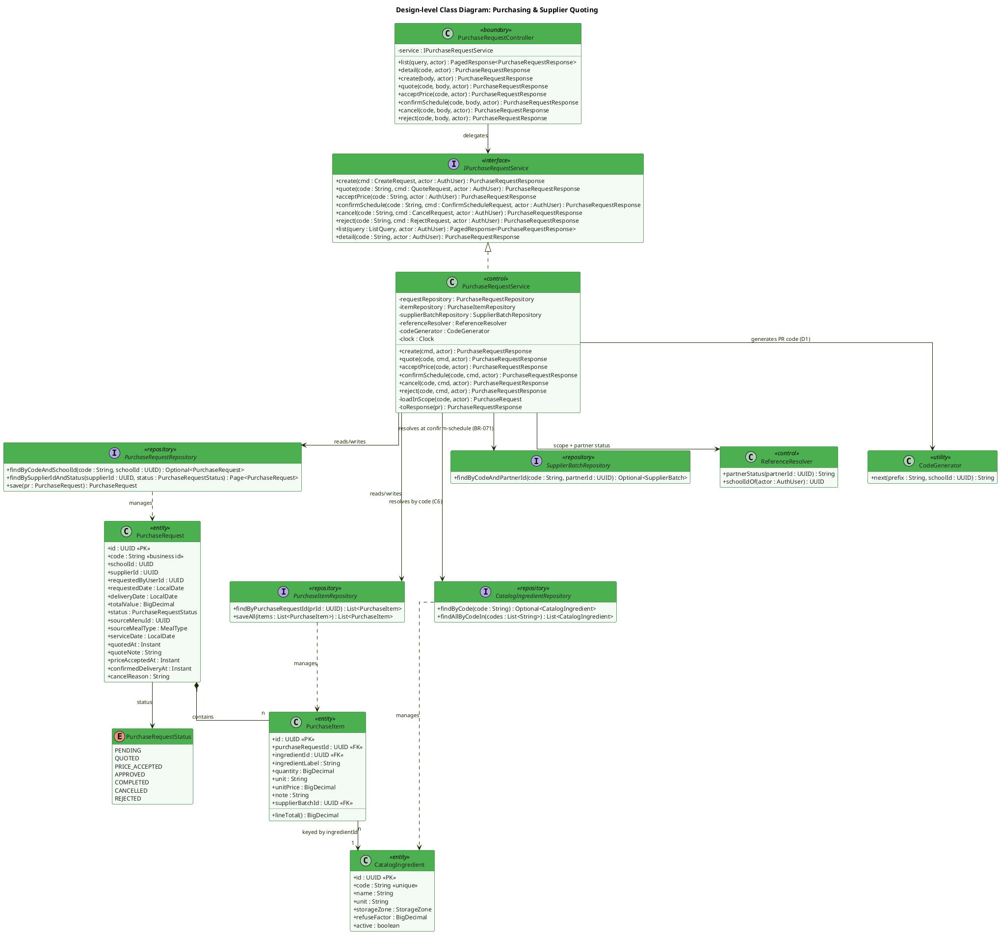

**Description:**
`PurchaseRequestService` implements the CF-M06-5 single-round pricing workflow: Service Caterers create a `PurchaseRequest` with `PurchaseItem` lines resolved against `CatalogIngredient` (by key, not name — C6). The supplier fills `unitPrice` per line at `quote()`, and the school accepts the total once via `acceptPrice()` (no re-quote loop). `confirmSchedule()` (BR-071) optionally attaches a `supplierBatchId` per line, tying the purchase directly to registered supplier batches ahead of delivery. `cancel()`/`reject()` are terminal side exits available at different points in the state machine (see §8.1). All persistence goes through Spring Data repositories — the service never touches the `EntityManager` directly.

---

### 1.2 Sequence Diagram — Create Purchase Request & Supplier Quote (UC-021, CF-M06-5)

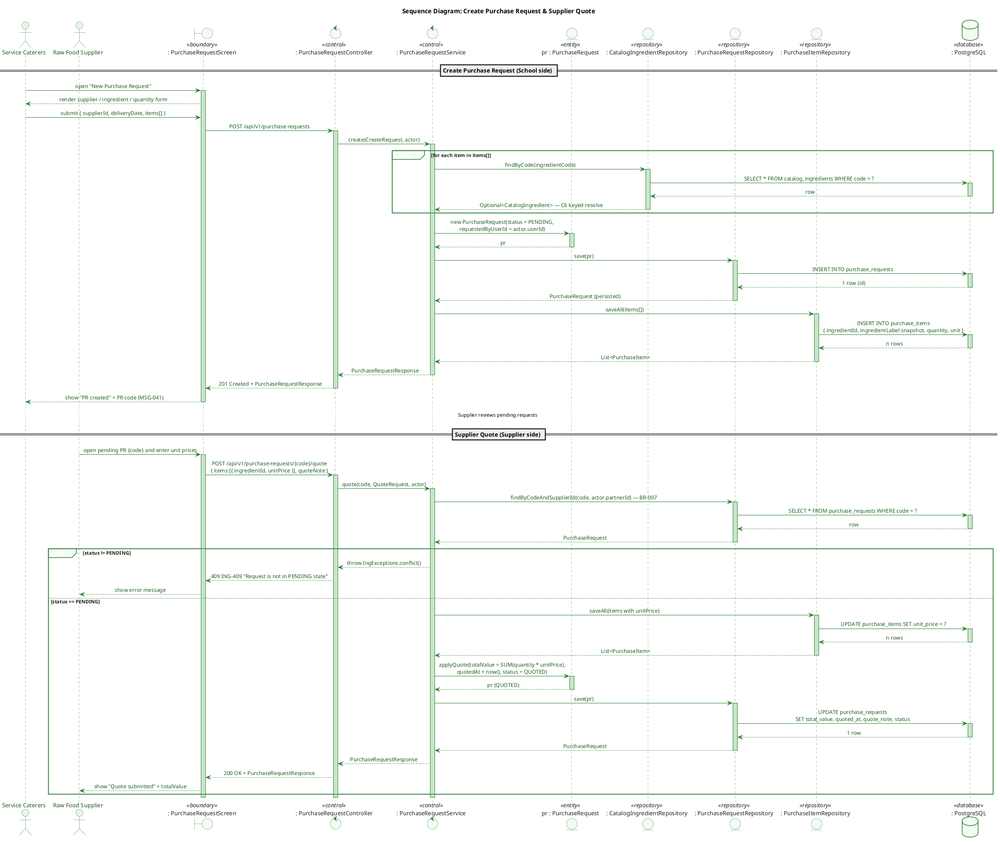

**Description:**
Two actors interact with the same aggregate across time, always through the UI boundary → controller → service → repository chain. The school creates the request in `PENDING`; the supplier is the only one who may fill unit prices via `quote()`, which is blocked unless the request is still `PENDING` (idempotency/race guard). `totalValue` is computed server-side from the line items — never trusted from the client — and the request transitions to `QUOTED`. Every repository call returns its result explicitly so the read/write boundary between the service and PostgreSQL stays visible.

---

### 1.3 Sequence Diagram — Accept Price & Confirm Delivery Schedule (UC-015, BR-071)

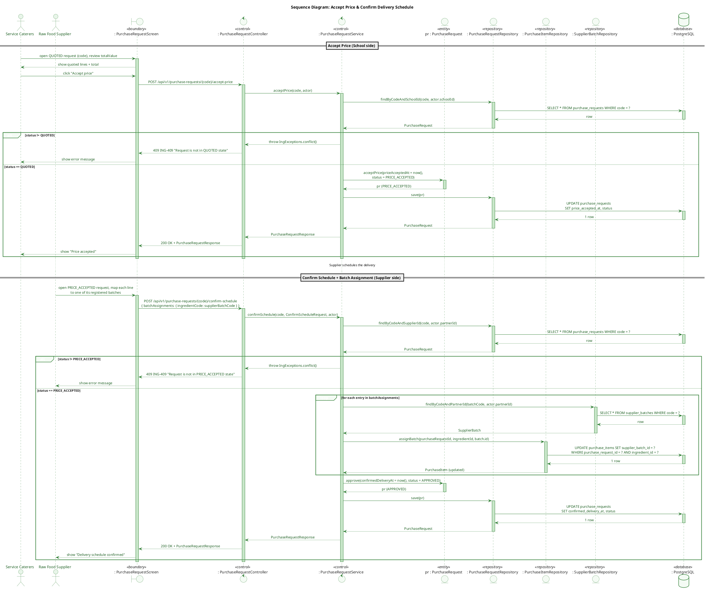

**Description:**
`acceptPrice()` is a one-way gate from `QUOTED` to `PRICE_ACCEPTED` — there is no re-quote step (CF-M06-5 deliberately has a single pricing round). `confirmSchedule()` is where BR-071 traceability begins: the supplier binds each purchase line to a specific, already-certified `SupplierBatch` resolved through `SupplierBatchRepository` under its own `partnerId`, so that when the physical delivery later arrives, the receiving flow (§4) can trust the batch's certification data. The request becomes `APPROVED`, ready for a `Delivery` to be registered against it (§3).

---

## 2. Supplier Batch & Certification Management

### 2.1 Class Diagram

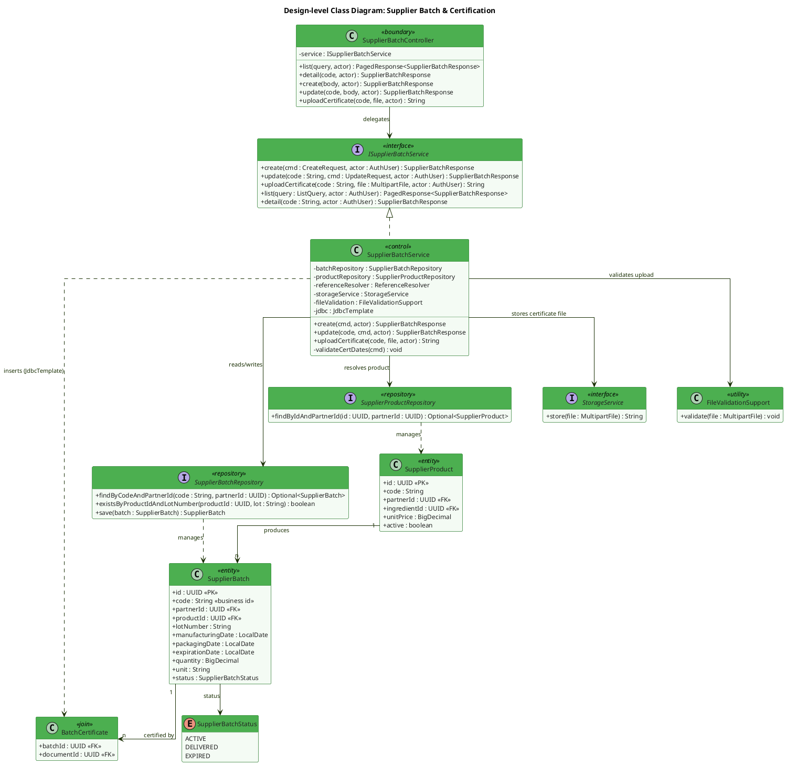

**Description:**
`SupplierBatchService.create()` enforces BR-071 at the database boundary before persistence: `expirationDate > manufacturingDate` and `packagingDate >= manufacturingDate`, else `IngExceptions.batchCertInvalid()` (ING-071). `uploadCertificate()` stores the file via `StorageService`, inserts a `partner_documents` row (type `PRODUCT_ORIGIN`, MF04-owned table) and links it through the `batch_certificates` join — no certificate content is duplicated into MF06.

---

### 2.2 Sequence Diagram — Register Supplier Batch & Upload Certificate (UC-081/100, BR-071)

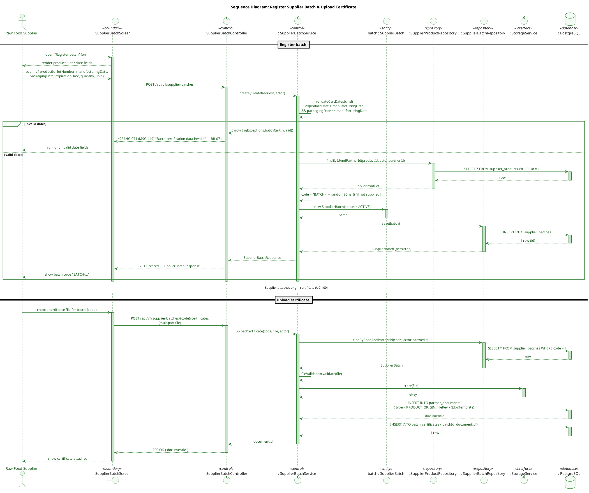

**Description:**
Certification is validated purely on structural dates before the batch even exists in the system — a batch that fails BR-071 never reaches the database. The certificate upload is a separate call so a supplier can register the batch first and attach paperwork afterward (UC-100), matching the actual two-step supplier workflow. Both `SupplierBatch` and its certificates are the traceability foundation that `ReceivingSessionService` (§4) and `TraceabilityService` (§7) later depend on. The batch lifecycle itself is shown in §8.3.

---

## 3. Delivery Management

### 3.1 Class Diagram

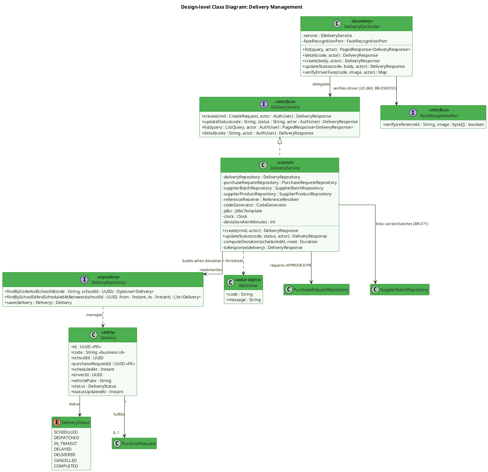

**Description:**
`DeliveryService.create()` requires an `APPROVED` purchase request to derive `schoolId`, and links the delivery to the supplier batches carried on it (`delivery_batches`). `updateStatus()` recomputes the elapsed deviation against `scheduledAt`; if it exceeds the configurable `delivery.deviation-alert-minutes` (default 30), an `AlertView` (MSG-065) is attached to the response for the FE to surface. Driver identity verification (UC-060, face recognition at the school gate) is a separate endpoint (`verifyDriverFace`) that calls `FaceRecognitionPort` directly from the controller rather than through `DeliveryService` — it does not mutate `Delivery` state, it only gates physical entry.

---

### 3.2 Sequence Diagram — Register Delivery & Track Status (UC-083/092, BR-071)

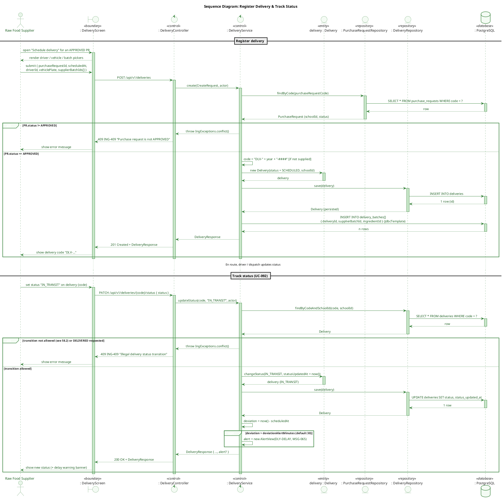

**Description:**
Delivery creation cannot happen ahead of an `APPROVED` purchase request — this enforces that every physical shipment traces back to an accepted price and a certified supplier batch. Status transitions are supplier-driven and purely observational except for the deviation check, which is computed server-side on every update so the delay alert cannot be spoofed or suppressed by the client. `DELIVERED` is deliberately not reachable from this endpoint (§8.2).

---

### 3.3 Sequence Diagram — Driver Face Verification at Gate (UC-060 pre-check, BR-050/051)

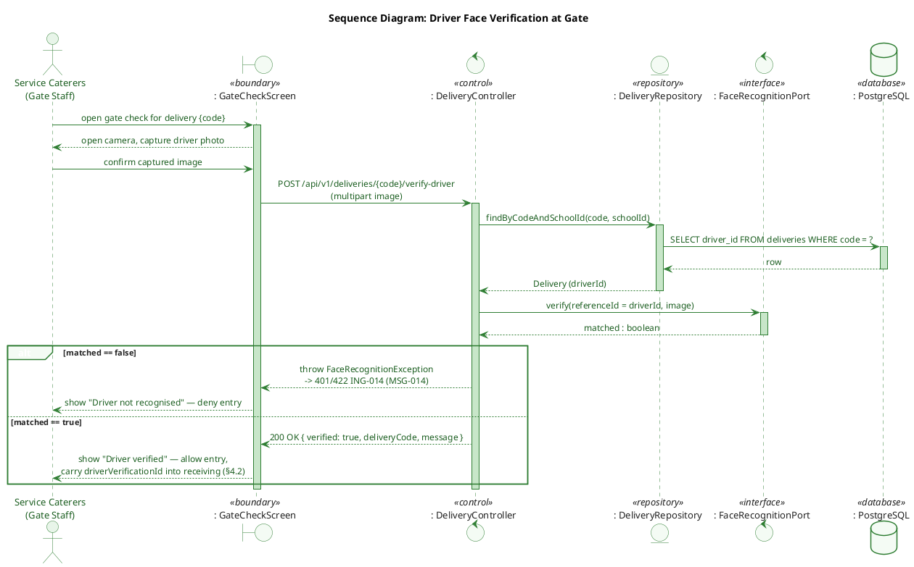

**Description:**
This check is intentionally decoupled from `DeliveryService` — it is a physical-access gate (does the person at the door match the registered driver on record) rather than a business-state transition, so it never writes to `deliveries`. A failed match raises `FaceRecognitionException`, surfaced as ING-014, and the gate staff denies entry; `driverVerificationId` is later stored on the `ReceivingSession` (§4) as evidence that the check happened, not re-run inside receiving itself.

---

## 4. Receiving

### 4.1 Class Diagram

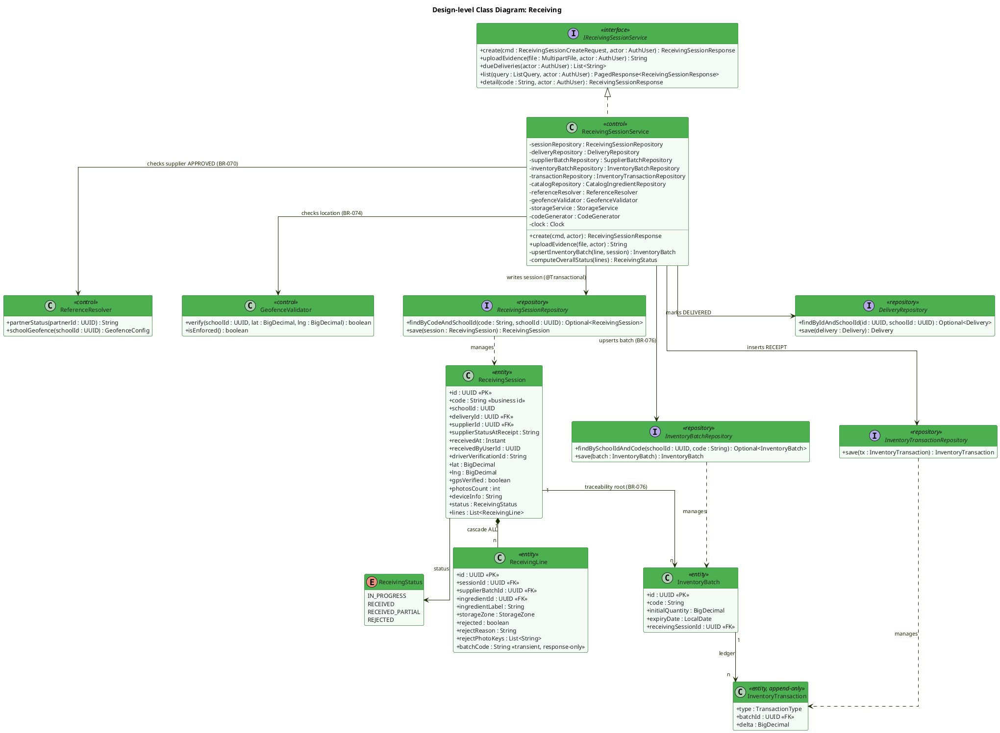

**Description:**
`ReceivingSessionService.create()` is the single atomic transaction of the whole module (ADR-M06-5): it validates BR-070 (supplier must be `APPROVED` at the moment of receipt), BR-074 (GPS inside the school's geofence), BR-072/078 (≥1 evidence photo overall, and reason+photo for every rejected line) before writing anything, then in one `@Transactional` block persists the session and its lines, **upserts** `InventoryBatch` per accepted line (creating it on first receipt of a given batch code, or appending an additional `RECEIPT` transaction on a re-delivery of the same code — preventing duplicate batch rows), and finally marks the source `Delivery` as `DELIVERED`. `receivedAt`, `deviceInfo` and the geofence check are all server-derived — never trusted from the client (BR-073, ADR-M06-7).

---

### 4.2 Sequence Diagram — Record Receiving, Happy Path (UC-060, ADR-M06-5)

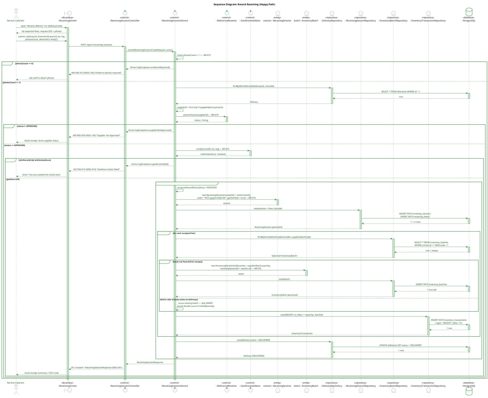

**Description:**
Every guard runs before any write — BR-072, BR-070, BR-074 in that order — so a rejected request leaves zero rows behind. The batch-upsert logic is the key traceability link (BR-076): `InventoryBatch.receivingSessionId` lets `TraceabilityService` (§7) later walk backward from a served dish all the way to this exact receiving event and its GPS/photo evidence. The whole write block is one `@Transactional` unit, so the session, its lines, the batches, the RECEIPT ledger rows and the delivery status either all land or none do.

---

### 4.3 Sequence Diagram — Reject a Batch During Receiving (UC-072, BR-078)

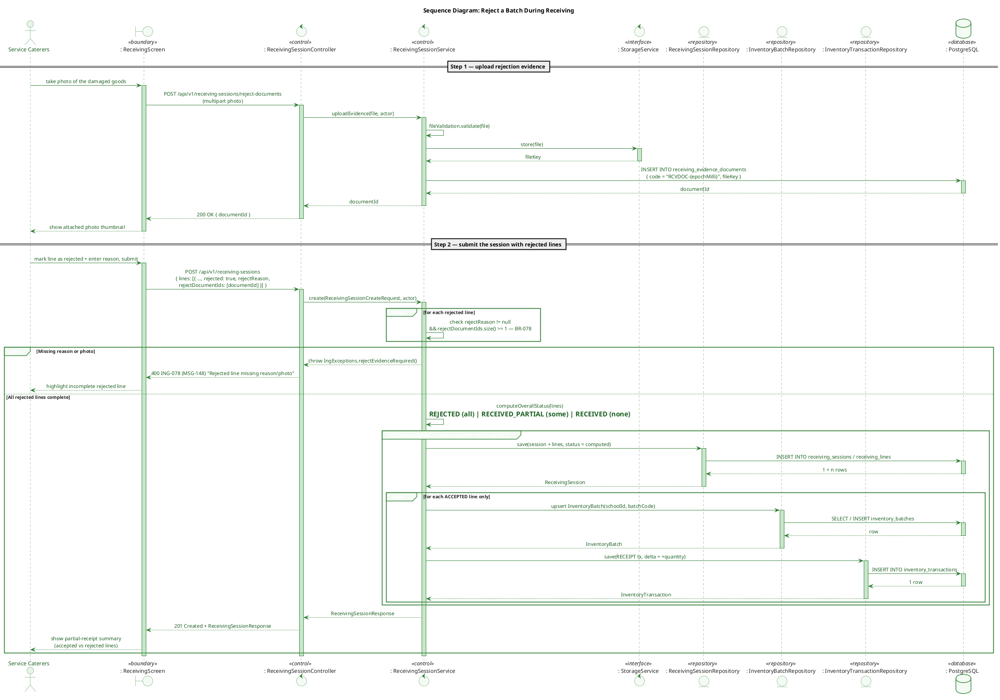

**Description:**
Evidence photos are uploaded first as standalone documents (returning a `documentId`), then referenced by id in the rejected line — never as an inline file, and never as a public URL (D10-BIS.2/3). A session can mix accepted and rejected lines in the same delivery, yielding `RECEIVED_PARTIAL` (UC-072); only accepted lines ever create an `InventoryBatch`, so rejected goods never enter the warehouse's available stock. The resulting session statuses are summarised in §8.4.

---

## 5. Inventory & FEFO Issue

### 5.1 Class Diagram

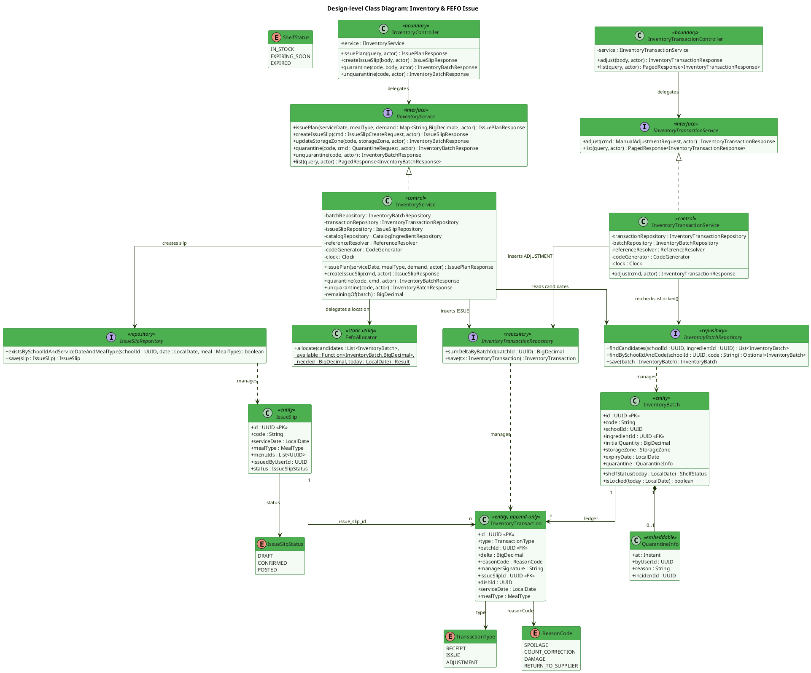

**Description:**
Available quantity is never a stored column (ADR-M06-1): `InventoryService` derives it as `initialQuantity + SUM(inventory_transactions.delta)` per batch. `FefoAllocator` is a pure, dependency-free static function (ADR-M06-4) — it excludes any `isLocked()` batch (expired, per `ShelfStatus`, or quarantined via the independent `QuarantineInfo` value object, ADR-M06-2) from the candidate pool entirely, then greedily consumes the earliest-expiry batches first. `createIssueSlip()` writes a real `IssueSlip` row (ADR-M06-6) and one negative-`delta` `ISSUE` transaction per line, each mandatorily carrying `dishId`/`menuId`/`serviceDate`/`mealType` (BR-076) — the DB `ck_tx_issue_trace` check makes this non-optional. `InventoryTransactionService.adjust()` is the only way to write a non-FEFO, non-receiving delta, and BR-204 requires both a `reasonCode` and a `managerSignature`.

---

### 5.2 Sequence Diagram — FEFO Issue Plan & Create Issue Slip (UC-045, ADR-M06-4/6, BR-075/076/077)

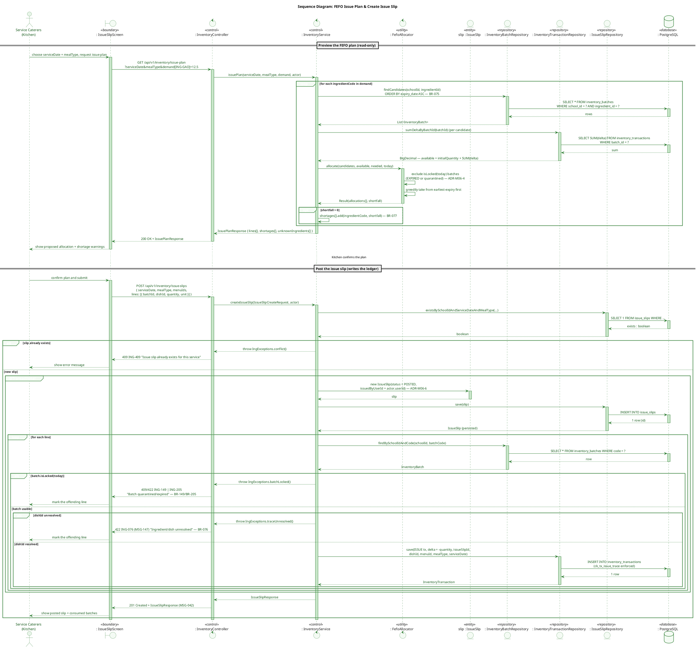

**Description:**
`issuePlan()` is a read-only preview — it runs `FefoAllocator` per requested ingredient and returns proposed allocations plus any `shortfall` (BR-077 auto shortage detection), without writing anything. Only `createIssueSlip()` persists: it re-validates every batch is still unlocked at commit time (guarding against a race between preview and confirmation) and writes one immutable `ISSUE` transaction per line, permanently linking the consumption to a dish, menu, service date and meal type — the backbone of farm-to-table traceability (§7). The slip's own lifecycle is in §8.5.

---

### 5.3 Sequence Diagram — Manual Stock Adjustment (UC-064, BR-204)

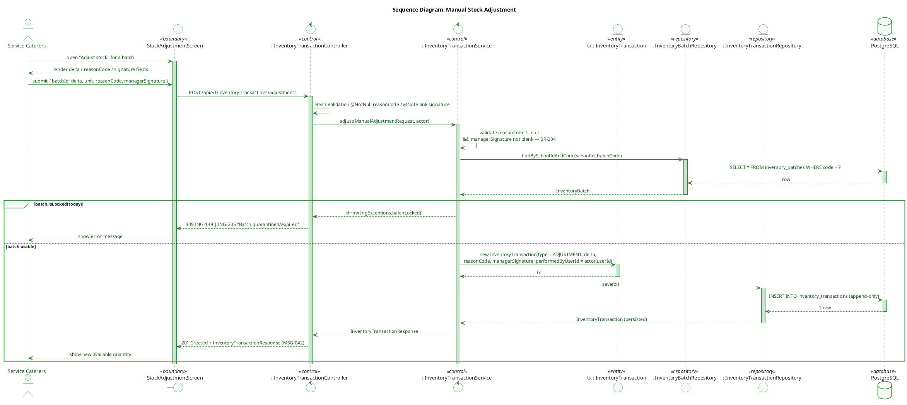

**Description:**
Manual adjustments are the only transaction type not tied to a receiving or issuing event, so BR-204 layers three independent enforcement points (request validation, service check, DB `CHECK` constraint) requiring a `reasonCode` drawn from a fixed list and a `managerSignature` — accountability for every off-cycle stock change (spoilage, count correction, damage, return to supplier).

---

### 5.4 Sequence Diagram — Quarantine / Un-quarantine a Batch (BR-149)

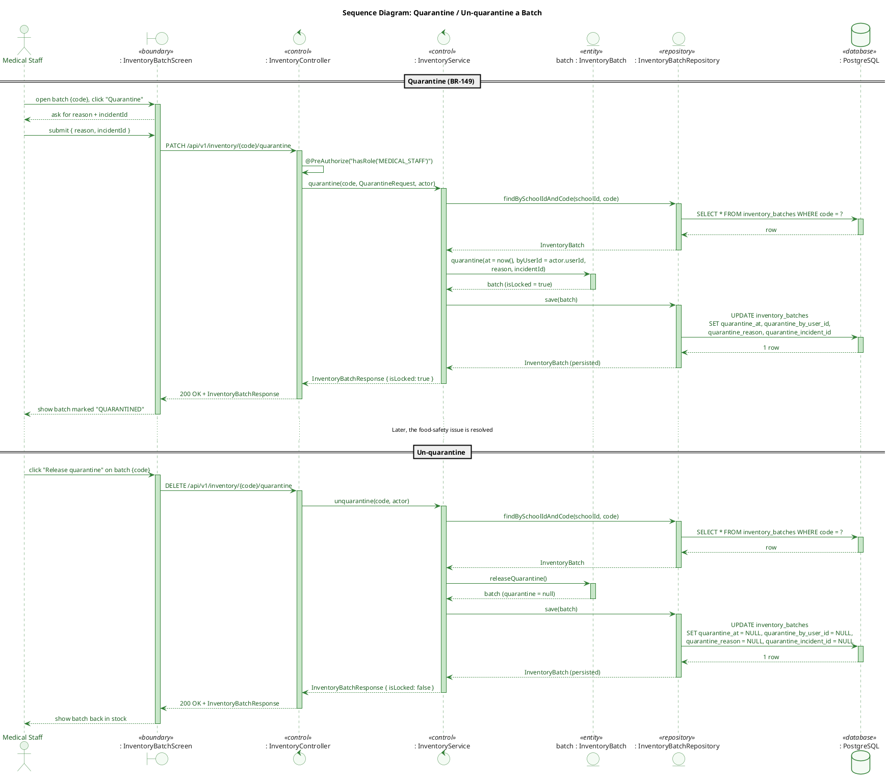

**Description:**
Only `MEDICAL_STAFF` may quarantine or lift quarantine (enforced by `@PreAuthorize` at the controller) — kitchen staff cannot self-clear a food-safety hold. Un-quarantine is a dedicated `DELETE` endpoint rather than a `PUT` with null fields (ADR-M06-2), keeping the intent explicit in the API surface and audit trail. Both transitions are the quarantine axis of §8.6.

---

## 6. Preparation Record

### 6.1 Class Diagram

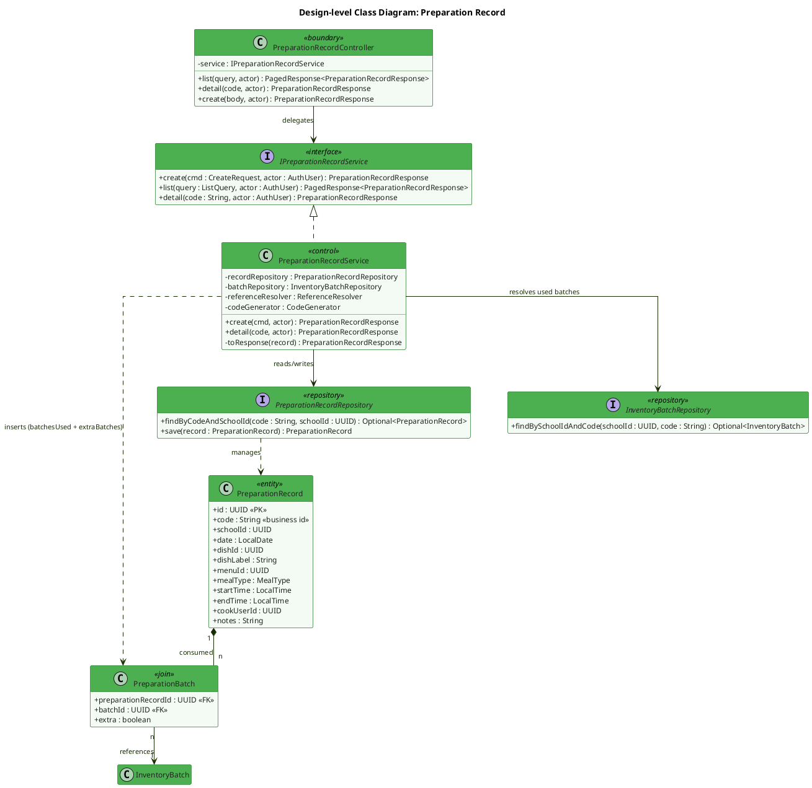

**Description:**
`PreparationRecordService.create()` resolves `dishId` from its code, generates a `PREP-{yyyymmdd}-{seq}` code, and inserts a `preparation_batches` join row per batch actually used in the kitchen — including `extraBatches`, batches consumed outside the original issue slip (e.g. topping up a shortfall), flagged `extra=true` for audit visibility. This closes the loop between what was issued (§5) and what was actually cooked (UC-066).

---

### 6.2 Sequence Diagram — Log Preparation Record (UC-066, BR-076)

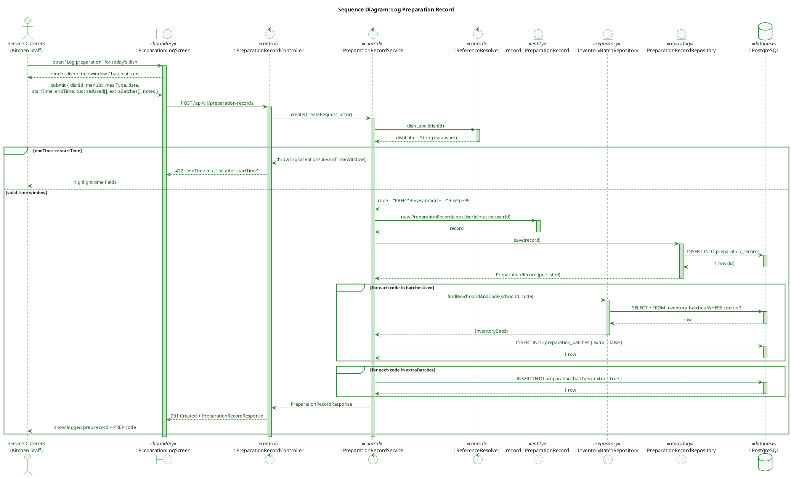

**Description:**
The record is a simple audit log tying a cook, a time window, a dish and the physical batches consumed together — no inventory transaction is written here (that already happened at issue time, §5.2); this is purely the kitchen's operational record for food-safety inspection (MF07) and traceability (§7).

---

## 7. Traceability

### 7.1 Class Diagram

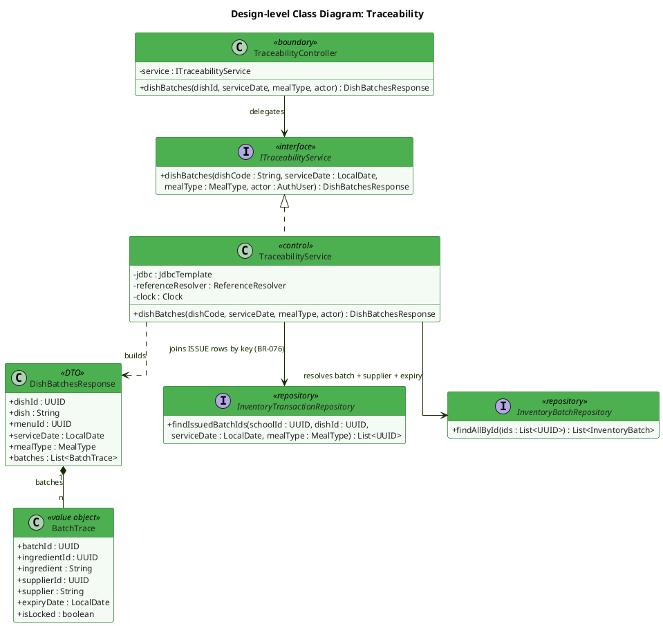

**Description:**
`TraceabilityService.dishBatches()` is a pure read path implementing ADR-M06-3's key-based traceability: it joins `inventory_transactions` (filtered to `type = ISSUE`, matching `dishId`/`serviceDate`/`mealType`) back to `inventory_batches` to reconstruct exactly which supplier batches fed a specific dish on a specific service — every join is by UUID foreign key, never by matching label strings. This is the query MF11 (incident management) and MF07/MF08/MF09/MF13 consume when a food-safety recall must identify affected batches and, from there, affected supplier shipments.

---

### 7.2 Sequence Diagram — Dish → Batch Traceability Lookup

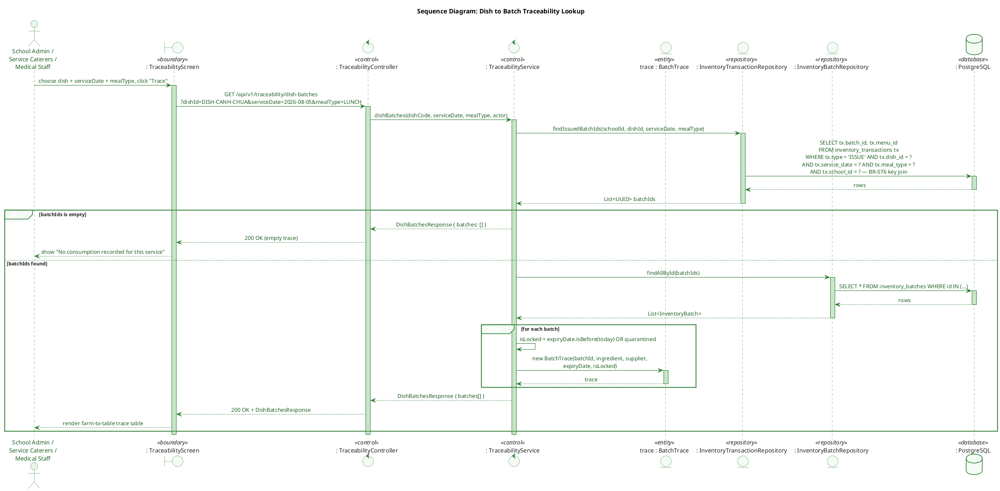

**Description:**
This endpoint answers "which supplier batches ended up in this dish, on this service date and meal" purely from the append-only ledger — no cache, no denormalized traceability table. Because `ck_tx_issue_trace` guarantees every `ISSUE` transaction carries `dishId`/`serviceDate`/`mealType`, this join can never return an incomplete trace for data written after MF06's rollout.

---

## 8. State Machines

### 8.1 Purchase Request Lifecycle (CF-M06-5)

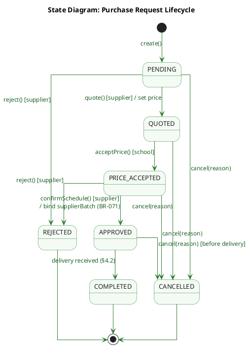

**Description:**
The single-round pricing model (CF-M06-5) means there is exactly one `QUOTED → PRICE_ACCEPTED` transition — no negotiation loop back to `PENDING`. `CANCELLED` requires a `cancelReason` at the database level (`ck_pr_cancel_reason`). `COMPLETED` is reached indirectly: no `PurchaseRequestService` method sets it directly in the current implementation — it is inferred from the linked `Delivery`/`ReceivingSession` reaching `DELIVERED`, matching the TDS intent though not yet wired as an explicit transition (flagged as an implementation gap worth tracking).

---

### 8.2 Delivery Lifecycle

```plantuml
@startuml MF06_Delivery_StateMachine
title State Diagram: Delivery Lifecycle

skinparam linetype ortho
skinparam backgroundColor #FFFFFF

skinparam state {
    BackgroundColor #F4FBF4
    BorderColor #2E7D32
    FontColor #212121
    FontName Arial
    FontSize 13
}

skinparam arrow {
    Color #2E7D32
    FontColor #1B5E20
    FontName Arial
    FontSize 12
}

skinparam note {
    BackgroundColor #E8F5E9
    BorderColor #2E7D32
    FontColor #212121
    FontName Arial
    FontSize 12
}

skinparam startColor #2E7D32
skinparam endColor #2E7D32

[*] --> SCHEDULED : create() [PR APPROVED]

SCHEDULED --> DISPATCHED : updateStatus(DISPATCHED) [supplier]
SCHEDULED --> CANCELLED : updateStatus(CANCELLED) [supplier]

DISPATCHED --> IN_TRANSIT : updateStatus(IN_TRANSIT)
DISPATCHED --> CANCELLED : updateStatus(CANCELLED)

IN_TRANSIT --> DELAYED : delay > threshold / alert (MSG-065)
DELAYED --> IN_TRANSIT : back on track

IN_TRANSIT --> DELIVERED : receiving session created (§4.2)
DELAYED --> DELIVERED : receiving session created (§4.2)

DELIVERED --> COMPLETED : reconciled

CANCELLED --> [*]
COMPLETED --> [*]

@enduml
```

**Description:**
`DELIVERED` is deliberately not one of the statuses `DeliveryController.updateStatus()` can set directly — it is a *side effect* of a successful `ReceivingSessionService.create()` transaction (§4.2), ensuring physical receipt (with GPS, photos, supplier-status check) is the only path to that state, closing the loop between the supplier's claim and the school's confirmation.

---

### 8.3 Supplier Batch Lifecycle (BR-071)

```plantuml
@startuml MF06_SupplierBatch_StateMachine
title State Diagram: Supplier Batch Lifecycle

skinparam linetype ortho
skinparam backgroundColor #FFFFFF

skinparam state {
    BackgroundColor #F4FBF4
    BorderColor #2E7D32
    FontColor #212121
    FontName Arial
    FontSize 13
}

skinparam arrow {
    Color #2E7D32
    FontColor #1B5E20
    FontName Arial
    FontSize 12
}

skinparam note {
    BackgroundColor #E8F5E9
    BorderColor #2E7D32
    FontColor #212121
    FontName Arial
    FontSize 12
}

skinparam startColor #2E7D32
skinparam endColor #2E7D32

[*] --> ACTIVE : create() [cert valid, BR-071]

ACTIVE --> ACTIVE : uploadCertificate()
ACTIVE --> ACTIVE : confirmSchedule() / bind purchase_item

ACTIVE --> DELIVERED : batch accepted (§4.2)\n/ create inventory_batch
ACTIVE --> EXPIRED : today > expirationDate

DELIVERED --> [*]
EXPIRED --> [*]

@enduml
```

**Description:**
A supplier batch is created only if its certification dates pass BR-071, so `ACTIVE` is the sole entry state. It stays `ACTIVE` while certificates are attached and while it is bound to purchase lines (self-transitions — the status does not change). It leaves that state one of two ways: physically received at a school, which turns it into `DELIVERED` and creates the school-side `InventoryBatch`, or reaching its `expirationDate` untouched, which turns it into `EXPIRED` and removes it from the pool a supplier may schedule.

---

### 8.4 Receiving Session Lifecycle (BR-072/078, ADR-M06-5)

```plantuml
@startuml MF06_ReceivingSession_StateMachine
title State Diagram: Receiving Session Lifecycle

skinparam linetype ortho
skinparam backgroundColor #FFFFFF

skinparam state {
    BackgroundColor #F4FBF4
    BorderColor #2E7D32
    FontColor #212121
    FontName Arial
    FontSize 13
}

skinparam arrow {
    Color #2E7D32
    FontColor #1B5E20
    FontName Arial
    FontSize 12
}

skinparam note {
    BackgroundColor #E8F5E9
    BorderColor #2E7D32
    FontColor #212121
    FontName Arial
    FontSize 12
}

skinparam startColor #2E7D32
skinparam endColor #2E7D32

[*] --> IN_PROGRESS : open form (draft)

IN_PROGRESS --> RECEIVED : submit [all accepted]\n/ batches + RECEIPT txs, delivery = DELIVERED
IN_PROGRESS --> RECEIVED_PARTIAL : submit [some rejected]\n/ accepted lines only
IN_PROGRESS --> REJECTED : submit [all rejected] / no batch

RECEIVED --> [*]
RECEIVED_PARTIAL --> [*]
REJECTED --> [*]

@enduml
```

**Description:**
`IN_PROGRESS` exists only while the staff member is filling the form client-side; the backend writes the session already in its final state, computed by `computeOverallStatus(lines)`. All three end states are terminal because the session is an evidence record (GPS, photos, device, server timestamp) — corrections are made through a manual `ADJUSTMENT` transaction (§5.3), never by editing history.

---

### 8.5 Issue Slip Lifecycle (ADR-M06-6)

```plantuml
@startuml MF06_IssueSlip_StateMachine
title State Diagram: Issue Slip Lifecycle

skinparam linetype ortho
skinparam backgroundColor #FFFFFF

skinparam state {
    BackgroundColor #F4FBF4
    BorderColor #2E7D32
    FontColor #212121
    FontName Arial
    FontSize 13
}

skinparam arrow {
    Color #2E7D32
    FontColor #1B5E20
    FontName Arial
    FontSize 12
}

skinparam note {
    BackgroundColor #E8F5E9
    BorderColor #2E7D32
    FontColor #212121
    FontName Arial
    FontSize 12
}

skinparam startColor #2E7D32
skinparam endColor #2E7D32

[*] --> DRAFT : createIssueSlip() / FEFO plan (§5.2)

DRAFT --> CONFIRMED : kitchen confirms [planned]
CONFIRMED --> POSTED : post() / ISSUE txs written [planned]

DRAFT --> POSTED : auto-post [current impl]\n/ ISSUE txs in same tx

POSTED --> [*]

@enduml
```

**Description:**
`IssueSlipStatus` declares three states, but the current `InventoryService.createIssueSlip()` writes the slip directly as `POSTED` inside the same transaction as the `ISSUE` ledger rows — the `DRAFT → CONFIRMED → POSTED` path is reserved for the planned two-step kitchen approval. `POSTED` is terminal in every case: because `inventory_transactions` is append-only (ADR-M06-1), an over-issue is corrected by a compensating `ADJUSTMENT`, never by editing or deleting the slip.

---

### 8.6 Inventory Batch — Dual-Axis Lock Model (ADR-M06-2, BR-149/205)

```plantuml
@startuml MF06_InventoryBatch_DualAxis
title State Diagram: Inventory Batch Dual-Axis Lock Model

skinparam backgroundColor #FFFFFF

skinparam state {
    BackgroundColor #F4FBF4
    BorderColor #2E7D32
    FontColor #212121
    FontName Arial
    FontSize 13
}

skinparam arrow {
    Color #2E7D32
    FontColor #1B5E20
    FontName Arial
    FontSize 12
}

skinparam note {
    BackgroundColor #E8F5E9
    BorderColor #2E7D32
    FontColor #212121
    FontName Arial
    FontSize 12
}

skinparam startColor #2E7D32
skinparam endColor #2E7D32

state "Shelf-life axis (derived, BR-205)" as Shelf {
  [*] --> IN_STOCK : line accepted (§4.2)
  IN_STOCK --> EXPIRING_SOON : expiryDate - today <= 2d
  EXPIRING_SOON --> EXPIRED : today >= expiryDate
  EXPIRED --> [*]
}

state "Quarantine axis (BR-149, Medical Staff only)" as Quar {
  [*] --> NOT_QUARANTINED : batch created
  NOT_QUARANTINED --> QUARANTINED : quarantine(reason)
  QUARANTINED --> NOT_QUARANTINED : unquarantine()
}

@enduml
```

**Description:**
`shelfStatus` and quarantine status are two fully independent axes (ADR-M06-2) — neither is derived from the other, and both are computed/read live rather than cached: shelf status from `expiryDate` vs. today, quarantine from the nullable `QuarantineInfo` embeddable. `isLocked()` is simply their logical OR, and every write path that consumes a batch (`FefoAllocator`, `createIssueSlip`, `adjust`) re-checks it at the moment of the write, not just at read time — closing the race between two staff members trying to use the same near-expiry or just-quarantined batch.

---

*Document generated from TDS `SFMS-MF06-IMP-001 v1.1` (Approved 2026-08-03). Class/sequence content verified against the actual implementation in `04_Development/Backend/src/main/java/com/sfms/mf06/**`, which in places (participant names, `ReferenceResolver` in place of ports, `IssueSlip` created directly as `POSTED`) diverges from the earlier TDS narrative — code is treated as ground truth throughout.*
