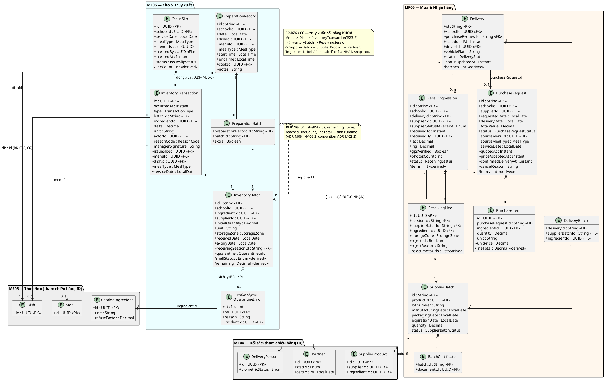
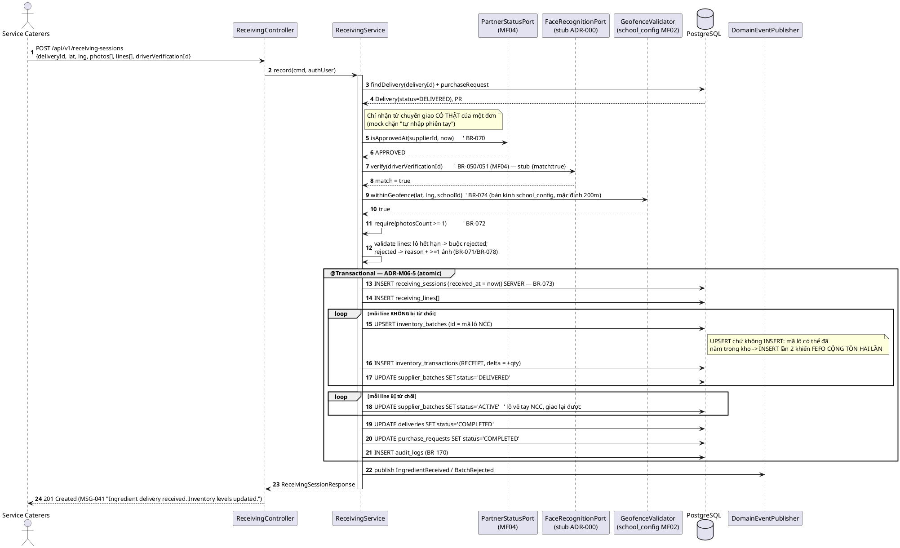
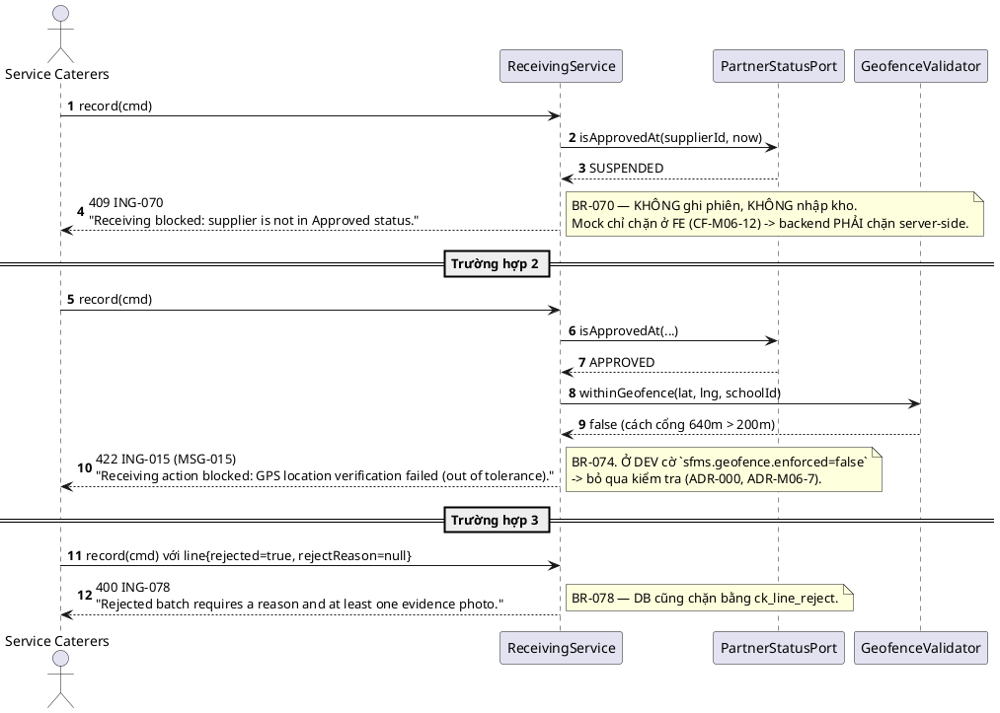
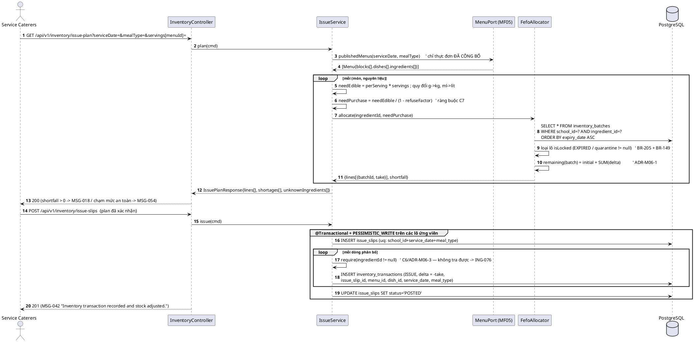
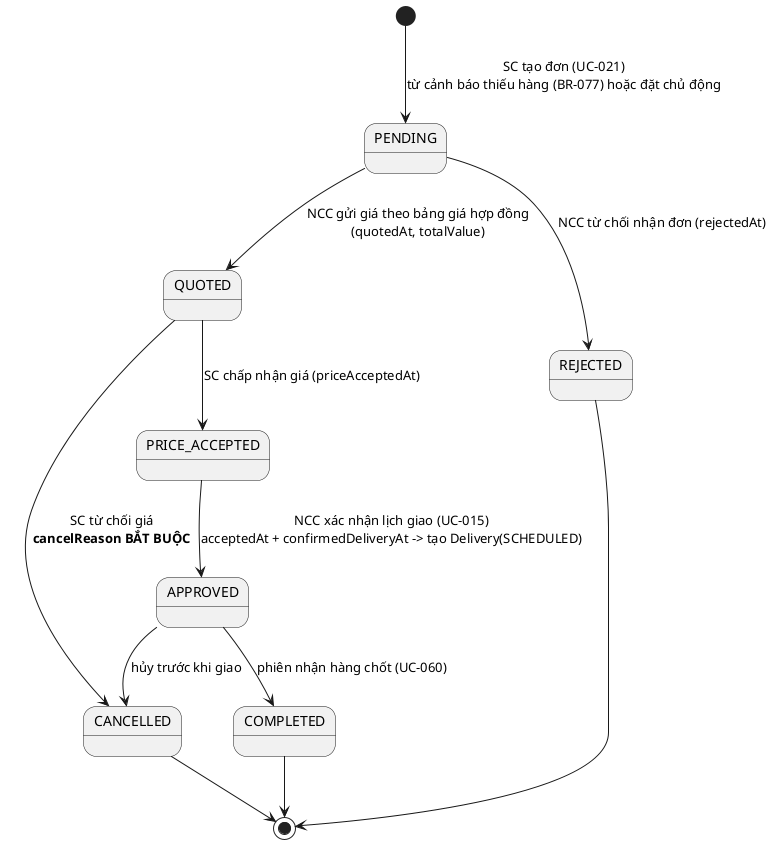
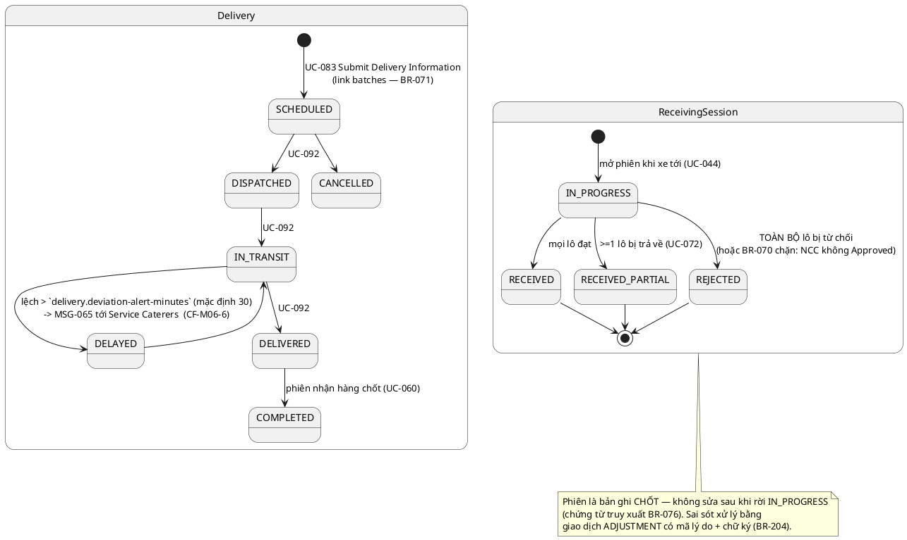
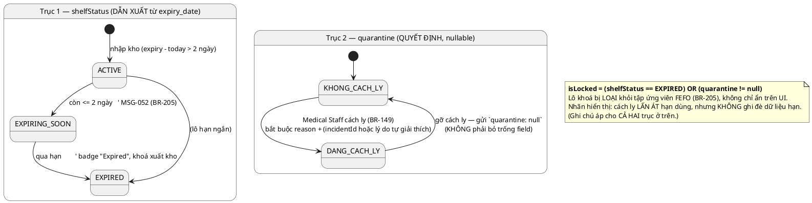

# ENGINEERING DOCUMENTATION STANDARD (EDS) v2.0 — TDS Backend
# MF06 — Ingredient & Inventory Management

| Field | Value |
|-------|-------|
| **Document ID** | `SFMS-MF06-IMP-001` |
| **Version** | `1.1` |
| **Date** | `2026-08-03` |
| **Status** | ✅ **`Approved`** *(2026-08-03 — sau Bước 0 + Bước 1 của `02_Module_Completion_Workflow.md`)* |
| **Document Owner** | Bùi Quang Huy (HuyBQHE180599) |
| **Author** | Bùi Quang Huy — chủ module MF03, MF06; Lead Requirements & Traceability Reviewer |
| **Reviewed by** | `[Nguyễn Đức Mạnh — Backend/DB · Pending]` · `[Trần Tuấn Minh — FE↔BE contract · Pending]` · `[Nguyễn Phương Thảo — Test · Pending]` |
| **DPO Sign-off** | `[ ] Pending` *(dữ liệu `Internal` — hồ sơ lô hàng/nhà cung cấp; KHÔNG chứa PII học sinh)* |
| **Approved by** | `[Nguyễn Văn Nam — Final Approval · Pending]` |
| **Last Review** | `2026-08-03` |
| **Based on EDS** | `v2.0` |

> **Stack (ADR-000 / `01_MVP_Backend_Implementation_Plan.md` §Stack):** Spring Boot **4.1.x (Java 25 LTS)** · PostgreSQL 16 · **Flyway** (mỗi module một file `V{n}`, xem §0-BIS — mô hình "V1 = toàn schema" đã bị bỏ) · **Spring Security + JWT** (RBAC 7 role) · springdoc-OpenAPI (Swagger) · MapStruct.
>
> **Convention kế thừa từ MF02** (vertical slice mẫu — `SFMS-MF02-IMP-001`): `PagedResponse<T>` + `Specification`, `@RestControllerAdvice` error-code, không lưu field dẫn xuất, tham chiếu cross-module bằng **ID**. Tài liệu này **không** phát minh lại các pattern đó.

---

## CHANGELOG

> **Policy 4.4 — Immutable History:** Không xóa thông tin cũ.

| Ngày | Người thực hiện | Nội dung thay đổi |
|------|-----------------|-------------------|
| **2026-08-03** | **Bùi Quang Huy** | **v1.1 — Bước 1 (rà & chốt tài liệu) → Status `Approved`.** Chạy **Bước 0** trước: 0 bảng trùng, 0 path trùng (MF06 **không** mắc lỗi "đặc tả lại resource module khác" của MF05/MF12), số V còn trống = **V10**. Chốt **16 quyết định `M06-D01`…`M06-D16`** (§2.4 mới) và **7 mục treo** (§2.5 mới, không chặn Bước 2). Nhóm thay đổi nặng nhất nằm ở **§5.2**: (a) **6 PK `VARCHAR(40)` → `UUID` + cột `code`** (D1 gọi đích danh MF06 — và FK bắt buộc phải cùng kiểu với `partners`/`menus`/`dishes` đã merge); (b) **4 cột audit D9** thêm vào mọi bảng, `issue_slips.created_by UUID` → `issued_by_user_id` (D9 gọi đích danh MF06: giữ tên cũ ⇒ **Hibernate duplicate column, build đỏ ngay**); (c) **3 FK trỏ bảng không tồn tại** — `supplier_documents` → `partner_documents` (`V6:61`), `supplier_products` và `catalog_ingredients` MF06 tự tạo (lỗi **C3**, MF05 `V8:103` đang chờ), kèm `ALTER TABLE dish_ingredients ADD CONSTRAINT`; (d) Flyway `V10`/`V11`, bỏ mô hình *"V1 = toàn schema, Nam giữ"* đã lạc hậu. Ngoài ra: đóng **oracle gap L6** bằng **9 MSG mới (MSG-145…MSG-153)** thay vì hạ chuẩn assertion (tiền lệ MSG-140/MSG-142); đổi tiền tố **`INV-` → `ING-`** (106 chỗ, theo `ModuleCodeResolver` đã merge); package `com.sfms.inventory` → **`com.sfms.mf06`**; đồng bộ **`ACTIVE` → `IN_STOCK`** ở 4 chỗ TDS còn lệch với chính ADR-M06-2; §9.2 chuyển hết sang **ISO-8601 + SCREAMING_SNAKE + number** và chốt hợp đồng **D12** (2 chỗ lệch tên/kiểu Request↔Response); thêm **D11** (M06-D08 — MF06 không có ca đổi shape, vẫn viết TC hồi quy) và xác nhận **D13** đủ 5/5 role trong `V900`. |
| 2026-07-28 | Bùi Quang Huy | Tạo bản đầu (v1.0). Nguồn: UC file `MF06_Ingredient_Inventory_Management.md`, traceability **§1.5**, `business_rules.md` §5–§6 + §8, `error_message.md`, mock (`mock-server.ts` / `db.ts` / `mock-data.ts`), `data_model.puml` (packages *Đối tác & Mua sắm* + *Kho & Truy xuất*), `semantic-audit.ts` (19 luật liên quan), ADR-000, MVP plan §Stack. Toàn bộ ví dụ code viết bằng **Java + JPA + Flyway SQL** (không TypeScript/Prisma). Ghi nhận **13 mâu thuẫn nguồn** tại §2.3. |

---

## MỤC LỤC

1. [Tổng quan Module](#1-tổng-quan-module) · 2. [Ma trận Truy vết](#2-ma-trận-truy-vết) · 3. [Architecture Decisions](#3-architecture-decisions-inline-adr) · 4. [NFR & SLA](#4-non-functional-requirements--sla) · 5. [Static Modeling](#5-static-modeling) · 6. [Dynamic Modeling](#6-dynamic-modeling) · 7. [Domain Event Catalog](#7-domain-event-catalog) · 8. [Interface Specification](#8-interface-specification) · 9. [API Specification](#9-api-specification) · 10. [Error Codes](#10-bảng-mã-lỗi) · 11. [Triển khai](#11-quy-trình-triển-khai) · 12. [Rollback Runbook](#12-rollback--incident-runbook) · 13. [Kiểm thử](#13-kịch-bản-kiểm-thử) · 14. [Xác minh](#14-phương-pháp-xác-minh) · 15. [API Samples](#15-mẫu-thử-thực-tế) · 16. [Authorization Matrix](#16-authorization-matrix) · 17. [AI Prompt Constraints](#17-ai-prompt-constraints-case-20)

---

## 1. Tổng quan Module

> MF06 giữ **toàn bộ chuỗi vật chất của nguyên liệu**: đề nghị mua → nhà cung cấp báo giá & xác nhận lịch giao → đăng ký lô + chứng chỉ → giao hàng → **phiên nhận hàng** (xác minh NCC/GPS/khuôn mặt/ảnh bằng chứng, từ chối lô không đạt) → nhập kho theo khu vực nhiệt độ → **xuất kho FEFO theo thực đơn** → sổ chế biến. Đây là **gốc của chuỗi truy xuất nguồn gốc** (BR-076): mọi câu hỏi "món này nấu bằng lô nào, lô nào của NCC nào" đều trả lời được nhờ dữ liệu module này.

| Field | Value |
|-------|-------|
| **Module Name** | Ingredient & Inventory Management (MF06) |
| **Bounded Context** | Procurement & Warehouse Traceability |
| **Data Classification** | `Internal` — hồ sơ lô hàng, giá hợp đồng, chứng chỉ NCC. **Không** chứa PII học sinh |
| **Compliance Scope** | Luật ATTP 55/2010/QH12 (Điều 37 — hiệu lực chứng nhận), QĐ 1246/QĐ-BYT (Bước 1 kiểm thực dùng lô của module này) — theo ADR-000 |
| **Upstream Dependencies** | **MF01** (JWT: `userId`/`role`/`schoolId`) · **MF02** (`school_config.geofence_radius` + tọa độ trường — mốc xác minh vị trí nhận hàng) · **MF04** (`Partner.status`/`certExpiry`, `SupplierProduct`, `DeliveryPerson` + Face Recognition stub) · **MF05** (`Menu` đã công bố + BOM món → nhu cầu nguyên liệu) |
| **Downstream Consumers** | **MF07** (Bước 1 kiểm thực đọc lô nhập trong ngày) · **MF08** (mẫu lưu ← món ← lô) · **MF09** (phân suất theo món đã nấu) · **MF11** (bản đồ truy xuất sự cố + **cách ly lô** BR-149) · **MF13** (báo cáo tỉ lệ nhận hàng đạt) |

**Phạm vi 21 Use Case (đúng traceability §1.5 — nguồn chuẩn):**

- **Mua hàng:** UC-021 (Create Purchase Request), UC-139 (View Purchase Requests).
- **Lô phía NCC:** UC-081 (Submit Batch Information), UC-100 (Upload Batch Certificates), UC-043 (Manage Ingredient Batches), UC-107 (View Batch History).
- **Giao hàng:** UC-015 (Confirm Delivery Schedule), UC-083 (Submit Delivery Information), UC-039 (Manage Deliveries), UC-092 (Update Delivery Status), UC-109 (View Delivery Batch Records).
- **Nhận hàng:** UC-044 (Manage Ingredient Receiving), UC-060 (Record Ingredient Receiving), UC-072 (Reject Ingredient Batch), UC-123 (View Ingredient Receiving Records).
- **Kho:** UC-061 (Record Ingredient Storage), UC-045 (Manage Inventory), UC-064 (Record Inventory Transactions).
- **Chế biến:** UC-062 (Record Ingredients Before Processing), UC-063 (Record Ingredients In Processing), UC-066 (Record Prepare Ingredient Information).

> ⚠️ `00_Team_Work_Assignment_Plan.md` §3 ghi "19 UC" — con số đó khớp **UC file** (`MF06_Ingredient_Inventory_Management.md`). **Traceability §1.5 liệt kê 21 UC**, bổ sung **UC-062** và **UC-063** (không có UC spec riêng trong UC file MF06). Tài liệu này bám traceability (xem **CF-M06-1**).

**Vai trò liên quan (BR-007):** Raw Food Supplier (mua hàng/lô/giao hàng), Service Caterers (nhận hàng, kho, xuất FEFO, chế biến), School Administration (xem hồ sơ nhận hàng — UC-123), Medical Staff (chỉ **cách ly/gỡ cách ly lô** phục vụ điều tra — BR-149, thuộc MF11 nhưng ghi vào bảng của MF06).

**Thư mục màn hình đã đọc (nguồn 6 — `src/app/(app)/<role>/<module>/`):**

| Thư mục | UC phục vụ |
|---|---|
| `service-caterers/orders`, `orders/new`, `orders/[id]` | UC-021, UC-139 (phía trường) |
| `service-caterers/receiving`, `receiving/new` | UC-044, UC-060, UC-072 |
| `service-caterers/inventory`, `inventory/issue` | UC-045, UC-061, UC-064 (dialog điều chỉnh), xuất kho FEFO |
| `service-caterers/inventory-transactions` | UC-064 (sổ giao dịch append-only) |
| `service-caterers/preparation-log` | UC-066, UC-062, UC-063 |
| `supplier/purchase-requests`, `[id]` | UC-139, UC-015 (báo giá → chốt giá → xác nhận lịch) |
| `supplier/deliveries`, `[id]` | UC-039, UC-083, UC-092, UC-109 |
| `supplier/batches`, `[id]` | UC-043, UC-081, UC-100, UC-107 |
| `school-admin/compliance` | UC-123 *(gián tiếp — `GET /compliance-report` module `receiving`; **không có màn danh sách phiếu nhận riêng cho School Administration** — xem **CF-M06-13**)* |

**Resource mock thuộc MF06 (`db.ts`):** `purchase-requests`, `deliveries`, `supplier-batches`, `receiving`, `inventory`, `inventory-transactions`, `preparation-records`.
*(Không thuộc MF06: `partners`, `supplier-products`, `supplier-documents`, `delivery-persons`, `supplier-partnerships` → MF04 — Mạnh.)*

---

## 2. Ma trận Truy vết

> **Nguồn:** cột Business Rules / System Messages lấy **nguyên văn** `traceability_matrix.md` **§1.5**; tên UC nguyên văn UC file `MF06_Ingredient_Inventory_Management.md` (UC-062/UC-063 lấy tên từ chính bảng §1.5 vì UC file không có); nội dung BR tra `business_rules.md` §5 (BR-046..050), §6 (BR-070..078, BR-202, BR-204, BR-205), §8 (BR-079..096).
> **Policy:** chỉ dùng mã có trong §1.5. Mã do UC file cite thêm mà §1.5 không có → **không** đưa vào cột BR, chỉ ghi ở §2.3.

### 2.1. UC ↔ BR ↔ MSG ↔ Code

| UC ID | Tên UC (nguyên văn) | Actor | Business Rules (§1.5) | System Messages (§1.5) | Thành phần Code (Java) |
|-------|---------------------|-------|-----------------------|------------------------|------------------------|
| UC-015 | Confirm Delivery Schedule | Raw Food Supplier | BR-071 | MSG-004, MSG-005 | `PurchaseRequestService.confirmDeliverySchedule()` |
| UC-039 | Manage Deliveries | Raw Food Supplier | BR-071 | MSG-004, MSG-005 | `DeliveryService.list()/update()` (`DeliverySpec`) |
| UC-083 | Submit Delivery Information | Raw Food Supplier | BR-071 | MSG-004, MSG-005 | `DeliveryService.create()` (link `linkedBatches`) |
| UC-092 | Update Delivery Status | Raw Food Supplier | BR-071 | MSG-029, MSG-065 | `DeliveryService.updateStatus()` (+ deviation alert) |
| UC-081 | Submit Batch Information | Raw Food Supplier | BR-071 | MSG-008, MSG-009 | `SupplierBatchService.create()` |
| UC-100 | Upload Batch Certificates | Raw Food Supplier | BR-071 | MSG-008, MSG-009 | `SupplierBatchService.attachCertificates()` |
| UC-043 | Manage Ingredient Batches | Raw Food Supplier | BR-071 | MSG-004, MSG-005 | `SupplierBatchService.list()/update()` |
| UC-044 | Manage Ingredient Receiving | Service Caterers | BR-070, BR-072, BR-073, BR-074, BR-078 | MSG-015, MSG-041 | `ReceivingService.listSessions()`, `listDueDeliveries()` |
| UC-060 | Record Ingredient Receiving | Service Caterers | BR-070, BR-071, BR-072, BR-073, BR-074 | MSG-015, MSG-041 | `ReceivingService.record()` *(transaction — ADR-M06-5)* |
| UC-072 | Reject Ingredient Batch | Service Caterers | BR-078 | MSG-041 | `ReceivingService.record()` (`lines[].rejected`) |
| UC-061 | Record Ingredient Storage | Service Caterers | BR-075, BR-202 | MSG-042 | `InventoryService.storeBatch()` (validate zone) |
| UC-064 | Record Inventory Transactions | Service Caterers | BR-075, BR-076, BR-204 | MSG-042 | `InventoryService.adjust()` |
| UC-045 | Manage Inventory | Service Caterers | BR-075, BR-077, BR-205 | MSG-018, MSG-042, MSG-052, MSG-054 | `InventoryService.list()`, `issuePlan()`, `issue()` |
| UC-021 | Create Purchase Request | Service Caterers | BR-077 | MSG-018 | `PurchaseRequestService.create()` (từ shortage) |
| UC-062 | Record Ingredients Before Processing | Service Caterers | BR-071, BR-076, BR-079, BR-083, BR-092, BR-095 | MSG-016 | *(dữ liệu lô do MF06 cấp; biểu mẫu Bước 1 thuộc **MF07** — xem CF-M06-2)* |
| UC-063 | Record Ingredients In Processing | Service Caterers | BR-076, BR-090, BR-093, BR-095, BR-096 | MSG-016, MSG-017 | *(biểu mẫu Bước 2 thuộc **MF07**; MF06 cấp `PreparationRecord.batchesUsed`)* |
| UC-066 | Record Prepare Ingredient Information | Service Caterers | BR-076 | MSG-016 | `PreparationRecordService.create()` |
| UC-107 | View Batch History | Raw Food Supplier | BR-076 | MSG-004, MSG-005 | `SupplierBatchService.list()` (lọc `expiration`) |
| UC-109 | View Delivery Batch Records | Raw Food Supplier | BR-071 | MSG-004, MSG-005 | `DeliveryService.list()` (+`linkedBatches`) |
| UC-123 | View Ingredient Receiving Records | School Administration | BR-076 | MSG-004, MSG-005 | `ReceivingService.listSessions()` (scope trường) |
| UC-139 | View Purchase Requests | Raw Food Supplier | — | MSG-004, MSG-005 | `PurchaseRequestService.list()` (scope NCC) |

### 2.2. Business Rules — nội dung (nguyên văn `business_rules.md`)

| BR | Nội dung (rút gọn nguyên văn) | Áp ở |
|----|-------------------------------|------|
| **BR-070** | Khi bắt đầu phiên nhận hàng, hệ thống **tự động xác minh** nhà cung cấp đang ở trạng thái **Approved**; nếu không được phê duyệt → **từ chối phiên nhận hàng**. | `ReceivingService.record()` — chặn cứng |
| **BR-071** | Mỗi lô nguyên liệu nhập vào phải kèm **đầy đủ chứng nhận**: số lô, ngày sản xuất, hạn sử dụng, số lượng, và chứng chỉ liên quan. | `SupplierBatch` (validate), `Delivery.linkedBatches` |
| **BR-072** | Nhân viên nhận hàng **bắt buộc phải chụp ảnh** nguyên liệu, nhãn, bao bì và tài liệu hỗ trợ làm bằng chứng. | `record()` — `photosCount ≥ 1`; lô bị từ chối cần ảnh riêng |
| **BR-073** | Hệ thống **tự động ghi nhận** tọa độ GPS, thông tin thiết bị, và timestamp trong quá trình nhận hàng — biện pháp chống gian lận. | `record()` — server ghi `Instant.now()`, không nhận từ client |
| **BR-074** | Hệ thống xác minh hoạt động nhận hàng được thực hiện **trong khu vực nhận hàng được phép** của trường. | `GeofenceValidator` (bán kính từ `school_config` — MF02/BR-028) |
| **BR-075** | Hệ thống ưu tiên sử dụng nguyên liệu theo nguyên tắc **FEFO** — lô hết hạn sớm nhất xuất kho trước. | `FefoAllocator.allocate()` |
| **BR-076** | Hệ thống ghi nhận **số lô** nguyên liệu liên kết với **từng thực đơn và phiên sản xuất** để đảm bảo **truy xuất nguồn gốc đầy đủ**. | `IssueSlipLine` (`menu_id`, `dish_id`, `batch_id`), `PreparationRecord` |
| **BR-077** | Hệ thống **tự động phát cảnh báo thiếu nguyên liệu** khi tồn kho không đủ đáp ứng nhu cầu kế hoạch bữa ăn. | `issuePlan()` → `shortfall` → MSG-018 / MSG-054 |
| **BR-078** | Lô không đạt kiểm tra chất lượng có thể bị **từ chối (Rejected)**; **lý do từ chối phải được ghi lại với ảnh bằng chứng**. | `record()` — `rejectReason` + `rejectPhotos` bắt buộc |
| **BR-202** | Khi lưu kho, khu vực lưu trữ được chọn (**Dry/Chilled/Frozen**) phải khớp nhóm nhiệt độ yêu cầu của nguyên liệu; hệ thống **chặn lưu và báo lỗi** nếu không khớp. | `InventoryService.storeBatch()` |
| **BR-204** | Mọi điều chỉnh tồn kho thủ công **bắt buộc** có (1) **mã lý do** từ danh sách định sẵn và (2) **xác nhận/chữ ký quản lý**; thiếu một trong hai → **chặn**. Ghi audit trail kèm mã lý do + người phê duyệt. | `InventoryService.adjust()` |
| **BR-205** | Nguyên liệu **đã quá hạn phải tự động bị khóa**, không cho chọn để xuất kho/chế biến; hiển thị badge **"Expired"**; lô sắp hết hạn hiện **"Expiring Soon"** để ưu tiên xuất theo FEFO (BR-075). | `isBatchLocked()`, `shelfStatus()` |
| **BR-079** | *(§8 — Ba bước kiểm tra bắt buộc; **Bước 1** kiểm tra nguyên liệu trước chế biến.)* Trích cho **UC-062**. | Dữ liệu lô do MF06 cấp; biểu mẫu ở MF07 |
| **BR-083** | *(§8)* Mỗi bước kiểm tra phải kèm **ảnh bằng chứng, GPS, timestamp** ghi tự động. Trích cho **UC-062**. | MF07 |
| **BR-090** | *(§8)* Thức ăn sau nấu phải đạt **nhiệt độ lõi tối thiểu 75°C** (kiểm tại Bước 2). Trích cho **UC-063**. | MF07 (`PreparationRecord.notes` ghi nhận) |
| **BR-092** | *(§8)* Hệ thống **tự động kiểm tra hạn sử dụng** của các lô nguyên liệu dùng trong bước kiểm tra. Trích cho **UC-062**. | `InventoryService` cấp `shelfStatus` cho MF07 |
| **BR-093** | *(§8)* Mỗi phiên kiểm ba bước tạo **hồ sơ hoàn chỉnh liên kết với lô nguyên liệu và hồ sơ sản xuất**. Trích cho **UC-063**. | Khoá `batch_id`/`preparation_record_id` |
| **BR-095** | *(§8)* Bước kiểm tra thất bại → ghi chi tiết không tuân thủ + **tự động tạo Corrective Action Request**. Trích cho UC-062/063. | MF07 |
| **BR-096** | *(§8)* Sau hành động khắc phục, bước thất bại phải **tái kiểm tra (Re-inspection)**. Trích cho **UC-063**. | MF07 |

### 2.3. ⚠️ Mâu thuẫn giữa các nguồn (ghi rõ, KHÔNG tự chọn bên đúng)

| # | Mô tả mâu thuẫn | Xử lý trong TDS |
|---|-----------------|-----------------|
| **CF-M06-1** | **Số UC lệch 3 nguồn.** UC file MF06 = **19 UC**; `00_Team_Work_Assignment_Plan.md` §3 cũng ghi 19; traceability **§1.5 = 21 UC** — thêm **UC-062** *(Record Ingredients Before Processing)* và **UC-063** *(Record Ingredients In Processing)*, cả hai **không có UC spec** trong `MF06_Ingredient_Inventory_Management.md`. Changelog traceability v1.1 ghi rõ *"gộp UC-062/UC-063 về Section 1.5"*. | Theo quy tắc §2c (traceability là chuẩn) → giữ **21 UC** trong §2.1. Đánh dấu UC-062/063 là **UC dùng chung với MF07** (biểu mẫu Bước 1/Bước 2 thuộc MF07; MF06 chỉ cấp dữ liệu lô + `PreparationRecord`). Huy/Thảo cần chốt module chủ để tránh 2 TDS cùng đặc tả một biểu mẫu. |
| **CF-M06-2** | **BR-079 & BR-080 bị UC file cite sai nghĩa (ghost-citation).** UC-060/UC-072/UC-123 UC file ghi *"GPS within 50m of school gate (**BR-079**)"* và *"cold chain temperature above 5°C per **BR-080**"*. Nhưng canonical: **BR-079 = Ba bước kiểm tra bắt buộc** (§8), **BR-080 = Trần chi phí thực đơn** (§7 Menu). Traceability §1.5 **không** cite BR-079/BR-080 cho các UC này mà dùng **BR-073/BR-074** (GPS + khu vực nhận hàng). | Theo traceability: xác minh vị trí dùng **BR-073 + BR-074**; bán kính lấy từ `school_config.geofence_radius` (BR-028/MF02, mặc định **200m** — **không phải 50m** như UC file). **Ngưỡng nhiệt độ chuỗi lạnh 5°C không có BR nào chống lưng** → TDS ghi nhận là **tiêu chí checklist**, không phải rule chặn cứng; cần Huy xin cấp BR mới nếu muốn enforce. |
| **CF-M06-3** | **UC-045 Manage Inventory** UC file ghi BR = "BR-076, BR-202, BR-204, BR-205, **BR-089**, **BR-090**". **BR-089 = Deprecated 11/07/2026** (giám sát nhiệt độ tủ lạnh qua IoT — hệ thống không quản lý IoT, và rule chưa từng có con số cụ thể). **BR-090 = nhiệt độ lõi 75°C sau nấu** (§8), sai ngữ cảnh kho. Traceability §1.5 cho UC-045 = **BR-075, BR-077, BR-205**. | Dùng traceability: **BR-075, BR-077, BR-205**. **Không** implement BR-089 (deprecated) → không có cảnh báo nhiệt độ kho tự động, **MSG-055** *(High temperature alert in inventory storage area)* nằm trong bảng "Ingredient & Inventory" của `error_message.md` §4 nhưng **không** xuất hiện ở §1.5 → **không** implement, ghi để Huy đối chiếu. |
| **CF-M06-4** | **UC-061 Record Ingredient Storage** UC file: *"scans the batch barcode (**BR-090**)"* — BR-090 canonical là nhiệt độ lõi 75°C, không liên quan barcode. Traceability §1.5 cho UC-061 = **BR-075, BR-202**. | Dùng **BR-075 + BR-202**. Quét barcode = **cơ chế nhập liệu UI**, không phải business rule → không có BR chống lưng; backend chỉ nhận `batchId` (chuỗi), không quan tâm nguồn nhập là quét hay gõ. |
| **CF-M06-5** | **UC-021 Create Purchase Request**: UC file mô tả **ngưỡng $5.000 → dual authorization** ("Pending Approval", School Admin duyệt). **Không BR nào** trong `business_rules.md` quy định ngưỡng này; traceability §1.5 chỉ cite **BR-077**. Mock cũng **không có** luồng dual-authorization — mock dùng vòng đời **duyệt giá 1 vòng**: `PENDING → QUOTED (NCC gửi giá theo hợp đồng) → PRICE_ACCEPTED → APPROVED → COMPLETED`, hoặc `CANCELLED` (SC từ chối giá, bắt buộc `cancelReason`). | **Theo mock + traceability**: implement vòng đời duyệt giá 1 vòng (§6.4), **không** implement ngưỡng $5.000. Ghi rõ để Huy/Nam quyết: hoặc bỏ mô tả $5.000 khỏi UC file, hoặc cấp BR mới + sửa mock đồng thời (quy tắc chống lệch §0 kế hoạch). |
| **CF-M06-6** | **UC-092 Update Delivery Status** UC file cite **BR-135** cho cảnh báo lệch >30 phút. Canonical **BR-135 = "Thông báo trễ phục vụ bữa ăn"** — trễ **20 phút** so với giờ phục vụ, gửi GVCN + phụ huynh (§10 Meal Serving, miền MF09). Traceability §1.5 cho UC-092 = **BR-071** + **MSG-065**. | Dùng traceability (**BR-071**, phát **MSG-065** *"Delivery delay alert: Supplier delivery time deviates from schedule"*). **Ngưỡng 30 phút không có BR** → đặt thành **tham số cấu hình** `delivery.deviation-alert-minutes` (mặc định 30), không hard-code như luật. Không dùng BR-135 (khác miền, khác ngưỡng). |
| **CF-M06-7** | **UC-081/UC-100** UC file cite **BR-046, BR-047, BR-048** (tài liệu tuân thủ NCC) và **MSG-013** (chứng nhận hết hạn → chặn). Traceability §1.5 cho hai UC này **chỉ** có **BR-071** + MSG-008/MSG-009. BR-046/047/048 thuộc **§5 Quản lý Nhà cung cấp = MF04** (Mạnh). | Cột BR §2.1 chỉ ghi **BR-071**. Việc chặn khi chứng nhận NCC hết hạn (**MSG-013**) là **cổng của MF04** — MF06 gọi qua port `PartnerStatusPort.isEligible(supplierId, at)` bằng **ID**, không import entity MF04 (§4b kế hoạch). Luật `MUA_HANG_SAU_KHI_GIAY_TO_HET_HAN` của `semantic-audit.ts` vẫn được port thành test tích hợp ở §13. |
| **CF-M06-8** | **UC-015/UC-044/UC-060** UC file cite **BR-050** (đăng ký nhân viên giao hàng) + Face Recognition. Traceability §1.5 **không** cite BR-050 cho các UC này. BR-050/BR-051 thuộc **§5 = MF04**. | MF06 **không** sở hữu dữ liệu sinh trắc. `record()` nhận `driverVerificationId` do MF04 cấp và **chặn cứng nếu thiếu** (mock cũng chặn: *"Tài xế chưa được xác thực khuôn mặt tại cổng"*), nhưng BR chống lưng nằm ở MF04 → không ghi vào cột BR §2.1. Face Recognition = **stub** ở dev (ADR-000). |
| **CF-M06-9** | **`SEARCH_FIELDS` gợi ý ở §2b kế hoạch trỏ field KHÔNG tồn tại.** Kế hoạch ghi `ReceivingSession` → `invoiceNo`, `supplierName`; `Inventory` → `ingredientName`, `batchCode`. Mock thật: `ReceivingSession { supplier, receivedBy, id, … }` (**không có** `invoiceNo`/`supplierName`); `InventoryBatch { id, ingredient, supplier, … }` (**không có** `ingredientName`/`batchCode`; mã lô **chính là** `id`). | Dùng field **có thật**: `receiving_sessions` → `id, supplier, received_by`; `inventory_batches` → `id, ingredient, supplier`. FE không phụ thuộc cột cụ thể (§2b-3 ghi chú) nên hợp đồng không đổi. Cần Nam sửa bảng gợi ý ở §2b kế hoạch. |
| **CF-M06-10** | **`IssueSlip` có trong mock (`mock-data.ts`) nhưng KHÔNG có trong `data_model.puml`.** Mock ghi rõ đây là mắt xích còn thiếu: `InventoryBatch → IssueSlip → IssueSlipLine (= InventoryTransaction) → Dish → Menu`, và mock **cố ý không** thêm cột `issueSlipId` vào transaction ("để không phá cấu trúc hiện có") — nối ngầm qua `(serviceDate, mealType)`. | Backend **thêm bảng `issue_slips`** + **cột `issue_slip_id` (FK) trên `inventory_transactions`** — nối ngầm bằng cặp `(serviceDate, mealType)` là **join theo giá trị, không theo khoá**, đúng thứ C6 của `data_model.puml` cấm. Đây là chỗ backend làm **khác mock có chủ đích** → cần cập nhật `data_model.puml` + mock FE đồng thời (§0 kế hoạch). Xem **ADR-M06-6**. |
| **CF-M06-11** | **`InventoryBatch.status` mâu thuẫn giữa nguồn.** `data_model.puml` đánh dấu `/status : Enum <<derived>>` (không tạo cột); mock seed **lưu sẵn** giá trị `ACTIVE/EXPIRING_SOON/EXPIRED` và tự nhận xét *"backend nên tính tại chỗ thay vì lưu cột này"*; `isBatchLocked()` trong mock **cố tình bỏ qua** cột `status` và tính lại từ `expiryDate` vì seed đóng băng quanh 06–07/2026. | Theo `data_model.puml` + ghi chú mock: **KHÔNG lưu cột `status`** cho lô. `shelfStatus` là **hàm dẫn xuất** từ `expiry_date` (`EXPIRED` nếu quá hạn; `EXPIRING_SOON` nếu ≤ **2 ngày** — ngưỡng lấy từ `batchShelfStatus()` của mock; ngược lại `ACTIVE`). Response API vẫn trả `status` để khớp hợp đồng FE. Xem **ADR-M06-2**. |
| **CF-M06-12** | **Mock KHÔNG enforce bất kỳ BR nào của MF06 phía "server".** `mock-server.ts` chỉ có handler nghiệp vụ riêng cho announcements / kitchen-inspections / academic-years / compliance-report; toàn bộ `receiving`, `inventory`, `inventory-transactions`, `purchase-requests`, `deliveries`, `supplier-batches`, `preparation-records` đi qua **generic REST** (`onGet/onPost/onPut/onDelete` `/.*/`). Mọi kiểm tra BR-070/072/073/074/078/202/204/205 hiện nằm **trong component FE** (`receiving/new/page.tsx`, `inventory/page.tsx`). | Backend thật **phải enforce server-side** toàn bộ các BR trên — FE validation chỉ là lớp UX. Đây là chỗ backend **bắt buộc** làm nhiều hơn mock (không phải lệch hợp đồng: JSON shape giữ nguyên, chỉ thêm mã lỗi). Danh sách mã lỗi tại §10. |
| **CF-M06-13** | **UC-123 (School Administration — View Ingredient Receiving Records) không có màn hình trong mock.** Thư mục `school-admin/` không có `receiving`; School Administration chỉ thấy chỉ số tổng hợp qua `GET /compliance-report` (module `receiving`: `rate`, `total`, `alerts`). | Backend **vẫn expose** `GET /api/v1/receiving-sessions` cho role School Administration (scope theo `schoolId` trong JWT) theo đúng UC-123 + BR-076. Minh cần bổ sung màn FE, hoặc Huy hạ UC-123 xuống "chỉ số trên dashboard tuân thủ". Ghi để review chéo. |

### 2.4. Quyết định chốt ở Bước 1 (2026-08-03) — `M06-D01` … `M06-D16`

> **Nguồn phát hiện.** Bước 0 (`02_Module_Completion_Workflow.md` §2.1) + rà D1–D13 trên code đã merge tới `V9`.
> **Ghi nhận cùng kết luận mà MF05 rút ra:** phần lớn mục dưới đây **không** tìm được bằng cách đọc tài liệu — chỉ lộ ra khi **mở file migration và class `common/` đã merge**. TDS v1.0 viết 28/07, trước khi có dòng backend nào.
>
> **Kết quả Bước 0 gọn:** ✅ **0 bảng trùng**, ✅ **0 path trùng** — MF06 không mắc lớp lỗi của MF05/MF12. Đổi lại mắc **3 FK trỏ bảng không tồn tại** và **toàn bộ 6 PK sai kiểu**.

| # | Quyết định | Vì sao (bằng chứng trong code) | Chạm mục |
|---|---|---|---|
| **M06-D01** | PK `VARCHAR(40)` = mã nghiệp vụ → **`UUID` + cột `code VARCHAR(32)` + `UNIQUE(school_id, code)`**, JSON lộ `code` qua `@JsonProperty("id")`, path param là `{code}`. Áp cho cả **6** bảng: `purchase_requests`, `supplier_batches`, `deliveries`, `receiving_sessions`, `inventory_batches`, `preparation_records` (+ `inventory_transactions`, `issue_slips` vốn đã UUID nay thêm `code`). | **D1** gọi đích danh MF06. `partners`/`user_accounts`/`menus`/`dishes` đã merge đều theo khuôn này (`V1:58`, `V8:53`) ⇒ FK của MF06 phải cùng kiểu UUID, không thể trỏ VARCHAR. | §5.1, §5.2, §9.2 |
| **M06-D02** | **Mọi** bảng thêm 4 cột audit `created_at/updated_at/created_by/updated_by` trong **DDL**; entity `extends BaseEntity` và **không** khai lại ở Java. `issue_slips.created_by UUID` → **`issued_by_user_id`**; `inventory_transactions.actor_id` → **`performed_by_user_id`**; `receiving_sessions.received_by` → `received_by_user_id`; `inventory_batches.quarantine_by` → `quarantine_by_user_id`; `preparation_records.cook_id` → `cook_user_id`. | **D9** gọi đích danh MF06: *"`created_by UUID NOT NULL REFERENCES user_accounts(id)` — **trùng tên, khác kiểu hẳn** ⇒ entity `extends BaseEntity` sẽ vỡ mapping"*. `BaseEntity` thật giữ `created_by VARCHAR(180)` (email actor, `@CreatedBy`). Đây là **lỗi số 1 làm build đỏ ngay** (§0-BIS). | §5.2 |
| **M06-D03** | `supplier_documents(id)` → **`partner_documents(id)`**; `supplier_products` → **MF06 tự tạo**. | Grep `V1`…`V9`: bảng thật tên `partner_documents` (`V6:61`); `supplier_documents` chỉ là **tên resource** của MF04 (`/api/v1/supplier-documents`), chưa bao giờ là bảng. `supplier_products` **0 kết quả**. Cùng lớp lỗi C2 mà MF07/MF10/MF12 mắc với `users(id)` — MF06 tránh được vế `user_accounts` nhưng dính vế này. | §5.2, §11.1 |
| **M06-D04** | **MF06 `CREATE TABLE catalog_ingredients`** (có `unit`, `storage_zone`, `refuse_factor` — C7), rồi `ALTER TABLE dish_ingredients ADD CONSTRAINT fk_dish_ing_catalog FOREIGN KEY (ingredient_code) REFERENCES catalog_ingredients(code)`. | Lỗi **C3** §2.1: bảng này *"không TDS nào tạo"* nhưng MF05 và MF06 đều tham chiếu; MF06 là chủ hợp lý. `V8:103` ghi sẵn: *"catalog_ingredients là bảng của MF06, CHƯA TỒN TẠI ⇒ lưu mã, KHÔNG khai FK. MF06 tự ALTER khi bảng của họ lên (Huy)"*. FK trỏ **`code`** chứ không `id`, vì cột bên MF05 là `VARCHAR(64)`. | §5.2 |
| **M06-D05** | Sinh `code` bằng `CodeGenerator` có sẵn, nhét năm/ngày vào **chuỗi `scope`** (`"mf06_purchase_requests:2026"`). **Không** đề xuất sửa bảng `code_sequences`. | Lỗi **C1** §2.1: `code_sequences` thật là counter **phẳng** `(scope, next_value)` (`V1:31`), không có `school_id`/`year`. MF11 định `CREATE TABLE` lại — sẽ phá `CodeGenerator` của MF01/02/03/04/05. Tiền lệ MF03 đang chạy: `next("mf03_registration_no:" + Year.now(), …)`. | §5.2 |
| **M06-D06** | Lượng/tiền trả **number** + `unit`/`currency` riêng, **không** chuỗi đã format (`"40 kg"`, `"9.800.000 ₫"`). | Team Plan §5 chuẩn dữ liệu; và chính §5.2 của TDS này lưu `NUMERIC(12,3)` + cột `unit` — ví dụ JSON v1.0 **tự mâu thuẫn với DDL cùng tài liệu**. FE format ở `lib/format.ts` (cùng nguyên tắc D4). | §9.2 |
| **M06-D07** | **D12** — chốt danh sách field **dẫn xuất/read-only**; `lines[].supplierBatchId` dùng **cùng tên** ở cả request lẫn response; response trả **cả** `ingredientId` (mã) lẫn `ingredient` (nhãn). | Bẫy Jackson *"200 mà không lưu gì"*: v1.0 để request gửi `supplierBatchId` còn response trả `batchId`, và request `ingredientId` (mã) ↔ response `ingredient` (nhãn) — **lệch cả tên lẫn kiểu**, đúng biến thể MF05 mắc, review bằng mắt không thấy. | §9.2 |
| **M06-D08** | **D11** — MF06 **không** có endpoint đổi shape theo vai trò ⇒ **một** DTO/resource, **không** `oneOf`. Vẫn viết TC hồi quy assert tập field giống nhau giữa ≥2 role + `items` đúng kiểu trong `/v3/api-docs`. | Rà §16: khác biệt giữa role là **tập dòng** (`All`/`School`/`Own` từ JWT), không phải tập field. Nhưng MF02/MF03 đều **về sau** mới thêm nhánh rút gọn ⇒ cần test chặn hồi quy. | §9.2, §16 |
| **M06-D09** | Tiền tố mã lỗi `INV-` → **`ING-`** (106 chỗ). | `common/error/ModuleCodeResolver.java` đã merge ghi sẵn danh sách 8 prefix còn trống, MF06 = **`ING`**. §0-BIS: code thật > tài liệu. | §10 và toàn tài liệu |
| **M06-D10** | Cấp **9 MSG mới (MSG-145…MSG-153)** cho 9 mã chặn cứng, **không** gộp vào MSG-004/005. | Đóng **L6** — điều kiện Exit của TestSpec. Theo **D7** + tiền lệ đã hai lần dùng (MSG-140 tách khỏi MSG-010 ở v1.7; MSG-142 ở v1.9): *một `error.code` không mang hai nghĩa*. Chuỗi tiếng Anh đã có sẵn trong §10, không phải soạn lại. | §10 |
| **M06-D11** | `shelfStatus` giá trị thứ ba là **`IN_STOCK`** ở **mọi** chỗ (§5.2, §9.2, §17 C4, Glossary). | ADR-M06-2 đã tự sửa 29/07 nhưng 4 chỗ khác của TDS chưa sync (**L2**). `ACTIVE` đã bị `STATUS_BADGE` của FE dùng cho *trạng thái đối tác* ⇒ lô còn hạn render nhãn "Hoạt động" — sai ngữ cảnh kho, và sai **im lặng**. | §5.2, §9.2, §17 |
| **M06-D12** | Ngày/giờ JSON **ISO-8601** toàn bộ; enum **SCREAMING_SNAKE** toàn bộ. `deliveryDate` của response phiên nhận đổi thành **`receivedAt`**. | **D4**/**D6** (**L3**/**L4**). Tên `deliveryDate` mô tả sai chính nó: giá trị là thời điểm **server ghi nhận** (BR-073), không phải ngày giao dự kiến. | §9.2 |
| **M06-D13** | Package **`com.sfms.mf06`** (v1.0 ghi `com.sfms.inventory`, 7 chỗ). | §0-BIS: khuôn `com.sfms.mf<NN>`; `com.sfms.iam` là ngoại lệ lịch sử **không lấy làm mẫu**. Cùng lỗi MF05 đã sửa ở `M05-D12`. | §17, TestSpec |
| **M06-D14** | Flyway: **`V10__mf06_ingredient_inventory.sql`** + **`V11__seed_mf06.sql`**; **không** sửa `V1`…`V9`. | Mô hình *"V1 = toàn schema, Nam giữ"* đã bị bỏ (§0-BIS). Làm theo bản cũ = đổi checksum `V1` = **Flyway đỏ trên máy cả nhóm**. | §5.2, §11, §12 |
| **M06-D15** | Ảnh bằng chứng từ chối lô + chứng nhận lô là **tài liệu RIÊNG TƯ**: upload `multipart` qua backend (không presign), lưu **`storageKey`** qua `common/storage/StorageService`, JSON tham chiếu bằng **id tài liệu**. Cột `reject_photo_urls` → **`reject_photo_keys`**; request nhận `rejectDocumentIds`. | **D10 + D10-BIS**. `R2StorageService.store()` trả **URL công khai** (`cdn.sfsm.io.vn/<key>`) — dùng nó cho ảnh bằng chứng ATTP = ai có URL cũng xem được. D10-BIS bảng phân loại xếp *"chứng nhận lô của MF06"* vào nhóm riêng tư. v1.0 lưu `"/uploads/rcv/…"` thẳng vào JSONB. | §5.2, §9.2 |
| **M06-D16** | Port **24 luật** `semantic-audit.ts` (v1.0 ghi 19). | **L7** — grep 61 tên luật trong script: thiếu 4 luật §8 *"Sổ chế biến"* (chạy trên `preparation-records`, resource **của MF06**) + `CACH_LY_LO_KHONG_LIEN_QUAN_BUA`. | §13.0, §17.2 |

### 2.5. Mục còn treo — cần người khác xác nhận (không chặn Bước 2)

> Theo prompt Bước 1 việc 5: *"Việc cần người khác xác nhận: liệt kê riêng, ĐỪNG tự quyết thay."*

| # | Việc | Ai quyết | Chặn gì | Cách đi tiếp nếu chưa có |
|---|---|---|---|---|
| 1 | **Commit MSG-145…MSG-153 vào `error_message.md` v2.0** + bổ sung dòng "Ingredient & Inventory" ở §4 Tóm tắt (hiện thiếu hẳn MSG của MF06). | **Huy** soạn (chủ module + Lead Traceability) → **Nam** ký | Assertion **nội dung** `error.message` của 9 TC. `code` + HTTP status **không** chờ. | Test assert `code` + status + `message` khác rỗng/tiếng Anh; gắn nhãn `⚠️ ORACLE GAP (L6)`. Gỡ nhãn khi MSG lên. |
| 2 | **`PartnerStatusPort` (BR-070) — MF04 expose hay MF06 đọc thẳng `partners.status`?** §0-BIS ghi *"tính tới 02/08 chưa có Port nào tồn tại; module đầu tiên cần thì tự đề xuất với chủ module đó"*. MF06 là module đầu tiên cần. | **Mạnh** (chủ MF04) + Huy | Không chặn — có đường vòng hợp lệ | Dùng `ReferenceResolver` (tra cứu thuần, native query, đã có sẵn `partnerCode`/`partnerIdByCode`) cho `partners.status`; **chỉ** cần Port nếu sau này BR-070 đòi *hành vi* của MF04 chứ không chỉ đọc trạng thái. |
| 3 | **UC-062 / UC-063 — module chủ là MF06 hay MF07?** (CF-M06-1). Biểu mẫu Bước 1/Bước 2 kiểm thực thuộc MF07; MF06 chỉ cấp dữ liệu lô + `PreparationRecord`. | **Huy + Thảo** | Không chặn MF06 | MF06 code đúng phần của mình (`preparation_records`, `shelfStatus` cấp cho MF07). Nếu MF07 cũng đặc tả biểu mẫu này thì **MF07 sửa**, vì MF06 lên trước (Sóng 1). |
| 4 | **`checklist_*` / `MSG-016`** — ING-016 trỏ MSG-016 *"Checklist validation failed"*, nhưng bảng `checklist_groups`/`checklist_items` đang là **mục tranh chấp MF07↔MF12** (§2.2 Workflow). | **Thảo** (giữ cả MF07 và MF12) | Không chặn — MF06 chỉ **phát** mã, không sở hữu bảng | MF06 dùng ING-016 cho checklist **nhận hàng/sổ chế biến của chính nó**, không đụng bảng checklist chung. |
| 5 | **Cập nhật `data_model.puml`**: thêm `IssueSlip` (ADR-M06-6, CF-M06-10) + `catalog_ingredients` + `supplier_products`; bỏ `InventoryBatch.status` khai `<<derived>>` cho khớp M06-D11. | **Huy** (tự làm) + **Mạnh** review | Không chặn code | Làm cùng lúc với `V10`, để puml không lệch tiếp. |
| 6 | **Màn FE cho UC-123** (School Administration đọc `/receiving-sessions`) — chưa tồn tại (CF-M06-13). | **Minh** (chủ màn) | Không chặn Bước 2; chặn **Bước 3** phần UC-123 | Backend cứ expose endpoint + `@PreAuthorize` theo §16. Bước 3 liệt kê rõ màn còn thiếu. |
| 7 | **Sửa bảng `SEARCH_FIELDS` §2b của Team Plan** — CF-M06-9 đã được ghi nhận và **bảng đã sửa 30/07** (`receiving` → `id, supplier, receivedBy`; `inventory` → `id, ingredient, supplier`). ✅ **Không còn treo**, giữ dòng này để khỏi mở lại. | — | — | — |

---

## 3. Architecture Decisions (inline ADR)

> ### ⚠️ Quy ước chung bắt buộc — `07_implement/00_Common_Conventions.md` (D1–D7)
>
> Áp dụng **D1–D7** của `00_Common_Conventions.md` cho toàn bộ tài liệu này. Các ADR bên dưới chỉ ghi phần **riêng của module**; khi xung đột, thứ tự ưu tiên là: **`00_Common_Conventions.md` > ADR module (§3) > hợp đồng mock FE**.
>
> | | Quy ước | Ảnh hưởng tới tài liệu này |
> |---|---|---|
> | **D1** | `id` trong JSON **và** path param = **mã nghiệp vụ**; UUID chỉ là PK nội bộ | §5.2 phải có `code VARCHAR(32)` + `UNIQUE(school_id, code)`; §9.2 path param dùng `{code}` |
> | **D2** | Envelope lỗi `{ "error": { "code", "message", "details" } }` ở `@RestControllerAdvice` | §10 — mã module là `error.code` |
> | **D3** | `baseURL` = `/api/v1` | §9 — mọi path |
> | **D4** | JSON ngày/giờ **luôn ISO-8601** (`LocalDate` / `Instant`) | §9.2 — **bỏ** mọi `@JsonFormat("dd/MM/yyyy")` |
> | **D5** | Nhận `body.id` client gửi → kiểm trùng → **409**; vắng thì server sinh | §9.2 — mọi `POST` |
> | **D6** | 8 enum dùng chung ở `common/enums/`, tất cả **SCREAMING_SNAKE** | §5.1, §5.2, §9.2 — không tự khai lại enum đã có ở D6 |
> | **D7** | Backend trả `code` + `message` **tiếng Anh** (nguyên văn `error_message.md`); FE tra bảng nhãn | §10 |
> | **D8** | Annotation springdoc S1–S8 (`@Tag`/`@Operation` có UC+BR/`@ApiResponse` trỏ `ErrorResponse`) | §9.1, §9.2, §10 — 🟡 đang áp dụng thực tế (11/11 controller MF01+MF02 đã mang đủ) |
> | **D9** | `created_by`/`updated_by` là **tên cột reserved** của `BaseEntity`; field nghiệp vụ "ai làm" đặt tên `<hành_động>_by_<loại>_id` | §5.2 — **M06-D02** (D9 gọi đích danh MF06) |
> | **D10 + D10-BIS** | Upload qua `common/storage/StorageService`, `multipart` qua backend (không presign); tách file **công khai** (URL) vs **riêng tư** (`storageKey`, JSON trả id tài liệu) | §5.2, §9.2 — **M06-D15** |
>
> **Bổ sung 2026-08-03 — `02_Module_Completion_Workflow.md` §6 (D11–D13, 🟡 chờ Nam ký):**
>
> | | Quy ước | Ảnh hưởng tới tài liệu này |
> |---|---|---|
> | **D11** | Response đổi shape theo vai trò phải khai `oneOf`; tên schema giữ tiền tố `PagedResponse` (S7) | §9.2 — **M06-D08**: MF06 **không** có ca này ⇒ một DTO/resource, nhưng **vẫn** có TC hồi quy |
> | **D12** | Read DTO ≠ Write DTO, nhưng key JSON phải khớp **hai chiều** — so cả **tên lẫn kiểu** | §9.2 — **M06-D07**: v1.0 dính 2 chỗ |
> | **D13** | Seed phải có tài khoản cho **mọi** role xuất hiện trong `@PreAuthorize` | §11.2 — ✅ đã kiểm `V900`, đủ 5/5 role của §16 |
>
> *Bổ sung 2026-07-29 theo `review.md` mục A — 7 mismatch xuyên module, phần lớn là lệch **giữa các TDS với nhau** chứ không phải lệch FE↔BE.*
>
> ⚠️ **Thứ tự ưu tiên đổi từ 2026-08-02 (§0-BIS):** **code thật ở `04_Development/Backend/`** > `00_Common_Conventions.md` > ADR module (§3) > mock FE. Toàn bộ §2.4 là hệ quả của việc áp đúng thứ tự này.


> Áp dụng nguyên **ADR-000** (stack, stub external service) và convention của **MF02** (`PagedResponse`/`Specification`, `@RestControllerAdvice`, tham chiếu bằng ID). Các quyết định dưới đây **inline** — chỉ ảnh hưởng MF06, **không** tách file `ADR-MF06_*.md` (theo §2c-5: chỉ tách khi quyết định ảnh hưởng >1 module).

### ADR-M06-1 — Tồn kho là **số dẫn xuất** từ sổ giao dịch append-only, không phải cột

- **Bối cảnh:** mock tính tồn bằng `batchRemaining(batchId) = parseQuantity(batch.quantity) − Σ|giao dịch âm|`. `InventoryBatch.quantity` là **lượng nhập ban đầu**, không phải tồn hiện tại.
- **Quyết định:** `inventory_batches.initial_quantity` (bất biến sau khi nhập) + `inventory_transactions` **append-only** (không UPDATE, không DELETE). Tồn khả dụng = `initial_quantity + SUM(delta)` tính runtime qua projection/materialized view, **không** cột `remaining_quantity`.
- **Hệ quả:** không bao giờ lệch giữa "cột tồn" và "sổ"; mọi thay đổi tồn đều có 1 dòng giải trình (đúng yêu cầu audit BR-204). Đổi lại phải index `(batch_id)` trên `inventory_transactions` và cân nhắc snapshot nếu số dòng vượt ~10⁶ (§4.4).

### ADR-M06-2 — `shelfStatus` tính runtime từ `expiry_date`; **cách ly tách khỏi hạn dùng**

- **Bối cảnh:** CF-M06-11. Thêm nữa, mock ghi rõ trước 22/07/2026 cột `status` từng gánh **hai khái niệm độc lập** — hạn dùng (dữ kiện) và cách ly (**quyết định** của người điều tra); cách ly một lô `EXPIRING_SOON` là ghi đè mất thông tin hạn, và gỡ cách ly xong không biết trả về trạng thái nào.
- **Quyết định:** (1) **không lưu** `status`; `shelfStatus(expiryDate, today)` = `EXPIRED` | `EXPIRING_SOON` (≤2 ngày) | **`IN_STOCK`**. (2) Cách ly là **value object nullable riêng** (`quarantine_at/by/reason/incident_id`) — `quarantine != null` lấn át nhãn hiển thị nhưng **không** ghi đè `shelfStatus`. (3) `isLocked = shelfStatus == EXPIRED || quarantine != null` (BR-205 + BR-149).
- **Sửa 2026-07-29 (review mục I4 — phát hiện mới, CF-M06-11 chưa nêu):** giá trị thứ ba đổi từ `ACTIVE` sang **`IN_STOCK`**. Lý do: `STATUS_BADGE` của FE đã dùng khóa `ACTIVE` cho **trạng thái đối tác** với nhãn *"Hoạt động"*. Lô nguyên liệu còn hạn mà trả `status: "ACTIVE"` sẽ được render bằng đúng nhãn đó — **sai ngữ cảnh kho**, và sai một cách im lặng (không lỗi, chỉ hiển thị nhầm). `EXPIRED`/`EXPIRING_SOON` không vướng vì hai khóa này vốn đã thuộc ngữ cảnh hạn dùng. ⇒ FE phải thêm khóa `IN_STOCK` vào `STATUS_BADGE` với nhãn *"Còn hàng"* (Phase 3 của `review_fix_plan.md`).
- **Hệ quả:** `PATCH /inventory/{id}/quarantine` phải phân biệt **"không gửi field"** (giữ nguyên) với **"gửi `null`"** (gỡ cách ly) — dùng `JsonNullable<T>` (springdoc) hoặc endpoint `DELETE .../quarantine` riêng. Mock đã gặp đúng bug này: `JSON.stringify` xoá khoá `undefined` nên lệnh gỡ cách ly về tới server thành body rỗng, toast báo thành công mà lô vẫn khoá.

### ADR-M06-3 — Liên kết **món ↔ lô** sinh tại thời điểm xuất kho, nối bằng **khoá** không bằng tên

- **Bối cảnh:** ràng buộc **C6** của `data_model.puml`: *"Truy xuất nối bằng KHOÁ, không bằng tên — lệch một chữ là đứt chuỗi mà không có lỗi nào báo ra"*. Mock đã dính: `"Tôm sú đông lạnh" ≠ "Tôm sú"`, `"Su su xào tỏi" ≠ "Su su xào"`.
- **Quyết định:** `inventory_transactions` mang **`ingredient_id`, `dish_id`, `menu_id`** (FK) — bắt buộc với loại `ISSUE`. `ingredient`/`dish_name` chỉ là **nhãn snapshot** để in phiếu, **không** dùng để join. Nguyên liệu không tra được `ingredient_id` → **từ chối xuất kho** (không im lặng bỏ qua), trả `ING-076`.
- **Hệ quả:** MF08/MF11 dựng bản đồ truy xuất bằng JOIN khoá; test `PHIEU_SAI_NGUYEN_LIEU_CUA_LO` (§13) chạy được ở tầng DB bằng CHECK/trigger.

### ADR-M06-4 — Xuất kho FEFO là **hàm thuần ở service**, lô khoá bị **loại khỏi tập ứng viên**

- **Quyết định:** `FefoAllocator.allocate(ingredientId, needed)` lọc `!isLocked` rồi **sort theo `expiry_date` tăng dần**, lấy dần đến khi đủ; phần còn thiếu trả `shortfall > 0` → **MSG-018** (thiếu kho) / **MSG-054** (chạm mức an toàn). Lô khoá bị **loại khỏi danh sách chọn**, không chỉ ẩn trên UI (BR-205 nguyên văn: *"loại chúng khỏi danh sách lựa chọn trong quy trình xuất kho"*).
- **Hệ quả:** phiếu xuất chạy trong `@Transactional` + `PESSIMISTIC_WRITE` trên các lô ứng viên → hai phiếu xuất song song cùng nguyên liệu không cùng trừ một lô. Cấm override FEFO không lý do (mock có bản ghi vi phạm `OVERRIDE_ABUSE`, `VIO-2026-005`) — nếu cho override thì bắt buộc `overrideReason` + audit.

### ADR-M06-5 — Phiên nhận hàng là **một transaction atomic ở backend**, không để FE orchestrate

- **Bối cảnh:** mock `receiving/new/page.tsx` gọi **6 mutation nối tiếp** trong `onSuccess`: tạo `receiving`, `PUT deliveries`, `PUT purchase-requests`, `PUT supplier-batches` (n lần), `POST/PUT inventory` (n lần). Đứt giữa chừng → lô vào kho mà đơn chưa COMPLETED, hoặc ngược lại.
- **Quyết định:** **một** endpoint `POST /api/v1/receiving-sessions` nhận toàn bộ payload phiên và ghi trong **một** `@Transactional`: `receiving_sessions` + `receiving_lines` + `inventory_batches` (upsert theo mã lô do NCC gán) + `inventory_transactions` (`RECEIPT`) + cập nhật `deliveries.status` / `purchase_requests.status` / `supplier_batches.status`.
- **Hệ quả:** JSON response giữ nguyên shape `ReceivingSession` để FE không đổi; **upsert theo mã lô** là bắt buộc (mock ghi chú: mã lô do NCC gán có thể đã nằm trong kho → tạo dòng thứ hai sẽ khiến FEFO **cộng tồn hai lần**).

### ADR-M06-6 — `IssueSlip` là bảng cha thật; `inventory_transactions.issue_slip_id` là FK

- **Quyết định:** thêm bảng `issue_slips` (`service_date`, `meal_type`, `menu_ids`, `created_by`, `status DRAFT|CONFIRMED|POSTED`) và cột **`issue_slip_id`** trên `inventory_transactions` (nullable — chỉ dòng `ISSUE` có). Thay cho cách nối ngầm `(serviceDate, mealType)` của mock (CF-M06-10).
- **Hệ quả:** audit trả lời được "ai tạo phiếu, lúc mấy giờ"; `lineCount` là `COUNT` runtime **không lưu cột** (theo convention ADR-M02-2). Cần bổ sung entity vào `data_model.puml` + mock FE khi triển khai.

### ADR-M06-7 — Xác minh vị trí/thời điểm nhận hàng: server là nguồn sự thật

- **Quyết định:** client gửi `lat/lng`; **server** ghi `receivedAt = Instant.now()` (BR-073 — không nhận timestamp từ client) và tự tính khoảng cách tới tọa độ trường, so với `school_config.geofence_radius` (BR-074, mặc định **200m** — MF02/BR-028). Ngoài bán kính → **MSG-015** (`ING-015`).
- **Hệ quả:** ở **dev** GPS là **no-op** theo ADR-000 (*"backend nhận lat/lng bất kỳ, validate geofence là no-op ở dev"*) — bật/tắt qua `sfms.geofence.enforced` (mặc định `false` ở dev, `true` ở prod). Test §13 chạy với cờ `true`.

---

## 4. Non-Functional Requirements & SLA

### 4.1. Performance & Availability

| Category | Requirement | Target | Đo |
|----------|-------------|--------|-----|
| Latency | `GET /inventory`, `/receiving-sessions`, `/inventory-transactions` (p99) | `< 300ms` | k6 |
| Latency | `GET /inventory/issue-plan` (nổ BOM + FEFO cho 1 bữa, ~5 thực đơn khối × ~6 món) | `< 500ms` | k6 |
| Latency | `POST /receiving-sessions` (transaction ghi 5 bảng) | `< 800ms` | k6 |
| Throughput | Giờ cao điểm nhận hàng 05:30–06:30 | 30 phiên/giờ/trường | k6 |
| Availability | Uptime tháng | `99.9%` | Uptime monitor |

### 4.2. Data Integrity & Retention

| Category | Requirement | Target | Compliance |
|----------|-------------|--------|------------|
| Invariant | Không dòng `ISSUE` nào trỏ lô đã quá hạn tại `service_date` | 100% | BR-205, luật `XUAT_LO_HET_HAN` |
| Invariant | Không dòng `ISSUE` nào có `service_date` < `received_date` của lô | 100% | luật `XUAT_TRUOC_KHI_NHAP` |
| Invariant | `transaction.ingredient_id == batch.ingredient_id` | 100% | BR-076, C6, luật `PHIEU_SAI_NGUYEN_LIEU_CUA_LO` |
| Invariant | Mọi lô trong kho có ≥1 phiên nhận ghi nhận | 100% | BR-076, luật `LO_KHONG_CO_PHIEU_NHAN` |
| Invariant | `expiry_date > received_date`; `expiration_date > manufacturing_date`; `packaging_date ≥ manufacturing_date` | 100% | BR-071, luật `NHAP_LO_DA_HET_HAN`/`HSD_TRUOC_NGAY_SX`/`DONG_GOI_TRUOC_KHI_SX` |
| Invariant | Mọi `ADJUSTMENT` có `reason_code` **và** `manager_signature` | 100% | BR-204 |
| Retention | `inventory_transactions`, `receiving_sessions` **append-only**, không xóa | ∞ | BR-076 (truy xuất), BR-170 (audit) |
| Retention | Ảnh bằng chứng nhận hàng | ≥ 2 năm | BR-072/BR-078 |

### 4.3. Security

| Category | Requirement | Compliance |
|----------|-------------|------------|
| Access control | RBAC `@PreAuthorize`; Supplier chỉ thấy đơn/lô/chuyến giao **của mình** (`supplierId` từ JWT) | BR-007 |
| Tenant isolation | Service Caterers & School Administration chỉ thấy dữ liệu **trường mình** (`schoolId` từ JWT) | BR-007, BR-022 |
| Anti-fraud | `receivedAt` + `deviceInfo` do **server** ghi, không nhận từ client; GPS đối chiếu geofence | BR-073, BR-074 |
| Non-repudiation | `ADJUSTMENT` bắt buộc `manager_signature` + audit kèm `reason_code` | BR-204 |
| Immutability | `inventory_transactions` không có endpoint `PUT`/`DELETE` | BR-076 |

### 4.4. Scalability & Capacity Planning

> 12 tháng, ~100 trường: `inventory_transactions` ≈ 100 trường × ~25 dòng/ngày × 220 ngày ≈ **550k dòng/năm** → tồn tính runtime vẫn rẻ nếu index đúng.
> **Index bắt buộc:** `inventory_transactions(batch_id)`, `(service_date, meal_type)`, `(issue_slip_id)`, `(menu_id, dish_id)`; `inventory_batches(school_id, ingredient_id, expiry_date)` — phục vụ FEFO sort; `receiving_sessions(school_id, delivery_date)`.
> Vượt **10⁶ dòng** → thêm bảng snapshot `batch_balance_daily` (job nightly), giữ nguyên nguồn sự thật là sổ giao dịch (ADR-M06-1).

---

## 5. Static Modeling

### 5.1. Class Diagram (PlantUML)

> Trích **đúng phạm vi MF06** từ `data_model.puml`: package *Đối tác & Mua sắm* (phần mua/giao/nhận) + *Kho & Truy xuất*. `IssueSlip` là bổ sung của TDS này (ADR-M06-6, CF-M06-10). Thực thể module khác vẽ mờ, **tham chiếu bằng ID**.



**Enum (mỗi thực thể một enum riêng — KHÔNG union phẳng, theo MVP plan §Package layout):**

| Enum | Giá trị | Nguồn |
|---|---|---|
| `PurchaseRequestStatus` | `PENDING, QUOTED, PRICE_ACCEPTED, APPROVED, COMPLETED, CANCELLED, REJECTED` | `STATUS_BADGE` + vòng đời duyệt giá 1 vòng (mock 25/07/2026) |
| `DeliveryStatus` | `SCHEDULED, DISPATCHED, IN_TRANSIT, DELAYED, DELIVERED, CANCELLED, COMPLETED` | `STATUS_BADGE` — "Delivery (Screen Spec 20/23 — UC-039/UC-092)" |
| `ReceivingStatus` | `IN_PROGRESS, RECEIVED, RECEIVED_PARTIAL, REJECTED` | `STATUS_BADGE` (`RECEIVED_PARTIAL` = có ≥1 lô bị trả về, bổ sung 25/07/2026) |
| `SupplierBatchStatus` | `ACTIVE, DELIVERED, EXPIRED` | `SUPPLIER_BATCHES` + `receiving/new` `onSuccess` |
| `ShelfStatus` *(derived)* | `ACTIVE, EXPIRING_SOON, EXPIRED` | `batchShelfStatus()` — ngưỡng ≤ 2 ngày |
| `StorageZone` | `DRY, CHILLED, FROZEN` | BR-202, `InventoryBatch.storageZone` |
| `TransactionType` | `RECEIPT, ISSUE, ADJUSTMENT` | mock `"Nhập kho" / "Xuất kho (FEFO)" / "Điều chỉnh"` |
| `ReasonCode` | `SPOILAGE, COUNT_CORRECTION, DAMAGE, RETURN_TO_SUPPLIER` | `REASON_CODES` (`inventory/page.tsx`) + BR-204 |
| `IssueSlipStatus` | `DRAFT, CONFIRMED, POSTED` | `IssueSlip.status` |

> ⚠️ **Nhãn tiếng Việt của `TransactionType`** (`"Nhập kho"` / `"Xuất kho (FEFO)"` / `"Điều chỉnh"`) là giá trị FE đang render. Backend **lưu enum tiếng Anh**; MapStruct trả đúng chuỗi tiếng Việt ra JSON để không phá hợp đồng mock (Minh xác nhận ở §9). Tương tự `storageZone`: DB `DRY/CHILLED/FROZEN`, JSON `"Dry"/"Chilled"/"Frozen"`.

### 5.2. Data Structure — JPA Entity + Flyway migration (Java 25 / Spring Boot 4.1)

> **Flyway: MF06 dùng `V10__mf06_ingredient_inventory.sql` + `V11__seed_mf06.sql`** — số V kế tiếp còn trống tính tới 2026-08-03 (`V1`…`V9` đã merge). Mô hình *"V1 = toàn bộ schema, Nam giữ"* **đã bị bỏ** (`00_Common_Conventions.md` §0-BIS) — sửa 2026-08-03, xem **M06-D14**. **Không dùng Prisma.** Field dẫn xuất **không** thành cột (ADR-M06-1/M06-2).
>
> **Sửa 2026-08-03 (Bước 1) — 4 nhóm thay đổi, xem §2.4:** **M06-D01** PK `VARCHAR` → `UUID` + cột `code` (D1) · **M06-D02** mọi bảng thêm 4 cột audit `BaseEntity` (D9) · **M06-D03** FK trỏ bảng **có thật trong `V1`…`V9`** (`supplier_products`/`supplier_documents` **chưa bao giờ tồn tại**) · **M06-D04** MF06 **tạo** `catalog_ingredients` (C3 — MF05 đang chờ).

```java
// InventoryBatch.java — lô trong kho trường (BR-071/075/202/205)
// D1/M06-D01: PK là UUID kế thừa BaseEntity; mã lô của NCC nằm ở cột `code`,
// lộ ra JSON dưới tên `id`. D9/M06-D02: KHÔNG khai lại created_at/created_by/…
@Entity @Table(name = "inventory_batches",
  uniqueConstraints = @UniqueConstraint(name="uq_batch_school_code",
                        columnNames = {"school_id", "code"}),                          // D1
  indexes = {
    @Index(name="ix_batch_fefo",    columnList="school_id,ingredient_id,expiry_date"), // BR-075
    @Index(name="ix_batch_session", columnList="receiving_session_id")                 // BR-076
  })
public class InventoryBatch extends BaseEntity {                       // D9 — id/audit kế thừa
  /** Mã lô do NCC gán ("BATCH-MP-8842") — mã này chảy xuyên đơn đặt → chuyến giao
   *  → phiếu nhận → kho → phiếu xuất (BR-076). KHÔNG phải PK (D1). */
  @Column(nullable = false, length = 32) private String code;
  @JsonProperty("id") public String getPublicId() { return code; }     // D1

  @Column(name="school_id",        nullable = false) private UUID schoolId;
  @Column(name="ingredient_id",    nullable = false) private UUID ingredientId;      // C6: khoá
  @Column(name="ingredient_label", nullable = false) private String ingredientLabel; // nhãn snapshot
  @Column(name="supplier_id",      nullable = false) private UUID supplierId;        // ref MF04 bằng ID

  /** ADR-M06-1: lượng NHẬP BAN ĐẦU, bất biến. Tồn = initialQuantity + SUM(tx.delta). */
  @Column(name="initial_quantity", nullable = false, precision = 12, scale = 3)
  private BigDecimal initialQuantity;
  @Column(nullable = false, length = 12) private String unit;        // kg | lít | quả | hộp

  @Enumerated(EnumType.STRING) @Column(name="storage_zone", nullable = false)
  private StorageZone storageZone;                                   // BR-202

  @Column(name="received_date", nullable = false) private LocalDate receivedDate;
  @Column(name="expiry_date",   nullable = false) private LocalDate expiryDate;      // BR-071
  @Column(name="receiving_session_id") private UUID receivingSessionId;              // BR-076 (FK UUID — D1)

  @Embedded private QuarantineInfo quarantine;                       // BR-149, nullable

  /** BR-205 — DẪN XUẤT, không cột (ADR-M06-2). Ngưỡng EXPIRING_SOON = 2 ngày.
   *  Giá trị thứ ba là IN_STOCK, KHÔNG phải ACTIVE — ADR-M06-2 sửa 2026-07-29
   *  (`ACTIVE` đã bị FE dùng cho trạng thái đối tác ⇒ render sai ngữ cảnh kho). */
  @Transient
  public ShelfStatus shelfStatus(LocalDate today) {
    if (expiryDate.isBefore(today))             return ShelfStatus.EXPIRED;
    if (!expiryDate.isAfter(today.plusDays(2))) return ShelfStatus.EXPIRING_SOON;
    return ShelfStatus.IN_STOCK;
  }
  /** BR-205 + BR-149 — lô khoá bị LOẠI khỏi tập ứng viên FEFO (ADR-M06-4). */
  @Transient
  public boolean isLocked(LocalDate today) {
    return shelfStatus(today) == ShelfStatus.EXPIRED || quarantine != null;
  }
}

@Embeddable
public class QuarantineInfo {                                        // BR-149 — tách khỏi hạn dùng
  @Column(name="quarantine_at")                    private Instant at;
  @Column(name="quarantine_by")                    private UUID    by;
  @Column(name="quarantine_reason", length = 500)  private String  reason;
  @Column(name="quarantine_incident_id")           private UUID    incidentId;  // ref MF11 bằng ID
}

// InventoryTransaction.java — sổ APPEND-ONLY (ADR-M06-1): không PUT, không DELETE
@Entity @Table(name = "inventory_transactions",
  indexes = {
    @Index(name="ix_tx_batch",   columnList="batch_id"),
    @Index(name="ix_tx_slip",    columnList="issue_slip_id"),
    @Index(name="ix_tx_service", columnList="service_date,meal_type"),
    @Index(name="ix_tx_trace",   columnList="menu_id,dish_id")       // BR-076 bản đồ truy xuất
  })
public class InventoryTransaction extends BaseEntity {                // D9 — id/audit kế thừa
  /** D1 — mã dòng sổ ("TXN-20260728-01"); PK UUID nằm ở BaseEntity. */
  @Column(nullable = false, length = 32) private String code;
  @JsonProperty("id") public String getPublicId() { return code; }

  @Column(name="occurred_at", nullable = false) private Instant occurredAt = Instant.now();

  @Enumerated(EnumType.STRING) @Column(nullable = false)
  private TransactionType type;                                      // RECEIPT | ISSUE | ADJUSTMENT

  @Column(name="batch_id",      nullable = false) private UUID batchId;       // FK UUID (D1)
  @Column(name="ingredient_id", nullable = false) private UUID ingredientId;  // == batch.ingredientId
  /** Có dấu: + nhập, − xuất/điều chỉnh giảm. */
  @Column(nullable = false, precision = 12, scale = 3) private BigDecimal delta;
  @Column(nullable = false, length = 12) private String unit;
  /** D9/M06-D02 — ai THỰC HIỆN giao dịch kho: field NGHIỆP VỤ (NOT NULL, FK), khác
   *  `created_by` audit của BaseEntity. Tên theo khuôn `<hành_động>_by_<loại>_id`. */
  @Column(name="performed_by_user_id", nullable = false) private UUID performedByUserId;

  // --- BR-204: bắt buộc với ADJUSTMENT ---
  @Enumerated(EnumType.STRING) @Column(name="reason_code") private ReasonCode reasonCode;
  @Column(name="manager_signature", length = 180)          private String     managerSignature;

  // --- BR-076: chỉ có ở ISSUE (ADR-M06-3/M06-6) ---
  @Column(name="issue_slip_id") private UUID      issueSlipId;
  @Column(name="menu_id")       private UUID      menuId;
  @Column(name="dish_id")       private UUID      dishId;            // KHOÁ, không phải dishName
  @Enumerated(EnumType.STRING) @Column(name="meal_type") private MealType mealType;
  @Column(name="service_date")  private LocalDate serviceDate;
  /** Nhãn snapshot để in phiếu — KHÔNG dùng để join (C6). */
  @Column(name="dish_label", length = 180) private String dishLabel;
}

// ReceivingSession.java — BR-070/072/073/074/078
@Entity @Table(name = "receiving_sessions",
  indexes = { @Index(name="ix_rcv_school_date", columnList="school_id,received_at"),
              @Index(name="ix_rcv_delivery",    columnList="delivery_id") })
public class ReceivingSession extends BaseEntity {                    // D9
  @Column(nullable = false, length = 32) private String code;        // "RCV-20260702-02" (D1)
  @JsonProperty("id") public String getPublicId() { return code; }
  @Column(name="school_id",   nullable = false) private UUID schoolId;
  @Column(name="delivery_id", nullable = false) private UUID deliveryId;   // FK UUID (D1)
  @Column(name="supplier_id", nullable = false) private UUID supplierId;
  /** BR-070 — trạng thái THẬT của NCC lúc nhận; phiếu nhận là chứng từ truy xuất,
   *  khai mặc định "APPROVED" thì sau này không biết lô vào kho trong tình trạng nào. */
  @Column(name="supplier_status_at_receipt", nullable = false, length = 16)
  private String supplierStatusAtReceipt;
  @Column(name="received_at", nullable = false) private Instant receivedAt;   // BR-073 — SERVER ghi
  @Column(name="received_by", nullable = false) private UUID    receivedBy;
  @Column(name="driver_verification_id", length = 80) private String driverVerificationId; // MF04
  @Column(precision = 9, scale = 6) private BigDecimal lat;                   // BR-074
  @Column(precision = 9, scale = 6) private BigDecimal lng;
  @Column(name="gps_verified", nullable = false) private boolean gpsVerified;
  @Column(name="photos_count", nullable = false) private int     photosCount; // BR-072 ≥ 1
  @Column(name="device_info", length = 200)      private String  deviceInfo;  // BR-073
  @Enumerated(EnumType.STRING) @Column(nullable = false) private ReceivingStatus status;

  @OneToMany(mappedBy = "session", cascade = CascadeType.ALL, orphanRemoval = true)
  private List<ReceivingLine> lines = new ArrayList<>();
}

// IssueSlip.java — bảng cha của các dòng xuất (ADR-M06-6; MỚI so với data_model.puml)
@Entity @Table(name = "issue_slips",
  uniqueConstraints = @UniqueConstraint(name = "uq_slip_school_date_meal",
                        columnNames = {"school_id", "service_date", "meal_type"}))
public class IssueSlip extends BaseEntity {                           // D9
  @Column(nullable = false, length = 32) private String code;        // "ISS-2026-0031" (D1)
  @JsonProperty("id") public String getPublicId() { return code; }
  @Column(name="school_id",    nullable = false) private UUID      schoolId;
  @Column(name="service_date", nullable = false) private LocalDate serviceDate;
  @Enumerated(EnumType.STRING) @Column(name="meal_type", nullable = false) private MealType mealType;
  @Column(name="menu_ids", columnDefinition = "uuid[]", nullable = false) private UUID[] menuIds;
  /** D9/M06-D02 — ĐỔI TÊN từ `created_by` (tên cột reserved của BaseEntity, `VARCHAR(180)`
   *  email actor). Đây là field nghiệp vụ "ai lập phiếu xuất", NOT NULL + FK.
   *  Giữ nguyên tên cũ = 2 định nghĩa cho 1 cột ⇒ Hibernate vỡ mapping (§0-BIS lỗi #1). */
  @Column(name="issued_by_user_id", nullable = false) private UUID issuedByUserId;
  // createdAt kế thừa BaseEntity — KHÔNG tự khai (D9)
  @Enumerated(EnumType.STRING) @Column(nullable = false)
  private IssueSlipStatus status = IssueSlipStatus.DRAFT;
  @Column(length = 500) private String note;
  // lineCount = COUNT runtime — KHÔNG cột (convention ADR-M02-2)
}
```

```sql
-- V10__mf06_ingredient_inventory.sql (Flyway) — MF06 (M06-D14: KHÔNG sửa V1…V9 đã merge)
--
-- Khuôn 4 cột audit lặp ở MỌI bảng dưới đây (D9 — BaseEntity, §0-BIS lỗi #1):
--     created_at  TIMESTAMPTZ NOT NULL DEFAULT now(),
--     updated_at  TIMESTAMPTZ,
--     created_by  VARCHAR(180),
--     updated_by  VARCHAR(180),
-- Entity `extends BaseEntity` KHÔNG khai lại 4 field này ở Java, nhưng DDL VẪN phải tạo đủ.

-- ================= Danh mục nguyên liệu — M06-D04 (C3 §2.1 Workflow) =================
-- Bảng này KHÔNG TDS nào tạo, nhưng MF05 (`dish_ingredients.ingredient_code`) và toàn bộ
-- MF06 đều tham chiếu. MF06 là chủ hợp lý ⇒ tạo ở đây. MF05 `V8:103` ghi rõ đang chờ.
CREATE TABLE catalog_ingredients (
  id             UUID PRIMARY KEY DEFAULT gen_random_uuid(),        -- D1
  code           VARCHAR(64)  NOT NULL UNIQUE,                      -- 'ING-THIT-LON-VAI'
  name           VARCHAR(180) NOT NULL,
  unit           VARCHAR(12)  NOT NULL,                             -- kg | lít | quả | hộp
  storage_zone   VARCHAR(10)  NOT NULL                              -- BR-202: khu YÊU CẦU
                 CHECK (storage_zone IN ('DRY','CHILLED','FROZEN')),
  refuse_factor  NUMERIC(4,3) NOT NULL DEFAULT 0                    -- ràng buộc C7
                 CHECK (refuse_factor >= 0 AND refuse_factor < 1),
  active         BOOLEAN      NOT NULL DEFAULT TRUE,
  created_at  TIMESTAMPTZ NOT NULL DEFAULT now(),                   -- D9
  updated_at  TIMESTAMPTZ,
  created_by  VARCHAR(180),
  updated_by  VARCHAR(180)
);
-- Danh mục dùng chung toàn hệ thống (không gắn school_id): `code` UNIQUE toàn cục là ĐÚNG,
-- không phải vi phạm D1 — D1 chỉ đòi UNIQUE(school_id, code) với dữ liệu THEO TRƯỜNG.

-- MF05 đang chờ: `dish_ingredients.ingredient_code` khai không FK vì bảng trên chưa có
-- (`V8:103`, M05-D15). Nay nối lại — FK trỏ `code` chứ KHÔNG trỏ `id`, vì cột bên MF05 là
-- VARCHAR(64) chứa mã, không phải UUID. Đổi kiểu cột của MF05 = sửa bảng đã merge ⇒ không làm.
ALTER TABLE dish_ingredients
  ADD CONSTRAINT fk_dish_ing_catalog
  FOREIGN KEY (ingredient_code) REFERENCES catalog_ingredients(code);

-- Danh mục mặt hàng NCC chào bán. M06-D03: `supplier_products` được TDS cũ tham chiếu
-- nhưng CHƯA BAO GIỜ TỒN TẠI (grep `V1`…`V9` ⇒ 0 kết quả; MF04/`V6` không tạo). MF06 là
-- module đầu tiên thực sự cần ⇒ tạo ở đây, không chờ MF04.
CREATE TABLE supplier_products (
  id            UUID PRIMARY KEY DEFAULT gen_random_uuid(),
  code          VARCHAR(32) NOT NULL,                               -- 'SP-GF-014'
  partner_id    UUID NOT NULL REFERENCES partners(id),              -- MF04, PK UUID (V1:58)
  ingredient_id UUID NOT NULL REFERENCES catalog_ingredients(id),   -- C6: khoá, không tên
  unit_price    NUMERIC(14,2),
  active        BOOLEAN NOT NULL DEFAULT TRUE,
  created_at  TIMESTAMPTZ NOT NULL DEFAULT now(),                   -- D9
  updated_at  TIMESTAMPTZ,
  created_by  VARCHAR(180),
  updated_by  VARCHAR(180),
  CONSTRAINT uq_sp_partner_code UNIQUE (partner_id, code)
);

-- ================= Mua hàng (UC-021/UC-139/UC-015) =================
CREATE TABLE purchase_requests (
  id                    UUID PRIMARY KEY DEFAULT gen_random_uuid(),  -- D1/M06-D01
  code                  VARCHAR(32) NOT NULL,                        -- "PR-2026-0815"
  school_id             UUID NOT NULL REFERENCES schools(id),
  supplier_id           UUID REFERENCES partners(id),                -- ref MF04
  requested_by_user_id  UUID REFERENCES user_accounts(id),           -- D9: KHÔNG đặt `created_by`
  requested_date        DATE NOT NULL,
  delivery_date         DATE NOT NULL,
  total_value           NUMERIC(14,2),                               -- NULL khi chưa báo giá
  status                VARCHAR(20) NOT NULL DEFAULT 'PENDING',
  source_menu_id        UUID REFERENCES menus(id),                   -- BR-077 (đơn sinh từ shortage)
  source_meal_type      VARCHAR(12),
  service_date          DATE,
  quoted_at             TIMESTAMPTZ, quote_note   VARCHAR(500),
  price_accepted_at     TIMESTAMPTZ,
  accepted_at           TIMESTAMPTZ, confirmed_delivery_at TIMESTAMPTZ,  -- UC-015
  rejected_at           TIMESTAMPTZ,
  cancelled_at          TIMESTAMPTZ, cancel_reason VARCHAR(500),
  created_at  TIMESTAMPTZ NOT NULL DEFAULT now(),                    -- D9
  updated_at  TIMESTAMPTZ,
  created_by  VARCHAR(180),
  updated_by  VARCHAR(180),
  CONSTRAINT uq_pr_school_code UNIQUE (school_id, code),             -- D1
  CONSTRAINT ck_pr_status CHECK (status IN
    ('PENDING','QUOTED','PRICE_ACCEPTED','APPROVED','COMPLETED','CANCELLED','REJECTED')),
  -- mock: SC từ chối giá BẮT BUỘC ghi lý do
  CONSTRAINT ck_pr_cancel_reason CHECK (status <> 'CANCELLED' OR cancel_reason IS NOT NULL)
);
CREATE INDEX ix_pr_supplier_status ON purchase_requests(supplier_id, status);
CREATE INDEX ix_pr_school_date     ON purchase_requests(school_id, requested_date);

CREATE TABLE purchase_items (
  id                  UUID PRIMARY KEY DEFAULT gen_random_uuid(),
  purchase_request_id UUID NOT NULL REFERENCES purchase_requests(id) ON DELETE CASCADE,
  ingredient_id       UUID NOT NULL REFERENCES catalog_ingredients(id),   -- C6: khoá, không tên
  ingredient_label    VARCHAR(180) NOT NULL,
  quantity            NUMERIC(12,3) NOT NULL CHECK (quantity > 0),
  unit                VARCHAR(12)  NOT NULL,
  unit_price          NUMERIC(14,2),                                      -- từ bảng giá hợp đồng
  note                VARCHAR(255),
  created_at  TIMESTAMPTZ NOT NULL DEFAULT now(),                         -- D9
  updated_at  TIMESTAMPTZ,
  created_by  VARCHAR(180),
  updated_by  VARCHAR(180)
  -- line_total = quantity * unit_price → DẪN XUẤT, không cột
);

-- ================= Lô phía NCC (BR-071) =================
CREATE TABLE supplier_batches (
  id                 UUID PRIMARY KEY DEFAULT gen_random_uuid(),   -- D1/M06-D01
  code               VARCHAR(32)   NOT NULL,                       -- "BATCH-GF-4412"
  partner_id         UUID          NOT NULL REFERENCES partners(id),   -- scope đa-tenant NCC
  product_id         UUID          NOT NULL REFERENCES supplier_products(id),
  lot_number         VARCHAR(60)   NOT NULL,
  manufacturing_date DATE          NOT NULL,
  packaging_date     DATE          NOT NULL,
  expiration_date    DATE          NOT NULL,
  quantity           NUMERIC(12,3) NOT NULL CHECK (quantity > 0),
  unit               VARCHAR(12)   NOT NULL,
  status             VARCHAR(16)   NOT NULL DEFAULT 'ACTIVE',
  created_at  TIMESTAMPTZ NOT NULL DEFAULT now(),                  -- D9
  updated_at  TIMESTAMPTZ,
  created_by  VARCHAR(180),
  updated_by  VARCHAR(180),
  -- Lô là dữ liệu CỦA NCC, không của trường ⇒ khoá duy nhất theo partner (D1, biến thể
  -- hợp lệ của UNIQUE(school_id, code) — cùng mục đích: không unique toàn cục).
  CONSTRAINT uq_sb_partner_code UNIQUE (partner_id, code),
  CONSTRAINT ck_sb_status CHECK (status IN ('ACTIVE','DELIVERED','EXPIRED')),
  -- semantic-audit: HSD_TRUOC_NGAY_SX / DONG_GOI_TRUOC_KHI_SX (BR-071)
  CONSTRAINT ck_sb_exp_after_mfg  CHECK (expiration_date > manufacturing_date),
  CONSTRAINT ck_sb_pack_after_mfg CHECK (packaging_date >= manufacturing_date)
);
CREATE UNIQUE INDEX uq_sb_product_lot ON supplier_batches(product_id, lot_number);

CREATE TABLE batch_certificates (                                   -- BR-071 (UC-100)
  batch_id    UUID NOT NULL REFERENCES supplier_batches(id) ON DELETE CASCADE,
  -- M06-D03: bảng thật tên `partner_documents` (`V6:61`, PK UUID). `supplier_documents`
  -- CHƯA BAO GIỜ TỒN TẠI — chỉ là tên RESOURCE của MF04 (`/api/v1/supplier-documents`).
  -- Để nguyên tên cũ ⇒ migration fail ở lệnh đầu tiên (đúng lỗi C2 của MF07/MF10/MF12).
  document_id UUID NOT NULL REFERENCES partner_documents(id),
  PRIMARY KEY (batch_id, document_id)
);

-- ================= Giao hàng (UC-083/039/092/109) =================
CREATE TABLE deliveries (
  id                  UUID PRIMARY KEY DEFAULT gen_random_uuid(),  -- D1/M06-D01
  code                VARCHAR(32) NOT NULL,                        -- "DLV-2026-1105"
  school_id           UUID NOT NULL REFERENCES schools(id),
  purchase_request_id UUID REFERENCES purchase_requests(id),
  scheduled_at        TIMESTAMPTZ NOT NULL,
  driver_id           UUID REFERENCES delivery_persons(id),        -- MF04 `V6:89`, PK UUID ✅
  vehicle_plate       VARCHAR(20) NOT NULL,
  status              VARCHAR(16) NOT NULL DEFAULT 'SCHEDULED',
  status_updated_at   TIMESTAMPTZ,                                 -- UC-092 audit trail
  created_at  TIMESTAMPTZ NOT NULL DEFAULT now(),                  -- D9
  updated_at  TIMESTAMPTZ,
  created_by  VARCHAR(180),
  updated_by  VARCHAR(180),
  CONSTRAINT uq_dlv_school_code UNIQUE (school_id, code),          -- D1
  CONSTRAINT ck_dlv_status CHECK (status IN
    ('SCHEDULED','DISPATCHED','IN_TRANSIT','DELAYED','DELIVERED','CANCELLED','COMPLETED'))
);
CREATE INDEX ix_dlv_school_sched ON deliveries(school_id, scheduled_at);

CREATE TABLE delivery_batches (                                     -- BR-071 Linked Batches
  delivery_id       UUID NOT NULL REFERENCES deliveries(id) ON DELETE CASCADE,
  supplier_batch_id UUID NOT NULL REFERENCES supplier_batches(id),
  ingredient_id     UUID NOT NULL REFERENCES catalog_ingredients(id), -- batchAssignments
  PRIMARY KEY (delivery_id, supplier_batch_id, ingredient_id)
);

-- ================= Nhận hàng (BR-070/072/073/074/078) =================
CREATE TABLE receiving_sessions (
  id                         UUID PRIMARY KEY DEFAULT gen_random_uuid(),  -- D1/M06-D01
  code                       VARCHAR(32) NOT NULL,                  -- "RCV-20260702-02"
  school_id                  UUID NOT NULL REFERENCES schools(id),
  delivery_id                UUID NOT NULL REFERENCES deliveries(id),
  supplier_id                UUID NOT NULL REFERENCES partners(id),
  supplier_status_at_receipt VARCHAR(16) NOT NULL,                  -- BR-070
  received_at                TIMESTAMPTZ NOT NULL DEFAULT now(),    -- BR-073 SERVER ghi
  received_by_user_id        UUID NOT NULL REFERENCES user_accounts(id),  -- D9: field nghiệp vụ
  driver_verification_id     VARCHAR(80),                           -- Face Recognition (CF-M06-8)
  lat NUMERIC(9,6), lng NUMERIC(9,6),                               -- BR-074
  gps_verified               BOOLEAN NOT NULL DEFAULT FALSE,
  photos_count               INT     NOT NULL DEFAULT 0 CHECK (photos_count >= 0),
  device_info                VARCHAR(200),                          -- BR-073
  status                     VARCHAR(20) NOT NULL,
  created_at  TIMESTAMPTZ NOT NULL DEFAULT now(),                   -- D9
  updated_at  TIMESTAMPTZ,
  created_by  VARCHAR(180),
  updated_by  VARCHAR(180),
  CONSTRAINT uq_rcv_school_code UNIQUE (school_id, code),           -- D1
  CONSTRAINT ck_rcv_status CHECK (status IN
    ('IN_PROGRESS','RECEIVED','RECEIVED_PARTIAL','REJECTED')),
  -- BR-072: phiên đã chốt phải có ảnh bằng chứng
  CONSTRAINT ck_rcv_photos CHECK (status = 'IN_PROGRESS' OR photos_count >= 1)
);
CREATE INDEX ix_rcv_school_date ON receiving_sessions(school_id, received_at);

CREATE TABLE receiving_lines (
  id                UUID PRIMARY KEY DEFAULT gen_random_uuid(),
  session_id        UUID NOT NULL REFERENCES receiving_sessions(id) ON DELETE CASCADE,
  supplier_batch_id UUID NOT NULL REFERENCES supplier_batches(id),
  ingredient_id     UUID NOT NULL REFERENCES catalog_ingredients(id),
  ingredient_label  VARCHAR(180) NOT NULL,
  storage_zone      VARCHAR(10) NOT NULL
                    CHECK (storage_zone IN ('DRY','CHILLED','FROZEN')),   -- BR-202
  rejected          BOOLEAN NOT NULL DEFAULT FALSE,
  reject_reason     VARCHAR(500),
  -- D10-BIS.2: ảnh bằng chứng từ chối là tài liệu RIÊNG TƯ ⇒ lưu `storageKey`, KHÔNG lưu
  -- URL công khai; JSON trả id tài liệu. Tên cột đổi `reject_photo_urls` → `reject_photo_keys`.
  reject_photo_keys JSONB NOT NULL DEFAULT '[]',
  created_at  TIMESTAMPTZ NOT NULL DEFAULT now(),                   -- D9
  updated_at  TIMESTAMPTZ,
  created_by  VARCHAR(180),
  updated_by  VARCHAR(180),
  -- BR-078: từ chối PHẢI có lý do + ảnh bằng chứng
  CONSTRAINT ck_line_reject CHECK (
    rejected = FALSE
    OR (reject_reason IS NOT NULL AND jsonb_array_length(reject_photo_keys) >= 1))
);

-- ================= Kho (BR-075/076/202/204/205) =================
CREATE TABLE inventory_batches (
  id                     UUID PRIMARY KEY DEFAULT gen_random_uuid(),  -- D1/M06-D01
  code                   VARCHAR(32) NOT NULL,                      -- mã lô của NCC (BR-076)
  school_id              UUID NOT NULL REFERENCES schools(id),
  ingredient_id          UUID NOT NULL REFERENCES catalog_ingredients(id),
  ingredient_label       VARCHAR(180) NOT NULL,                     -- nhãn snapshot
  supplier_id            UUID NOT NULL REFERENCES partners(id),
  initial_quantity       NUMERIC(12,3) NOT NULL CHECK (initial_quantity > 0),
  unit                   VARCHAR(12) NOT NULL,
  storage_zone           VARCHAR(10) NOT NULL
                         CHECK (storage_zone IN ('DRY','CHILLED','FROZEN')),
  received_date          DATE NOT NULL,
  expiry_date            DATE NOT NULL,
  receiving_session_id   UUID REFERENCES receiving_sessions(id),    -- BR-076 gốc truy xuất
  quarantine_at          TIMESTAMPTZ,
  quarantine_by_user_id  UUID REFERENCES user_accounts(id),         -- D9: field nghiệp vụ
  quarantine_reason      VARCHAR(500),
  quarantine_incident_id UUID,                                      -- ref MF11 bằng ID
  created_at  TIMESTAMPTZ NOT NULL DEFAULT now(),                   -- D9
  updated_at  TIMESTAMPTZ,
  created_by  VARCHAR(180),
  updated_by  VARCHAR(180),
  -- UPSERT của ADR-M06-5/C7 neo vào ràng buộc này: mã lô NCC đã có trong kho trường thì
  -- CỘNG vào lô cũ, không INSERT dòng thứ hai (FEFO cộng tồn hai lần).
  CONSTRAINT uq_batch_school_code UNIQUE (school_id, code),         -- D1
  -- semantic-audit: NHAP_LO_DA_HET_HAN
  CONSTRAINT ck_batch_exp_after_recv CHECK (expiry_date > received_date),
  -- BR-149 / luật CACH_LY_KHONG_RO_SU_CO: cách ly phải có "ai, lúc nào, vì sao"
  CONSTRAINT ck_batch_quarantine_complete CHECK (
    quarantine_at IS NULL
    OR (quarantine_by_user_id IS NOT NULL AND quarantine_reason IS NOT NULL))
);
CREATE INDEX ix_batch_fefo    ON inventory_batches(school_id, ingredient_id, expiry_date); -- BR-075
CREATE INDEX ix_batch_session ON inventory_batches(receiving_session_id);

CREATE TABLE issue_slips (                                          -- ADR-M06-6 (MỚI)
  id                 UUID PRIMARY KEY DEFAULT gen_random_uuid(),
  code               VARCHAR(32) NOT NULL,                          -- "ISS-2026-0031" (D1)
  school_id          UUID NOT NULL REFERENCES schools(id),
  service_date       DATE NOT NULL,
  meal_type          VARCHAR(12) NOT NULL,
  menu_ids           UUID[] NOT NULL,
  -- D9/M06-D02: ĐỔI TÊN từ `created_by` — tên đó là cột reserved của BaseEntity
  -- (VARCHAR(180), email actor). Giữ nguyên = 2 định nghĩa 1 cột ⇒ Hibernate vỡ mapping.
  issued_by_user_id  UUID NOT NULL REFERENCES user_accounts(id),
  status             VARCHAR(12) NOT NULL DEFAULT 'DRAFT'
                     CHECK (status IN ('DRAFT','CONFIRMED','POSTED')),
  note               VARCHAR(500),
  created_at  TIMESTAMPTZ NOT NULL DEFAULT now(),                   -- D9 (thay `created_at` cũ)
  updated_at  TIMESTAMPTZ,
  created_by  VARCHAR(180),
  updated_by  VARCHAR(180),
  CONSTRAINT uq_slip_school_code UNIQUE (school_id, code),          -- D1
  -- chặn trừ tồn HAI LẦN cho cùng (ngày, bữa) — mock chỉ chặn ở FE (`issuedMenus`)
  CONSTRAINT uq_slip_school_date_meal UNIQUE (school_id, service_date, meal_type)
);

CREATE TABLE inventory_transactions (                               -- APPEND-ONLY (ADR-M06-1)
  id                UUID PRIMARY KEY DEFAULT gen_random_uuid(),
  code              VARCHAR(32) NOT NULL,                           -- "TXN-20260728-01" (D1)
  school_id         UUID NOT NULL REFERENCES schools(id),           -- cần cho UNIQUE(school_id, code)
  occurred_at       TIMESTAMPTZ NOT NULL DEFAULT now(),
  type              VARCHAR(12) NOT NULL CHECK (type IN ('RECEIPT','ISSUE','ADJUSTMENT')),
  batch_id          UUID NOT NULL REFERENCES inventory_batches(id),
  ingredient_id     UUID NOT NULL REFERENCES catalog_ingredients(id),
  delta             NUMERIC(12,3) NOT NULL CHECK (delta <> 0),
  unit              VARCHAR(12) NOT NULL,
  -- D9/M06-D02: ĐỔI TÊN từ `actor_id`. Đây là "ai thực hiện giao dịch kho" — field nghiệp
  -- vụ NOT NULL, khác `created_by` audit. Khuôn `<hành_động>_by_<loại>_id` của D9.
  performed_by_user_id UUID NOT NULL REFERENCES user_accounts(id),
  reason_code       VARCHAR(24) CHECK (reason_code IN
                      ('SPOILAGE','COUNT_CORRECTION','DAMAGE','RETURN_TO_SUPPLIER')),
  manager_signature VARCHAR(180),
  issue_slip_id     UUID REFERENCES issue_slips(id),
  menu_id           UUID REFERENCES menus(id),                      -- MF05 `V8:53`, PK UUID ✅
  dish_id           UUID REFERENCES dishes(id),                     -- MF05 `V8:33`, PK UUID ✅ — C6: khoá
  dish_label        VARCHAR(180),                                   -- nhãn snapshot
  meal_type         VARCHAR(12),
  service_date      DATE,
  created_at  TIMESTAMPTZ NOT NULL DEFAULT now(),                   -- D9
  updated_at  TIMESTAMPTZ,
  created_by  VARCHAR(180),
  updated_by  VARCHAR(180),
  CONSTRAINT uq_tx_school_code UNIQUE (school_id, code),            -- D1
  -- BR-204: điều chỉnh thủ công BẮT BUỘC mã lý do + chữ ký quản lý (chốt chặn ở DB)
  CONSTRAINT ck_tx_adjustment CHECK (
    type <> 'ADJUSTMENT'
    OR (reason_code IS NOT NULL AND manager_signature IS NOT NULL)),
  -- BR-076: dòng xuất phải neo được về phiếu xuất + món
  CONSTRAINT ck_tx_issue_trace CHECK (
    type <> 'ISSUE'
    OR (issue_slip_id IS NOT NULL AND dish_id IS NOT NULL
        AND service_date IS NOT NULL AND meal_type IS NOT NULL)),
  CONSTRAINT ck_tx_sign CHECK (
    (type = 'RECEIPT' AND delta > 0) OR (type = 'ISSUE' AND delta < 0) OR type = 'ADJUSTMENT')
);
CREATE INDEX ix_tx_batch   ON inventory_transactions(batch_id);
CREATE INDEX ix_tx_slip    ON inventory_transactions(issue_slip_id);
CREATE INDEX ix_tx_service ON inventory_transactions(service_date, meal_type);
CREATE INDEX ix_tx_trace   ON inventory_transactions(menu_id, dish_id);

-- ================= Sổ chế biến (UC-066) =================
CREATE TABLE preparation_records (
  id           UUID PRIMARY KEY DEFAULT gen_random_uuid(),          -- D1/M06-D01
  code         VARCHAR(32) NOT NULL,                                -- "PREP-20260707-02"
  school_id    UUID NOT NULL REFERENCES schools(id),
  date         DATE NOT NULL,
  dish_id      UUID NOT NULL REFERENCES dishes(id),                 -- C6
  dish_label   VARCHAR(180) NOT NULL,
  menu_id      UUID REFERENCES menus(id),
  meal_type    VARCHAR(12),
  start_time   TIME NOT NULL,
  end_time     TIME NOT NULL,
  cook_user_id UUID NOT NULL REFERENCES user_accounts(id),          -- D9: field nghiệp vụ
  notes        VARCHAR(1000),
  created_at  TIMESTAMPTZ NOT NULL DEFAULT now(),                   -- D9
  updated_at  TIMESTAMPTZ,
  created_by  VARCHAR(180),
  updated_by  VARCHAR(180),
  CONSTRAINT uq_prep_school_code UNIQUE (school_id, code),          -- D1
  CONSTRAINT ck_prep_time CHECK (end_time > start_time)
);
CREATE TABLE preparation_batches (
  preparation_record_id UUID NOT NULL
                        REFERENCES preparation_records(id) ON DELETE CASCADE,
  batch_id UUID NOT NULL REFERENCES inventory_batches(id),
  -- lô đầu bếp thêm tay ngoài phiếu xuất — tách riêng để audit đối chiếu
  extra    BOOLEAN NOT NULL DEFAULT FALSE,
  PRIMARY KEY (preparation_record_id, batch_id)
);
```

> **M06-D05 — sinh `code` theo `CodeGenerator` đã có, KHÔNG đổi bảng `code_sequences`.**
> Lỗi **C1** (§2.1 Workflow): `code_sequences` thật là counter **phẳng theo `scope`** (`V1:31` — `(scope VARCHAR(64) PK, next_value BIGINT)`), **không** có `school_id`/`year`, trong khi mã MF06 có năm (`PR-2026-0815`, `DLV-2026-1105`) hoặc có ngày (`RCV-20260702-02`, `PREP-20260707-02`, `TXN-20260728-01`).
> Lời giải lấy nguyên tiền lệ **MF03** đang chạy: nhét năm/ngày **vào chính chuỗi `scope`** (`VARCHAR(64)`, tự do) — **zero thay đổi schema, zero ảnh hưởng MF01/02/03/04/05**:
>
> ```java
> codeGenerator.next("mf06_purchase_requests:" + Year.now().getValue(), "PR-" + year, 4);
> codeGenerator.next("mf06_receiving:"  + date.format(BASIC_ISO_DATE), "RCV-" + ymd, 2);
> ```
>
> `inventory_batches.code` là **ngoại lệ**: mã lô do **NCC gán** (BR-076), không sinh — nhận từ `supplier_batches.code`, và trùng mã ⇒ **UPSERT** (C7), không phải 409.

> **Bất biến đặt ở tầng DB (không trông vào kỷ luật service):**
> `ck_tx_adjustment` (BR-204) · `ck_tx_issue_trace` (BR-076) · `ck_line_reject` (BR-078) · `ck_rcv_photos` (BR-072) · `ck_batch_exp_after_recv` · `ck_sb_exp_after_mfg` · `ck_sb_pack_after_mfg` (BR-071) · `ck_batch_quarantine_complete` (BR-149) · `uq_slip_school_date_meal` (chặn trừ tồn 2 lần).
>
> **Không đặt được ở DB** (cần truy vấn chéo dòng → enforce ở service + test §13): BR-070 (NCC Approved lúc nhận), BR-074 (geofence), BR-075 (thứ tự FEFO), BR-202 (khớp khu nhiệt độ), BR-205 (loại lô khoá khỏi tập chọn), và các luật `XUAT_LO_HET_HAN`, `XUAT_TRUOC_KHI_NHAP`, `PHIEU_SAI_NGUYEN_LIEU_CUA_LO`, `LO_KHONG_CO_PHIEU_NHAN`.
>
> **Bảng đối chiếu FK với schema đã merge** (kết quả Bước 0, 2026-08-03 — `V1`…`V9`):
>
> | FK trong TDS v1.0 | Bảng đích có thật? | Kiểu PK thật | Xử lý |
> |---|---|---|---|
> | `schools(id)` | ✅ `V1` | UUID | giữ |
> | `user_accounts(id)` | ✅ `V1` | UUID | giữ — MF06 **không** dính lỗi C2 (`users(id)`) như MF07/MF10/MF12 |
> | `partners(id)` | ✅ `V1:57` | UUID | giữ |
> | `delivery_persons(id)` | ✅ `V6:89` | UUID | giữ |
> | `menus(id)` · `dishes(id)` | ✅ `V8:53` · `V8:33` | UUID | giữ |
> | `supplier_documents(id)` | ⛔ **không tồn tại** | — | → `partner_documents(id)` (`V6:61`) — **M06-D03** |
> | `supplier_products(id)` | ⛔ **không tồn tại** | — | MF06 **tạo** (M06-D03) |
> | `catalog_ingredients(id)` | ⛔ **không tồn tại** | — | MF06 **tạo** (M06-D04, lỗi C3) |
>
> Không bảng nào của MF06 trùng tên bảng đã merge, và không path nào của §9.1 trùng controller đã có ⇒ MF06 **không** dính lớp lỗi "đặc tả lại resource module khác" mà MF05/MF12 mắc.

---

## 6. Dynamic Modeling

### 6.1. Sequence — Record Ingredient Receiving, Happy Path (UC-060, BR-070/071/072/073/074)

> Nguồn luồng: `service-caterers/receiving/new/page.tsx` (`submit()` + `onSuccess`). Khác mock ở một điểm **có chủ đích**: 6 mutation của FE gộp thành **1 transaction backend** (ADR-M06-5).



### 6.2. Sequence — Error Path: NCC bị đình chỉ / ngoài geofence (BR-070, BR-074)



### 6.3. Sequence — Xuất kho FEFO theo thực đơn (UC-045, BR-075/076/077/205)



### 6.4. State Machine — PurchaseRequest (UC-021/UC-139/UC-015 — duyệt giá 1 vòng)

> Theo **mock** (`supplier/purchase-requests/[id]`, review 25/07/2026): giá theo **hợp đồng**, không đàm phán, **không có báo giá lại**. Ngưỡng $5.000 của UC file **không** implement — xem **CF-M06-5**.



### 6.5. State Machine — Delivery (UC-083/039/092) & ReceivingSession (UC-060/072)



### 6.6. State Machine — InventoryBatch: hạn dùng **×** cách ly (hai trục độc lập)

> **ADR-M06-2 / CF-M06-11.** Hạn dùng là **dữ kiện** (suy từ `expiry_date`); cách ly là **quyết định** của người điều tra (BR-149). Gộp hai trục vào một cột chính là bug mock đã sửa 22/07/2026.



---

## 7. Domain Event Catalog

> Nguồn: các handler mock có `audit(...)` + các mốc nghiệp vụ downstream cần (MF07/MF08/MF11/MF13). Giai đoạn MVP publish **in-process** (`ApplicationEventPublisher`), đóng gói sẵn để chuyển sang message broker khi cần (ADR-000).

### 7.1. Events Published (Phát ra)

| Event | Khi nào | Consumer | BR/UC |
|---|---|---|---|
| `PurchaseRequestCreated` | SC tạo đơn (kể cả sinh từ cảnh báo thiếu hàng) | MF04 (thông báo NCC), MF13 | UC-021, BR-077 |
| `PurchaseRequestQuoted` / `PriceAccepted` | NCC gửi giá / SC chốt giá | MF04, MF13 | UC-139, CF-M06-5 |
| `DeliveryScheduled` | NCC xác nhận lịch giao | MF06 (màn nhận hàng), MF04 | UC-015, UC-083, BR-071 |
| `DeliveryStatusChanged` | Cập nhật trạng thái vận chuyển | MF10 (thông báo SC) | UC-092, BR-071 |
| `DeliveryDeviationDetected` | Lệch lịch > ngưỡng cấu hình (mặc định 30′) | MF10 → **MSG-065** | UC-092 (CF-M06-6) |
| `IngredientReceived` | Phiên nhận chốt `RECEIVED`/`RECEIVED_PARTIAL` | MF07 (Bước 1 kiểm thực), MF13 → **MSG-041** | UC-060, BR-070..074 |
| `BatchRejected` | ≥1 lô bị từ chối | MF04 (thông báo NCC), MF13 | UC-072, BR-078 |
| `BatchStored` | Lưu kho theo khu vực nhiệt độ | MF13 → **MSG-042** | UC-061, BR-202 |
| `StockIssued` | Phiếu xuất `POSTED` | MF07, MF08, MF09, MF11 (bản đồ truy xuất) → **MSG-042** | UC-045, BR-075/076 |
| `StockAdjusted` | Điều chỉnh thủ công | MF13, Audit → **MSG-042** | UC-064, BR-204 |
| `InventoryShortageDetected` | `shortfall > 0` khi lập kế hoạch xuất | MF05 (lập lại thực đơn), MF06 (tạo đơn mua) → **MSG-018** / **MSG-054** | UC-045, UC-021, BR-077 |
| `BatchExpiringSoon` | Job nightly quét lô ≤2 ngày | MF10 (nhắc bếp) → **MSG-052** | BR-205 |
| `BatchQuarantined` / `BatchReleased` | Medical Staff cách ly / gỡ | MF11 (sự cố), MF06 (FEFO loại lô) | BR-149 |
| `PreparationRecorded` | Ghi sổ chế biến | MF07 (Bước 2), MF08 (mẫu lưu) → **MSG-016** | UC-066, BR-076 |

### 7.2. Events Consumed (Tiêu thụ)

| Event | Nguồn | MF06 làm gì |
|---|---|---|
| `PartnerSuspended` / `PartnerCertExpired` | MF04 | Chặn mở phiên nhận hàng mới của NCC đó (BR-070); gắn cờ cảnh báo trên đơn đang mở |
| `MenuPublished` | MF05 | Cho phép lập kế hoạch xuất kho cho (ngày, bữa) đó — chỉ thực đơn **đã công bố** |
| `IncidentOpened` (kèm `suspectDishIds`) | MF11 | **Tự cách ly** các lô đã xuất cho món nghi vấn trong khung điều tra (BR-149) |
| `IncidentClosed` | MF11 | Nhắc gỡ cách ly các lô còn khoá — luật `DONG_SU_CO_MA_CON_LO_KHOA` |
| `SchoolConfigUpdated` | MF02 | Nạp lại `geofenceRadius` cho `GeofenceValidator` (BR-028/BR-074) |

### 7.3. Payload Schema (Java record — **không** TypeScript)

```java
package com.sfms.mf06.event;

/** Phát khi phiên nhận hàng được chốt (UC-060, BR-070..BR-074). */
public record IngredientReceived(
    UUID           eventId,
    Instant        occurredAt,
    UUID           schoolId,
    String         receivingSessionId,
    String         deliveryId,
    UUID           supplierId,
    String         supplierStatusAtReceipt,   // BR-070 — trạng thái THẬT lúc nhận
    List<String>   acceptedBatchIds,
    List<String>   rejectedBatchIds,          // BR-078
    boolean        gpsVerified,               // BR-074
    int            photosCount,               // BR-072
    UUID           receivedBy
) {}

/** Phát khi phiếu xuất kho POSTED — đây là nơi liên kết món ↔ lô ra đời (BR-076, C6). */
public record StockIssued(
    UUID           eventId,
    Instant        occurredAt,
    UUID           schoolId,
    UUID           issueSlipId,
    LocalDate      serviceDate,
    MealType       mealType,
    List<IssuedLine> lines
) {
  public record IssuedLine(
      String     batchId,
      UUID       ingredientId,   // KHOÁ, không phải tên (C6)
      UUID       dishId,
      UUID       menuId,
      BigDecimal quantity,
      String     unit
  ) {}
}

/** Phát khi tồn không đủ nhu cầu bữa ăn (BR-077 → MSG-018 / MSG-054). */
public record InventoryShortageDetected(
    UUID           eventId,
    Instant        occurredAt,
    UUID           schoolId,
    UUID           menuId,
    MealType       mealType,
    LocalDate      serviceDate,
    List<Shortage> shortages
) {
  public record Shortage(
      UUID       ingredientId,
      String     ingredientLabel,
      BigDecimal needed,
      BigDecimal available,
      BigDecimal shortfall,
      String     unit,
      boolean    unknownIngredient   // không tra được trong catalog → không truy xuất được (BR-076)
  ) {}
}

/** Phát khi lô bị cách ly phục vụ điều tra (BR-149) — consumer chính là MF11. */
public record BatchQuarantined(
    UUID          eventId,
    Instant       occurredAt,
    String        batchId,
    UUID          quarantinedBy,
    String        reason,
    Optional<UUID> incidentId      // Optional<T> — Java, KHÔNG dùng `?:` của TypeScript
) {}
```

---

## 8. Interface Specification

> Nguồn hợp đồng phía FE: `src/lib/api/hooks.ts` — `usePagedList<T>(resource, params)` → `GET /<resource>?page&pageSize&search&<field>=<value>`; `useDetail<T>(resource, id)` → `GET /<resource>/<id>`; `useCreate<T>(resource)` → `POST /<resource>`; `useUpdate<T>(resource)` → `PUT /<resource>/<id>`.
> **Viết bằng Java** — không dùng `export interface` của TypeScript.

### 8.1. Service Interfaces

```java
package com.sfms.mf06.service;

/** Nhận hàng — UC-044/060/072/123 (BR-070..BR-074, BR-078). */
public interface ReceivingService {

  /** UC-044/UC-123 — danh sách phiên nhận, scope theo schoolId trong JWT. */
  PagedResponse<ReceivingSessionResponse> list(ReceivingFilter filter, PageRequestDto page);

  /** UC-044 — chuyến giao đang chờ nhận trong ngày (status DELIVERED/IN_TRANSIT). */
  List<DueDeliveryResponse> listDueDeliveries(LocalDate date);

  ReceivingSessionResponse getById(String sessionId);

  /**
   * UC-060 + UC-072 — ghi trọn phiên nhận trong MỘT transaction (ADR-M06-5):
   * receiving_sessions + receiving_lines + inventory_batches (UPSERT)
   * + inventory_transactions(RECEIPT) + cập nhật delivery/PR/supplier_batch.
   *
   * @throws SupplierNotApprovedException  BR-070 → ING-070
   * @throws GeofenceViolationException    BR-074 → ING-015 (MSG-015)
   * @throws MissingEvidenceException      BR-072/BR-078 → ING-072 / ING-078
   * @throws DriverNotVerifiedException    (MF04, CF-M06-8) → ING-014
   */
  ReceivingSessionResponse record(RecordReceivingCommand cmd, AuthUser actor);
}

/** Kho — UC-045/061/064 (BR-075, BR-076, BR-077, BR-202, BR-204, BR-205). */
public interface InventoryService {

  PagedResponse<InventoryBatchResponse> listBatches(InventoryFilter filter, PageRequestDto page);

  InventoryBatchResponse getBatch(String batchId);

  /** UC-061 — gán/đổi khu vực lưu trữ; chặn nếu lệch nhóm nhiệt độ của nguyên liệu (BR-202). */
  InventoryBatchResponse storeBatch(String batchId, StorageZone zone, AuthUser actor);

  /**
   * UC-064 — điều chỉnh thủ công. BẮT BUỘC reasonCode + managerSignature (BR-204);
   * lô đang cách ly KHÔNG điều chỉnh được (mock lọc `quarantine == null`).
   * @throws MissingReasonOrSignatureException → ING-204
   */
  InventoryTransactionResponse adjust(AdjustStockCommand cmd, AuthUser actor);

  /** Sổ giao dịch — APPEND-ONLY, chỉ đọc (không có update/delete). */
  PagedResponse<InventoryTransactionResponse> listTransactions(TxFilter f, PageRequestDto page);

  /** BR-149 — cách ly / gỡ cách ly (Medical Staff; ghi vào bảng MF06, nghiệp vụ MF11). */
  InventoryBatchResponse quarantine(String batchId, QuarantineCommand cmd, AuthUser actor);
  InventoryBatchResponse releaseQuarantine(String batchId, AuthUser actor);
}

/** Xuất kho theo thực đơn — UC-045 (BR-075 FEFO, BR-076 truy xuất, BR-077 thiếu hàng). */
public interface IssueService {

  /**
   * Nổ định mức (BOM) của bữa ăn thành nhu cầu từng nguyên liệu rồi phân bổ FEFO.
   * Lượng thực xuất = lượng ăn được ÷ (1 − refuseFactor) — ràng buộc C7, chỉ áp cho kg/lít.
   */
  IssuePlanResponse plan(IssuePlanQuery query);

  /**
   * Chốt phiếu xuất: tạo issue_slip + n dòng inventory_transactions(ISSUE).
   * @throws BatchLockedException        BR-205/BR-149 → ING-205
   * @throws InsufficientStockException  BR-077 → ING-018 (MSG-018)
   * @throws UnknownIngredientException  BR-076/C6 → ING-076
   * @throws DuplicateIssueSlipException (school, serviceDate, mealType) đã có phiếu → ING-409
   */
  IssueSlipResponse issue(CreateIssueSlipCommand cmd, AuthUser actor);
}

/** Phân bổ FEFO — hàm thuần, tách khỏi service để unit-test không cần DB. */
public interface FefoAllocator {
  record Allocation(String batchId, BigDecimal take, BigDecimal remaining, LocalDate expiryDate) {}
  record Result(List<Allocation> lines, BigDecimal shortfall) {}

  /** Lô isLocked() bị LOẠI khỏi tập ứng viên; còn lại sort theo expiryDate tăng dần (BR-075). */
  Result allocate(UUID ingredientId, BigDecimal needed, List<InventoryBatch> candidates,
                  Map<String, BigDecimal> remainingByBatch, LocalDate today);
}

/** Mua hàng & giao hàng — UC-021/139/015/083/039/092/109. */
public interface PurchaseRequestService {
  PagedResponse<PurchaseRequestResponse> list(PrFilter f, PageRequestDto page);
  PurchaseRequestResponse getById(String id);
  PurchaseRequestResponse create(CreatePurchaseRequestCommand cmd, AuthUser actor);   // UC-021
  PurchaseRequestResponse quote(String id, QuoteCommand cmd, AuthUser supplier);      // NCC gửi giá
  PurchaseRequestResponse acceptPrice(String id, AuthUser caterer);
  PurchaseRequestResponse cancel(String id, String cancelReason, AuthUser caterer);   // reason bắt buộc
  PurchaseRequestResponse confirmDeliverySchedule(String id, ConfirmScheduleCommand cmd,
                                                  AuthUser supplier);                 // UC-015
}

public interface DeliveryService {
  PagedResponse<DeliveryResponse> list(DeliveryFilter f, PageRequestDto page);         // UC-039/109
  DeliveryResponse create(CreateDeliveryCommand cmd, AuthUser supplier);               // UC-083
  /** UC-092 — đổi trạng thái + ghi statusUpdatedAt; lệch > ngưỡng → phát MSG-065. */
  DeliveryResponse updateStatus(String id, DeliveryStatus next, AuthUser supplier);
}

/** Lô phía NCC — UC-043/081/100/107 (BR-071). */
public interface SupplierBatchService {
  PagedResponse<SupplierBatchResponse> list(SupplierBatchFilter f, PageRequestDto page);
  SupplierBatchResponse create(CreateSupplierBatchCommand cmd, AuthUser supplier);     // UC-081
  SupplierBatchResponse update(String id, UpdateSupplierBatchCommand cmd, AuthUser supplier);
  SupplierBatchResponse attachCertificates(String id, List<UUID> documentIds,
                                           AuthUser supplier);                          // UC-100
}

/** Sổ chế biến — UC-066 (BR-076). */
public interface PreparationRecordService {
  PagedResponse<PreparationRecordResponse> list(PrepFilter f, PageRequestDto page);
  /** `batchesUsed` PREFILL từ các dòng ISSUE cùng (menuId, mealType, dishId) — không nhập tay. */
  List<String> suggestBatches(UUID menuId, MealType mealType, UUID dishId);
  PreparationRecordResponse create(CreatePreparationCommand cmd, AuthUser actor);
}

/** Cổng sang MF04 — tham chiếu bằng ID, KHÔNG import entity module khác (§4b kế hoạch). */
public interface PartnerStatusPort {
  boolean isApprovedAt(UUID supplierId, Instant at);          // BR-070
  Optional<LocalDate> certExpiryOf(UUID supplierId);          // BR-047/BR-048 (miền MF04)
}
public interface FaceRecognitionPort {                        // stub ở dev (ADR-000)
  boolean verify(String driverVerificationId);
}
```

### 8.2. Repository Interfaces (Spring Data JPA)

```java
package com.sfms.mf06.repository;

public interface InventoryBatchRepository
    extends JpaRepository<InventoryBatch, String>, JpaSpecificationExecutor<InventoryBatch> {

  /** BR-075 — ứng viên FEFO, sort theo hạn tăng dần. Lọc isLocked() ở tầng service
   *  (EXPIRING_SOON/EXPIRED là DẪN XUẤT, không truy vấn được bằng cột — ADR-M06-2). */
  @Lock(LockModeType.PESSIMISTIC_WRITE)
  @Query("""
         SELECT b FROM InventoryBatch b
          WHERE b.schoolId = :schoolId AND b.ingredientId = :ingredientId
            AND b.quarantine IS NULL
            AND b.expiryDate >= :today
          ORDER BY b.expiryDate ASC
         """)
  List<InventoryBatch> findFefoCandidatesForUpdate(UUID schoolId, UUID ingredientId, LocalDate today);

  /** BR-205 — job nightly phát MSG-052 cho lô sắp hết hạn (≤ 2 ngày). */
  List<InventoryBatch> findBySchoolIdAndExpiryDateBetween(UUID schoolId, LocalDate from, LocalDate to);

  /** Luật LO_KHONG_CO_PHIEU_NHAN — lô không neo về phiên nhận nào (§13). */
  List<InventoryBatch> findBySchoolIdAndReceivingSessionIdIsNull(UUID schoolId);
}

public interface InventoryTransactionRepository
    extends JpaRepository<InventoryTransaction, UUID>,
            JpaSpecificationExecutor<InventoryTransaction> {

  /** ADR-M06-1 — tồn còn lại của từng lô, tính runtime (không cột). */
  @Query("""
         SELECT t.batchId AS batchId, COALESCE(SUM(t.delta), 0) AS delta
           FROM InventoryTransaction t
          WHERE t.batchId IN :batchIds
          GROUP BY t.batchId
         """)
  List<BatchDeltaProjection> sumDeltaByBatchIds(Collection<String> batchIds);

  /** BR-076 — bản đồ truy xuất: món → lô (MF08/MF11 gọi qua port). */
  List<InventoryTransaction> findByServiceDateAndMealTypeAndTypeOrderByOccurredAtAsc(
      LocalDate serviceDate, MealType mealType, TransactionType type);

  List<InventoryTransaction> findByIssueSlipId(UUID issueSlipId);
}

public interface ReceivingSessionRepository
    extends JpaRepository<ReceivingSession, String>,
            JpaSpecificationExecutor<ReceivingSession> {
  boolean existsByDeliveryIdAndStatusNot(String deliveryId, ReceivingStatus status);
  /** Luật NHAN_LO_TU_PHIEU_BI_TU_CHOI (§13). */
  @Query("SELECT s.id FROM ReceivingSession s WHERE s.status = 'REJECTED'")
  List<String> findRejectedSessionIds();
}

public interface IssueSlipRepository extends JpaRepository<IssueSlip, UUID> {
  Optional<IssueSlip> findBySchoolIdAndServiceDateAndMealType(
      UUID schoolId, LocalDate serviceDate, MealType mealType);
}

public interface PurchaseRequestRepository
    extends JpaRepository<PurchaseRequest, String>, JpaSpecificationExecutor<PurchaseRequest> {}

public interface DeliveryRepository
    extends JpaRepository<Delivery, String>, JpaSpecificationExecutor<Delivery> {
  List<Delivery> findBySchoolIdAndStatusInAndScheduledAtBetween(
      UUID schoolId, Collection<DeliveryStatus> statuses, Instant from, Instant to);
}

public interface SupplierBatchRepository
    extends JpaRepository<SupplierBatch, String>, JpaSpecificationExecutor<SupplierBatch> {}

public interface PreparationRecordRepository
    extends JpaRepository<PreparationRecord, String>,
            JpaSpecificationExecutor<PreparationRecord> {}
```

**`SEARCH_FIELDS` của MF06** (§2b-3 kế hoạch — chỉ cột **có thật**, xem CF-M06-9):

| Resource | `SEARCH_FIELDS` | Ghi chú |
|---|---|---|
| `receiving` | `id`, `supplier_label`, `received_by_name` | §2b gợi ý `invoiceNo`/`supplierName` — **không tồn tại** trong mock |
| `inventory` | `id`, `ingredient_label`, `supplier_label` | mã lô **chính là** `id`; không có `batchCode`/`ingredientName` |
| `inventory-transactions` | `id`, `batch_id`, `ingredient_label`, `dish_label` | |
| `purchase-requests` | `id`, `supplier_label`, `requested_by_name` | |
| `deliveries` | `id`, `driver_name`, `vehicle_plate` | |
| `supplier-batches` | `id`, `lot_number`, `product_label` | |
| `preparation-records` | `id`, `dish_label`, `cook_name` | |

**Lọc khoảng ngày (§2b-5):** `receiving` → `received_at` (mock: `deliveryDate`, kiểu `dd/MM/yyyy HH:mm` → backend dùng `Instant`, so sánh theo **ngày ở múi giờ `Asia/Ho_Chi_Minh`**); `inventory-transactions` → `service_date` (`LocalDate`); `deliveries` → `scheduled_at` (`Instant`); `purchase-requests` → `requested_date` (`LocalDate`).

---

## 9. API Specification

### 9.1. Endpoints Table

> **Mock?** — mock phục vụ 7 resource của MF06 **qua generic REST** (không handler nghiệp vụ riêng — CF-M06-12). Backend thật thêm tiền tố `/api/v1` và **bổ sung** các endpoint hành động (⭐) mà mock đang mô phỏng bằng nhiều `PUT` liên tiếp từ FE.

| Method | Path | Auth | Roles | Rate Limit | Mock? |
|--------|------|------|-------|------------|-------|
| `GET` | `/api/v1/purchase-requests` | JWT | Service Caterers, Raw Food Supplier, School Admin | 300/min | ✅ `/purchase-requests` |
| `GET` | `/api/v1/purchase-requests/{id}` | JWT | ⟵ nt | 300/min | ✅ |
| `POST` | `/api/v1/purchase-requests` | JWT | Service Caterers | 60/min | ✅ |
| `POST` | `/api/v1/purchase-requests/{id}/quote` ⭐ | JWT | Raw Food Supplier | 60/min | ⚠️ (mock: `PUT` merge field) |
| `POST` | `/api/v1/purchase-requests/{id}/accept-price` ⭐ | JWT | Service Caterers | 60/min | ⚠️ (`PUT`) |
| `POST` | `/api/v1/purchase-requests/{id}/cancel` ⭐ | JWT | Service Caterers | 60/min | ⚠️ (`PUT`) |
| `POST` | `/api/v1/purchase-requests/{id}/confirm-schedule` ⭐ | JWT | Raw Food Supplier | 60/min | ⚠️ (`PUT`, UC-015) |
| `GET` | `/api/v1/deliveries` · `/{id}` | JWT | Raw Food Supplier, Service Caterers | 300/min | ✅ `/deliveries` |
| `POST` | `/api/v1/deliveries` | JWT | Raw Food Supplier | 60/min | ✅ (UC-083) |
| `PATCH` | `/api/v1/deliveries/{id}/status` ⭐ | JWT | Raw Food Supplier | 60/min | ⚠️ (`PUT`, UC-092) |
| `GET` | `/api/v1/supplier-batches` · `/{id}` | JWT | Raw Food Supplier, Service Caterers | 300/min | ✅ `/supplier-batches` |
| `POST` | `/api/v1/supplier-batches` | JWT | Raw Food Supplier | 60/min | ✅ (UC-081) |
| `PUT` | `/api/v1/supplier-batches/{id}` | JWT | Raw Food Supplier | 60/min | ✅ (UC-043) |
| `POST` | `/api/v1/supplier-batches/{id}/certificates` ⭐ | JWT | Raw Food Supplier | 30/min | ❌ (MỚI, UC-100) |
| `GET` | `/api/v1/receiving-sessions` | JWT | Service Caterers, **School Administration** | 300/min | ✅ `/receiving` (UC-044/UC-123) |
| `GET` | `/api/v1/receiving-sessions/{id}` | JWT | ⟵ nt | 300/min | ✅ |
| `GET` | `/api/v1/receiving-sessions/due-deliveries` ⭐ | JWT | Service Caterers | 300/min | ⚠️ (mock lọc `/deliveries` ở FE) |
| `POST` | `/api/v1/receiving-sessions` | JWT | Service Caterers | 30/min | ⚠️ (**1 transaction** thay 6 mutation FE — ADR-M06-5) |
| `GET` | `/api/v1/inventory` · `/{id}` | JWT | Service Caterers, Medical Staff, School Admin | 300/min | ✅ `/inventory` |
| `PATCH` | `/api/v1/inventory/{id}/storage-zone` ⭐ | JWT | Service Caterers | 60/min | ⚠️ (`PUT`, UC-061/BR-202) |
| `PATCH` | `/api/v1/inventory/{id}/quarantine` ⭐ | JWT | **Medical Staff** | 30/min | ⚠️ (`PUT` field `quarantine`, BR-149) |
| `DELETE` | `/api/v1/inventory/{id}/quarantine` ⭐ | JWT | **Medical Staff** | 30/min | ⚠️ (mock gửi `quarantine: null`) |
| `GET` | `/api/v1/inventory/issue-plan` ⭐ | JWT | Service Caterers | 120/min | ❌ (MỚI — mock tính FEFO ở FE) |
| `POST` | `/api/v1/inventory/issue-slips` ⭐ | JWT | Service Caterers | 30/min | ⚠️ (mock `POST` n dòng transaction rời) |
| `GET` | `/api/v1/inventory/issue-slips` · `/{id}` ⭐ | JWT | Service Caterers, School Admin | 300/min | ❌ (MỚI — ADR-M06-6) |
| `GET` | `/api/v1/inventory-transactions` | JWT | Service Caterers, School Admin | 300/min | ✅ `/inventory-transactions` |
| `POST` | `/api/v1/inventory-transactions/adjustments` ⭐ | JWT | Service Caterers | 30/min | ⚠️ (mock `POST` generic, UC-064/BR-204) |
| `GET` | `/api/v1/preparation-records` · `/{id}` | JWT | Service Caterers, Medical Staff | 300/min | ✅ `/preparation-records` |
| `POST` | `/api/v1/preparation-records` | JWT | Service Caterers | 60/min | ✅ (UC-066) |
| `GET` | `/api/v1/traceability/dish-batches` ⭐ | JWT | Medical Staff, School Admin | 120/min | ❌ (MỚI — BR-076, MF11 dùng) |

> **Response list bất biến (§2b kế hoạch):** mọi `GET` danh sách trả `{ items, total, page, pageSize, pageCount }` — không wrapper, đủ 5 field, `pageCount ≥ 1` kể cả khi rỗng, `page` đã clamp.
> **KHÔNG có** `PUT`/`DELETE` trên `/inventory-transactions` — sổ append-only (ADR-M06-1). Mock generic REST cho phép; backend **chặn 405**.

### 9.2. Request / Response Schemas

> **Sửa 2026-08-03 (Bước 1) — mọi ví dụ dưới đây đã áp:** **D4** ngày/giờ ISO-8601 (bản v1.0 còn `dd/MM/yyyy`) · **D6** enum SCREAMING_SNAKE (bản v1.0 còn `"Chilled"`, `"Điều chỉnh"`, `"spoilage"`) · **M06-D06** lượng/tiền là **number + `unit` riêng**, không phải chuỗi đã format (`"40 kg"`) · **M06-D07 (D12)** tên field khớp hai chiều Request↔Response.

#### ⚠️ M06-D07 — Hợp đồng D12: field nào sửa được, field nào dẫn xuất

> Bẫy Jackson: gửi field **sai tên** hoặc **đúng tên sai kiểu** ⇒ **200 mà không lưu gì**, không lỗi, không cảnh báo, form báo thành công (`02_Module_Completion_Workflow.md` §6 D12). Bản v1.0 có **2 chỗ** dính:
>
> | Chỗ lệch trong v1.0 | Sửa |
> |---|---|
> | Request `lines[].supplierBatchId` ↔ Response `lines[].batchId` — **cùng khái niệm, hai tên** | Cả hai chiều dùng **`supplierBatchId`**; `batchId` trong response là **lô kho** (`inventory_batches.code`), field **khác nghĩa**, giữ riêng |
> | Request `lines[].ingredientId` (mã) ↔ Response `lines[].ingredient` (nhãn) — **lệch cả tên lẫn kiểu**, đúng biến thể nguy hiểm mà MF05 mắc | Response trả **cả hai**: `ingredientId` (mã, khớp request) + `ingredient` (nhãn hiển thị, **read-only**) |
>
> **Field DẪN XUẤT (read-only — FE KHÔNG gửi lên; gửi lên bị bỏ qua, xem TC bắt buộc D12):**
> `receiving-sessions`: `receivedAt` (BR-073 — server ghi), `supplier`, `supplierStatus`, `items`, `batches`, `gpsVerified`, `status`, `receivedBy`, `lines[].ingredient` ·
> `inventory`: `ingredient`, `supplier`, `remaining`, `status`, `isLocked` (mọi field ADR-M06-1/M06-2) ·
> `inventory-transactions`: toàn bộ (sổ append-only — chỉ POST `/adjustments`) ·
> `purchase-requests`: `totalValue`, `quotedAt`, `priceAcceptedAt`, `confirmedDeliveryAt`, `status`.

#### `POST /api/v1/receiving-sessions` (UC-060 + UC-072)

**Request:**
```json
{
  "deliveryId": "DLV-2026-1105",
  "driverVerificationId": "face-9f2c1b7a",
  "lat": 21.0122, "lng": 105.7801,
  "photosCount": 8,
  "deviceInfo": "Android 14 / SFMS-Mobile 1.0.3",
  "lines": [
    { "supplierBatchId": "BATCH-GF-4411", "ingredientId": "ING-THIT-LON-VAI",
      "storageZone": "CHILLED", "rejected": false },
    { "supplierBatchId": "BATCH-GF-4412", "ingredientId": "ING-RAU-CAI-NGOT",
      "storageZone": "CHILLED", "rejected": true,
      "rejectReason": "Rau dập nát, có mùi lạ — không đạt cảm quan",
      "rejectDocumentIds": ["DOC-RCV-4412-01"] }
  ]
}
```
> `rejectDocumentIds` — **D10-BIS.3**: ảnh bằng chứng tham chiếu bằng **id tài liệu** đã upload, **không** phải đường dẫn file (`"/uploads/rcv/…"` của v1.0). Upload trước qua `multipart/form-data` (D10-BIS.1), lưu `storageKey` (riêng tư, D10-BIS.2).

**201 (MSG-041)** — shape khớp `ReceivingSession` của mock:
```json
{
  "id": "RCV-20260728-01",
  "supplier": "Cty CP Thực phẩm sạch GreenFarm",
  "supplierId": "SUP-001",
  "supplierStatus": "APPROVED",
  "receivedAt": "2026-07-28T05:40:00Z",
  "items": 1,
  "batches": ["BATCH-GF-4411"],
  "status": "RECEIVED_PARTIAL",
  "gpsVerified": true,
  "photosCount": 8,
  "receivedBy": "Trần Văn Hùng",
  "lines": [
    { "supplierBatchId": "BATCH-GF-4411", "ingredientId": "ING-THIT-LON-VAI",
      "ingredient": "Thịt lợn nạc vai", "batchId": "BATCH-GF-4411",
      "storageZone": "CHILLED", "rejected": false },
    { "supplierBatchId": "BATCH-GF-4412", "ingredientId": "ING-RAU-CAI-NGOT",
      "ingredient": "Rau cải ngọt", "batchId": null, "storageZone": "CHILLED",
      "rejected": true, "rejectReason": "Rau dập nát, có mùi lạ — không đạt cảm quan" }
  ]
}
```
> `deliveryDate` của v1.0 đổi thành **`receivedAt`** (ISO-8601): giá trị này là **thời điểm server ghi nhận** (BR-073), không phải ngày giao dự kiến — tên cũ mô tả sai chính nó. Ngày giao dự kiến nằm ở `deliveries.scheduledAt`.
> `lines[].batchId` = mã lô **trong kho** sau khi nhập; dòng bị **từ chối** không vào kho ⇒ `null` (v1.0 trả mã lô cho cả dòng rejected — sai, lô đó chưa bao giờ tồn tại trong `inventory_batches`).
**409 (BR-070):** `{ "error": { "code": "ING-070", "message": "Receiving blocked: supplier is not in Approved status." } }`
**422 (MSG-015, BR-074):** `{ "error": { "code": "ING-015", "message": "Receiving action blocked: GPS location verification failed (out of tolerance)." } }`
**400 (BR-072):** `{ "error": { "code": "ING-072", "message": "Evidence photos are required to complete a receiving session." } }`
**400 (BR-078):** `{ "error": { "code": "ING-078", "message": "Rejected batch requires a rejection reason and at least one evidence photo." } }`

#### `GET /api/v1/inventory` (UC-045) — shape khớp `InventoryBatch` mock

**200:**
```json
{
  "items": [
    { "id": "BATCH-MP-8842", "ingredientId": "ING-THIT-LON-VAI",
      "ingredient": "Thịt lợn nạc vai", "supplierId": "SUP-003", "supplier": "Minh Phát",
      "quantity": 40, "remaining": 17.2, "unit": "kg",
      "storageZone": "CHILLED", "receivedDate": "2026-07-05", "expiryDate": "2026-07-08",
      "status": "IN_STOCK", "isLocked": false, "quarantine": null },
    { "id": "BATCH-MP-8820", "ingredientId": "ING-THIT-GA",
      "ingredient": "Thịt gà ta", "supplierId": "SUP-003", "supplier": "Minh Phát",
      "quantity": 25, "remaining": 2.2, "unit": "kg",
      "storageZone": "CHILLED", "receivedDate": "2026-06-29", "expiryDate": "2026-07-02",
      "status": "EXPIRED", "isLocked": true,
      "quarantine": { "at": "2026-06-30T14:35:00Z", "by": "Ngô Thị Hà (Y tế)",
                      "reason": "Nghi lô gà không đạt nhiệt độ lõi khi chế biến — phục vụ điều tra INC-2026-014 (BR-149).",
                      "incidentId": "INC-2026-014" } }
  ],
  "total": 27, "page": 1, "pageSize": 8, "pageCount": 4
}
```
> `status` là **dẫn xuất** từ `expiryDate` tại thời điểm gọi (ADR-M06-2) — **không** đọc cột; giá trị thứ ba là **`IN_STOCK`**, không phải `ACTIVE` (v1.0 ghi sai, mâu thuẫn với chính ADR-M06-2 — FE đã dùng khoá `ACTIVE` cho trạng thái đối tác). `remaining` và `isLocked` là **field mới** (mock chưa có, FE tính bằng `batchRemaining()`); giữ `quantity` = lượng nhập ban đầu để không phá hợp đồng.
> **M06-D06:** `quantity`/`remaining` là **number**, đơn vị tách ra `unit` — v1.0 trả chuỗi đã format (`"40 kg"`), khiến FE không cộng/so sánh được và vi phạm chuẩn dữ liệu Team Plan §5. Format là việc của `lib/format.ts` ở tầng render (cùng nguyên tắc D4).

#### `GET /api/v1/inventory/issue-plan` (UC-045, BR-075/077) — MỚI

**Query:** `?serviceDate=2026-07-28&mealType=LUNCH&servings[MENU-2026-27]=380`
**200:**
```json
{
  "serviceDate": "2026-07-28", "mealType": "LUNCH",
  "lines": [
    { "dishId": "DISH-011", "dishName": "Thịt kho trứng cút",
      "ingredientId": "ING-THIT-LON-VAI", "ingredientName": "Thịt lợn nạc vai",
      "perServing": 60, "perServingUnit": "g", "needed": 22.8, "unit": "kg",
      "allocation": [ { "batchId": "BATCH-MP-8842", "take": 17.2, "expiryDate": "2026-07-08" },
                      { "batchId": "BATCH-GF-4411", "take": 5.6,  "expiryDate": "2026-08-05" } ],
      "shortfall": 0, "unknownIngredient": false }
  ],
  "shortages": [
    { "ingredientId": "ING-TOM-SU", "ingredientName": "Tôm sú", "needed": 5.5,
      "available": 0, "shortfall": 5.5, "unit": "kg" }
  ],
  "unknownIngredients": []
}
```
**Cảnh báo kèm theo:** `shortages` không rỗng → FE hiện **MSG-018** *"Inventory shortage: Insufficient stock of ingredient [Ingredient Name]."*; lô còn dưới mức an toàn → **MSG-054**.

#### `POST /api/v1/inventory-transactions/adjustments` (UC-064, BR-204)

**Request:** `{ "batchId": "BATCH-GF-4388", "delta": -2, "unit": "lít", "reasonCode": "SPOILAGE", "managerSignature": "Lê Thị Mai" }`
**201 (MSG-042):**
```json
{ "id": "TXN-20260728-01", "occurredAt": "2026-07-28T13:47:00Z", "type": "ADJUSTMENT",
  "batchId": "BATCH-GF-4388", "ingredientId": "ING-DAU-AN", "ingredient": "Dầu ăn thực vật",
  "delta": -2, "unit": "lít", "reasonCode": "SPOILAGE", "performedBy": "Trần Văn Hùng",
  "managerSignature": "Lê Thị Mai" }
```
> Sửa 4 chỗ so với v1.0: `timestamp` → **`occurredAt`** (khớp tên cột/entity) và giá trị **ISO-8601** (D4) · `"Điều chỉnh"` → **`ADJUSTMENT`**, `"spoilage"` → **`SPOILAGE`** (D6 — chính DDL §5.2 cùng tài liệu đã khai `CHECK (type IN ('RECEIPT','ISSUE','ADJUSTMENT'))`, ví dụ JSON v1.0 tự mâu thuẫn với nó) · `"quantity": "-2 lít"` → **`delta: -2` + `unit`** (M06-D06) · `actor` → **`performedBy`** (khớp cột `performed_by_user_id`, M06-D02).
**400 (BR-204):** `{ "error": { "code": "ING-204", "message": "Manual stock adjustment requires a reason code and manager sign-off." } }`
**409 (BR-149):** `{ "error": { "code": "ING-149", "message": "Batch is under quarantine and cannot be adjusted." } }`

#### `PATCH /api/v1/inventory/{id}/storage-zone` (UC-061, BR-202)

**Request:** `{ "storageZone": "DRY" }`
**200 (MSG-042):** `{ "id": "BATCH-MP-8842", "storageZone": "DRY" }`
**422 (BR-202):** `{ "error": { "code": "ING-202", "message": "Storage zone does not match the required temperature zone of this ingredient.", "details": [{ "field": "storageZone", "message": "Thịt lợn nạc vai requires CHILLED" }] } }`

#### `PATCH` / `DELETE` `/api/v1/inventory/{id}/quarantine` (BR-149)

**PATCH request:** `{ "reason": "Nghi lô gà không đạt nhiệt độ lõi khi chế biến", "incidentId": "INC-2026-014" }`
**200:** trả `InventoryBatch` với `quarantine != null`.
**DELETE 200:** trả `InventoryBatch` với `"quarantine": null`.
> ⚠️ **Hai endpoint riêng thay vì một `PUT` mang `quarantine: null`** — ADR-M06-2. Mock từng mất lệnh gỡ cách ly vì `JSON.stringify` xoá khoá mang `undefined`; tách `DELETE` loại hẳn lớp lỗi đó.

#### `PATCH /api/v1/deliveries/{id}/status` (UC-092, MSG-065)

**Request:** `{ "status": "IN_TRANSIT" }`
**200 (MSG-029):** `{ "id": "DLV-2026-1104", "status": "IN_TRANSIT", "statusUpdatedAt": "2026-07-28T06:12:00Z" }`
**200 + cảnh báo (MSG-065):** lệch > `delivery.deviation-alert-minutes` → response kèm `"alert": { "code": "MSG-065", "message": "Delivery delay alert: Supplier delivery time deviates from schedule." }` và phát event `DeliveryDeviationDetected`.

#### `POST /api/v1/purchase-requests/{id}/quote` (NCC gửi giá — CF-M06-5)

**Request:** `{ "items": [ { "ingredientId": "ING-THIT-LON-VAI", "unitPrice": 125000 } ], "quoteNote": "Giá theo hợp đồng khung Q3/2026" }`
**200:** `{ "id": "PR-2026-0812", "status": "QUOTED", "totalValue": 9800000, "currency": "VND", "quotedAt": "2026-07-28T09:15:00Z" }`
**409:** đơn không ở `PENDING` → `{ "error": { "code": "ING-409", "message": "Purchase request is not in a quotable state." } }`

#### M06-D08 (D11) — MF06 **không** có endpoint đổi shape theo vai trò

Rà toàn bộ §16 với từng endpoint danh sách: mọi vai trò được phép đọc đều nhận **cùng một tập field**; khác biệt duy nhất là **tập DÒNG** (`All` / `School` theo `schoolId` / `Own` theo `partnerId` — đều lấy từ JWT). Lọc dòng **không** phải D11 — D11 nói về *response đổi shape*, thứ làm springdoc mất kiểu.

**Quyết định:** giữ **một** DTO cho mỗi resource, **không** khai `oneOf`. Đổi lại, mỗi endpoint danh sách phải khai schema có tên **`PagedResponse<TênDto>`** (`PagedResponseInventoryBatchResponse`, `PagedResponseReceivingSessionResponse`…) với `items` **đúng kiểu**, không phải `PagedResponse` trống — quy ước tên giữ tiền tố `PagedResponse` do `OpenApiMetaContractIT` (S7) chốt. Cấm đặt lại `name=` cho `@Schema` generic (`02_Module_Completion_Workflow.md` §5 — làm hỏng type sinh của **cả** 11 endpoint danh sách hiện có).

**Vẫn phải có TC** cho D11 dù kết luận là "không đổi shape": TC gọi cùng endpoint bằng **≥2 vai trò**, assert (a) tập field **giống hệt nhau** — đây chính là hồi quy bắt được nếu ai đó về sau thêm nhánh rút gọn theo role như MF02/MF03 đã làm, và (b) `/v3/api-docs` khai `items` đúng kiểu. Xem `TestSpec-MF06` **TC-SEC-014**.

---

## 10. Bảng mã lỗi

> Tiền tố **`ING-`** (sửa 2026-08-03 — **M06-D09**, xem ghi chú 4 cuối mục). Envelope **D2**: `{ "error": { "code", "message", "details" } }`, dựng ở `common/error/GlobalExceptionHandler` — module **không** tự viết advice. Message **tiếng Anh** nguyên văn `error_message.md` (D7).
>
> **⛔→✅ Oracle gap L6 đã đóng (2026-08-03).** Bản v1.0 để 9 mã chặn cứng ở dạng *"(dẫn xuất BR-xxx)"* — `TestSpec-MF06` §2 **L6** xếp đây là **điều kiện Exit**. Theo tiền lệ **MF02** (BR-219 → MSG-140) và **MF03** (BR-220 → MSG-142/143/144), lời giải là **cấp MSG mới**, không phải hạ chuẩn assertion. Đề nghị **MSG-145…MSG-153** cho `error_message.md` **v2.0** — nội dung nguyên văn lấy đúng chuỗi tiếng Anh mà v1.0 đã viết ở cột "Message" dưới đây, nên **không** phải soạn lại. ⏳ Chờ Huy (Lead Traceability, cũng là chủ module) commit vào `error_message.md` + Nam ký; xem **§2.5 mục treo #1**.
>
> Bốn mã **đã có MSG dùng chung mọi module**, không cần cấp mới — bản v1.0 viết trước khi `error_message.md` lên v1.6–v1.9 nên chưa biết: `ING-404` → **MSG-137**, lỗi DTO/validate → **MSG-138**, `ING-409` (D5, client gửi `id` trùng) → **MSG-139**, `429` rate limit → **MSG-141**.

| Code | HTTP | MSG nguồn | Message (nguyên văn MSG / mô tả) | Trigger | BR |
|------|------|-----------|----------------------------------|---------|-----|
| ING-004 | 401 | MSG-004 | Session expired. Please log in again. | Access token hết hạn | BR-004 |
| ING-005 | 403 | MSG-005 | Access denied: You do not have permission to access this resource. | Sai RBAC; Supplier xem đơn/lô của NCC khác; cross-school | BR-007 |
| ING-008 | 400 | MSG-008 | File upload failed: File size exceeds the maximum limit of 10MB. | Upload chứng chỉ lô / ảnh bằng chứng quá 10MB (UC-081/100) | — |
| ING-009 | 400 | MSG-009 | File upload failed: Unsupported file type. Only PDF, JPG, and PNG are allowed. | Sai định dạng file chứng chỉ (UC-081/100) | — |
| ING-015 | 422 | MSG-015 | Receiving action blocked: GPS location verification failed (out of tolerance). | Vị trí nhận hàng ngoài geofence của trường (UC-060) | BR-074 *(+BR-073)* |
| ING-016 | 400 | MSG-016 | Checklist validation failed: Mandatory safety checks are missing. | Checklist nhận hàng / sổ chế biến chưa đủ (UC-062/063/066) | BR-095 |
| ING-018 | 409 | MSG-018 | Inventory shortage: Insufficient stock of ingredient [Ingredient Name]. | `shortfall > 0` khi lập/chốt phiếu xuất (UC-045/021) | BR-077 |
| ING-070 | 409 | **MSG-145** 🆕 | Receiving blocked: supplier is not in Approved status. | NCC không còn `APPROVED` tại thời điểm mở phiên nhận (UC-060) | BR-070 |
| ING-072 | 400 | **MSG-146** 🆕 | Evidence photos are required to complete a receiving session. | `photosCount = 0` khi chốt phiên | BR-072 |
| ING-076 | 422 | **MSG-147** 🆕 | Ingredient cannot be resolved in the catalog — traceability would be broken. | Dòng xuất không tra được `ingredientId`/`dishId` (C6, ADR-M06-3) | BR-076 |
| ING-078 | 400 | **MSG-148** 🆕 | Rejected batch requires a rejection reason and at least one evidence photo. | `rejected = true` mà thiếu lý do hoặc ảnh (UC-072) | BR-078 |
| ING-071 | 422 | **MSG-149** 🆕 | Batch certification is incomplete or dates are invalid. | Thiếu số lô/NSX/HSD/số lượng; `HSD ≤ NSX`; `đóng gói < NSX` (UC-081/043) | BR-071 |
| ING-202 | 422 | **MSG-150** 🆕 | Storage zone does not match the required temperature zone of this ingredient. | Lưu kho sai khu Dry/Chilled/Frozen (UC-061) | BR-202 |
| ING-204 | 400 | **MSG-151** 🆕 | Manual stock adjustment requires a reason code and manager sign-off. | Thiếu `reasonCode` hoặc `managerSignature` (UC-064) | BR-204 |
| ING-205 | 409 | **MSG-152** 🆕 | Batch is expired and locked for issuance. | Chọn/ép xuất lô đã quá hạn (UC-045) | BR-205 |
| ING-149 | 409 | **MSG-153** 🆕 | Batch is under quarantine and cannot be issued or adjusted. | Thao tác trên lô đang cách ly (UC-045/064) | BR-149 *(MF11)* |
| ING-014 | 422 | MSG-014 | Face recognition failed: Biometric identity could not be verified. | Tài xế chưa/không xác thực được khuôn mặt tại cổng (UC-060) | BR-051 *(MF04 — CF-M06-8)* |
| ING-013 | 409 | MSG-013 | Supplier food safety certificate has expired. Onboarding blocked. | Nhận hàng/đặt hàng của NCC hết hiệu lực chứng nhận | BR-046/048 *(MF04 — CF-M06-7)* |
| ING-409 | 409 | MSG-139 | Conflicting state / duplicate issue slip. | Đơn không đúng trạng thái chuyển tiếp; đã có phiếu xuất cho (ngày, bữa) | §6.4, ADR-M06-6 |
| ING-405 | 405 | MSG-138 | Inventory transactions are append-only. | Gọi `PUT`/`DELETE` trên `/inventory-transactions` | ADR-M06-1, BR-076 |
| ING-404 | 404 | MSG-137 | Resource not found. | Không tìm thấy đơn/lô/phiên/phiếu | — |
| ING-500 | 500 | MSG-025 | Database transaction failed. Rollback executed. | Transaction phiên nhận/phiếu xuất thất bại | ADR-M06-5 |

**Success MSG liên quan:** **MSG-041** *(Ingredient delivery received. Inventory levels updated — UC-060)*, **MSG-042** *(Inventory transaction recorded and stock adjusted — UC-061/064/045)*, **MSG-029** *(Profile updated successfully — UC-092 cập nhật trạng thái giao hàng)*.

**Warning MSG liên quan:** **MSG-052** *(Ingredient batch [Batch ID] is close to expiration ([Expiration Date]) — BR-205)*, **MSG-054** *(Safety stock level reached for ingredient [Ingredient Name]. Reorder recommended — BR-077)*, **MSG-065** *(Delivery delay alert: Supplier delivery time deviates from schedule — UC-092)*.

> **Ghi chú cho Huy (Lead Traceability):**
> 1. ~~Các mã `ING-070/…/149` dẫn xuất trực tiếp từ BR và chưa có MSG chính thức… Đề nghị cấp MSG mới hoặc xác nhận dùng MSG chung (MSG-004/005) là đủ.~~ — **ĐÃ QUYẾT 2026-08-03 (M06-D10):** cấp **9 MSG mới (MSG-145…MSG-153)**, **không** dùng MSG-004/005 chung. Lý do theo **D7** và đúng tiền lệ đã hai lần áp dụng (MSG-140 tách khỏi MSG-010 ở v1.7, MSG-142 tách ở v1.9): *một `error.code` không mang hai nghĩa*. Gộp 9 tình huống chặn cứng khác nhau (NCC đình chỉ / thiếu ảnh / mất truy xuất / sai khu nhiệt độ / thiếu chữ ký / lô hết hạn / lô cách ly) vào MSG-005 *"Access denied"* là **sai ngữ nghĩa**, và FE sẽ không tra được nhãn tiếng Việt riêng cho từng ca. Chuỗi tiếng Anh giữ **nguyên văn** cột "Message" ở bảng trên. **Việc còn lại của Huy:** commit 9 dòng vào `error_message.md` v2.0 + cập nhật dòng "Ingredient & Inventory" ở §4 Tóm tắt (đang thiếu toàn bộ; xem **§2.5 #1**). *(Policy 4.4 — giữ nguyên câu cũ gạch ngang, không xóa.)*
> 2. **MSG-055** *(High temperature alert in inventory storage area)* được `error_message.md` §4 xếp vào module "Ingredient & Inventory" nhưng gắn **BR-089 — đã Deprecated 11/07/2026**, và **không** xuất hiện ở traceability §1.5 → **không implement** (CF-M06-3).
> 3. **MSG-017** *(Cooking temperature too low: 75°C)* xuất hiện ở §1.5 cho **UC-063** nhưng thuộc miền kiểm thực Bước 2 (**MF07**) — MF06 không phát mã này.
> 4. **M06-D09 — tiền tố đổi `INV-` → `ING-`.** `common/error/ModuleCodeResolver.java` (code đã merge) để sẵn dòng cuối: *"8 module còn lại đăng ký ở đây khi implement (**ING**, INS, SMP, SRV, FBK, INC, AIS, RPT)"* — tức nhóm **đã chọn `ING` cho MF06**, trong khi TDS v1.0 viết `INV-` (106 chỗ, nay đã đổi hết). Theo §0-BIS *"code thật > tài liệu"*. Bước 2 chỉ cần **thêm 7 dòng** vào `PREFIX_BY_RESOURCE` (`purchase-requests`, `deliveries`, `supplier-batches`, `receiving-sessions`, `inventory`, `inventory-transactions`, `preparation-records` → `"ING"`) — chỉ thêm dòng, không sửa dòng cũ (§5 Workflow).

---

## 11. Quy trình Triển khai

### 11.1. Prerequisites

> **Sửa 2026-08-03 (M06-D14).** Bản v1.0 viết theo mô hình *"V1 = toàn bộ schema, Nam giữ; MF06 chỉ thêm seed"* — mô hình đó **đã bị bỏ** từ khi MF02 dùng `V3` (`00_Common_Conventions.md` §0-BIS). Làm theo bản cũ nghĩa là **sửa `V1__init_schema.sql` đã merge** ⇒ đổi checksum ⇒ **Flyway đỏ trên máy cả nhóm**. MF06 tự giữ file V riêng.

- **Đã có trong `dev` (kiểm 2026-08-03):** `common/domain/BaseEntity` (D9), `common/dto/PagedResponse` + `ErrorResponse`, `common/error/GlobalExceptionHandler` + `ModuleCodeResolver`, `common/code/CodeGenerator` + bảng `code_sequences`, `common/query/{ListQuery,SpecSupport}`, `common/reference/ReferenceResolver`, `common/storage/StorageService` (Local + R2), `common/config/OpenApiConfig`, `iam/security/AuthUser` + `@CurrentUser`, `common/enums/` (8 enum D6). **Dùng, không viết lại.**
- **MF02** ✅ `school_config.geofence_radius` (`V3:61`, `DEFAULT 200`, `CHECK 50–500`) + tọa độ trường — khớp đúng ADR-M06-7.
- **MF04** ✅ `partners` (`V1:57`), `delivery_persons` (`V6:89`), `partner_documents` (`V6:61`) đã merge. ⚠️ **`supplier_products` KHÔNG có** — MF06 tự tạo (M06-D03). `PartnerStatusPort` **chưa tồn tại** (§0-BIS: *"tính tới 02/08 chưa có Port nào"*) — xem **§2.5 #2**.
- **MF05** ✅ `menus`/`dishes`/`dish_ingredients` (`V8`). ⚠️ **`catalog_ingredients` KHÔNG có** — MF05 né tạm bằng `ingredient_code` không FK (`V8:103`, M05-D15) và **đang chờ MF06 tạo**; `refuse_factor` (C7) cũng nằm ở bảng đó ⇒ **MF06 tạo** (M06-D04).
- Docker: `docker compose -f docker-compose.dev.yml up` (PostgreSQL 16 + Mailpit + uploads volume).

### 11.2. Pre-Migration Checklist *(tick trước khi chạy migration)*

- [ ] Chạy lại 2 lệnh Bước 0 ngay trước khi viết migration — số V có thể đã bị module khác lấy trong lúc chờ:
      `ls 04_Development/Backend/src/main/resources/db/migration/`
- [ ] `catalog_ingredients` seed đầy đủ — **mọi** nguyên liệu dùng trong thư viện món phải có bản ghi (mock từng thiếu 8 nguyên liệu → `ingredientIdOfName` trả `undefined` → FEFO coi như thiếu hàng vĩnh viễn). Đối chiếu với **`V9__seed_mf05.sql:42`** (`dish_ingredients.ingredient_code` đã seed) — mã nào ở đó mà thiếu ở đây thì `ALTER TABLE … ADD CONSTRAINT fk_dish_ing_catalog` **sẽ fail**.
- [ ] `refuse_factor` đã điền cho nguyên liệu kg/lít (C7) — thiếu → xuất kho thiếu 35–45% với tôm/gà.
- [ ] `partners`, `delivery_persons`, `partner_documents` (MF04, `V1`/`V6`) đã có trước khi seed `supplier_batches`/`batch_certificates` (FK).
- [ ] D13 — seed có tài khoản cho **mọi** role trong `@PreAuthorize` của §16. ✅ **Đã kiểm `V900__test_fixtures.sql`:** `system-admin` (U-9000/U-9001) · `school-admin` (U-0001) · `service-caterers` (U-0003/U-0013/U-0014, có `schoolId`) · `supplier` (U-0006 `SUP-001` ACTIVE, **U-0007 `SUP-004` SUSPENDED** — dùng đúng cho BR-070) · `medical-staff` (U-0002/U-0012). **Đủ 5/5**, MF06 không phải thêm tài khoản, chỉ thêm dữ liệu nghiệp vụ. Mật khẩu chung: `P@ssw0rd123`.
- [ ] Backup DB dev + ghi lại `flyway_schema_history` version hiện tại.

### 11.3. Implementation Steps (Flyway — **KHÔNG** dùng `npx prisma migrate`)

```bash
# 1) Xác nhận Java/Maven đúng phiên bản stack
java -version          # Expected: openjdk version "25"
mvn -f 04_Development/Backend/pom.xml -v

# 2) Đặt migration MF06 — V10/V11 là số kế tiếp còn trống (V1…V9 đã merge, kiểm 2026-08-03)
#    04_Development/Backend/src/main/resources/db/migration/
#      V10__mf06_ingredient_inventory.sql  (Huy — schema §5.2 + ALTER dish_ingredients)
#      V11__seed_mf06.sql                  (Huy — seed từ mock-data.ts)
#    ⚠️ TUYỆT ĐỐI KHÔNG sửa V1…V9 đã merge — Flyway lưu checksum.

# 3) Chạy migration (hoặc để Spring Boot tự chạy khi khởi động)
mvn -f 04_Development/Backend/pom.xml flyway:migrate

# 4) Kiểm tra migration đã áp
mvn -f 04_Development/Backend/pom.xml flyway:info | grep -E "V10__|V11__"
# Expected: Success

# 5) Build & chạy
mvn -f 04_Development/Backend/pom.xml clean verify
mvn -f 04_Development/Backend/pom.xml spring-boot:run -Dspring-boot.run.profiles=dev

# 6) Smoke test sau khi deploy
curl -s localhost:8080/actuator/health
# Expected: {"status":"UP"}

curl -s -H "Authorization: Bearer $TOKEN" \
  "localhost:8080/api/v1/inventory?page=1&pageSize=8" | jq 'keys'
# Expected: ["items","page","pageCount","pageSize","total"]   (đủ 5 field — §2b)

curl -s -H "Authorization: Bearer $TOKEN" \
  "localhost:8080/api/v1/receiving-sessions?page=99" | jq '.page, .pageCount'
# Expected: page đã clamp về pageCount (không vượt)

# 7) BƯỚC 2b BẮT BUỘC (02_Module_Completion_Workflow.md §7) — sinh lại type FE
cd 04_Development/Frontend && npm run gen:api
# Commit src/lib/api/schema.d.ts CÙNG commit backend.
# Kiểm: mỗi endpoint danh sách trỏ PagedResponse<TênDto> với items ĐÚNG KIỂU, không phải {}.
```

**Nội dung `V11__seed_mf06.sql`** (nguồn: `mock-data.ts`):
`RECEIVING_SESSIONS` (21 phiên, gồm **RCV-20260630-02 status=REJECTED** của NCC `SUSPENDED` — dữ liệu để test BR-070) · `INVENTORY` (~35 lô, gồm `BATCH-GF-4388` **EXPIRED**, `BATCH-DD-1080` + `BATCH-MP-8820` **đang cách ly**) · `INVENTORY_TRANSACTIONS` (~30 dòng RECEIPT/ISSUE/ADJUSTMENT) · `ISSUE_SLIPS` · `PURCHASE_REQUESTS` (5) + `PURCHASE_REQUEST_ITEMS` · `DELIVERIES` (4) · `SUPPLIER_BATCHES` (7) · `PREPARATION_RECORDS` (5).

> ⚠️ **Seed phải giữ nguyên các "ca xấu" có chủ đích của mock** — chúng là dữ liệu kiểm chứng của §13: lô hết hạn để demo BR-205, lô cách ly để demo BR-149, phiếu REJECTED để demo BR-070. **Không** "dọn sạch" seed.

### 11.4. Deployment Checklist

- [ ] `flyway:info` — mọi migration `Success`, không `Pending`.
- [ ] Swagger `/swagger-ui.html` liệt kê đủ **30 endpoint** §9.1.
- [ ] `GET /api/v1/inventory` trả đúng 5 field phân trang; tập rỗng sau lọc → `200 {items:[],total:0,page:1,pageSize:8,pageCount:1}` (**không** 404 — §2b-6).
- [ ] `PUT /api/v1/inventory-transactions/{id}` → **405 ING-405**.
- [ ] Cờ `sfms.geofence.enforced` = `false` (dev) / `true` (prod).
- [ ] `delivery.deviation-alert-minutes` = 30 (cấu hình, không hard-code — CF-M06-6).
- [ ] Đổi `NEXT_PUBLIC_API_BASE_URL` của FE sang backend thật → 4 màn Service Caterers + 3 màn Supplier chạy được (Minh xác nhận).
- [ ] Job nightly `BatchExpiryScanner` đã đăng ký (`@Scheduled`, 06:00) — phát MSG-052.

---

## 12. Rollback & Incident Runbook

### 12.1. Trigger Conditions

| # | Điều kiện | Mức |
|---|-----------|-----|
| T1 | `POST /receiving-sessions` lỗi > 5% trong 15 phút (giờ nhận hàng 05:30–06:30) | **Critical** — bếp không nhập được hàng |
| T2 | Phát hiện **tồn âm** hoặc lô bị **cộng tồn hai lần** (UPSERT hỏng — ADR-M06-5) | **Critical** — số liệu kho sai |
| T3 | FEFO phân bổ **lô đã quá hạn / đang cách ly** (vi phạm BR-205/BR-149) | **Critical** — rủi ro ATTP |
| T4 | `issue-plan` p99 > 2s hoặc timeout | High |
| T5 | Migration `V10`/`V11` fail giữa chừng | High |
| T6 | Shape phân trang thiếu field → FE trắng bảng | Medium |

### 12.2. Rollback Procedure (Flyway)

```bash
# Bước 1: Revert migration MF06 (nếu lỗi ở V11 seed)
./mvnw flyway:undo -Dflyway.target=11        # Flyway Teams; bản Community: chạy script bù V13__revert_mf06_seed.sql
# Bản Community — script bù (KHÔNG DROP bảng: dữ liệu nhận hàng là chứng từ, append-only):
psql "$DB_URL" -f db/rollback/V13__revert_mf06_seed.sql

# Bước 2: Re-deploy phiên bản trước
./mvnw spring-boot:run -Dspring-boot.run.profiles=dev -Dsfms.version=$PREV_TAG

# Bước 3: Verify rollback
./mvnw flyway:info | tail -5
curl -s localhost:8080/actuator/health          # Expected: {"status":"UP"}

# Bước 4: Smoke test
curl -s -H "Authorization: Bearer $TOKEN" "localhost:8080/api/v1/inventory?pageSize=1" | jq '.total'
curl -s -H "Authorization: Bearer $TOKEN" "localhost:8080/api/v1/receiving-sessions?pageSize=1" | jq '.total'
```

> ⚠️ **Không bao giờ `DELETE` / `TRUNCATE` `inventory_transactions` hay `receiving_sessions` khi rollback.** Đây là **chứng từ truy xuất** (BR-076) và nguồn tính tồn (ADR-M06-1) — xóa là mất vĩnh viễn chuỗi "món ↔ lô ↔ NCC". Sửa số liệu sai bằng **giao dịch bù `ADJUSTMENT`** có `reasonCode = COUNT_CORRECTION` + `managerSignature` (BR-204), không bằng xóa dòng.

### 12.3. Notification Protocol

| Mức | Ai được báo | Kênh | SLA |
|-----|-------------|------|-----|
| Critical (T1–T3) | Nam (Architect) + Mạnh (Backend Lead) + Huy (chủ module) | Nhóm chat dự án + gọi điện | ≤ 15 phút |
| High (T4–T5) | Mạnh + Huy | Nhóm chat | ≤ 1 giờ |
| Medium (T6) | Minh (FE contract) + Huy | Nhóm chat | ≤ 4 giờ |
| Mọi mức | Thảo (QA) — bổ sung test hồi quy | Ghi vào TestSpec-MF06 | trước lần deploy kế |

### 12.4. Post-Incident Review (PIR)

- Trong **48 giờ** sau sự cố: Huy lập ghi chú PIR (triệu chứng → nguyên nhân gốc → biện pháp).
- **Bắt buộc**: mọi sự cố nhóm T2/T3 phải sinh thêm **≥1 luật trong `semantic-audit.ts`** hoặc **≥1 integration test §13** — đúng tinh thần script audit: *"khoá tồn tại, trỏ đúng bảng, nhưng trỏ vào dòng sai"* là lớp lỗi không có công cụ nào bắt hộ.
- Cập nhật §2.3 nếu sự cố lộ ra mâu thuẫn nguồn mới.

---

## 13. Kịch bản Kiểm thử

> **Nguồn oracle:** mọi expected value trích từ **BR / UC / MSG** hoặc từ **`semantic-audit.ts`** — không dùng giả định.
> **19 luật của `semantic-audit.ts` liên quan MF06** được port thành test dưới đây. Nhắc lại quy tắc đọc kết quả của script: *"luật kiểm 0 dòng là luật HỎNG, không phải luật sạch"* → mỗi test phải khẳng định **có dữ liệu để kiểm** trước khi khẳng định "không vi phạm".

### 13.0. Bảng port luật `semantic-audit.ts` → test

| Luật (`semantic-audit.ts`) | Mục | Tầng test | BR |
|---|---|---|---|
| `XUAT_LO_HET_HAN` | §1 | Unit + Integration | BR-205 |
| `XUAT_TRUOC_KHI_NHAP` | §1 | Integration | BR-076 |
| `PHIEU_SAI_NGUYEN_LIEU_CUA_LO` | §1 | Unit + DB invariant | BR-076, C6 |
| `NHAP_LO_DA_HET_HAN` | §2 | DB CHECK (`ck_batch_exp_after_recv`) | BR-071 |
| `CACH_LY_KHONG_RO_SU_CO` | §9b | Integration | BR-149 |
| `DONG_SU_CO_MA_CON_LO_KHOA` | §9b | Integration (MF11 ↔ MF06) | BR-149 |
| `LO_TRO_MAT_HANG_KHONG_TON_TAI` | §10 | DB FK | BR-071 |
| `HSD_TRUOC_NGAY_SX` | §10 | DB CHECK (`ck_sb_exp_after_mfg`) | BR-071 |
| `DONG_GOI_TRUOC_KHI_SX` | §10 | DB CHECK (`ck_sb_pack_after_mfg`) | BR-071 |
| `TEN_LO_KHAC_MAT_HANG` | §10 | Integration | BR-071, C6 |
| `GIAO_TRUOC_KHI_DAT` | §10 | Unit | BR-071 |
| `CHUYEN_GIAO_LO_KHAC_NCC` | §10 | Integration | BR-071 |
| `MUA_HANG_SAU_KHI_GIAY_TO_HET_HAN` | §10 | Integration (port MF04) | BR-046/048 |
| `LO_KHONG_CO_PHIEU_NHAN` | §10b | Integration | BR-076 |
| `NHAN_LO_TU_PHIEU_BI_TU_CHOI` | §10b | Integration | BR-078 |
| `NGAY_NHAP_LO_KHAC_PHIEU_NHAN` | §10b | Integration | BR-076 |
| `NCC_LO_KHAC_NCC_PHIEU_NHAN` | §10b | Integration | BR-076 |
| `NHAN_HANG_SAU_KHI_CHUNG_NHAN_HET_HAN` | §10c | Integration | BR-070 |
| `PHIEU_GHI_SAI_TRANG_THAI_NCC` | §10c | Integration | BR-070 |

### 13.1. Unit Tests (JUnit 5 — service layer, không cần DB)

| ID | Mục tiêu | Given | When | Then (oracle) |
|----|----------|-------|------|---------------|
| UT-M06-01 | FEFO chọn lô hết hạn **sớm nhất** trước | 3 lô cùng `ingredientId`, HSD 08/07, 05/08, 10/07; tồn đủ | `allocate(need=20kg)` | Lấy lô HSD **08/07** trước, rồi **10/07** — BR-075 |
| UT-M06-02 | Lô **EXPIRED bị loại** khỏi tập ứng viên | Lô A hết hạn hôm qua (còn 40kg), lô B còn hạn (10kg); need = 15kg | `allocate` | Chỉ dùng B; `shortfall = 5` — **không** đụng A (BR-205) |
| UT-M06-03 | Lô **đang cách ly bị loại** | Lô A `quarantine != null` (18kg), need = 10kg | `allocate` | `lines` rỗng, `shortfall = 10` (BR-149) |
| UT-M06-04 | `shelfStatus` suy từ `expiryDate`, **không** đọc cột | `expiry = today+1` | `shelfStatus(today)` | `EXPIRING_SOON` (ngưỡng ≤ 2 ngày — ADR-M06-2) |
| UT-M06-05 | `isLocked` = hết hạn **hoặc** cách ly | 4 tổ hợp (hạn × cách ly) | `isLocked(today)` | `ACTIVE+null → false`; 3 tổ hợp còn lại `true` |
| UT-M06-06 | Tồn = nhập ban đầu + Σ delta | `initial = 45kg`; tx: `-24.1`, `-7.6` | `remaining()` | `13.3 kg` (ADR-M06-1) |
| UT-M06-07 | Quy đổi BOM + hệ số thải bỏ (C7) | 40g tôm/suất × 380 suất; `refuseFactor = 0.45` | `toPurchaseQuantity` | `15.2 / (1−0.45) = 27.636 kg` — chỉ áp cho kg/lít |
| UT-M06-08 | Đơn vị **đếm** không áp hệ số thải bỏ (C7) | 3 quả trứng cút/suất × 380 | `toPurchaseQuantity(..., "quả")` | `1140 quả` (không nhân hệ số) |
| UT-M06-09 | `ADJUSTMENT` thiếu `reasonCode` → chặn | `delta = -2`, `reasonCode = null`, có chữ ký | `adjust()` | Ném `MissingReasonOrSignatureException` → **ING-204** (BR-204) |
| UT-M06-10 | `ADJUSTMENT` thiếu chữ ký quản lý → chặn | có `reasonCode`, `managerSignature = ""` | `adjust()` | **ING-204** (BR-204) |
| UT-M06-11 | Lưu kho sai khu nhiệt độ → chặn | Nguyên liệu yêu cầu `CHILLED`, chọn `DRY` | `storeBatch()` | **ING-202** (BR-202) |
| UT-M06-12 | Từ chối lô thiếu lý do/ảnh → chặn | `rejected = true`, `reason = null` | `record()` | **ING-078** (BR-078) |
| UT-M06-13 | NCC không `APPROVED` → chặn phiên nhận | `PartnerStatusPort` trả `SUSPENDED` | `record()` | **ING-070**, **không** ghi bản ghi nào (BR-070) |
| UT-M06-14 | `GIAO_TRUOC_KHI_DAT` | `delivery.scheduledAt` < `pr.requestedDate` | `DeliveryService.create()` | Từ chối — **ING-409** (luật §10) |
| UT-M06-15 | Nguyên liệu không tra được trong catalog → chặn xuất | dòng BOM có tên không khớp catalog | `issue()` | **ING-076**, `unknownIngredient = true` (BR-076, C6) |
| UT-M06-16 | Deviation > ngưỡng → phát `MSG-065` | lệch 45′ (ngưỡng 30′) | `updateStatus(DELAYED)` | Phát `DeliveryDeviationDetected` + **MSG-065** (CF-M06-6) |

```java
@Test
@DisplayName("BR-205 + BR-149 — FEFO loại lô hết hạn và lô đang cách ly khỏi tập ứng viên")
void allocate_skipsLockedBatches() {
  LocalDate today = LocalDate.of(2026, 7, 28);
  var expired    = batch("BATCH-A", "ING-DAU-AN", bd("40"), today.minusDays(3), null);
  var quarantined= batch("BATCH-B", "ING-DAU-AN", bd("18"), today.plusDays(30),
                         new QuarantineInfo(Instant.now(), MEDICAL_STAFF, "Điều tra INC-2026-014", INC_ID));
  var usable     = batch("BATCH-C", "ING-DAU-AN", bd("10"), today.plusDays(5), null);

  var result = allocator.allocate(ING_DAU_AN, bd("15"),
                  List.of(expired, quarantined, usable), remainingAll(), today);

  assertThat(result.lines()).extracting(Allocation::batchId).containsExactly("BATCH-C");
  assertThat(result.shortfall()).isEqualByComparingTo("5");   // BR-077 → MSG-018
}
```

### 13.2. Integration Tests (JUnit 5 + Testcontainers PostgreSQL 16)

| ID | Kịch bản (Gherkin) | Oracle |
|----|--------------------|--------|
| IT-M06-01 | **Given** chuyến giao `DELIVERED` của NCC `APPROVED`, GPS trong geofence, 8 ảnh, 2 lô đạt **When** `POST /receiving-sessions` **Then** `201`; `receiving_sessions` 1 dòng, `receiving_lines` 2 dòng, `inventory_batches` +2, `inventory_transactions` +2 (`RECEIPT`, delta > 0), `deliveries.status = COMPLETED`, `purchase_requests.status = COMPLETED` | MSG-041; BR-070/072/073/074; ADR-M06-5 |
| IT-M06-02 | **Given** NCC `SUSPENDED` **When** `POST /receiving-sessions` **Then** `409 ING-070` **và** `SELECT count(*) FROM receiving_sessions` **không đổi** | BR-070 — luật `PHIEU_GHI_SAI_TRANG_THAI_NCC` |
| IT-M06-03 | **Given** `sfms.geofence.enforced=true`, tọa độ cách trường 640m (geofence 200m) **When** `POST /receiving-sessions` **Then** `422 ING-015` | MSG-015, BR-074 |
| IT-M06-04 | **Given** phiên có 1/2 lô bị từ chối kèm lý do + ảnh **When** chốt phiên **Then** `status = RECEIVED_PARTIAL`; chỉ lô đạt vào `inventory_batches`; `supplier_batches` lô bị từ chối trở lại `ACTIVE` | BR-078, UC-072 |
| IT-M06-05 | **Given** mã lô đã tồn tại trong kho **When** phiên nhận lại chính mã lô đó **Then** `inventory_batches` **UPSERT** (không thêm dòng thứ hai); tồn **không** bị cộng hai lần | ADR-M06-5 |
| IT-M06-06 | **Given** thực đơn đã công bố + tồn đủ **When** `POST /inventory/issue-slips` **Then** `201`; mỗi dòng `ISSUE` có đủ `issue_slip_id`, `dish_id`, `menu_id`, `service_date`, `meal_type` | MSG-042; BR-076; `ck_tx_issue_trace` |
| IT-M06-07 | **Given** đã có phiếu xuất cho (ngày, bữa) **When** tạo phiếu thứ hai **Then** `409 ING-409` (`uq_slip_school_date_meal`) — **không** trừ tồn hai lần | ADR-M06-6 |
| IT-M06-08 | **Given** tồn thiếu 5.5kg tôm **When** `GET /inventory/issue-plan` **Then** `shortages[]` có dòng tôm; `POST /issue-slips` → `409 ING-018` | MSG-018, BR-077 |
| IT-M06-09 | **When** `PUT`/`DELETE /inventory-transactions/{id}` **Then** `405 ING-405` | ADR-M06-1 (append-only) |
| IT-M06-10 | **Given** lô đang cách ly **When** `POST /inventory-transactions/adjustments` **Then** `409 ING-149`; **When** `POST /inventory/issue-slips` chứa lô đó **Then** `409 ING-149` | BR-149 |
| IT-M06-11 | **Given** DB seed đủ **When** chạy truy vấn kiểm `XUAT_LO_HET_HAN` **Then** `count(rows checked) > 0` **và** `count(violations) = 0` | BR-205, `semantic-audit.ts` §1 |
| IT-M06-12 | Truy vấn `XUAT_TRUOC_KHI_NHAP` | `violations = 0`, rows checked > 0 |
| IT-M06-13 | Truy vấn `PHIEU_SAI_NGUYEN_LIEU_CUA_LO` (`tx.ingredient_id <> batch.ingredient_id`) | `violations = 0` — C6 |
| IT-M06-14 | Truy vấn `LO_KHONG_CO_PHIEU_NHAN` (`receiving_session_id IS NULL`) | `violations = 0` — BR-076 |
| IT-M06-15 | Truy vấn `NHAN_LO_TU_PHIEU_BI_TU_CHOI` (lô trỏ phiên `REJECTED`) | `violations = 0` — BR-078 |
| IT-M06-16 | Truy vấn `NGAY_NHAP_LO_KHAC_PHIEU_NHAN` / `NCC_LO_KHAC_NCC_PHIEU_NHAN` | `violations = 0` — BR-076 |
| IT-M06-17 | Truy vấn `NHAN_HANG_SAU_KHI_CHUNG_NHAN_HET_HAN` (nhận sau `certExpiry`) | `violations = 0` — BR-070 |
| IT-M06-18 | **Given** sự cố `CLOSED` **When** chạy kiểm `DONG_SU_CO_MA_CON_LO_KHOA` **Then** không lô nào còn `quarantine != null` gắn sự cố đó | BR-149 |
| IT-M06-19 | **Given** lô cách ly không có `incidentId` và lý do không tự giải thích **When** `PATCH /inventory/{id}/quarantine` **Then** `400` (luật `CACH_LY_KHONG_RO_SU_CO`) | BR-149 |
| IT-M06-20 | **Given** lô đang cách ly **When** `DELETE /inventory/{id}/quarantine` **Then** `200`, response `"quarantine": null`, lô trở lại tập ứng viên FEFO | ADR-M06-2 |
| IT-M06-21 | Shape phân trang: `GET /inventory?status=KHONG_TON_TAI` (tập rỗng) | `200 {items:[],total:0,page:1,pageSize:8,pageCount:1}` — §2b-6, **không** 404 |
| IT-M06-22 | `GET /inventory?page=99` | `page` clamp về `pageCount`; đủ 5 field — §2b-6 |
| IT-M06-23 | `GET /inventory?search=THỊT LỢN` (khác hoa/thường + dấu) | Trả đúng lô "Thịt lợn nạc vai" — `ILIKE`, chỉ trên `SEARCH_FIELDS` §8.2 |
| IT-M06-24 | `GET /inventory-transactions?dateFrom=2026-07-06&dateTo=2026-07-06` | Chỉ dòng `service_date = 06/07/2026` — §2b-5 |
| IT-M06-25 | `GET /inventory?not:storageZone=Dry` | Loại các lô `DRY` — lọc phủ định §2b-2 |
| IT-M06-26 | **Given** sổ chế biến **When** `GET /preparation-records/suggest-batches?menuId&mealType&dishId` **Then** trả **đúng** các `batch_id` của dòng `ISSUE` cùng khoá | BR-076, UC-066 |

```java
@Test
@DisplayName("semantic-audit XUAT_LO_HET_HAN — không phiếu xuất nào dùng lô đã quá hạn tại ngày phục vụ")
void noIssueFromExpiredBatch() {
  var checked = jdbc.queryForObject("""
      SELECT count(*) FROM inventory_transactions t
        JOIN inventory_batches b ON b.id = t.batch_id
       WHERE t.type = 'ISSUE' AND t.service_date IS NOT NULL
      """, Integer.class);
  assertThat(checked).as("luật kiểm 0 dòng là luật HỎNG").isGreaterThan(0);

  var violations = jdbc.queryForList("""
      SELECT t.id, t.batch_id, t.service_date, b.expiry_date
        FROM inventory_transactions t
        JOIN inventory_batches b ON b.id = t.batch_id
       WHERE t.type = 'ISSUE' AND b.expiry_date < t.service_date
      """);
  assertThat(violations).as("BR-205 — xuất lô đã hết hạn").isEmpty();
}
```

### 13.3. E2E / Security Tests

| ID | Kịch bản | Oracle |
|----|----------|--------|
| SEC-M06-01 | Raw Food Supplier A gọi `GET /purchase-requests/{id}` của NCC B | `403 ING-005` (BR-007) |
| SEC-M06-02 | Raw Food Supplier gọi `POST /receiving-sessions` | `403 ING-005` — chỉ Service Caterers (§16) |
| SEC-M06-03 | Service Caterers gọi `PATCH /inventory/{id}/quarantine` | `403 ING-005` — chỉ Medical Staff (BR-149) |
| SEC-M06-04 | Parent / Teacher gọi bất kỳ endpoint MF06 | `403 ING-005` |
| SEC-M06-05 | Service Caterers trường A gọi `GET /inventory` → thấy lô trường B? | Không — lọc `schoolId` từ JWT, **không** từ query |
| SEC-M06-06 | Gửi `schoolId`/`supplierId` giả trong body `POST /receiving-sessions` | Bị bỏ qua; server dùng JWT (AP-AI-006) |
| SEC-M06-07 | Không JWT | `401 ING-004` (MSG-004) |
| SEC-M06-08 | Upload chứng chỉ `.exe` 20MB (UC-100) | `400 ING-009` rồi `ING-008` (MSG-009/MSG-008) |
| SEC-M06-09 | Client gửi `receivedAt` trong quá khứ (giả mạo giờ nhận) | Bị bỏ qua; server ghi `Instant.now()` (BR-073) |
| E2E-M06-01 | **Trục xương sống:** đặt hàng → NCC báo giá → chốt giá → xác nhận lịch → giao → nhận → nhập kho → xuất FEFO theo thực đơn → sổ chế biến → truy ngược từ món ra lô ra NCC | Chuỗi nối bằng **ID**, không đứt mắt xích nào (BR-076, C6, mục 3 kế hoạch) |
| E2E-M06-02 | **Điều tra sự cố:** MF11 mở sự cố với món nghi vấn → MF06 tự cách ly lô đã xuất cho món đó → FEFO không còn chọn lô đó → đóng sự cố → gỡ cách ly | BR-149; luật `DONG_SU_CO_MA_CON_LO_KHOA` |

---

## 14. Phương pháp Xác minh

### 14.1. Database Inspection

```sql
-- 1) Tồn hiện tại của từng lô (DẪN XUẤT — ADR-M06-1), kèm trạng thái hạn dùng runtime
SELECT b.id, b.ingredient_label,
       b.initial_quantity + COALESCE(SUM(t.delta), 0) AS remaining, b.unit,
       CASE WHEN b.expiry_date <  CURRENT_DATE              THEN 'EXPIRED'
            WHEN b.expiry_date <= CURRENT_DATE + INTERVAL '2 day' THEN 'EXPIRING_SOON'
            ELSE 'ACTIVE' END                              AS shelf_status,
       (b.quarantine_at IS NOT NULL)                       AS quarantined
  FROM inventory_batches b
  LEFT JOIN inventory_transactions t ON t.batch_id = b.id
 GROUP BY b.id
 ORDER BY b.expiry_date;              -- Expected: không dòng nào remaining < 0

-- 2) BR-204: mọi điều chỉnh có đủ mã lý do + chữ ký quản lý
SELECT count(*) FROM inventory_transactions
 WHERE type = 'ADJUSTMENT' AND (reason_code IS NULL OR manager_signature IS NULL);
-- Expected: 0

-- 3) BR-076 / C6: phiếu xuất trỏ đúng nguyên liệu của lô
SELECT t.id, t.ingredient_id, b.ingredient_id
  FROM inventory_transactions t JOIN inventory_batches b ON b.id = t.batch_id
 WHERE t.ingredient_id <> b.ingredient_id;
-- Expected: 0 rows

-- 4) BR-076: mọi lô neo được về phiên nhận (luật LO_KHONG_CO_PHIEU_NHAN)
SELECT id, ingredient_label FROM inventory_batches WHERE receiving_session_id IS NULL;
-- Expected: 0 rows

-- 5) BR-205: không dòng xuất nào dùng lô quá hạn tại ngày phục vụ
SELECT t.id, t.batch_id, t.service_date, b.expiry_date
  FROM inventory_transactions t JOIN inventory_batches b ON b.id = t.batch_id
 WHERE t.type = 'ISSUE' AND b.expiry_date < t.service_date;
-- Expected: 0 rows

-- 6) Chuỗi truy xuất đầy đủ (BR-076) — món của bữa trưa một ngày ra tận NCC
SELECT t.dish_label, t.batch_id, b.ingredient_label, r.id AS receiving_id, p.name AS supplier
  FROM inventory_transactions t
  JOIN inventory_batches   b ON b.id = t.batch_id
  LEFT JOIN receiving_sessions r ON r.id = b.receiving_session_id
  LEFT JOIN partners          p ON p.id = b.supplier_id
 WHERE t.type = 'ISSUE' AND t.service_date = DATE '2026-07-06' AND t.meal_type = 'LUNCH';
-- Expected: mọi dòng có receiving_id và supplier KHÔNG NULL
```

### 14.2. Log / Audit Verification

```bash
# BR-070/072/073/074/078/204: mọi thao tác nhạy cảm có audit log
docker compose logs backend | grep -E "AUDIT.*(RECEIVE|REJECT_BATCH|ISSUE_SLIP|ADJUST|QUARANTINE)"

# Verify audit đủ field bắt buộc (actor, ip, action, resource, result — theo AuditLog mock)
docker compose logs backend | grep AUDIT | head -1 | jq 'keys'
# Expected: ["action","actor","ip","resource","result","timestamp"]

# Không PII học sinh trong log MF06 (module này không xử lý PII)
docker compose logs backend | grep -Ei "studentCode|hs-[0-9]" 
# Expected: no output
```

### 14.3. Tool-based Verification

```bash
# Shape phân trang đủ 5 field trên MỌI resource MF06 (§2b-7 checklist của Mạnh)
for r in purchase-requests deliveries supplier-batches receiving-sessions \
         inventory inventory-transactions preparation-records; do
  echo -n "$r: "
  curl -s -H "Authorization: Bearer $TOKEN" "localhost:8080/api/v1/$r?page=1&pageSize=8" \
    | jq -c 'keys'
done
# Expected mỗi dòng: ["items","page","pageCount","pageSize","total"]

# Sổ giao dịch là append-only
curl -s -o /dev/null -w "%{http_code}\n" -X DELETE \
  -H "Authorization: Bearer $TOKEN" "localhost:8080/api/v1/inventory-transactions/$TXID"
# Expected: 405

# Swagger có đủ endpoint MF06
curl -s localhost:8080/v3/api-docs | jq '.paths | keys | map(select(startswith("/api/v1/inventory") or startswith("/api/v1/receiving")))'
```

---

## 15. Mẫu thử thực tế

### 15.1. Happy Path

```bash
# [POST] Ghi phiên nhận hàng (UC-060) — 1 transaction (ADR-M06-5)
curl -X POST localhost:8080/api/v1/receiving-sessions \
  -H "Authorization: Bearer $CATERER_TOKEN" -H "Content-Type: application/json" \
  -d '{"deliveryId":"DLV-2026-1104","driverVerificationId":"face-9f2c1b7a",
       "lat":21.0122,"lng":105.7801,"photosCount":8,
       "lines":[{"supplierBatchId":"BATCH-GF-4411","ingredientId":"ING-THIT-LON-VAI",
                 "storageZone":"Chilled","rejected":false}]}'
# Expected: 201 — {"id":"RCV-...","status":"RECEIVED","gpsVerified":true,...}  (MSG-041)

# [GET] Kế hoạch xuất kho FEFO cho bữa trưa (UC-045)
curl -s -H "Authorization: Bearer $CATERER_TOKEN" \
  "localhost:8080/api/v1/inventory/issue-plan?serviceDate=2026-07-28&mealType=LUNCH&servings%5BMENU-2026-27%5D=380" \
  | jq '.lines[0].allocation, .shortages'
# Expected: allocation sort theo expiryDate tăng dần (BR-075)

# [POST] Chốt phiếu xuất
curl -X POST localhost:8080/api/v1/inventory/issue-slips \
  -H "Authorization: Bearer $CATERER_TOKEN" -H "Content-Type: application/json" \
  -d '{"serviceDate":"2026-07-28","mealType":"LUNCH","menuIds":["MENU-2026-27"],
       "servings":{"MENU-2026-27":380}}'
# Expected: 201 — {"id":"...","status":"POSTED","lineCount":5}   (MSG-042)

# [POST] Điều chỉnh tồn có mã lý do + chữ ký (UC-064)
curl -X POST localhost:8080/api/v1/inventory-transactions/adjustments \
  -H "Authorization: Bearer $CATERER_TOKEN" -H "Content-Type: application/json" \
  -d '{"batchId":"BATCH-GF-4388","delta":-2,"unit":"lít",
       "reasonCode":"SPOILAGE","managerSignature":"Lê Thị Mai"}'
# Expected: 201 — {"type":"Điều chỉnh","quantity":"-2 lít","reasonCode":"spoilage",...}  (MSG-042)
```

### 15.2. Error Paths

```bash
# [POST] Nhận hàng của NCC bị đình chỉ → 409 (BR-070)
curl -s -X POST localhost:8080/api/v1/receiving-sessions \
  -H "Authorization: Bearer $CATERER_TOKEN" -H "Content-Type: application/json" \
  -d '{"deliveryId":"DLV-SUSPENDED-01","photosCount":6,"lat":21.0122,"lng":105.7801,"lines":[]}'
# Expected: 409 {"error":{"code":"ING-070","message":"Receiving blocked: supplier is not in Approved status."}}

# [POST] GPS ngoài geofence → 422 (BR-074, MSG-015)
curl -s -X POST localhost:8080/api/v1/receiving-sessions \
  -H "Authorization: Bearer $CATERER_TOKEN" -H "Content-Type: application/json" \
  -d '{"deliveryId":"DLV-2026-1104","photosCount":6,"lat":21.0900,"lng":105.9000,"lines":[...]}'
# Expected: 422 {"error":{"code":"ING-015","message":"Receiving action blocked: GPS location verification failed (out of tolerance)."}}

# [POST] Điều chỉnh thiếu chữ ký quản lý → 400 (BR-204)
curl -s -X POST localhost:8080/api/v1/inventory-transactions/adjustments \
  -H "Authorization: Bearer $CATERER_TOKEN" -H "Content-Type: application/json" \
  -d '{"batchId":"BATCH-GF-4388","delta":-2,"unit":"lít","reasonCode":"SPOILAGE"}'
# Expected: 400 {"error":{"code":"ING-204","message":"Manual stock adjustment requires a reason code and manager sign-off."}}

# [PATCH] Lưu kho sai khu nhiệt độ → 422 (BR-202)
curl -s -X PATCH localhost:8080/api/v1/inventory/BATCH-MP-8842/storage-zone \
  -H "Authorization: Bearer $CATERER_TOKEN" -H "Content-Type: application/json" \
  -d '{"storageZone":"Dry"}'
# Expected: 422 ING-202

# [PUT] Sửa dòng sổ giao dịch → 405 (append-only)
curl -s -o /dev/null -w "%{http_code}\n" -X PUT \
  localhost:8080/api/v1/inventory-transactions/$TXID \
  -H "Authorization: Bearer $CATERER_TOKEN" -H "Content-Type: application/json" -d '{"delta":-1}'
# Expected: 405

# [GET] Không có JWT → 401 (MSG-004)
curl -s -o /dev/null -w "%{http_code}\n" localhost:8080/api/v1/inventory
# Expected: 401
```

---

## 16. Authorization Matrix

> Least Privilege — 7 role (BR-007). `School` = chỉ trong trường mình (`schoolId` từ JWT). `Own` = chỉ dữ liệu của chính NCC đang đăng nhập (`supplierId` từ JWT).

| Endpoint | SYS ADMIN | SCHOOL ADMIN | SERVICE CATERERS | RAW FOOD SUPPLIER | MEDICAL STAFF | TEACHER / PARENT |
|----------|-----------|--------------|------------------|-------------------|---------------|------------------|
| `GET /purchase-requests` · `/{id}` (UC-139) | ✅ All | ✅ School | ✅ School | ✅ **Own** | ❌ | ❌ |
| `POST /purchase-requests` (UC-021) | ❌ | ❌ | ✅ School | ❌ | ❌ | ❌ |
| `POST /purchase-requests/{id}/quote` | ❌ | ❌ | ❌ | ✅ Own | ❌ | ❌ |
| `POST .../accept-price` · `/cancel` | ❌ | ❌ | ✅ School | ❌ | ❌ | ❌ |
| `POST .../confirm-schedule` (UC-015) | ❌ | ❌ | ❌ | ✅ Own | ❌ | ❌ |
| `GET /deliveries` · `/{id}` (UC-039/109) | ✅ All | ✅ School | ✅ School | ✅ Own | ❌ | ❌ |
| `POST /deliveries` (UC-083) | ❌ | ❌ | ❌ | ✅ Own | ❌ | ❌ |
| `PATCH /deliveries/{id}/status` (UC-092) | ❌ | ❌ | ❌ | ✅ Own | ❌ | ❌ |
| `GET /supplier-batches` · `/{id}` (UC-043/107) | ✅ All | ❌ | ✅ *(lô của chuyến giao tới trường mình)* | ✅ Own | ❌ | ❌ |
| `POST` · `PUT /supplier-batches` (UC-081) | ❌ | ❌ | ❌ | ✅ Own | ❌ | ❌ |
| `POST /supplier-batches/{id}/certificates` (UC-100) | ❌ | ❌ | ❌ | ✅ Own | ❌ | ❌ |
| `GET /receiving-sessions` · `/{id}` (UC-044/**123**) | ✅ All | ✅ **School** | ✅ School | ❌ | ✅ School *(điều tra)* | ❌ |
| `GET /receiving-sessions/due-deliveries` (UC-044) | ❌ | ❌ | ✅ School | ❌ | ❌ | ❌ |
| `POST /receiving-sessions` (UC-060/072) | ❌ | ❌ | ✅ School | ❌ | ❌ | ❌ |
| `GET /inventory` · `/{id}` (UC-045) | ✅ All | ✅ School | ✅ School | ❌ | ✅ School | ❌ |
| `PATCH /inventory/{id}/storage-zone` (UC-061) | ❌ | ❌ | ✅ School | ❌ | ❌ | ❌ |
| `PATCH` · `DELETE /inventory/{id}/quarantine` (BR-149) | ❌ | ❌ | ❌ | ❌ | ✅ **School** | ❌ |
| `GET /inventory/issue-plan` | ❌ | ❌ | ✅ School | ❌ | ❌ | ❌ |
| `POST /inventory/issue-slips` | ❌ | ❌ | ✅ School | ❌ | ❌ | ❌ |
| `GET /inventory/issue-slips` · `/{id}` | ✅ All | ✅ School | ✅ School | ❌ | ✅ School | ❌ |
| `GET /inventory-transactions` (UC-064) | ✅ All | ✅ School | ✅ School | ❌ | ✅ School | ❌ |
| `POST /inventory-transactions/adjustments` (UC-064) | ❌ | ❌ | ✅ School | ❌ | ❌ | ❌ |
| `GET` · `POST /preparation-records` (UC-066) | ❌ | ✅ School *(chỉ đọc)* | ✅ School | ❌ | ✅ School *(chỉ đọc)* | ❌ |
| `GET /traceability/dish-batches` (BR-076) | ✅ All | ✅ School | ✅ School | ❌ | ✅ School | ❌ |

> **Ghi chú phân quyền:**
> - **Cách ly lô là quyền của Medical Staff, không phải bếp** (BR-149): bếp không được tự gỡ khóa lô đang bị nghi. Mock đã dính đúng lỗi này ở tầng dữ liệu (FE đọc mảng seed clone nên lô Y tế vừa cách ly vẫn hiện trong danh sách xuất kho) — backend chặn ở tầng quyền **và** tầng FEFO.
> - **Raw Food Supplier không bao giờ thấy `/inventory`** — kho là dữ liệu nội bộ của trường.
> - **UC-123** cho School Administration đọc `/receiving-sessions` scope trường mình (BR-076) — hiện chưa có màn FE (CF-M06-13).
> - Mọi truy cập cross-school / cross-supplier → **403 ING-005**; `schoolId`/`supplierId` **luôn** lấy từ JWT, không nhận từ body/query.

---

## 17. AI Prompt Constraints (CASE 2.0)

> MF06 là module **P1 nặng bất biến dữ liệu**: sai một mắt xích khoá là mất khả năng truy xuất khi có sự cố ATTP. Block dưới đây dùng khi nhờ AI sinh code MF06. Stack = Java 25 / Spring Boot 4.1.x / PostgreSQL 16 / Flyway.

### 17.1 Constraint Summary Table

| # | Constraint | Source | Last Verified |
|---|-----------|--------|---------------|
| C1 | Mọi `GET` danh sách trả `PagedResponse<T> {items,total,page,pageSize,pageCount}` (đủ 5 field, không wrapper, `pageCount≥1`, `page` clamp). `search` chỉ chạy trên `SEARCH_FIELDS` §8.2 (cột **có thật** — không `invoiceNo`/`batchCode`). Lọc exact/`not:`/`dateFrom`/`dateTo` theo §2b. Tập rỗng → `200`, **không** `404`. | §2b kế hoạch, CF-M06-9 | 2026-07-28 |
| C2 | `schoolId`/`supplierId`/`userId`/`role` **PHẢI** đọc từ JWT (`AuthUser`) — KHÔNG tin body/query. Supplier chỉ thấy dữ liệu **của mình**; Caterers/School Admin chỉ **trường mình**; cross-scope → `403 ING-005`. | BR-007, §16 | 2026-07-28 |
| C3 | **Tồn kho là số DẪN XUẤT**: `remaining = initial_quantity + SUM(tx.delta)`. `inventory_transactions` **append-only** — KHÔNG sinh endpoint `PUT`/`DELETE` (trả `405 ING-405`). Sửa sai bằng giao dịch `ADJUSTMENT` bù có `reasonCode` + `managerSignature`. | ADR-M06-1, BR-204 | 2026-07-28 |
| C4 | **`shelfStatus` tính runtime từ `expiry_date`** (`EXPIRED` / `EXPIRING_SOON` ≤2 ngày / **`IN_STOCK`**) — KHÔNG cột `status`. **Cách ly là trục độc lập** (`quarantine` nullable); gỡ cách ly qua `DELETE .../quarantine`, KHÔNG qua `PUT` mang `null`. `isLocked = EXPIRED OR quarantine != null`. | ADR-M06-2, BR-205, BR-149, CF-M06-11 | 2026-07-28 |
| C5 | **FEFO (BR-075):** loại lô `isLocked` khỏi **tập ứng viên** (không chỉ ẩn UI), sort `expiry_date` ASC, chạy trong `@Transactional` + `PESSIMISTIC_WRITE`. Thiếu hàng → `shortfall` + `MSG-018`/`MSG-054`, KHÔNG tự ý xuất lô khoá. Lượng thực xuất = ăn được ÷ (1 − `refuseFactor`), **chỉ** cho kg/lít. | BR-075/077/205, C7, ADR-M06-4 | 2026-07-28 |
| C6 | **Truy xuất nối bằng KHOÁ, không bằng tên** (ràng buộc C6 của `data_model.puml`): dòng `ISSUE` bắt buộc `ingredient_id` + `dish_id` + `menu_id` + `service_date` + `meal_type`; `ingredient_label`/`dish_label` chỉ là nhãn snapshot. Không tra được khoá → `422 ING-076`, KHÔNG im lặng bỏ qua. | BR-076, C6, ADR-M06-3 | 2026-07-28 |
| C7 | **Phiên nhận hàng là MỘT transaction backend** (không để FE gọi 6 mutation): `receiving_sessions` + `receiving_lines` + **UPSERT** `inventory_batches` (theo mã lô NCC — INSERT lần 2 khiến FEFO cộng tồn hai lần) + `inventory_transactions(RECEIPT)` + cập nhật `deliveries`/`purchase_requests`/`supplier_batches`. | ADR-M06-5 | 2026-07-28 |
| C8 | **Enforce server-side** (mock chỉ kiểm ở FE — CF-M06-12): BR-070 NCC `APPROVED` → `409 ING-070`; BR-072 `photosCount ≥ 1` → `400 ING-072`; BR-073 `receivedAt = Instant.now()` **do server ghi**, không nhận từ client; BR-074 geofence theo `school_config` (cờ `sfms.geofence.enforced`) → `422 ING-015`; BR-078 từ chối cần lý do + ảnh → `400 ING-078`; BR-202 khớp khu nhiệt độ → `422 ING-202`; BR-204 → `400 ING-204`. | BR-070..078, BR-202/204, ADR-M06-7 | 2026-07-28 |
| C9 | Tham chiếu module khác **bằng ID qua port** (`PartnerStatusPort`, `FaceRecognitionPort`, `MenuPort`) — KHÔNG import entity MF04/MF05/MF11. Enum riêng theo thực thể, KHÔNG union phẳng. Không lưu field dẫn xuất (`items`, `batches`, `lineCount`, `lineTotal`, `remaining`, `status`). | §4b/§5 kế hoạch, ADR-M02-2 | 2026-07-28 |

### 17.2 Constraint Injection Block (Copy-Paste)

```
[CONSTRAINT BLOCK — Module: MF06 Ingredient & Inventory Management]
Stack: Java 25 / Spring Boot 4.1.x / PostgreSQL 16 / Flyway (V so ke tiep con trong — xem 00_Common_Conventions.md §0-BIS) /
       Spring Security + JWT / MapStruct / springdoc-OpenAPI.
Theo TDS SFMS-MF06-IMP-001 + ADR-000 + convention MF02 (SFMS-MF02-IMP-001):

1. GET danh sách trả PagedResponse{items,total,page,pageSize,pageCount}; search chỉ trên
   SEARCH_FIELDS §8.2 (cột có thật); lọc exact/not:/dateFrom/dateTo bằng Specification;
   tập rỗng -> 200 với pageCount=1, không 404.
2. Đọc schoolId/supplierId/role từ JWT; Supplier chỉ thấy dữ liệu của mình, Caterers/School
   Admin chỉ trường mình; cross-scope -> 403 ING-005.
3. Tồn kho = initial_quantity + SUM(tx.delta) (dẫn xuất). inventory_transactions APPEND-ONLY:
   không PUT/DELETE (405 ING-405); sửa sai bằng ADJUSTMENT bù + reasonCode + managerSignature.
4. shelfStatus tính runtime từ expiry_date (EXPIRED / EXPIRING_SOON <=2 ngày / IN_STOCK) — KHÔNG
   cột status. quarantine là trục độc lập, nullable; gỡ cách ly bằng DELETE /inventory/{id}/quarantine.
5. FEFO: loại lô isLocked khỏi TẬP ỨNG VIÊN, sort expiry_date ASC, @Transactional +
   PESSIMISTIC_WRITE; thiếu hàng -> shortfall + MSG-018/MSG-054; lượng xuất = ăn được ÷ (1−refuseFactor)
   chỉ cho kg/lít (ràng buộc C7).
6. Dòng ISSUE bắt buộc ingredient_id + dish_id + menu_id + service_date + meal_type (nối bằng KHOÁ,
   không bằng tên); không tra được -> 422 ING-076.
7. POST /receiving-sessions là MỘT @Transactional: session + lines + UPSERT inventory_batches
   (theo mã lô NCC) + inventory_transactions(RECEIPT) + cập nhật delivery/PR/supplier_batch.
8. Enforce server-side: BR-070 (409 ING-070), BR-072 (400 ING-072), BR-073 (receivedAt = server),
   BR-074 (422 ING-015), BR-078 (400 ING-078), BR-202 (422 ING-202), BR-204 (400 ING-204),
   BR-205/BR-149 (409 ING-205/ING-149).
9. Tham chiếu MF04/MF05/MF11 bằng ID qua port, không import entity; enum riêng theo thực thể;
   không lưu field dẫn xuất.

[CONTEXT BLOCK]
- Bounded Context: Procurement & Warehouse Traceability · Data Classification: Internal
- Interfaces: §8 (Java) · Error codes: §10 (ING-) · Auth matrix: §16
- Migration: Flyway V{n}__<mo_ta>.sql (KHÔNG npx prisma)

[TASK BLOCK]
Implement {feature} thỏa constraints trên. Output Java theo §8. Test JUnit5 + Testcontainers
cover §13, gồm 24 luật semantic-audit đã port (TestSpec-MF06 §2 L7 — §13.0 của TDS ghi 19, thiếu 5).
```

### 17.3 Constraint Quality Checklist

- [x] Mỗi constraint traceable tới BR/ADR/ràng buộc cụ thể.
- [x] Không constraint generic ("viết code sạch", "đảm bảo bảo mật").
- [x] Last Verified ≤ 2 sprints (2026-07-28).
- [x] ≥ 3 constraint cụ thể; reference §8 + §16.
- [x] Ràng buộc stack (Java/Flyway) nêu tường minh; cấm Prisma/TypeScript.
- [x] Nêu rõ chỗ backend **cố ý khác mock** (C7, C8, ADR-M06-6) để reviewer không tưởng là lệch hợp đồng.

### 17.4 Anti-Pattern Detection (cho code AI sinh từ block này)

| AP-ID | Anti-Pattern | Dấu hiệu | Hành động |
|-------|-------------|----------|-----------|
| AP-AI-001 | Unconstrained Gen | Code không match C1–C9 | Reject — inject lại |
| AP-AI-003 | Implicit Decision | Tự chọn cách lưu tồn/khoá ngoài §3 | Reject — bổ sung decision §3 |
| AP-AI-005 | Hallucinated Contract | Import service/type ngoài §8 | Reject — verify contract |
| AP-AI-006 | Trust FE identity | Đọc `schoolId`/`supplierId`/`receivedAt` từ body | Reject — vi phạm C2/C8 |
| AP-AI-007 | Wrong stack | Sinh Prisma / TypeScript `export interface` | Reject — sai stack |
| AP-AI-009 | Store derived field | Thêm cột `remaining`/`status`/`lineCount` vật lý | Reject — vi phạm C3/C4/C9 |
| AP-AI-011 | **Join bằng tên** | `WHERE b.ingredient = t.ingredient` thay vì `ingredient_id` | Reject — vi phạm C6 / ràng buộc C6 `data_model.puml` |
| AP-AI-012 | **FEFO đọc cột `status`** | Lọc `status = 'ACTIVE'` thay vì tính từ `expiry_date` | Reject — vi phạm C4 (seed đóng băng → xuất lô quá hạn) |
| AP-AI-013 | **INSERT thay vì UPSERT lô** | `INSERT INTO inventory_batches` không xử lý mã lô đã tồn tại | Reject — vi phạm C7 (cộng tồn hai lần) |
| AP-AI-014 | **Mutable ledger** | Sinh `PUT /inventory-transactions/{id}` | Reject — vi phạm C3 |
| AP-AI-015 | **Gỡ cách ly bằng `PUT` null** | `PUT /inventory/{id}` với `quarantine: null` | Reject — vi phạm C4 (mock từng mất lệnh gỡ) |
| AP-AI-016 | **Bỏ qua hệ số thải bỏ** | `needed = perServing × servings` không chia `(1 − refuseFactor)` | Reject — vi phạm C5 / ràng buộc C7 |

### 17.5 ⚠️ Ghi chú mâu thuẫn cho reviewer (nhắc lại từ §2.3)

- **CF-M06-1:** UC file 19 UC vs traceability §1.5 **21 UC** (thêm UC-062/UC-063, không có UC spec) — TDS theo traceability; cần chốt module chủ với MF07.
- **CF-M06-2:** UC file cite **BR-079/BR-080** cho GPS 50m & chuỗi lạnh 5°C — **ghost-citation** (canonical là kiểm thực 3 bước & trần chi phí thực đơn). TDS dùng **BR-073/BR-074** + geofence 200m từ `school_config`.
- **CF-M06-3:** UC-045 cite **BR-089 (Deprecated)** + BR-090 (sai miền) → không implement; **MSG-055** cũng không implement.
- **CF-M06-4:** UC-061 cite BR-090 cho quét barcode — sai; dùng BR-075/BR-202.
- **CF-M06-5:** Ngưỡng **$5.000 dual authorization** của UC-021 **không có BR** và **không có trong mock** → implement vòng đời duyệt giá 1 vòng.
- **CF-M06-6:** UC-092 cite **BR-135** (trễ phục vụ bữa ăn, MF09) cho lệch giao hàng 30′ → dùng BR-071 + MSG-065, ngưỡng thành **tham số cấu hình**.
- **CF-M06-7 / CF-M06-8:** BR-046/047/048 và BR-050/051 thuộc **MF04** — MF06 gọi qua port bằng ID.
- **CF-M06-9:** `SEARCH_FIELDS` gợi ý ở §2b kế hoạch trỏ **field không tồn tại** — cần Nam sửa bảng kế hoạch.
- **CF-M06-10 / CF-M06-11:** `IssueSlip` thiếu trong `data_model.puml`; `InventoryBatch.status` khai `<<derived>>` nhưng mock lưu — cần cập nhật `data_model.puml` + mock FE khi triển khai.
- **CF-M06-12:** Mock **không** enforce BR nào của MF06 ở "server" — backend phải làm; JSON shape giữ nguyên.
- **CF-M06-13:** UC-123 chưa có màn FE cho School Administration.

---

## PHỤ LỤC

### A. Glossary

| Thuật ngữ | Định nghĩa |
|-----------|------------|
| **FEFO** | First Expired First Out — lô hết hạn sớm nhất xuất trước (BR-075); khác FIFO (theo ngày nhập) |
| **Lô (Batch)** | Đơn vị truy xuất nhỏ nhất; mã do NCC gán, chảy xuyên đơn đặt → giao → nhận → kho → phiếu xuất (BR-076) |
| **`SupplierBatch` vs `InventoryBatch`** | Lô **NCC khai** trước khi giao (số lô/NSX/HSD/chứng chỉ — BR-071) **vs** lô **đã vào kho trường** (khu lưu, tồn, cách ly). Cùng mã, hai vòng đời |
| **Phiếu nhận (ReceivingSession)** | Chứng từ chốt một lần nhận hàng: NCC, GPS, ảnh, tài xế, các lô nhận/từ chối (BR-070..078) |
| **Phiếu xuất (IssueSlip)** | Bản ghi cha nhóm các dòng xuất của một bữa; nơi liên kết **món ↔ lô** ra đời (ADR-M06-6) |
| **`shelfStatus`** | Trạng thái hạn dùng **dẫn xuất** từ `expiry_date`: IN_STOCK / EXPIRING_SOON (≤2 ngày) / EXPIRED (BR-205) |
| **Cách ly (Quarantine)** | **Quyết định** của Medical Staff giữ lô phục vụ điều tra (BR-149) — độc lập với hạn dùng |
| **`isLocked`** | Lô bị khoá xuất kho: hết hạn **hoặc** đang cách ly; bị loại khỏi tập ứng viên FEFO |
| **Khu vực lưu trữ (StorageZone)** | Dry / Chilled / Frozen; phải khớp nhóm nhiệt độ yêu cầu của nguyên liệu (BR-202) |
| **Hệ số thải bỏ (`refuseFactor`)** | Phần bỏ đi khi sơ chế; lượng thực xuất = ăn được ÷ (1 − hệ số), chỉ cho kg/lít (ràng buộc C7) |
| **Geofence** | Bán kính hợp lệ quanh tọa độ trường (mặc định 200m, cấu hình 50–500m ở `school_config` — BR-028/MF02) |
| **Append-only ledger** | Sổ giao dịch chỉ thêm dòng, không sửa/xóa; nguồn duy nhất tính tồn (ADR-M06-1) |
| **Ghost-citation** | Mã BR được trích nhưng nội dung canonical hoàn toàn khác chủ đề (xem CF-M06-2/3/4/6) |

### B. Tài liệu tham chiếu

| Document | Path |
|----------|------|
| UC MF06 (19 UC) | `02_Requirements/02_UseCases/MF06_Ingredient_Inventory_Management.md` |
| Traceability **§1.5** (21 UC) | `02_Requirements/03_TraceabilityMatrix/traceability_matrix.md` |
| Business Rules §5 (BR-046..050), §6 (BR-070..078, BR-202/204/205), §8 (BR-079..096), §11 (BR-149) | `02_Requirements/00_BusinessRules/business_rules.md` |
| Error/System Messages | `02_Requirements/00_BusinessRules/error_message.md` |
| Mock API + seed | `03_Design/08_FrontEnd/Web/src/lib/api/mock-server.ts`, `db.ts`, `hooks.ts`, `mock-data.ts` |
| Màn hình FE | `src/app/(app)/service-caterers/{orders,receiving,inventory,inventory-transactions,preparation-log}/`, `src/app/(app)/supplier/{purchase-requests,deliveries,batches}/` |
| Data Model (packages *Đối tác & Mua sắm* + *Kho & Truy xuất*, ràng buộc C6/C7) | `03_Design/01_Diagrams/01_Class_Diagram/data_model.puml` |
| Test rule (24 luật MF06 — L7) | `03_Design/08_FrontEnd/Web/scripts/semantic-audit.ts` §1, §2, §9b, §10, §10b, §10c |
| Hợp đồng phân trang/search/filter | `07_implement/00_Team_Work_Assignment_Plan.md` §2b |
| Convention vertical slice | `07_implement/MF02_School_Class_Management/TDS-MF02_Backend.md` |
| ADR nền (stack, stub external service) | `03_Design/02_ADR/ADR-000.md` · `ADR-001.md` |
| Stack | `07_implement/01_MVP_Backend_Implementation_Plan.md` §Stack |
| Căn cứ pháp lý | `00_Policies/55_2010_QH12` (Điều 37 — hiệu lực chứng nhận ATTP) · `00_Policies/1246_QD-BYT` (Bước 1 kiểm thực dùng lô của MF06) |

---

## ✅ DANH SÁCH MÃ ĐÃ TRÍCH DẪN (đối chiếu nhanh khi review)

**Use Cases (21) — nguồn traceability §1.5 (nguồn chuẩn) + tên nguyên văn UC file:**
UC-015, UC-021, UC-039, UC-043, UC-044, UC-045, UC-060, UC-061, **UC-062**, **UC-063**, UC-064, UC-066, UC-072, UC-081, UC-083, UC-092, UC-100, UC-107, UC-109, UC-123, UC-139.
*(UC-062 và UC-063 chỉ có trong traceability §1.5, **không** có UC spec trong UC file MF06 — xem CF-M06-1.)*

**Business Rules (18) — đúng theo cột "Business Rules" của traceability §1.5:**
BR-070, BR-071, BR-072, BR-073, BR-074, BR-075, BR-076, BR-077, BR-078, BR-202, BR-204, BR-205 *(§6 — miền MF06)*; BR-079, BR-083, BR-090, BR-092, BR-093, BR-095, BR-096 *(§8 — trích cho UC-062/UC-063, biểu mẫu thuộc MF07)*.

**Business Rules chỉ tham chiếu, KHÔNG tính là BR của MF06:**
BR-046, BR-047, BR-048, BR-050, BR-051 *(§5 — MF04, gọi qua port; CF-M06-7/CF-M06-8)*; BR-007 *(RBAC)*; BR-028 *(geofence — MF02)*; BR-149 *(cách ly lô — MF11, ghi vào bảng MF06)*; BR-170 *(audit trail)*.

**Business Rules bị UC file cite nhầm — KHÔNG dùng (xem §2.3):**
~~BR-079~~ / ~~BR-080~~ *(GPS 50m & chuỗi lạnh 5°C — CF-M06-2)*, ~~BR-089~~ *(Deprecated 11/07/2026 — CF-M06-3)*, ~~BR-090~~ *(quét barcode — CF-M06-4)*, ~~BR-135~~ *(lệch lịch giao — CF-M06-6)*.

**System Messages — nguồn `error_message.md`, đúng theo traceability §1.5:**
- Error/Blocking: **MSG-004, MSG-005, MSG-008, MSG-009, MSG-015, MSG-016, MSG-018**.
- Success: **MSG-029, MSG-041, MSG-042**.
- Warning: **MSG-052, MSG-054, MSG-065**.
- Tham chiếu cross-module (không do MF06 phát): MSG-013, MSG-014 *(MF04)*, MSG-017 *(MF07)*, MSG-025 *(lỗi hệ thống)*.
- **KHÔNG implement:** ~~MSG-055~~ *(gắn BR-089 đã Deprecated, không có trong §1.5 — CF-M06-3)*.

**Mã lỗi cục bộ TDS (dẫn xuất từ BR, chưa có MSG chính thức — cần Huy quyết ở §10):**
ING-070, ING-071, ING-072, ING-076, ING-078, ING-149, ING-202, ING-204, ING-205, ING-405, ING-409.

**Quyết định kiến trúc (inline §3, KHÔNG tách file `ADR-MF06_*.md`):**
ADR-M06-1 (tồn dẫn xuất từ sổ append-only) · ADR-M06-2 (`shelfStatus` runtime + cách ly tách trục) · ADR-M06-3 (món↔lô nối bằng khoá tại thời điểm xuất) · ADR-M06-4 (FEFO loại lô khoá, khoá bi quan) · ADR-M06-5 (phiên nhận là 1 transaction) · ADR-M06-6 (`IssueSlip` là bảng cha thật) · ADR-M06-7 (server là nguồn sự thật cho GPS/timestamp).
Trích stack nền từ **ADR-000**; convention list/paging/error-handling từ **TDS-MF02** (ADR-M02-1/M02-2).

**Ràng buộc `data_model.puml` áp dụng:** **C5** (đối tác đình chỉ không nhận đơn mới — BR-070) · **C6** (truy xuất nối bằng khoá) · **C7** (lượng thực mua = ăn được ÷ (1 − hệ số thải bỏ)).

**Luật `semantic-audit.ts` đã port sang test (24 — sửa 2026-08-03 theo TestSpec-MF06 §2 L7; 19 luật dưới đây + 4 luật §8 "Sổ chế biến" `CHE_BIEN_SAI_NGAY_THUC_DON`/`SO_CHE_BIEN_TRO_LO_KHONG_TON_TAI`/`CHE_BIEN_DUNG_LO_HET_HAN`/`LO_CHE_BIEN_KHONG_CO_PHIEU_XUAT` + `CACH_LY_LO_KHONG_LIEN_QUAN_BUA`):**
`XUAT_LO_HET_HAN`, `XUAT_TRUOC_KHI_NHAP`, `PHIEU_SAI_NGUYEN_LIEU_CUA_LO`, `NHAP_LO_DA_HET_HAN`, `CACH_LY_KHONG_RO_SU_CO`, `DONG_SU_CO_MA_CON_LO_KHOA`, `LO_TRO_MAT_HANG_KHONG_TON_TAI`, `HSD_TRUOC_NGAY_SX`, `DONG_GOI_TRUOC_KHI_SX`, `TEN_LO_KHAC_MAT_HANG`, `GIAO_TRUOC_KHI_DAT`, `CHUYEN_GIAO_LO_KHAC_NCC`, `MUA_HANG_SAU_KHI_GIAY_TO_HET_HAN`, `LO_KHONG_CO_PHIEU_NHAN`, `NHAN_LO_TU_PHIEU_BI_TU_CHOI`, `NGAY_NHAP_LO_KHAC_PHIEU_NHAN`, `NCC_LO_KHAC_NCC_PHIEU_NHAN`, `NHAN_HANG_SAU_KHI_CHUNG_NHAN_HET_HAN`, `PHIEU_GHI_SAI_TRANG_THAI_NCC`.
