# MF07 — Food Safety Inspection & Monitoring (+ Violation-Process)
## Design Diagrams (Database, Class, Sequence, State)

> **Stack:** Spring Boot 4.1.x (Java 25 LTS) · PostgreSQL 16 · Flyway · Spring Security + JWT · springdoc-OpenAPI · MapStruct · Cloudflare R2 stub for evidence photos
> **Bounded Context:** Food Safety Assurance
> **Based on:** TDS `SFMS-MF07-IMP-001 v1.3` (Approved 2026-08-03)
> **Notation:** class diagrams use standard UML (`+` public / `-` private / `~` package, `<<interface>>`, `<<enumeration>>`, association multiplicities `1`, `0..1`, `n`); sequence diagrams follow robustness-analysis UML stereotypes — `actor` (human user), `boundary` (frontend UI screen), `control` (controller/service), `entity` (repository, backed by a `database` lifeline) — with `alt`/`else`/`opt`/`==` combined fragments, explicit `activate`/`deactivate` bars, return (`-->`) values on every call, and `note right/left of` annotations for business-rule callouts; state diagrams show the concrete enum-column lifecycle (`[*]` start/end, guarded transitions) behind each stateful entity.

---

## Database Architecture (DBML)

> Reflects Flyway `V12__mf07_inspection.sql` (+ seed `V13__mf07_seed_checklist.sql`) owned by MF07 (M07-D06). All MF07-owned parent tables (`inspection_sessions`, `kitchen_inspections`, `checklist_groups`, `checklist_items`, `safety_signoffs`) use a `UUID` primary key generated server-side plus a business `code` column exposed as `id` in JSON (M07-D01). Child/detail tables (`step1_fresh_rows`, `step1_dry_rows`, `step2_rows`, `step3_rows`, `inspection_evidences`, `checklist_item_results`) use `UUID` PKs only — never exposed through a path param, so they carry no `code`. `violation_records` is **owned by MF11** (per M07-D07, decided 2026-08-03 after two modules were found declaring the same table + the same `/api/v1/violations` path) and is shown here **read-only, commented out in the actual migration** — MF07 only reads it through a `ViolationQueryPort`, never by importing MF11's entity/repository.

```dbml
// Use DBML to define your database structure
// Docs: https://dbml.dbdiagram.io/docs
// Module: MF07 — Food Safety Inspection & Monitoring
// Source: TDS SFMS-MF07-IMP-001 v1.3 | Flyway V12__mf07_inspection.sql + V13__mf07_seed_checklist.sql

Table inspection_sessions {
  id                     uuid          [pk, default: `gen_random_uuid()`, note: "Internal PK"]
  code                   varchar(32)   [not null, note: "Business id, e.g. 'INSP-20260805-L' (day+shift, no yearly sequence). JSON field name: id (M07-D01)"]
  school_id              uuid          [not null, note: "UUID ref -> schools(id) in MF02"]
  partner_id             uuid          [not null, note: "UUID ref -> partners(id) in MF04. Row-level scope for Service Caterers (BR-099)"]
  date                   date          [not null]
  meal_type              varchar(16)   [not null, note: "BREAKFAST | LUNCH | SNACK (common/enums/MealType, shared with MF05, CF-8)"]
  menu_id                uuid          [null, note: "UUID ref -> menus.id in MF05. BR-093: session must link to the meal's production record"]
  dish_id                uuid          [null, note: "UUID ref -> dishes.id in MF05"]
  step1                  varchar(12)   [not null, default: 'PENDING', note: "PENDING|PASSED|FAILED"]
  step2                  varchar(12)   [not null, default: 'PENDING', note: "PENDING|PASSED|FAILED"]
  step3                  varchar(12)   [not null, default: 'PENDING', note: "PENDING|PASSED|FAILED"]
  overall                varchar(12)   [not null, default: 'PENDING', note: "PENDING|IN_PROGRESS|PASSED|FAILED (IN_PROGRESS added per CF-23). Immutable once PASSED (ADR-M07-02)"]
  fail_step              int           [null, note: "1-3, which step failed (CF-25, BR-095/BR-183 evidence)"]
  fail_reason            varchar(1000) [null]
  fail_severity          varchar(8)    [null, note: "LOW|MEDIUM|HIGH"]
  fail_witness           varchar(120)  [null]
  decided_at             timestamptz   [null]
  core_temp              "numeric(5,2)" [null, note: "BR-090: core temp >= 75C, measured at Step 2"]
  holding_temp           "numeric(5,2)" [null, note: "BR-091: holding temp >= 60C, measured at Step 3 (CF-24: FE has no input field yet, CHECK not enabled)"]
  inspector_user_id      uuid          [not null, note: "UUID ref -> user_accounts(id) in MF01 (M07-D03: no 'users' table exists)"]
  co_signer_user_id      uuid          [null, note: "BR-099 + QD 1246 Art.5: co-signature (Catering Manager + School representative)"]
  co_signed_at           timestamptz   [null]
  gps                    varchar(64)   [null, note: "BR-083: GPS auto-captured server-side"]
  staff_notes            varchar(2000) [null]
  medical_review_result  varchar(12)   [null, note: "PASSED|FAILED. BR-222: Medical Staff's INDEPENDENT review, never overrides `overall`"]
  medical_review_reason  varchar(1000) [null, note: "Required when medical_review_result = FAILED (ck_insp_medical_reason)"]
  medical_review_by      uuid          [null]
  medical_review_at      timestamptz   [null]
  created_at             timestamptz   [not null, default: `now()`]
  updated_at             timestamptz   [null]
  created_by             varchar(180)  [null]
  updated_by             varchar(180)  [null]

  indexes {
    (school_id, code) [unique, name: "uq_insp_code"]
    (school_id, date) [name: "ix_insp_school_date"]
    overall            [name: "ix_insp_overall"]
    (step1, step2, step3) [name: "ix_insp_steps"]
  }

  Note: "Aggregate root of the three-step inspection (BR-079). One row per (school x date x meal x partner) while `overall <> 'FAILED'` (ux_insp_slot) — a re-inspection after failure is a brand NEW row (BR-096), the failed row is never edited. `overall = 'PASSED'` requires all 3 steps PASSED (ck_insp_overall_passed, BR-098) — this is the hard gate MF09 reads before releasing a meal for serving (BR-094)."
}

Table step1_fresh_rows {
  id                  uuid          [pk, default: `gen_random_uuid()`, note: "Form 1, Part I (QD 1246 Art.3) — fresh/perishable ingredients, 15 columns"]
  session_id          uuid          [not null, ref: > inspection_sessions.id]
  row_order           int           [not null, default: 0]
  name                varchar(160)  [not null]
  batch_id            uuid          [null, note: "UUID ref -> inventory_batches.id in MF06 (BR-092/093)"]
  received_at         varchar(32)   [not null]
  quantity            varchar(32)   [not null]
  supplier_name       varchar(160)  [not null]
  supplier_contact    varchar(200)  [null]
  deliverer           varchar(120)  [null]
  has_invoice         boolean       [not null, default: false]
  has_vet_cert        boolean       [not null, default: false]
  has_quarantine_cert boolean       [not null, default: false]
  sensory_pass        boolean       [not null]
  quick_test          varchar(8)    [not null, default: 'NONE', note: "PASS|FAIL|NONE"]
  action               varchar(500) [null]
  photo_count         int           [not null, default: 0]

  Note: "BR-083: a row marked sensory_pass=false must carry >=1 evidence photo (ck_s1f_evidence)."
}

Table step1_dry_rows {
  id               uuid          [pk, default: `gen_random_uuid()`, note: "Form 1, Part II — dry/packaged ingredients"]
  session_id       uuid          [not null, ref: > inspection_sessions.id]
  row_order        int           [not null, default: 0]
  name             varchar(160)  [not null]
  batch_id         uuid          [null, note: "UUID ref -> inventory_batches.id (MF06)"]
  producer         varchar(160)  [null]
  producer_address varchar(240)  [null]
  received_at      varchar(32)   [not null]
  quantity         varchar(32)   [not null]
  supplier_name    varchar(160)  [not null]
  deliverer        varchar(120)  [null]
  supplier_contact varchar(200)  [null]
  expiry           date          [null, note: "BR-092: system auto-checks batch expiry"]
  storage          varchar(16)   [null, note: "THUONG|LANH|DONG (ambient/chilled/frozen)"]
  has_invoice      boolean       [not null, default: false]
  sensory_pass     boolean       [not null]
  action           varchar(500)  [null]
  photo_count      int           [not null, default: 0]

  Note: "ck_s1d_evidence mirrors step1_fresh_rows."
}

Table step2_rows {
  id                uuid          [pk, default: `gen_random_uuid()`, note: "Form 2 (QD 1246 Art.4) — condition during processing, 13 columns"]
  session_id        uuid          [not null, ref: > inspection_sessions.id]
  row_order         int           [not null, default: 0]
  shift             varchar(48)   [not null]
  dish_id           uuid          [null, note: "UUID ref -> dishes.id (MF05)"]
  dish_name         varchar(160)  [not null]
  main_ingredients  varchar(500)  [null]
  servings          varchar(16)   [null]
  prep_done_at      varchar(32)   [null]
  cook_done_at      varchar(32)   [null]
  hygiene_staff     boolean       [not null]
  hygiene_equipment boolean       [not null]
  hygiene_area      boolean       [not null]
  sensory_pass      boolean       [not null]
  core_temp         "numeric(5,2)" [null, note: "BR-090: >=75C required for step2='PASSED' at session level"]
  action            varchar(500)  [null]
  photo_count       int           [not null, default: 0]

  Note: "ck_s2_evidence: sensory_pass=false requires >=1 photo."
}

Table step3_rows {
  id                uuid          [pk, default: `gen_random_uuid()`, note: "Form 3 (QD 1246 Art.5) — condition before serving, 10 columns"]
  session_id        uuid          [not null, ref: > inspection_sessions.id]
  row_order         int           [not null, default: 0]
  shift             varchar(48)   [not null]
  dish_id           uuid          [null]
  dish_name         varchar(160)  [not null]
  servings          varchar(16)   [null]
  divided_done_at   varchar(32)   [null]
  eat_start_at      varchar(32)   [null]
  utensils          varchar(300)  [null]
  holding_temp      "numeric(5,2)" [null, note: "BR-091: >=60C, CF-24: no FE input yet"]
  sensory_pass      boolean       [not null]
  action            varchar(500)  [null]
  photo_count       int           [not null, default: 0]

  Note: "ck_s3_evidence mirrors step1/step2."
}

Table inspection_evidences {
  id          uuid         [pk, default: `gen_random_uuid()`]
  owner_type  varchar(32)  [not null, note: "SESSION|STEP1_FRESH|STEP1_DRY|STEP2|STEP3|KITCHEN_ITEM"]
  owner_id    uuid         [not null, note: "Internal PK of the owning row, never a business code"]
  storage_key varchar(500) [not null, note: "D10-BIS: evidence photos are PRIVATE documents — only a storage key is kept; JSON returns a document id, download goes through an @PreAuthorize + audited endpoint, never a public URL"]
  file_name   varchar(200) [not null]
  size_bytes  bigint       [not null]
  sha256      char(64)     [not null, note: "ADR-M07-04: tamper-evidence for evidence photos"]
  gps         varchar(64)  [null]
  uploaded_at timestamptz  [not null, default: `now()`]
  uploaded_by uuid         [not null, note: "UUID ref -> user_accounts(id) in MF01"]

  indexes {
    (owner_type, owner_id) [name: "ix_evidence_owner"]
  }

  Note: "Shared evidence table for BR-083 (three-step), BR-207 (checklist findings), BR-211 (violation record) photos."
}

Table kitchen_inspections {
  id                      uuid         [pk, default: `gen_random_uuid()`]
  code                    varchar(32)  [not null, note: "'KIN-2026-018'. JSON field name: id"]
  school_id               uuid         [not null, note: "UUID ref -> schools(id) in MF02"]
  partner_id              uuid         [null, note: "UUID ref -> partners(id) in MF04"]
  date                    date         [not null]
  score                   int          [not null, note: "0-100 (BR-100/BR-104), recomputed server-side from itemResults (CF-26)"]
  inspector_user_id       uuid         [not null, note: "UUID ref -> user_accounts(id)"]
  pest_control_valid      boolean      [not null, default: true, note: "CF-5: legacy flag kept for School Admin screen; no dedicated pest-control table"]
  staff_health_valid      boolean      [not null, default: true, note: "BR-103"]
  result                  varchar(12)  [not null, note: "PASSED|FAILED, derived from score >= 60 (ck_kin_result_score)"]
  confirm_status          varchar(32)  [not null, default: 'AWAITING_CATERERS_CONFIRM', note: "AWAITING_CATERERS_CONFIRM|CONFIRMED (BR-221)"]
  confirmed_by            uuid         [null]
  confirmed_at            timestamptz  [null]
  record_caterers_rep     uuid         [null, note: "BR-221: bidirectional acknowledgement of the kitchen inspection record"]
  record_pdf_exported_at  timestamptz  [null]
  record_pdf_version      int          [null]
  record_signed_at        timestamptz  [null]
  created_at              timestamptz  [not null, default: `now()`]
  updated_at              timestamptz  [null]
  created_by              varchar(180) [null]
  updated_by              varchar(180) [null]

  indexes {
    (school_id, code) [unique, name: "uq_kin_code"]
    (school_id, date) [name: "ix_kin_school_date"]
  }

  Note: "UC-014. ADR-M07-03: score < 60 => result=FAILED + warning to School Administration (MSG-093), kitchen operations are NOT locked (descoped 2026-07-05, CF-2)."
}

Table checklist_groups {
  id            uuid         [pk, default: `gen_random_uuid()`]
  code          varchar(32)  [not null, note: "'CLG-1'. JSON field name: id"]
  school_id     uuid         [not null, note: "BR-210: checklist is scoped PER SCHOOL. UUID ref -> schools(id)"]
  name          varchar(200) [not null]
  display_order int          [not null, default: 0]
  is_active     boolean      [not null, default: true, note: "BR-210: delete = hide, history is preserved (CF-15: FE currently hard-deletes)"]
  created_at    timestamptz  [not null, default: `now()`]
  updated_at    timestamptz  [null]
  created_by    varchar(180) [null]
  updated_by    varchar(180) [null]

  indexes {
    (school_id, code) [unique, name: "uq_clg_code"]
  }

  Note: "M07-D10: MF07 owns this table AND the /api/v1/checklist-groups controller; MF12 (UC-186) only reads it."
}

Table checklist_items {
  id            uuid         [pk, default: `gen_random_uuid()`]
  code          varchar(32)  [not null, note: "'CLI-1-1'. JSON field name: id"]
  group_id      uuid         [not null, ref: > checklist_groups.id]
  school_id     uuid         [not null, note: "Needed for UNIQUE(school_id, code)"]
  name          varchar(300) [not null]
  legal_note    text         [null, note: "BR-207: legal basis citation"]
  display_order int          [not null, default: 0]
  is_active     boolean      [not null, default: true]
  created_at    timestamptz  [not null, default: `now()`]
  updated_at    timestamptz  [null]
  created_by    varchar(180) [null]
  updated_by    varchar(180) [null]

  indexes {
    (school_id, code) [unique, name: "uq_cli_code"]
  }
}

Table checklist_item_results {
  inspection_id uuid          [not null, ref: > kitchen_inspections.id]
  item_id       uuid          [not null, ref: > checklist_items.id]
  passed        boolean       [not null]
  reason        varchar(1000) [null]
  photo_count   int           [not null, default: 0]

  indexes {
    (inspection_id, item_id) [pk]
  }

  Note: "BR-207: a failed item requires >=1 photo AND a reason (ck_cir_evidence)."
}

Table safety_signoffs {
  id            uuid         [pk, default: `gen_random_uuid()`]
  code          varchar(32)  [not null, note: "'SGN-2026-014'. JSON field name: id"]
  school_id     uuid         [not null, note: "UUID ref -> schools(id)"]
  date          date         [not null]
  signed_by     uuid         [not null, note: "UUID ref -> user_accounts(id)"]
  signed_at     timestamptz  [not null, default: `now()`]
  note          varchar(1000) [null]
  hygiene_score int          [null, note: "CF-32: snapshot of the day's score AT SIGNING TIME"]
  failed_steps  int          [not null, default: 0, note: "CF-32: snapshot of failed-step count AT SIGNING TIME"]
  created_at    timestamptz  [not null, default: `now()`]
  updated_at    timestamptz  [null]
  created_by    varchar(180) [null]
  updated_by    varchar(180) [null]

  indexes {
    (school_id, code) [unique, name: "uq_sgn_code"]
    (school_id, date) [unique, name: "uq_signoff_day"]
  }

  Note: "UC-027 step 5 — School Administration's daily safety acknowledgement. One signoff per school per day."
}

// ── Owned by MF11 — shown read-only for context, NOT created by MF07 (M07-D07) ──
Table violation_records {
  id                          varchar(32)  [pk, note: "Owned by MF11 — TDS-MF11 already declares this table + /api/v1/violations. MF07 never issues DDL for it."]
  school_id                   varchar(32)  [note: "ref -> schools(id)"]
  subject                     varchar(300) [null]
  severity                    varchar(8)   [note: "LOW|MEDIUM|HIGH"]
  violation_type              varchar(32)  [note: "HYGIENE_VIOLATION|PROCEDURE_SKIP|OVERRIDE_ABUSE|UNAUTHORIZED_ACTION|OTHER"]
  status                      varchar(12)  [note: "OPEN|CLOSED"]
  resolution                  varchar(24)  [note: "PENDING|PENDING_APPROVAL|APPROVED|REJECTED"]
  caterers_representative_id  varchar(32)  [note: "BR-183: targets the Catering UNIT, never an individual"]
  source_inspection_id        varchar(40)  [ref: > inspection_sessions.id, note: "BR-183: traces back to the failed three-step session that was escalated (CF-29: not sent by FE yet)"]
  signed_record_photo_url     varchar(500) [note: "BR-211: hard gate (MSG-095) before Close/Submit"]

  Note: "MF07 reads violation history (compliance/history screen) ONLY through a ViolationQueryPort exposed by MF11 — never by importing MF11's entity/repository (CF-6)."
}

// ── Relationships summary ──────────────────────────────────────────────────
// inspection_sessions.school_id            -> schools.id (MF02, UUID-only, no FK)
// inspection_sessions.partner_id           -> partners.id (MF04, UUID-only, no FK)
// inspection_sessions.menu_id              -> menus.id (MF05, UUID-only, no FK)
// inspection_sessions.dish_id              -> dishes.id (MF05, UUID-only, no FK)
// inspection_sessions.inspector_user_id    -> user_accounts.id (MF01, UUID-only, no FK)
// step1_fresh_rows.session_id              -> inspection_sessions.id
// step1_dry_rows.session_id                -> inspection_sessions.id
// step2_rows.session_id                    -> inspection_sessions.id
// step3_rows.session_id                    -> inspection_sessions.id
// step1_fresh_rows.batch_id                -> inventory_batches.id (MF06, UUID-only, no FK)
// step1_dry_rows.batch_id                  -> inventory_batches.id (MF06, UUID-only, no FK)
// kitchen_inspections.school_id            -> schools.id (MF02, UUID-only, no FK)
// checklist_items.group_id                 -> checklist_groups.id
// checklist_item_results.inspection_id     -> kitchen_inspections.id
// checklist_item_results.item_id           -> checklist_items.id
// safety_signoffs.school_id                -> schools.id (MF02, UUID-only, no FK)
// violation_records.source_inspection_id   -> inspection_sessions.id (MF11 -> MF07, cross-module, read-only)
```

---

## 1. Three-Step Food Inspection (Service Caterers)

### 1.1 Class Diagram

```plantuml
@startuml MF07_ThreeStep_ClassDiagram
title Design-level Class Diagram: Three-Step Food Inspection (Service Caterers)

' ==========================================
' CẤU HÌNH BỐ CỤC VÀ MÀU SẮC RATIONAL ROSE
' ==========================================
skinparam classAttributeIconSize 0
skinparam linetype ortho
skinparam nodesep 60
skinparam ranksep 60
skinparam backgroundColor #FFFFFF

' Định dạng cho Class / Interface / Abstract Class
skinparam class {
    BackgroundColor #F4FBF4
    BorderColor #2E7D32
    FontColor #212121
    FontName Arial
    FontSize 13

    HeaderBackgroundColor #4CAF50
    HeaderFontColor #FFFFFF

    AttributeFontColor #212121
    AttributeFontName Arial
    AttributeFontSize 12
}

skinparam interface {
    BackgroundColor #f7ed93ff
    BorderColor #000000ff
    FontColor #000000ff
    FontName Arial
}

' Định dạng Mũi tên & Liên kết (Relationships & Arrows)
skinparam arrow {
    Color #162c00ff
    FontColor #162c00ff
    FontName Arial
    FontSize 11
}

' Định dạng Icon Stereotype (C, I, A, E)
skinparam stereotype {
    CBackgroundColor #f6eedcff
    CBorderColor #000000ff
    EBackgroundColor #f6eedcff
    EBorderColor #000000ff
    ABackgroundColor #f6eedcff
    ABorderColor #000000ff
    IBackgroundColor #f6eedcff
    IBorderColor #000000ff
}

hide empty members

enum StepStatus {
  PENDING
  IN_PROGRESS
  PASSED
  FAILED
}

enum MealType {
  BREAKFAST
  LUNCH
  SNACK
}

class InspectionSession {
  +id : UUID <<PK>>
  +code : String <<business id>>
  +schoolId : UUID <<FK>>
  +partnerId : UUID <<FK>>
  +date : LocalDate
  +mealType : MealType
  +menuId : UUID <<FK>>
  +dishId : UUID <<FK>>
  +step1 : StepStatus
  +step2 : StepStatus
  +step3 : StepStatus
  +overall : StepStatus
  +failStep : Integer
  +failReason : String
  +failSeverity : String
  +failWitness : String
  +decidedAt : Instant
  +coreTemp : BigDecimal
  +holdingTemp : BigDecimal
  +inspectorUserId : UUID <<FK>>
  +coSignerUserId : UUID <<FK>>
  +coSignedAt : Instant
  +gps : String
  +staffNotes : String
  +medicalReviewResult : StepStatus
  +medicalReviewReason : String
}

class Step1FreshRow {
  +id : UUID <<PK>>
  +sessionId : UUID <<FK>>
  +name : String
  +batchId : UUID <<FK>>
  +hasVetCert : boolean
  +hasQuarantineCert : boolean
  +sensoryPass : boolean
  +quickTest : String
  +photoCount : int
}

class Step1DryRow {
  +id : UUID <<PK>>
  +sessionId : UUID <<FK>>
  +name : String
  +batchId : UUID <<FK>>
  +expiry : LocalDate
  +sensoryPass : boolean
  +photoCount : int
}

class Step2Row {
  +id : UUID <<PK>>
  +sessionId : UUID <<FK>>
  +dishId : UUID <<FK>>
  +hygieneStaff : boolean
  +hygieneEquipment : boolean
  +hygieneArea : boolean
  +sensoryPass : boolean
  +coreTemp : BigDecimal
  +photoCount : int
}

class Step3Row {
  +id : UUID <<PK>>
  +sessionId : UUID <<FK>>
  +dishId : UUID <<FK>>
  +holdingTemp : BigDecimal
  +sensoryPass : boolean
  +photoCount : int
}

class InspectionEvidence {
  +id : UUID <<PK>>
  +ownerType : String
  +ownerId : UUID
  +storageKey : String
  +sha256 : String
  +gps : String
  +uploadedAt : Instant
}

interface InspectionSessionService {
  +openSession(request : OpenSessionRequest, actorUserId : String) : InspectionSessionResponse
  +submitStep(sessionId : String, step : int, request : SubmitStepRequest, actorUserId : String) : InspectionSessionResponse
  +coSign(sessionId : String, request : CoSignRequest, actorUserId : String) : InspectionSessionResponse
  +reinspect(failedSessionId : String, actorUserId : String) : InspectionSessionResponse
  +medicalReview(sessionId : String, request : MedicalReviewRequest, actorUserId : String) : InspectionSessionResponse
}

interface InspectionQueryService {
  +list(page, pageSize, search, filters, actorUserId : String) : PagedResponse<InspectionSummaryResponse>
  +findById(sessionId : String, actorUserId : String) : Optional<InspectionDetailResponse>
  +buildPrintModel(sessionId : String, actorUserId : String) : ThreeStepPrintModel
}

interface ThreeStepValidator {
  +assertStepOrder(session : InspectionSession, step : int) : void
  +validateStep1(rows) : ValidationResult
  +validateStep2(rows, coreTemp : BigDecimal) : ValidationResult
  +validateStep3(rows, holdingTemp : BigDecimal) : ValidationResult
}

interface EvidenceService {
  +attachEvidence(ownerType : String, ownerId : UUID, photos, gps : String) : List<InspectionEvidence>
}

interface ServingApprovalService {
  +checkGate(schoolId : String, date : LocalDate, mealType : String, grade : String) : ServingGateResponse
}

interface NonConformanceService {
  +record(sessionId : String, step : int, reason : String, severity : String, witness : String) : void
}

interface CapaPort <<owned by MF11>> {
  +raiseCorrectiveAction(sessionId : String, step : int, reason : String) : void
}

interface IncidentPort <<owned by MF11>> {
  +raiseCriticalIncident(sessionId : String, severity : String) : void
}

class InspectionSessionServiceImpl {
  -inspectionSessionRepository : InspectionSessionRepository
  -threeStepValidator : ThreeStepValidator
  -evidenceService : EvidenceService
  -nonConformanceService : NonConformanceService
  -auditLogger : AuditLogger
  -eventPublisher : DomainEventPublisher
}

class ThreeStepValidatorImpl {
  -inventoryLookupPort : InventoryLookupPort
}

class EvidenceServiceImpl {
  -inspectionEvidenceRepository : InspectionEvidenceRepository
}

class NonConformanceServiceImpl {
  -capaPort : CapaPort
  -incidentPort : IncidentPort
  -eventPublisher : DomainEventPublisher
}

class ServingApprovalServiceImpl {
  -inspectionSessionRepository : InspectionSessionRepository
}

class InspectionController <<@RestController>> {
  +list(...) : ResponseEntity<PagedResponse<InspectionSummaryResponse>>
  +detail(code : String) : ResponseEntity<InspectionDetailResponse>
  +create(request : OpenSessionRequest) : ResponseEntity<InspectionSessionResponse>
  +update(code : String, request : UpdateInspectionRequest) : ResponseEntity<InspectionSessionResponse>
  +submitStep(code : String, step : int, request : SubmitStepRequest) : ResponseEntity<InspectionSessionResponse>
  +coSign(code : String, request : CoSignRequest) : ResponseEntity<InspectionSessionResponse>
  +reinspect(code : String) : ResponseEntity<InspectionSessionResponse>
  +servingGate(date, mealType, grade) : ResponseEntity<ServingGateResponse>
  +print(code : String) : ResponseEntity<ThreeStepPrintModel>
}

class InspectionMapper <<@Mapper MapStruct>> {
  +toSummary(session : InspectionSession) : InspectionSummaryResponse
  +toDetail(session : InspectionSession) : InspectionDetailResponse
  +toEntity(request : OpenSessionRequest) : InspectionSession
}

interface InspectionSessionRepository <<@Repository>> {
  +findByCode(code : String) : Optional<InspectionSession>
  +findLatestBySlot(schoolId : UUID, date : LocalDate, mealType : MealType) : Optional<InspectionSession>
  +save(session : InspectionSession) : InspectionSession
}

interface InspectionEvidenceRepository <<@Repository>> {
  +saveAll(evidences : List<InspectionEvidence>) : List<InspectionEvidence>
  +findByOwner(ownerType : String, ownerId : UUID) : List<InspectionEvidence>
}

InspectionSessionService <|.. InspectionSessionServiceImpl
InspectionQueryService <|.. InspectionSessionServiceImpl
ThreeStepValidator <|.. ThreeStepValidatorImpl
EvidenceService <|.. EvidenceServiceImpl
NonConformanceService <|.. NonConformanceServiceImpl
ServingApprovalService <|.. ServingApprovalServiceImpl

InspectionController --> InspectionSessionService : delegates
InspectionController --> InspectionQueryService : delegates
InspectionController --> ServingApprovalService : delegates (MF09 gate)
InspectionController --> InspectionMapper : maps

InspectionSessionServiceImpl --> ThreeStepValidator : uses (BR-090/091/092)
InspectionSessionServiceImpl --> EvidenceService : uses (BR-083)
InspectionSessionServiceImpl --> NonConformanceService : uses on step failure (BR-095)
InspectionSessionServiceImpl --> InspectionSessionRepository : persists
ServingApprovalServiceImpl --> InspectionSessionRepository : reads latest session for slot
EvidenceServiceImpl --> InspectionEvidenceRepository : persists
NonConformanceServiceImpl --> CapaPort : raises corrective action (BR-095, same transaction)
NonConformanceServiceImpl --> IncidentPort : raises on CRITICAL severity (BR-097)

InspectionSessionRepository ..> InspectionSession : <<manages>>
InspectionEvidenceRepository ..> InspectionEvidence : <<manages>>

InspectionMapper ..> InspectionSummaryResponse
InspectionMapper ..> InspectionDetailResponse

InspectionSession "1" *-- "n" Step1FreshRow
InspectionSession "1" *-- "n" Step1DryRow
InspectionSession "1" *-- "n" Step2Row
InspectionSession "1" *-- "n" Step3Row
InspectionSession "1" o-- "n" InspectionEvidence
InspectionSession "1" -- "1" MealType
InspectionSession "1" -- "1" StepStatus

@enduml
```

**Description:**
`InspectionSession` is the aggregate root of the three-step inspection domain mandated by Decision 1246/QĐ-BYT (Step 1 — raw materials before processing, Step 2 — hygiene condition throughout processing, Step 3 — condition right before serving). Each step is backed by its own child table (`Step1FreshRow`/`Step1DryRow`/`Step2Row`/`Step3Row`) that mirrors Forms 1/2/3 of the decree column-for-column, so the same rows can be replayed into a print model without re-derivation. `InspectionSessionServiceImpl` owns the write path and always re-validates thresholds server-side through `ThreeStepValidator` (BR-090 core temp ≥ 75°C, BR-091 holding temp ≥ 60°C, BR-092 batch expiry) rather than trusting the score/temperature the frontend submits — the mock currently lets the client decide this (CF-26-equivalent risk), which the backend must not repeat. `EvidenceService` enforces BR-083 (a "failed" row requires at least one photo, GPS and timestamp captured server-side, never client-supplied). `ServingApprovalServiceImpl` is the single source of truth MF09 must call before releasing any meal (BR-094/BR-098, constraint C3) — MF09 is expected to query this service, never the `inspection_sessions` table directly.

---

### 1.2 Sequence Diagram — Open Session & Submit Three Steps, Happy Path (UC-052 / UC-065)

```plantuml
@startuml MF07_ThreeStep_HappyPath
title Sequence Diagram: Open Session & Submit Three Steps, Happy Path

' Bật chế độ liên kết vuông góc (Orthogonal lines)
skinparam linetype ortho

' ==========================================
' CẤU HÌNH MÀU SẮC TÔNG XANH LÁ
' ==========================================
skinparam backgroundColor #FFFFFF

' Định dạng chung cho Stereotype
skinparam stereotype {
    CBackgroundColor #E8F5E9
    CBorderColor #2E7D32
    EBackgroundColor #E8F5E9
    EBorderColor #2E7D32
    ABackgroundColor #E8F5E9
    ABorderColor #2E7D32
    IBackgroundColor #E8F5E9
    IBorderColor #2E7D32
}

' ==========================================
' Note
' ==========================================
skinparam NoteBackgroundColor #E8F5E9
skinparam NoteBorderColor #2E7D32
skinparam NoteFontColor #212121
skinparam NoteFontName Arial

' ==========================================
' Lifeline theo stereotype robustness UML
' (boundary / control / entity / database)
' ==========================================
skinparam BoundaryBackgroundColor #F4FBF4
skinparam BoundaryBorderColor #2E7D32
skinparam BoundaryFontColor #212121
skinparam BoundaryFontName Arial
skinparam BoundaryFontSize 13

skinparam ControlBackgroundColor #F4FBF4
skinparam ControlBorderColor #2E7D32
skinparam ControlFontColor #212121
skinparam ControlFontName Arial
skinparam ControlFontSize 13

skinparam EntityBackgroundColor #F4FBF4
skinparam EntityBorderColor #2E7D32
skinparam EntityFontColor #212121
skinparam EntityFontName Arial
skinparam EntityFontSize 13

skinparam CollectionsBackgroundColor #F4FBF4
skinparam CollectionsBorderColor #2E7D32
skinparam CollectionsFontColor #212121

skinparam DatabaseBackgroundColor #F4FBF4
skinparam DatabaseBorderColor #2E7D32
skinparam DatabaseFontColor #212121
skinparam DatabaseFontName Arial
skinparam DatabaseFontSize 13

skinparam sequence {

    ' ==========================================
    ' Actor & Participant
    ' ==========================================
    ActorBackgroundColor #E8F5E9
    ActorBorderColor #2E7D32
    ActorFontColor #1B5E20
    ActorFontName Arial
    ActorFontSize 13

    ParticipantBackgroundColor #F4FBF4
    ParticipantBorderColor #2E7D32
    ParticipantFontColor #212121
    ParticipantFontName Arial
    ParticipantFontSize 13

    ' ==========================================
    ' Message
    ' ==========================================
    ArrowColor #2E7D32
    ArrowFontColor #1B5E20
    ArrowFontName Arial
    ArrowFontSize 12

    ' ==========================================
    ' Activation (Execution)
    ' ==========================================
    LifeLineBackgroundColor #C8E6C9
    LifeLineBorderColor #2E7D32

    ' ==========================================
    ' Group (alt / opt / loop / par...)
    ' ==========================================
    GroupBackgroundColor #F4FBF4
    GroupBorderColor #2E7D32
    GroupHeaderFontColor #FFFFFF
    GroupHeaderBackgroundColor #4CAF50
    GroupFontColor #212121
    GroupFontName Arial

}

actor "Service Caterers" as SC
boundary ":ThreeStepInspectionUI" as UI
control ":InspectionController" as C
control ":InspectionSessionService" as S
control ":ThreeStepValidator" as V
control ":EvidenceService" as E
control ":ServingApprovalService" as A
entity ":InspectionSessionRepository" as ISR
entity ":InspectionEvidenceRepository" as IER
database ":PostgreSQL" as DB
control ":AuditLogger" as AUD

SC -> UI : chọn ngày/buổi ăn, bấm "Mở phiên kiểm tra"
activate UI
UI -> C : POST /api/v1/inspections\n{ date, mealType, menuId }
activate C
C -> S : openSession(OpenSessionRequest, actorUserId)
activate S
S -> ISR : save(session with step1..3 = PENDING, overall = PENDING)
activate ISR
ISR -> DB : INSERT INTO inspection_sessions (...)
activate DB
DB --> ISR : sessionId (uuid) + code
deactivate DB
ISR --> S : InspectionSession
deactivate ISR
S --> C : 201 InspectionSessionResponse { id: "INSP-20260805-L" }
deactivate S
C --> UI : 201 Created
deactivate C
UI --> SC : show new session card
deactivate UI

== Step 1 — raw materials before processing (BR-079, BR-092) ==
SC -> UI : nhập freshRows[]/dryRows[], đính ảnh, bấm "Nộp Bước 1"
activate UI
UI -> C : POST /inspections/{id}/steps/1\n{ freshRows[], dryRows[] }
activate C
C -> S : submitStep(id, 1, request, actorUserId)
activate S
S -> V : validateStep1(rows)
activate V
V -> DB : SELECT expiry_date FROM inventory_batches WHERE id IN (...)
activate DB
DB --> V : batchRows[]
deactivate DB
note right of V: BR-092 — auto-check expiry of every batch referenced
alt expired batch / missing quarantine cert / "failed" row without a photo
  V --> S : ValidationResult(invalid, INSP-016)
  deactivate V
  S --> C : 422 INSP-016 (MSG-016)
  C --> UI : 422 INSP-016
  UI --> SC : show blocking validation error
else valid
  V --> S : ValidationResult(ok)
  deactivate V
  S -> E : attachEvidence("SESSION", id, photos, gps)
  activate E
  note right of S: BR-083 — GPS + timestamp captured server-side, never client-supplied
  E -> IER : saveAll(evidences)
  activate IER
  IER -> DB : INSERT INTO inspection_evidences (...)
  activate DB
  DB --> IER : n rows inserted
  deactivate DB
  IER --> E : List<InspectionEvidence>
  deactivate IER
  E --> S : List<InspectionEvidence>
  deactivate E
  S -> ISR : save(session with step1='PASSED')
  activate ISR
  ISR -> DB : UPDATE inspection_sessions SET step1='PASSED'
  activate DB
  DB --> ISR : 1 row updated
  deactivate DB
  ISR --> S : InspectionSession
  deactivate ISR
  S -> AUD : audit(actor, SUBMIT_STEP1, SUCCESS)
  activate AUD
  AUD --> S : auditId
  deactivate AUD
  S --> C : 200 InspectionSessionResponse
end
deactivate S
C --> UI : result
deactivate C
UI --> SC : show step 1 marked PASSED / error banner
deactivate UI

== Step 2 — condition during processing (BR-090) ==
SC -> UI : nhập rows[]/coreTemp, bấm "Nộp Bước 2"
activate UI
UI -> C : POST /inspections/{id}/steps/2\n{ rows[], coreTemp }
activate C
C -> S : submitStep(id, 2, request, actorUserId)
activate S
S -> V : validateStep2(rows, coreTemp)
activate V
alt coreTemp < 75
  V --> S : ValidationResult(fails BR-090)
  deactivate V
  S -> ISR : save(session with step2='FAILED', overall='FAILED')
  activate ISR
  ISR -> DB : UPDATE step2='FAILED', overall='FAILED'
  activate DB
  DB --> ISR : 1 row updated
  deactivate DB
  ISR --> S : InspectionSession
  deactivate ISR
  S --> C : 422 INSP-017 (MSG-017)
else coreTemp >= 75
  V --> S : ValidationResult(ok)
  deactivate V
  S -> ISR : save(session with step2='PASSED', coreTemp=?)
  activate ISR
  ISR -> DB : UPDATE step2='PASSED', core_temp=?
  activate DB
  DB --> ISR : 1 row updated
  deactivate DB
  ISR --> S : InspectionSession
  deactivate ISR
  S --> C : 200 InspectionSessionResponse
end
deactivate S
C --> UI : result
deactivate C
UI --> SC : show step 2 result
deactivate UI
note right of V: BR-079 — Step 3 stays LOCKED until step2 = PASSED

== Step 3 — condition right before serving (BR-091) ==
SC -> UI : nhập rows[]/holdingTemp, bấm "Nộp Bước 3"
activate UI
UI -> C : POST /inspections/{id}/steps/3\n{ rows[], holdingTemp }
activate C
C -> S : submitStep(id, 3, request, actorUserId)
activate S
S -> V : assertStepOrder(session, 3) ; validateStep3(rows, holdingTemp)
activate V
V --> S : ValidationResult(ok)
deactivate V
S -> ISR : save(session with step3='PASSED')
activate ISR
ISR -> DB : UPDATE step3='PASSED'
activate DB
DB --> ISR : 1 row updated
deactivate DB
ISR --> S : InspectionSession
deactivate ISR
S --> C : 200 InspectionSessionResponse
deactivate S
C --> UI : result
deactivate C
UI --> SC : show step 3 marked PASSED
deactivate UI

== Close session & co-sign (BR-098, BR-099) ==
SC -> UI : chọn người đồng ký, bấm "Đồng ký & Đóng phiên"
activate UI
UI -> C : POST /inspections/{id}/co-sign\n{ coSignerUserId }
activate C
C -> A : approveForServing(id) [via coSign()]
activate A
A -> ISR : findByCode(id)
activate ISR
ISR -> DB : SELECT * FROM inspection_sessions WHERE code = ?
activate DB
DB --> ISR : sessionRow
deactivate DB
ISR --> A : Optional<InspectionSession>
deactivate ISR
A -> A : assert step1 = step2 = step3 = 'PASSED'
note right of A: BR-098 — only ALL THREE steps PASSED unlocks approval
A -> ISR : save(session with overall='PASSED', decidedAt, coSignedAt)
activate ISR
ISR -> DB : UPDATE overall='PASSED', decided_at=now(), co_signed_at=now()
activate DB
DB --> ISR : 1 row updated
deactivate DB
ISR --> A : InspectionSession
deactivate ISR
A ->> "MF08" : InspectionPassed → mandatory sample retention (BR-105)
A ->> "MF09" : ServingApproved → opens the serving gate (BR-094)
A --> C : 200 OK (MSG-043)
deactivate A
C --> UI : 200 OK
deactivate C
UI --> SC : show "Session closed & serving approved"
deactivate UI
@enduml
```

**Description:**
Covers the happy path from opening a session (UC-052) through submitting all three inspection steps (UC-052/UC-065) to closing it with a co-signature. Each step submission re-validates the relevant business rule inside `ThreeStepValidator` — the backend never trusts the pass/fail flag the client sends, since the mock frontend currently computes these client-side (see TDS §2.3 CF-26 for the equivalent risk on `kitchen_inspections.score`). Step 3 is structurally locked until Step 2 is `PASSED` (BR-079), enforced by `assertStepOrder`. Only when all three steps are `PASSED` does `co-sign` flip `overall` to `PASSED`, which is immutable from that point on (ADR-M07-02) and fires two events consumed downstream: `InspectionPassed` (MF08 must retain a food sample, BR-105) and `ServingApproved` (MF09's hard gate opens, BR-094).

---

### 1.3 Sequence Diagram — Step Failure → Auto-CAPA → Re-inspection (BR-095 / BR-096 / BR-097)

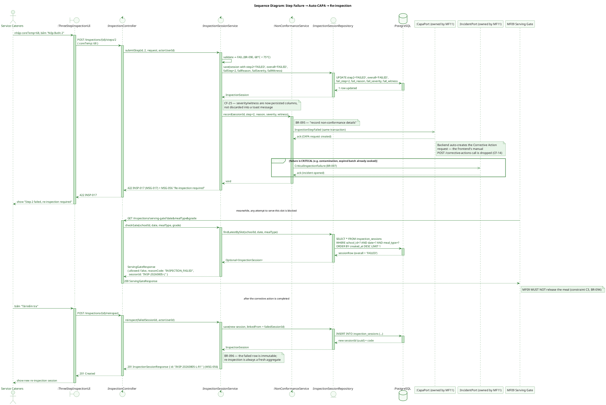

**Description:**
Demonstrates the error path required by BR-095/BR-096/BR-097. A failed step is never silently lost: `fail_step`/`fail_reason`/`fail_severity`/`fail_witness` are persisted (closing CF-25, which the frontend mock only shows in a toast). `NonConformanceService.record()` runs in the **same transaction** as the step update and always emits `InspectionStepFailed`, so MF11's Corrective Action Request is created automatically server-side — this removes the frontend's separate, easy-to-lose `POST /corrective-actions` call (CF-14: if the tab is closed before that second call fires, the rule silently stops applying). Severe failures additionally raise `CriticalInspectionFailure` for MF11's incident management (BR-097). While the session is `FAILED`, `ServingApprovalService` reports `allowed:false` to MF09 — the meal cannot be served (BR-094, constraint C3). Re-inspection (BR-096) always creates a brand-new session; the failed session row is never mutated, preserving it as an immutable legal record under QĐ 1246.

---

### 1.4 State Diagram — `InspectionSession.overall` Lifecycle (BR-079, BR-096, BR-098)

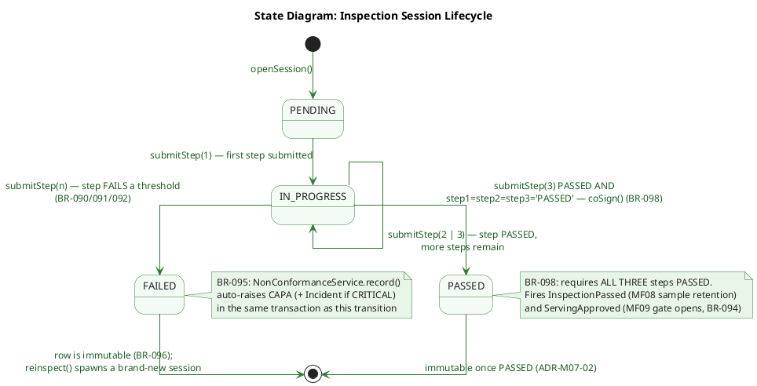

**Description:**
`overall` starts at `PENDING` when a session is opened and moves to `IN_PROGRESS` as soon as the first step is submitted (CF-23). Any step that fails a hard threshold (BR-090 core temp, BR-091 holding temp, BR-092 batch expiry) drives `overall` straight to `FAILED`, which is a terminal state for that row — BR-096 forbids editing a failed session; the only way forward is `reinspect()`, which opens a brand-new `PENDING` session (see §1.3). `overall` only reaches `PASSED` once all three steps are individually `PASSED` and the co-signature step completes (BR-098) — from that point the row is immutable (ADR-M07-02) and `ServingApprovalService` starts reporting `allowed:true` to MF09 (BR-094).

---

## 2. Kitchen Inspection & Dynamic Checklist (Medical Staff)

### 2.1 Class Diagram

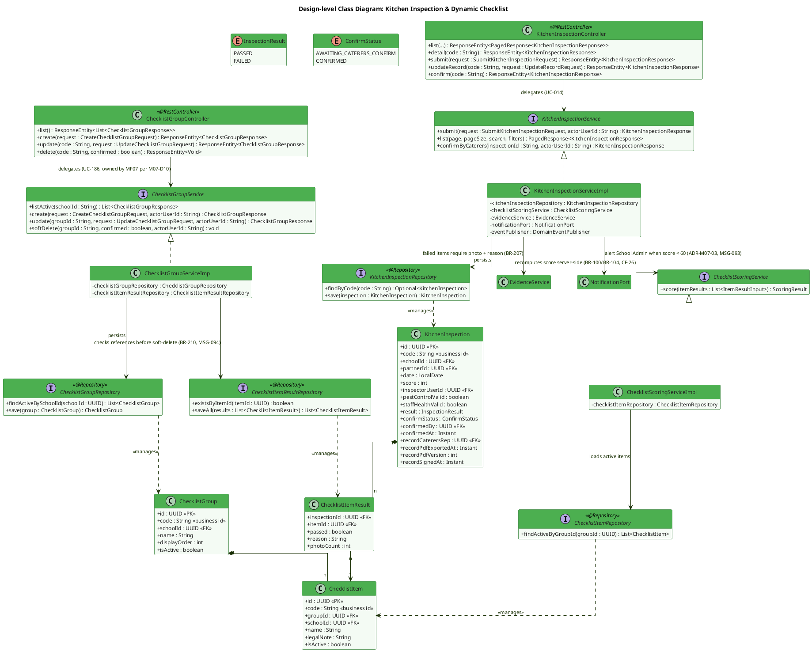

**Description:**
`KitchenInspection` (UC-014) is scored against a dynamic, per-school checklist owned by `ChecklistGroup`/`ChecklistItem` — MF07 owns both the table and the `/api/v1/checklist-groups` controller (M07-D10), while MF12 (UC-186) only reads it. `ChecklistScoringServiceImpl` recomputes `score` from `itemResults` on the server rather than trusting the value the frontend currently computes and submits (CF-26) — otherwise BR-100/BR-104 would be unenforceable. `ChecklistGroupServiceImpl.softDelete` deliberately does **not** hard-delete: it flips `is_active=false` and returns `409 + MSG-094` if the group/item is already referenced by a saved inspection, requiring an explicit `?confirmed=true` to proceed — replacing the frontend's current hard `DELETE` (CF-15), which would silently break BR-210's history-preservation requirement. `confirmStatus`/`recordCaterersRep`/`recordPdfExportedAt` support BR-221's bidirectional acknowledgement flow between Medical Staff and the Catering unit, distinct from and non-blocking to kitchen operations.

---

### 2.2 Sequence Diagram — Submit Kitchen Inspection & 60% Threshold (UC-014, ADR-M07-03)

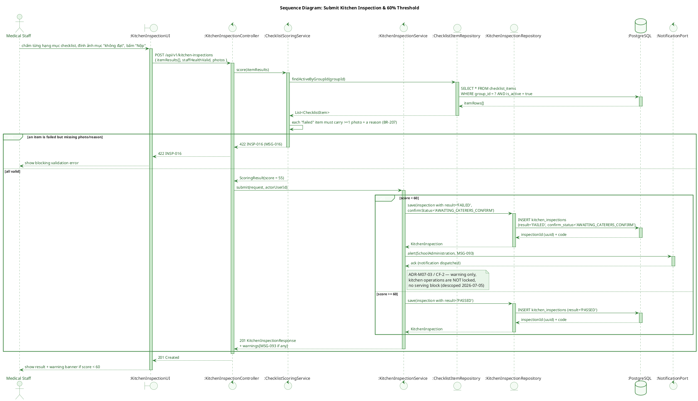

**Description:**
`score` is authoritative from `ChecklistScoringService`, never the value the client sends (CF-26). A "failed" checklist item is rejected with `422 INSP-016` unless it carries both a photo and a written reason (BR-207). When the recomputed score drops below 60, the session is still recorded and a warning notification is sent to School Administration (`MSG-093`) — the older behaviour of locking the kitchen and returning `MSG-024` was explicitly descoped on 2026-07-05 (CF-2) and must not be reintroduced.

---

### 2.3 Sequence Diagram — Caterers Confirmation & Signed Record (BR-221, BR-211-adjacent)

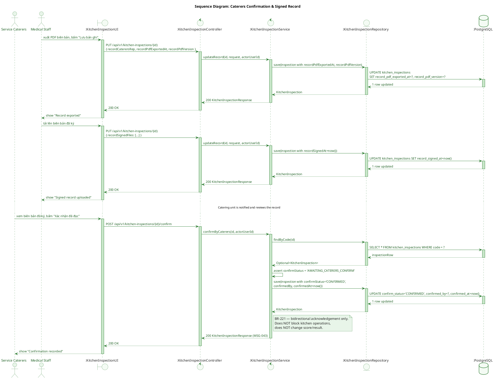

**Description:**
Implements BR-221 (formalized 2026-08-03): after Medical Staff exports the inspection record as PDF and uploads the signed scan, the Catering unit's representative must explicitly confirm having read it before `confirm_status` moves from `AWAITING_CATERERS_CONFIRM` to `CONFIRMED`. This is proof of two-way notification, not an approval gate — it never blocks kitchen operations and never mutates `score`/`result`. `POST /kitchen-inspections/{id}/confirm` is one of the endpoints not yet present in the frontend mock (§9.3.12 of the TDS) and must be added alongside the corresponding "confirm" button on the Caterer's screen.

---

### 2.4 State Diagram — `KitchenInspection.confirmStatus` Lifecycle (BR-221)

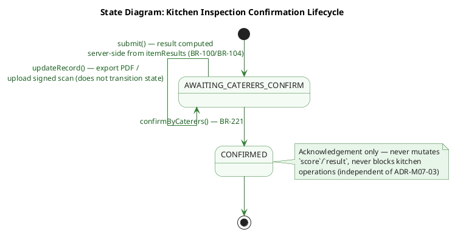

**Description:**
`confirmStatus` is a simple two-state acknowledgement machine, orthogonal to `result` (`PASSED`/`FAILED`, driven separately by the score threshold in §2.2). Every `KitchenInspection` starts `AWAITING_CATERERS_CONFIRM` at submit time; `updateRecord()` (PDF export, signed-scan upload) can be called any number of times while still in that state, since it only stages the record. The single one-way transition to `CONFIRMED` happens through `confirmByCaterers()` and is permanent — there is no path back, since it merely documents that the Catering unit read the signed record (BR-221), not an approval that could later be revoked.

---

## 3. Safety Monitoring, Medical Review & Violation Registry

### 3.1 Class Diagram

```plantuml
@startuml MF07_Monitoring_ClassDiagram
title Design-level Class Diagram: Safety Monitoring, Medical Review & Violation Registry

' ==========================================
' CẤU HÌNH BỐ CỤC VÀ MÀU SẮC RATIONAL ROSE
' ==========================================
skinparam classAttributeIconSize 0
skinparam linetype ortho
skinparam nodesep 60
skinparam ranksep 60
skinparam backgroundColor #FFFFFF

' Định dạng cho Class / Interface / Abstract Class
skinparam class {
    BackgroundColor #F4FBF4
    BorderColor #2E7D32
    FontColor #212121
    FontName Arial
    FontSize 13

    HeaderBackgroundColor #4CAF50
    HeaderFontColor #FFFFFF

    AttributeFontColor #212121
    AttributeFontName Arial
    AttributeFontSize 12
}

skinparam interface {
    BackgroundColor #f7ed93ff
    BorderColor #000000ff
    FontColor #000000ff
    FontName Arial
}

' Định dạng Mũi tên & Liên kết (Relationships & Arrows)
skinparam arrow {
    Color #162c00ff
    FontColor #162c00ff
    FontName Arial
    FontSize 11
}

' Định dạng Icon Stereotype (C, I, A, E)
skinparam stereotype {
    CBackgroundColor #f6eedcff
    CBorderColor #000000ff
    EBackgroundColor #f6eedcff
    EBorderColor #000000ff
    ABackgroundColor #f6eedcff
    ABorderColor #000000ff
    IBackgroundColor #f6eedcff
    IBorderColor #000000ff
}

hide empty members

class InspectionSession {
  +code : String
  +overall : StepStatus
  +medicalReviewResult : StepStatus
  +medicalReviewReason : String
}

class SafetySignoff {
  +id : UUID <<PK>>
  +code : String <<business id>>
  +schoolId : UUID <<FK>>
  +date : LocalDate
  +signedBy : UUID <<FK>>
  +signedAt : Instant
  +hygieneScore : int
  +failedSteps : int
}

class ServingGateResponse <<DTO>> {
  +allowed : boolean
  +reasonCode : String
  +message : String
  +sessionId : String
}

class DailyMonitoringResponse <<DTO>> {
  +schoolId : String
  +date : LocalDate
  +sessionsOpened : int
  +sessionsPassed : int
  +sessionsFailed : int
  +signoff : SafetySignoffResponse
}

class MedicalMonitoringResponse <<DTO>> {
  +schoolId : String
  +pendingReviewCount : int
  +recentSessions : List<InspectionSummaryResponse>
}

interface SafetyMonitoringService {
  +dailyDashboard(schoolId : String, date : LocalDate) : DailyMonitoringResponse
  +medicalDashboard(schoolId : String) : MedicalMonitoringResponse
  +signoff(schoolId : String, date : LocalDate, note : String, actorUserId : String) : SafetySignoffResponse
}

interface ComplianceReportService {
  +generate(schoolId : String, from : LocalDate, to : LocalDate) : ComplianceReportResponse
}

interface ServingApprovalService {
  +checkGate(schoolId : String, date : LocalDate, mealType : String, grade : String) : ServingGateResponse
}

interface InspectionSessionService {
  +open(schoolId : String, date : LocalDate, mealType : String) : InspectionDetailResponse
  +submitStep(code : String, step : int, request : Object) : InspectionDetailResponse
  +medicalReview(code : String, request : MedicalReviewRequest) : InspectionDetailResponse
}

interface ViolationQueryPort <<owned by MF11>> {
  +findByCaterersRepresentative(repId : String, sinceDays : int) : List<ViolationRef>
  +findBySourceInspectionId(sessionId : String) : List<ViolationRef>
}

interface SafetySignoffRepository <<@Repository>> {
  +existsBySchoolIdAndDate(schoolId : UUID, date : LocalDate) : boolean
  +save(signoff : SafetySignoff) : SafetySignoff
}

class SafetyMonitoringServiceImpl {
  -inspectionSessionRepository : InspectionSessionRepository
  -kitchenInspectionRepository : KitchenInspectionRepository
  -safetySignoffRepository : SafetySignoffRepository
}

class ComplianceReportServiceImpl {
  -inspectionSessionRepository : InspectionSessionRepository
  -kitchenInspectionRepository : KitchenInspectionRepository
  -complianceDataPort : ComplianceDataPort
}

class ServingApprovalServiceImpl <<see §1.1>> {
  -inspectionSessionRepository : InspectionSessionRepository
}

class InspectionSessionServiceImpl <<see §1.1>> {
  -inspectionSessionRepository : InspectionSessionRepository
}

class SafetyMonitoringController <<@RestController>> {
  +dailyDashboard(schoolId, date) : ResponseEntity<DailyMonitoringResponse>
  +medicalDashboard(schoolId) : ResponseEntity<MedicalMonitoringResponse>
  +signoff(request : SignoffRequest) : ResponseEntity<SafetySignoffResponse>
}

class InspectionQueryController <<@RestController>> {
  +medicalReview(code : String, request : MedicalReviewRequest) : ResponseEntity<InspectionDetailResponse>
  +servingGate(date, mealType, grade) : ResponseEntity<ServingGateResponse>
}

SafetyMonitoringService <|.. SafetyMonitoringServiceImpl
ComplianceReportService <|.. ComplianceReportServiceImpl
ServingApprovalService <|.. ServingApprovalServiceImpl
InspectionSessionService <|.. InspectionSessionServiceImpl

SafetyMonitoringController --> SafetyMonitoringService : delegates (UC-027, UC-054)
SafetyMonitoringService ..> DailyMonitoringResponse : returns
SafetyMonitoringService ..> MedicalMonitoringResponse : returns
ServingApprovalService ..> ServingGateResponse : returns

InspectionQueryController --> InspectionSessionService : delegates medicalReview() (UC-112, BR-222)
InspectionQueryController --> ServingApprovalService : delegates (BR-094, consumed by MF09)

note bottom of InspectionSessionServiceImpl : Full attribute/method list in §1.1
note bottom of ServingApprovalServiceImpl : Full attribute/method list in §1.1

ComplianceReportServiceImpl --> ComplianceDataPort : exposes read-only data to MF13 (M07-D09)
SafetyMonitoringServiceImpl ..> ViolationQueryPort : reads violation history for dashboards (owned by MF11)

SafetyMonitoringServiceImpl --> SafetySignoffRepository : persists (UC-027 step 5)
SafetySignoffRepository ..> SafetySignoff : <<manages>>
SafetyMonitoringServiceImpl ..> InspectionSession : reads (dashboard aggregation)
ComplianceReportServiceImpl ..> InspectionSession : reads (report aggregation)
InspectionSessionServiceImpl --> InspectionSession : reads/updates medicalReview* fields (BR-222)
SafetySignoff ..> InspectionSession : "failedSteps" snapshot derived from (CF-32)

@enduml
```

**Description:**
This diagram groups the read/monitoring side of MF07 that School Administration and Medical Staff rely on. `SafetyMonitoringServiceImpl` backs both the School Administration daily dashboard (UC-027, returning `DailyMonitoringResponse`) and the Medical Staff monitoring dashboard (UC-054, returning `MedicalMonitoringResponse`); it also owns `SafetySignoff` creation, whose `hygieneScore`/`failedSteps` are deliberately stored as a **snapshot at signing time** (CF-32) rather than recomputed live — a later change to the underlying scores must never retroactively alter what was signed. `ComplianceReportServiceImpl` generates the cross-module compliance report (UC-113/UC-115/UC-117); per M07-D09 the actual `/api/v1/compliance-report` endpoint has moved to MF13, so MF07 exposes a read-only `ComplianceDataPort` instead of owning that resource. `InspectionSessionService` and its implementation `InspectionSessionServiceImpl` (defined in full in §1.1, shown here only as realization targets) back `InspectionQueryController.medicalReview`, which implements BR-222 — Medical Staff's independent review of a three-step session, authorization-scoped at the **field level** (only `medicalReview*` columns), never allowed to overwrite `overall` or the BR-094/BR-098 outcome. `ServingApprovalService`/`ServingApprovalServiceImpl` (also fully specified in §1.1) return `ServingGateResponse` to `InspectionQueryController.servingGate`, the endpoint consumed by MF09 (BR-094). Violation history shown on these dashboards is read exclusively through `ViolationQueryPort`, owned by MF11, since MF07 does not own the `violation_records` table (M07-D07). `InspectionSession` (fully modeled in §1.1, shown here only for its monitoring-relevant fields) is the shared aggregate root this whole view reads from: `SafetyMonitoringServiceImpl` and `ComplianceReportServiceImpl` read it to build dashboards/reports, `InspectionSessionServiceImpl` is the only component allowed to update its `medicalReview*` fields (BR-222), and `SafetySignoff.failedSteps` is a point-in-time snapshot derived from it (CF-32).

---

### 3.2 Sequence Diagram — Serving Gate Check for MF09 (BR-094)

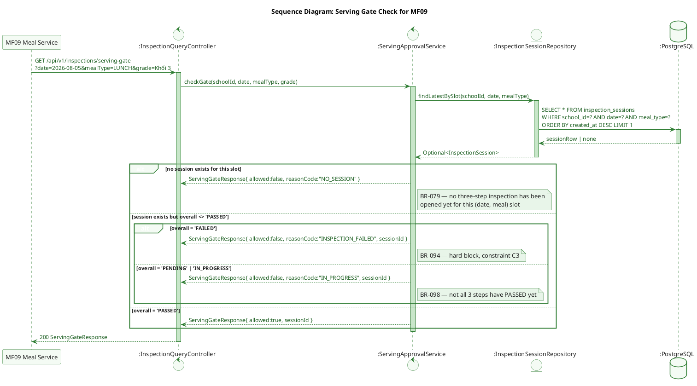

**Description:**
`GET /api/v1/inspections/serving-gate` is the single authoritative check MF09 must call before releasing any meal for serving — it replaces the current mock behaviour where the frontend fetches `GET /inspections?pageSize=100` and filters client-side (CF-20 in the TDS). `ServingApprovalService` returns one of three explicit `reasonCode`s (`NO_SESSION`, `INSPECTION_FAILED`, `IN_PROGRESS`) so MF09 can present a precise message rather than a generic denial, while `allowed:true` is only ever returned when `overall = 'PASSED'` — the same invariant enforced by the `ck_insp_overall_passed` database constraint (BR-098) and never bypassable from a client.

---

### 3.3 Sequence Diagram — Medical Independent Review & Daily Safety Signoff (BR-222, UC-027)

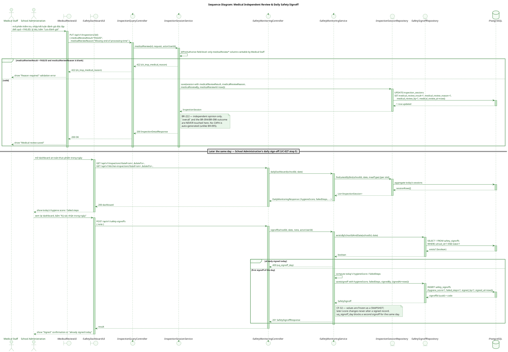

**Description:**
The top half implements BR-222: Medical Staff's independent review of a three-step session runs entirely in parallel to `overall` — enforced both by service-layer field-level authorization (Medical Staff may only write `medicalReview*` columns on `inspection_sessions`) and by the `ck_insp_medical_reason` database constraint requiring a reason whenever the review result is `FAILED`. Unlike a genuine step failure (BR-095), a `FAILED` medical review never triggers an automatic CAPA — it is a supervisory opinion from the School side, not the Catering unit's own three-step conclusion. The bottom half covers UC-027's daily sign-off: `SafetyMonitoringService.signoff()` computes `hygieneScore`/`failedSteps` from the day's data and freezes them into the `safety_signoffs` row as a **point-in-time snapshot** (CF-32) — a later correction to an inspection's score must never retroactively change what School Administration already signed. `uq_signoff_day` guarantees at most one sign-off per school per day.

---

*Document generated from TDS `SFMS-MF07-IMP-001 v1.3` (Approved 2026-08-03).*
