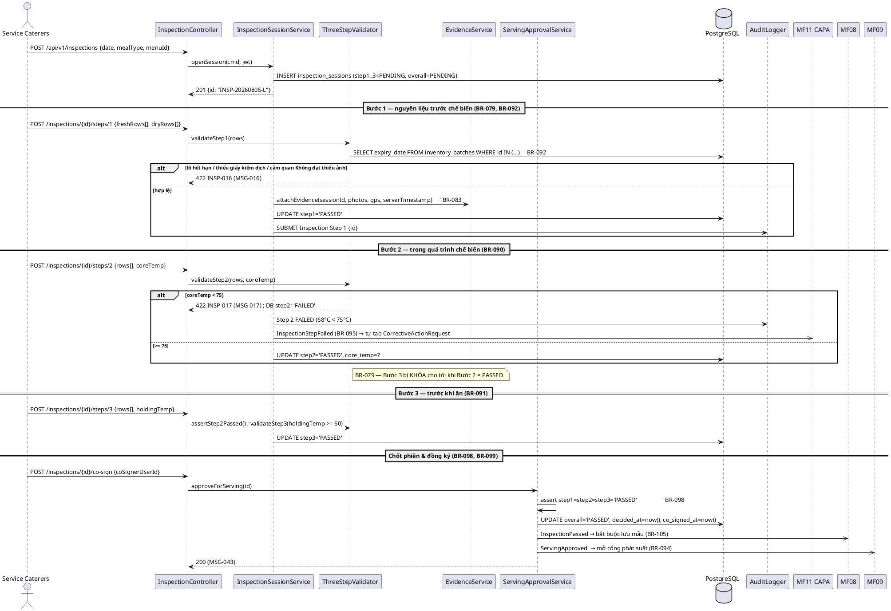
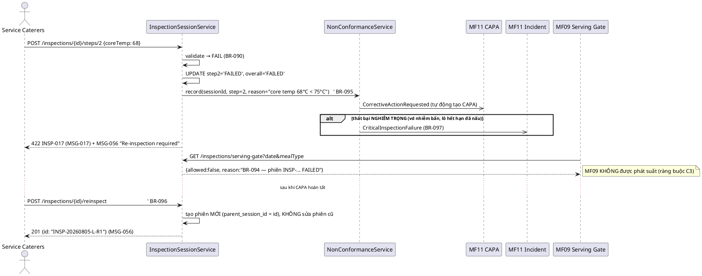
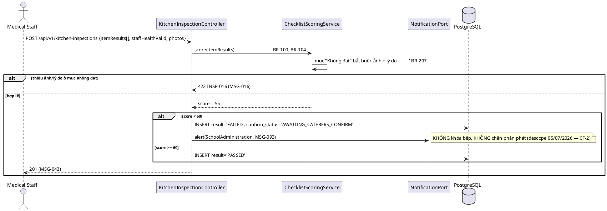
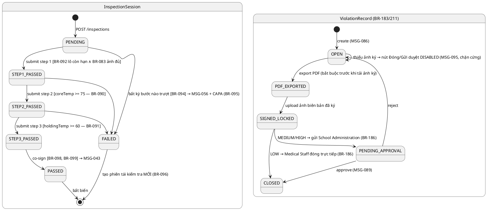

# ENGINEERING DOCUMENTATION STANDARD (EDS) v2.0 — TDS Backend
# MF07 — Food Safety Inspection & Monitoring (+ Violation-Process)

| Field | Value |
|-------|-------|
| **Document ID** | `SFMS-MF07-IMP-001` |
| **Version** | `1.3` |
| **Date** | `2026-08-03` |
| **Status** | **`Approved`** |
| **Document Owner** | Nguyễn Phương Thảo (ThaoNP) |
| **Author** | Nguyễn Phương Thảo — chủ module MF05/MF07/MF12, Lead Test/QA Reviewer |
| **Reviewed by** | `[Mạnh — §5/§9 Pending]` · `[Minh — §8/§9 JSON Pending]` · **`[Huy — §2 Traceability ✅ 2026-08-03]`** |
| **DPO Sign-off** | `[ ] Pending` *(ảnh bằng chứng có thể lộ mặt nhân viên bếp; biên bản vi phạm nêu đại diện Nhà thầu)* |
| **Approved by** | **`[Nguyễn Văn Nam — ✅ ký ranh giới liên module + prefix mã lỗi, 2026-08-03]`** *(final approval toàn tài liệu: Pending)* |
| **Last Review** | `2026-08-03` |
| **Based on EDS** | `v2.0` |

> **Stack (ADR-000 / `01_MVP_Backend_Implementation_Plan.md` §3):** Spring Boot **4.1.x (Java 25 LTS)** · PostgreSQL 16 · **Flyway** (mỗi module một file `V<n>__mf<NN>_*.sql` — mô hình "V1 = toàn bộ schema" **đã bỏ từ 02/08/2026**, xem `00_Common_Conventions.md` §0-BIS) · Spring Security + JWT · springdoc-OpenAPI (Swagger) · MapStruct · Cloudflare R2 stub (`./data/uploads`) cho ảnh bằng chứng.
>
> ⚠️ **Đọc §2.4 trước khi code.** Bản v1.2 chốt **16 quyết định `M07-D01`…`M07-D16`** từ Bước 0 + Bước 1 (`02_Module_Completion_Workflow.md` §7). Ba trong số đó **gỡ resource ra khỏi phạm vi MF07** (`violation_records`, `corrective_actions`, `compliance-report`) — nếu bạn đọc §5.2/§9.2 mà không đọc §2.4, bạn sẽ code lại thứ của MF11/MF13 và làm **Flyway đỏ + app không khởi động**.
>
> **Căn cứ pháp lý nghiệp vụ:** Quyết định **1246/QĐ-BYT** (kiểm thực ba bước, Mẫu số 1/2/3), Luật ATTP 55/2010/QH12, TTLT 13/2016/TTLT-BYT-BGDĐT — bản đầy đủ tại `00_Policies/`.

---

## CHANGELOG

> **Policy 4.4 — Immutable History:** Không xóa thông tin cũ.

| Ngày | Người thực hiện | Nội dung thay đổi |
|------|-----------------|-------------------|
| 2026-08-03 | Nguyễn Phương Thảo | **v1.3 — Nam + Huy xác nhận, đóng 7/9 mục treo.** §2.5 viết lại. **(1) Huy cấp `MSG-145`…`MSG-148`** (`error_message.md` **v1.10**) ⇒ §10 hết dòng `*(không có MSG riêng)*` và hết message tiếng Việt — **D7 sạch hoàn toàn**. Đường đi của con số: **8 mã thiếu → 4** (grep ra MSG-129 đã tồn tại từ v1.5 + bổ sung 4 mã dùng chung MSG-137/138/139/141) **→ 0**. Kèm 1 sửa lan sang cả dự án: bảng phân nhóm cuối `error_message.md` **tách** *"Food Safety Inspection"* thành 2 dòng, 6 mã của ATTP Report Center (MSG-091/092/096/097/098/099) chuyển sang **MF12 §1.12** — trước đó ai tra "mã nào của MF07" đều lấy nhầm. **(2) Huy chốt CHÍNH THỨC HOÁ CF-10 + CF-25** ⇒ `business_rules.md` **v2.1** cấp **BR-221** (xác nhận hai chiều biên bản kiểm tra bếp) và **BR-222** (đánh giá độc lập của Y tế trên phiên kiểm thực); CF-25 dùng BR-095 + BR-183 có sẵn, không cần BR mới. **Không cấp UC mới** — BR-221 trong luồng UC-014, BR-222 gắn UC-112; §2.1 cập nhật 2 dòng đó. **Điều đáng chú ý: 2 BR này làm 3 TC MẠNH LÊN chứ không chỉ đổi nhãn** — file review chỉ mô tả *field tồn tại*, còn BR mới là chỗ nói rõ field đó **KHÔNG được làm gì** (BR-221 *không* chặn vận hành bếp; BR-222 *không* ghi đè `overall`, *không* đổi kết quả BR-094/098, *không* sinh CAPA). Ba assertion "không" đó trước 03/08 không có oracle nào chống lưng nên **không viết được**; nay viết được, và chúng chính là thứ ngăn người sau "tiện tay" cho `medicalReviewResult` ghi đè `overall`. **(3) Nam ký ranh giới liên module** (`M07-D07`/`D08`/`D09`/`D10`) và **prefix `checklist-groups → INSP`**. **(4) CF-1 hết là mâu thuẫn:** `traceability_matrix.md` **dòng 630** ghi nhóm ATTP *"(gồm Violation, +UC-178, **+UC-185, +UC-186**)"* = **13 UC** — chênh 11 vs 13 chính là 2 UC đó, và bảng tổng kết của matrix **đã gộp UC-186** vào phạm vi ATTP, khớp `M07-D10`. UC-186 **giữ ở §1.12**, ghi chú chéo. UC-062 thuộc **MF06**. **Còn treo 2 mục, cả hai của Minh (FE)** — CF-24 (ô nhập `holdingTemp`) và CF-18/19 (nút co-sign/reinspect), **không chặn Bước 2**. |
| 2026-08-03 | Nguyễn Phương Thảo | **v1.2 — Bước 0 + Bước 1 của `02_Module_Completion_Workflow.md` §7. Status `Draft` → `Approved`.** Chốt **16 quyết định `M07-D01`…`M07-D16`** (§2.4) + **9 mục treo** (§2.5) không chặn code. **Kết quả Bước 0:** 3 lệnh grep ra **0 bảng trùng · 0 path trùng** với code đã merge (V1–V11) — nhưng lệnh thứ ba (`REFERENCES`, đề nghị của Huy trong changelog MF06) bắt **22 FK hỏng**: 9 chỗ `REFERENCES users(id)` (bảng tên thật `user_accounts`, PK **UUID**, MF07 khai `VARCHAR(32)` — nhóm **C2** của workflow §2.1) + 13 chỗ FK sai kiểu tới `schools`/`partners`/`menus`/`dishes`/`inventory_batches` (đều PK `UUID`). **Lỗi nặng nhất lại KHÔNG lệnh nào bắt được:** MF07 và **MF11** cùng khai `CREATE TABLE violation_records` + cùng `@RequestMapping("/api/v1/violations")`, MF07 và **MF13** cùng khai `GET /api/v1/compliance-report`, MF07 và **MF12** cùng khai `checklist_groups`/`checklist_items` — cả 4 module đều **chưa merge** nên hai lệnh grep (chỉ liệt kê thứ *đã có trong code*) mù hoàn toàn. Xử lý: `M07-D07`/`D08`/`D09` **gỡ** `violation_records`, `corrective_actions`, `compliance-report` khỏi MF07; `M07-D10` chốt MF07 **giữ** `checklist_*`. Sửa theo D1 (PK `UUID` + `code`, 6 bảng), D4, D6, D9 (3 bảng tự khai cột audit), §0-BIS (package `com.sfms.mf07`), số V `V12`/`V13`. §10 gỡ 4 mã `VIO-*` sang MF11, gán **MSG-129** cho `INSP-094`/`INSP-098`, bổ sung 4 mã dùng chung (MSG-137/138/139/141), còn **4 mã** chờ Huy cấp MSG mới (§2.5). Bổ sung **TC bắt buộc D11 + D12** vào `TestSpec-MF07` theo §7 Bước 1 việc 3. |
| 2026-07-28 | Nguyễn Phương Thảo | **v1.1 — viết lại toàn bộ §9 API Specification theo Frontend.** Đọc `client.ts` + `hooks.ts` + `data-table.tsx` + **50 call-site / 22 file** (42 chạm 6 resource MF07 + 8 gọi chéo module) và endpoint riêng `GET /compliance-report`. Bổ sung: §9.0 hợp đồng hook→HTTP (**`PUT` = partial merge**, `<DataTable>` search server-side thật), §9.1 bản đồ Màn hình FE → Endpoint (3 nhóm role), §9.2 bảng 29 endpoint kèm cột "FE dùng?", §9.3 schema theo **từng thao tác thật** (4 biến thể `PUT /inspections/{id}`, 4 biến thể `PUT /violations/{id}`), §9.4 resource ngoài MF07, §9.5 bảng khoảng cách FE↔BE (19 mục). Phát hiện thêm **19 mâu thuẫn CF-14…CF-32**. Cập nhật §5.2 theo phát hiện: enum `StepStatus` thêm `IN_PROGRESS`, `ResolutionStatus` thêm `PENDING`, bổ sung cột `fail_step/fail_reason/fail_severity/fail_witness`, `violation_records.reject_reason`, `safety_signoffs.hygiene_score/failed_steps`. |
| 2026-07-28 | Nguyễn Phương Thảo | Tạo bản đầu (v1.0). Nguồn: UC `MF07_Food_Safety_Inspection_Monitoring.md`; traceability §1.7 (+ tham chiếu §1.11 cho Violation, §1.12 cho UC-186); `business_rules.md` §8 §12 §18; `error_message.md`; mock `mock-server.ts` (handler `POST /kitchen-inspections`, `GET /compliance-report`, filter `step`/`stepStatus`) + `db.ts` + `mock-data.ts`; màn FE `medical-staff/{inspections,conduct-inspection,compliance,violations,reports,report-center}`, `service-caterers/inspections`, `school-admin/{compliance,violations}`; `data_model.puml` package "Kiểm soát ATTP" + `ViolationRecord`; `semantic-audit.ts` §7; ADR-000. Ghi nhận **10 mâu thuẫn nguồn CF-1…CF-10** (§2.3) — **không tự chọn bên đúng**. |

---

## MỤC LỤC

1. [Tổng quan Module](#1-tổng-quan-module) · 2. [Ma trận Truy vết](#2-ma-trận-truy-vết) · 3. [Architecture Decisions](#3-architecture-decisions-inline-adr) · 4. [NFR & SLA](#4-non-functional-requirements--sla) · 5. [Static Modeling](#5-static-modeling) · 6. [Dynamic Modeling](#6-dynamic-modeling) · 7. [Domain Event Catalog](#7-domain-event-catalog) · 8. [Interface Specification](#8-interface-specification) · 9. [API Specification](#9-api-specification) · 10. [Error Codes](#10-bảng-mã-lỗi) · 11. [Triển khai](#11-quy-trình-triển-khai) · 12. [Rollback Runbook](#12-rollback--incident-runbook) · 13. [Kiểm thử](#13-kịch-bản-kiểm-thử) · 14. [Xác minh](#14-phương-pháp-xác-minh) · 15. [API Samples](#15-mẫu-thử-thực-tế) · 16. [Authorization Matrix](#16-authorization-matrix) · 17. [AI Prompt Constraints](#17-ai-prompt-constraints-case-20)

---

## 1. Tổng quan Module

> MF07 là **cổng an toàn cuối cùng trước khi bữa ăn được phục vụ**. Gồm 3 nhóm nghiệp vụ:
> **(A) Kiểm thực ba bước** (`InspectionSession`) do Service Caterers thực hiện theo QĐ 1246/QĐ-BYT — chỉ khi cả 3 bước ĐẠT thì bữa ăn mới được phê duyệt phục vụ (BR-098);
> **(B) Kiểm tra an toàn & vệ sinh bếp** (`KitchenInspection`) do Medical Staff thực hiện theo checklist động;
> **(C) Giám sát & báo cáo tuân thủ** cho School Administration/Medical Staff.
> Phần **Violation-Process** (BR-183…BR-190, BR-211) được ghi nhận ở đây ở **tầng dữ liệu**, nhưng màn nhập liệu đã gộp về UC-179 thuộc §1.11 (xem CF-6).

| Field | Value |
|-------|-------|
| **Module Name** | Food Safety Inspection & Monitoring (MF07), gộp Violation-Process |
| **Bounded Context** | Food Safety Assurance |
| **Data Classification** | `Internal` + ảnh bằng chứng (có thể chứa hình ảnh nhân viên) + `PII` gián tiếp (đại diện Nhà thầu trên biên bản vi phạm) |
| **Compliance Scope** | QĐ 1246/QĐ-BYT · Luật ATTP 55/2010/QH12 · TTLT 13/2016 · PDPD |
| **Upstream Dependencies** | MF01 (JWT/RBAC), MF02 (`SchoolRecord`, geofence), MF04 (`Partner` — bếp/đơn vị suất ăn), MF05 (`Menu`/`dishId` của bữa được kiểm), MF06 (`InventoryBatch` — HSD, FEFO ở Bước 1) |
| **Downstream Consumers** | MF08 (lưu mẫu bắt buộc sau khi 3 bước ĐẠT — BR-105), MF09 (chặn phát suất khi kiểm thực trượt — BR-094, ràng buộc C3), MF11 (CAPA tự sinh khi bước trượt — BR-095; `ViolationRecord.sourceInspectionId`), MF12/MF13 (báo cáo tuân thủ) |
| **Ưu tiên** | **P2** — làm song song nửa sau, nhưng **BR-094 là chốt chặn của trục xương sống** nên phải thông trước khi demo MF09 |

**Phạm vi 11 Use Case (đúng `traceability_matrix.md` §1.7 — bảng phân công `00_` §3 ghi 13 UC, xem CF-1):**
UC-052, UC-065, UC-014, UC-027, UC-054, UC-112, UC-113, UC-115, UC-117, UC-124, UC-178 *(Deprecated 11/07/2026)*.

**Thư mục màn hình FE đã đọc (nguồn 6):**

| Role | Thư mục | Vai trò |
|---|---|---|
| Service Caterers | `(app)/service-caterers/inspections`, `inspections/[id]`, `inspections/[id]/print` | UC-052, UC-065, UC-124 + bản in Mẫu 1/2/3 |
| Medical Staff | `(app)/medical-staff/conduct-inspection`, `conduct-inspection/[id]`, `[id]/record`, `checklist`, `history` | UC-014 (+ checklist động BR-210, xem CF-9) |
| Medical Staff | `(app)/medical-staff/inspections`, `inspections/[id]` | UC-112, UC-117 |
| Medical Staff | `(app)/medical-staff/compliance`, `compliance/report`, `compliance/history` | UC-054, UC-115 |
| Medical Staff | `(app)/medical-staff/violations`, `violations/new`, `violations/[id]`, `violations/reports` | BR-183…BR-190, BR-211 (UC-179 §1.11) |
| School Administration | `(app)/school-admin/compliance`, `school-admin/violations`, `violations/override-report` | UC-027, UC-113, BR-189, BR-190 |

---

## 2. Ma trận Truy vết

> **Nguồn chuẩn:** cột Business Rules & System Messages lấy **nguyên văn** `traceability_matrix.md` **§1.7**; tên UC nguyên văn `02_Requirements/02_UseCases/MF07_Food_Safety_Inspection_Monitoring.md` *(riêng UC-065 lấy tên từ §1.7 — xem CF-1)*; nội dung BR tra `business_rules.md` §8, §12, §18.
> **Policy:** chỉ dùng mã có trong §1.7. Mã mà UC file/mock nêu thêm → ghi ở §2.3, **không** đưa vào §2.1.

### 2.1. UC ↔ BR ↔ MSG ↔ Code

| UC ID | Tên UC | Actor | Business Rules (§1.7) | System Messages (§1.7) | Thành phần Code (Java) |
|-------|--------|-------|------------------------|------------------------|------------------------|
| UC-052 | Manage Three-Step Food Inspection | Service Caterers | BR-079, BR-083, BR-090, BR-091, BR-092, BR-093, BR-094, BR-095, BR-096, BR-097, BR-098, BR-099 | MSG-016, MSG-017, MSG-043, MSG-056 | `InspectionSessionService.openSession()/submitStep()`, `ThreeStepValidator`, `InspectionController` |
| UC-065 | Record Meals Before Serving | Service Caterers | BR-091, BR-094, BR-095, BR-096, BR-097, BR-098, BR-099 | MSG-016, MSG-043, MSG-056 | `InspectionSessionService.submitStep3()`, `ServingApprovalService.approve()` |
| UC-014 | Conduct Food Safety Inspection | Medical Staff | BR-100, BR-101, BR-102, BR-103, BR-104, **BR-221** *(mới 03/08)* | MSG-043 | `KitchenInspectionService.submit()/confirm()`, `ChecklistScoringService` |
| UC-027 | Daily Food Safety Monitoring | School Administration | BR-100, BR-104 | MSG-004, MSG-005 | `SafetyMonitoringService.dailyDashboard()`, `SafetySignoffService.signoff()` |
| UC-054 | Monitor Food Safety | Medical Staff | BR-089, BR-100, BR-101, BR-102, BR-103, BR-104 | MSG-055, MSG-059 | `SafetyMonitoringService.medicalDashboard()` |
| UC-112 | View Food Inspection Records | Medical Staff | BR-099, **BR-222** *(mới 03/08)* | MSG-004, MSG-005 | `InspectionQueryService.list()` (scope = toàn trường), `MedicalReviewService.review()` |
| UC-113 | View Food Inspection Reports | School Administration | BR-099 | MSG-004, MSG-005 | `InspectionReportService.summary()` |
| UC-115 | View Food Safety Compliance Report | Medical Staff | BR-100, BR-101 | MSG-004, MSG-005 | `ComplianceReportService.generate()` (khớp `GET /compliance-report` của mock) |
| UC-117 | View Food Safety Reports | Medical Staff | — | MSG-004, MSG-005 | `InspectionReportService.byCategory()` |
| UC-124 | View Inspection Records | Service Caterers | BR-099 | MSG-004, MSG-005 | `InspectionQueryService.listOwn()` (scope = phiên do mình lập) |
| UC-178 | ~~Record Process Violation~~ *(Deprecated 11/07/2026)* | Service Caterers, Medical Staff | BR-183, BR-211 | MSG-085, MSG-086, MSG-095 | `ViolationRecordService.*` — **API giữ, màn nhập gộp về UC-179 (MF11)**, xem CF-6 |

### 2.2. Business Rules — nội dung (nguyên văn `business_rules.md`)

| BR | § | Tóm tắt nguyên văn | Điểm enforce trong backend |
|----|---|--------------------|-----------------------------|
| BR-079 | §8 | Mỗi lô thức ăn phải qua **đúng 3 bước** kiểm tra theo Điều 3–5 QĐ 1246/QĐ-BYT (Bước 1 nguyên liệu trước chế biến · Bước 2 điều kiện vệ sinh **trong suốt** quá trình chế biến · Bước 3 trước khi ăn). | `ThreeStepValidator.assertStepOrder()` |
| BR-083 | §8 | Mỗi bước phải kèm **ảnh bằng chứng, vị trí GPS, timestamp** ghi tự động. | `EvidenceValidator` — bắt buộc ảnh cho dòng "Không đạt" |
| BR-090 | §8 | Thức ăn sau nấu đạt **nhiệt độ lõi ≥ 75°C** (kiểm tại Bước 2). *(Chú thích: ngưỡng HACCP, KHÔNG trích trực tiếp QĐ 1246.)* | `Step2Validator` → MSG-017 |
| BR-091 | §8 | Thức ăn chờ phục vụ giữ **≥ 60°C** (kiểm tại Bước 3). *(Cùng ghi chú như BR-090.)* | `Step3Validator` |
| BR-092 | §8 | Hệ thống tự động **kiểm tra hạn sử dụng** lô nguyên liệu dùng trong bước kiểm tra. | `Step1Validator` — tra `InventoryBatch.expiryDate` (MF06) |
| BR-093 | §8 | Mỗi phiên tạo **hồ sơ kiểm tra hoàn chỉnh** liên kết lô nguyên liệu + hồ sơ sản xuất bữa ăn. | FK `menu_id`, `dish_id`, `batch_ids[]` |
| BR-094 | §8 | Bữa ăn **không được phục vụ** nếu bất kỳ bước nào thất bại. | `ServingApprovalService` — chốt chặn cho MF09 (ràng buộc C3) |
| BR-095 | §8 | Bước thất bại → ghi **chi tiết không tuân thủ** + **tự động tạo Corrective Action Request**. | Phát sự kiện `InspectionStepFailed` → MF11 |
| BR-096 | §8 | Sau hành động khắc phục, bước thất bại phải **tái kiểm tra**. | `InspectionSessionService.reinspect()` → MSG-056 |
| BR-097 | §8 | Kết quả thất bại **nghiêm trọng** liên kết tự động với **quản lý sự cố**. | Phát `CriticalInspectionFailure` → MF11 |
| BR-098 | §8 | Chỉ khi **cả 3 bước ĐẠT** hệ thống mới **phê duyệt bữa ăn** để phục vụ. | `ServingApprovalService.approve()` → MSG-043 |
| BR-099 | §8 | **Medical Staff** và **School Administration** xem **toàn bộ** hồ sơ kiểm tra; **Service Caterers** chỉ xem hồ sơ **do mình thực hiện**. | `@PreAuthorize` + row-level filter theo `inspector_user_id` |
| BR-100 | §12 | Ghi nhận và theo dõi **điểm số vệ sinh hàng ngày** của bếp ăn. | `ChecklistScoringService.score()` |
| BR-101 | §12 | Lưu trữ kết quả **kiểm tra an toàn & vệ sinh định kỳ hàng tháng**. | `KitchenInspection` retention |
| BR-102 | §12 | **(sửa 27/07/2026)** Kiểm soát côn trùng **không còn là hồ sơ/màn hình độc lập** — ghi như **mục tùy chọn** trong phiên kiểm tra bếp (UC-014). Không có màn nhập liệu/nhật ký riêng. | Ghi qua `checklist_item_findings` (mục `CLI-3-8`, `CLI-4-6`); **KHÔNG** tạo bảng `pest_control_logs` |
| BR-103 | §12 | Theo dõi tính hợp lệ của **giấy xác nhận sức khỏe nhân viên bếp**. *(Chu kỳ khám cụ thể chưa xác nhận — thiếu TT 15/2012 trong `00_Policies/`.)* | Cờ `staff_health_valid` trong phiên kiểm tra |
| BR-104 | §12 | Điểm vệ sinh nhân viên bếp được tổng hợp và dùng trong **Báo cáo Tuân thủ ATTP**. | `ComplianceReportService` |
| BR-089 | §12 | ~~Giám sát nhiệt độ tủ lạnh liên tục~~ — **Deprecated 11/07/2026** (hệ thống không quản lý IoT). | **Không** implement giám sát tự động — xem CF-3 |
| BR-183 | §18 | Mọi vi phạm do Service Caterers gây ra → **1 loại Biên bản Vi phạm duy nhất**, nhắm **đơn vị Nhà thầu** (không nhắm cá nhân): `reportedBy`, mô tả, ảnh bằng chứng, `severityLevel`, `caterersRepresentativeId`. | `ViolationRecordService.create()` |
| **BR-221** | §12 | **(mới 2026-08-03)** Sau khi Medical Staff nộp phiên `KitchenInspection`, phiên ở `AWAITING_CATERERS_CONFIRM`; đại diện Service Caterers phải **xác nhận đã đọc** thì mới sang `CONFIRMED`. Ghi lại ai/lúc nào/PDF xuất khi nào/ảnh bản ký. **Không chặn** vận hành bếp, **không** đổi `score`/`result`. | `KitchenInspectionService.confirm()` — bằng chứng đã thông báo hai chiều, **không** phải gate |
| **BR-222** | §12 | **(mới 2026-08-03)** Medical Staff ghi **đánh giá độc lập** trên phiên kiểm thực (`medicalReviewResult`/`Reason`/`By`/`At`). **KHÔNG ghi đè `overall`**, **KHÔNG** đổi kết quả BR-094/BR-098. `FAILED` bắt buộc kèm lý do. Chỉ Medical Staff ghi được; Caterer chỉ đọc. **Không** tự sinh CAPA (khác BR-095). | `MedicalReviewService` + CHECK `ck_insp_medical_reason` + phân quyền theo FIELD (§16) |
| BR-211 | §18 | Xuất PDF theo mẫu `00_Policies/specialreport2173_1.md` → in → **ký tay 2 bên** → **tải ảnh/scan** (`signedRecordPhotoUrl` bắt buộc). Lưu biên bản **không bị chặn** bởi thiếu ảnh ký, nhưng **gate chặn cứng** ở bước Đóng/Gửi duyệt (MSG-095). | `ViolationRecordService.export()/uploadSignedRecord()`; gate ở MF11 (UC-180/182) |

### 2.3. ⚠️ Mâu thuẫn giữa các nguồn (ghi rõ, KHÔNG tự chọn bên đúng)

| # | Mô tả mâu thuẫn | Nguồn A | Nguồn B | Xử lý trong TDS |
|---|-----------------|---------|---------|-----------------|
| **CF-1** | **Lệch danh sách UC giữa UC file và traceability §1.7.** §1.7 có **UC-065 "Record Meals Before Serving"** — UC file MF07 **không có** UC này. Ngược lại UC file có **UC-062 "Record Ingredients Before Processing"** — §1.7 **không có** (changelog v1.1 ghi *"gộp UC-062/UC-063 về Section 1.5"*, tức MF06). Bảng phân công `00_` §3 lại ghi MF07 = **13 UC**, §1.7 chỉ có **11**. | `MF07_Food_Safety_Inspection_Monitoring.md` | `traceability_matrix.md` §1.7 + `00_` §3 | §2.1 bám **§1.7** (giữ UC-065, bỏ UC-062). Nội dung Bước 1 mô tả trong UC-062 vẫn dùng làm **nguồn nghiệp vụ** cho `Step1Fresh/Step1Dry` (§5.2) và ghi rõ nguồn. Chờ **Huy** chốt UC-062 thuộc MF06 hay MF07 và giải thích chênh 11 vs 13. |
| **CF-2** | **UC-014 AF1 "kitchen quarantine, khóa vận hành bếp, MSG-024"** trong UC file **đã bị descope 05/07/2026**: điểm <60% chỉ **cảnh báo School Administration (MSG-093)**, **không** khóa bếp. §1.7 cho UC-014 chỉ liệt kê MSG-043 — **không có** MSG-024 lẫn MSG-093. Mock (`mock-server.ts` dòng 185–186) đã theo bản mới. | UC file UC-014 AF1 + `error_message.md` MSG-024 | `business_rules.md` §12 (ghi chú sau BR-208) + mock | Backend theo **bản đã descope**: `score < 60` → `result=FAILED` + phát cảnh báo School Administration, **KHÔNG** khóa bếp, **KHÔNG** chặn phân phát. Dùng **MSG-093** (Warning) trong §10 và đánh dấu **không có trong §1.7** — chờ Huy bổ sung vào traceability. MSG-024 **không** dùng ở MF07. |
| **CF-3** | **BR-089 Deprecated 11/07/2026** nhưng §1.7 vẫn liệt kê BR-089 cho UC-054, và §1.7 gán **MSG-055/MSG-059** (cảnh báo nhiệt độ kho / tủ mẫu) cho UC-054 — cả hai gắn với cơ chế giám sát tự động đã bỏ. | `traceability_matrix.md` §1.7 | `business_rules.md` §12 BR-089 (Deprecated), BR-110 (sửa 11/07) | §2.1 giữ mã theo §1.7 nhưng backend **không** implement giám sát/cảnh báo tự động. MSG-055/MSG-059 chỉ phát khi **nhân viên nhập tay** giá trị nhiệt độ ngoài dải trong phiên kiểm tra. Ghi rõ để Huy xử lý. |
| **CF-4** | **`FridgeTempLog` còn trong `data_model.puml`** (package "Kiểm soát ATTP") nhưng không có resource tương ứng trong `db.ts` và BR-089 đã Deprecated. | `data_model.puml` | `db.ts` + BR-089 | **Không** tạo bảng `fridge_temp_logs` ở MVP. Cần Mạnh cập nhật `data_model.puml`. |
| **CF-5** | **BR-102 (kiểm soát côn trùng)**: UC file UC-014 bước 4 vẫn yêu cầu *"verify active quarterly pest control certificate"*, và mock `KitchenInspection` vẫn còn cờ `pestControlValid`. Nhưng BR-102 bản 27/07/2026 đã **bỏ mô hình chứng nhận/nhật ký độc lập**; resource `pest-control-log` **đã gỡ khỏi `db.ts`**. | UC file UC-014 + field `pestControlValid` | `business_rules.md` BR-102 (27/07/2026) + `db.ts` (đã bỏ resource) | Giữ cột `pest_control_valid` (dữ liệu cũ + màn School Admin đang đọc — chú thích trong `mock-data.ts`), **nhưng không** tạo bảng nhật ký côn trùng và **không** có endpoint nhập liệu riêng. Côn trùng ghi qua mục `CLI-3-8`/`CLI-4-6`. |
| **CF-6** | **UC-178 Deprecated 11/07/2026** — dialog nhập gộp vào **UC-179** (`§1.11`, thuộc **MF11**). Nhưng bảng phân công `00_` §3 vẫn ghi MF07 = *"Kiểm thực 3 bước + vi phạm quy trình"*, và §1.7 vẫn giữ dòng UC-178. | `00_` §3 + §1.7 (giữ số hiệu) | ghi chú §1.7 (Deprecated) + §1.11 UC-179 | MF07 **sở hữu bảng `violation_records` + API CRUD/PDF** (vì `sourceInspectionId` trỏ về phiên kiểm thực), **MF11 sở hữu luồng nhập liệu và phê duyệt xử lý** (UC-179/180/182). Ranh giới ghi rõ ở §1 và §16. Cần **Nam** chốt lại phân công để tránh 2 module cùng gen entity. |
| **CF-7** | **BR-184 Deprecated 26/07/2026** (gộp vào BR-183, bỏ khái niệm biên bản nhắm cá nhân) nhưng mock `ViolationRecord` vẫn có `type: "Quy trình" \| "Nhân sự"`, `staffName`, `staffPosition`, `disciplinaryLevel`; 3 bản ghi seed vẫn dùng. | `mock-data.ts` `ViolationRecord` + seed | `business_rules.md` BR-183/BR-184/BR-185 (26/07/2026) | §5.2 **giữ cột** `staff_name`, `staff_position`, `disciplinary_level` (dữ liệu lịch sử — mock ghi rõ *"KHÔNG xoá field"*), nhưng đánh dấu **deprecated**: API tạo mới **từ chối** các field này; dùng `unit_sanction_level` (BR-185 mới) và `caterers_representative_id`. |
| **CF-8** | **`InspectionSession.meal` khác nhau giữa puml và mock.** puml: `"Bữa trưa" \| "Bữa phụ"`. mock: `"Bữa sáng" \| "Bữa trưa" \| "Bữa chiều"` (thống nhất 25/07/2026). MF05 dùng enum `MealType {BREAKFAST, LUNCH, SNACK}`. | `data_model.puml` | `mock-data.ts` + `MEAL_TYPE_LABEL` | §5.2 dùng **enum `MealType`** của MF05 (khoá nghiệp vụ chung), nhãn tiếng Việt tra ở tầng hiển thị. Cần cập nhật puml. |
| **CF-9** | **Checklist động (BR-207/BR-210, UC-186)** là nền dữ liệu của UC-014 nhưng: BR-207/BR-210 **không có** trong cột BR của UC-014 tại §1.7, và **UC-186 nằm ở §1.12 (MF12)**, không phải §1.7. MSG-094 cũng thuộc nhóm MF12. | `traceability_matrix.md` §1.7 (UC-014 = BR-100..104) | `business_rules.md` §12 BR-207/BR-210 + §1.12 UC-186 + `db.ts` resource `checklist-groups` | MF07 **đọc** `checklist_groups`/`checklist_items` để chấm điểm; **CRUD checklist thuộc MF12** (UC-186). §5.2 khai bảng ở MF07 vì FK từ `checklist_item_findings`, nhưng ghi rõ **chủ sở hữu API là MF12**. Cần **Nam** chốt để không gen trùng. |
| **CF-14** | **BR-095 (tự động tạo CAPA khi bước trượt) đang do FRONTEND thực hiện**, không phải hệ thống: `inspections/[id]/page.tsx:1281` và `conduct-inspection/page.tsx:183` gọi tay `POST /corrective-actions` ngay sau khi ghi kết quả trượt. Đóng tab trước khi request thứ 2 chạy ⇒ **không có CAPA nào được tạo**, quy tắc mất hiệu lực im lặng. | mock FE (2 call-site) | `business_rules.md` BR-095 (*"hệ thống phải… tự động tạo"*) | Backend **tự tạo CAPA trong cùng transaction** ghi bước trượt (§7.1 `InspectionStepFailed`). Minh **gỡ** lệnh gọi client khi chuyển sang backend thật để tránh tạo trùng. **Ưu tiên cao** (§9.5 mục 2). |
| **CF-15** | **Xoá checklist là XOÁ CỨNG.** `checklist/page.tsx:179` gọi `deleteGroup.mutateAsync(id)` → `DELETE /checklist-groups/{id}`. Trái BR-210 (*"không xóa dữ liệu lịch sử đã ghi nhận — chỉ ẩn hạng mục khỏi các phiên kiểm tra mới"*) và trái MSG-094 (cảnh báo xác nhận). | mock FE | `business_rules.md` BR-210 + `error_message.md` MSG-094 | Backend đổi `DELETE` thành **soft-delete** (`is_active=false`); trả **409 + MSG-094** khi đã được phiên đã lưu tham chiếu, chờ `?confirmed=true`. Minh bổ sung hộp thoại xác nhận. |
| **CF-16** | **BR-187 (cảnh báo tái diễn 90 ngày) do FE tự dò**: `violations/new/page.tsx:64` tải `GET /violations?pageSize=50` rồi so client-side, và gửi kết quả lên qua field `repeatSuspect`. Nghĩa là **client tự quyết định** có nghi ngờ tái diễn hay không. | mock FE | `business_rules.md` BR-187 | Backend **tự dò** theo `caterers_representative_id` + severity ≥ MEDIUM + 90 ngày (repository `findRepeatCandidates`), **bỏ qua** `repeatSuspect` FE gửi. |
| **CF-17** | **Cặp filter `step` + `stepStatus` không có call-site nào.** `00_Team_Work_Assignment_Plan.md` §2b-2 ghi *"kết hợp với `stepStatus` lọc kết quả bước kiểm thực (module MF07)"*, nhưng FE lọc bằng `overall`. Tương tự `mealPrefix` được §2b-2 gán cho MF09 nhưng thực tế dùng ở `samples` (MF08). | `00_` §2b-2 | mock FE (grep 0 kết quả) | Backend **vẫn hỗ trợ** `step`/`stepStatus` theo hợp đồng chung (không phá gì), nhưng đề nghị **sửa `00_` §2b-2** ghi rõ "chưa có FE dùng" và sửa dòng `mealPrefix` sang MF08. |
| **CF-18** | **Không có bước đồng ký (co-sign).** `coSigner` được gán **ngay lúc tạo phiên** (`inspections/page.tsx:94`, giá trị cứng `"Ngô Thị Hà (Y tế)"`), FE không bao giờ cập nhật lại. BR-099 và QĐ 1246 Điều 5 yêu cầu đồng ký **sau** khi hoàn tất 3 bước. | mock FE | BR-099 + QĐ 1246 Điều 5 | Đặc tả `POST /inspections/{id}/co-sign` (§9.3.12). **Chờ Huy/Nam chốt** rồi Minh bổ sung nút ký ở workspace. Giá trị `coSigner` gán sẵn hiện chỉ là **nhãn hiển thị**, không phải bằng chứng ký. |
| **CF-19** | **Không có luồng tái kiểm tra (BR-096).** Không nút nào tạo phiên tái kiểm; phiên `FAILED` là ngõ cụt. | mock FE | BR-096, MSG-056 | Đặc tả `POST /inspections/{id}/reinspect` (§9.3.12); Minh bổ sung nút trên phiên FAILED. |
| **CF-20** | **Cổng chặn BR-094 chưa tồn tại ở tầng API.** Màn phát suất (`meal-service/page.tsx:150`) tải `GET /inspections?pageSize=100` rồi **tự lọc client-side** để quyết định cho phát suất hay không. | mock FE | BR-094 + ràng buộc C3 `data_model.puml` | Backend mở `GET /inspections/serving-gate`; **MF09 bắt buộc gọi endpoint này**, không tự query bảng (AP-AI-010). |
| **CF-21** | **Xuất PDF biên bản (BR-211) render tại browser**: `violations/[id]/page.tsx:120` và `conduct-inspection/[id]/record/page.tsx:144` mở `window.open` rồi `document.write` HTML. Backend chỉ ghi nhận `pdfExported`/`pdfGeneratedAt`/`pdfVersion`. | mock FE | BR-211 (*"hệ thống xuất PDF theo mẫu `00_Policies/specialreport2173_1.md`"*) | Backend sinh PDF thật (PDFBox) qua `POST /violations/{id}/export-pdf`; bản in phải **đồng nhất** giữa các máy — HTML client render khác nhau theo trình duyệt/máy in. |
| **CF-22** | **Ngày ở dạng chuỗi locale `vi-VN`**: `date`, `occurredAt`, `signedAt`, `medicalReviewAt`, `recordPdfExportedAt`, `pdfGeneratedAt` đều `dd/MM/yyyy [HH:mm]`. Trái quy ước `01_MVP…` §3 (*"Ngày = ISO/Instant"*). | mock FE | **D4** (thắng `01_MVP…` §3) | ⚠️ **SỬA 2026-08-03 (`M07-D11`)** — bản v1.0 chốt *"format ra `dd/MM/yyyy` ở tầng response"*, **trái D4**. Nay: backend lưu `Instant`/`LocalDate`, **parse khoan dung cả 2 dạng khi NHẬN** (mock đang gửi `dd/MM/yyyy`), nhưng **TRẢ VỀ luôn ISO-8601**. Hiển thị `dd/MM/yyyy` là việc của `lib/format.ts` phía FE (D4 ghi rõ *"không sửa seed mock ở đợt này"*). |
| **CF-23** | **`overall` có giá trị thứ 4 là `"IN_PROGRESS"`** — FE khởi tạo phiên với giá trị này (`inspections/page.tsx:92`) và giữ nguyên sau khi bước 1/2 ĐẠT. Enum `StepStatus` ban đầu của TDS chỉ có `{PENDING, PASSED, FAILED}`. | mock FE | §5.2 bản v1.0 | **§5.2 đã bổ sung `IN_PROGRESS`** vào enum + CHECK constraint của cột `overall` (3 cột `step*` giữ nguyên 3 giá trị). |
| **CF-24** | **Bước 3 không có ô nhập nhiệt độ giữ ấm.** `Step3Row` của mock **không có** field `holdingTemp`; FE chỉ gửi `coreTemp` ở bước 2. BR-091 (≥60°C) do đó **không có nguồn dữ liệu nào**. | mock FE (`Step3Row` thiếu field) | `business_rules.md` BR-091 + MSG-020 | §5.2 giữ cột `holding_temp` nhưng **ghi rõ chỉ ENABLE `ck_insp_holding_temp` sau khi Minh bổ sung ô nhập** — bật ngay sẽ chặn mọi phiên hợp lệ. |
| **CF-25** | **`severity` và `witness` khi ghi bước KHÔNG ĐẠT bị vứt bỏ**: dialog thu thập cả hai (`onFail(reason, severity, witness)`) nhưng chỉ đưa vào chuỗi toast — **không field nào được lưu**. Đây là dữ liệu cần để nâng phiên trượt thành biên bản vi phạm (BR-183). | mock FE `inspections/[id]:1279–1293` | BR-095 (*"ghi nhận chi tiết không tuân thủ"*), BR-183 | ✅ **ĐÓNG 2026-08-03 — Huy chốt CHÍNH THỨC HOÁ.** 4 cột `fail_step`/`fail_reason`/`fail_severity`/`fail_witness` là field thật, chống lưng bởi **BR-095** (*"ghi nhận chi tiết không tuân thủ"*) + **BR-183** (dữ liệu để nâng phiên trượt thành biên bản). `MF07-TC-007` chạy bình thường. |
| **CF-26** | **Điểm checklist do FE tính rồi gửi lên** (`score` trong payload `POST /kitchen-inspections`); backend mock chỉ so `score >= 60`. Nghĩa là **client quyết định điểm** — BR-100/BR-104 không được enforce ở server. | mock FE + `mock-server.ts:184` | BR-100, BR-104 | Backend **tính lại `score` từ `itemResults`**, bỏ qua giá trị FE gửi, vẫn trả về `score` + `result`. |
| **CF-27** | **`ViolationRecord.description` là chuỗi HTML** sinh từ vùng `contentEditable` của FE, không phải plain text. | mock FE `violations/new:124` | §5.2 cột `VARCHAR(2000)` | Backend **sanitize HTML** (chống XSS khi render lại ở màn BGH/báo cáo), giữ nội dung, giới hạn độ dài **sau** sanitize. |
| **CF-28** | **`resolution` có giá trị `"PENDING"`** lúc lập biên bản (`violations/new:128`), ngoài enum `{PENDING_APPROVAL, APPROVED, REJECTED}` mà TDS khai. | mock FE | §5.2 bản v1.0 | **§5.2 đã bổ sung `PENDING`** vào enum + CHECK; đây là trạng thái "chưa ai nhập xử lý". |
| **CF-29** | **`sourceInspectionId` không được FE gửi** khi lập biên bản từ màn `violations/new`, dù field có trong mock data (`VIO-2026-008`) và §5.2. Biên bản lập từ phiên kiểm thực trượt **mất liên kết ngược**. | mock FE | BR-183 (*"truy vết ngược bản ghi kiểm thực đã nâng cấp thành biên bản"*), `mock-data.ts` seed | Backend nhận optional; Minh bổ sung pre-fill khi mở form từ phiên kiểm thực. |
| **CF-30** | **Gate MSG-095 (bắt buộc ảnh bản ký trước khi đóng/gửi duyệt) chỉ tồn tại phía client** — nút bị `disabled`, nhưng **gọi thẳng API là lách được**. BR-211 ghi rõ đây là **gate chặn cứng**. | mock FE (chỉ disable nút) | BR-211 + MSG-095 (*"chặn cứng"*) | Backend **bắt buộc** chặn: `resolution → APPROVED`/`PENDING_APPROVAL` khi `signed_record_photo_url` null → **409 `VIO-095`**. **Ưu tiên cao** (§9.5 mục 6). |
| **CF-31** | **`rejectReason` của biên bản vi phạm không tồn tại ở bất kỳ đặc tả nào** — không có trong interface `ViolationRecord` của mock, không có trong `data_model.puml`, nhưng FE **gửi** khi BGH từ chối (`school-admin/violations/page.tsx:67`). | mock FE (call-site) | `mock-data.ts` interface + `data_model.puml` | **§5.2 đã bổ sung cột `reject_reason`**. Cần Mạnh cập nhật `data_model.puml` và Minh bổ sung field vào interface mock. |
| **CF-32** | **`hygieneScore` và `failedSteps` của chữ ký an toàn không có trong đặc tả** — FE gửi làm **snapshot căn cứ tại thời điểm ký** (`school-admin/compliance/page.tsx:91–92`) nhưng `SafetySignoff` trong puml/§5.2 v1.0 không có 2 field này. | mock FE | `data_model.puml` + §5.2 v1.0 | **§5.2 đã bổ sung 2 cột**. Cần Mạnh cập nhật `data_model.puml`. |
| **CF-10** | **Mock có 6 field không có BR/UC nào phủ**: `KitchenInspection.confirmStatus` (`AWAITING_CATERERS_CONFIRM`→`CONFIRMED`), `recordCaterersRep`, `recordPdfExportedAt`, `recordSignedFiles`; `InspectionSession.medicalReviewResult/Reason/By/At`. Nguồn duy nhất là các file review (`review_medicalstaff_compliance_kitcheninspection.md` Mục 8.4/8.5, Vòng 11 Mục 22) — **không** có trong `business_rules.md` hay `traceability_matrix.md`. | `mock-data.ts` + review docs | `business_rules.md` / `traceability_matrix.md` | ✅ **ĐÓNG 2026-08-03 — Huy chốt CHÍNH THỨC HOÁ.** `business_rules.md` **v2.1** cấp **BR-221** (`confirmStatus`, `recordCaterersRep`, `recordPdfExportedAt`, `recordSignedFiles` — xác nhận hai chiều biên bản kiểm tra bếp, **không** phải cổng chặn) và **BR-222** (`medicalReview*` — đánh giá độc lập của Y tế, **không** ghi đè `overall`, **không** đổi kết quả BR-094/BR-098). **Không cấp UC mới**: BR-221 trong luồng **UC-014**, BR-222 gắn **UC-112**. Cột `Oracle Source` của `MF07-TC-022`/`TC-023` đổi sang BR-221/BR-222. |

---

### 2.4. ✅ Quyết định đã chốt — Bước 0 + Bước 1 (2026-08-03)

> **Nguồn quy trình:** `07_implement/02_Module_Completion_Workflow.md` §2.1 (Bước 0) + §7 (Bước 1).
> **Thứ tự ưu tiên:** `00_Common_Conventions.md` D1–D10 > §6 workflow (D11–D13) > ADR module §3 > mock FE.
> Mục nào **chưa** chốt được nằm ở §2.5 — không mục nào trong §2.5 chặn việc sinh code.

#### 2.4.0 — Kết quả thô của Bước 0 (chạy 2026-08-03, trên `dev` sau khi MF06 merge)

| Lệnh | Kết quả với MF07 |
|---|---|
| `grep "CREATE TABLE"` trên `db/migration/*.sql` | 53 bảng đã tồn tại — **0 trùng** với 12 bảng MF07 khai |
| `grep '"/api/v1/[a-z-]*'` trên `src/main/java` | 31 path đã có controller — **0 trùng** với 7 nhóm path MF07 khai |
| `ls db/migration/` | `V1`…`V11` đã dùng ⇒ **`V12` là số trống đầu tiên** (TDS v1.1 ghi `V11`/`V12` — **sai**, MF06 đã lấy `V10`/`V11`) |
| `grep "REFERENCES"` trên TDS này *(lệnh thứ 3, Huy đề nghị 03/08)* | **30 FK · 22 hỏng** — xem `M07-D03`/`M07-D04` |

> **Bài học lan sang module khác — hai lệnh grep của Bước 0 có một điểm mù ĐÃ ĐO ĐƯỢC.**
> Chúng liệt kê thứ **đã có trong code đã merge**. MF07 sạch ở cả hai, nhưng lại đụng **ba module chưa merge** (MF11, MF12, MF13) ở đúng lớp lỗi mà Bước 0 sinh ra để chặn: hai `CREATE TABLE violation_records` ⇒ Flyway đỏ; hai `@RequestMapping("/api/v1/violations")` ⇒ app không khởi động. Không lệnh nào trong Bước 0 hiện tại thấy được — vì cả hai bên đều còn là **file `.md`**. Đề nghị bổ sung **lệnh thứ tư** vào §2.1 của workflow:
> ```bash
> grep -l "CREATE TABLE <tên bảng của bạn>" 07_implement/*/TDS-*.md      # ai còn khai bảng này
> grep -rho '/api/v1/[a-z-]*' 07_implement/*/TDS-*.md | sort | uniq -d   # path bị ≥2 TDS khai
> ```

#### 2.4.1 — Bảng quyết định

| # | Quyết định | Căn cứ | Thay cho |
|---|---|---|---|
| **M07-D01** | **PK là `UUID` + cột `code VARCHAR(32)` + `UNIQUE(school_id, code)`; JSON trả `code` dưới tên `id` qua `@JsonProperty("id")`.** Áp cho **6 bảng lộ qua path param**: `inspection_sessions`, `kitchen_inspections`, `checklist_groups`, `checklist_items`, `safety_signoffs`, và (nếu Nam trả về MF07) `violation_records`. Bảng con **không** lộ qua path param (`step1_fresh_rows`, `step1_dry_rows`, `step2_rows`, `step3_rows`, `inspection_evidences`, `checklist_item_results`) dùng `UUID PRIMARY KEY DEFAULT gen_random_uuid()` **không** có cột `code`. | **D1** | §5.2 v1.1 khai `id VARCHAR(32/40) PRIMARY KEY` = chính mã nghiệp vụ (6 bảng) và `BIGSERIAL` (bảng con). Đóng **L1** của `TestSpec-MF07` §2.1 |
| **M07-D02** | **Bỏ mọi khai báo `created_at`/`updated_at`/`created_by`/`updated_by` ở tầng Entity** — `extends BaseEntity`. **DDL VẪN tạo đủ 4 cột** (§0-BIS). 3 bảng đang vi phạm: `inspection_sessions`, `kitchen_inspections`, `violation_records`. | **D9** | Entity §5.2 tự khai `@Column(name="created_at") private Instant createdAt = Instant.now()`. ⚠️ **Rà cột audit TRƯỚC cột PK** — theo changelog MF06 03/08, đụng tên reserved của `BaseEntity` làm **Hibernate duplicate column ⇒ build đỏ ngay**, còn lệch PK chỉ sai hợp đồng mà vẫn chạy. Bảng D §2.1 của workflow ghi MF07 cột audit là `—` ⇒ **ghi sai**, sửa thành **3** |
| **M07-D03** | **9 chỗ `VARCHAR(32) REFERENCES users(id)` → `UUID REFERENCES user_accounts(id)`.** Cụ thể: `inspection_sessions.inspector_user_id`, `.co_signer_user_id`, `.medical_review_by`; `inspection_evidences.uploaded_by`; `kitchen_inspections.inspector_user_id`, `.record_caterers_rep`; `safety_signoffs.signed_by`; và 2 chỗ trong `violation_records` (chuyển sang MF11 theo `M07-D07`). | **C2** của workflow §2.1 | Bảng `users` **chưa bao giờ tồn tại** — migration fail ở lệnh đầu tiên. MF07 sai **cả tên bảng lẫn kiểu**: `V1:129` là `user_accounts (id UUID PRIMARY KEY)` |
| **M07-D04** | **13 FK ngoại module đổi `VARCHAR` → `UUID`**: `schools(id)` ×5, `partners(id)` ×2, `menus(id)` ×1, `dishes(id)` ×3, `inventory_batches(id)` ×2 — **tất cả đều là `UUID PRIMARY KEY DEFAULT gen_random_uuid()`** trong `V1`/`V6`/`V8`/`V10` đã merge. | **D1** (FK cùng kiểu với PK đích) | §5.2 v1.1 khai `VARCHAR(32)`/`VARCHAR(40)`/`VARCHAR(64)`. ⚠️ **Không** bắt chước ngoại lệ `M06-D04` (FK trỏ `code`): ngoại lệ đó tồn tại vì `dish_ingredients.ingredient_code` **đã merge** ở `V8`, sửa kiểu = sửa file V đã merge. Bảng của MF07 chưa merge ⇒ trỏ thẳng `id` |
| **M07-D05** | **Package `com.sfms.mf07` → `com.sfms.mf07`** (8 chỗ trong tài liệu). | **§0-BIS** | `com.sfms.iam` của MF01 là ngoại lệ lịch sử, không bắt chước |
| **M07-D06** | **Số migration: `V12__mf07_inspection.sql` + `V13__mf07_seed_checklist.sql`**; rollback bù là `V14__mf07_rollback.sql`. **Cấm `CREATE TABLE IF NOT EXISTS`** ở mọi bảng. | Bước 0 lệnh 3 | §11.3 v1.1 ghi `V11`/`V12` — **đã bị MF06 lấy** (`V10__mf06_ingredient_inventory.sql`, `V11__seed_mf06.sql`). `IF NOT EXISTS` bị cấm theo workflow §2.2: nó làm schema **phụ thuộc thứ tự merge**, hai người có hai schema khác nhau mà Flyway vẫn xanh |
| **M07-D07** | **`violation_records` + `/api/v1/violations` + `/api/v1/override-abuse` GỠ khỏi phạm vi MF07 → MF11 sở hữu.** MF07 **không** `CREATE TABLE`, **không** `@RequestMapping`. Liên kết ngược giữ nguyên: MF11 khai cột `violation_records.source_inspection_id UUID REFERENCES inspection_sessions(id)` trong migration **của MF11** (chạy sau `V12` nên bảng đích đã có). MF07 cần đọc biên bản ⇒ `ViolationQueryPort` do MF11 expose. | Bước 0 | **Đảo lại xử lý của CF-6** (v1.0 chốt *"MF07 sở hữu bảng + API CRUD/PDF"*). Lý do đảo là **bằng chứng mới, không phải đổi ý**: `TDS-MF11_Backend.md` dòng **984** khai `CREATE TABLE violation_records` và §9 khai `/api/v1/violations`, `/violations/{code}/resolution`, `/violations/override-abuse-report`. Giữ CF-6 = **2 migration cùng tạo 1 bảng** (Flyway đỏ) + **2 controller cùng path** (app không khởi động). Giữa hai bên, MF11 là chủ hợp lý: UC-179/180/182 nằm ở traceability **§1.11**, còn UC-178 của MF07 đã **Deprecated 11/07/2026** |
| **M07-D08** | **`POST /api/v1/corrective-actions` GỠ khỏi MF07 → MF11 sở hữu** (`TDS-MF11` dòng 938 `CREATE TABLE corrective_actions` + `/corrective-actions`, `/corrective-actions/{code}/approve`). CF-14 (BR-095 tự tạo CAPA) vẫn giải quyết **y nguyên**: MF07 gọi `CapaPort.openFromFailedStep(...)` do MF11 expose, **trong cùng transaction** ghi bước trượt, idempotency key = `sourceInspectionId + step`. | Bước 0 + **§0-BIS** *(tham chiếu chéo qua Port, không import entity module khác)* | §9.2 v1.1 và §7.1 mô tả MF07 tự mở endpoint. Hành vi nghiệp vụ không đổi một chút nào — chỉ đổi **ai giữ bảng và controller** |
| **M07-D09** | **`GET /api/v1/compliance-report` GỠ khỏi MF07 → MF13 sở hữu** (`TDS-MF13_Backend.md` §9.1 hàng 1, UC-171, BR-175/176/180/182). MF07 expose `ComplianceDataPort` (chỉ đọc: số phiên, tỉ lệ PASSED, điểm bếp bình quân theo kỳ) cho MF13 **và** MF12 (`send-compliance-report-dialog`). UC-113/115/117 của MF07 phục vụ bằng `GET /inspections` + `GET /kitchen-inspections` với tham số kỳ — **không** mở endpoint tổng hợp trùng path. | Bước 0 | §9.2 v1.1 hàng 21. `GET /compliance-report` là **endpoint MF13 DUY NHẤT có trong mock** (`TDS-MF13` §9 ghi rõ *"mock-server.ts chỉ có 1 endpoint của MF13"*) — lấy mất nó thì MF13 không còn bề mặt nào |
| **M07-D10** | **`checklist_groups` + `checklist_items` + `checklist_item_results`: MF07 SỞ HỮU** — `CREATE TABLE` trong `V12`, controller `/api/v1/checklist-groups` ở `com.sfms.mf07.web`. **MF12 chỉ đọc**, và phải **bỏ 2 khối `CREATE TABLE IF NOT EXISTS`** ở `TDS-MF12_Backend.md` dòng **623/631** khi tới lượt. | Bước 0 | **Đảo lại xử lý của CF-9** (v1.0 chốt *"CRUD checklist thuộc MF12"*). Lý do: (a) `TDS-MF12` dòng **529–530** đã tự ghi *"nếu MF07 đã tạo ở V11 thì bỏ 2 khối CREATE TABLE"* — MF12 **đã nhường trước**; (b) MF07 lên **Sóng 2**, MF12 **Sóng 3** ⇒ bảng có mặt ở `V12` trước; (c) `checklist_item_results` FK vào `kitchen_inspections` của MF07, tách chủ hai bảng dính FK là tự chuốc lấy phụ thuộc thứ tự merge. ⚠️ Hệ quả truy vết: **UC-186 nằm ở §1.12** nhưng code ở `com.sfms.mf07` — ghi rõ ở §2.5 mục 2, cần **Nam** ký |
| **M07-D11** | **D4 — response LUÔN trả ISO-8601.** Bỏ mệnh đề *"format ra `dd/MM/yyyy` ở tầng response"* trong xử lý **CF-22** và bỏ `dd/MM/yyyy` khỏi ràng buộc **C12** (§17.1). Backend **vẫn parse khoan dung cả 2 dạng khi NHẬN** (mock đang gửi `dd/MM/yyyy`), nhưng **trả về ISO**. Việc hiển thị `dd/MM/yyyy` là của `lib/format.ts` phía FE. | **D4** | CF-22 v1.0. Đóng **L3** của `TestSpec-MF07` §2.1 |
| **M07-D12** | **D6 — `meal` trả `BREAKFAST`/`LUNCH`/`SNACK`** (SCREAMING_SNAKE), dùng `common/enums/MealType` — **không** khai lại enum trong module. Nhãn `SNACK` = **"Bữa phụ"** (nhãn `"Bữa chiều"` của mock là **sai**). Backend parse khoan dung nhãn tiếng Việt khi nhận. | **D6** + CF-8 | C12 §17.1 ghi *"`meal` (nhãn tiếng Việt)"*. Đóng **L4** của `TestSpec-MF07` §2.1 |
| **M07-D13** | **D11 — MF07 KHÔNG có endpoint nào đổi shape theo vai trò ⇒ chốt MỘT DTO cho mỗi resource, KHÔNG khai `oneOf`.** BR-099 (*Caterer chỉ xem phiên do mình thực hiện*) là **lọc theo TẬP DÒNG** (row-level, `WHERE inspector_user_id = :me`), **không phải tập field** — 4 vai trò thấy **cùng bộ field**. **Nhưng vẫn bắt buộc có TC**: `MF07-TC-SEC-017` assert tập field **giống hệt nhau** giữa Medical / SchoolAdmin / Caterer / SystemAdmin. | **D11** (§6 workflow) + tiền lệ `M06-D…` (`TestSpec-MF06` TC-SEC-014) | Không có mục nào trong v1.1. Viết TC dù kết luận là "không áp dụng" — vì MF02/MF03 cũng "không có vấn đề" lúc viết TDS rồi **về sau** mới thêm nhánh rút gọn |
| **M07-D14** | **D12 — khai danh sách field DẪN XUẤT (read-only, server tự đặt), API tạo/sửa TỪ CHỐI nếu client gửi.** Gồm: `overall`, `decidedAt`, `gps`, `coSignedAt`, `score`, `result`, `generatedAt`, `pdfGeneratedAt`, `sha256`, và `repeatSuspect` (**bỏ hẳn** — CF-16). **Biến thể nguy hiểm hơn cũng phải chặn: đúng tên nhưng SAI KIỂU** — `coreTemp`/`holdingTemp`/`score` là **number**, gửi `"75"` (string) Jackson bỏ qua im lặng ⇒ **200 mà không lưu gì**. TC bắt buộc: `MF07-TC-028`. | **D12** (§6 workflow) + tiền lệ `TestSpec-MF05` TC-027 | Không có mục nào trong v1.1. CF-26 (FE tự tính `score`) là **đúng một ca** của D12 — nay được nâng thành luật cho cả module |
| **M07-D15** | **D13 — ĐÃ ĐỦ, không phải sửa gì.** Rà `V900__test_fixtures.sql`: mọi role xuất hiện trong `@PreAuthorize` của MF07 đều có tài khoản seed ACTIVE thật — `medical-staff` (`U-0002`, `U-0012`), `school-admin` (`U-0001`, `U-0018`), `service-caterers` (`U-0003`, `U-0013`, `U-0014`, `U-0022`), `teacher` (`U-0004`, `U-0008`…), `system-admin` (`U-9000`, `U-9001`). TC bảo mật phụ thuộc claim ngoài role (`partnerId` cho BR-099 row-level) **phải dùng tài khoản seed thật**, **không** `@WithMockUser`. Mật khẩu chung: **`P@ssw0rd123`** (V900 dòng 11) — sai 4 lần là khoá tài khoản (BR-002). | **D13** (§6 workflow) | Đây là module đầu tiên trong 8 module rà mà D13 **không** phải bổ sung seed |
| **M07-D16** | **§10 — 4 mã hết "không có MSG riêng", 4 mã chuyển MF11, 4 mã dùng chung được bổ sung.** (a) `INSP-094` và `INSP-098` → **MSG-129** *("Meal cannot be served: inspection step [Step Name] did not pass.")* — mã này **đã tồn tại** trong `error_message.md` v1.5, khớp đúng nghiệp vụ BR-094/BR-098, trước đây chỉ gán cho `SRV-094` của MF09. (b) Bổ sung `INSP-404`→**MSG-137**, `INSP-001`→**MSG-138**, `INSP-409`→**MSG-139** (D5), `INSP-429`→**MSG-141** — 4 mã **dùng chung mọi module**, v1.1 thiếu cả bốn. (c) `VIO-085`/`VIO-095`/`VIO-088`/`VIO-211` **gỡ khỏi §10 của MF07** theo `M07-D07`. (d) Còn **4 mã** chưa có MSG: `INSP-091`, `INSP-092`, `INSP-079`, `INSP-083` → §2.5 mục 1, **không tự cấp mã**. | **D2 + D7** + checklist §2c-3 | v1.1 có **8 dòng** ghi `*(không có MSG riêng)*` + message **tiếng Việt** (trái D7). Nay còn 4, đều đã có đề nghị nội dung tiếng Anh sẵn cho Huy |

### 2.5. Mục treo — **7/9 ĐÃ ĐÓNG 2026-08-03 (Nam + Huy xác nhận)**

> Bản v1.2 mở 9 mục. **Nam và Huy xác nhận ngày 2026-08-03** ⇒ đóng 7. Hai mục còn lại đều thuộc **Minh (FE)** và **không chặn Bước 2** — backend vẫn code đủ, hành vi mặc định ghi rõ.

| # | Mục | Người chốt | Kết quả |
|---|---|---|---|
| 1 | 4 mã lỗi chưa có MSG | **Huy** ✅ | ✅ **`MSG-145`…`MSG-148` đã ghi vào `error_message.md` v1.10** (2026-08-03), nội dung đúng 4 chuỗi tiếng Anh đề xuất. §10 hết dòng `*(không có MSG riêng)*`. **Kèm 1 sửa lan sang cả dự án:** bảng phân nhóm cuối `error_message.md` đã **tách** *"Food Safety Inspection"* thành 2 dòng — 6 mã của ATTP Report Center (MSG-091/092/096/097/098/099) chuyển sang dòng **MF12 §1.12** |
| 2 | UC-186 ở §1.12 nhưng code ở `com.sfms.mf07` | **Nam** ✅ + **Huy** ✅ | ✅ **Giữ §1.12, ghi chú chéo** — không dời UC-186 sang §1.7. **Bằng chứng chống lưng tìm được khi rà lại:** `traceability_matrix.md` **dòng 630** ghi nhóm *"Food Safety Inspection & Monitoring (gồm Violation, +UC-178, **+UC-185, +UC-186**)"* = **13 UC** — tức bảng tổng kết của chính matrix **đã gộp** UC-186 vào phạm vi ATTP, chỉ có bảng chi tiết §1.x đặt nó ở §1.12. `M07-D10` (MF07 giữ `checklist_*`) khớp với bảng tổng kết. §2.1 giữ nguyên 11 dòng theo §1.7 |
| 3 | Prefix mã lỗi `/checklist-groups` | **Nam** ✅ | ✅ **`checklist-groups → INSP`** (theo nơi đặt controller). Chỉ **thêm một dòng** vào `ModuleCodeResolver`, không sửa dòng có sẵn |
| 4 | CF-1 — chênh 11 vs 13 UC | **Huy** ✅ | ✅ **Không phải lỗi.** Chênh 2 = **UC-185 + UC-186**, đúng như `traceability_matrix.md` dòng 630 ghi tên. §2.1 bám **§1.7** (11 dòng). UC-062 thuộc **MF06** (changelog matrix v1.1 đã ghi *"gộp UC-062/UC-063 về Section 1.5"*) — nội dung Bước 1 của UC-062 vẫn dùng làm nguồn nghiệp vụ cho `Step1Fresh`/`Step1Dry`, **không** gán mã UC-062 cho TC nào |
| 5 | CF-2 — MSG-093 không có trong §1.7 | **Huy** ✅ | ✅ Dùng **MSG-093**, giữ nhãn *"không có trong §1.7"*. **Không** dùng MSG-024 (thuộc Incident Management, ngữ nghĩa *"operation blocked"* đã descope 05/07/2026) |
| 7 | CF-25 — `fail_severity`/`fail_witness` | **Huy** ✅ | ✅ **Chính thức hoá** — 4 cột `fail_step`/`fail_reason`/`fail_severity`/`fail_witness` là field thật, chống lưng bởi **BR-095** (*"ghi nhận chi tiết không tuân thủ"*) + **BR-183** (dữ liệu để nâng thành biên bản). `MF07-TC-007` **chạy bình thường**, gỡ điều kiện `@Disabled` |
| 8 | CF-10 — 6 field không có BR/UC nguồn | **Huy** ✅ | ✅ **Chính thức hoá, cấp 2 BR mới** trong `business_rules.md` **v2.1**: **BR-221** (Xác nhận hai chiều biên bản kiểm tra bếp — `confirmStatus`, `recordCaterersRep`, `recordPdfExportedAt`, `recordSignedFiles`) và **BR-222** (Đánh giá độc lập của Y tế trên phiên kiểm thực — `medicalReview*`). **Không cấp UC mới**: BR-221 nằm trong luồng **UC-014**, BR-222 gắn **UC-112**. `MF07-TC-022`/`TC-023` chạy bình thường, cột `Oracle Source` đổi từ *"chưa có BR/UC nguồn — CF-10"* sang **BR-221/BR-222** |

**Còn treo — cả hai thuộc Minh (FE), không chặn Bước 2:**

| # | Mục | Cần ai | Hành vi mặc định khi code |
|---|---|---|---|
| 6 | **CF-24 — Bước 3 chưa có ô nhập `holdingTemp`** ⇒ BR-091 không có nguồn dữ liệu | **Minh** | Giữ cột `holding_temp`, **KHÔNG enable** CHECK `ck_insp_holding_temp` — bật ngay sẽ **chặn mọi phiên hợp lệ**. `MF07-TC-005` để `@Disabled`, `MF07-TC-INT-013` là regression guard chống bật sớm. ⚠️ **MSG-145 đã cấp** nên phần backend của BR-091 đã sẵn sàng — chỉ chờ ô nhập |
| 9 | **CF-18/CF-19 — `co-sign` và `reinspect` chưa có nút ở FE** | **Minh** | Backend **vẫn mở** 2 endpoint (BR-099 + QĐ 1246 Điều 5; BR-096 + MSG-056 chống lưng). `coSigner` gán sẵn lúc tạo phiên chỉ là **nhãn hiển thị** — `co_signed_at` phải `NULL` cho tới khi gọi endpoint |

**Bàn giao sang MF11** *(đi kèm `M07-D07`, không còn là việc của MF07)*: nội dung **MSG-088** ghi nguyên văn *"staff name matches"* nhưng BR-187 (sửa 26/07/2026) đã đổi căn cứ sang `caterersRepresentativeId` ⇒ chuỗi lỗi thời, MF11 xin Huy cập nhật khi tới lượt. Kèm mã `VIO-211` chưa có MSG.

> **Ba mục ĐÃ ĐÓNG nhờ Bước 0**, trước đây nằm trong danh sách treo: CF-6 (chủ `violation_records` — `M07-D07`), CF-9 (chủ `checklist_*` — `M07-D10`), CF-14 (ai tạo CAPA — `M07-D08`). Cả ba từng ghi *"Cần Nam chốt để tránh 2 module cùng gen entity"*; lời giải dựng từ **nội dung TDS của module đối diện** nên Nam chỉ ký chứ không phải thiết kế lại — **ký ngày 2026-08-03**.

---

## 3. Architecture Decisions (inline ADR)

> ### ⚠️ Quy ước chung bắt buộc — `07_implement/00_Common_Conventions.md` (D1–D10) + `02_Module_Completion_Workflow.md` §6 (D11–D13)
>
> Áp dụng **D1–D13** cho toàn bộ tài liệu này. Các ADR bên dưới chỉ ghi phần **riêng của module**; khi xung đột, thứ tự ưu tiên là: **`00_Common_Conventions.md` > §6 workflow > ADR module (§3) > hợp đồng mock FE**.
>
> | | Quy ước | Ảnh hưởng tới tài liệu này |
> |---|---|---|
> | **D1** | `id` trong JSON **và** path param = **mã nghiệp vụ**; UUID chỉ là PK nội bộ | §5.2 phải có `code VARCHAR(32)` + `UNIQUE(school_id, code)`; §9.2 path param dùng `{code}` |
> | **D2** | Envelope lỗi `{ "error": { "code", "message", "details" } }` ở `@RestControllerAdvice` | §10 — mã module là `error.code` |
> | **D3** | `baseURL` = `/api/v1` | §9 — mọi path |
> | **D4** | JSON ngày/giờ **luôn ISO-8601** (`LocalDate` / `Instant`) | §9.2 — **bỏ** mọi `@JsonFormat("dd/MM/yyyy")` |
> | **D5** | Nhận `body.id` client gửi → kiểm trùng → **409**; vắng thì server sinh | §9.2 — mọi `POST` |
> | **D6** | 8 enum dùng chung ở `common/enums/`, tất cả **SCREAMING_SNAKE** | §5.1, §5.2, §9.2 — không tự khai lại enum đã có ở D6 |
> | **D7** | Backend trả `code` + `message` **tiếng Anh** (nguyên văn `error_message.md`); FE tra bảng nhãn | §10 — `M07-D16` |
> | **D8** | Annotation springdoc S1–S8 (`@Tag`/`@Operation` có UC+BR/`@ApiResponse` trỏ `ErrorResponse`) | §9.2 — mọi endpoint; tên schema danh sách giữ tiền tố `PagedResponse` (S7) |
> | **D9** | Audit **tự động** qua `BaseEntity` — entity **không** khai `created_at`/`updated_at`/`created_by`/`updated_by`, nhưng **DDL vẫn tạo đủ 4 cột** | §5.2 — `M07-D02`, 3 bảng đang vi phạm |
> | **D10 / D10-BIS** | Upload file **multipart qua backend** (không presign); tài liệu riêng tư lưu `storageKey`, JSON trả **id tài liệu**, tải xuống có `@PreAuthorize` + audit | §9.3 — ảnh bằng chứng (BR-083) và ảnh biên bản đã ký (BR-211) đều là **riêng tư** |
> | **D11** | Response đổi shape theo vai trò phải khai `oneOf` | **Không áp dụng cho MF07** — `M07-D13`. Vẫn bắt buộc có `MF07-TC-SEC-017` |
> | **D12** | Read DTO ≠ Write DTO, nhưng key JSON phải khớp **cả tên lẫn kiểu** hai chiều | §9.3 — `M07-D14`; field dẫn xuất liệt kê đủ, TC bắt buộc `MF07-TC-028` |
> | **D13** | Seed phải có tài khoản cho **mọi** role trong `@PreAuthorize` | ✅ **đã đủ** — `M07-D15`, không phải bổ sung seed |
>
> *Bổ sung 2026-07-29 theo `review.md` mục A — 7 mismatch xuyên module, phần lớn là lệch **giữa các TDS với nhau** chứ không phải lệch FE↔BE.*
> *Mở rộng D1–D7 → D1–D13 ngày 2026-08-03 (Bước 1). D9 là mục **đắt nhất** trong bảng: đụng tên cột reserved của `BaseEntity` làm Hibernate báo duplicate column ⇒ **build đỏ ngay**, trong khi lệch D1 chỉ sai hợp đồng mà app vẫn chạy ⇒ **rà D9 trước D1**.*


> Theo quy ước MF01: **KHÔNG tạo file `ADR-MF07_*.md` riêng** — quyết định trong phạm vi module viết inline. Ngoại lệ: ranh giới MF07↔MF11 cho `ViolationRecord`/`CorrectiveAction` (CF-6/CF-14) và MF07↔MF12 cho `checklist_*` (CF-9) là quyết định **liên module** — đã chốt ở **`M07-D07`/`M07-D08`/`M07-D10`** (§2.4), chờ **Nam ký**; nếu Nam muốn tách ADR riêng thì tách sau, nội dung quyết định không đổi.

### ADR-M07-01 — `InspectionSession` là **aggregate root** giữ cả 3 bước, không tách 3 bảng phiên

| Option | Mô tả | Ưu | Nhược |
|--------|-------|----|-------|
| A | 3 bảng `step1_sessions`, `step2_sessions`, `step3_sessions` | Mỗi bước độc lập | BR-093 yêu cầu "hồ sơ kiểm tra hoàn chỉnh"; join 3 bảng để tính `overall` dễ lệch; mock chỉ có 1 bản ghi/phiên |
| **B (chọn)** | 1 bảng `inspection_sessions` (cột `step1/step2/step3/overall`) + 4 bảng dòng biểu mẫu (`step1_fresh_rows`, `step1_dry_rows`, `step2_rows`, `step3_rows`) | Khớp mock; `overall` tính từ 3 cột trong cùng transaction; đúng Mẫu 1/2/3 QĐ 1246 | Bảng dòng có shape khác nhau (đúng luật) |

**Decision:** B. **Rationale:** QĐ 1246 quy định **3 mẫu biểu khác nhau** (15 cột / 13 cột / 10 cột) nhưng thuộc **một hồ sơ kiểm thực của một bữa**; BR-093 yêu cầu hồ sơ hoàn chỉnh.

### ADR-M07-02 — `overall` là **cột lưu**, không phải cột dẫn xuất (ngoại lệ có chủ đích)

| Option | Mô tả | Ưu | Nhược |
|--------|-------|----|-------|
| A | Tính runtime từ `step1/step2/step3` | Đúng quy ước "không lưu field dẫn xuất" | Kết luận ĐẠT/KHÔNG ĐẠT là **quyết định pháp lý tại thời điểm ký**; tính lại sau khi đổi luật sẽ làm đổi lịch sử |
| **B (chọn)** | Lưu `overall` + `decided_at`, tính **một lần** lúc chốt phiên | Bất biến, đối chiếu thanh tra được | Cần test đảm bảo nhất quán với 3 cột bước |

**Decision:** B — **ngoại lệ có ghi chú** so với `01_MVP_Backend_Implementation_Plan.md` §3. Bù lại: §14 có query kiểm tra nhất quán bắt buộc chạy trước mỗi release.

### ADR-M07-03 — Điểm checklist bếp <60% → **cảnh báo**, KHÔNG khóa bếp (descope 05/07/2026)

| Option | Mô tả | Ưu | Nhược |
|--------|-------|----|-------|
| A | Theo UC-014 AF1 gốc: khóa vận hành bếp, chặn phân phát, MSG-024 | Khớp SRS gốc | Không có căn cứ pháp lý cho ngưỡng 60%; rủi ro HS không có bữa ăn; MSG-024/BR-105 thuộc Incident Management (mượn nhầm cơ chế) |
| **B (chọn)** | `score < 60` → `result=FAILED` + **cảnh báo School Administration** (MSG-093); bếp vận hành bình thường | Khớp quyết định team 05/07/2026 + mock; School Admin tự quyết hành động (có thể mở CAPA qua BR-095) | Lệch UC file chưa cập nhật (CF-2) |

**Decision:** B. **Rationale:** trích `business_rules.md` §12 ghi chú 05/07/2026 và `mock-server.ts` dòng 185–186.

### ADR-M07-04 — Ảnh bằng chứng lưu **tham chiếu**, không lưu blob trong DB

Ảnh (BR-083, BR-207, BR-211) lưu ở object storage (dev: Cloudflare R2 stub → `./data/uploads` theo ADR-000); DB chỉ giữ `url`, `uploaded_at`, `size`, `sha256`. **Lý do:** ảnh biên bản đã ký là bằng chứng pháp lý — cần checksum để chống sửa; blob trong Postgres làm phình backup và chậm restore (§12).

### ADR-M07-05 — `ViolationRecord` **append-only** ở tầng audit (BR-188)

Không cho `UPDATE` xoá dấu vết: mọi thay đổi ghi thêm dòng `audit_logs` (BR-170/BR-188, cùng nguyên tắc BR-162/BR-172). Sau khi có `signed_record_photo` hợp lệ → trạng thái **Đã khóa**, DB từ chối update cột nội dung (trigger hoặc kiểm ở service).

---

## 4. Non-Functional Requirements & SLA

### 4.1. Performance & Availability

| Metric | Target | Ghi chú |
|---|---|---|
| `GET /api/v1/inspections` (phân trang + filter `step`/`stepStatus`) | p95 < 250ms · p99 < 400ms | Index `(school_id, date, meal)` + `(step1)`,`(step2)`,`(step3)` |
| `POST /api/v1/inspections/{id}/steps/{n}` | p99 < 600ms (chưa tính upload ảnh) | Ảnh upload async, trả `uploadUrl` |
| `GET /api/v1/compliance-report` (UC-115) | p95 < 1.5s cho kỳ 30 ngày | Aggregate; cache 5 phút |
| **`GET /api/v1/inspections/serving-gate`** (MF09 hỏi trước khi phát suất — BR-094) | **p99 < 150ms** | Chốt chặn đồng bộ, không được chậm |
| Uptime | 99.9% | — |

### 4.2. Data Integrity & Retention

- Phiên kiểm thực đã **chốt (co-signed)** là **bất biến** (BR-093, BR-099) — sửa = tạo phiên tái kiểm tra mới (BR-096), không update tại chỗ.
- `overall` + `decided_at` bất biến sau khi chốt (ADR-M07-02).
- Biên bản vi phạm có `signed_record_photo` → **Đã khóa**, không sửa nội dung (BR-211, ADR-M07-05).
- Retention: hồ sơ kiểm thực + kiểm tra bếp giữ tối thiểu **12 tháng** (đồng bộ BR-177); ảnh bằng chứng cùng vòng đời.
- **Không** lưu field dẫn xuất: `photosCount` (đếm từ bảng file), tỉ lệ pass/fail trong báo cáo.

### 4.3. Security

- BR-099 là **row-level security**: Service Caterers chỉ đọc phiên có `inspector_user_id` = mình (hoặc `partner_id` = đơn vị mình); Medical Staff/School Administration đọc toàn trường.
- GPS (BR-083) ghi **server-side timestamp**, không tin timestamp từ client; toạ độ client chỉ dùng để đối chiếu geofence (dev: no-op theo ADR-000).
- Ảnh bằng chứng: URL ký hạn ngắn (pre-signed), không public.
- PDPD: ảnh có mặt nhân viên → hạn chế truy cập theo §16; **không** lưu định danh cá nhân nhân viên Nhà thầu trong biên bản mới (BR-183 sửa 26/07/2026).
- Audit (BR-170/BR-188) cho mọi submit bước, chốt phiên, chấm điểm bếp, lập/khóa biên bản vi phạm.

### 4.4. Scalability

- 1 trường × 3 bữa/ngày × ~200 ngày học ≈ **600 phiên kiểm thực/năm**; mỗi phiên ~10–30 dòng biểu mẫu → ~18.000 dòng/năm. Không cần phân vùng ở MVP.
- Ảnh: ước tính 5 ảnh/phiên × 2MB ≈ **6GB/năm/trường** → cần theo dõi quota storage.

---

## 5. Static Modeling

### 5.1. Class Diagram (PlantUML)

```plantuml
@startuml MF07_Inspection
skinparam classAttributeIconSize 0
hide methods

package "MF07 — Kiểm thực & Giám sát ATTP" #F5F3FF {
  class InspectionSession {
    +id : String <<PK>>
    +schoolId : String <<FK>>
    +partnerId : String <<FK>>
    +date : LocalDate
    +mealType : MealType
    +menuId : String <<FK>>
    +dishId : String <<FK>>
    +step1 : StepStatus
    +step2 : StepStatus
    +step3 : StepStatus
    +overall : StepStatus
    +decidedAt : Instant
    +coreTemp : BigDecimal
    +holdingTemp : BigDecimal
    +inspectorUserId : String <<FK>>
    +coSignerUserId : String <<FK>>
    +gps : String
    +staffNotes : String
    +medicalReviewResult : StepStatus
    +medicalReviewReason : String
  }
  class Step1FreshRow { +sessionId <<FK>> · name · receivedAt · quantity · supplierName · hasVetCert · hasQuarantineCert · sensoryPass · quickTest · action }
  class Step1DryRow   { +sessionId <<FK>> · name · producer · expiry · storage · hasInvoice · sensoryPass · action }
  class Step2Row      { +sessionId <<FK>> · shift · dishId · mainIngredients · servings · prepDoneAt · cookDoneAt · hygieneStaff · hygieneEquipment · hygieneArea · sensoryPass · action }
  class Step3Row      { +sessionId <<FK>> · shift · dishId · servings · dividedDoneAt · eatStartAt · utensils · sensoryPass · action }
  class InspectionEvidence { +id <<PK>> · ownerType · ownerId · url · sha256 · uploadedAt · gps }

  class KitchenInspection {
    +id : String <<PK>>
    +schoolId : String <<FK>>
    +partnerId : String <<FK>>
    +date : LocalDate
    +score : int
    +inspectorUserId : String <<FK>>
    +pestControlValid : boolean
    +staffHealthValid : boolean
    +result : InspectionResult
    +confirmStatus : ConfirmStatus
    +recordSignedAt : Instant
  }
  class ChecklistGroup { +id <<PK>> · schoolId <<FK>> · name · displayOrder · isActive }
  class ChecklistItem  { +id <<PK>> · groupId <<FK>> · name · legalNote · isActive }
  class ChecklistItemResult { +inspectionId <<FK>> · itemId <<FK>> · passed · reason · photoCount }

  class ViolationRecord {
    +id : String <<PK>>
    +schoolId : String <<FK>>
    +subject : String
    +recordedByUserId : String <<FK>>
    +occurredAt : Instant
    +severity : Severity
    +violationType : ViolationType
    +status : ViolationStatus
    +resolution : ResolutionStatus
    +caterersRepresentativeId : String <<FK>>
    +locationOfIncident : String
    +unitSanctionLevel : String
    +pdfGeneratedAt : Instant
    +signedRecordPhotoUrl : String
    +sourceInspectionId : String <<FK>>
    +relatedIncidentId : String <<FK>>
    +selfReported : boolean
    +repeatSuspect : boolean
  }
  class SafetySignoff { +id <<PK>> · schoolId <<FK>> · date · signedByUserId <<FK>> · note }

  enum StepStatus     { PENDING · PASSED · FAILED }
  enum InspectionResult { PASSED · FAILED }
  enum ConfirmStatus  { AWAITING_CATERERS_CONFIRM · CONFIRMED }
  enum Severity       { LOW · MEDIUM · HIGH }
  enum ViolationType  { HYGIENE_VIOLATION · PROCEDURE_SKIP · OVERRIDE_ABUSE · UNAUTHORIZED_ACTION · OTHER }
}

InspectionSession "1" *-- "n" Step1FreshRow
InspectionSession "1" *-- "n" Step1DryRow
InspectionSession "1" *-- "n" Step2Row
InspectionSession "1" *-- "n" Step3Row
InspectionSession "1" o-- "n" InspectionEvidence
KitchenInspection "1" *-- "n" ChecklistItemResult
ChecklistGroup "1" *-- "n" ChecklistItem
ChecklistItemResult "n" --> "1" ChecklistItem
ViolationRecord "n" --> "0..1" InspectionSession : sourceInspectionId
ViolationRecord "n" --> "0..1" Incident : relatedIncidentId (MF11)
InspectionSession "n" --> "0..1" Menu : bữa được kiểm (MF05)

note as N1
  **BR-094 / BR-098 — chốt chặn phục vụ**
  MF09 chỉ được phát suất khi tồn tại phiên của đúng
  (ngày, bữa, khối) với overall = PASSED.
  Ràng buộc C3 của `data_model.puml`.
end note
N1 .. InspectionSession
@enduml
```

### 5.2. Data Structure — JPA Entity + Flyway migration (Java 25 / Spring Boot 4.1)

> ⚠️ **KHÔNG dùng Prisma / TypeScript.** Template `PHASE-3_TDS.md` §5.2 minh hoạ Prisma — đã dịch sang JPA + SQL.
>
> ### 🔴 Bản v1.2 — đọc 5 luật này trước khi copy bất kỳ dòng nào (§2.4)
>
> | Luật | Chi tiết | Quyết định |
> |---|---|---|
> | **PK là `UUID`, không phải mã** | 5 bảng lộ qua path param (`inspection_sessions`, `kitchen_inspections`, `checklist_groups`, `checklist_items`, `safety_signoffs`) = `UUID` + `code VARCHAR(32)` + `UNIQUE(school_id, code)` + `@JsonProperty("id")` trên `code`. Bảng con = `UUID DEFAULT gen_random_uuid()`, **không** có `code` | `M07-D01` |
> | **Không khai cột audit** | `extends BaseEntity` — entity **không** khai `createdAt`/`updatedAt`/`createdBy`/`updatedBy`; DDL **vẫn** tạo đủ 4 cột. Khai lại = **Hibernate duplicate column ⇒ build đỏ ngay** | `M07-D02` |
> | **`users` không tồn tại** | Mọi FK người dùng = `UUID REFERENCES user_accounts(id)` | `M07-D03` |
> | **FK ngoại module đều `UUID`** | `schools`/`partners`/`menus`/`dishes`/`inventory_batches` đều `UUID PRIMARY KEY` trong `V1`/`V6`/`V8`/`V10` **đã merge** | `M07-D04` |
> | **3 bảng đã rời khỏi đây** | `violation_records` → **MF11** · `corrective_actions` → **MF11** · `compliance-report` → **MF13**. Bảng `violation_records` bên dưới **giữ lại chỉ để tra cứu cột**, MF07 **KHÔNG** tạo | `M07-D07`/`D08`/`D09` |

```java
package com.sfms.mf07.domain;

import com.sfms.common.domain.BaseEntity;      // D9 — mang sẵn 4 cột audit
import com.sfms.common.enums.MealType;         // D6 — KHÔNG khai lại enum dùng chung
import com.fasterxml.jackson.annotation.JsonProperty;
import jakarta.persistence.*;
import java.math.BigDecimal;
import java.time.Instant;
import java.time.LocalDate;
import java.util.ArrayList;
import java.util.List;
import java.util.UUID;

@Entity
@Table(name = "inspection_sessions",
       uniqueConstraints = @UniqueConstraint(name = "uq_insp_code", columnNames = {"school_id", "code"}),
       indexes = {
         @Index(name = "ix_insp_school_date", columnList = "school_id,date"),
         @Index(name = "ix_insp_overall",     columnList = "overall"),
         @Index(name = "ix_insp_steps",       columnList = "step1,step2,step3")
       })
public class InspectionSession extends BaseEntity {   // D9 / M07-D02

    /** D1 — PK nội bộ, KHÔNG lộ ra JSON. */
    @Id @GeneratedValue
    private UUID id;

    /** D1 — mã nghiệp vụ; JSON trả field này dưới tên "id". Sinh qua CodeGenerator, scope "mf07_inspection:<năm>" (C1). */
    @JsonProperty("id")
    @Column(nullable = false, length = 32)
    private String code;                     // "INSP-20260702-L"

    @Column(name = "school_id", nullable = false)
    private UUID schoolId;                   // M07-D04 — schools.id là UUID (V1:40)

    /** Đơn vị suất ăn thực hiện phiên (BR-099 row-level). */
    @Column(name = "partner_id", nullable = false)
    private UUID partnerId;                  // M07-D04 — partners.id là UUID (V1:57)

    @Column(nullable = false)
    private LocalDate date;

    @Enumerated(EnumType.STRING)
    @Column(name = "meal_type", nullable = false, length = 16)
    private MealType mealType;               // dùng chung enum của MF05 (CF-8)

    /** BR-093: hồ sơ kiểm tra liên kết hồ sơ sản xuất bữa ăn. M07-D04 — menus.id là UUID (V8:53). */
    @Column(name = "menu_id")
    private UUID menuId;

    @Column(name = "dish_id")
    private UUID dishId;                     // KHÓA, không lưu tên món (C6). M07-D04 — dishes.id là UUID (V8:33)

    @Enumerated(EnumType.STRING) @Column(nullable = false, length = 12)
    private StepStatus step1 = StepStatus.PENDING;

    @Enumerated(EnumType.STRING) @Column(nullable = false, length = 12)
    private StepStatus step2 = StepStatus.PENDING;

    @Enumerated(EnumType.STRING) @Column(nullable = false, length = 12)
    private StepStatus step3 = StepStatus.PENDING;

    /** ADR-M07-02: chốt một lần, bất biến. */
    @Enumerated(EnumType.STRING) @Column(nullable = false, length = 12)
    private StepStatus overall = StepStatus.PENDING;

    @Column(name = "decided_at")
    private Instant decidedAt;

    /** BR-090: nhiệt độ lõi ≥ 75°C, đo ở Bước 2. */
    @Column(name = "core_temp", precision = 5, scale = 2)
    private BigDecimal coreTemp;

    /** BR-091: nhiệt độ giữ ấm ≥ 60°C, đo ở Bước 3. */
    @Column(name = "holding_temp", precision = 5, scale = 2)
    private BigDecimal holdingTemp;

    /** M07-D03 — bảng là `user_accounts` (V1:129), PK UUID. Bảng `users` chưa bao giờ tồn tại. */
    @Column(name = "inspector_user_id", nullable = false)
    private UUID inspectorUserId;

    /** BR-099 + QĐ 1246 Điều 5: đồng ký (Catering Manager + đại diện Nhà trường). */
    @Column(name = "co_signer_user_id")
    private UUID coSignerUserId;

    @Column(name = "co_signed_at")
    private Instant coSignedAt;

    /** BR-083: GPS + timestamp ghi tự động (server-side). */
    @Column(length = 64)
    private String gps;

    @Column(name = "staff_notes", length = 2000)
    private String staffNotes;

    /**
     * BR-222 (mới 2026-08-03, chính thức hoá CF-10) — đánh giá ĐỘC LẬP của Medical Staff.
     * KHÔNG ghi đè `overall`, KHÔNG đổi kết quả BR-094/BR-098: `overall` là kết luận của ĐƠN VỊ
     * THỰC HIỆN theo QĐ 1246, `medicalReviewResult` là ý kiến GIÁM SÁT của nhà trường — song song.
     * FAILED bắt buộc kèm `medicalReviewReason` (CHECK ck_insp_medical_reason). Gắn UC-112.
     */
    @Enumerated(EnumType.STRING) @Column(name = "medical_review_result", length = 12)
    private StepStatus medicalReviewResult;

    @Column(name = "medical_review_reason", length = 1000)
    private String medicalReviewReason;

    @Column(name = "medical_review_by")
    private UUID medicalReviewBy;            // M07-D03

    @Column(name = "medical_review_at")
    private Instant medicalReviewAt;

    @OneToMany(mappedBy = "session", cascade = CascadeType.ALL, orphanRemoval = true)
    private List<Step2Row> step2Rows = new ArrayList<>();

    // ⛔ D9 / M07-D02 — KHÔNG khai createdAt/updatedAt/createdBy/updatedBy ở đây.
    //    BaseEntity đã mang đủ 4 cột. Khai lại ⇒ Hibernate duplicate column ⇒ build đỏ ngay.
    //    (DDL bên dưới VẪN tạo đủ 4 cột — §0-BIS.)
}
```

```java
package com.sfms.mf07.domain;

/**
 * IN_PROGRESS bổ sung theo FE (CF-23): `POST /inspections` khởi tạo `overall = "IN_PROGRESS"`,
 * và giữ nguyên giá trị này sau khi bước 1/bước 2 ĐẠT. Chỉ bước 3 ĐẠT mới chuyển PASSED.
 * Dùng cho cột `overall`; 3 cột `step1/step2/step3` chỉ nhận PENDING | PASSED | FAILED.
 */
public enum StepStatus       { PENDING, IN_PROGRESS, PASSED, FAILED }
public enum InspectionResult { PASSED, FAILED }
public enum ConfirmStatus    { AWAITING_CATERERS_CONFIRM, CONFIRMED }
public enum Severity         { LOW, MEDIUM, HIGH }

// ⛔ D6 — MealType KHÔNG khai ở đây. Dùng `com.sfms.common.enums.MealType`
//    { BREAKFAST, LUNCH, SNACK }. Nhãn SNACK chốt là "Bữa phụ" (M07-D12).
//
// ⛔ M07-D07 — 3 enum sau ĐÃ CHUYỂN SANG MF11 cùng bảng `violation_records`:
//      ViolationType    { HYGIENE_VIOLATION, PROCEDURE_SKIP, OVERRIDE_ABUSE, UNAUTHORIZED_ACTION, OTHER }
//      ViolationStatus  { OPEN, CLOSED }
//      ResolutionStatus { PENDING, PENDING_APPROVAL, APPROVED, REJECTED }   // PENDING = CF-28
//    Giữ lại ở đây dưới dạng chú thích để MF11 chép sang, KHÔNG khai trong com.sfms.mf07.
```

**Flyway migration — `V12__mf07_inspection.sql`** *(`M07-D06` — `V11` đã bị `V11__seed_mf06.sql` lấy; **KHÔNG** dùng `IF NOT EXISTS`)*

```sql
-- =========================================================
-- MF07 — Food Safety Inspection & Monitoring
-- Nguồn: mock-data.ts (InspectionSession, Step1Fresh/Dry, Step2Row, Step3Row,
--        KitchenInspection, ChecklistGroup/Item, SafetySignoff)
--        + data_model.puml package "Kiểm soát ATTP" (đã trừ FridgeTempLog — CF-4)
--        + QĐ 1246/QĐ-BYT Mẫu số 1/2/3
--
-- Bản v1.2 (2026-08-03) — áp M07-D01..D04 sau Bước 0:
--   · PK  UUID + code VARCHAR(32) + UNIQUE(school_id, code)   (D1)
--   · 4 cột audit created_at/updated_at/created_by/updated_by (D9 — BaseEntity điền)
--   · FK người dùng -> user_accounts(id) UUID, KHÔNG phải users(id) VARCHAR
--   · FK schools/partners/menus/dishes/inventory_batches -> UUID
--   · KHÔNG tạo violation_records (MF11) — xem M07-D07
-- =========================================================

CREATE TABLE inspection_sessions (
    id                    UUID         PRIMARY KEY DEFAULT gen_random_uuid(),   -- D1
    code                  VARCHAR(32)  NOT NULL,                                -- D1 — "INSP-20260702-L"
    school_id             UUID         NOT NULL REFERENCES schools(id),
    partner_id            UUID         NOT NULL REFERENCES partners(id),
    date                  DATE         NOT NULL,
    meal_type             VARCHAR(16)  NOT NULL CHECK (meal_type IN ('BREAKFAST','LUNCH','SNACK')),
    menu_id               UUID         REFERENCES menus(id),
    dish_id               UUID         REFERENCES dishes(id),
    step1                 VARCHAR(12)  NOT NULL DEFAULT 'PENDING' CHECK (step1 IN ('PENDING','PASSED','FAILED')),
    step2                 VARCHAR(12)  NOT NULL DEFAULT 'PENDING' CHECK (step2 IN ('PENDING','PASSED','FAILED')),
    step3                 VARCHAR(12)  NOT NULL DEFAULT 'PENDING' CHECK (step3 IN ('PENDING','PASSED','FAILED')),
    -- CF-23: FE khởi tạo và giữ 'IN_PROGRESS' cho tới khi bước 3 ĐẠT
    overall               VARCHAR(12)  NOT NULL DEFAULT 'PENDING'
                          CHECK (overall IN ('PENDING','IN_PROGRESS','PASSED','FAILED')),
    -- CF-25 (ĐÓNG 2026-08-03, Huy chốt chính thức hoá): lý do + mức độ + người chứng kiến
    -- khi một bước KHÔNG ĐẠT. Chống lưng: BR-095 ("ghi nhận chi tiết không tuân thủ") + BR-183.
    fail_step             INT          CHECK (fail_step BETWEEN 1 AND 3),
    fail_reason           VARCHAR(1000),
    fail_severity         VARCHAR(8)   CHECK (fail_severity IN ('LOW','MEDIUM','HIGH')),
    fail_witness          VARCHAR(120),
    decided_at            TIMESTAMPTZ,
    core_temp             NUMERIC(5,2),
    holding_temp          NUMERIC(5,2),
    inspector_user_id     UUID         NOT NULL REFERENCES user_accounts(id),   -- M07-D03
    co_signer_user_id     UUID         REFERENCES user_accounts(id),            -- M07-D03
    co_signed_at          TIMESTAMPTZ,
    gps                   VARCHAR(64),
    staff_notes           VARCHAR(2000),
    medical_review_result VARCHAR(12) CHECK (medical_review_result IN ('PASSED','FAILED')),
    medical_review_reason VARCHAR(1000),
    medical_review_by     UUID         REFERENCES user_accounts(id),            -- M07-D03
    medical_review_at     TIMESTAMPTZ,
    -- D9 / M07-D02: 4 cột audit — DDL tạo, BaseEntity điền, Entity KHÔNG khai lại
    created_at            TIMESTAMPTZ  NOT NULL DEFAULT now(),
    updated_at            TIMESTAMPTZ  NOT NULL DEFAULT now(),
    created_by            VARCHAR(180),
    updated_by            VARCHAR(180),
    -- BR-098: overall PASSED chỉ khi cả 3 bước PASSED
    CONSTRAINT ck_insp_overall_passed
      CHECK (overall <> 'PASSED' OR (step1='PASSED' AND step2='PASSED' AND step3='PASSED')),
    -- BR-090: đã chốt Bước 2 PASSED thì phải có nhiệt độ lõi >= 75
    CONSTRAINT ck_insp_core_temp
      CHECK (step2 <> 'PASSED' OR (core_temp IS NOT NULL AND core_temp >= 75)),
    -- BR-091: đã chốt Bước 3 PASSED thì phải có nhiệt độ giữ ấm >= 60
    -- ⚠️ CF-24 / §9.5 mục 9: FE Bước 3 hiện KHÔNG có ô nhập `holdingTemp`. Bật CHECK này ngay
    --    sẽ chặn mọi phiên hợp lệ. Chỉ ENABLE sau khi Minh bổ sung ô nhập ở Bước 3.
    CONSTRAINT ck_insp_holding_temp
      CHECK (step3 <> 'PASSED' OR (holding_temp IS NOT NULL AND holding_temp >= 60)),
    -- BR-222: đánh giá Y tế "Không đạt" bắt buộc có lý do
    CONSTRAINT ck_insp_medical_reason
      CHECK (medical_review_result <> 'FAILED' OR medical_review_reason IS NOT NULL)
);
-- D1: mã nghiệp vụ duy nhất trong phạm vi trường
CREATE UNIQUE INDEX uq_insp_code  ON inspection_sessions (school_id, code);
CREATE INDEX ix_insp_school_date ON inspection_sessions (school_id, date);
CREATE INDEX ix_insp_overall     ON inspection_sessions (overall);
CREATE INDEX ix_insp_steps       ON inspection_sessions (step1, step2, step3);
-- BR-079: một bữa (ngày × buổi × đơn vị) chỉ có 1 phiên gốc; tái kiểm tra là phiên MỚI
CREATE UNIQUE INDEX ux_insp_slot ON inspection_sessions (school_id, date, meal_type, partner_id)
    WHERE overall <> 'FAILED';

-- ---- Mẫu số 1 phần I: thực phẩm tươi sống (15 cột, QĐ 1246 Điều 3) ----
-- Bảng con: PK UUID, KHÔNG có cột `code` (không lộ qua path param) — M07-D01
CREATE TABLE step1_fresh_rows (
    id                    UUID PRIMARY KEY DEFAULT gen_random_uuid(),
    session_id            UUID NOT NULL REFERENCES inspection_sessions(id) ON DELETE CASCADE,
    row_order             INT NOT NULL DEFAULT 0,
    name                  VARCHAR(160) NOT NULL,
    batch_id              UUID REFERENCES inventory_batches(id),  -- BR-092/093; V10:215 PK UUID
    received_at           VARCHAR(32)  NOT NULL,
    quantity              VARCHAR(32)  NOT NULL,
    supplier_name         VARCHAR(160) NOT NULL,
    supplier_contact      VARCHAR(200),
    deliverer             VARCHAR(120),
    has_invoice           BOOLEAN NOT NULL DEFAULT FALSE,
    has_vet_cert          BOOLEAN NOT NULL DEFAULT FALSE,      -- (9) giấy ĐK VS thú y
    has_quarantine_cert   BOOLEAN NOT NULL DEFAULT FALSE,      -- (10) giấy kiểm dịch
    sensory_pass          BOOLEAN NOT NULL,
    quick_test            VARCHAR(8) NOT NULL DEFAULT 'NONE' CHECK (quick_test IN ('PASS','FAIL','NONE')),
    action                VARCHAR(500),
    photo_count           INT NOT NULL DEFAULT 0,
    -- BR-083: dòng KHÔNG ĐẠT bắt buộc có ảnh bằng chứng
    CONSTRAINT ck_s1f_evidence CHECK (sensory_pass = TRUE OR photo_count >= 1)
);

-- ---- Mẫu số 1 phần II: thực phẩm khô/bao gói sẵn ----
CREATE TABLE step1_dry_rows (
    id               UUID PRIMARY KEY DEFAULT gen_random_uuid(),
    session_id       UUID NOT NULL REFERENCES inspection_sessions(id) ON DELETE CASCADE,
    row_order        INT NOT NULL DEFAULT 0,
    name             VARCHAR(160) NOT NULL,
    batch_id         UUID REFERENCES inventory_batches(id),
    producer         VARCHAR(160),
    producer_address VARCHAR(240),
    received_at      VARCHAR(32) NOT NULL,
    quantity         VARCHAR(32) NOT NULL,
    supplier_name    VARCHAR(160) NOT NULL,
    deliverer        VARCHAR(120),
    supplier_contact VARCHAR(200),
    expiry           DATE,                                     -- BR-092
    storage          VARCHAR(16) CHECK (storage IN ('THUONG','LANH','DONG')),
    has_invoice      BOOLEAN NOT NULL DEFAULT FALSE,
    sensory_pass     BOOLEAN NOT NULL,
    action           VARCHAR(500),
    photo_count      INT NOT NULL DEFAULT 0,
    CONSTRAINT ck_s1d_evidence CHECK (sensory_pass = TRUE OR photo_count >= 1)
);

-- ---- Mẫu số 2: kiểm tra khi chế biến (13 cột, QĐ 1246 Điều 4) ----
CREATE TABLE step2_rows (
    id                UUID PRIMARY KEY DEFAULT gen_random_uuid(),
    session_id        UUID NOT NULL REFERENCES inspection_sessions(id) ON DELETE CASCADE,
    row_order         INT NOT NULL DEFAULT 0,
    shift             VARCHAR(48) NOT NULL,
    dish_id           UUID REFERENCES dishes(id),
    dish_name         VARCHAR(160) NOT NULL,
    main_ingredients  VARCHAR(500),
    servings          VARCHAR(16),
    prep_done_at      VARCHAR(32),
    cook_done_at      VARCHAR(32),
    hygiene_staff     BOOLEAN NOT NULL,
    hygiene_equipment BOOLEAN NOT NULL,
    hygiene_area      BOOLEAN NOT NULL,
    sensory_pass      BOOLEAN NOT NULL,
    core_temp         NUMERIC(5,2),
    action            VARCHAR(500),
    photo_count       INT NOT NULL DEFAULT 0,
    CONSTRAINT ck_s2_evidence CHECK (sensory_pass = TRUE OR photo_count >= 1)
);

-- ---- Mẫu số 3: kiểm tra trước khi ăn (10 cột, QĐ 1246 Điều 5) ----
CREATE TABLE step3_rows (
    id                UUID PRIMARY KEY DEFAULT gen_random_uuid(),
    session_id        UUID NOT NULL REFERENCES inspection_sessions(id) ON DELETE CASCADE,
    row_order         INT NOT NULL DEFAULT 0,
    shift             VARCHAR(48) NOT NULL,
    dish_id           UUID REFERENCES dishes(id),
    dish_name         VARCHAR(160) NOT NULL,
    servings          VARCHAR(16),
    divided_done_at   VARCHAR(32),
    eat_start_at      VARCHAR(32),
    utensils          VARCHAR(300),
    holding_temp      NUMERIC(5,2),
    sensory_pass      BOOLEAN NOT NULL,
    action            VARCHAR(500),
    photo_count       INT NOT NULL DEFAULT 0,
    CONSTRAINT ck_s3_evidence CHECK (sensory_pass = TRUE OR photo_count >= 1)
);

-- ---- Ảnh bằng chứng dùng chung (BR-083, BR-207, BR-211) ----
CREATE TABLE inspection_evidences (
    id          UUID PRIMARY KEY DEFAULT gen_random_uuid(),
    owner_type  VARCHAR(32)  NOT NULL,   -- SESSION | STEP1_FRESH | STEP1_DRY | STEP2 | STEP3 | KITCHEN_ITEM
                                         -- (VIOLATION / VIOLATION_SIGNED đã chuyển sang MF11 — M07-D07)
    owner_id    UUID         NOT NULL,   -- PK nội bộ của bảng chủ, KHÔNG phải mã nghiệp vụ
    storage_key VARCHAR(500) NOT NULL,   -- D10-BIS: ảnh bằng chứng là tài liệu RIÊNG TƯ ⇒ lưu key,
                                         --   JSON trả `id` tài liệu; tải xuống qua endpoint có @PreAuthorize + audit
    file_name   VARCHAR(200) NOT NULL,
    size_bytes  BIGINT       NOT NULL,
    sha256      CHAR(64)     NOT NULL,   -- ADR-M07-04: chống sửa ảnh bằng chứng
    gps         VARCHAR(64),
    uploaded_at TIMESTAMPTZ  NOT NULL DEFAULT now(),
    uploaded_by UUID         NOT NULL REFERENCES user_accounts(id)   -- M07-D03
);
CREATE INDEX ix_evidence_owner ON inspection_evidences (owner_type, owner_id);

-- ---- Kiểm tra an toàn & vệ sinh bếp (UC-014) ----
CREATE TABLE kitchen_inspections (
    id                    UUID         PRIMARY KEY DEFAULT gen_random_uuid(),   -- D1
    code                  VARCHAR(32)  NOT NULL,                                -- D1 — "KIN-2026-018"
    school_id             UUID         NOT NULL REFERENCES schools(id),
    partner_id            UUID         REFERENCES partners(id),
    date                  DATE         NOT NULL,
    score                 INT          NOT NULL CHECK (score BETWEEN 0 AND 100),   -- BR-100/BR-104
    inspector_user_id     UUID         NOT NULL REFERENCES user_accounts(id),   -- M07-D03
    pest_control_valid    BOOLEAN      NOT NULL DEFAULT TRUE,   -- CF-5, giữ cho màn School Admin
    staff_health_valid    BOOLEAN      NOT NULL DEFAULT TRUE,   -- BR-103
    result                VARCHAR(12)  NOT NULL CHECK (result IN ('PASSED','FAILED')),
    confirm_status        VARCHAR(32)  NOT NULL DEFAULT 'AWAITING_CATERERS_CONFIRM'
                          CHECK (confirm_status IN ('AWAITING_CATERERS_CONFIRM','CONFIRMED')),  -- BR-221
    confirmed_by          UUID         REFERENCES user_accounts(id),            -- M07-D03
    confirmed_at          TIMESTAMPTZ,
    record_caterers_rep   UUID         REFERENCES user_accounts(id),            -- M07-D03
    record_pdf_exported_at TIMESTAMPTZ,
    record_pdf_version    INT,
    record_signed_at      TIMESTAMPTZ,
    -- D9 / M07-D02
    created_at            TIMESTAMPTZ  NOT NULL DEFAULT now(),
    updated_at            TIMESTAMPTZ  NOT NULL DEFAULT now(),
    created_by            VARCHAR(180),
    updated_by            VARCHAR(180),
    -- ADR-M07-03: <60 điểm => FAILED (cảnh báo, KHÔNG khóa bếp)
    CONSTRAINT ck_kin_result_score CHECK ((score >= 60) = (result = 'PASSED'))
);
CREATE UNIQUE INDEX uq_kin_code   ON kitchen_inspections (school_id, code);      -- D1
CREATE INDEX ix_kin_school_date ON kitchen_inspections (school_id, date);

-- ---- Checklist động (BR-207/BR-210) ----
-- M07-D10: MF07 SỞ HỮU cả bảng lẫn controller /api/v1/checklist-groups.
-- MF12 chỉ ĐỌC và phải bỏ 2 khối `CREATE TABLE IF NOT EXISTS` ở TDS-MF12 §5.2 (dòng 623/631).
CREATE TABLE checklist_groups (
    id            UUID         PRIMARY KEY DEFAULT gen_random_uuid(),   -- D1
    code          VARCHAR(32)  NOT NULL,                                -- D1 — "CLG-1"
    school_id     UUID         NOT NULL REFERENCES schools(id),         -- BR-210: phạm vi TỪNG TRƯỜNG
    name          VARCHAR(200) NOT NULL,
    display_order INT          NOT NULL DEFAULT 0,
    is_active     BOOLEAN      NOT NULL DEFAULT TRUE,                   -- BR-210: xoá = ẩn, giữ lịch sử
    created_at    TIMESTAMPTZ  NOT NULL DEFAULT now(),                  -- D9
    updated_at    TIMESTAMPTZ  NOT NULL DEFAULT now(),
    created_by    VARCHAR(180),
    updated_by    VARCHAR(180)
);
CREATE UNIQUE INDEX uq_clg_code ON checklist_groups (school_id, code);

CREATE TABLE checklist_items (
    id            UUID         PRIMARY KEY DEFAULT gen_random_uuid(),   -- D1
    code          VARCHAR(32)  NOT NULL,                                -- D1 — "CLI-1-1"
    group_id      UUID         NOT NULL REFERENCES checklist_groups(id),
    school_id     UUID         NOT NULL REFERENCES schools(id),         -- D1 cần cho UNIQUE(school_id, code)
    name          VARCHAR(300) NOT NULL,
    legal_note    TEXT,                        -- BR-207: chú thích căn cứ pháp lý, text đơn giản
    display_order INT          NOT NULL DEFAULT 0,
    is_active     BOOLEAN      NOT NULL DEFAULT TRUE,
    created_at    TIMESTAMPTZ  NOT NULL DEFAULT now(),                  -- D9
    updated_at    TIMESTAMPTZ  NOT NULL DEFAULT now(),
    created_by    VARCHAR(180),
    updated_by    VARCHAR(180)
);
CREATE UNIQUE INDEX uq_cli_code ON checklist_items (school_id, code);

CREATE TABLE checklist_item_results (
    inspection_id UUID NOT NULL REFERENCES kitchen_inspections(id) ON DELETE CASCADE,
    item_id       UUID NOT NULL REFERENCES checklist_items(id),
    passed        BOOLEAN     NOT NULL,
    reason        VARCHAR(1000),
    photo_count   INT         NOT NULL DEFAULT 0,
    PRIMARY KEY (inspection_id, item_id),
    -- BR-207: "Không đạt" bắt buộc ≥1 ảnh gắn đúng hạng mục + lý do
    CONSTRAINT ck_cir_evidence CHECK (passed = TRUE OR (photo_count >= 1 AND reason IS NOT NULL))
);

-- =========================================================
-- ⛔ BIÊN BẢN VI PHẠM — KHÔNG TẠO Ở ĐÂY (M07-D07, chốt 2026-08-03)
--
-- `violation_records` do **MF11** sở hữu (TDS-MF11_Backend.md dòng 984 đã khai
-- CREATE TABLE violation_records; §9 đã khai /api/v1/violations,
-- /violations/{code}/resolution, /violations/override-abuse-report).
-- Hai migration cùng tạo một bảng ⇒ Flyway đỏ trên máy cả nhóm.
-- Hai controller cùng path ⇒ Spring không khởi động được.
--
-- Khối SQL dưới đây GIỮ LẠI dưới dạng CHÚ THÍCH, làm nguồn cột cho MF11 chép sang
-- (13 cột CF-7/CF-28/CF-31 chỉ có ở tài liệu này). MF11 khi merge phải:
--   · đổi PK sang UUID + code VARCHAR(32) + UNIQUE(school_id, code)   (D1)
--   · đổi mọi REFERENCES users(id) -> UUID REFERENCES user_accounts(id)  (C2 — MF11 cũng dính)
--   · thêm source_inspection_id UUID REFERENCES inspection_sessions(id)
--     — chạy được vì migration MF11 (V14+) đứng SAU V12 của MF07
--
-- MF07 cần đọc biên bản (màn compliance/history) ⇒ dùng `ViolationQueryPort` do MF11 expose,
-- KHÔNG import entity của MF11 (§0-BIS).
--
-- CREATE TABLE violation_records (
--     id                         VARCHAR(32)  PRIMARY KEY,      -- "VIO-2026-008"
--     school_id                  VARCHAR(32)  NOT NULL REFERENCES schools(id),
--     subject                    VARCHAR(300) NOT NULL,
--     description                VARCHAR(2000),                 -- CF-27: là HTML, MF11 phải sanitize
--     recorded_by_user_id        VARCHAR(32)  NOT NULL REFERENCES users(id),
--     occurred_at                TIMESTAMPTZ,
--     location_of_incident       VARCHAR(300),
--     severity                   VARCHAR(8)   NOT NULL CHECK (severity IN ('LOW','MEDIUM','HIGH')),
--     violation_type             VARCHAR(32)  NOT NULL
--                                CHECK (violation_type IN ('HYGIENE_VIOLATION','PROCEDURE_SKIP','OVERRIDE_ABUSE','UNAUTHORIZED_ACTION','OTHER')),
--     status                     VARCHAR(12)  NOT NULL DEFAULT 'OPEN' CHECK (status IN ('OPEN','CLOSED')),
--     -- CF-28: FE gửi 'PENDING' lúc lập biên bản, trước khi có ai nhập xử lý
--     resolution                 VARCHAR(24)  DEFAULT 'PENDING'
--                                CHECK (resolution IN ('PENDING','PENDING_APPROVAL','APPROVED','REJECTED')),
--     -- CF-31: FE gửi khi School Administration từ chối biên bản xử lý (UC-182) —
--     --        field này CHƯA có trong mock interface lẫn data_model.puml
--     reject_reason              VARCHAR(1000),
--     caterers_representative_id VARCHAR(32)  REFERENCES users(id),  -- BR-183 (26/07/2026): cấp ĐƠN VỊ
--     action_taken               VARCHAR(2000),
--     handled_by_user_id         VARCHAR(32)  REFERENCES users(id),
--     unit_sanction_level        VARCHAR(48),                   -- BR-185 (thay disciplinary_level)
--     self_reported              BOOLEAN      NOT NULL DEFAULT FALSE,
--     repeat_suspect             BOOLEAN      NOT NULL DEFAULT FALSE,  -- ⚠️ CF-16: BỎ HẲN, backend tự dò
--     pdf_generated_at           TIMESTAMPTZ,                   -- BR-211: bắt buộc trước khi tải ảnh ký
--     pdf_version                INT,
--     signed_record_photo_url    VARCHAR(500),                  -- BR-211: gate MSG-095
--     source_inspection_id       VARCHAR(40)  REFERENCES inspection_sessions(id),  -- CF-29
--     related_incident_id        VARCHAR(32),                   -- FK mềm sang MF11 (tham chiếu bằng ID)
--     -- @deprecated BR-184 (gộp vào BR-183 ngày 26/07/2026) — giữ cột cho dữ liệu lịch sử, xem CF-7
--     staff_name                 VARCHAR(120),
--     staff_position             VARCHAR(120),
--     disciplinary_level         VARCHAR(48),
--     created_at                 TIMESTAMPTZ  NOT NULL DEFAULT now(),
--     updated_at                 TIMESTAMPTZ  NOT NULL DEFAULT now(),
--     -- BR-211: đã có ảnh ký thì phải đã xuất PDF trước
--     CONSTRAINT ck_vio_signed_after_pdf
--       CHECK (signed_record_photo_url IS NULL OR pdf_generated_at IS NOT NULL)
-- );
-- CREATE INDEX ix_vio_school_date ON violation_records (school_id, occurred_at);
-- CREATE INDEX ix_vio_severity    ON violation_records (severity);
-- CREATE INDEX ix_vio_rep         ON violation_records (caterers_representative_id);
-- =========================================================

-- ---- Ký xác nhận an toàn hằng ngày của BGH (UC-027) ----
CREATE TABLE safety_signoffs (
    id             UUID        PRIMARY KEY DEFAULT gen_random_uuid(),   -- D1
    code           VARCHAR(32) NOT NULL,                                -- D1 — "SGN-2026-014"
    school_id      UUID        NOT NULL REFERENCES schools(id),
    date           DATE        NOT NULL,
    signed_by      UUID        NOT NULL REFERENCES user_accounts(id),   -- M07-D03
    signed_at      TIMESTAMPTZ NOT NULL DEFAULT now(),
    note           VARCHAR(1000),
    -- CF-32: snapshot căn cứ tại thời điểm ký — điểm vệ sinh và số bước không đạt có thể đổi
    -- về sau, chữ ký thì không được đổi theo. FE gửi 2 field này, puml chưa có.
    hygiene_score  INT         CHECK (hygiene_score BETWEEN 0 AND 100),
    failed_steps   INT         NOT NULL DEFAULT 0 CHECK (failed_steps >= 0),
    created_at     TIMESTAMPTZ NOT NULL DEFAULT now(),                  -- D9
    updated_at     TIMESTAMPTZ NOT NULL DEFAULT now(),
    created_by     VARCHAR(180),
    updated_by     VARCHAR(180),
    CONSTRAINT uq_signoff_day UNIQUE (school_id, date)
);
CREATE UNIQUE INDEX uq_sgn_code ON safety_signoffs (school_id, code);   -- D1
```

**Sinh mã nghiệp vụ (`code`) — quy ước C1 dùng chung, KHÔNG sửa bảng `code_sequences`:**

`code_sequences` thật (`V1:31`) là counter **phẳng theo `scope VARCHAR(64)`** — **không** có `school_id`/`year`. Mã của MF07 có năm (`KIN-2026-018`, `SGN-2026-014`) ⇒ nhét năm **vào chính chuỗi `scope`**, đúng tiền lệ MF03 đang chạy:

```java
codeGenerator.next("mf07_kitchen_inspection:" + Year.now().getValue(), "KIN-%d-%03d");
codeGenerator.next("mf07_safety_signoff:"     + Year.now().getValue(), "SGN-%d-%03d");
// `INSP-<yyyyMMdd>-<L|S|B>` sinh theo ngày + buổi, KHÔNG qua code_sequences (mã không có số thứ tự trong năm).
```

Zero thay đổi schema, zero ảnh hưởng `CodeGenerator` của MF01/02/03/04/05/06.

**Seed (`V13__mf07_seed_checklist.sql`):** 6 nhóm checklist mặc định từ `CHECKLIST_GROUPS_SEED` (`CLG-1`…`CLG-6`) kèm `legal_note` trích `00_Policies/` — trong đó `CLI-3-8` *"Không có dấu vết của côn trùng, động vật gây hại"* và `CLI-4-6` *"Khu chế biến có phương tiện phòng chống côn trùng"* là nơi duy nhất ghi nhận côn trùng (BR-102 mới, CF-5).

---

## 6. Dynamic Modeling

### 6.1. Sequence — Kiểm thực ba bước (UC-052 / UC-065), Happy Path



### 6.2. Sequence — Error Path: bước trượt → CAPA → tái kiểm tra (BR-095/096/097)



### 6.3. Sequence — Kiểm tra bếp & ngưỡng 60% (UC-014, ADR-M07-03)



### 6.4. State Machine — Phiên kiểm thực & Biên bản vi phạm



---

## 7. Domain Event Catalog

### 7.1. Events Published

| Event | Trigger | Payload chính | Consumer | BR |
|---|---|---|---|---|
| `InspectionStepSubmitted` | Nộp 1 bước | `sessionId, step, status, gps, submittedAt` | MF13 | BR-083 |
| `InspectionStepFailed` | Bước trượt | `sessionId, step, reason, dishId, batchIds[]` | **MF11 (tự tạo CAPA)** | BR-095 |
| `CriticalInspectionFailure` | Trượt nghiêm trọng | `sessionId, reason, severity` | **MF11 (Incident)** | BR-097 |
| `InspectionPassed` | Cả 3 bước ĐẠT + đồng ký | `sessionId, date, mealType, menuId, dishIds[]` | **MF08 (bắt buộc lưu mẫu)**, MF09 | BR-098, BR-105 |
| `ServingApproved` | Sau `InspectionPassed` | `schoolId, date, mealType, grade[]` | **MF09 (mở cổng phát suất)** | BR-094 |
| `ReinspectionScheduled` | Tạo phiên tái kiểm | `parentSessionId, newSessionId` | MF11, MF13 | BR-096 |
| `KitchenInspectionSubmitted` | UC-014 | `inspectionId, score, result, failedItemIds[]` | MF13 | BR-100, BR-104 |
| `KitchenScoreBelowThreshold` | `score < 60` | `inspectionId, score, schoolId` | **MF10 (cảnh báo School Administration — MSG-093)** | ADR-M07-03 |
| `ViolationRecordCreated` | Lập biên bản | `violationId, severity, caterersRepresentativeId, sourceInspectionId` | MF11, MF13 | BR-183, BR-188 |
| `ViolationRepeatSuspected` | Trùng đại diện, ≥MEDIUM, ≤90 ngày | `violationId, previousViolationId` | MF10 (MSG-088) | BR-187 |
| `ViolationRecordLocked` | Upload ảnh ký hợp lệ | `violationId, signedAt` | MF11 (mở gate đóng/duyệt) | BR-211 |

### 7.2. Events Consumed

| Event | Nguồn | Xử lý trong MF07 | BR |
|---|---|---|---|
| `MenuPublished` | MF05 | Tạo slot phiên kiểm thực cần thực hiện cho (ngày × bữa × khối) | BR-079, BR-093 |
| `InventoryBatchQuarantined` | MF06/MF11 | Đánh dấu dòng Bước 1 dùng lô bị cách ly; chặn `PASSED` | BR-092 |
| `CorrectiveActionCompleted` | MF11 | Mở khoá tạo phiên tái kiểm tra | BR-096 |
| `ChecklistGroupUpdated` | **MF12 (UC-186)** | Nạp lại checklist đang hiệu lực; **không** đổi dữ liệu phiên cũ | BR-210 |
| `OverrideAbuseDetected` | MF06 (weekly job) | Sinh `ViolationRecord` với `violationType = OVERRIDE_ABUSE` | BR-190 |

### 7.3. Payload Schema (Java record — KHÔNG dùng TypeScript interface)

```java
package com.sfms.mf07.event;

import java.math.BigDecimal;
import java.time.Instant;
import java.time.LocalDate;
import java.util.List;
import java.util.Optional;

public record InspectionPassed(
        String       eventId,
        Instant      occurredAt,
        String       sessionId,
        String       schoolId,
        LocalDate    date,
        String       mealType,
        String       menuId,
        List<String> dishIds,
        String       inspectorUserId,
        String       coSignerUserId
) {}

public record InspectionStepFailed(
        String       eventId,
        Instant      occurredAt,
        String       sessionId,
        int          step,                 // 1 | 2 | 3
        String       reasonCode,           // "CORE_TEMP_LOW" | "EXPIRED_BATCH" | "CHECKLIST_INCOMPLETE"
        String       reasonDetail,
        BigDecimal   measuredValue,        // vd 68.0 (°C)
        BigDecimal   requiredValue,        // vd 75.0 (BR-090)
        List<String> batchIds
) {}

public record ViolationRecordCreated(
        String            eventId,
        Instant           occurredAt,
        String            violationId,
        String            severity,                    // LOW | MEDIUM | HIGH
        String            violationType,
        String            caterersRepresentativeId,
        Optional<String>  sourceInspectionId,          // BR-183: truy vết ngược phiên kiểm thực
        Optional<String>  relatedIncidentId
) {}

public record KitchenScoreBelowThreshold(
        String  eventId,
        Instant occurredAt,
        String  inspectionId,
        String  schoolId,
        int     score,
        String  messageCode          // "MSG-093" — cảnh báo, KHÔNG khóa bếp (ADR-M07-03)
) {}
```

---

## 8. Interface Specification

### 8.1. Service Interfaces (Java)

```java
package com.sfms.mf07.service;

import com.sfms.common.dto.PagedResponse;
import com.sfms.mf07.dto.*;
import java.time.LocalDate;
import java.util.List;
import java.util.Map;
import java.util.Optional;

public interface InspectionSessionService {

    /** UC-052 — mở phiên cho (ngày × bữa); một bữa chỉ 1 phiên gốc (BR-079). */
    InspectionSessionResponse openSession(OpenSessionRequest request, String actorUserId);

    /**
     * UC-052/UC-065 — nộp 1 bước.
     * BR-079: Bước 3 khoá cho tới khi Bước 2 = PASSED.
     * BR-083: dòng "Không đạt" bắt buộc ảnh; GPS + timestamp ghi server-side.
     * BR-090/091: kiểm ngưỡng nhiệt độ; trượt → MSG-017 + phát InspectionStepFailed (BR-095).
     */
    InspectionSessionResponse submitStep(String sessionId, int step, SubmitStepRequest request, String actorUserId);

    /** UC-052 bước 5 — đồng ký; chỉ khi cả 3 bước PASSED (BR-098) → MSG-043. */
    InspectionSessionResponse coSign(String sessionId, CoSignRequest request, String actorUserId);

    /** BR-096 — tạo phiên tái kiểm tra MỚI, KHÔNG sửa phiên cũ (§4.2 bất biến). */
    InspectionSessionResponse reinspect(String failedSessionId, String actorUserId);

    /** CF-10 — đánh giá riêng của Medical Staff, KHÔNG ghi đè `overall`. */
    InspectionSessionResponse medicalReview(String sessionId, MedicalReviewRequest request, String actorUserId);
}

public interface InspectionQueryService {
    /**
     * UC-112 (Medical Staff, toàn trường) / UC-124 (Caterer, chỉ phiên của mình) — BR-099.
     * Hỗ trợ đủ filter của hợp đồng §2b: page, pageSize, search, dateFrom, dateTo, step, stepStatus.
     * SEARCH_FIELDS = {inspector, dishName, staffNotes} (xem CF trong §9.1).
     */
    PagedResponse<InspectionSummaryResponse> list(int page, int pageSize, String search,
                                                  Map<String, String> filters, String actorUserId);

    Optional<InspectionDetailResponse> findById(String sessionId, String actorUserId);

    /** Bản in Mẫu số 1/2/3 theo QĐ 1246 (màn `inspections/[id]/print`). */
    ThreeStepPrintModel buildPrintModel(String sessionId, String actorUserId);
}

public interface ServingApprovalService {
    /** BR-094/BR-098 — cổng chặn của MF09. Trả allowed=false kèm lý do khi chưa có phiên PASSED. */
    ServingGateResponse checkGate(String schoolId, LocalDate date, String mealType, String grade);
}

public interface KitchenInspectionService {
    /** UC-014 — BR-100/BR-104 chấm điểm; BR-207 mục Không đạt bắt buộc ảnh + lý do; <60 → MSG-093. */
    KitchenInspectionResponse submit(SubmitKitchenInspectionRequest request, String actorUserId);

    PagedResponse<KitchenInspectionResponse> list(int page, int pageSize, String search, Map<String, String> filters);

    /** CF-10 — Service Caterers xác nhận kết quả phiên (AWAITING_CATERERS_CONFIRM → CONFIRMED). */
    KitchenInspectionResponse confirmByCaterers(String inspectionId, String actorUserId);
}

public interface SafetyMonitoringService {
    /** UC-027 — dashboard ngày cho School Administration (BR-100, BR-104). */
    DailyMonitoringResponse dailyDashboard(String schoolId, LocalDate date);

    /** UC-054 — dashboard cho Medical Staff (BR-100..BR-104; BR-089 đã deprecated — CF-3). */
    MedicalMonitoringResponse medicalDashboard(String schoolId);

    /** UC-027 bước 5 — BGH ký xác nhận an toàn hằng ngày. */
    SafetySignoffResponse signoff(String schoolId, LocalDate date, String note, String actorUserId);
}

public interface ComplianceReportService {
    /** UC-115/UC-113/UC-117 — khớp `GET /compliance-report` của mock; xuất PDF/XLSX theo BR-178 (MF13). */
    ComplianceReportResponse generate(String schoolId, LocalDate from, LocalDate to);
}

public interface ViolationRecordService {
    /** BR-183 — cấp ĐƠN VỊ Nhà thầu; API mới TỪ CHỐI staffName/staffPosition (CF-7). MSG-086. */
    ViolationResponse create(CreateViolationRequest request, String actorUserId);

    /** BR-187 — best-effort, đối chiếu caterersRepresentativeId trong 90 ngày; MSG-088. */
    List<ViolationResponse> findRepeatSuspects(String caterersRepresentativeId, int lookbackDays);

    /** BR-211 — xuất PDF theo mẫu `00_Policies/specialreport2173_1.md`; bắt buộc trước khi tải ảnh ký. */
    ViolationPdfResponse exportPdf(String violationId, String actorUserId);

    /** BR-211 — tải ảnh/scan biên bản đã ký → khóa nội dung (ADR-M07-05). */
    ViolationResponse uploadSignedRecord(String violationId, UploadSignedRecordRequest request, String actorUserId);

    /** BR-189 — Violation Registry cho School Administration. */
    PagedResponse<ViolationResponse> registry(int page, int pageSize, String search, Map<String, String> filters);

    /** BR-190 — báo cáo lạm dụng manual override hàng tuần. */
    List<OverrideAbuseRow> weeklyOverrideAbuse(String schoolId, int isoWeek, int year);
}
```

### 8.2. Repository Interfaces (Spring Data JPA)

```java
package com.sfms.mf07.repository;

import com.sfms.mf07.domain.*;
import org.springframework.data.jpa.repository.*;
import java.time.LocalDate;
import java.util.List;
import java.util.Optional;

public interface InspectionSessionRepository
        extends JpaRepository<InspectionSession, String>, JpaSpecificationExecutor<InspectionSession> {

    /** BR-094 — cổng chặn của MF09; p99 < 150ms (§4.1). */
    Optional<InspectionSession> findFirstBySchoolIdAndDateAndMealTypeAndOverall(
            String schoolId, LocalDate date, MealType mealType, StepStatus overall);

    /** UC-124 + BR-099 — Caterer chỉ thấy phiên của đơn vị mình. */
    List<InspectionSession> findByPartnerIdAndDateBetween(String partnerId, LocalDate from, LocalDate to);

    /** UC-113/UC-115 — tỉ lệ đạt trong kỳ (tính runtime, không lưu cột dẫn xuất). */
    @Query("""
           SELECT new com.sfms.mf07.dto.PassRateProjection(
                    COUNT(s), SUM(CASE WHEN s.overall = 'PASSED' THEN 1 ELSE 0 END))
           FROM InspectionSession s
           WHERE s.schoolId = :schoolId AND s.date BETWEEN :from AND :to
           """)
    PassRateProjection passRate(String schoolId, LocalDate from, LocalDate to);
}

public interface KitchenInspectionRepository
        extends JpaRepository<KitchenInspection, String>, JpaSpecificationExecutor<KitchenInspection> {

    List<KitchenInspection> findBySchoolIdAndDateBetweenOrderByDateDesc(String schoolId, LocalDate from, LocalDate to);

    /** BR-104 — điểm vệ sinh trung bình trong kỳ (nội dung tối thiểu của báo cáo BR-209). */
    @Query("SELECT AVG(k.score) FROM KitchenInspection k WHERE k.schoolId = :schoolId AND k.date BETWEEN :from AND :to")
    Double averageScore(String schoolId, LocalDate from, LocalDate to);
}

public interface ChecklistGroupRepository extends JpaRepository<ChecklistGroup, String> {
    /** BR-210 — checklist theo TỪNG TRƯỜNG, chỉ mục đang hiệu lực cho phiên MỚI. */
    List<ChecklistGroup> findBySchoolIdAndIsActiveTrueOrderByDisplayOrderAsc(String schoolId);
}

public interface ViolationRecordRepository
        extends JpaRepository<ViolationRecord, String>, JpaSpecificationExecutor<ViolationRecord> {

    /** BR-187 — nghi ngờ tái diễn: cùng đại diện Nhà thầu, ≥ MEDIUM, trong N ngày. */
    @Query("""
           SELECT v FROM ViolationRecord v
           WHERE v.caterersRepresentativeId = :repId
             AND v.severity IN ('MEDIUM','HIGH')
             AND v.occurredAt >= :since
           ORDER BY v.occurredAt DESC
           """)
    List<ViolationRecord> findRepeatCandidates(String repId, java.time.Instant since);

    List<ViolationRecord> findBySourceInspectionId(String sourceInspectionId);
}

public interface SafetySignoffRepository extends JpaRepository<SafetySignoff, String> {
    Optional<SafetySignoff> findBySchoolIdAndDate(String schoolId, LocalDate date);
}
```

---
## 9. API Specification

> **Nguồn của mục này:** đọc trực tiếp Frontend mock — `src/lib/api/client.ts`, `src/lib/api/hooks.ts`, `src/components/app/data-table.tsx`, và **toàn bộ 50 call-site** — 42 chạm 6 resource của MF07 (`inspections`, `kitchen-inspections`, `checklist-groups`, `violations`, `override-abuse`, `safety-signoffs`) + endpoint nghiệp vụ riêng `GET /compliance-report`.
> **Nguyên tắc:** liệt kê **đúng những gì FE đang gọi** (path, method, query, payload thật) để *đổi `baseURL` là chạy*; endpoint **chưa có ở FE** tách riêng ở §9.3.12 và đánh dấu **MỚI (lộ trình)**.

### 9.0. Hợp đồng gọi API của Frontend (bất biến — không được đổi một phía)

**`client.ts`:** `axios.create({ baseURL: "/api", timeout: 10000 })`. Timeout **10s** là ràng buộc cứng phía client.

| Hook / Component | HTTP sinh ra | Ghi chú hợp đồng bắt buộc |
|---|---|---|
| `usePagedList<T>(resource, params)` | `GET /{resource}?<params>` | Trả `{items,total,page,pageSize,pageCount}` — không wrapper. |
| `useDetail<T>(resource, id)` | `GET /{resource}/{id}` | Trả **thẳng object T**, không bọc `{data:…}`. |
| `useCreate<TInput>(resource)` | `POST /{resource}` | Body `Partial<T>`. MF07 có **2 kiểu**: gửi kèm `id` do client sinh (`violations`, `safety-signoffs`) và **không gửi `id`** để server cấp (`kitchen-inspections`, `checklist-groups`). |
| `useUpdate<{id}>(resource)` | `PUT /{resource}/{id}` | ⚠️ Hook **tách `id` khỏi body**, chỉ gửi tập field con → **`PUT` mang ngữ nghĩa PATCH/merge**. Backend **bắt buộc** merge; replace toàn bộ sẽ **xoá sạch** `step1Fresh`/`step2Rows`/`evidenceFiles` mỗi lần đổi trạng thái. |
| `useDelete(resource)` | `DELETE /{resource}/{id}` | MF07 dùng ở **đúng 1 chỗ**: xoá nhóm checklist (xem **CF-15** — trái BR-210). |
| **`<DataTable resource=… filters=… />`** | `GET /{resource}?page&pageSize&search&<filters>` | Component danh sách dùng chung: **search + phân trang chạy server-side thật**. Khác MF05 (lọc client-side) — backend **phải** hỗ trợ `search` trên `SEARCH_FIELDS` ngay từ đầu. |

> **Hệ quả bắt buộc:** `PUT /inspections/{id}` là endpoint bận nhất module — FE dùng nó cho **cả 3 bước kiểm thực, chốt phiên, và đánh giá của Y tế**. Mỗi lần gọi FE gửi lại **toàn bộ `formPayload`** (5 field mẫu biểu) kèm patch trạng thái. Backend `Object.assign`-merge như `mock-server.ts:354`.

### 9.1. Bản đồ Màn hình FE → Endpoint (đầy đủ 50 call-site / 22 file — 42 chạm resource MF07 + 8 gọi chéo module)

**Nhóm A — Service Caterers (thực hiện kiểm thực ba bước · UC-052, UC-065, UC-124)**

| # | Màn hình / Component | File (`src/…`) | Hook | HTTP + Path | Query / Payload thực tế | UC |
|---|---|---|---|---|---|---|
| 1 | Danh sách phiên kiểm thực | `app/(app)/service-caterers/inspections/page.tsx:69` | `usePagedList` | `GET /inspections` | `pageSize=500` | UC-124 |
| 2 | ↳ **Mở phiên mới** | `…/inspections/page.tsx:84` | `useCreate` | `POST /inspections` | §9.3.3 | UC-052 |
| 3 | Workspace phiên (Mẫu 1/2/3) | `app/(app)/service-caterers/inspections/[id]/page.tsx:897` | `useDetail` | `GET /inspections/{id}` | — | UC-052 |
| 4 | ↳ **Lưu chi tiết mẫu biểu** | `…/inspections/[id]/page.tsx:1062` | `useUpdate` | `PUT /inspections/{id}` | §9.3.4-A | UC-052 |
| 5 | ↳ **Xác nhận bước ĐẠT** (step 1/2/3) | `…/inspections/[id]/page.tsx:1069, 1275` | `useUpdate` | `PUT /inspections/{id}` | §9.3.4-B | UC-052, UC-065 |
| 6 | ↳ **Ghi bước KHÔNG ĐẠT** | `…/inspections/[id]/page.tsx:1280` | `useUpdate` | `PUT /inspections/{id}` | §9.3.4-C | UC-052 AF1 |
| 7 | ↳ **Tự tạo CAPA khi bước trượt** | `…/inspections/[id]/page.tsx:1281` | `useCreate` | `POST /corrective-actions` | ⚠️ **FE tự tạo** — xem CF-14 | BR-095 |
| 8 | ↳ thực đơn của bữa được kiểm | `…/inspections/[id]/page.tsx:918` | `usePagedList` | `GET /menus` | `pageSize=200` *(MF05)* | BR-093 |
| 9 | Bản in Mẫu 1/2/3 | `app/(app)/service-caterers/inspections/[id]/print/page.tsx:36` | `useDetail` | `GET /inspections/{id}` | — | UC-124 |
| 10 | Dashboard Caterer | `app/(app)/service-caterers/dashboard/page.tsx:238` | `usePagedList` | `GET /inspections` | `pageSize=100` | UC-124 |
| 11 | Phục vụ bữa ăn (cổng BR-094) | `app/(app)/service-caterers/meal-service/page.tsx:150` | `usePagedList` | `GET /inspections` | `pageSize=100` | BR-094 |
| 12 | Lưu mẫu (cổng BR-105) | `app/(app)/service-caterers/samples/page.tsx:101` | `usePagedList` | `GET /inspections` | `pageSize=100` | BR-105 *(MF08)* |

**Nhóm B — Medical Staff (kiểm tra bếp · checklist · giám sát · vi phạm)**

| # | Màn hình | File | Hook | HTTP + Path | Query / Payload | UC |
|---|---|---|---|---|---|---|
| 13 | **Thực hiện kiểm tra bếp** | `app/(app)/medical-staff/conduct-inspection/page.tsx:158` | `useCreate` | `POST /kitchen-inspections` | §9.3.6 — **handler nghiệp vụ riêng của mock** | UC-014 |
| 14 | ↳ nạp checklist đang hiệu lực | `…/conduct-inspection/page.tsx:87` | `usePagedList` | `GET /checklist-groups` | — | UC-014 |
| 15 | ↳ **CAPA khi điểm <60** | `…/conduct-inspection/page.tsx:183` | `useCreate` | `POST /corrective-actions` | ⚠️ FE tự tạo — CF-14 | BR-095 |
| 16 | Chi tiết phiên kiểm bếp | `app/(app)/medical-staff/conduct-inspection/[id]/page.tsx:48` | `useDetail` | `GET /kitchen-inspections/{id}` | — | UC-014 |
| 17 | **Biên bản kiểm tra bếp** (BR-211) | `app/(app)/medical-staff/conduct-inspection/[id]/record/page.tsx:82` | `useDetail` | `GET /kitchen-inspections/{id}` | — | UC-014 |
| 18 | ↳ **Xuất & in PDF** | `…/[id]/record/page.tsx:135` | `useUpdate` | `PUT /kitchen-inspections/{id}` | `{recordCaterersRep, recordPdfExportedAt, recordPdfVersion}` | BR-211 |
| 19 | ↳ **Tải / gỡ ảnh bản đã ký** | `…/[id]/record/page.tsx:120, 128` | `useUpdate` | `PUT /kitchen-inspections/{id}` | `{recordSignedFiles: [...]}` | BR-211 |
| 20 | Lịch sử kiểm tra bếp | `app/(app)/medical-staff/conduct-inspection/history/page.tsx:120` | `DataTable` | `GET /kitchen-inspections` | `page`, `pageSize`, `search`, **`dateFrom`**, **`dateTo`** | UC-014 |
| 21 | **Quản lý checklist động** | `app/(app)/medical-staff/conduct-inspection/checklist/page.tsx:40` | `usePagedList` | `GET /checklist-groups` | `pageSize=50` | UC-186 *(§1.12/MF12)* |
| 22 | ↳ đối chiếu phiên đã dùng | `…/checklist/page.tsx:41` | `usePagedList` | `GET /kitchen-inspections` | `pageSize=50` | BR-210 |
| 23 | ↳ **Thêm nhóm** | `…/checklist/page.tsx:185` | `useCreate` | `POST /checklist-groups` | §9.3.7 — **body KHÔNG có `id`** | BR-210 |
| 24 | ↳ **Sửa nhóm** (kèm items lồng) | `…/checklist/page.tsx:187` | `useUpdate` | `PUT /checklist-groups/{id}` | §9.3.7 | BR-210 |
| 25 | ↳ **Xoá nhóm** | `…/checklist/page.tsx:179` | `useDelete` | `DELETE /checklist-groups/{id}` | ⚠️ **xoá cứng** — CF-15 | BR-210 |
| 26 | Hồ sơ kiểm thực (Y tế) | `app/(app)/medical-staff/inspections/page.tsx:124` | `DataTable` | `GET /inspections` | `page`, `pageSize`, `search`, **`dateFrom`**, **`dateTo`**, **`overall`** | UC-112 |
| 27 | Chi tiết phiên kiểm thực | `app/(app)/medical-staff/inspections/[id]/page.tsx:63` | `useDetail` | `GET /inspections/{id}` | — | UC-112 |
| 28 | ↳ **Đánh giá riêng của Y tế** | `…/inspections/[id]/page.tsx:109` | `useUpdate` | `PUT /inspections/{id}` | §9.3.4-D *(CF-10)* | — |
| 29 | Dashboard tuân thủ (Y tế) | `app/(app)/medical-staff/compliance/page.tsx:148, 149` | `usePagedList` | `GET /inspections`, `GET /kitchen-inspections` | `pageSize=50` | UC-054 |
| 30 | ↳ lịch sử báo cáo đã gửi | `…/compliance/page.tsx:156` | `usePagedList` | `GET /sent-reports` | `pageSize=20` *(MF12)* | UC-190 |
| 31 | Soạn báo cáo tuân thủ | `app/(app)/medical-staff/compliance/report/page.tsx:65` | `usePagedList` | `GET /inspections` | `pageSize=100` | UC-185 *(MF12)* |
| 32 | ↳ **Gửi báo cáo** | `…/compliance/report/page.tsx:75` | `useCreate` | `POST /sent-reports` | *(MF12)* | UC-185 |
| 33 | Sổ vi phạm (Y tế) | `app/(app)/medical-staff/violations/page.tsx:170` | `DataTable` | `GET /violations` | `page`, `pageSize`, `search`, **`type`**, **`severity`** | BR-189 |
| 34 | **Lập biên bản vi phạm** | `app/(app)/medical-staff/violations/new/page.tsx:115` | `useCreate` | `POST /violations` | §9.3.9 | BR-183 (UC-179) |
| 35 | ↳ dò tái diễn 90 ngày | `…/violations/new/page.tsx:64` | `usePagedList` | `GET /violations` | `pageSize=50` — ⚠️ **FE tự dò** (CF-16) | BR-187 |
| 36 | Chi tiết biên bản | `app/(app)/medical-staff/violations/[id]/page.tsx:72` | `useDetail` | `GET /violations/{id}` | — | BR-183 |
| 37 | ↳ **Xuất PDF biên bản** | `…/violations/[id]/page.tsx:116` | `useUpdate` | `PUT /violations/{id}` | `{pdfExported:true, pdfGeneratedAt, pdfVersion}` | BR-211 |
| 38 | ↳ **Tải / gỡ ảnh bản ký** | `…/violations/[id]/page.tsx:137, 146` | `useUpdate` | `PUT /violations/{id}` | `{signedRecordFiles, signedRecordPhoto}` | BR-211 |
| 39 | ↳ **Nhập xử lý & đóng/gửi duyệt** | `…/violations/[id]/page.tsx:164` | `useUpdate` | `PUT /violations/{id}` | §9.3.10-C | BR-185, BR-186 |
| 40 | Báo cáo tổng hợp vi phạm | `app/(app)/medical-staff/violations/reports/page.tsx:46, 48` | `usePagedList` + `useCreate` | `GET /violations`, `POST /sent-reports` | `pageSize=100` *(MF12)* | UC-189 |
| 41 | Điều tra sự cố (liên kết vi phạm) | `app/(app)/medical-staff/incidents/[id]/page.tsx:279` | `usePagedList` | `GET /violations` | `pageSize=100` *(MF11)* | BR-183 |

**Nhóm C — School Administration (giám sát · ký xác nhận · phê duyệt xử lý)**

| # | Màn hình | File | Hook | HTTP + Path | Query / Payload | UC |
|---|---|---|---|---|---|---|
| 42 | Giám sát ATTP hằng ngày | `app/(app)/school-admin/compliance/page.tsx:44, 45` | `usePagedList` | `GET /inspections`, `GET /kitchen-inspections` | `pageSize=100` | UC-027 |
| 43 | ↳ lịch sử chữ ký | `…/compliance/page.tsx:65` | `usePagedList` | `GET /safety-signoffs` | `pageSize=200` | UC-027 |
| 44 | ↳ **Ký xác nhận an toàn** | `…/compliance/page.tsx:83` | `useCreate` | `POST /safety-signoffs` | §9.3.11 | UC-027 |
| 45 | **Báo cáo tuân thủ** | `app/(app)/school-admin/reports/page.tsx:36` | `useQuery` + `api.get` | **`GET /compliance-report`** | `refetchInterval = 5 phút` (BR-180) | UC-113, UC-115 |
| 46 | Sổ vi phạm (BGH) | `app/(app)/school-admin/violations/page.tsx:204` | `DataTable` | `GET /violations` | `page`, `pageSize`, `search`, `filters` | BR-189 |
| 47 | ↳ **Phê duyệt / Từ chối xử lý** | `…/violations/page.tsx:66, 95` · `[id]/page.tsx:74, 126` | `useUpdate` | `PUT /violations/{id}` | §9.3.10-D | UC-182, BR-186 |
| 48 | Chi tiết vi phạm (BGH) | `app/(app)/school-admin/violations/[id]/page.tsx:40` | `useDetail` | `GET /violations/{id}` | — | BR-189 |
| 49 | **Báo cáo lạm dụng override** | `app/(app)/school-admin/violations/override-report/page.tsx:102` | `DataTable` | `GET /override-abuse` | `page`, `pageSize`, `search`, **`week`** | BR-190 (UC-183) |
| 50 | Dashboard BGH | `app/(app)/school-admin/dashboard/page.tsx:54, 55` | `usePagedList` | `GET /violations`, `GET /kitchen-inspections` | `pageSize=100` | UC-027 |

> **Ba quan sát quan trọng:**
> **(1)** Khác MF05, MF07 **có dùng `search` server-side thật** qua `<DataTable>` ở 5 màn (#20, #26, #33, #46, #49) → `SEARCH_FIELDS` phải hoạt động **ngay từ ngày đầu**.
> **(2)** Cặp filter **`step` + `stepStatus`** mà `00_` §2b-2 ghi *"module MF07"* **không có call-site nào** — FE lọc bằng `overall` (#26). Xem **CF-17**.
> **(3)** **Không có endpoint đồng ký (co-sign)**: `coSigner` được gán **ngay lúc tạo phiên** (#2), FE không bao giờ cập nhật lại. BR-099/QĐ 1246 Điều 5 chưa được hiện thực. Xem **CF-18**.

### 9.2. Endpoints Table (tổng hợp)

> **`SEARCH_FIELDS`:** `inspections` = `{inspector, dish, staffNotes}` · `kitchen-inspections` = `{inspector}` · `checklist-groups` = `{name}` · `safety-signoffs` = `{signedBy}`.
> **Cột "FE dùng?"**: ✅ có call-site §9.1 · ⬜ backend cung cấp theo hợp đồng chung nhưng FE chưa gọi · 🆕 đề xuất mới (§9.3.12).
>
> ### 🔴 Sửa v1.2 — 7 endpoint đã RỜI khỏi MF07 (§2.4)
>
> | Path | Sang module nào | Quyết định | Vì sao |
> |---|---|---|---|
> | `GET/POST/PUT /api/v1/violations`, `GET /api/v1/violations/{id}` | **MF11** | `M07-D07` | `TDS-MF11` §9 đã khai cùng path + dòng 984 đã `CREATE TABLE violation_records` ⇒ 2 controller 1 path = **app không khởi động** |
> | `GET /api/v1/override-abuse` | **MF11** | `M07-D07` | MF11 khai `GET /violations/override-abuse-report` cho cùng nghiệp vụ (BR-190) |
> | `POST /api/v1/corrective-actions` | **MF11** | `M07-D08` | `TDS-MF11` dòng 938 `CREATE TABLE corrective_actions` + `/corrective-actions/{code}/approve`. BR-095 vẫn tự động: MF07 gọi `CapaPort` **trong cùng transaction** ghi bước trượt |
> | `GET /api/v1/compliance-report` | **MF13** | `M07-D09` | `TDS-MF13` §9.1 hàng 1 (UC-171) — và đây là **endpoint duy nhất của MF13 có trong mock**. MF07 expose `ComplianceDataPort` (chỉ đọc) thay thế |
> | `POST /api/v1/violations/{id}/export-pdf`, `/signed-record` | **MF11** | `M07-D07` | Đi kèm bảng `violation_records` |
>
> **`{id}` trong bảng dưới đây = MÃ NGHIỆP VỤ**, không phải UUID (D1). Khi hiện thực, đặt tên biến path là `{code}` theo tiền lệ MF05 (`@GetMapping("/{code}")`) — path string không đổi.
>
> **Verb đổi trạng thái:** MF05 (module gần nhất đã merge) dùng **`POST /{code}/<action>`** cho mọi chuyển trạng thái (`/approve`, `/reject`, `/publish`, `/submit`) và `PUT /{code}` cho sửa bản ghi. MF07 giữ đúng khuôn đó — `POST /inspections/{id}/steps/{step}`, `/co-sign`, `/reinspect` là **luồng nghiệp vụ**, không phải sửa bản ghi.

| # | Method | Path | UC / BR | Auth | Roles | Rate limit | Mock? | FE dùng? |
|---|--------|------|---------|------|-------|-----------|-------|----------|
| 1 | `GET` | `/api/v1/inspections` | UC-112, UC-124 | JWT | Medical, SchoolAdmin (all) · Caterer (own — BR-099) | 300/60min | ✅ | ✅ (#1,10,11,12,26,29,31,42) |
| 2 | `GET` | `/api/v1/inspections/{id}` | UC-112, UC-124 | JWT | như trên | 300/60min | ✅ | ✅ (#3,9,27) |
| 3 | `POST` | `/api/v1/inspections` | UC-052 | JWT | Service Caterers | 60/min | ✅ | ✅ (#2) |
| 4 | `PUT` | `/api/v1/inspections/{id}` | UC-052, UC-065 | JWT | Caterer (own) · Medical (chỉ field `medicalReview*`) | 120/min | ✅ | ✅ (#4,5,6,28) |
| 5 | `DELETE` | `/api/v1/inspections/{id}` | — | JWT | — | — | ✅ | ⬜ **CẤM** — hồ sơ pháp lý QĐ 1246, không được xoá (§4.2) |
| 6 | `GET` | `/api/v1/kitchen-inspections` | UC-014, UC-027 | JWT | Medical, SchoolAdmin, Caterer | 300/60min | ✅ | ✅ (#20,22,29,42,50) |
| 7 | `GET` | `/api/v1/kitchen-inspections/{id}` | UC-014 | JWT | như trên | 300/60min | ✅ | ✅ (#16,17) |
| 8 | `POST` | `/api/v1/kitchen-inspections` | UC-014 | JWT | Medical Staff | 30/min | ✅ **(handler nghiệp vụ riêng)** | ✅ (#13) |
| 9 | `PUT` | `/api/v1/kitchen-inspections/{id}` | UC-014, BR-211 | JWT | Medical Staff | 60/min | ✅ | ✅ (#18,19) |
| 10 | `GET` | `/api/v1/checklist-groups` | UC-186 | JWT | Medical Staff | 300/60min | ✅ | ✅ (#14,21) |
| 11 | `POST` | `/api/v1/checklist-groups` | UC-186 | JWT | Medical Staff | 30/min | ✅ | ✅ (#23) |
| 12 | `PUT` | `/api/v1/checklist-groups/{id}` | UC-186 | JWT | Medical Staff | 30/min | ✅ | ✅ (#24) |
| 13 | `DELETE` | `/api/v1/checklist-groups/{id}` | UC-186 | JWT | Medical Staff | 30/min | ✅ | ✅ (#25) — ⚠️ backend **đổi thành ẩn**, xem CF-15 |
| ~~14–18~~ | ~~`/api/v1/violations*`, `/override-abuse`~~ | — | — | — | — | — | ⛔ **CHUYỂN SANG MF11** (`M07-D07`) — xem bảng đỏ ở đầu §9.2 |
| 19 | `GET` | `/api/v1/safety-signoffs` | UC-027 | JWT | School Administration | 300/60min | ✅ | ✅ (#43) |
| 20 | `POST` | `/api/v1/safety-signoffs` | UC-027 | JWT | School Administration | 30/min | ✅ | ✅ (#44) |
| ~~21~~ | ~~`GET /api/v1/compliance-report`~~ | UC-113, UC-115, UC-117 | — | — | — | — | ⛔ **CHUYỂN SANG MF13** (`M07-D09`). MF07 phục vụ 3 UC này qua `GET /inspections` + `GET /kitchen-inspections` có tham số kỳ, và expose `ComplianceDataPort` cho MF13/MF12 |
| 22 | `POST` | `/api/v1/inspections/{id}/steps/{step}` | UC-052, UC-065 | JWT | Service Caterers | 60/min | ❌ | 🆕 §9.3.12 |
| 23 | `POST` | `/api/v1/inspections/{id}/co-sign` | UC-052, BR-099 | JWT | Caterer + đại diện Nhà trường | 30/min | ❌ | 🆕 — **BR-099 chưa có ở FE** (CF-18) |
| 24 | `POST` | `/api/v1/inspections/{id}/reinspect` | UC-052 AF1, BR-096 | JWT | Service Caterers | 30/min | ❌ | 🆕 — **BR-096 chưa có ở FE** (CF-19) |
| 25 | `GET` | **`/api/v1/inspections/serving-gate`** | BR-094 | JWT | Caterer, Teacher, SchoolAdmin | 600/min | ❌ | 🆕 — FE hiện **tự lọc client-side** (#11), CF-20 |
| 26 | `POST` | `/api/v1/kitchen-inspections/{id}/confirm` | *(CF-10)* | JWT | Service Caterers | 30/min | ❌ | 🆕 — màn xác nhận phía Caterer **chưa code** |
| ~~27–28~~ | ~~`/api/v1/violations/{id}/export-pdf`, `/signed-record`~~ | BR-211 | — | — | — | — | ⛔ **CHUYỂN SANG MF11** (`M07-D07`) |
| 29 | `GET` | `/api/v1/inspections/{id}/print` | UC-124 | JWT | Caterer (own), Medical, SchoolAdmin | 60/min | ❌ | 🆕 — FE render bản in tại chỗ (#9) |
| 30 | `GET` | `/api/v1/inspections/{id}/evidences/{evidenceId}` | BR-083 · **D10-BIS** | JWT | Caterer (own), Medical, SchoolAdmin | 300/60min | ❌ | 🆕 — ảnh bằng chứng là tài liệu **RIÊNG TƯ**: JSON trả **id tài liệu**, tải xuống qua endpoint này có `@PreAuthorize` + ghi audit. **Không** trả URL công khai |

> **Còn lại 22 endpoint trong phạm vi MF07** (29 của v1.1 − 8 chuyển đi + 1 mới ở hàng 30). 4 nhóm path: `/inspections`, `/kitchen-inspections`, `/checklist-groups`, `/safety-signoffs` — **cả 4 đều chưa có controller nào trong code đã merge** (Bước 0 lệnh 2).

### 9.3. Request / Response Schemas — theo từng thao tác của Frontend

#### 9.3.1 · `GET /api/v1/inspections` — danh sách (call-site #1, #26)

**Query FE thực dùng:** `page`, `pageSize` (50 · 100 · 500), `search`, `dateFrom`, `dateTo`, `overall`.

```jsonc
// GET /api/v1/inspections?page=1&pageSize=8&search=&dateFrom=2026-07-01&dateTo=2026-07-31&overall=FAILED
{
  "items": [
    {
      "id": "INSP-20260630-L",
      "date": "2026-06-30",                  // ✅ ISO-8601 (D4 / M07-D11). Backend NHẬN cả "30/06/2026" nhưng TRẢ ISO
      "meal": "LUNCH",                        // ✅ SCREAMING_SNAKE (D6 / M07-D12), common/enums/MealType. Nhãn "Bữa trưa" tra ở lib/labels.ts
      "step1": "PASSED",
      "step2": "FAILED",
      "step3": "PENDING",
      "overall": "FAILED",                    // PENDING | IN_PROGRESS | PASSED | FAILED — CF-23
      "coreTemp": 68,
      "inspector": "Trần Văn Hùng",
      "coSigner": "Ngô Thị Hà (Y tế)",
      "dish": "Cá basa sốt cà chua",
      "dishId": "ca-basa-sot-ca-chua",
      "evidencePhotos": 3,
      "gps": "21.0285,105.8542",
      "staffNotes": "Nhiệt độ lõi chưa đạt, đã yêu cầu nấu lại.",
      "medicalReviewResult": "FAILED",
      "medicalReviewReason": "Ghi thiếu giờ kết thúc chế biến.",
      "medicalReviewBy": "Ngô Thị Hà (Y tế)",
      "medicalReviewAt": "01/07/2026 08:15",
      "formHeader": { "facility": "Bếp ăn TH Đoàn Thị Điểm", "inspector": "Trần Văn Hùng",
                      "checkedAt": "30/06/2026 10:40", "location": "Bếp trung tâm" },
      "step1Fresh": [ /* Mẫu số 1 phần I — 15 cột, §9.3.4-A */ ],
      "step1Dry":   [ /* Mẫu số 1 phần II */ ],
      "step2Rows":  [ /* Mẫu số 2 — 13 cột */ ],
      "step3Rows":  [ /* Mẫu số 3 — 10 cột */ ]
    }
  ],
  "total": 1, "page": 1, "pageSize": 8, "pageCount": 1
}
```

> **Giữ nguyên tên field mock** (`meal`, `coreTemp`, `dish`, `evidencePhotos`, `staffNotes`, `step1Fresh`, `step1Dry`, `step2Rows`, `step3Rows`, `formHeader`) — đổi một chữ là gãy màn workspace 1.000+ dòng và bản in Mẫu 1/2/3.
> `overall` được lọc bằng **exact match** (`?overall=FAILED`) theo cơ chế lọc field bất kỳ của `paginate()`.

#### 9.3.2 · `GET /api/v1/inspections/{id}` — chi tiết (call-site #3, #9, #27)

Trả **thẳng object** cùng shape trên. FE workspace đọc `step1Fresh`/`step1Dry`/`step2Rows`/`step3Rows` để dựng lại form — **thiếu 4 field này là mất trắng dữ liệu đã nhập**.

#### 9.3.3 · `POST /api/v1/inspections` — mở phiên (call-site #2 · `inspections/page.tsx:84`)

```json
{
  "id": "INSP-20260805-L",
  "date": "05/08/2026",
  "meal": "Bữa trưa",
  "step1": "PENDING",
  "step2": "PENDING",
  "step3": "PENDING",
  "overall": "IN_PROGRESS",
  "inspector": "Trần Văn Hùng",
  "coSigner": "Ngô Thị Hà (Y tế)"
}
```

> ⚠️ **`overall` khởi tạo bằng `"IN_PROGRESS"`**, không phải `"PENDING"` — giá trị này **không có** trong enum `StepStatus` mà §5.2 khai. Xem **CF-23**.
> ⚠️ **`coSigner` được gán ngay lúc tạo**, trước khi có bất kỳ bước nào ĐẠT — trái tinh thần BR-099/QĐ 1246 Điều 5 (đồng ký **sau** khi hoàn tất 3 bước). Xem **CF-18**.
> **Backend bổ sung khi nhận:** `school_id`/`partner_id` từ JWT · `menu_id` suy từ (ngày × bữa × khối) · kiểm trùng phiên theo `ux_insp_slot`.

#### 9.3.4 · `PUT /api/v1/inspections/{id}` — **4 biến thể payload**

**(A) Lưu chi tiết mẫu biểu** — `inspections/[id]/page.tsx:1062` (`formPayload`)

```jsonc
{
  "formHeader": { "facility": "…", "inspector": "…", "checkedAt": "05/08/2026 10:40", "location": "Bếp trung tâm" },
  "step1Fresh": [
    { "name": "Cá basa phi lê", "receivedAt": "05/08/2026 06:10", "quantity": "19.2 kg",
      "supplierName": "HTX Green Farm", "supplierContact": "Đông Anh, HN · 0912…", "deliverer": "Đặng Văn Tâm",
      "hasInvoice": true, "hasVetCert": true, "hasQuarantineCert": true,
      "sensoryPass": true, "quickTest": "NONE", "action": "", "photoTaken": true, "photoCount": 2 }
  ],
  "step1Dry": [
    { "name": "Gạo tám thơm", "producer": "Cty Gạo Việt", "producerAddress": "Nam Định",
      "receivedAt": "05/08/2026 06:10", "quantity": "40 kg", "supplierName": "HTX Green Farm",
      "deliverer": "Đặng Văn Tâm", "supplierContact": "…", "expiry": "01/06/2027",
      "storage": "Thường", "hasInvoice": true, "sensoryPass": true, "action": "", "photoCount": 0 }
  ],
  "step2Rows": [
    { "shift": "Bữa trưa 11:00", "dishName": "Cá basa sốt cà chua",
      "mainIngredients": "Cá basa 60g × 320 suất", "servings": "320",
      "prepDoneAt": "05/08/2026 09:30", "cookDoneAt": "05/08/2026 10:20",
      "hygieneStaff": true, "hygieneEquipment": true, "hygieneArea": true,
      "sensoryPass": true, "action": "", "photoCount": 1 }
  ],
  "step3Rows": [
    { "shift": "Bữa trưa 11:00", "dishName": "Cá basa sốt cà chua", "servings": "320",
      "dividedDoneAt": "05/08/2026 10:45", "eatStartAt": "05/08/2026 11:00",
      "utensils": "Khay inox có nắp đậy", "sensoryPass": true, "action": "", "photoCount": 1 }
  ],
  "evidencePhotos": 4                        // FE tự cộng photoCount của cả 4 mảng
}
```

> **Đây là shape đúng Mẫu số 1/2/3 của QĐ 1246/QĐ-BYT** — backend map sang 4 bảng `step1_fresh_rows`, `step1_dry_rows`, `step2_rows`, `step3_rows` (§5.2) và **map ngược khi đọc**. `evidencePhotos` là **giá trị dẫn xuất** — backend tính lại từ bảng file, bỏ qua số FE gửi.

**(B) Xác nhận bước ĐẠT** — `inspections/[id]/page.tsx:1272–1275`

```json
{ "…formPayload": "…", "step2": "PASSED", "coreTemp": 78.5, "overall": "IN_PROGRESS" }
```
```json
{ "…formPayload": "…", "step3": "PASSED", "overall": "PASSED" }
```
> `overall` được FE tự set: `"PASSED"` khi xác nhận **bước 3**, còn lại `"IN_PROGRESS"`. `coreTemp` chỉ gửi kèm ở **bước 2**.
> **Backend phải kiểm lại, không tin client:** BR-090 (`coreTemp ≥ 75`) · BR-091 (`holdingTemp ≥ 60`) · BR-079 (bước 3 khoá tới khi bước 2 PASSED) · BR-098 (`overall=PASSED` chỉ khi cả 3 bước PASSED).
> ⚠️ FE **không gửi `holdingTemp`** ở bước 3 — BR-091 hiện **không có nguồn dữ liệu**. Xem **CF-24**.

**(C) Ghi bước KHÔNG ĐẠT** — `inspections/[id]/page.tsx:1280`

```json
{ "…formPayload": "…", "step2": "FAILED", "overall": "FAILED" }
```
→ FE **ngay sau đó** tự gọi `POST /corrective-actions` (§9.3.5). Backend **phải tự sinh CAPA** thay vì trông vào client — **CF-14**.
> `severity` và `witness` mà dialog thu thập **chỉ đưa vào chuỗi toast**, **không được lưu** ở đâu. Xem **CF-25**.

**(D) Đánh giá riêng của Y tế** — `medical-staff/inspections/[id]/page.tsx:109`

```json
{ "medicalReviewResult": "FAILED",
  "medicalReviewReason": "Ghi thiếu giờ kết thúc chế biến.",
  "medicalReviewBy": "Ngô Thị Hà (Y tế)",
  "medicalReviewAt": "01/07/2026 08:15" }
```
> **KHÔNG ghi đè `overall`** (tách biệt kết quả tự tính theo bước). `medicalReviewReason` **bắt buộc** khi `FAILED` → 422 nếu thiếu (khớp CHECK `ck_insp_medical_reason`).
> **Phân quyền theo field:** đây là **4 field duy nhất** mà Medical Staff được ghi trên `inspections`.

#### 9.3.5 · `POST /api/v1/corrective-actions` — CAPA do FE tạo *(resource của MF11)*

```json
{ "id": "CAPA-482913",
  "source": "INSP-20260805-L (Bước 2 không đạt)",
  "inspectionId": "INSP-20260805-L",
  "description": "Bước 2 không đạt (HIGH): nhiệt độ lõi 68°C. Khắc phục và tái kiểm tra bước này trước khi phục vụ (BR-096).",
  "assignee": "Cty TNHH Suất ăn An Bình",
  "status": "DRAFT" }
```
> ⚠️ **BR-095 nói *"hệ thống tự động tạo"*, nhưng hiện là FE gọi tay.** Nếu người dùng đóng tab ngay sau khi ghi bước trượt thì **không có CAPA nào được tạo** — quy tắc mất hiệu lực im lặng. Backend **phải** phát `InspectionStepFailed` và tự tạo CAPA (§7.1); FE bỏ lệnh gọi này khi chuyển sang backend thật. **CF-14**.

#### 9.3.6 · `POST /api/v1/kitchen-inspections` — chấm điểm bếp (call-site #13, UC-014)

**Payload FE gửi** (`conduct-inspection/page.tsx:158`) — **không có `id`, không có `date`**:

```json
{
  "score": 55,
  "inspector": "Ngô Thị Hà",
  "pestControlValid": true,
  "staffHealthValid": true,
  "failedItems": ["Sàn bếp khô ráo, không đọng nước", "Thùng rác có nắp, không quá đầy"],
  "itemFindings": [
    { "item": "Sàn bếp khô ráo, không đọng nước", "photos": 2,
      "reason": "Nước đọng khu vực rửa, nguy cơ trơn trượt và nhiễm khuẩn chéo" }
  ],
  "photosCount": 3,
  "confirmStatus": "AWAITING_CATERERS_CONFIRM",
  "itemResults": [ { "item": "CLI-1-1", "passed": true }, { "item": "CLI-3-8", "passed": false } ]
}
```

**201 Created** — mock handler tự cấp `id` + `date` + tính `result`:

```json
{ "id": "KIN-2026-101", "date": "05/08/2026", "score": 55, "result": "FAILED",
  "inspector": "Ngô Thị Hà", "pestControlValid": true, "staffHealthValid": true,
  "failedItems": [ … ], "itemFindings": [ … ], "photosCount": 3,
  "confirmStatus": "AWAITING_CATERERS_CONFIRM", "itemResults": [ … ],
  "warnings": [ { "code": "MSG-093",
    "message": "Kitchen safety score below 60% threshold. Alert sent to School Administration — kitchen operations continue as normal." } ] }
```

> ⚠️ **`score` do FE tính** rồi gửi lên; backend hiện chỉ so `score >= 60`. Backend thật **phải tính lại điểm từ `itemResults`** — nếu tin số client gửi thì BR-100/BR-104 vô nghĩa. **CF-26**.
> ✅ **KHÔNG** trả MSG-024 và **KHÔNG** khoá bếp (ADR-M07-03, CF-2) — khớp `mock-server.ts:185–186`.
> ⚠️ `itemResults[].item` chứa **`itemId`** (`"CLI-3-8"`) trong khi `itemFindings[].item` và `failedItems[]` chứa **tên hạng mục dạng chuỗi**. Hai cách nối cho cùng một khái niệm — backend nối bằng **`itemId`**, và **suy `failedItems`/`itemFindings[].item`** ra từ tên hạng mục lúc trả về (ràng buộc C6 "nối bằng khoá, không bằng tên").

#### 9.3.7 · `checklist-groups` — checklist động (call-site #23, #24, #25 · UC-186/BR-210)

**`POST /api/v1/checklist-groups`** — body **cố ý bỏ `id`** để server cấp (`checklist/page.tsx:183–185`):

```json
{ "name": "Nhóm 7 — Khu vực rửa & khử trùng",
  "order": 7,
  "items": [
    { "id": "CLI-7-1", "name": "Bồn rửa 3 ngăn hoạt động tốt",
      "legalNote": "Luật ATTP 55/2010/QH12 Điều 28.5." }
  ] }
```

**`PUT /api/v1/checklist-groups/{id}`** — gửi **cả nhóm kèm mảng `items` lồng bên trong** (không có endpoint riêng cho từng item).

**`DELETE /api/v1/checklist-groups/{id}`** — ⚠️ FE gọi **xoá cứng**. Trái BR-210 (*"không xóa dữ liệu lịch sử — chỉ ẩn khỏi các phiên kiểm tra mới"*) và trái MSG-094. **Backend phải đổi thành soft-delete** (`is_active=false`) và trả **409 + MSG-094** khi nhóm/hạng mục đã được phiên đã lưu tham chiếu, chờ `?confirmed=true`. **CF-15**.

> **Ranh giới module:** CRUD checklist thuộc **UC-186 → §1.12 → MF12** (xem CF-9 và `TDS-MF12_Backend.md` §2.3 CF-3). MF07 **chỉ đọc** (#14). Bảng khai ở §5.2 của MF07 vì FK từ `checklist_item_results` — **cần Nam chốt ai gen entity**.

#### 9.3.8 · `GET /api/v1/compliance-report` — báo cáo tuân thủ (call-site #45)

Endpoint **nghiệp vụ riêng** (không theo REST resource), FE gọi thẳng `api.get` với `refetchInterval = 5 phút` (BR-180).

```json
{
  "generatedAt": "05/08/2026 16:40",
  "period": "30 ngày gần nhất",
  "modules": [
    { "slug": "three-step",            "title": "Kiểm thực ba bước",       "rate": 92,  "total": 25, "alerts": 2 },
    { "slug": "sample-retention",      "title": "Lưu mẫu thực phẩm",       "rate": 100, "total": 25, "alerts": 0 },
    { "slug": "receiving",             "title": "Nhận nguyên liệu",        "rate": 96,  "total": 24, "alerts": 1 },
    { "slug": "supplier-certificates", "title": "Chứng nhận nhà cung cấp", "rate": 88,  "total": 8,  "alerts": 1 },
    { "slug": "hygiene",               "title": "Vệ sinh bếp (UC-014)",    "rate": 75,  "total": 4,  "alerts": 1 }
  ]
}
```
> **Đúng 5 `slug`, đúng thứ tự** — FE tra từng module bằng `bySlug(...)`. Thiếu 1 slug là vỡ card tương ứng.
> Backend tổng hợp **cross-module**: `inspections` (MF07) · `samples` (MF08) · `receiving` + `partners` (MF04/MF06) · `kitchen-inspections` (MF07).

#### 9.3.9 · `POST /api/v1/violations` — lập biên bản vi phạm (call-site #34 · BR-183)

```jsonc
{
  "id": "VIO-2026-010",
  "type": "Quy trình",                       // ⚠️ HARDCODE — "Nhân sự" không còn được sinh (BR-184 deprecated)
  "subject": "Khu sơ chế — không tách thớt sống/chín",
  "description": "<p>Phát hiện dùng chung thớt…</p>",   // ⚠️ HTML từ contentEditable — CF-27
  "recordedBy": "Ngô Thị Hà (Y tế)",
  "date": "05/08/2026",
  "severity": "MEDIUM",
  "resolution": "PENDING",                   // ⚠️ giá trị NGOÀI enum {PENDING_APPROVAL,APPROVED,REJECTED} — CF-28
  "status": "OPEN",
  "violationType": "HYGIENE_VIOLATION",
  "evidenceFiles": [ { "name": "bang_chung_01.jpg", "uploadedAt": "05/08/2026 09:40", "size": "1.6 MB" } ],
  "evidencePhotos": 1,                       // dẫn xuất từ evidenceFiles — tương thích ngược
  "repeatSuspect": true,                     // ⚠️ FE tự dò 90 ngày — CF-16
  "locationOfIncident": "Khu sơ chế, bếp trung tâm",
  "occurredAt": "05/08/2026 09:15",
  "caterersRepresentative": "Trần Văn Hùng (Cty TNHH Suất ăn An Bình)",
  "pdfExported": false,
  "signedRecordFiles": [],
  "relatedIncidentId": "INC-2026-014"
}
```

> ✅ **Đã khớp BR-183 bản 26/07/2026:** `staffName`/`staffPosition` **không còn được gửi** — xác nhận CF-7 chỉ còn là dữ liệu lịch sử.
> ⚠️ `sourceInspectionId` (truy vết ngược phiên kiểm thực, BR-183) **không được FE gửi** dù có trong mock data và §5.2 — biên bản lập từ màn `violations/new` mất liên kết về phiên gốc. **CF-29**.
> **422 `VIO-085` (MSG-085)** nếu thiếu `description` hoặc `evidenceFiles` rỗng.

#### 9.3.10 · `PUT /api/v1/violations/{id}` — **4 biến thể**

**(A) Xuất PDF** — `violations/[id]/page.tsx:116`
```json
{ "pdfExported": true, "pdfGeneratedAt": "05/08/2026 10:05", "pdfVersion": 1 }
```

**(B) Tải / gỡ ảnh bản đã ký** — `violations/[id]/page.tsx:137, 146`
```json
{ "signedRecordFiles": [ { "name": "bien_ban_da_ky_01.jpg", "uploadedAt": "05/08/2026 14:20", "size": "2.4 MB" } ],
  "signedRecordPhoto": true }
```
→ **409 `VIO-211`** nếu `pdfGeneratedAt` còn null (BR-211: phải xuất PDF trước). Có ảnh hợp lệ ⇒ **khoá nội dung** (ADR-M07-05).

**(C) Nhập xử lý & đóng / gửi duyệt** — `violations/[id]/page.tsx:164` (UC-180)
```json
{ "actionTaken": "Yêu cầu thay thớt, tách khu; huấn luyện lại quy trình.",
  "disciplinaryLevel": "WRITTEN_WARNING",
  "handledBy": "Ngô Thị Hà (Y tế)",
  "resolution": "APPROVED",       // LOW  → APPROVED + status CLOSED (BR-186)
  "status": "CLOSED" }
```
```json
{ "…", "resolution": "PENDING_APPROVAL", "status": "OPEN" }   // MEDIUM/HIGH → chờ BGH duyệt
```
> ⚠️ FE vẫn gửi **`disciplinaryLevel`** (kỷ luật cá nhân) — BR-185 bản 26/07/2026 đã thay bằng **`unitSanctionLevel`** (chế tài cấp đơn vị). Backend **nhận nhưng ánh xạ sang `unit_sanction_level`**, không tạo dữ liệu cá nhân mới (CF-7).
> ⚠️ **Gate MSG-095 chỉ tồn tại phía client** — backend **bắt buộc** chặn lại: `resolution` chuyển sang `APPROVED`/`PENDING_APPROVAL` khi `signed_record_photo_url` còn null → **409 `VIO-095`**. **CF-30**.

**(D) BGH phê duyệt / từ chối** — `school-admin/violations/page.tsx:66, 95` · `[id]/page.tsx:74, 126` (UC-182)
```json
{ "resolution": "APPROVED", "status": "CLOSED" }
```
```json
{ "resolution": "REJECTED", "rejectReason": "Hành động khắc phục chưa tương xứng mức độ." }
```
> ⚠️ **`rejectReason` không có** trong interface `ViolationRecord` của mock lẫn `data_model.puml` — FE gửi một field chưa được khai ở đâu. §5.2 cần bổ sung cột `reject_reason`. **CF-31**.
> **Phân quyền theo field:** `resolution`/`status`/`rejectReason` ở biến thể (D) **chỉ School Administration** được ghi; nếu gác theo path `PUT /violations/**` thì Medical Staff tự duyệt được biên bản của mình — vi phạm BR-186.

#### 9.3.11 · `POST /api/v1/safety-signoffs` — BGH ký xác nhận (call-site #44 · UC-027)

```json
{ "id": "SGN-05082026",
  "date": "05/08/2026",
  "signedBy": "Phạm Quốc Toản (BGH)",
  "signedAt": "05/08/2026 16:40:12",
  "hygieneScore": 92,
  "failedSteps": 0 }
```
> ⚠️ `hygieneScore` và `failedSteps` là **snapshot căn cứ tại thời điểm ký** (FE ghi rõ: *"điểm vệ sinh và số bước không đạt có thể đổi về sau, chữ ký thì không được đổi theo"*) — **cả hai chưa có trong §5.2**. Cần bổ sung. **CF-32**.
> `id` = `SGN-` + `ddMMyyyy` do client sinh; ràng buộc `uq_signoff_day (school_id, date)` chặn ký trùng ngày → **409**.

#### 9.3.12 · Endpoint MỚI (lộ trình) — **chưa có ở Frontend**

> **Quy tắc chống lệch (`00_` §0):** khi backend mở các endpoint này, **phải sửa mock FE trong cùng thay đổi**.

| Endpoint | Thay thế cho | Payload | Kết quả |
|---|---|---|---|
| `POST /inspections/{id}/steps/{step}` | `PUT` biến thể B/C | `{rows[], coreTemp \| holdingTemp, photoIds[], gps}` | 200 · 422 `INSP-016`/`INSP-017`/`INSP-091` · 409 `INSP-079` |
| `POST /inspections/{id}/co-sign` | **chưa có gì ở FE** (CF-18) | `{ "coSignerUserId": "USR-SA-002" }` | 200 (MSG-043) · 409 `INSP-098` nếu còn bước chưa PASSED |
| `POST /inspections/{id}/reinspect` | **chưa có gì ở FE** (CF-19) | `{}` | 201 phiên MỚI (MSG-056); phiên cũ **không đổi** |
| **`GET /inspections/serving-gate`** | FE tự lọc client-side (#11) | `?date&mealType&grade` | `{allowed, reasonCode, sessionId}` — **chốt chặn BR-094 cho MF09** |
| `POST /kitchen-inspections/{id}/confirm` | màn Caterer **chưa code** | `{}` | `AWAITING_CATERERS_CONFIRM → CONFIRMED` |
| `POST /violations/{id}/export-pdf` | `PUT {pdfExported,…}` + render HTML ở browser | `{}` | trả file PDF theo mẫu `00_Policies/specialreport2173_1.md` |
| `POST /violations/{id}/signed-record` | `PUT {signedRecordFiles}` | multipart `file` | 200 `{locked:true}` · 409 `VIO-211` |
| `GET /inspections/{id}/print` | FE render tại chỗ (#9) | — | Mẫu 1/2/3 dựng server-side, đảm bảo bản in đồng nhất |

**`GET /api/v1/inspections/serving-gate?date=2026-08-05&mealType=LUNCH&grade=Khối%203`**
```json
{ "allowed": false, "reasonCode": "INSPECTION_FAILED",
  "message": "Bữa ăn không được phép phục vụ vì bước kiểm tra thất bại (BR-094).",
  "sessionId": "INSP-20260805-L" }
```
Ba `reasonCode`: `NO_SESSION` (chưa có phiên — BR-079) · `INSPECTION_FAILED` (BR-094) · `IN_PROGRESS` (chưa chốt — BR-098).

### 9.4. Resource NGOÀI MF07 mà màn hình MF07 gọi kèm

| Resource | Endpoint | Gọi ở đâu | Dùng để làm gì | Module sở hữu |
|---|---|---|---|---|
| `corrective-actions` | `POST /corrective-actions` | #7, #15 | Tạo CAPA khi bước trượt / điểm bếp <60 (BR-095) — **backend sẽ tiếp quản**, CF-14 | **MF11** |
| `sent-reports` | `GET`/`POST /sent-reports` | #30, #32, #40 | Gửi & xem lại báo cáo tuân thủ / vi phạm (UC-185, UC-189, UC-190) | **MF12** |
| `menus` | `GET /menus?pageSize=200` | #8 | Đối chiếu bữa được kiểm với thực đơn (BR-093) | **MF05** |
| `samples` | `GET /samples` | #12, `inspections/[id]:40` | Cổng lưu mẫu sau khi 3 bước ĐẠT (BR-105) | **MF08** |
| `incidents` | `GET /incidents/{id}` | #41 | Liên kết vi phạm ↔ sự cố (`relatedIncidentId`) | **MF11** |
| `inventory` | `GET /inventory` | Bước 1 — tra HSD lô | BR-092 kiểm hạn sử dụng | **MF06** |

### 9.5. Khoảng cách hợp đồng: Frontend hiện tại ↔ Backend theo TDS

| # | Hạng mục | Frontend hiện tại | Backend theo TDS | Hành động |
|---|---|---|---|---|
| 1 | **Chuyển bước kiểm thực** | `PUT /inspections/{id}` với `{step_n, overall}` tự do | Action endpoint `steps/{n}` có kiểm BR-079/090/091/098 | **GĐ1:** backend kiểm ràng buộc ngay trong `PUT`. **GĐ2:** Minh đổi sang action endpoint, backend khoá `step*`/`overall` khỏi `PUT`. |
| 2 | **CAPA tự động** (CF-14) | **FE gọi tay** `POST /corrective-actions` sau khi ghi bước trượt | BR-095: hệ thống tự tạo qua sự kiện `InspectionStepFailed` | Backend tự tạo CAPA **ngay trong transaction** ghi bước trượt; Minh **gỡ** lệnh gọi client để tránh tạo trùng. **Ưu tiên cao** — hiện đóng tab là mất CAPA. |
| 3 | **Cổng phục vụ BR-094** (CF-20) | FE tự lọc `inspections` client-side ở màn phát suất | `GET /inspections/serving-gate` là chốt chặn duy nhất | Backend mở endpoint; Minh đổi MF09 sang gọi nó. **Không** để MF09 tự query bảng. |
| 4 | **Điểm checklist** (CF-26) | FE tính `score` rồi gửi lên | Backend tính lại từ `itemResults` | Backend **bỏ qua** `score` FE gửi, tự chấm; vẫn trả về `score` + `result`. |
| 5 | **Xoá checklist** (CF-15) | `DELETE` xoá cứng | BR-210: ẩn (`is_active=false`), giữ lịch sử, cảnh báo MSG-094 | Backend đổi `DELETE` thành soft-delete + trả 409/MSG-094 khi đã được tham chiếu; Minh bổ sung hộp thoại xác nhận. |
| 6 | **Gate ảnh bản ký** (CF-30) | Chỉ chặn phía client | MSG-095 chặn cứng server-side | Backend chặn `resolution` chuyển trạng thái khi thiếu `signed_record_photo_url` → 409 `VIO-095`. **Ưu tiên cao** — hiện gọi API trực tiếp là lách được. |
| 7 | **Đồng ký 3 bước** (CF-18) | `coSigner` gán lúc **tạo phiên**, không có bước ký | BR-099 + QĐ 1246 Điều 5: đồng ký **sau** khi 3 bước ĐẠT | Chờ **Huy/Nam** chốt. Backend đặc tả `co-sign`; Minh bổ sung nút ký ở workspace. |
| 8 | **Tái kiểm tra** (CF-19) | **Không có nút nào** | BR-096: phiên MỚI, không sửa phiên cũ | Minh bổ sung nút "Tái kiểm tra" trên phiên FAILED cùng lúc backend mở `reinspect`. |
| 9 | **Nhiệt độ giữ ấm** (CF-24) | Bước 3 **không nhập `holdingTemp`** | BR-091 `holdingTemp ≥ 60` + CHECK constraint | Minh bổ sung ô nhập ở Bước 3; **cho tới lúc đó** backend chưa bật CHECK `ck_insp_holding_temp` (nếu bật ngay sẽ chặn mọi phiên hợp lệ). |
| 10 | **`overall = IN_PROGRESS`** (CF-23) | Giá trị thứ 4 ngoài enum | Enum `StepStatus {PENDING, PASSED, FAILED}` | **§5.2 đã bổ sung `IN_PROGRESS`** vào enum + CHECK. |
| 11 | **`meal` là nhãn tiếng Việt** (CF-8) | `"Bữa trưa"` | Enum `MealType {BREAKFAST, LUNCH, SNACK}` | Backend lưu enum, **format nhãn ở tầng response**; parse cả 2 chiều. |
| 12 | **Ngày dạng `dd/MM/yyyy`** (CF-22) | `date`, `occurredAt`, `signedAt`, `medicalReviewAt`, `recordPdfExportedAt` | ISO/Instant (`01_MVP…` §3) | Backend lưu `Instant`/`LocalDate`, format ra `dd/MM/yyyy` khi trả, parse cả 2 dạng khi nhận. |
| 13 | **ID do client sinh** | `INSP-…`, `VIO-…`, `CAPA-…`, `SGN-…` | Sequence tập trung | Backend chấp nhận `id` client gửi, kiểm trùng → 409; `kitchen-inspections`/`checklist-groups` thì **tự cấp** (FE không gửi). |
| 14 | **`step`/`stepStatus`** (CF-17) | **Không dùng** | `00_` §2b-2 khai là filter của MF07 | Backend **vẫn hỗ trợ** theo hợp đồng chung; đề nghị sửa `00_` §2b-2 ghi rõ "chưa có FE dùng". |
| 15 | **`severity`/`witness` khi bước trượt** (CF-25) | Chỉ hiện trong toast, **không lưu** | Cần lưu để dựng biên bản vi phạm từ phiên trượt | Bổ sung 2 cột vào `inspection_sessions` hoặc chuyển thẳng sang `violation_records.sourceInspectionId` — chờ Huy xác nhận nguồn BR. |
| 16 | **`sourceInspectionId`** (CF-29) | FE **không gửi** khi lập biên bản | BR-183 yêu cầu truy vết ngược | Minh bổ sung pre-fill khi mở form từ phiên kiểm thực; backend nhận optional. |
| 17 | **`rejectReason` của vi phạm** (CF-31) | FE gửi | Chưa có trong mock interface / puml / §5.2 | **§5.2 đã bổ sung cột `reject_reason`**; cần Mạnh cập nhật `data_model.puml`. |
| 18 | **`hygieneScore`/`failedSteps` của chữ ký** (CF-32) | FE gửi | Chưa có trong §5.2 | **§5.2 đã bổ sung 2 cột**; cần Mạnh cập nhật `data_model.puml`. |
| 19 | **`description` là HTML** (CF-27) | `contentEditable` → chuỗi HTML | Cột `VARCHAR(2000)` | Backend **sanitize HTML** (chống XSS khi render lại ở màn khác) và giữ nguyên nội dung; giới hạn độ dài sau sanitize. |

---

## 10. Bảng mã lỗi

> Tiền tố **`INSP-`** — đăng ký một dòng vào `ModuleCodeResolver` (chỉ **thêm dòng**, không sửa dòng có sẵn) cho 4 nhóm path `/inspections`, `/kitchen-inspections`, `/checklist-groups`, `/safety-signoffs`. Ánh xạ về `error_message.md` — **không đổi nội dung MSG gốc**.
>
> ### 🔴 Sửa v1.2 (`M07-D16`)
>
> - **Tiền tố `VIO-` đã gỡ khỏi MF07** — 4 mã `VIO-085`/`VIO-095`/`VIO-088`/`VIO-211` theo bảng `violation_records` sang **MF11** (`M07-D07`). Giữ ở cuối mục này dưới dạng ghi chú để MF11 chép.
> - **`INSP-094` và `INSP-098` nay có MSG thật: MSG-129.** Mã này **đã tồn tại** trong `error_message.md` v1.5 với nội dung *"Meal cannot be served: inspection step [Step Name] did not pass."* — đúng nghiệp vụ BR-094/BR-098, trước đây chỉ được gán cho `SRV-094` của MF09. Đây là ca *"mã đã có sẵn nhưng module không biết"*, tìm ra bằng cách grep `error_message.md` thay vì tin ghi chú *"không có MSG riêng"* của bản v1.0.
> - **Bổ sung 4 mã dùng chung mọi module** mà v1.1 thiếu cả bốn: `INSP-404`→MSG-137, `INSP-001`→MSG-138, `INSP-409`→MSG-139 (D5), `INSP-429`→MSG-141.
> - **Còn 4 mã chưa có MSG** (`INSP-091`, `INSP-092`, `INSP-079`, `INSP-083`) — nội dung **tiếng Anh** (D7) đã soạn sẵn ở cột Message, đề nghị Huy cấp `MSG-145`…`MSG-148`. Xem §2.5 mục 1. **Không tự cấp mã.**

| Code | HTTP | MSG nguồn | Message (nguyên văn) | Trigger | BR |
|------|------|-----------|----------------------|---------|-----|
| `INSP-404` | 404 | **MSG-137** | Resource not found. | Phiên/checklist/chữ ký không tồn tại **hoặc** ngoài phạm vi dữ liệu được phép đọc (BR-099) | — |
| `INSP-001` | 400 | **MSG-138** | Validation failed: one or more required fields are missing or invalid. | DTO sai định dạng / sai giá trị enum / thiếu field bắt buộc. **Bao gồm D12**: gửi field dẫn xuất (`overall`, `score`, `result`…) hoặc đúng tên sai kiểu (`coreTemp: "75"`) | **D12** |
| `INSP-409` | 409 | **MSG-139** | A record with this value already exists. | **D5** — client gửi `id`/`code` trùng ở `POST`; hoặc trùng `ux_insp_slot` (BR-079) | D5, BR-079 |
| `INSP-429` | 429 | **MSG-141** | Too many requests. Please try again later. | Vượt rate limit của §9.2 | — |
| `INSP-004` | 401 | MSG-004 | Session expired. Please log in again. | JWT hết hạn | BR-004 (MF01) |
| `INSP-005` | 403 | MSG-005 | Access denied: You do not have permission to access this resource. | Sai role; Caterer xem phiên đơn vị khác | BR-099 |
| `INSP-016` | 422 | MSG-016 | Checklist validation failed: Mandatory safety checks are missing. | Thiếu mục bắt buộc; mục "Không đạt" thiếu ảnh/lý do | BR-095, BR-207 |
| `INSP-017` | 422 | MSG-017 | Cooking temperature too low: Meal core temperature must reach 75°C. | `coreTemp < 75` ở Bước 2 | BR-090 |
| `INSP-091` | 422 | **MSG-145** ✅ | Holding temperature is below the required minimum of 60°C. | `holdingTemp < 60` ở Bước 3 | BR-091 |
| `INSP-092` | 422 | **MSG-146** ✅ | Ingredient batch [Batch Code] has expired and cannot be used in this inspection. | Bước 1 dùng lô quá HSD | BR-092 |
| `INSP-079` | 409 | **MSG-147** ✅ | Step [Step Name] is locked until the previous step has passed. | Nộp Bước 2/Bước 3 khi bước liền trước chưa PASSED | BR-079 |
| `INSP-094` | 409 | **MSG-129** | Meal cannot be served: inspection step [Step Name] did not pass. | MF09 hỏi `serving-gate` khi phiên FAILED | BR-094 |
| `INSP-098` | 409 | **MSG-129** | Meal cannot be served: inspection step [Step Name] did not pass. | Co-sign khi còn bước chưa PASSED | BR-098 |
| `INSP-083` | 422 | **MSG-148** ✅ | An evidence photo is required for every item marked as not compliant. | Nộp bước / hạng mục checklist "Không đạt" thiếu ảnh | BR-083, BR-207 |
| `INSP-015` | 422 | MSG-015 | Receiving action blocked: GPS location verification failed (out of tolerance). | GPS ngoài dung sai *(dev: no-op theo ADR-000)* | BR-083 |
| `INSP-055` | 200/warn | MSG-055 | High temperature alert in inventory storage area: [Temperature]°C. | Nhân viên **nhập tay** nhiệt độ kho ngoài dải — xem CF-3 | BR-089 *(deprecated)* |
| `INSP-059` | 200/warn | MSG-059 | Retention refrigerator door left open or temperature fluctuation detected. | Ghi nhận thủ công trong phiên kiểm tra — xem CF-3 | BR-110 |
| `INSP-056` | 200/warn | MSG-056 | Re-inspection required: Failed safety check during inspection step [Step Name]. | Sau khi 1 bước trượt | BR-096, BR-098 |
| `INSP-093` | 200/warn | MSG-093 | Kitchen safety score below 60% threshold. Alert sent to School Administration — kitchen operations continue as normal. | `score < 60` (UC-014) — **không có trong §1.7**, xem CF-2 | *(không gắn BR — chưa có căn cứ pháp lý cho ngưỡng 60%)* |

**Success MSG liên quan:** MSG-043 (nộp checklist kiểm tra ATTP thành công — UC-052/065/014).

> **⛔ 4 mã tiền tố `VIO-` đã chuyển sang MF11** cùng bảng `violation_records` (`M07-D07`). Giữ lại đây làm nguồn cho MF11 chép, **MF07 không đăng ký tiền tố `VIO-` vào `ModuleCodeResolver`**:
>
> | Code | HTTP | MSG nguồn | Message | Trigger | BR |
> |---|---|---|---|---|---|
> | `VIO-085` | 422 | MSG-085 | Violation record submission blocked: required fields (description, evidence photo) are missing. | Lập biên bản thiếu mô tả/ảnh | BR-183 |
> | `VIO-095` | 409 | MSG-095 | Cannot close/submit this violation resolution: the signed 3-party record photo has not been uploaded yet. Please print, collect signatures, and upload the signed record first. | Đóng/gửi duyệt khi chưa có ảnh ký — **chặn cứng** | BR-211 |
> | `VIO-211` | 409 | ⏳ *(chưa có MSG — MF11 xin cấp)* | The violation record must be exported and printed before the signed copy can be uploaded. | Upload ảnh ký khi chưa export PDF | BR-211 |
> | `VIO-088` | 200/warn | MSG-088 | Possible repeat violation detected: staff name matches a prior violation within the lookback window. Manual verification required. | Trùng đại diện Nhà thầu ≥MEDIUM trong 90 ngày | BR-187 |
>
> Success MSG đi kèm: MSG-086 (lập biên bản), MSG-087 (nộp Biên bản Xử lý Sai phạm), MSG-089 (phê duyệt xử lý).

> **✅ ĐÓNG 2026-08-03 — Huy đã cấp mã, `error_message.md` v1.10 đã ghi.**
> 1. ✅ **`MSG-145`…`MSG-148` đã có trong `error_message.md` v1.10** — §10 hết dòng `*(không có MSG riêng)*`, hết message tiếng Việt (D7 sạch). Đường đi: **8 mã thiếu → 4** (nhờ tìm ra MSG-129 đã tồn tại + bổ sung 4 mã dùng chung) **→ 0**.
> 2. ✅ **Bảng phân nhóm cuối `error_message.md` đã tách** — nhóm *"Food Safety Inspection (MF07)"* nay chỉ còn mã của MF07; 6 mã của ATTP Report Center (MSG-091/092/096/097/098/099) chuyển sang dòng riêng ghi rõ **MF12 — §1.12**.
> 3. ⏳ **Còn 1 việc, không thuộc MF07:** `MSG-088` ghi nguyên văn *"staff name matches"* nhưng BR-187 (sửa 26/07/2026) đã đổi căn cứ sang `caterersRepresentativeId` ⇒ **nội dung MSG-088 lỗi thời**. Nay là việc của **MF11** (`M07-D07`) — chuyển sang danh sách bàn giao cho Minh.

---

## 11. Quy trình Triển khai

### 11.1. Prerequisites

- [x] MF01 (auth/RBAC · `user_accounts` `V1:129`), MF02 (`schools` `V1:40`, `PagedResponse`), MF04 (`partners` `V1:57`), MF05 (`menus` `V8:53`, `dishes` `V8:33`), MF06 (`inventory_batches` `V10:215`) **đã merge** — kiểm bằng Bước 0 lệnh 1 ngày 2026-08-03. ⚠️ **Không** phải "trong Flyway V1": mô hình đó đã bỏ, mỗi module một file V riêng (§0-BIS).
- [x] Ranh giới MF07 ↔ MF11 (`violation_records`, `corrective_actions`) và MF07 ↔ MF12 (`checklist_*`) — **đã chốt** ở `M07-D07`/`M07-D08`/`M07-D10` (§2.4). Còn chờ **Nam ký** (§2.5 mục 2), nhưng hành vi mặc định đã rõ nên không chặn code.
- [x] `V12`/`V13` là số trống — `ls db/migration/` ngày 03/08 ra `V1`…`V11`.
- [ ] Object storage stub sẵn sàng (`./data/uploads` theo ADR-000) + cấu hình giới hạn 10MB/file (MSG-008). **D10-BIS:** multipart qua backend, **không** presign; ảnh bằng chứng là tài liệu riêng tư ⇒ lưu `storage_key`, tải xuống qua endpoint §9.2 hàng 30 có `@PreAuthorize` + audit.
- [x] ~~Mẫu PDF `00_Policies/specialreport2173_1.md` (PDFBox) cho BR-211~~ — **không còn là việc của MF07**, đi cùng `violation_records` sang MF11 (`M07-D07`).

### 11.2. Pre-Migration Checklist

- [ ] Backup DB: `pg_dump -h [host] -U sfms sfms > backup_mf07_20260803.sql`
- [ ] **Không** sửa bất kỳ file `V1`…`V11` đã merge — sửa = Flyway checksum mismatch trên máy cả nhóm.
- [ ] **Chạy lại Bước 0 ngay trước khi viết migration** (`ls db/migration/`) — `V12`/`V13` có thể đã bị module khác lấy từ 03/08 tới lúc bạn code. **Đừng tin con số trong tài liệu này**, tin `ls`.
- [ ] Seed `checklist_groups`/`checklist_items` (6 nhóm) sẵn sàng và **gắn `school_id`** (BR-210 phạm vi từng trường).

### 11.3. Implementation Steps (Flyway — KHÔNG dùng `npx prisma migrate`)

```bash
# 0) BƯỚC 0 — chạy lại, đừng tin số V trong tài liệu
ls 04_Development/Backend/src/main/resources/db/migration/     # 03/08: V1..V11 => V12 trống

# 1) Đặt file migration (M07-D06)
#    src/main/resources/db/migration/V12__mf07_inspection.sql
#    src/main/resources/db/migration/V13__mf07_seed_checklist.sql

# 2) Chạy migration (Flyway chạy khi Spring Boot khởi động, hoặc chạy tay)
./mvnw flyway:migrate -Dflyway.configFiles=flyway.dev.conf

# 3) Kiểm tra schema (KHÔNG có violation_records — đó là bảng của MF11, M07-D07)
psql -h localhost -U sfms -d sfms -c "\dt inspection_sessions step1_fresh_rows step2_rows step3_rows kitchen_inspections checklist_groups safety_signoffs"

# 3b) D1 — mọi PK phải là uuid, mọi bảng chính phải có cột code
psql -U sfms -d sfms -c "SELECT table_name, column_name, data_type FROM information_schema.columns
  WHERE table_name IN ('inspection_sessions','kitchen_inspections','checklist_groups','checklist_items','safety_signoffs')
    AND column_name IN ('id','code') ORDER BY 1,2;"
# Expected: id = uuid ở cả 5 bảng; code = character varying ở cả 5 bảng

# 3c) M07-D03 — không FK nào trỏ bảng `users` (bảng đó chưa bao giờ tồn tại)
psql -U sfms -d sfms -c "SELECT conname FROM pg_constraint WHERE confrelid = 'users'::regclass;" 2>&1
# Expected: ERROR relation "users" does not exist  <-- đúng thì mới pass

# 4) Kiểm tra CHECK constraint quan trọng đã lên
psql -U sfms -d sfms -c "\d+ inspection_sessions" | grep -E "ck_insp_(overall_passed|core_temp|holding_temp)"

# 5) Build & chạy
./mvnw clean verify && docker compose -f docker-compose.dev.yml up -d

# 6) Smoke test cổng chặn BR-094 (quan trọng nhất của module)
curl -s -H "Authorization: Bearer $JWT" \
  "http://localhost:8080/api/v1/inspections/serving-gate?date=2026-08-05&mealType=LUNCH" | jq
# Expected: {"allowed": false, "reasonCode": "NO_SESSION", ...} khi chưa có phiên

# 7) Swagger
open http://localhost:8080/swagger-ui/index.html
```

### 11.4. Deployment Checklist

- [ ] **21 endpoint FE đang gọi** (§9.2, cột "FE dùng?" = ✅) hiện đủ trên Swagger, shape khớp bảng.
- [ ] **Đổi `baseURL` FE sang backend thật** → chạy lại **50 call-site** §9.1: 12 màn Caterer, 29 màn Medical Staff, 9 màn School Admin đều render đúng (Minh xác nhận).
- [ ] `PUT /inspections/{id}` **merge partial** — gửi `{step2:"PASSED", coreTemp}` không được xoá `step1Fresh`/`step2Rows`/`formHeader`.
- [ ] `search` server-side chạy đúng ở 5 màn dùng `<DataTable>` (`inspections`, `kitchen-inspections`, `violations` ×2, `override-abuse`).
- [ ] `overall` nhận **`IN_PROGRESS`**; `resolution` nhận **`PENDING`** — không 400 ở lần tạo phiên/biên bản đầu tiên.
- [ ] **CAPA tự sinh ở backend** khi ghi bước trượt (không cần FE gọi `POST /corrective-actions`).
- [ ] **Gate MSG-095 chặn server-side**: gọi thẳng `PUT /violations/{id}` với `resolution=APPROVED` khi chưa có ảnh ký → **409 `VIO-095`**.
- [ ] `DELETE /checklist-groups/{id}` **không xoá cứng** — trả 409 + MSG-094 khi đã được tham chiếu.
- [ ] `score` được backend tính lại từ `itemResults`, không tin số FE gửi.
- [ ] `GET /compliance-report` trả **đúng 5 slug, đúng thứ tự** — thiếu 1 slug là vỡ card ở màn BGH.
- [ ] `GET /compliance-report` trả **đúng 5 module slug** như mock (`three-step`, `sample-retention`, `receiving`, `supplier-certificates`, `hygiene`).
- [ ] Filter `step` + `stepStatus` hoạt động đúng (`step=2&stepStatus=FAILED`).
- [ ] BR-094 chặn được: MF09 gọi `serving-gate` trả `allowed=false` khi phiên FAILED.
- [ ] BR-090/BR-091 chặn được ở tầng service **và** tầng CHECK constraint.
- [ ] `score < 60` → `FAILED` + MSG-093, **không** khóa bếp, **không** trả MSG-024.
- [ ] Ảnh bằng chứng có `sha256`; dòng "Không đạt" không lưu được nếu thiếu ảnh.
- [ ] Audit log (BR-170/BR-188) ghi đủ submit bước / co-sign / chấm điểm / lập & khóa biên bản.

---

## 12. Rollback & Incident Runbook

### 12.1. Trigger Conditions

| Điều kiện | Ngưỡng | Hành động |
|---|---|---|
| **`serving-gate` trả `allowed=true` khi phiên FAILED** | ≥ 1 ca | **Rollback ngay** — vi phạm BR-094, rủi ro an toàn HS |
| Phiên đã co-sign bị sửa được | ≥ 1 ca | **Rollback ngay** — vi phạm tính bất biến §4.2 |
| Biên bản đã có ảnh ký bị sửa nội dung | ≥ 1 ca | **Rollback ngay** — vi phạm BR-211/BR-188 |
| Lỗi 5xx trên `/api/v1/inspections*` | > 2% trong 10 phút | Rollback ứng dụng |
| Upload ảnh thất bại | > 10% trong 30 phút | Chuyển sang chế độ ghi nhận offline (BR-196), **không** rollback |
| Migration V11/V12 fail giữa chừng | 1 ca | Khôi phục backup §11.2 |

### 12.2. Rollback Procedure (Flyway)

```bash
# Flyway community KHÔNG auto-undo.

# Bước 1: dừng traffic ghi (giữ traffic đọc để thanh tra vẫn tra cứu được)
kubectl scale deploy sfms-api --replicas=0

# Bước 2: migration bù (chỉ khi phần MF07 hỏng và CHƯA có dữ liệu thật)
#   src/main/resources/db/migration/V14__mf07_rollback.sql        (M07-D06)
#   DROP TABLE IF EXISTS checklist_item_results, checklist_items, checklist_groups,
#        step1_fresh_rows, step1_dry_rows, step2_rows, step3_rows,
#        inspection_evidences, safety_signoffs,
#        kitchen_inspections, inspection_sessions CASCADE;
#   -- KHÔNG có violation_records: bảng đó của MF11 (M07-D07). Drop nó ở đây là xoá
#   -- hồ sơ của module khác.
./mvnw flyway:migrate

# ⚠️ NẾU ĐÃ CÓ DỮ LIỆU KIỂM THỰC THẬT: KHÔNG drop — đó là hồ sơ pháp lý (QĐ 1246).
#    Chỉ khôi phục backup và giữ nguyên bản ghi.
psql -h [host] -U sfms -d sfms < backup_mf07_20260728.sql

# Bước 3: re-deploy bản cũ
docker compose -f docker-compose.dev.yml up -d --force-recreate api

# Bước 4: smoke test cổng chặn
curl -s -H "Authorization: Bearer $JWT" \
  "localhost:8080/api/v1/inspections/serving-gate?date=$(date +%F)&mealType=LUNCH" | jq '.allowed'
```

### 12.3. Notification Protocol

| Vai | Khi nào báo | Kênh |
|---|---|---|
| Nam (Leader/Architect) | Mọi rollback | Nhóm chat + log `07_implement` |
| Mạnh (Lead Backend/DB) | Rollback đụng migration | Nhóm chat |
| Minh (FE↔BE) | Đổi shape §9 (đặc biệt `meal`, `step1..3`) | Nhóm chat — sửa mock FE **cùng lúc** |
| **Medical Staff + School Administration (nghiệp vụ)** | Cổng BR-094 hỏng, hoặc mất hồ sơ kiểm thực | Thông báo trong hệ thống + điện thoại |

### 12.4. Post-Incident Review

Trong 48h: dựng timeline từ `audit_logs` + `inspection_evidences.uploaded_at`; xác định BR nào không được enforce; bổ sung test §13; nếu là lỗi cổng BR-094 thì thêm **canary check chạy mỗi 5 phút** trước khi mở lại traffic.

---

## 13. Kịch bản Kiểm thử

> **Nguồn oracle:** mọi expected value trích từ BR/UC/MSG. Luật port từ `semantic-audit.ts` §7 ghi rõ tên gốc.

### 13.1. Unit Tests

| ID | Test | Input | Expected | Nguồn |
|----|------|-------|----------|-------|
| UT-07-01 | 3 bước đúng thứ tự | step1→2→3 đều hợp lệ | `overall = PASSED` sau co-sign | BR-079, BR-098 |
| UT-07-02 | Nộp Bước 3 khi Bước 2 PENDING | — | `INSP-079` (409) | BR-079 |
| UT-07-03 | Nhiệt độ lõi 68°C | `coreTemp = 68` | `INSP-017` (MSG-017), `step2 = FAILED` | BR-090 |
| UT-07-04 | Nhiệt độ lõi đúng ngưỡng | `coreTemp = 75` | PASSED (biên `>=`, không phải `>`) | BR-090 |
| UT-07-05 | Nhiệt độ giữ ấm 58°C | `holdingTemp = 58` | `INSP-091`, `step3 = FAILED` | BR-091 |
| UT-07-06 | Lô hết hạn ở Bước 1 | `batch.expiryDate < date` | `INSP-092` | BR-092 |
| UT-07-07 | Dòng "Không đạt" thiếu ảnh | `sensoryPass=false, photoCount=0` | `INSP-083` / vi phạm CHECK `ck_s1f_evidence` | BR-083 |
| UT-07-08 | Bước trượt → tự tạo CAPA | step2 FAILED | phát `InspectionStepFailed`; MF11 nhận | BR-095 |
| UT-07-09 | Tái kiểm tra tạo phiên MỚI | `reinspect(failedId)` | phiên mới, phiên cũ **không đổi** | BR-096, §4.2 |
| UT-07-10 | Co-sign khi 1 bước FAILED | — | `INSP-098` (409) | BR-098 |
| UT-07-11 | Caterer đọc phiên đơn vị khác | JWT partnerId ≠ session.partnerId | `INSP-005` | BR-099 |
| UT-07-12 | Chấm điểm bếp 55 | 11/20 mục đạt | `score=55`, `result=FAILED`, warning **MSG-093** | ADR-M07-03, CF-2 |
| UT-07-13 | Chấm điểm bếp 60 | biên | `result=PASSED` (`>= 60`) | mock `passed = score >= 60` |
| UT-07-14 | **KHÔNG** khóa bếp khi <60 | score=40 | `serving-gate` vẫn `allowed=true` nếu kiểm thực PASSED | ADR-M07-03 |
| UT-07-15 | Mục checklist "Không đạt" thiếu lý do | `passed=false, reason=null` | `INSP-016` / vi phạm CHECK `ck_cir_evidence` | BR-207 |
| UT-07-16 | Biên bản thiếu mô tả/ảnh | — | `VIO-085` (MSG-085) | BR-183 |
| UT-07-17 | Upload ảnh ký khi chưa export PDF | — | `VIO-211` (409) | BR-211 |
| UT-07-18 | Nghi ngờ tái diễn | 2 biên bản MEDIUM cùng đại diện, cách 30 ngày | `repeatSuspect = true`, warning MSG-088 | BR-187 |
| UT-07-19 | Biên bản mới gửi `staffName` | payload có `staffName` | 422 — field deprecated, API từ chối | BR-183 (26/07/2026), CF-7 |
| UT-07-20 | Phát suất khi kiểm thực trượt | phiên FAILED + có bản ghi SERVED | vi phạm — test phải phát hiện | port luật `PHAT_SUAT_DU_KIEM_THUC_TRUOT` |

### 13.2. Integration Tests (API → DB, Testcontainers PostgreSQL 16)

| ID | Kịch bản | Bước | Expected |
|----|----------|------|----------|
| IT-07-01 | Happy path trọn phiên | `POST /inspections` → 3 × `steps/{n}` → `co-sign` | 201 → 200 ×3 → 200 (MSG-043); DB `overall=PASSED`, `decided_at` khác null |
| IT-07-02 | Cổng phục vụ mở | Sau IT-07-01, `GET /serving-gate` | `{allowed:true}` |
| IT-07-03 | Cổng phục vụ chặn | Phiên FAILED, `GET /serving-gate` | `{allowed:false, reasonCode:"INSPECTION_FAILED"}` |
| IT-07-04 | Hợp đồng phân trang | `GET /inspections?page=999` | `page = pageCount`, 200 |
| IT-07-05 | Tập rỗng | `GET /inspections?dateFrom=2099-01-01` | `200 {items:[],total:0,page:1,pageSize:8,pageCount:1}` |
| IT-07-06 | Filter bước | `GET /inspections?step=2&stepStatus=FAILED` | chỉ phiên có `step2=FAILED` |
| IT-07-07 | Filter khoảng ngày | `dateFrom=2026-07-01&dateTo=2026-07-31` | so trên cột `date` (§2b-5) |
| IT-07-08 | BR-099 scope | Caterer A `GET /inspections` | chỉ phiên `partner_id = A` |
| IT-07-09 | Kiểm tra bếp <60 | `POST /kitchen-inspections` score 55 | 201, `result=FAILED`, warning MSG-093, có event `KitchenScoreBelowThreshold` |
| IT-07-10 | Compliance report | `GET /compliance-report` | đúng 5 `slug` như mock |
| IT-07-11 | Biên bản → khóa | `POST /violations` → `export-pdf` → `signed-record` | 201 → 200 → 200 `locked:true`; PUT sau đó → 409 |
| IT-07-12 | Audit đủ | Chuỗi IT-07-01 | `audit_logs` ≥ 5 dòng kèm actor + IP |
| IT-07-13 | Truy vết ngược | Biên bản có `sourceInspectionId` | `GET /inspections/{id}` trả kèm `violations[]` |

### 13.3. E2E / Security Tests

| ID | Kịch bản | Expected |
|----|----------|----------|
| SEC-07-01 | Không JWT | 401 `INSP-004` |
| SEC-07-02 | Parent gọi mọi endpoint MF07 | 403 `INSP-005` |
| SEC-07-03 | Teacher gọi `POST /kitchen-inspections` | 403 `INSP-005` |
| SEC-07-04 | Caterer gọi `POST /kitchen-inspections` | 403 (UC-014 là Medical Staff) |
| SEC-07-05 | Caterer A xem phiên của B (BR-099) | 403 `INSP-005` |
| SEC-07-06 | Truy cập ảnh bằng chứng không qua pre-signed URL | 403 |
| SEC-07-07 | Sửa `overall` trực tiếp qua PUT | 405/403 — không có endpoint |
| SEC-07-08 | Ma trận 7 role × 22 endpoint | Khớp §16 100% |
| E2E-07-01 | Trục xương sống | Caterer kiểm thực 3 bước ĐẠT → Teacher phát suất được → cùng bữa nhưng phiên FAILED thì Teacher **không** phát được (BR-094) |
| E2E-07-02 | Vi phạm từ kiểm thực | Bước 2 trượt → CAPA tự tạo (MF11) → Medical Staff lập biên bản với `sourceInspectionId` → export PDF → upload ảnh ký → khóa |

---

## 14. Phương pháp Xác minh

### 14.1. Database Inspection

```sql
-- BR-098: không phiên nào PASSED mà còn bước chưa PASSED
SELECT id, step1, step2, step3, overall FROM inspection_sessions
WHERE overall = 'PASSED' AND NOT (step1='PASSED' AND step2='PASSED' AND step3='PASSED');
-- Expected: 0 rows

-- BR-090/BR-091: không phiên PASSED nào dưới ngưỡng nhiệt độ
SELECT id, core_temp, holding_temp FROM inspection_sessions
WHERE overall = 'PASSED' AND (core_temp < 75 OR holding_temp < 60);
-- Expected: 0 rows

-- BR-094 (port luật PHAT_SUAT_DU_KIEM_THUC_TRUOT):
-- không được phát suất vào ngày/bữa mà phiên kiểm thực FAILED
SELECT sd.id, sd.date, i.id AS session_id, i.overall
FROM student_distributions sd
JOIN inspection_sessions i
  ON i.school_id = sd.school_id AND i.date = sd.date AND i.meal_type = sd.meal_type
WHERE i.overall = 'FAILED' AND sd.status = 'SERVED';
-- Expected: 0 rows

-- BR-083/BR-207: không dòng "Không đạt" nào thiếu ảnh
SELECT 'step2' AS src, id FROM step2_rows WHERE sensory_pass = FALSE AND photo_count = 0
UNION ALL
SELECT 'checklist', inspection_id FROM checklist_item_results WHERE passed = FALSE AND photo_count = 0;
-- Expected: 0 rows

-- ADR-M07-03: điểm và kết quả luôn nhất quán, KHÔNG có bản ghi nào bị "khóa bếp"
SELECT id, score, result FROM kitchen_inspections WHERE (score >= 60) <> (result = 'PASSED');
-- Expected: 0 rows

-- BR-211: biên bản có ảnh ký thì phải đã xuất PDF trước
SELECT id FROM violation_records WHERE signed_record_photo_url IS NOT NULL AND pdf_generated_at IS NULL;
-- Expected: 0 rows

-- ADR-M07-02: overall bất biến sau khi chốt
SELECT id, decided_at, updated_at FROM inspection_sessions
WHERE decided_at IS NOT NULL AND updated_at > decided_at + INTERVAL '1 second';
-- Expected: 0 rows (trừ cột medical_review_* — kiểm riêng)
```

### 14.2. Log / Audit Verification

```bash
# BR-170/BR-188: mọi thao tác nhạy cảm có audit kèm actor + IP
psql -U sfms -d sfms -c \
 "SELECT timestamp, actor, ip, action FROM audit_logs
  WHERE resource IN ('Three-Step Inspection','Food Safety Inspection','Violation Management')
  ORDER BY timestamp DESC LIMIT 20;"

# PDPD: log KHÔNG chứa định danh cá nhân nhân viên Nhà thầu (BR-183 sửa 26/07/2026)
grep -RniE "staffName|staffPosition" logs/app.log
# Expected: No output (chỉ dữ liệu lịch sử trong DB, không log ra mới)

# Ảnh bằng chứng: checksum có ghi
psql -U sfms -d sfms -c "SELECT count(*) FROM inspection_evidences WHERE sha256 IS NULL;"
# Expected: 0
```

### 14.3. Tool-based

```bash
# Đối chiếu contract §9 với Swagger
curl -s localhost:8080/v3/api-docs | jq '.paths | keys[] | select(startswith("/api/v1/inspections"))'

# Kiểm shape compliance-report khớp mock
curl -s -H "Authorization: Bearer $JWT" localhost:8080/api/v1/compliance-report \
  | jq -S '[.modules[].slug] | sort'
# Expected: ["hygiene","receiving","sample-retention","supplier-certificates","three-step"]

# Kiểm hợp đồng phân trang
curl -s -H "Authorization: Bearer $JWT" "localhost:8080/api/v1/inspections?page=1" | jq -S 'keys'
# Expected: ["items","page","pageCount","pageSize","total"]
```

---

## 15. Mẫu thử thực tế

### 15.1. Happy Path

```bash
# Mở phiên (UC-052)
curl -X POST localhost:8080/api/v1/inspections \
  -H "Authorization: Bearer $JWT_CATERER" -H "Content-Type: application/json" \
  -d '{"date":"2026-08-05","mealType":"LUNCH","menuId":"MENU-2026-30"}'
# 201 {"id":"INSP-20260805-L","step1":"PENDING",...}

# Bước 1 — nguyên liệu (BR-092)
curl -X POST localhost:8080/api/v1/inspections/INSP-20260805-L/steps/1 \
  -H "Authorization: Bearer $JWT_CATERER" -H "Content-Type: application/json" \
  -d '{"freshRows":[{"name":"Cá basa phi lê","batchId":"BATCH-GF-4410","quantity":"19.2 kg",
       "supplierName":"HTX Green Farm","hasInvoice":true,"hasVetCert":true,"hasQuarantineCert":true,
       "sensoryPass":true,"quickTest":"NONE","receivedAt":"05/08/2026 06:10"}],"gps":"21.0285,105.8542"}'

# Bước 2 — nhiệt độ lõi (BR-090)
curl -X POST localhost:8080/api/v1/inspections/INSP-20260805-L/steps/2 \
  -H "Authorization: Bearer $JWT_CATERER" -H "Content-Type: application/json" \
  -d '{"coreTemp":78.5,"rows":[{"shift":"Bữa trưa 11:00","dishId":"ca-basa-sot-ca-chua",
       "dishName":"Cá basa sốt cà chua","servings":"320","hygieneStaff":true,
       "hygieneEquipment":true,"hygieneArea":true,"sensoryPass":true}]}'

# Bước 3 — giữ ấm (BR-091)
curl -X POST localhost:8080/api/v1/inspections/INSP-20260805-L/steps/3 \
  -H "Authorization: Bearer $JWT_CATERER" -H "Content-Type: application/json" \
  -d '{"holdingTemp":63,"rows":[{"shift":"Bữa trưa 11:00","dishId":"ca-basa-sot-ca-chua",
       "dishName":"Cá basa sốt cà chua","servings":"320","utensils":"Khay inox có nắp đậy","sensoryPass":true}]}'

# Đồng ký & phê duyệt phục vụ (BR-098, MSG-043)
curl -X POST localhost:8080/api/v1/inspections/INSP-20260805-L/co-sign \
  -H "Authorization: Bearer $JWT_CATERER" -H "Content-Type: application/json" \
  -d '{"coSignerUserId":"USR-SA-002"}'

# Cổng phát suất cho MF09 (BR-094)
curl -s "localhost:8080/api/v1/inspections/serving-gate?date=2026-08-05&mealType=LUNCH" \
  -H "Authorization: Bearer $JWT_TEACHER" | jq
```

### 15.2. Error Paths

```bash
# Nhiệt độ lõi thấp (BR-090) → 422 INSP-017
curl -X POST localhost:8080/api/v1/inspections/INSP-20260805-L/steps/2 \
  -H "Authorization: Bearer $JWT_CATERER" -H "Content-Type: application/json" \
  -d '{"coreTemp":68,"rows":[{"shift":"Bữa trưa","dishId":"ca-basa-sot-ca-chua","dishName":"Cá basa sốt cà chua","hygieneStaff":true,"hygieneEquipment":true,"hygieneArea":true,"sensoryPass":true}]}'

# Nộp Bước 3 khi Bước 2 chưa ĐẠT (BR-079) → 409 INSP-079
curl -X POST localhost:8080/api/v1/inspections/INSP-NEW/steps/3 \
  -H "Authorization: Bearer $JWT_CATERER" -H "Content-Type: application/json" -d '{"holdingTemp":65,"rows":[]}'

# Co-sign khi còn bước trượt (BR-098) → 409 INSP-098
curl -X POST localhost:8080/api/v1/inspections/INSP-20260630-L/co-sign \
  -H "Authorization: Bearer $JWT_CATERER" -H "Content-Type: application/json" -d '{"coSignerUserId":"USR-SA-002"}'

# Caterer xem phiên đơn vị khác (BR-099) → 403 INSP-005
curl -i localhost:8080/api/v1/inspections/INSP-OTHER-PARTNER -H "Authorization: Bearer $JWT_CATERER"

# Upload ảnh ký khi chưa export PDF (BR-211) → 409 VIO-211
curl -X POST localhost:8080/api/v1/violations/VIO-2026-010/signed-record \
  -H "Authorization: Bearer $JWT_MEDICAL" -F "file=@bien_ban.jpg"

# Không JWT → 401 INSP-004
curl -i localhost:8080/api/v1/inspections
```

---

## 16. Authorization Matrix

> Least Privilege — 7 role (BR-007). **BR-099 là ràng buộc phân quyền cốt lõi của module:** Medical Staff + School Administration xem **toàn bộ** hồ sơ; Service Caterers chỉ xem **phiên do mình thực hiện**.
> `Own` = phiên/biên bản do chính đơn vị mình lập · `School` = trong trường (schoolId từ JWT).

| Endpoint | SYS ADMIN | SCHOOL ADMIN | MEDICAL STAFF | SERVICE CATERERS | TEACHER | PARENT | SUPPLIER |
|---|---|---|---|---|---|---|---|
| `GET /inspections` · `/{id}` (UC-112/124) | ✅ All | ✅ School (BR-099) | ✅ School (BR-099) | ✅ **Own** (BR-099) | ❌ | ❌ | ❌ |
| `POST /inspections` (UC-052) | ❌ | ❌ | ❌ | ✅ | ❌ | ❌ | ❌ |
| `POST /inspections/{id}/steps/{n}` (UC-052/065) | ❌ | ❌ | ❌ | ✅ Own | ❌ | ❌ | ❌ |
| `POST /inspections/{id}/co-sign` | ❌ | ✅ (đại diện Nhà trường đồng ký) | ❌ | ✅ Own | ❌ | ❌ | ❌ |
| `POST /inspections/{id}/reinspect` (BR-096) | ❌ | ❌ | ❌ | ✅ Own | ❌ | ❌ | ❌ |
| `POST /inspections/{id}/medical-review` *(CF-10)* | ❌ | ❌ | ✅ School | ❌ | ❌ | ❌ | ❌ |
| `GET /inspections/{id}/print` | ✅ | ✅ School | ✅ School | ✅ Own | ❌ | ❌ | ❌ |
| `GET /inspections/serving-gate` (BR-094) | ✅ | ✅ School | ✅ School | ✅ School | ✅ School | ❌ | ❌ |
| `GET /kitchen-inspections` (UC-014/027) | ✅ All | ✅ School | ✅ School | ✅ School (đọc kết quả bếp mình) | ❌ | ❌ | ❌ |
| `POST /kitchen-inspections` (UC-014) | ❌ | ❌ | ✅ School | ❌ | ❌ | ❌ | ❌ |
| `POST /kitchen-inspections/{id}/confirm` *(CF-10)* | ❌ | ❌ | ❌ | ✅ (đơn vị bị kiểm) | ❌ | ❌ | ❌ |
| `GET /checklist-groups` (đọc; CRUD ở MF12/UC-186) | ✅ | ❌ | ✅ School | ❌ | ❌ | ❌ | ❌ |
| `GET /monitoring/daily` (UC-027) | ✅ | ✅ School | ❌ | ❌ | ❌ | ❌ | ❌ |
| `POST /monitoring/signoff` (UC-027) | ❌ | ✅ School | ❌ | ❌ | ❌ | ❌ | ❌ |
| `GET /monitoring/food-safety` (UC-054) | ✅ | ❌ | ✅ School | ❌ | ❌ | ❌ | ❌ |
| `GET /compliance-report` (UC-115/113/117) | ✅ | ✅ School | ✅ School | ❌ | ❌ | ❌ | ❌ |
| `GET /violations` (BR-189 registry) | ✅ All | ✅ School | ✅ School | ✅ Own (`selfReported`) | ❌ | ❌ | ❌ |
| `POST /violations` (BR-183) | ❌ | ❌ | ✅ School | ✅ (tự ghi nhận) | ❌ | ❌ | ❌ |
| `POST /violations/{id}/export-pdf` · `/signed-record` (BR-211) | ❌ | ❌ | ✅ (người lập) | ✅ (người lập) | ❌ | ❌ | ❌ |
| `GET /violations/override-abuse` (BR-190) | ✅ | ✅ School | ✅ School | ❌ | ❌ | ❌ | ❌ |

> **BR-099:** row-level filter theo `partner_id`/`inspector_user_id` — **không** chỉ dựa vào role. **BR-186** (phê duyệt xử lý sai phạm: LOW → Medical Staff, MEDIUM/HIGH → School Administration) thuộc **MF11 (UC-180/182)**, không nằm trong bảng này.
>
> ⚠️ **Ma trận trên áp cho endpoint đích (§9.3.12).** Ở **giai đoạn 1** — khi FE còn đổi trạng thái qua `PUT` (§9.5 mục 1) — quyền phải kiểm **theo FIELD trong body**, không chỉ theo path:
>
> | Resource | Field trong body | Role duy nhất được ghi |
> |---|---|---|
> | `inspections` | `step1`/`step2`/`step3`/`overall`/`coreTemp`/`step*Rows`/`formHeader` | **Service Caterers** chủ sở hữu phiên (BR-099) |
> | `inspections` | `medicalReviewResult`/`medicalReviewReason`/`medicalReviewBy`/`medicalReviewAt` | **Medical Staff** — 4 field DUY NHẤT Y tế được ghi |
> | `violations` | `actionTaken`/`handledBy`/`disciplinaryLevel`/`pdfExported`/`signedRecordFiles` | **Medical Staff** người lập |
> | `violations` | `resolution`/`status`/`rejectReason` **ở luồng phê duyệt (UC-182)** | **School Administration** (BR-186) |
> | `kitchen-inspections` | `recordSignedFiles`/`recordPdfExportedAt`/`recordCaterersRep` | **Medical Staff** |
> | `kitchen-inspections` | `confirmStatus` | **Service Caterers** (đơn vị bị kiểm) |
>
> Nếu chỉ gác ở mức "role nào được gọi `PUT /violations/**`" thì **Medical Staff tự phê duyệt biên bản xử lý của chính mình** — vi phạm BR-186.

---

## 17. AI Prompt Constraints (CASE 2.0)

### 17.1 Constraint Summary Table

| # | Constraint | Source | Last Verified |
|---|-----------|--------|---------------|
| C1 | Kiểm thực **PHẢI đủ 3 bước theo đúng thứ tự**; Bước 3 khoá cho tới khi Bước 2 = `PASSED`. `overall = PASSED` **chỉ khi** cả 3 bước PASSED **và** đã đồng ký. | BR-079, BR-098, BR-099 | 2026-07-28 |
| C2 | Ngưỡng nhiệt độ là **chặn cứng**: Bước 2 `coreTemp >= 75` (MSG-017), Bước 3 `holdingTemp >= 60`. Enforce ở **cả** service **và** CHECK constraint. Dùng `>=`, không phải `>`. | BR-090, BR-091 | 2026-07-28 |
| C3 | Bước trượt → ghi non-conformance + phát `InspectionStepFailed` để **MF11 tự tạo CAPA** (BR-095); trượt nghiêm trọng → `CriticalInspectionFailure` (BR-097). Tái kiểm tra = **phiên MỚI**, **KHÔNG** sửa phiên cũ (BR-096). | BR-095, BR-096, BR-097 | 2026-07-28 |
| C4 | `serving-gate` là **chốt chặn duy nhất** cho MF09: trả `allowed=false` khi không có phiên hoặc `overall ≠ PASSED` (BR-094, ràng buộc C3 `data_model.puml`). Không được có đường vòng nào khác. | BR-094, BR-098 | 2026-07-28 |
| C5 | Mọi dòng/mục đánh giá **"Không đạt" bắt buộc có ảnh bằng chứng + lý do**; GPS & timestamp ghi **server-side**, không tin client. Ảnh lưu tham chiếu + `sha256`, không lưu blob. | BR-083, BR-207, ADR-M07-04 | 2026-07-28 |
| C6 | Điểm checklist bếp `< 60` → `result = FAILED` + **cảnh báo School Administration (MSG-093)**. **TUYỆT ĐỐI KHÔNG** khóa vận hành bếp, **KHÔNG** chặn phân phát, **KHÔNG** dùng MSG-024/BR-105 (descope 05/07/2026). | ADR-M07-03, `business_rules.md` §12, `mock-server.ts` 185–186 | 2026-07-28 |
| C7 | Biên bản vi phạm nhắm **ĐƠN VỊ Nhà thầu** (`caterersRepresentativeId`), **KHÔNG** field cá nhân (`staffName`/`staffPosition`/`disciplinaryLevel` chỉ đọc dữ liệu cũ). BR-211: export PDF → in → ký tay → upload ảnh ký → **khóa**; thiếu ảnh ký thì gate đóng/gửi duyệt bị **chặn cứng** (MSG-095). | BR-183, BR-185, BR-211, ADR-M07-05 | 2026-07-28 |
| C8 | Phân quyền **row-level BR-099**: Service Caterers chỉ đọc phiên của đơn vị mình; Medical Staff/School Administration đọc toàn trường. `schoolId`/`partnerId` lấy **từ JWT**. | BR-099, §16 | 2026-07-28 |
| C9 | `PUT /{resource}/{id}` là **merge một phần (PATCH-semantics)** — hook `useUpdate` chỉ gửi tập field con, và mỗi lần ghi bước FE gửi lại **toàn bộ `formPayload`** (5 field mẫu biểu). **KHÔNG** replace toàn bộ: sẽ xoá sạch `step1Fresh`/`step2Rows`/`evidenceFiles`. | §9.0, `hooks.ts`, `mock-server.ts:354` | 2026-07-28 |
| C10 | **Phân quyền theo FIELD trong body**, không chỉ theo path (bảng ở §16): Y tế chỉ ghi được 4 field `medicalReview*` trên `inspections`; School Administration là role duy nhất ghi được `resolution`/`rejectReason` ở luồng phê duyệt UC-182. | §16, BR-099, BR-186 | 2026-07-28 |
| C11 | **KHÔNG tin số liệu client tính**: `score` (BR-100/104), `evidencePhotos`, `repeatSuspect` (BR-187), `allergyConflicts` — backend **tính lại từ dữ liệu gốc**, vẫn trả về đúng tên field cho FE. | CF-16, CF-26, §9.3.6 | 2026-07-28 |
| C12 | Giữ **nguyên xi tên field JSON** của mock: `meal`, `step1/step2/step3`, `overall` (**gồm `IN_PROGRESS`**), `coreTemp`, `dish`, `evidencePhotos`, `staffNotes`, `formHeader`, `step1Fresh`, `step1Dry`, `step2Rows`, `step3Rows`, `itemFindings`, `itemResults`, `confirmStatus`, `signedRecordFiles`. ⚠️ **SỬA 2026-08-03 (`M07-D11`/`M07-D12`):** C12 chỉ chốt **TÊN field**, **không** chốt định dạng/giá trị. Ngày **luôn ISO-8601** khi TRẢ VỀ (D4) — bỏ `dd/MM/yyyy`; `meal` trả **`BREAKFAST`/`LUNCH`/`SNACK`** (D6) — bỏ "nhãn tiếng Việt". Backend **parse khoan dung** cả `dd/MM/yyyy` lẫn nhãn tiếng Việt khi NHẬN, vì mock đang gửi vậy. | §9.3, CF-8, CF-22, CF-23, **D4/D6** | 2026-07-28 · **sửa 2026-08-03** |
| C15 | **D12 — field DẪN XUẤT, API tạo/sửa TỪ CHỐI nếu client gửi:** `overall`, `decidedAt`, `gps`, `coSignedAt`, `score`, `result`, `generatedAt`, `pdfGeneratedAt`, `sha256`. `repeatSuspect` **bỏ hẳn** (CF-16 — backend tự dò). Chặn cả biến thể **đúng tên sai kiểu**: `coreTemp`/`holdingTemp`/`score` là **number**, gửi string ⇒ Jackson bỏ qua im lặng ⇒ **200 mà không lưu gì**. | **D12**, `M07-D14`, CF-16, CF-26 | 2026-08-03 |
| C16 | **D11 — KHÔNG khai `oneOf`.** BR-099 lọc theo **tập dòng** (`WHERE inspector_user_id = :me`), không phải tập field ⇒ mọi vai trò thấy **cùng bộ field**, chốt **một DTO** cho mỗi resource. Vẫn phải có `MF07-TC-SEC-017` assert điều đó. | **D11**, `M07-D13`, BR-099 | 2026-08-03 |
| C17 | **D10-BIS — ảnh bằng chứng là tài liệu RIÊNG TƯ.** Upload **multipart qua backend** (không presign); lưu `storage_key` chứ không lưu URL công khai; JSON trả **id tài liệu**; tải xuống qua `GET /inspections/{id}/evidences/{evidenceId}` có `@PreAuthorize` + ghi audit. Field tham chiếu nhận **ID**, không nhận tên file. | **D10-BIS**, BR-083, ADR-M07-04 | 2026-08-03 |
| C13 | **CAPA (BR-095) do BACKEND tạo**, trong cùng transaction ghi bước trượt — **không** trông vào lệnh gọi của client. Tương tự: dò tái diễn BR-187 và gate MSG-095 phải chạy server-side. | CF-14, CF-16, CF-30 | 2026-07-28 |
| C14 | Xoá nhóm/hạng mục checklist là **ẩn** (`is_active=false`), **không** xoá cứng; đã được phiên đã lưu tham chiếu → **409 + MSG-094**, chờ `?confirmed=true`. Dữ liệu `checklist_item_results` cũ **giữ nguyên**. | BR-210, CF-15, ADR-M12-06 | 2026-07-28 |

### 17.2 Constraint Injection Block (Copy-Paste)

```
[CONSTRAINT BLOCK — Module: MF07 Food Safety Inspection & Monitoring (+ Violation-Process)]
Stack: Java 25 / Spring Boot 4.1.x / PostgreSQL 16 / Flyway (V so ke tiep con trong — xem 00_Common_Conventions.md §0-BIS) /
       Spring Security + JWT / MapStruct / springdoc-OpenAPI / PDFBox (BR-211).
Theo TDS SFMS-MF07-IMP-001 + ADR-000 + QĐ 1246/QĐ-BYT:

1. Kiểm thực đủ 3 bước đúng thứ tự; Bước 3 khoá tới khi Bước 2 PASSED (BR-079).
   overall=PASSED chỉ khi cả 3 bước PASSED và đã đồng ký (BR-098, BR-099).
2. Nhiệt độ chặn cứng: coreTemp >= 75 ở Bước 2 (MSG-017), holdingTemp >= 60 ở Bước 3.
   Enforce ở service VÀ CHECK constraint. Dùng >=, không phải >.
3. Bước trượt → ghi non-conformance + phát InspectionStepFailed (MF11 tạo CAPA, BR-095);
   nghiêm trọng → CriticalInspectionFailure (BR-097). Tái kiểm tra = phiên MỚI (BR-096),
   KHÔNG sửa phiên cũ.
4. GET /inspections/serving-gate là chốt chặn duy nhất cho MF09: allowed=false khi không có
   phiên hoặc overall != PASSED (BR-094).
5. Dòng/mục "Không đạt" bắt buộc ảnh + lý do (BR-083, BR-207). GPS/timestamp ghi server-side.
   Ảnh lưu url + sha256, KHÔNG lưu blob trong DB.
6. Điểm bếp < 60 → FAILED + cảnh báo School Administration (MSG-093). KHÔNG khóa bếp,
   KHÔNG chặn phân phát, KHÔNG dùng MSG-024/BR-105 (descope 05/07/2026).
7. Biên bản vi phạm cấp ĐƠN VỊ Nhà thầu (caterersRepresentativeId); API mới TỪ CHỐI
   staffName/staffPosition/disciplinaryLevel (BR-184 deprecated). BR-211: PDF → ký tay →
   ảnh ký → khóa; thiếu ảnh ký → chặn cứng MSG-095.
8. Row-level BR-099: Caterer chỉ đọc phiên đơn vị mình; Medical/SchoolAdmin đọc toàn trường.
   schoolId/partnerId lấy TỪ JWT, không tin query.
9. GET danh sách trả {items,total,page,pageSize,pageCount}; hỗ trợ dateFrom/dateTo trên cột
   `date` và cặp step + stepStatus; search chỉ trên SEARCH_FIELDS = {inspector, dish, staffNotes}.
   MF07 dùng search SERVER-SIDE thật qua <DataTable> ở 5 màn — phải chạy từ ngày đầu.
10. PUT /{resource}/{id} là MERGE MỘT PHẦN (PATCH-semantics). Mỗi lần ghi bước, FE gửi lại toàn bộ
    formPayload (formHeader + step1Fresh + step1Dry + step2Rows + step3Rows + evidencePhotos).
    KHÔNG replace toàn bộ tài nguyên.
11. Phân quyền THEO FIELD trong body, không chỉ theo path:
    - inspections: step*/overall/coreTemp/*Rows → Caterer chủ sở hữu;
                   medicalReview* (4 field) → Medical Staff;
    - violations:  actionTaken/handledBy/pdfExported/signedRecordFiles → Medical Staff người lập;
                   resolution/status/rejectReason (luồng UC-182) → School Administration.
12. KHÔNG tin số client tính: score, evidencePhotos, repeatSuspect — backend tính lại từ dữ liệu gốc,
    vẫn trả về đúng tên field.
13. CAPA (BR-095) do BACKEND tạo trong cùng transaction ghi bước trượt; dò tái diễn (BR-187) và gate
    ảnh bản ký (MSG-095) chạy server-side. KHÔNG trông vào lệnh gọi của client.
14. Xoá checklist = ẩn (is_active=false); đã được tham chiếu → 409 + MSG-094, chờ confirmed=true.
15. Giữ nguyên TÊN field JSON mock; overall nhận cả IN_PROGRESS. ⚠️ SỬA 03/08 (M07-D11/D12): ngày TRẢ VỀ luôn ISO-8601 (D4), meal trả SCREAMING_SNAKE (D6) — C12 chỉ chốt tên field, không chốt định dạng.

[CONTEXT BLOCK]
- Bounded Context: Food Safety Assurance · Data Classification: Internal + ảnh bằng chứng
- Interfaces: §8 (Java) · Error codes: §10 (INSP- / VIO-) · Auth matrix: §16
- Migration: Flyway V{n}__<mo_ta>.sql (KHÔNG npx prisma)
- Giữ NGUYÊN tên field JSON của mock: meal, step1/step2/step3, overall, coreTemp, dish,
  evidencePhotos, staffNotes, itemFindings, confirmStatus.

[TASK BLOCK]
Implement {feature} thỏa constraints trên. Output Java theo §8. Test JUnit5 + Testcontainers cover §13.
```

### 17.3 Constraint Quality Checklist

- [x] Mỗi constraint traceable tới BR/ADR/luật cụ thể.
- [x] Không constraint generic.
- [x] Last Verified ≤ 2 sprint (2026-07-28).
- [x] ≥ 3 constraint cụ thể; tham chiếu §8 + §16.
- [x] Ràng buộc stack (Java/JPA/Flyway) nêu tường minh — không TypeScript/Prisma.

### 17.4 Anti-Pattern Detection

| AP-ID | Anti-Pattern | Dấu hiệu | Hành động |
|-------|-------------|----------|-----------|
| AP-AI-001 | Unconstrained Gen | Code không match C1–C9 | Reject — inject lại |
| AP-AI-003 | Implicit Decision | Tự thêm cơ chế khóa bếp/quarantine cho UC-014 | **Reject — vi phạm C6** (descope có chủ đích) |
| AP-AI-005 | Hallucinated Contract | Đổi tên field JSON mock (`meal` → `mealType` ở response) | Reject — vỡ hợp đồng FE |
| AP-AI-006 | Trust FE identity | Đọc `partnerId`/`schoolId` từ body | Reject — vi phạm C8 |
| AP-AI-007 | Wrong stack | Sinh Prisma `model {}` / TS `export interface` / `npx prisma migrate` | Reject |
| AP-AI-010 | Bypass serving gate | MF09 tự query `inspection_sessions` thay vì gọi `serving-gate` | Reject — vi phạm C4 |
| AP-AI-011 | Mutate closed record | `UPDATE` phiên đã co-sign hoặc biên bản đã khóa | Reject — vi phạm §4.2, C7 |
| AP-AI-012 | Resurrect deprecated | Sinh bảng `pest_control_logs`, `fridge_temp_logs`, hoặc field cá nhân trong biên bản mới | Reject — CF-3/CF-4/CF-5/CF-7 |
| AP-AI-013 | **Full-replace on PUT** | `PUT` map body vào entity mới rồi `save()` → `step2Rows`/`evidenceFiles` bị null | **Reject — vi phạm C9**, mất dữ liệu Mẫu 1/2/3 mỗi lần đổi trạng thái |
| AP-AI-014 | Path-only authorization | `@PreAuthorize` gộp cho `PUT /violations/**` | **Reject — vi phạm C10**, Medical Staff tự duyệt biên bản của mình (BR-186) |
| AP-AI-015 | **Client-side rule** | Trông vào FE gọi `POST /corrective-actions`; hoặc tin `score`/`repeatSuspect` FE gửi; hoặc chỉ disable nút thay vì chặn 409 | **Reject — vi phạm C11/C13**, BR-095/BR-187/BR-211 mất hiệu lực im lặng |
| AP-AI-016 | Hard delete checklist | `DELETE FROM checklist_items` / `checklist_groups` | Reject — vi phạm C14/BR-210, xoá mất lịch sử kiểm tra |
| AP-AI-017 | Enum thiếu giá trị FE dùng | `StepStatus` không có `IN_PROGRESS`, `ResolutionStatus` không có `PENDING` | Reject — 400 ngay lần tạo phiên/biên bản đầu tiên (CF-23, CF-28) |

### 17.5 ⚠️ Ghi chú mâu thuẫn cho reviewer (nhắc lại từ §2.3)

> **✅ Cập nhật 2026-08-03 — Nam + Huy đã xác nhận, 7/10 mục dưới đây ĐÃ ĐÓNG.** Bảng đầy đủ ở **§2.5**. Giữ nguyên danh sách cũ theo Policy 4.4, kèm trạng thái.

- ✅ **CF-1 — ĐÓNG (Huy).** Chênh **11 vs 13** không phải lỗi: 2 UC dôi ra là **UC-185 + UC-186**, đúng như `traceability_matrix.md` **dòng 630** ghi tên. **UC-062 thuộc MF06** (changelog matrix v1.1). §2.1 giữ 11 dòng theo §1.7.
- ✅ **CF-2 — ĐÓNG (Huy).** Dùng **MSG-093**, giữ nhãn *"không có trong §1.7"*. **Không** dùng MSG-024.
- **CF-3/CF-4/CF-5:** BR-089 deprecated nhưng §1.7 còn dùng; `FridgeTempLog` và nhật ký côn trùng đã bỏ. *(không đổi — backend không implement giám sát tự động)*
- ✅ **CF-6 — ĐÓNG (Nam ký).** `violation_records` + `/api/v1/violations` **thuộc MF11** — `M07-D07`. MF07 gỡ khỏi phạm vi, đọc qua `ViolationQueryPort`.
- **CF-7:** BR-184 deprecated nhưng mock còn field cá nhân — giữ cột cho lịch sử, API mới từ chối. *(nay là việc của **MF11** cùng bảng)*
- ✅ **CF-8 — ĐÓNG.** Dùng `common/enums/MealType` (**D6**, `M07-D12`); nhãn `SNACK` = **"Bữa phụ"**.
- ✅ **CF-9 — ĐÓNG (Nam ký).** `checklist_*` **thuộc MF07** (bảng + controller) — `M07-D10`; MF12 chỉ đọc, bỏ 2 khối `CREATE TABLE IF NOT EXISTS`. Prefix mã lỗi: **`INSP-`**.
- ✅ **CF-10 — ĐÓNG (Huy chốt CHÍNH THỨC HOÁ).** `business_rules.md` **v2.1** cấp **BR-221** (`confirmStatus`, `recordCaterersRep`, `recordPdfExportedAt`, `recordSignedFiles` — UC-014) và **BR-222** (`medicalReview*` — UC-112). Không cấp UC mới. *(Dòng cũ ghi "8 field" — đếm sai, thực tế là **6**: 4 của `KitchenInspection` + `medicalReview*` là **1 nhóm 4 field** của `InspectionSession`. §2.3 và §2.5 ghi đúng 6.)*
- ✅ **CF-25 — ĐÓNG (Huy chốt CHÍNH THỨC HOÁ).** 4 cột `fail_*` là field thật, oracle **BR-095 + BR-183** — không cần BR mới.
- ⏳ **MSG-088** nội dung nguyên văn nói *"staff name matches"* nhưng BR-187 đã đổi sang `caterersRepresentativeId` — **bàn giao MF11** cùng `M07-D07`, MF11 xin Huy cập nhật khi tới lượt.
- ⏳ **Còn treo, cả hai của Minh (FE), không chặn Bước 2:** **CF-24** (Bước 3 chưa có ô nhập `holdingTemp`) · **CF-18/CF-19** (chưa có nút co-sign / reinspect).

**Nhóm CF-14…CF-32 (phát hiện khi đối chiếu Frontend — xem §9.5):**

- **Ưu tiên cao, ảnh hưởng an toàn/pháp lý:** **CF-14** (BR-095 CAPA do FE tạo tay — đóng tab là mất) · **CF-30** (gate MSG-095 chỉ ở client, gọi API trực tiếp là lách) · **CF-20** (cổng BR-094 chưa có ở tầng API) · **CF-26** (điểm checklist do client tính) · **CF-15** (xoá cứng checklist, mất lịch sử).
- **Thiếu luồng so với BR:** **CF-18** (không có bước đồng ký — BR-099/QĐ 1246 Điều 5) · **CF-19** (không có tái kiểm tra — BR-096) · **CF-24** (Bước 3 không nhập nhiệt độ giữ ấm — BR-091 không có nguồn dữ liệu) · **CF-21** (PDF render ở browser thay vì theo mẫu `00_Policies/`).
- **Lệch mô hình dữ liệu, §5.2 đã cập nhật:** **CF-23** (`overall = IN_PROGRESS`) · **CF-28** (`resolution = PENDING`) · **CF-25** (`severity`/`witness` bị vứt) · **CF-31** (`rejectReason` chưa khai ở đâu) · **CF-32** (`hygieneScore`/`failedSteps`) — **cần Mạnh cập nhật `data_model.puml`**.
- **Quy ước chung cần sửa ở tài liệu nguồn:** **CF-17** (`step`/`stepStatus` không ai dùng; `mealPrefix` thuộc MF08 chứ không phải MF09 — sửa `00_` §2b-2) · **CF-22** (ngày locale) · **CF-27** (`description` là HTML, phải sanitize) · **CF-16** (BR-187 do FE dò) · **CF-29** (`sourceInspectionId` không được gửi).

> **Lưu ý cho reviewer §9:** mục §9 đã viết lại theo **đúng Frontend đang gọi** (50 call-site / 22 file). Đọc kèm **§9.5 — bảng khoảng cách FE↔BE (19 mục)**: mỗi dòng ghi rõ ai sửa, sửa ở đâu, và việc nào thuộc giai đoạn 1 / giai đoạn 2.

---

## PHỤ LỤC A. Danh sách mã đã trích dẫn (đối chiếu nhanh khi review)

**Use Cases (11 — nguồn `traceability_matrix.md` §1.7):**
UC-014, UC-027, UC-052, UC-054, UC-065, UC-112, UC-113, UC-115, UC-117, UC-124, UC-178 *(Deprecated 11/07/2026)*.

**UC tham chiếu chéo (KHÔNG thuộc §1.7, chỉ nêu để chỉ ranh giới module):**
UC-062 *(UC file MF07 nhưng traceability xếp §1.5/MF06 — CF-1)*, UC-179/UC-180/UC-181/UC-182/UC-183 *(§1.11/MF11)*, UC-186 *(§1.12/MF12 — CF-9)*, UC-038/UC-082/UC-168 *(CAPA, §1.11/MF11)*.

**Business Rules dùng trong §2.1 (đúng cột BR của §1.7):**
BR-079, BR-083, BR-089 *(deprecated — CF-3)*, BR-090, BR-091, BR-092, BR-093, BR-094, BR-095, BR-096, BR-097, BR-098, BR-099, BR-100, BR-101, BR-102, BR-103, BR-104, BR-183, BR-211.

**Business Rules chỉ nêu ở §2.2/§2.3/§5.2 để ghi ranh giới hoặc mâu thuẫn:**
BR-105 *(MF08 — lưu mẫu sau khi 3 bước ĐẠT)*, BR-110 *(MF08)*, BR-170, BR-178, BR-184 *(deprecated)*, BR-185, BR-186, BR-187, BR-188, BR-189, BR-190, BR-196, BR-207, BR-208 *(deprecated)*, BR-210.

**System Messages (nguồn `error_message.md`):**
MSG-004, MSG-005, MSG-015, MSG-016, MSG-017, MSG-043, MSG-055, MSG-056, MSG-059, MSG-085, MSG-086, MSG-088, MSG-093, MSG-095.

**Luật `semantic-audit.ts` đã port sang test §13/§14:** `PHAT_SUAT_DU_KIEM_THUC_TRUOT`.

**Căn cứ pháp lý trích dẫn:** QĐ 1246/QĐ-BYT (Điều 3/4/5 — Mẫu số 1/2/3), Luật ATTP 55/2010/QH12 (Điều 19, 28, 29), TTLT 13/2016/TTLT-BYT-BGDĐT (Phụ lục 04 Mục IV). *(Ngưỡng 75°C/60°C là thông lệ HACCP, **không** trích trực tiếp QĐ 1246 — theo ghi chú BR-090/BR-091.)*

**Nguồn mock đã đọc:** `mock-server.ts` (`paginate` + filter `step`/`stepStatus`, handler `POST /kitchen-inspections`, `GET /compliance-report`), `db.ts` (`inspections`, `kitchen-inspections`, `checklist-groups`, `violations`, `override-abuse`, `safety-signoffs`, `sent-reports`), `mock-data.ts` (`Step1FreshRow`, `Step1DryRow`, `Step2Row`, `Step3Row`, `ThreeStepFormHeader`, `InspectionSession`, `INSPECTIONS`, `KitchenInspection`, `KITCHEN_INSPECTIONS`, `InspectionItemFinding`, `ChecklistGroup`, `ChecklistItem`, `CHECKLIST_GROUPS_SEED`, `ViolationRecord`, `VIOLATIONS`, `UploadedFile`, `OverrideAbuseRow`, `SafetySignoff`).

---

## PHỤ LỤC B. Chỉ mục call-site Frontend của §9 (dùng khi tích hợp FE↔BE)

**Hạ tầng gọi API:** `src/lib/api/client.ts` (baseURL `/api`, timeout 10s) · `src/lib/api/hooks.ts` · **`src/components/app/data-table.tsx`** (danh sách dùng chung — `page`/`pageSize`/`search` + `filters` chạy **server-side thật**).

**File chứa call-site (22 file, 50 điểm gọi):**

| File | Số call-site | Resource chạm |
|---|---|---|
| `app/(app)/service-caterers/inspections/[id]/page.tsx` | 4 | `inspections` (GET/PUT), `corrective-actions` (POST), `menus` (GET) |
| `app/(app)/service-caterers/inspections/page.tsx` | 2 | `inspections` (GET/POST) |
| `app/(app)/service-caterers/inspections/[id]/print/page.tsx` | 1 | `inspections` (GET) |
| `app/(app)/service-caterers/{dashboard,meal-service,samples}/page.tsx` | 3 | `inspections` (GET) |
| `app/(app)/medical-staff/conduct-inspection/page.tsx` | 3 | `kitchen-inspections` (POST), `checklist-groups` (GET), `corrective-actions` (POST) |
| `app/(app)/medical-staff/conduct-inspection/[id]/{page,record/page}.tsx` | 3 | `kitchen-inspections` (GET/PUT) |
| `app/(app)/medical-staff/conduct-inspection/{checklist,history}/page.tsx` | 6 | `checklist-groups` (GET/POST/PUT/DELETE), `kitchen-inspections` (GET) |
| `app/(app)/medical-staff/inspections/{page,[id]/page}.tsx` | 3 | `inspections` (GET/PUT) |
| `app/(app)/medical-staff/compliance/{page,report/page}.tsx` | 5 | `inspections`, `kitchen-inspections`, `sent-reports` |
| `app/(app)/medical-staff/violations/{page,new/page,[id]/page,reports/page}.tsx` | 9 | `violations` (GET/POST/PUT), `sent-reports` |
| `app/(app)/medical-staff/incidents/[id]/page.tsx` | 1 | `violations` (GET) |
| `app/(app)/school-admin/compliance/page.tsx` | 4 | `inspections`, `kitchen-inspections`, `safety-signoffs` (GET/POST) |
| `app/(app)/school-admin/violations/{page,[id]/page,override-report/page}.tsx` | 6 | `violations` (GET/PUT), `override-abuse` (GET) |
| `app/(app)/school-admin/{reports,dashboard}/page.tsx` | 3 | **`compliance-report`**, `violations`, `kitchen-inspections` |

**6 resource + 1 endpoint nghiệp vụ riêng · 21 endpoint FE đang gọi · 8 endpoint đề xuất mới** — chi tiết §9.2.

---

*Tài liệu này là Backend-TDS của module MF07 theo `06_Document/Templates/PHASE-3_TDS.md` (17 mục, EDS v2.0), viết theo hướng đã chốt tại `07_implement/00_Team_Work_Assignment_Plan.md` §0/§2a/§2c. Mọi mã UC/BR/MSG trích từ `02_Requirements/` — không dùng số từ `Report 3.md` phụ lục.*
