# MF08 — Food Sample Retention — Design Diagrams

| Field | Value |
|---|---|
| **Module** | MF08 — Food Sample Retention |
| **Derived from** | `TDS-MF08_Backend.md` (v1.1, Approved) — §5 Static Modeling, §6 Dynamic Modeling, §7 Domain Event Catalog, §8 Interface Specification, §9 API Specification |
| **Class diagrams reconciled with** | Merged code `04_Development/Backend/src/main/java/com/sfms/mf08` + `com/sfms/common` (2026-08-08), following `MF04_Supplier_Partner_Management/Design-Diagram-Review-Guide.md` §3. Every class, field and method on the five class diagrams was checked against its `.java` file; differences from the TDS are listed in the deviation table at the end of this document. Sequence and state diagrams still carry the earlier style and are queued for the same pass. |
| **Notation** | DBML (database), PlantUML — 5 class diagrams · 7 sequence diagrams (UML robustness stereotypes `actor` → `boundary` → `control` → `entity` → `database`, explicit activations and return messages, fail-fast guards as `⇒ <status> <code> (<MSG>)` labels) · **1 state diagram** (only `FoodSampleStatus` is action-driven; see §5.4 for why the other two enums are not drawn) |
| **Language** | English (source TDS is Vietnamese; identifiers, comments and business-rule references are kept consistent with the source) |
| **Scope** | 4 owned tables, 4 service interfaces, 5 use cases (UC-069, UC-042, UC-030, UC-076, UC-118) |
| **Legal basis** | Decision 1246/QĐ-BYT (31/3/2017) Art. 1.2/6/7/8 + Form No. 4 (sample label) + Form No. 5 (retention & disposal register, 12 columns); Circular 14/2011/TT-BYT Art. 5.2 |

This document restates the approved backend design as three standard artifacts: (1) a DBML schema for the module's four owned tables, (2) per-feature class diagrams that show the controller/service/repository/domain layering — drawn flat, with architectural tiers carried by stereotypes rather than package boxes — and (3) per-feature sequence and state diagrams for the interactions that carry real business logic (retention countdown, disposal lock, chain-of-custody hand-over). Read-only list/detail endpoints without branching business logic are covered by the class diagrams alone and are not repeated as sequence diagrams.

**Reading the sequence diagrams.** Every flow starts at the **actor**, passes through the **boundary** object (the FE screen), then the **control** objects (`:XxxController` → `:XxxServiceImpl` → helpers and the one port), reaches the **entity** lifelines (the repositories) and ends at the **database** — with the return message drawn on every leg, back out to the actor. Rejections are **not** modelled as branches: a guard that throws and stops is a self-message or a return label carrying `⇒ <status> <code> (<MSG>)`, so the diagrams stay two levels deep at most; `alt`, `opt` and `loop` appear only where the code really forks, skips or iterates. Every error code on the diagrams is the constant from `SmpError.java` with the HTTP status from `SmpExceptions.java`, not the code listed in the TDS where the two differ.

---

## 1. Database Architecture (DBML)

> Only the 4 tables below are **owned** by MF08 (Flyway `V14__mf08_food_sample_retention.sql`). Tables from other modules (`schools`, `dishes`, `menus`, `inspection_sessions`) are declared as **stub tables** (id only) purely to render the foreign-key arrows — MF08 never joins into them at the ORM level (no `@ManyToOne` across modules); all cross-module reads go through `ReferenceResolver` by id (see class diagrams in §2–§6). `incident_id` (MF11) is intentionally **not** given a DBML `ref:` arrow: MF11 has not merged yet, and even once it does, ADR-M08-5 keeps it as a plain ID column with no physical foreign key — enforced only through `IncidentStatusPort`.

```dbml
Project sfms_mf08 {
  database_type: 'PostgreSQL'
  Note: '''
    MF08 — Food Sample Retention.
    Migration: V14__mf08_food_sample_retention.sql (schema) + V15__seed_mf08.sql (seed).
    All 4 owned tables carry a business `code` (UNIQUE per school, except the
    system-wide `receiving_authorities` directory) that is exposed as JSON
    field "id"; the UUID primary key never leaves the API.
    Food Sample Retention is the LAST link of the incident traceability chain:
    incident -> student -> dish -> ingredient batch -> RETAINED SAMPLE.
  '''
}

// ============================================================
// Owned by MF08
// ============================================================

Table food_samples {
  id                  uuid        [pk, default: `gen_random_uuid()`, note: 'internal PK, never exposed in JSON']
  code                varchar(32) [not null, note: 'business code, exposed as JSON "id", e.g. SMP-20260706-01']
  school_id           uuid        [not null, ref: > schools.id]
  inspection_id       uuid        [not null, note: 'MF07 inspection_sessions.id — BR-105 gate, read by id only (ReferenceResolver)']
  dish_id             uuid        [not null, note: 'MF05 dishes.id — BR-114 traceability key; ID only, no physical FK (ADR-M08-5)']
  menu_id             uuid        [note: 'MF05 menus.id — BR-114; ID only, no physical FK (ADR-M08-5)']
  incident_id         uuid        [note: 'MF11 incidents.id — BR-112/114, ID only, no physical FK (ADR-M08-5)']
  dish_name           varchar(180)[not null, note: 'snapshot taken at collection time — Form No. 4']
  meal_type           meal_type   [not null, note: 'D6 (M08-D05); "meal" display label is DERIVED, not a column']
  meal_shift          varchar(60) [not null, note: 'free-text serving time, e.g. "Lunch — 10:45" — Form No. 5 column 3']
  servings            int         [not null, note: 'column 4 — Art. 1.2']
  sample_amount       decimal(7,2) [not null, note: 'column 5 — BR-203']
  sample_unit         sample_unit [not null, note: 'G (solid) or ML (liquid)']
  container           varchar(120) [not null, note: 'column 6 — Art. 6.1']
  sanitized           boolean     [not null, note: 'Art. 6.2 — sanitized container']
  sealed              boolean     [not null, note: 'Art. 7.1 — sealed, one container per dish']
  fridge_temp         decimal(4,1) [not null, note: 'column 7 — BR-110, manual point-in-time reading']
  temp_out_of_range   boolean     [not null, default: false, note: 'soft-warning flag, MSG-020 — sample is still saved']
  collected_at        timestamptz [not null, note: 'column 8 — Form No. 4']
  collected_by        varchar(180) [not null, note: 'column 11 — snapshot of actor full name from JWT, BR-114']
  storage_location     varchar(120) [not null]
  retention_deadline  timestamptz [not null, note: 'BR-111 snapshot = collected_at + 24h, frozen once at registration (ADR-M08-3)']
  status               food_sample_status [not null, default: 'RETAINED']
  disposed_at          timestamptz [note: 'column 9']
  disposed_by          varchar(180) [note: 'column 12']
  disposal_witness     varchar(180) [note: 'CF-M08-9 — separate column, not concatenated into the note']
  disposal_note        varchar(500) [note: 'column 10 — quality note']
  lab_request_id       uuid        [ref: > sample_lab_requests.id, note: 'ADR-M08-1 — single FK back to the hand-over aggregate']
  retrieved_at          timestamptz
  sent_to_lab_at        timestamptz
  gps_lat               decimal(9,6) [note: 'BR-108 — server-recorded, client value ignored']
  gps_lng               decimal(9,6)
  device_info           varchar(200)
  created_at            timestamptz [not null, default: `now()`]
  updated_at            timestamptz
  created_by            varchar(180)
  updated_by            varchar(180)

  indexes {
    (school_id, code)             [unique, name: 'uq_smp_school_code']
    (inspection_id, dish_id)      [unique, name: 'uq_smp_inspection_dish']
    (school_id, collected_at)     [name: 'ix_smp_school_collected']
    (status)                      [name: 'ix_smp_status']
    (incident_id)                 [name: 'ix_smp_incident']
    (lab_request_id)              [name: 'ix_smp_lab_request']
  }

  Note: '''
    BR-111/BR-112/BR-113 are enforced at the DB level, not only in the service layer:
    CHECK ck_smp_amount: (sample_unit=G AND sample_amount>=100) OR (sample_unit=ML AND sample_amount>=150) — BR-203.
    CHECK ck_smp_container_state: sanitized AND sealed must both be true — Art. 6.2/7.1.
    CHECK ck_smp_dispose_after_deadline: disposed_at IS NULL OR disposed_at >= retention_deadline — BR-111.
    CHECK ck_smp_dispose_complete: status<>DISPOSED OR (disposed_at, disposed_by, disposal_witness, disposal_note all present) — BR-112.
    CHECK ck_smp_sent_has_request: status<>SENT_TO_LAB OR (lab_request_id, sent_to_lab_at both present) — BR-113.
    CHECK ck_smp_sent_after_collect: sent_to_lab_at IS NULL OR sent_to_lab_at >= collected_at.
    UNIQUE uq_smp_inspection_dish: one retained sample per (inspection, dish) — Art. 7.1 "one sealed
    container per dish". Derived/computed display fields (hoursRemaining, meal, dish, weight, batchIds)
    have NO physical column — always recomputed at read time (ADR-M08-3/ADR-M08-5).
  '''
}

Table sample_lab_requests {
  id                  uuid        [pk, default: `gen_random_uuid()`]
  code                varchar(32) [not null, note: 'business code, e.g. LABREQ-2026-002']
  school_id           uuid        [not null, ref: > schools.id]
  incident_id         uuid        [note: 'MF11 incidents.id — BR-114. Column is NULLABLE in V14; the service enforces the mandatory rule (deviation 5). ID only, no physical FK']
  authority_id        uuid        [ref: > receiving_authorities.id]
  lab_destination     varchar(180) [not null, note: 'snapshot of the receiving authority name']
  handover_type       handover_type [not null, default: 'LAB']
  test_criteria       varchar(400) [note: 'BR-212 — mandatory when handover_type = LAB']
  requested_by        varchar(180) [not null, note: 'BR-114 — "authorizedBy", the logged-in Medical Staff, from JWT']
  requested_at        timestamptz [not null]
  delivered_by        varchar(180) [not null, note: 'BR-113 — Medical Staff personally transports the samples']
  sent_to_lab_at       timestamptz [not null]
  lab_representative   varchar(180) [note: 'BR-212 — optional']
  status               lab_request_status [not null, default: 'SENT_TO_LAB']
  note                 varchar(400)
  cancelled_at         timestamptz [note: 'legacy — read-only, no cancel endpoint for new records (ADR-M08-2)']
  cancelled_by         varchar(180)
  cancel_reason        varchar(400)
  created_at           timestamptz [not null, default: `now()`]
  updated_at           timestamptz
  created_by           varchar(180)
  updated_by           varchar(180)

  indexes {
    (school_id, code)  [unique, name: 'uq_labreq_school_code']
    (incident_id)       [name: 'ix_labreq_incident']
  }

  Note: '''
    ADR-M08-1 — aggregate root of ONE hand-over event: 1 incident, 1 receiving destination,
    N samples, 1 evidence bundle. food_samples.lab_request_id is the single FK pointing back.
    ADR-M08-2 — SENT_TO_LAB is the terminal status for new records; created already "delivered"
    because BR-113 (26/07/2026) requires Medical Staff to hand over before the record exists.
    CHECK ck_labreq_criteria: handover_type<>LAB OR test_criteria IS NOT NULL — BR-212.
    CHECK ck_labreq_authority: handover_type<>AUTHORITY OR authority_id IS NOT NULL.
    RETRIEVAL_REQUESTED / PENDING_LAB_DELIVERY are LEGACY status values (BR-215, deprecated
    26/07/2026) kept only to read migrated history; the service never writes them again.
  '''
}

Table receiving_authorities {
  id          uuid        [pk, default: `gen_random_uuid()`]
  code        varchar(32) [not null, unique, note: 'system-wide UNIQUE — no school_id on this directory table, e.g. LAB-CDC-HN']
  name        varchar(180) [not null, unique]
  type        authority_type [not null]
  contact     varchar(180)
  address     varchar(255)
  is_active   boolean     [not null, default: true]
  note        varchar(400)
  created_at  timestamptz [not null, default: `now()`]
  updated_at  timestamptz
  created_by  varchar(180)
  updated_by  varchar(180)

  Note: 'System-wide directory of testing labs (LAB) and regulatory authorities (AUTHORITY) that MF08 owns; MF11 reuses entries by code.'
}

Table sample_attachments {
  id               uuid        [pk, default: `gen_random_uuid()`]
  owner_type       attachment_owner [not null, note: 'SAMPLE or LAB_REQUEST — polymorphic owner']
  owner_id         uuid        [not null, note: 'FK to food_samples.id or sample_lab_requests.id depending on owner_type']
  kind             attachment_kind [not null]
  file_name        varchar(255) [not null]
  storage_key      varchar(255) [not null, note: 'NEVER returned in JSON — D10-BIS, M08-D16']
  size_bytes       bigint      [not null]
  checksum_sha256  char(64)    [not null]
  created_at       timestamptz [not null, default: `now()`, note: 'doubles as "uploadedAt" in the API response']
  updated_at       timestamptz
  created_by       varchar(180) [note: 'doubles as "uploadedBy" in the API response']
  updated_by       varchar(180)

  indexes {
    (owner_type, owner_id, kind) [name: 'ix_att_owner']
  }

  Note: '''
    ADR-M08-4 — evidence for BR-107 (EVIDENCE_PHOTO) and BR-212 (SEAL_PHOTO, HANDOVER_RECORD,
    LAB_RECEIPT) normalized into one table. Upload is multipart through the backend (D10-BIS),
    never presigned; JSON exposes the attachment `id`, never `storage_key`. Download requires
    @PreAuthorize + audit logging.
  '''
}

// ============================================================
// Enums
// ============================================================

Enum meal_type {
  BREAKFAST
  LUNCH
  SNACK
}

Enum sample_unit {
  G
  ML
}

Enum food_sample_status {
  RETAINED
  SENT_TO_LAB
  DISPOSED
  RETRIEVAL_REQUESTED  // legacy, read-only (BR-215 deprecated)
  PENDING_LAB_DELIVERY // legacy, read-only (BR-215 deprecated)
}

Enum lab_request_status {
  SENT_TO_LAB
  CANCELLED
  RETRIEVAL_REQUESTED  // legacy, read-only
  PENDING_LAB_DELIVERY // legacy, read-only
}

Enum handover_type {
  LAB
  AUTHORITY
}

Enum authority_type {
  LAB
  AUTHORITY
}

Enum attachment_owner {
  SAMPLE
  LAB_REQUEST
}

Enum attachment_kind {
  EVIDENCE_PHOTO
  SEAL_PHOTO
  HANDOVER_RECORD
  LAB_RECEIPT
}

// ============================================================
// External tables — owned by other modules, referenced by id only
// ============================================================

Table schools {
  id uuid [pk]
  Note: 'Owned by MF01/MF02. Used for tenant/school scoping and the BR-109 geofence lookup (school_config.geofence_radius).'
}

Table dishes {
  id uuid [pk]
  Note: 'Owned by MF05. dish_id on food_samples is the MF11 incident-traceability key.'
}

Table menus {
  id uuid [pk]
  Note: 'Owned by MF05. menu_id links the sample back to the served menu — BR-114.'
}

Table inspection_sessions {
  id       uuid [pk]
  overall  varchar
  Note: 'Owned by MF07. inspection_id backs the BR-105 gate: sample registration is only allowed when overall = PASSED (all 3 steps).'
}
```

**Description.** MF08 owns four tables that together digitize the legal retention register required by Decision 1246/QĐ-BYT. `food_samples` is the core **mutable-state** table: it moves through a small lifecycle (`RETAINED → SENT_TO_LAB` or `RETAINED → DISPOSED`) gated by five CHECK constraints that make the module's core legal guarantees — minimum weight (BR-203), sealed/sanitized container (Art. 6.2/7.1), the 24-hour minimum hold before disposal (BR-111), a complete disposal record (BR-112), and a lab request attached before "sent to lab" (BR-113) — physically impossible to violate even with a service-layer bug. `sample_lab_requests` is the **aggregate root of one hand-over event** (ADR-M08-1): a single Medical Staff action that retrieves N samples and hands them to one receiving authority is modeled as one row, with `food_samples.lab_request_id` as the only FK pointing back — this eliminates the "record split across two entities disagrees with itself" class of bug the mock data exhibited. `sample_attachments` normalizes the four kinds of legal evidence (photo of the sample, photo of the seal, hand-over record, lab receipt) that BR-107/BR-212 require, and never exposes its internal `storage_key`. `receiving_authorities` is the one **system-wide** (no `school_id`) directory table, since testing labs and regulatory authorities are shared across schools. Fields that are always recomputable — `hoursRemaining` (countdown), `meal`/`dish` display labels, `weight` (formatted string), `batchIds` (ingredient batches) — deliberately have **no column**: they are derived at read time so the legal record's stored facts are never silently rewritten when a display rule changes (ADR-M08-3/ADR-M08-5). All foreign keys into other modules' tables are plain UUID columns resolved by id through `ReferenceResolver`, never through ORM associations — including `incident_id`, which is not even given a physical FK, because MF11 has not merged and BR-112's "open incident" check is a *behavioral* query (`IncidentStatusPort`), not a lookup.

---

## 2. Feature 1 — Register Food Sample & Print Label (UC-069)

Lets Service Caterers register a retained sample immediately after a meal batch passes all 3 inspection steps: capture Form No. 4 label data, the mandatory evidence photo, GPS/device metadata, and start the 24-hour retention countdown. Backs UC-069 (BR-105, BR-106, BR-107, BR-108, BR-109, BR-114, BR-203).

### 2.1 Class Diagram

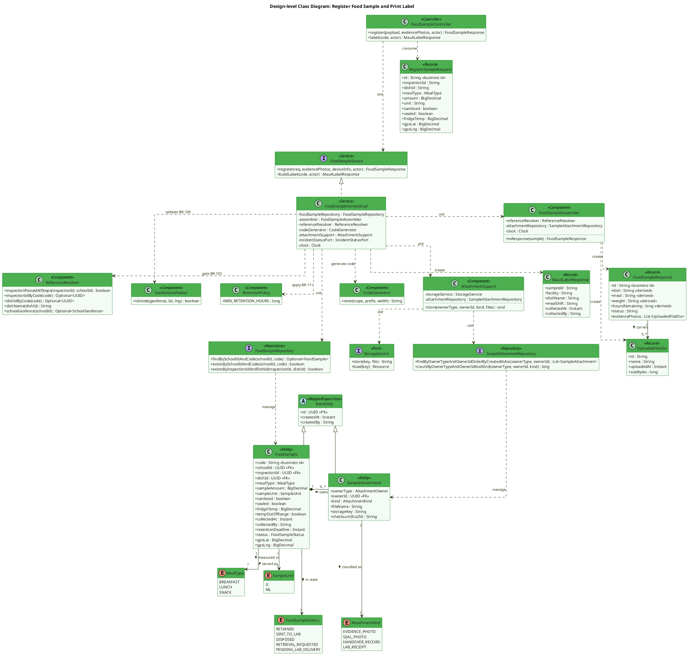

**Description.** `FoodSample` is the aggregate root of a retention record; `SampleAttachment` is a child collection addressed polymorphically by `(ownerType = SAMPLE, ownerId)`, which is why the composition is drawn from the owning entity rather than through a typed foreign key. `FoodSampleController` never touches a repository; every write goes through `FoodSampleServiceImpl`, whose constructor lists exactly six collaborators — the two repositories it owns, `FoodSampleAssembler` (response mapping), `AttachmentSupport` (evidence storage), `ReferenceResolver` (facts owned by other modules) and `CodeGenerator` (D1/D5 business codes) — plus the injected `Clock` that keeps the BR-111 deadline deterministic. Note there is **no** `InspectionGatePort` and **no** `GeofenceQueryPort`: the BR-105 inspection check and the BR-109 geofence lookup are plain reads against already-merged modules, so the merged code routes both through `ReferenceResolver` (`M08-D06`/`M08-D07`) and keeps `GeofenceValidator` as a local haversine helper. `RegisterSampleRequest` *does* carry `gpsLat`/`gpsLng` — the device is the only thing that can measure them — but `collectedBy`, `deviceInfo` and the audit timestamps are never read from the body: the service overwrites them from the JWT and the request context (BR-108/BR-114). `FoodSampleResponse` exposes four values with no backing column (`dish`, `meal`, `weight`, `hoursRemaining`), recomputed by the assembler on every read (ADR-M08-3), and `RetentionPolicy` exists as a one-constant class so the 24-hour threshold has a single definition site after the 72 h → 24 h change.

### 2.2 Sequence Diagram — Register Food Sample

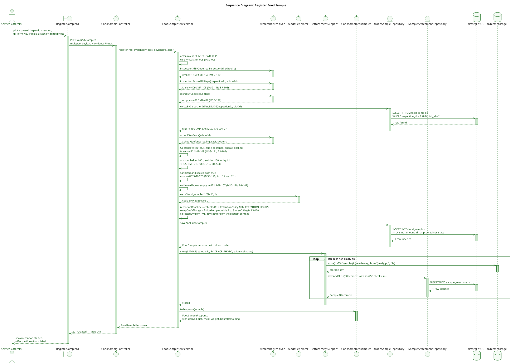

**Description.** Backs UC-069 steps 3–5. `register()` runs its guards in a fixed order — role, BR-105 inspection gate, dish resolution, the Art. 7.1 one-sample-per-dish check, BR-109 geofence, BR-203 weight and container state, BR-107 evidence photo — and each of them throws immediately, which is why they read as self-messages and return labels rather than nested branches. Only after all of them pass does the service compute the fields the client is not allowed to supply: the business `code` from `CodeGenerator`, `retentionDeadline` from `RetentionPolicy.MIN_RETENTION_HOURS`, `collectedBy` from the JWT and `deviceInfo` from the request context. The fridge temperature is the one input that never blocks the write — it only raises `tempOutOfRange` (MSG-020, BR-110). Evidence photos are stored inside the same transaction, one storage write plus one row per file, so a `RETAINED` sample with no photo cannot exist.

### 2.3 Sequence Diagram — Print Form No. 4 Sample Label

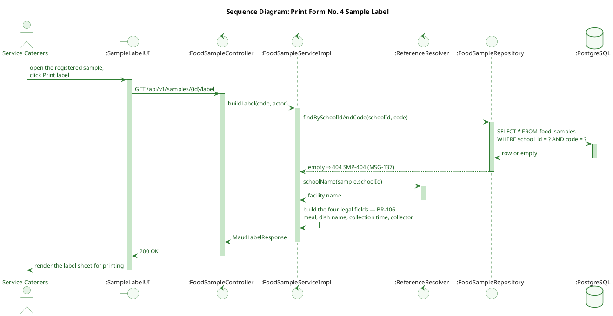

**Description.** The label endpoint is the second half of UC-069: after the sample is registered the caterer prints the Form No. 4 label that goes on the container. It is a read-only projection — the service reloads the sample inside the actor's school scope, asks `ReferenceResolver` for the facility name, and returns exactly the four fields the law requires (meal, dish name, collection time, collector — BR-106) plus the sample code for traceability. Nothing is written, which is why the flow has no repository save and no transaction boundary. *(This section previously held a second copy of the registration rejections; they now appear as `⇒ <code>` labels on the registration diagram itself, so the duplicate was replaced by the label flow that had no diagram at all.)*

---

## 3. Feature 2 — Manage Retention (Storage & Fridge Temperature) (UC-042)

Lets Service Caterers browse the retention register and update a sample's storage location or re-record the fridge temperature (e.g. moved to another fridge, AF2), while the retention countdown runs untouched in the background. Backs UC-042 (BR-105, BR-110, BR-111, BR-112, BR-113, BR-114).

### 3.1 Class Diagram

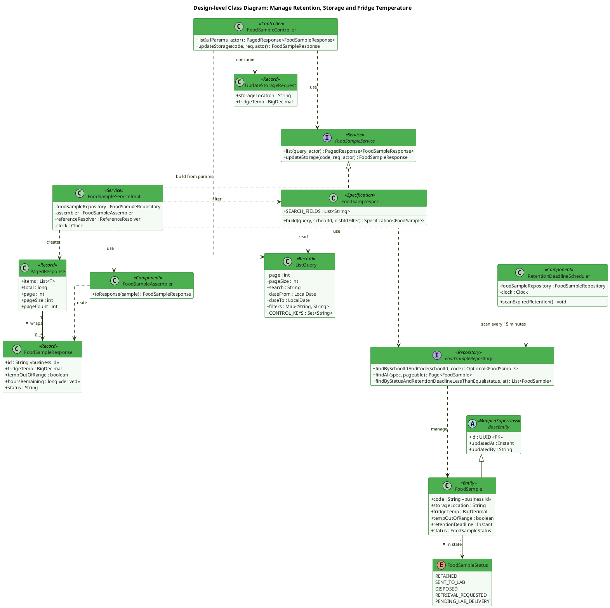

**Description.** `FoodSampleSpec` is where every list rule lives: it always pins `schoolId` from the actor, applies the exact-match `FIELD_MAP` (`id`, `status`, `mealType`, `incidentId`), converts `dateFrom`/`dateTo` into an `Instant` half-open range on `collected_at`, and restricts free-text search to `SEARCH_FIELDS = {code, dishName, collectedBy}` — JPA property names, three columns only (`M08-D12` — `meal_label` left the list once it became a derived value). `ListQuery` is the shared record that turns the raw `Map<String,String>` of query params into that contract, and `PagedResponse` is the shared 5-field envelope, which is why both are drawn from `common` rather than restated per module. `updateStorage()` is intentionally the *only* other write path exposed for this feature: it re-records `storageLocation`/`fridgeTemp` (re-evaluating the BR-110 soft `tempOutOfRange` warning) but never touches `status` or `retentionDeadline` — those are owned exclusively by `register()`/`dispose()`/`handOver()`. `RetentionDeadlineScheduler` is the module's only background job; per ADR-M08-6 there is deliberately no temperature-alarm job, since BR-110 dropped the automatic 30-minute alert requirement and MF08 does not manage IoT sensors.

### 3.2 Sequence Diagram — Update Storage Location / Fridge Temperature

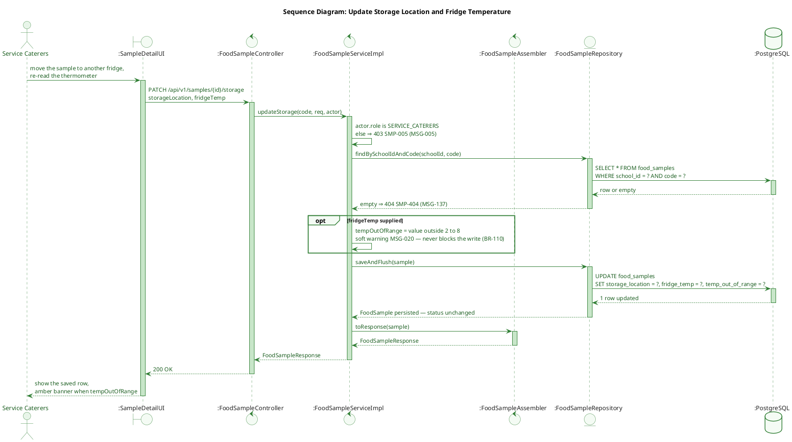

**Description.** Backs UC-042 AF2 — moving a sample to another fridge and re-reading the thermometer. The only conditional in the code is `opt fridgeTemp supplied`: the location is always overwritten, the temperature only when the caller sends one, and an out-of-range reading raises the soft `tempOutOfRange` flag instead of rejecting the write (BR-110 dropped the automatic alert, CF-M08-3). `status` and `retentionDeadline` are deliberately absent from the update — they belong to `register()`, `dispose()` and `handOver()` alone.

### 3.3 State Machine — FoodSample Lifecycle

```plantuml
@startuml MF08_F2_FoodSampleState
title State Diagram: FoodSample Lifecycle

' Orthogonal connector mode
skinparam linetype ortho

' ==========================================
' GREEN COLOUR SCHEME
' ==========================================
skinparam backgroundColor #FFFFFF

' ==========================================
' State
' ==========================================
skinparam state {
    BackgroundColor #F4FBF4
    BorderColor #2E7D32
    FontColor #212121
    FontSize 13
}

' ==========================================
' Arrow
' ==========================================
skinparam arrow {
    Color #2E7D32
    FontColor #1B5E20
    FontSize 12
}

' ==========================================
' Note
' ==========================================
skinparam note {
    BackgroundColor #E8F5E9
    BorderColor #2E7D32
    FontColor #212121
    FontSize 12
}

' ==========================================
' Start / End
' ==========================================
skinparam startColor #2E7D32
skinparam endColor #2E7D32

[*] --> RETAINED : register

RETAINED --> SENT_TO_LAB : hand over to lab
RETAINED --> DISPOSED : dispose

SENT_TO_LAB --> [*]
DISPOSED --> [*]
@enduml
```

**Description.** Three states, three writers — `register()` creates the row in `RETAINED`, `handOver()` moves it to `SENT_TO_LAB`, `dispose()` moves it to `DISPOSED`; no other code path assigns a status, which is why the diagram has no other edge. Two API actions deliberately do **not** appear here because they leave the status untouched: `updateStorage()` re-records the storage location and fridge temperature (UC-042 AF2), and `linkDisposedToIncident()` backfills `incidentId` onto an already-disposed sample (UC-076 AF1). The 24-hour retention deadline is likewise not a state: passing it only makes `dispose()` *permitted* (BR-111), and an open incident makes it *forbidden* again (BR-112) — both are guards evaluated inside `dispose()` against `retention_deadline` and `IncidentStatusPort`, not stored positions in the lifecycle. Both end states are final in the UML sense while the row itself is kept forever: Form No. 5 is an audit register, so `SENT_TO_LAB` and `DISPOSED` mean *the lifecycle is over*, never *the record was deleted*.

---

## 4. Feature 3 — Dispose Food Sample (UC-030)

Lets Service Caterers close out a sample's legal retention record once the 24-hour minimum hold has elapsed, unless the sample is locked by an open food-safety incident. Backs UC-030 (BR-111, BR-112).

### 4.1 Class Diagram

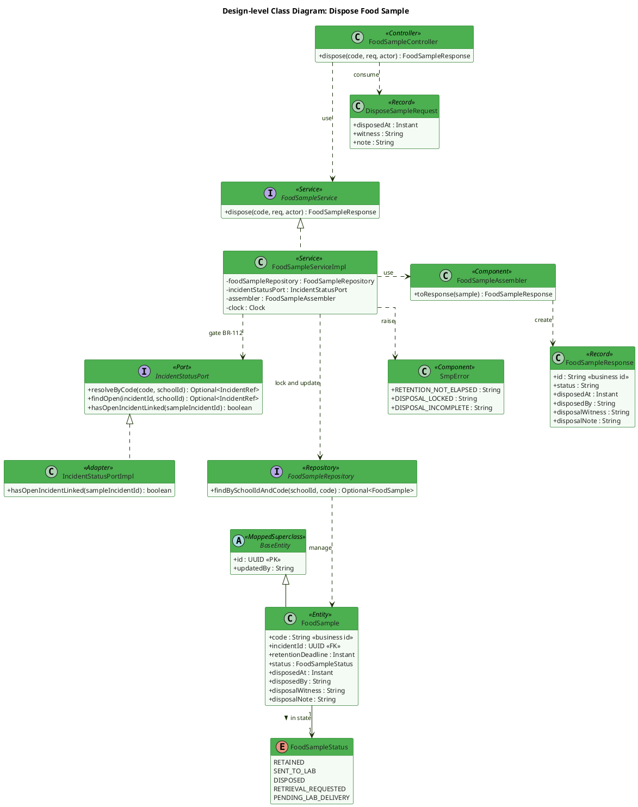

**Description.** `dispose()` is a narrow, two-gate operation: it never touches a field outside the disposal columns (`disposedAt`, `disposedBy`, `disposalWitness`, `disposalNote`, `status`). `IncidentStatusPort` is the module's **only** true port — BR-112 asks a *behavioural* question about MF11 ("is an incident still open against this sample"), not a value lookup, so it stays behind an interface that MF11 satisfies with `IncidentStatusPortImpl`; every other cross-module read in MF08 goes through `ReferenceResolver` instead. `SmpError` appears on the diagram because the three codes this flow can raise (`SMP-111`, `SMP-112`, `SMP-030`) are part of the API contract, not internal detail: the service raises them itself rather than letting Bean Validation answer first, which is exactly why `DisposeSampleRequest` carries no `@NotBlank` on `witness`/`note` — a bean-level rejection would return the generic `SMP-422` and lose the Form No. 5 column semantics.

### 4.2 Sequence Diagram — Dispose Food Sample

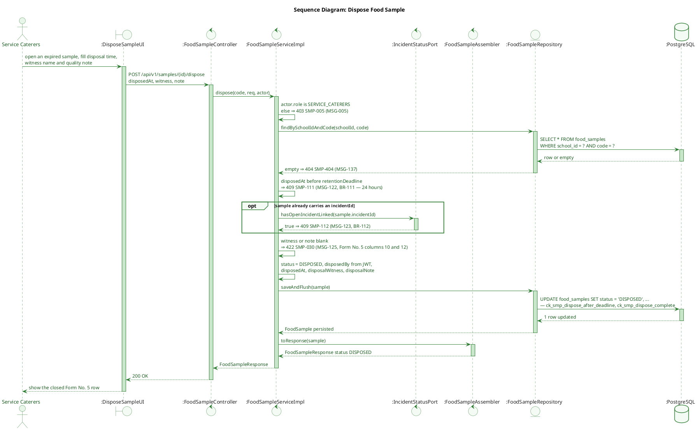

**Description.** Backs UC-030 and its blocked path. Three guards run in this order and each one stops the flow on the spot: the 24-hour minimum hold (BR-111, compared against the stored `retentionDeadline`, not against today's constant), the open-incident lock (BR-112 — the only place `IncidentStatusPort` is consulted, and only when the sample already carries an `incidentId`, hence the `opt`), and the completeness of the disposal record itself (witness and quality note, Form No. 5 columns 10 and 12). The same two conditions are also DB constraints (`ck_smp_dispose_after_deadline`, `ck_smp_dispose_complete`), so a service-layer bug cannot write a disposal the register would not accept.

---

## 5. Feature 4 — Retrieve & Hand Over Samples to Lab / Incident Investigation (UC-076)

During a food-safety incident, lets Medical Staff — and only Medical Staff, per BR-113's 26/07/2026 revision — select retained samples, personally retrieve and transport them, and hand them over to a testing lab or regulatory authority in one atomic action, with a full chain-of-custody evidence bundle. Also covers UC-076 AF1: linking an already-disposed sample to an incident discovered after the fact. Backs UC-076 (BR-113, BR-114, BR-212).

### 5.1 Class Diagram

```plantuml
@startuml MF08_F4_ClassDiagram
title Design-level Class Diagram: Retrieve and Hand Over Samples to Lab

' ==========================================
' LAYOUT AND RATIONAL ROSE COLOUR SCHEME
' Top-level skinparam declarations only — the nested
' block form is not used in class diagrams.
' ==========================================
skinparam classAttributeIconSize 0
skinparam linetype ortho
skinparam nodesep 60
skinparam ranksep 60
skinparam backgroundColor #FFFFFF

' Vertical layout: web -> service -> repository -> domain
top to bottom direction
hide empty members

' Class / Abstract Class
skinparam classBackgroundColor #F4FBF4
skinparam classBorderColor #2E7D32
skinparam classFontColor #212121
skinparam classFontSize 13
skinparam classHeaderBackgroundColor #4CAF50
skinparam classAttributeFontColor #212121
skinparam classAttributeFontSize 12

' Interface
skinparam interfaceBackgroundColor #f7ed93ff
skinparam interfaceBorderColor #000000ff
skinparam interfaceFontColor #000000ff

' Relationships & Arrows
skinparam arrowColor #162c00ff
skinparam arrowFontColor #162c00ff
skinparam arrowFontSize 11

' Stereotype icons (C, I, A, E)
skinparam stereotypeCBackgroundColor #f6eedcff
skinparam stereotypeCBorderColor #000000ff
skinparam stereotypeEBackgroundColor #f6eedcff
skinparam stereotypeEBorderColor #000000ff
skinparam stereotypeABackgroundColor #f6eedcff
skinparam stereotypeABorderColor #000000ff
skinparam stereotypeIBackgroundColor #f6eedcff
skinparam stereotypeIBorderColor #000000ff

' ────── mf08.web ────────────────────────────────────
class SampleLabRequestController <<Controller>> {
  + handOver(payload, sealPhotos, handoverRecords, labReceipts, actor) : SampleLabRequestResponse
  + retrievable(incidentId, includeAllDishes, actor) : List<FoodSampleResponse>
  + detail(code, actor) : SampleLabRequestResponse
}
class ReceivingAuthorityController <<Controller>> {
  + list(allParams) : PagedResponse<ReceivingAuthorityResponse>
}
class FoodSampleController <<Controller>> {
  + linkIncident(code, req, actor) : FoodSampleResponse
}

' ────── mf08.dto ────────────────────────────────────
class HandOverSamplesRequest <<Record>> {
  + id : String <<business id>>
  + incidentId : String
  + sampleIds : List<String>
  + authorityId : String
  + handoverType : String
  + testCriteria : String
  + labRepresentative : String
}
class SampleLabRequestResponse <<Record>> {
  + id : String <<business id>>
  + incidentId : String
  + sampleIds : List<String>
  + labDestination : String
  + status : String
  + handoverRecordFiles : List<UploadedFileDto>
}
class IncidentLinkRequest <<Record>> {
  + incidentId : String
}
class ReceivingAuthorityResponse <<Record>> {
  + id : String <<business id>>
  + name : String
  + type : String
  + isActive : boolean
}

' ────── mf08.service ────────────────────────────────
interface SampleLabRequestService <<Service>> {
  + handOver(req, sealPhotos, handoverRecords, labReceipts, actor) : SampleLabRequestResponse
  + retrievableForIncident(incidentId, includeAllDishes, actor) : List<FoodSampleResponse>
}
class SampleLabRequestServiceImpl <<Service>> {
  -labRequestRepository : SampleLabRequestRepository
  -foodSampleRepository : FoodSampleRepository
  -authorityRepository : ReceivingAuthorityRepository
  -assembler : SampleLabRequestAssembler
  -attachmentSupport : AttachmentSupport
  -incidentStatusPort : IncidentStatusPort
  -codeGenerator : CodeGenerator
  -foodSampleServiceImpl : FoodSampleServiceImpl
}
interface FoodSampleService <<Service>> {
  + linkDisposedToIncident(code, req, actor) : FoodSampleResponse
}
interface ReceivingAuthorityService <<Service>> {
  + list(query) : PagedResponse<ReceivingAuthorityResponse>
}
class SampleLabRequestAssembler <<Component>> {
  + toResponse(request) : SampleLabRequestResponse
}
class SampleLabRequestSpec <<Specification>> {
  + SEARCH_FIELDS : List<String>
  + build(query, schoolId) : Specification<SampleLabRequest>
}
class AttachmentSupport <<Component>> {
  + store(ownerType, ownerId, kind, files) : void
}

' ────── mf08.port and the MF11 adapter ──────────────
interface IncidentStatusPort <<Port>> {
  + resolveByCode(code, schoolId) : Optional<IncidentRef>
  + findOpen(incidentId, schoolId) : Optional<IncidentRef>
}
class IncidentStatusPortImpl <<Adapter>> {
  + findOpen(incidentId, schoolId) : Optional<IncidentRef>
}

' ────── mf08.repository ─────────────────────────────
interface SampleLabRequestRepository <<Repository>> {
  + findBySchoolIdAndCode(schoolId, code) : Optional<SampleLabRequest>
  + findByIncidentIdOrderByRequestedAtDesc(incidentId) : List<SampleLabRequest>
}
interface FoodSampleRepository <<Repository>> {
  + lockAllBySchoolIdAndCodeIn(schoolId, codes) : List<FoodSample>
  + findBySchoolIdAndIncidentIdAndStatus(schoolId, incidentId, status) : List<FoodSample>
  + findByLabRequestId(labRequestId) : List<FoodSample>
}
interface ReceivingAuthorityRepository <<Repository>> {
  + findByCode(code) : Optional<ReceivingAuthority>
  + existsByCode(code) : boolean
}

' ────── mf08.domain ─────────────────────────────────
abstract class BaseEntity <<MappedSuperclass>> {
  +id : UUID <<PK>>
  +createdAt : Instant
}
class SampleLabRequest <<Entity>> {
  +code : String <<business id>>
  +schoolId : UUID <<FK>>
  +incidentId : UUID <<FK>>
  +authorityId : UUID <<FK>>
  +labDestination : String
  +handoverType : HandoverType
  +testCriteria : String
  +requestedBy : String
  +deliveredBy : String
  +sentToLabAt : Instant
  +status : LabRequestStatus
}
class ReceivingAuthority <<Entity>> {
  +code : String <<business id>>
  +name : String
  +type : AuthorityType
  +isActive : boolean
}
class FoodSample <<Entity>> {
  +code : String <<business id>>
  +incidentId : UUID <<FK>>
  +labRequestId : UUID <<FK>>
  +retrievedAt : Instant
  +sentToLabAt : Instant
  +status : FoodSampleStatus
}
class SampleAttachment <<Entity>> {
  +ownerType : AttachmentOwner
  +ownerId : UUID <<FK>>
  +kind : AttachmentKind
  +storageKey : String
}
enum HandoverType {
  LAB
  AUTHORITY
}
enum AuthorityType {
  LAB
  AUTHORITY
}
enum LabRequestStatus {
  SENT_TO_LAB
  CANCELLED
  RETRIEVAL_REQUESTED
  PENDING_LAB_DELIVERY
}

' ===== Dependency: Controller -> Service -> Repository -> Entity =====
SampleLabRequestController  ..> SampleLabRequestService     : «use»
SampleLabRequestController  ..> HandOverSamplesRequest      : «consume»
ReceivingAuthorityController ..> ReceivingAuthorityService  : «use»
FoodSampleController        ..> FoodSampleService           : «use»
FoodSampleController        ..> IncidentLinkRequest         : «consume»
SampleLabRequestServiceImpl ..> SampleLabRequestRepository  : «use»
SampleLabRequestServiceImpl ..> FoodSampleRepository        : «lock and bulk update»
SampleLabRequestServiceImpl ..> ReceivingAuthorityRepository : «use»
SampleLabRequestServiceImpl ..> SampleLabRequestAssembler   : «use»
SampleLabRequestServiceImpl ..> SampleLabRequestSpec        : «filter»
SampleLabRequestServiceImpl ..> AttachmentSupport           : «store evidence BR-212»
SampleLabRequestServiceImpl ..> IncidentStatusPort          : «gate BR-114»
SampleLabRequestServiceImpl ..> FoodSampleServiceImpl       : «resolve incident code» deviation D3
SampleLabRequestAssembler   ..> SampleLabRequestResponse    : «create»
ReceivingAuthorityService   ..> ReceivingAuthorityResponse  : «create»
SampleLabRequestRepository  ..> SampleLabRequest            : «manage»
FoodSampleRepository        ..> FoodSample                  : «manage»
ReceivingAuthorityRepository ..> ReceivingAuthority         : «manage»
AttachmentSupport           ..> SampleAttachment            : «create»

' ===== Realization / Inheritance =====
SampleLabRequestService <|.. SampleLabRequestServiceImpl
IncidentStatusPort <|.. IncidentStatusPortImpl
BaseEntity <|-- SampleLabRequest
BaseEntity <|-- ReceivingAuthority
BaseEntity <|-- FoodSample
BaseEntity <|-- SampleAttachment

' ===== Composition and associations with multiplicity =====
SampleLabRequest "1" *-- "0..*" SampleAttachment : owns >
SampleLabRequest "1" --> "0..*" FoodSample       : hands over >
SampleLabRequest "0..*" --> "1" ReceivingAuthority : delivered to >
SampleLabRequest "1" --> "1" HandoverType        : typed as >
SampleLabRequest "1" --> "1" LabRequestStatus    : in state >
ReceivingAuthority "1" --> "1" AuthorityType     : typed as >

' ═══════════════════════════════════════════════════════════════
' Layout: [hidden] links only — invisible on the rendered diagram.
' Vertical spine = one class per tier; `right` chains keep the
' classes of one tier side by side; the extra vertical links split
' a wide tier into two shorter rows.
' ═══════════════════════════════════════════════════════════════

' vertical spine — one class per tier
SampleLabRequestController -[hidden]-> HandOverSamplesRequest
HandOverSamplesRequest -[hidden]-> SampleLabRequestService
SampleLabRequestService -[hidden]-> IncidentStatusPort
IncidentStatusPort -[hidden]-> SampleLabRequestRepository
SampleLabRequestRepository -[hidden]-> BaseEntity

' horizontal chains — siblings of the same tier
SampleLabRequestController -[hidden]right-> ReceivingAuthorityController
HandOverSamplesRequest -[hidden]right-> SampleLabRequestResponse
IncidentLinkRequest -[hidden]right-> ReceivingAuthorityResponse
SampleLabRequestService -[hidden]right-> FoodSampleService
SampleLabRequestServiceImpl -[hidden]right-> SampleLabRequestAssembler
SampleLabRequestSpec -[hidden]right-> AttachmentSupport
SampleLabRequestRepository -[hidden]right-> FoodSampleRepository
SampleLabRequest -[hidden]right-> ReceivingAuthority
FoodSample -[hidden]right-> SampleAttachment
HandoverType -[hidden]right-> AuthorityType

' second row of a wide tier
HandOverSamplesRequest -[hidden]-> IncidentLinkRequest
SampleLabRequestController -[hidden]-> FoodSampleController
SampleLabRequestService -[hidden]-> ReceivingAuthorityService
SampleLabRequestRepository -[hidden]-> ReceivingAuthorityRepository
SampleLabRequestServiceImpl -[hidden]-> SampleLabRequestSpec
SampleLabRequest -[hidden]-> FoodSample
HandoverType -[hidden]-> LabRequestStatus
@enduml
```

**Description.** `SampleLabRequest` is the aggregate root of a hand-over event (ADR-M08-1): `handOver()` is a single service call that both creates the request row and flips every listed `FoodSample` to `SENT_TO_LAB` inside one transaction, closing the "phase can be recorded without the samples changing state" gap the mock's two-call (`POST` + N×`PUT`) flow left open. `linkDisposedToIncident()` deliberately lives on `FoodSampleService`, not `SampleLabRequestService` — AF1 attaches an `incidentId` to a sample that is already `DISPOSED` and never creates or touches a `SampleLabRequest`. `IncidentStatusPort` is the one true port in the module (as opposed to the `ReferenceResolver` methods used in Features 1–2): whether an incident is open is a *behavioural* fact about MF11, and MF11 now supplies the adapter (`mf11.port.IncidentStatusPortImpl`), so the "logging stub" of the pre-merge design no longer exists. Two structural facts are drawn as the code has them, not as the TDS describes them: the three receiving-authority/lab-request/sample repositories are injected side by side into one `SampleLabRequestServiceImpl` (there is no separate hand-over workflow bean), and that impl also injects **`FoodSampleServiceImpl` itself** — a concrete class, not the `FoodSampleService` interface — purely to reuse its incident-code resolution. That last edge is labelled `deviation D3` on the diagram and is listed in the deviation table; it is drawn faithfully but should not be copied.

### 5.2 Sequence Diagram — Retrieve & Hand Over Samples to Lab

```plantuml
@startuml MF08_F4_HandOver_Happy
title Sequence Diagram: Retrieve and Hand Over Samples to Lab

' Orthogonal connector mode
skinparam linetype ortho

' ==========================================
' GREEN COLOUR SCHEME
' ==========================================
skinparam backgroundColor #FFFFFF

' Stereotype icons
skinparam stereotype {
    CBackgroundColor #E8F5E9
    CBorderColor #2E7D32
    EBackgroundColor #E8F5E9
    EBorderColor #2E7D32
    ABackgroundColor #E8F5E9
    ABorderColor #2E7D32
    IBackgroundColor #E8F5E9
    IBorderColor #2E7D32
}

' ==========================================
' Note
' ==========================================
skinparam NoteBackgroundColor #E8F5E9
skinparam NoteBorderColor #2E7D32
skinparam NoteFontColor #212121

' ==========================================
' Lifelines by UML robustness stereotype
' (boundary / control / entity / database)
' ==========================================
skinparam BoundaryBackgroundColor #F4FBF4
skinparam BoundaryBorderColor #2E7D32
skinparam BoundaryFontColor #212121
skinparam BoundaryFontSize 13

skinparam ControlBackgroundColor #F4FBF4
skinparam ControlBorderColor #2E7D32
skinparam ControlFontColor #212121
skinparam ControlFontSize 13

skinparam EntityBackgroundColor #F4FBF4
skinparam EntityBorderColor #2E7D32
skinparam EntityFontColor #212121
skinparam EntityFontSize 13

skinparam CollectionsBackgroundColor #F4FBF4
skinparam CollectionsBorderColor #2E7D32
skinparam CollectionsFontColor #212121

skinparam DatabaseBackgroundColor #F4FBF4
skinparam DatabaseBorderColor #2E7D32
skinparam DatabaseFontColor #212121
skinparam DatabaseFontSize 13

skinparam sequence {

    ' ==========================================
    ' Actor & Participant
    ' ==========================================
    ActorBackgroundColor #E8F5E9
    ActorBorderColor #2E7D32
    ActorFontColor #1B5E20
    ActorFontSize 13

    ParticipantBackgroundColor #F4FBF4
    ParticipantBorderColor #2E7D32
    ParticipantFontColor #212121
    ParticipantFontSize 13

    ' ==========================================
    ' Message
    ' ==========================================
    ArrowColor #2E7D32
    ArrowFontColor #1B5E20
    ArrowFontSize 12

    ' ==========================================
    ' Activation (Execution)
    ' ==========================================
    LifeLineBackgroundColor #C8E6C9
    LifeLineBorderColor #2E7D32

    ' ==========================================
    ' Group (alt / opt / loop / par...)
    ' ==========================================
    GroupBackgroundColor #F4FBF4
    GroupBorderColor #2E7D32
    GroupHeaderBackgroundColor #4CAF50
    GroupFontColor #212121

}

actor    "Medical Staff"                  as MS
boundary ":SampleHandOverUI"              as UI
control  ":SampleLabRequestController"    as C
control  ":SampleLabRequestServiceImpl"   as S
control  ":FoodSampleServiceImpl"         as FS
control  ":IncidentStatusPort"            as INC
control  ":CodeGenerator"                 as CG
control  ":AttachmentSupport"             as AS
control  ":SampleLabRequestAssembler"     as ASM
entity   ":FoodSampleRepository"          as R
entity   ":SampleLabRequestRepository"    as LR
entity   ":ReceivingAuthorityRepository"  as AUR
database ":PostgreSQL"                    as DB
database ":Object storage"                as OS

... load the samples that may still be retrieved for this incident ...

MS -> UI : open the incident task
activate UI
UI -> C : GET /api/v1/sample-lab-requests/retrievable?incidentId=INC-2026-014
activate C
C -> S : retrievableForIncident(incidentId, includeAllDishes, actor)
activate S
S -> INC : windowOf(incidentId)
activate INC
INC --> S : InvestigationWindow from, to — 24 hours (BR-149)
deactivate INC
S -> R : findBySchoolIdAndStatusAndCollectedAtBetween(schoolId, RETAINED, from, to)\nplus findBySchoolIdAndIncidentIdAndStatus(schoolId, incidentId, RETAINED)
activate R
R -> DB : SELECT * FROM food_samples\nWHERE school_id = ? AND status = 'RETAINED' AND collected_at BETWEEN ? AND ?
activate DB
DB --> R : rows
deactivate DB
R --> S : merged list, de-duplicated by id
deactivate R
S --> C : List<FoodSampleResponse>
deactivate S
C --> UI : 200 OK
deactivate C
UI --> MS : render the tick list inside the investigation window

... hand the selected samples over — one transaction ...

MS -> UI : tick samples, choose the receiving authority,\nattach seal photo and hand-over record
UI -> C : POST /api/v1/sample-lab-requests\nmultipart payload + sealPhotos + handoverRecords + labReceipts
activate C
C -> S : handOver(req, files, actor)
activate S

S -> S : actor.role is MEDICAL_STAFF\nelse ⇒ 403 SMP-005 (MSG-005, BR-113)
S -> FS : resolveIncidentId(req.incidentId, schoolId)
activate FS
FS --> S : incidentId
deactivate FS
S -> INC : findOpen(incidentId, schoolId)
activate INC
INC --> S : empty ⇒ 409 SMP-023 (MSG-128, BR-114)
deactivate INC
S -> S : handoverType LAB without testCriteria,\nor no hand-over record file ⇒ 422 SMP-212 (MSG-127, BR-212)
S -> AUR : findByCode(req.authorityId)
activate AUR
AUR --> S : empty ⇒ 422 SMP-422 (MSG-138)\nabsent while handoverType is AUTHORITY ⇒ 422 SMP-422
deactivate AUR

S -> R : lockAllBySchoolIdAndCodeIn(schoolId, req.sampleIds)
activate R
R -> DB : SELECT * FROM food_samples\nWHERE school_id = ? AND code IN (?) FOR UPDATE
activate DB
DB --> R : locked rows
deactivate DB
R --> S : fewer rows than requested ⇒ 404 SMP-404 (MSG-137)\nany row not RETAINED ⇒ 409 SMP-113 (MSG-124)
deactivate R

S -> CG : next("sample_lab_requests", "LABREQ", 3)
activate CG
CG --> S : code LABREQ-2026-002
deactivate CG
S -> LR : saveAndFlush(labRequest status SENT_TO_LAB,\nrequestedBy and deliveredBy from JWT)
activate LR
LR -> DB : INSERT INTO sample_lab_requests ...\n— ck_labreq_criteria, ck_labreq_authority
activate DB
DB --> LR : 1 row inserted
deactivate DB
LR --> S : SampleLabRequest persisted
deactivate LR

S -> AS : store(LAB_REQUEST, labRequest.id, SEAL_PHOTO then HANDOVER_RECORD then LAB_RECEIPT, files)
activate AS
AS -> OS : store("mf08/lab_request/{id}/{kind}/{uuid}.{ext}", file)
activate OS
OS --> AS : storage key
deactivate OS
AS -> DB : INSERT INTO sample_attachments ...
activate DB
DB --> AS : rows inserted
deactivate DB
AS --> S : stored
deactivate AS

loop for each locked sample
  S -> R : saveAndFlush(status SENT_TO_LAB, labRequestId,\nincidentId, retrievedAt, sentToLabAt)
  activate R
  R -> DB : UPDATE food_samples SET status = 'SENT_TO_LAB', lab_request_id = ?, ...\n— ck_smp_sent_has_request
  activate DB
  DB --> R : 1 row updated
  deactivate DB
  R --> S : FoodSample persisted
  deactivate R
end

S -> ASM : toResponse(labRequest)
activate ASM
ASM --> S : SampleLabRequestResponse with sampleIds and evidence files
deactivate ASM
S --> C : SampleLabRequestResponse
deactivate S
C --> UI : 201 Created
deactivate C
UI --> MS : samples now read Sent to Lab — terminal, disposal impossible
deactivate UI
@enduml
```

**Description.** Backs UC-076, drawn as the two calls the screen actually makes: first `GET /retrievable`, which asks MF11 for the 24-hour investigation window and returns the samples still `RETAINED` inside it (plus any already linked to the incident), then `POST /sample-lab-requests`, which performs the whole hand-over in one transaction. The write order matters and is drawn as the code has it: the request row is inserted first so its id exists, then the evidence files, then the samples flip to `SENT_TO_LAB` one by one in a loop, each carrying `labRequestId`, `incidentId`, `retrievedAt` and `sentToLabAt`. The pessimistic lock (`FOR UPDATE`) is taken before any of that, so two concurrent hand-overs cannot both claim the same sample — the second one hits `SMP-113`. Note the role guard: only Medical Staff may reach this method (BR-113, after BR-215 was deprecated).

### 5.3 Sequence Diagram — Link Disposed Sample to Incident (UC-076 AF1)

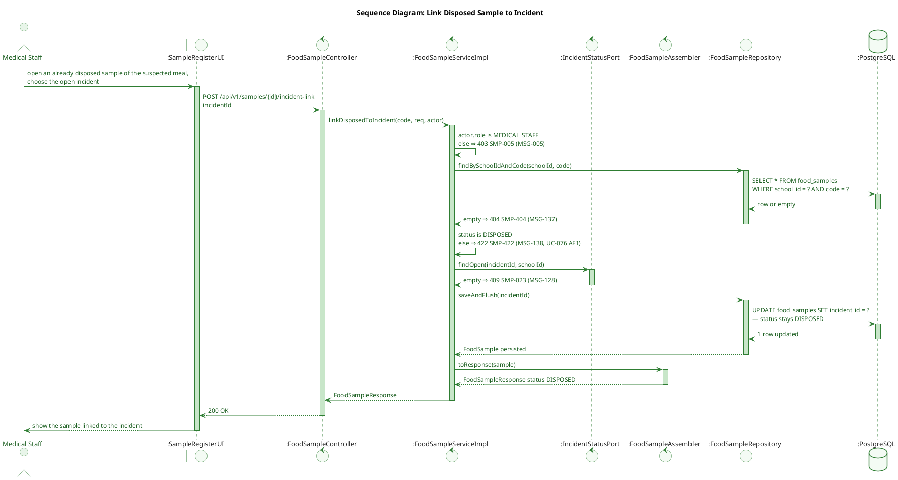

**Description.** Backs UC-076 AF1: an incident is sometimes reported *after* a sample's retention window has elapsed and it has already been disposed of. The flow only backfills `incident_id` — the status guard (`must already be DISPOSED`) and the fact that no other column is touched are what separate this from the hand-over flow, which acts only on samples still `RETAINED`. The incident must still be open, so the same `SMP-023` check as the hand-over applies.

### 5.4 Why there is no state diagram for `SampleLabRequest` or `ReceivingAuthority`

Neither enum qualifies under the rule that a state diagram is drawn only for values whose transitions are triggered by an explicit business action.

`LabRequestStatus` is assigned exactly once, at creation: `handOver()` writes `SENT_TO_LAB` on the new row and nothing in the merged code ever writes the value again. That is the whole point of ADR-M08-2 — BR-113 (revision of 26/07/2026) requires Medical Staff to complete the physical hand-over *before* the record exists, so there is no "requested" or "in transit" phase left to model. `CANCELLED`, `RETRIEVAL_REQUESTED` and `PENDING_LAB_DELIVERY` remain in the Java enum only so migrated rows from the deprecated BR-215 workflow stay readable; no endpoint and no service method can reach them (see deviation 8).

`ReceivingAuthority.isActive` is a directory flag on a lookup table, not a lifecycle. `ReceivingAuthorityService` exposes `list()` and nothing else — there is no create, update, activate or deactivate endpoint in MF08, so the flag only ever changes through a seed or a DBA statement (see deviation 9). Its effect on behaviour is already visible where it belongs: the class diagram in §5.1 shows the field, and the hand-over flow reads the directory through `ReceivingAuthorityRepository.findByCode`.

---

## 6. Feature 5 — View & Export Sample Records (UC-118)

Read-mostly reporting surface: browse/search the retention register, inspect one sample's full detail (including chain-of-custody and hand-over evidence), and export the legally required Form No. 5 register (XLSX/PDF). Backs UC-118 (BR-114).

### 6.1 Class Diagram

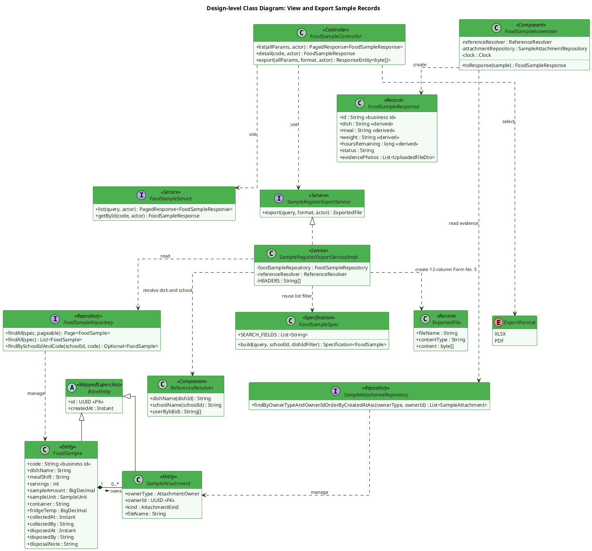

**Description.** There is **one** response shape: the merged code has no `FoodSampleDetailResponse` — `GET /samples` and `GET /samples/{id}` both return `FoodSampleResponse`, assembled by the same `FoodSampleAssembler`, so a row never changes shape between the table and the detail view (`D11` does not apply to MF08: role differences here are row-scoping through `schoolId`, never field-shape differences — `M08-D13`). `SampleRegisterExportService` is a separate service because it produces a binary artifact rather than a DTO, and it deliberately depends on the **same** `FoodSampleSpec.build(...)` as `list()`; the only difference is that it calls the unpaged `findAll(spec)` and sorts by `collectedAt`, so the exported Form No. 5 can never drift from the on-screen register for the same filters. Its `HEADERS` constant is drawn as an attribute because those 12 column titles *are* the legal layout of Appendix 2 — they are contract, not formatting.

### 6.2 Sequence Diagram — Export Sample Register (Form No. 5)

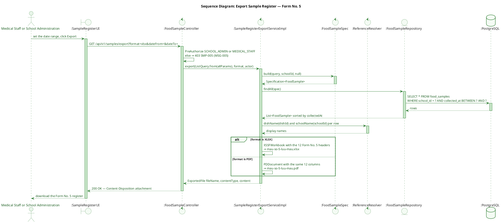

**Description.** Backs UC-118's export action. The role check sits in the controller (`@PreAuthorize`), the filtering is the *same* `FoodSampleSpec.build(...)` that `GET /samples` uses — only unpaged and re-sorted by `collectedAt` — so the exported register can never disagree with the on-screen table for the same filters. The single real branch is the output format: `XSSFWorkbook` for XLSX, `PDDocument` for PDF, both emitting the same 12 Form No. 5 columns. No writes, and the only cross-module call is `ReferenceResolver` resolving dish and school display names.

---

## Appendix — Cross-Feature Notes

- **Retention deadline is a snapshot, not a live computation.** `retention_deadline` is calculated once at registration (`collectedAt + RetentionPolicy.MIN_RETENTION_HOURS`) and stored — even though it is arithmetically derivable — because the underlying legal threshold has already changed once (72h → 24h, 26/07/2026) and may change again; recomputing historical deadlines against today's constant would silently rewrite a legal record (ADR-M08-3). `hoursRemaining`, by contrast, has no column and is always computed at read time from the stored deadline.
- **Cross-module reads split between two mechanisms, by design.** Pure lookups against another module's already-merged, already-exposed data go through `ReferenceResolver` (BR-105 inspection gate, BR-109 geofence) — no new port, no cross-module `@ManyToOne` (`M08-D06`/`M08-D07`). Behavioural facts about MF11 (is the incident open) go through the module's single port, `IncidentStatusPort`, now satisfied by the merged adapter `mf11.port.IncidentStatusPortImpl` (`M08-D08` — the pre-merge logging stub is gone).
- **Two-controller split mirrors the two aggregate roots.** `FoodSampleController`/`FoodSampleService` own the sample's own lifecycle (Features 1–3, 6); `SampleLabRequestController`/`SampleLabRequestService` own the hand-over aggregate (Feature 4, ADR-M08-1). The only Feature-4 write on `FoodSampleService` is `linkDisposedToIncident()` (AF1), which intentionally never touches `SampleLabRequest`.
- **Append-only by legal requirement, not convention.** No sequence diagram above ever deletes a `food_samples`, `sample_lab_requests`, or `sample_attachments` row — Form No. 5 is a compliance register that inspectors may audit, so corrections happen through new records plus the audit trail (BR-170), never physical deletion (§12.2 rollback runbook).

### Scope note — what is deliberately not drawn

Following `Design-Diagram-Review-Guide.md` §1.1b, the class diagrams show only elements that encode a design decision. Left out on purpose: `JpaRepository` and every other Spring Data / framework interface (the `<<Repository>>` stereotype already says it); getters, setters and constructors; annotations; `@Configuration` classes and `@Bean` factories; and private helper methods that are pure decomposition (`resolveSchoolId`, `loadInScope`, `parseUnit`, `resolveCreateCode`). `BaseEntity` **is** drawn, because D9 — `created_by`/`updated_by` as reserved columns filled by `AuditorAware` — is exactly what explains why no MF08 table declares its own audit columns. FE screen objects are not drawn in the class diagrams either; they appear as `boundary` lifelines in the sequence diagrams, which is where the interaction actually lives.

### Known deviations between the merged code and the TDS

| # | TDS says | Merged code does | Handling |
|---|---|---|---|
| 1 | §8 declares `InspectionGatePort` (BR-105) and `GeofenceQueryPort` (BR-109) as dedicated ports | Both are plain reads through `ReferenceResolver` (`inspectionIdByCode`, `inspectionPassedAllSteps`, `schoolGeofence`); distance maths sits in the local `GeofenceValidator` helper | **Cosmetic** — diagrams follow the code (`M08-D06`/`M08-D07`); TDS §8 should drop the two port names |
| 2 | `IncidentStatusPort` runs against a logging stub "until MF11 merges" | MF11 has merged and supplies `mf11.port.IncidentStatusPortImpl` | **Doc gap** — diagrams now show the real adapter; the "stub" wording is removed from the descriptions |
| 3 | Hand-over depends on `FoodSampleService` (interface) | `SampleLabRequestServiceImpl` injects the concrete **`FoodSampleServiceImpl`** to reuse incident-code resolution | **Raise issue** — drawn faithfully and labelled `deviation D3`; depending on an impl breaks the interface boundary. Extract the shared resolver into a small component instead |
| 4 | §8/§9 return a separate `FoodSampleDetailResponse` for the single-record view | Only `FoodSampleResponse` exists; list and detail share one shape | **Cosmetic** — diagrams follow the code; TDS §9.2 should drop the second DTO |
| 5 | §1 DBML declared `sample_lab_requests.incident_id` as `not null` | `V14__mf08_food_sample_retention.sql` creates the column **nullable**; `@NotBlank` on the request DTO enforces the rule at the service layer only | **Doc gap** — DBML corrected in §1; decide whether to add `NOT NULL` in a follow-up migration or to keep the service-level rule |
| 6 | §1 DBML drew `ref:` arrows from `dish_id` / `menu_id` to `dishes` / `menus` | The migration deliberately creates **no** physical FK for `inspection_id` / `dish_id` / `menu_id` / `incident_id` (ADR-M08-5, stated in the file's own preamble) | **Doc gap** — the two arrows are removed; only `school_id` and `lab_request_id` are real FKs |
| 7 | Repository lookups keyed by UUID (`findByIdAndSchoolId`, `lockAllByIdIn`) | Keyed by business code (`findBySchoolIdAndCode`, `lockAllBySchoolIdAndCodeIn`) — the D1 consequence: path params carry `code`, so the lookup does too | **Cosmetic** — diagrams follow the code |
| 8 | `LabRequestStatus` has five values, with `CANCELLED` reachable through a cancel action and two legacy in-transit states | Only `SENT_TO_LAB` is ever written (`SampleLabRequestServiceImpl.handOver`); `cancelled_at`/`cancelled_by`/`cancel_reason` columns exist but no endpoint writes them, and the seed contains no legacy row | **Doc gap** — no state diagram is drawn for this enum (§5.4). Either delete the unreachable values with the migration that retires BR-215 history, or add the cancel endpoint the TDS implies |
| 9 | `ReceivingAuthority.isActive` behaves as an activate/deactivate lifecycle | `ReceivingAuthorityService` exposes `list()` only — no create/update/activate endpoint exists, so the flag changes through seed or DBA statement | **Doc gap** — no state diagram is drawn (§5.4); if the directory is meant to be maintained in-app, MF08 still needs those endpoints |
| 10 | `FoodSample` lifecycle includes a 24-hour "expired" state and incident-driven lock/unlock transitions | `status` only ever takes `RETAINED`, `SENT_TO_LAB`, `DISPOSED`; the deadline and the incident lock are guards inside `dispose()`, and MF08 has no event listener consuming `IncidentOpened`/`IncidentClosed` | **Cosmetic** — the earlier composite state diagram modelled guards as states; the redrawn diagram keeps only the three statuses the code writes |
| 11 | §7 Domain Event Catalog publishes `FoodSampleRegistered`, `FoodSampleTemperatureOutOfRange`, `FoodSampleRetentionExpired`, `FoodSampleDisposed`, `SamplesHandedOverToLab`, `DisposedSampleLinkedToIncident` | `grep publishEvent` over `com.sfms.mf08` returns **nothing** — no domain event is published anywhere; `RetentionDeadlineScheduler` only writes a log line every 15 minutes | **Doc gap** — the sequence diagrams no longer show an outbox or event lifeline. Either implement the catalogue (MF13 statistics and the MF07 dashboard are the stated consumers) or retire §7 of the TDS |
| 12 | Guard failures modelled as `alt` / `else` branches (TDS §6 sequences) | Every guard throws immediately — `SmpExceptions.*` — so there is no alternative path to draw | **Cosmetic** — guards are drawn as self-messages and return labels carrying `⇒ <status> <code> (<MSG>)`; nesting is now at most one level |
