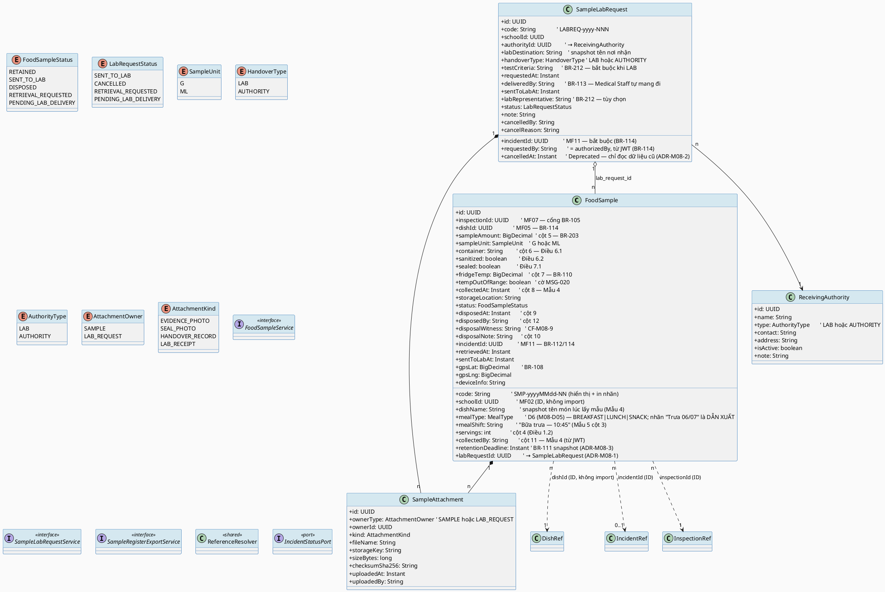
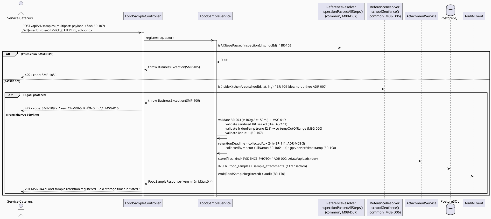
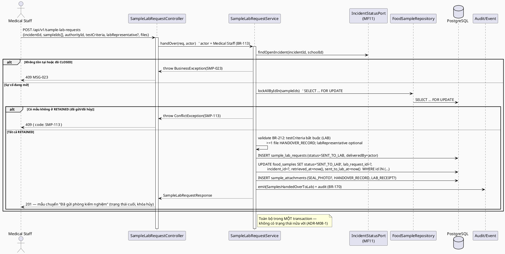
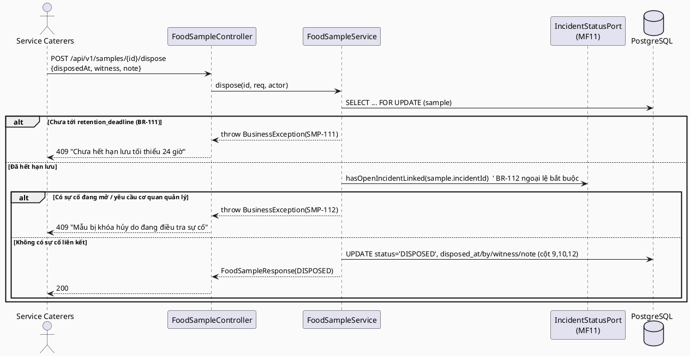
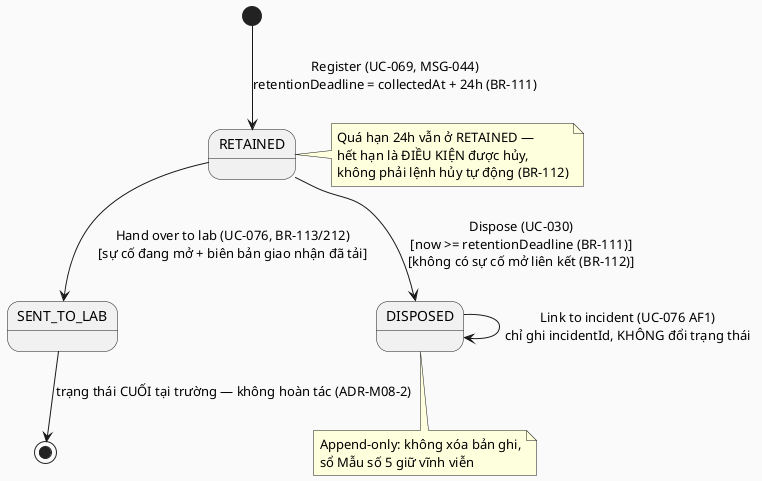
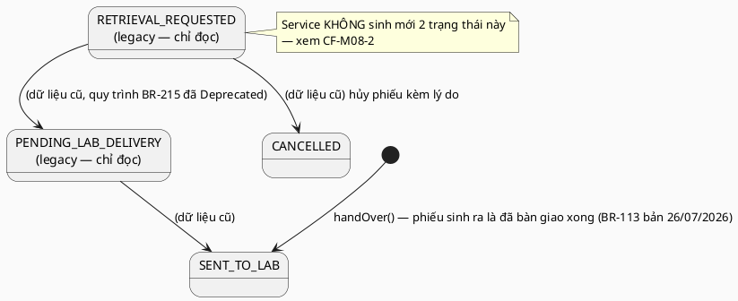

# ENGINEERING DOCUMENTATION STANDARD (EDS) v2.0 — TDS Backend
# MF08 — Food Sample Retention (Lưu mẫu Thực phẩm)

| Field | Value |
|-------|-------|
| **Document ID** | `SFMS-MF08-IMP-001` |
| **Version** | `1.1` |
| **Date** | `2026-08-03` |
| **Status** | **`Approved`** *(sau Bước 0 + Bước 1 của `02_Module_Completion_Workflow.md`, 2026-08-03)* |
| **Document Owner** | Nguyễn Đức Mạnh (ManhNDHE160692) |
| **Author** | Nguyễn Đức Mạnh — Lead Backend & DB (chủ MF04, MF08, MF10) |
| **Reviewed by** | `[Huy — §2 Traceability: Pending]` · `[Minh — §8/§9 FE↔BE contract: Pending]` · `[Thảo — §13 Test: Pending]` |
| **DPO Sign-off** | `[ ] Pending` *(hồ sơ lưu mẫu = bằng chứng pháp lý ATTP; không chứa PII học sinh — chỉ họ tên nhân sự bếp/y tế)* |
| **Approved by** | `[Nam — Final Approval: Pending]` |
| **Last Review** | `2026-08-03` |
| **Based on EDS** | `v2.0` |

> **Stack (ADR-000 / `01_MVP_Backend_Implementation_Plan.md` §3):** Spring Boot **4.1.x (Java 25 LTS)** · PostgreSQL 16 · **Flyway** (mỗi module một file `V<n>__mf<NN>_*.sql` — mô hình "V1 = toàn bộ schema" ĐÃ BỊ BỎ, xem `00_Common_Conventions.md` §0-BIS) · **Spring Security + JWT** (RBAC 7 role) · springdoc-OpenAPI (Swagger) · MapStruct.
>
> **MF08 là P1 — mắt xích cuối của trục xương sống truy xuất:** `sự cố → HS → món → lô → NCC → **mẫu lưu**`. Module áp dụng nguyên convention của **MF02** (vertical slice mẫu): `PagedResponse<T>` + `Specification`, `@RestControllerAdvice`, tham chiếu chéo module bằng **ID**.
>
> **Cơ sở pháp lý:** Quyết định **1246/QĐ-BYT** (31/3/2017) — Điều 1.2 (bữa ≥30 suất), Điều 6 (dụng cụ), Điều 7 (khối lượng/niêm phong/thời điểm lấy), Điều 8.1 (2–8°C), Điều 8.2 (lưu ≥24h, chặn hủy khi có sự cố), **Mẫu số 4** (nhãn mẫu), **Mẫu số 5** (sổ theo dõi lưu & hủy, 12 cột); **Thông tư 14/2011/TT-BYT** Điều 5 khoản 2 (bàn giao mẫu cho phòng kiểm nghiệm).

---

## CHANGELOG

> **Policy 4.4 — Immutable History:** Không xóa thông tin cũ.

| Ngày | Người thực hiện | Nội dung thay đổi |
|------|-----------------|-------------------|
| 2026-08-03 | Nguyễn Đức Mạnh | **v1.1 — xong Bước 0 + Bước 1** (`02_Module_Completion_Workflow.md` §2.1/§7). Bước 0 chạy **5 lệnh** trên code đã merge + toàn bộ `07_implement/*/TDS-*.md`: MF08 **sạch cả ba lớp va chạm** (0/4 bảng trùng trên 61 bảng đã merge · 0/3 path trùng trên 35 path · 0 path bị TDS khác cùng khai · 0 FK trỏ bảng không tồn tại · 0 chỗ `REFERENCES users(id)`). Đổi lại tìm được **9 lệch khác** khi đối chiếu code thật: số V (V1 → **V14/V15**), **D9** (4 entity tự khai `id`/`created_at`/`updated_at`, thiếu `created_by`/`updated_by`), **D1** (`UNIQUE(code)` toàn cục thay vì `UNIQUE(school_id, code)`; `receiving_authorities` thiếu `code` trong khi §9.2 đã dùng `authorityId: "LAB-CDC-HN"`), **D4** (§9.2 còn `dd/MM/yyyy HH:mm`), **D6** (thiếu `MealType`), §10 ghi chú lỗi thời, và **2 Port thừa** (`GeofenceQueryPort`/`InspectionGatePort` — hạ tầng đã có sẵn). **16 quyết định `M08-D01`…`M08-D16`** ở §2.4, **6 mục treo** ở §2.5 (không chặn Bước 2). Status Draft → **Approved**. |
| 2026-07-28 | Nguyễn Đức Mạnh | Tạo bản đầu (v1.0). Nguồn: UC file `MF08_Food_Sample_Retention.md`, traceability §1.8, `business_rules.md` §9 (BR-105..BR-114, BR-203, BR-212, BR-215-deprecated), `error_message.md`, mock (`mock-server.ts` · `db.ts` · `mock-data.ts` `FOOD_SAMPLES`/`SAMPLE_LAB_REQUESTS`/`RECEIVING_AUTHORITIES`), màn FE `service-caterers/samples*` + `medical-staff/samples`, `data_model.puml` (FoodSample/SampleLabRequest/ReceivingAuthority), `semantic-audit.ts` (10 luật MF08), ADR-000, MVP plan §3. Toàn bộ ví dụ code viết bằng **Java + JPA + Flyway SQL** (không TypeScript/Prisma). Ghi nhận **10 mâu thuẫn nguồn** tại §2.3 — không tự chọn bên đúng. |

---

## MỤC LỤC

1. [Tổng quan Module](#1-tổng-quan-module) · 2. [Ma trận Truy vết](#2-ma-trận-truy-vết) · 3. [Architecture Decisions](#3-architecture-decisions-inline-adr) · 4. [NFR & SLA](#4-non-functional-requirements--sla) · 5. [Static Modeling](#5-static-modeling) · 6. [Dynamic Modeling](#6-dynamic-modeling) · 7. [Domain Event Catalog](#7-domain-event-catalog) · 8. [Interface Specification](#8-interface-specification) · 9. [API Specification](#9-api-specification) · 10. [Error Codes](#10-bảng-mã-lỗi) · 11. [Triển khai](#11-quy-trình-triển-khai) · 12. [Rollback Runbook](#12-rollback--incident-runbook) · 13. [Kiểm thử](#13-kịch-bản-kiểm-thử) · 14. [Xác minh](#14-phương-pháp-xác-minh) · 15. [API Samples](#15-mẫu-thử-thực-tế) · 16. [Authorization Matrix](#16-authorization-matrix) · 17. [AI Prompt Constraints](#17-ai-prompt-constraints-case-20)

---

## 1. Tổng quan Module

> MF08 số hóa **sổ lưu mẫu thức ăn theo QĐ 1246/QĐ-BYT**: đăng ký mẫu sau khi lô bữa ăn đạt kiểm thực ba bước (sinh **nhãn Mẫu số 4** + mở **sổ Mẫu số 5**), theo dõi đồng hồ lưu tối thiểu **24 giờ** ở **2–8°C**, hủy mẫu đúng quy trình khi hết hạn (chặn hủy nếu đang có sự cố), và — khi điều tra sự cố — cho **Medical Staff tự thu hồi mẫu, tự bàn giao phòng kiểm nghiệm** kèm bằng chứng chuỗi giám sát. Mẫu lưu là **mắt xích cuối** của chuỗi truy xuất sự cố.

| Field | Value |
|-------|-------|
| **Module Name** | Food Sample Retention (MF08) |
| **Bounded Context** | Food Safety Evidence & Chain of Custody |
| **Data Classification** | `Confidential` — bằng chứng pháp lý ATTP (thanh tra/CDC có thể yêu cầu xuất trình); chứa họ tên nhân sự bếp/y tế, **không** chứa PII học sinh |
| **Compliance Scope** | QĐ 1246/QĐ-BYT (Điều 1, 6, 7, 8 + Mẫu số 4/5) · TT 14/2011/TT-BYT Điều 5.2 · PDPD (theo ADR-000) |
| **Upstream Dependencies** | **MF01** (JWT: `userId/role/schoolId`, họ tên người lấy/hủy/bàn giao mẫu) · **MF02** (tọa độ trường + `school_config.geofence_radius` — mốc xác minh vị trí BR-109) · **MF05** (`dishId` — thư viện món) · **MF07** (`inspectionId` — phiên kiểm thực PASSED 3/3, cổng BR-105) · **MF11** (`incidentId` — sự cố đang mở, BR-112/113/114) |
| **Downstream Consumers** | **MF11** (điều tra: mẫu của ca sự cố, phiếu bàn giao lab) · **MF13** (báo cáo tuân thủ — tỉ lệ lưu mẫu, xuất Mẫu số 5) · **MF07** (bảng giám sát tuân thủ: nhiệt độ tủ lưu lấy từ `FoodSample.fridgeTemp`) |

**Phạm vi 5 Use Case (đúng traceability §1.8):**
- UC-069 **Register Food Sample** — Service Caterers đăng ký mẫu (Mẫu 4 + Mẫu 5 cột 1–8, 11), khởi động đồng hồ lưu.
- UC-042 **Manage Food Sample Retention** — quản lý vị trí lưu/nhiệt độ tủ, giám sát hạn lưu.
- UC-030 **Dispose Food Sample** — hủy mẫu sau hạn lưu (Mẫu 5 cột 9, 10, 12).
- UC-076 **Retrieve Food Sample Records** — Medical Staff thu hồi & gửi xét nghiệm / liên kết mẫu đã hủy với sự cố (AF1).
- UC-118 **View Food Sample Records** — tra cứu + xuất sổ Mẫu số 5 (Excel/PDF).

**Vai trò liên quan (BR-007):** Service Caterers (đăng ký, hủy — nghiệp vụ chính), Medical Staff (giám sát, thu hồi & bàn giao lab, liên kết sự cố), School Administration (xem/xuất sổ để đối chiếu thanh tra).

**Thư mục màn hình đã đọc (nguồn 6 — `src/app/(app)/`):**
- `service-caterers/samples/` — danh sách + dialog "Đăng ký lưu mẫu" (UC-069) và khối `LabRequestTasks` *(khối này thuộc quy trình BR-215 đã Deprecated — xem CF-M08-2)*.
- `service-caterers/samples/[id]/` — chi tiết Mẫu 4 + Mẫu 5 (12 cột) + dialog "Hủy mẫu" (UC-030).
- `service-caterers/samples/print/` và `service-caterers/samples/[id]/print/` + `components/app/sample-law-print.tsx` — bản in **Mẫu số 4** (nhãn) và **Mẫu số 5** (12 cột) đúng câu chữ Phụ lục 2.
- `medical-staff/samples/` — Sổ lưu mẫu (UC-118) + khối task "Thu hồi & gửi xét nghiệm" theo ca (UC-076, deep-link `?incident=&task=retrieval`) + dialog AF1 liên kết mẫu đã hủy.
- `medical-staff/compliance/` — tiêu thụ `fridgeTemp` của mẫu làm nguồn giám sát nhiệt độ tủ lưu (BR-110) sau khi `FridgeTempLog` bị xóa khỏi mock — xem CF-M08-3.
- `medical-staff/incidents/[id]/` — nguồn deep-link sang màn thu hồi mẫu (ngữ cảnh `incidentId`, `mealDate`, `suspectedDishIds`).

---

## 2. Ma trận Truy vết

> **Nguồn:** cột BR/MSG lấy **nguyên văn** `traceability_matrix.md` §1.8; tên UC nguyên văn UC file `MF08_Food_Sample_Retention.md`; nội dung BR tra `business_rules.md` §9 (BR-105..BR-114, BR-203, BR-212). **Policy:** chỉ dùng mã có trong §1.8; mọi sai khác so với UC file được ghi ở §2.3, **không tự chọn bên đúng**.

### 2.1. UC ↔ BR ↔ MSG ↔ Code

| UC ID | Tên UC (nguyên văn) | Actor | Business Rules (§1.8) | System Messages (§1.8) | Thành phần Code (Java) |
|-------|---------------------|-------|-----------------------|------------------------|------------------------|
| UC-069 | Register Food Sample | Service Caterers | BR-105, BR-106, BR-107, BR-108, BR-109, BR-114, BR-203 | MSG-019, MSG-044 | `FoodSampleService.register()`, `FoodSampleController#register`, `SampleLabelService.buildMau4()` |
| UC-042 | Manage Food Sample Retention | Service Caterers | BR-105, BR-110, BR-111, BR-112, BR-113, BR-114 | MSG-019, MSG-020, MSG-044, MSG-059 | `FoodSampleService.list()/updateStorage()`, `RetentionDeadlineScheduler` |
| UC-030 | Dispose Food Sample | Service Caterers | BR-112, BR-113 | MSG-004, MSG-005 | `FoodSampleService.dispose()` |
| UC-076 | Retrieve Food Sample Records | Medical Staff | BR-113, BR-114, BR-212 *(mới 12/07/2026)* | MSG-004, MSG-005, MSG-023 | `SampleLabRequestService.handOver()` (batch), `FoodSampleService.linkDisposedToIncident()` (AF1) |
| UC-118 | View Food Sample Records | Medical Staff / School Admin | BR-114 | MSG-004, MSG-005 | `FoodSampleService.list()` (`FoodSampleSpec`), `SampleRegisterExportService.export()` |

### 2.2. Business Rules — nội dung (nguyên văn `business_rules.md` §9)

| BR | Nội dung (rút gọn nguyên văn) | Áp ở |
|----|-------------------------------|------|
| **BR-105** | Sau khi lô thức ăn **vượt qua 3 bước kiểm tra**, Service Caterers **bắt buộc** lưu mẫu cho **tất cả món ăn** của bữa ăn. *(Ghi chú luật: Điều 1.2 chỉ bắt buộc với bữa ≥30 suất; quy mô trường luôn ≥30 nên áp không điều kiện.)* | `register()` — cổng `inspectionId` PASSED 3/3; job đối soát "đủ món" |
| **BR-106** | Nhãn mẫu theo **Mẫu số 4**: **bữa ăn (sáng/trưa/tối), tên mẫu thức ăn, thời gian lấy mẫu (giờ, phút, ngày, tháng, năm), người lấy mẫu (họ tên, chữ ký)**. Được lưu thêm trường bổ sung ngoài yêu cầu tối thiểu. | `SampleLabelService.buildMau4()`, validate 4 field bắt buộc |
| **BR-107** | Nhân viên **bắt buộc chụp ảnh** mẫu thực phẩm và nhãn mẫu làm bằng chứng vận hành. | `register()` — ≥1 attachment `EVIDENCE_PHOTO` |
| **BR-108** | Hệ thống **tự động ghi nhận** GPS, thông tin thiết bị, và timestamp trong quá trình lưu mẫu. | `register()` — server ghi `gpsLat/gpsLng/deviceInfo/recordedAt`, client không ghi đè |
| **BR-109** | Hệ thống xác minh việc lưu mẫu được thực hiện **trong khu vực bếp hoặc kho được chỉ định**. | `GeofenceValidator` (tọa độ trường MF02 + `geofence_radius`) |
| **BR-110** | Tủ lạnh lưu mẫu duy trì **2°C – 8°C**. ~~Cảnh báo nếu lệch >30 phút~~ — **bỏ 11/07/2026** (ngụ ý giám sát IoT hệ thống không quản lý); **giữ ngưỡng 2–8°C** làm tiêu chí kiểm tra **thủ công** tại một thời điểm đo. | `register()/updateStorage()` — validate ngưỡng (MSG-020); **KHÔNG** job cảnh báo tự động (CF-M08-3) |
| **BR-111** | Hệ thống **tự động theo dõi** hạn lưu và đếm ngược **24 giờ** kể từ khi đăng ký. Mẫu **không được hủy** trước 24 giờ. *(Sửa 26/07/2026: 72h → **24h**.)* | `retentionDeadline = collectedAt + 24h`; `dispose()` chặn sớm |
| **BR-112** | Hết hạn lưu → nhân viên hủy theo quy trình; ghi thông tin hủy, người chịu trách nhiệm, timestamp. **Ngoại lệ bắt buộc:** **chặn hủy** (dù đã hết 24h) nếu có sự cố ATTP/nghi ngờ ngộ độc đang liên kết lô mẫu hoặc có yêu cầu cơ quan quản lý, cho đến khi sự cố đóng. | `dispose()` — kiểm `incidentId` mở + `disposalLocked` |
| **BR-113** | Khi xảy ra sự cố, **Medical Staff** chỉ định mẫu cần thu hồi (kèm phòng kiểm nghiệm đích + chỉ tiêu) **và tự mình thực hiện** lấy mẫu tại tủ, vận chuyển tới phòng kiểm nghiệm; hệ thống ghi nhận yêu cầu, mục đích, người chỉ định/thực hiện, cho tải lên ảnh/PDF "Biên bản giao nhận mẫu". *(BR-215 — giao Service Caterers thực hiện — **Deprecated 26/07/2026**, lý do rủi ro tráo mẫu/chain of custody.)* | `SampleLabRequestService.handOver()` |
| **BR-114** | Hồ sơ lưu mẫu phải **liên kết** với thông tin thực đơn, hồ sơ kiểm tra, và thông tin lô sản xuất bữa ăn. `authorizedBy` = **tài khoản Medical Staff đang đăng nhập, readonly** (không nhập tay). | FK `dishId`/`inspectionId`/`menuId`/`incidentId`; `authorizedBy` từ JWT |
| **BR-203** | Khối lượng tối thiểu **100 g** (thức ăn đặc) / **150 ml** (thức ăn lỏng). Dụng cụ **nắp đậy kín**, đã **rửa sạch & tiệt trùng**; mỗi món lưu vào dụng cụ **riêng biệt, có niêm phong**. Hệ thống **chặn** đăng ký nếu khối lượng dưới ngưỡng. | `register()` — MSG-019 + cờ `sanitized`/`sealed` |
| **BR-212** | Khi thu hồi & gửi xét nghiệm: **Chỉ tiêu yêu cầu kiểm nghiệm** (bắt buộc khi chỉ định) và **ảnh/scan phiếu nhận mẫu do phòng kiểm nghiệm cấp** (bắt buộc khi xác nhận đã gửi); **Đại diện phòng lab** tùy chọn. Hệ thống **không tự sinh** biên bản bàn giao. **Không** áp cơ chế ký 2 bên như BR-211 (phòng lab là đơn vị ngoài, không có tài khoản SFMS). | `handOver()` — validate `testCriteria` + `handoverRecordFiles` |

### 2.3. ⚠️ Mâu thuẫn giữa các nguồn (ghi rõ, KHÔNG tự chọn bên đúng)

| # | Mô tả mâu thuẫn | Xử lý trong TDS |
|---|-----------------|-----------------|
| **CF-M08-1** | **Hạn lưu 24h vs 72h.** `business_rules.md` BR-111 (sửa **26/07/2026**) = **24 giờ**; `medical-staff/samples/page.tsx` và seed `FOOD_SAMPLES` đã theo 24h. Nhưng **mock FE phía bếp vẫn 72h**: `service-caterers/samples/page.tsx` ghi `retentionDeadline: "72 giờ..."`, `hoursRemaining: 72`, cột "Còn lại / 72h"; `samples/[id]/page.tsx` "còn X giờ / 72 giờ", "Chưa đủ 72 giờ"; ~~`semantic-audit.ts` còn 2 luật `HAN_LUU_KHONG_DU_72H` / `HUY_MAU_TRUOC_HAN_72H`~~. | Backend theo **BR-111 = 24 giờ** (BR là nguồn chuẩn, mock ghi rõ "CHƯA áp"). Hằng số đặt ở `RetentionPolicy.MIN_RETENTION_HOURS = 24`, **không hardcode rải rác**.<br><br>✅ **Đã xử lý một phần 30/07/2026:** 2 luật `semantic-audit.ts` đã đổi sang `HAN_LUU_KHONG_DU_24H` / `HUY_MAU_TRUOC_HAN_24H` + ngưỡng 24h. Trước đó `npm run audit` báo **11 vi phạm giả** vì seed đã đúng 24h nhưng luật vẫn kiểm 72h; nay sạch.<br>⏳ **Còn lại:** 2 màn FE bếp (`service-caterers/samples`, `samples/[id]`) vẫn hardcode 72h — thuộc T3.3 của `review_fix_plan.md`, làm khi cắt MF08 sang backend. |
| **CF-M08-2** | **Ai thực hiện thu hồi mẫu.** UC file UC-076 (Secondary Actors + Normal Flow bước 8) ghi **Service Caterers** lấy mẫu & bàn giao theo **BR-215**; mock `service-caterers/samples/page.tsx` còn khối `LabRequestTasks` (2 bước `RETRIEVAL_REQUESTED` → `PENDING_LAB_DELIVERY` → `SENT_TO_LAB`). Nhưng `business_rules.md` **BR-215 = Deprecated 26/07/2026**, **BR-113 khôi phục Medical Staff tự thực hiện**. | Backend theo **BR-113 (bản 26/07/2026)**: chỉ **Medical Staff** tạo phiếu và bàn giao; chuỗi trạng thái rút còn `RETAINED → SENT_TO_LAB`. 2 trạng thái trung gian giữ trong enum **chỉ để đọc dữ liệu cũ** (`@Deprecated`), service **không bao giờ sinh mới**. ⚠️ UC-076 (UC file) và khối `LabRequestTasks` phía bếp cần Huy/Minh dọn. |
| **CF-M08-3** | **Nhật ký nhiệt độ tủ + cảnh báo tự động.** UC-042 Normal Flow yêu cầu "ghi nhiệt độ tủ **2 lần/ngày**", AF1 yêu cầu cảnh báo **MSG-020** và **alarm sau 30 phút (MSG-059)**; traceability §1.8 liệt kê cả **MSG-059**. Nhưng **BR-110 đã bỏ cơ chế cảnh báo tự động (11/07/2026)** và entity `FridgeTempLog`/`FRIDGE_TEMP_LOGS` **đã xóa khỏi mock (26/07/2026)** — nguồn nhiệt độ thay thế là `FoodSample.fridgeTemp` nhập tại form lưu mẫu. | Backend **không** dựng resource nhật ký tủ riêng và **không** job cảnh báo 30 phút (**MSG-059 không phát sinh**). Nhiệt độ được ghi **mỗi lần đăng ký/cập nhật lưu trữ mẫu** (là một phép đo có người chịu trách nhiệm + timestamp), validate 2–8°C → **MSG-020** (cảnh báo mềm, có cờ `tempOutOfRange`, vẫn lưu). Ghi rõ để Huy/Thảo đối chiếu: UC-042 AF1 + MSG-059 hiện **không có đường thực thi**. |
| **CF-M08-4** | **UC file vs traceability §1.8 lệch danh sách BR** ở cả 5 UC: UC-069 (UC file có BR-111, thiếu BR-105 / §1.8 ngược lại) · UC-042 (UC file chỉ BR-109, BR-110 / §1.8 có BR-105, 110–114) · UC-030 (UC file thêm BR-111) · UC-076 (UC file BR-111, BR-113, BR-114, **BR-150** / §1.8 BR-113, BR-114, **BR-212**) · UC-118 (UC file BR-107, 108, 110, 111, 114 / §1.8 chỉ BR-114). | Theo quy tắc §2c: **traceability §1.8 là chuẩn** cho cột BR ở §2.1. BR-150 (root cause analysis) thuộc **MF11**, không đưa vào MF08. Ghi lại để Huy đối chiếu & đồng bộ UC file. |
| **CF-M08-5** | **MSG-015 (GPS) không có trong §1.8.** UC-069 AF2 (UC file) yêu cầu chặn đăng ký + hiện **MSG-015** khi GPS ngoài khuôn viên; `error_message.md` MSG-015 = *"Receiving action blocked: GPS location verification failed…"* gắn **BR-074/BR-079** (miền MF06/MF07), và traceability §1.8 UC-069 **chỉ** có MSG-019, MSG-044. | Backend vẫn **enforce BR-109** (chặn khi ngoài geofence) nhưng trả **mã cục bộ `SMP-109`** (dẫn xuất trực tiếp từ BR-109), **không** mượn MSG-015 của module khác. Đề xuất Huy cấp MSG mới cho "GPS lưu mẫu ngoài khu vực" — chưa tự đặt mã. |
| **CF-M08-6** | **MSG-023 dùng sai ngữ cảnh văn bản.** §1.8 gán MSG-023 cho UC-076 (Incident ID không hợp lệ/đã đóng) và mock hiện đúng như vậy (`toast.error("Invalid Incident ID. (MSG-023)")`), nhưng nội dung gốc MSG-023 = *"Incident report incomplete: Symptoms, date of ingestion, and dishes are required."* — nói về biên bản sự cố thiếu field, không phải ID không hợp lệ. | Giữ **MSG-023** đúng theo §1.8 (không đổi nội dung MSG gốc — mã lỗi backend `SMP-023` map về MSG-023), nhưng ghi rõ sai lệch ngữ nghĩa để Huy quyết định cấp MSG riêng. |
| **CF-M08-7** | **Mock lưu field dẫn xuất & bản sao chéo.** `FoodSample.hoursRemaining` (đếm ngược) là dẫn xuất; `retentionDeadline` lưu dạng chuỗi; và các field bàn giao (`labDestination`, `testCriteria`, `labRepresentative`, `deliveredBy`, `sentToLabAt`, `labReceiptFiles`, `handoverRecordFiles`, `sealPhotoFiles`) **tồn tại song song** trên cả `FoodSample` lẫn `SampleLabRequest`. | Theo "Chuẩn dữ liệu" (§5 kế hoạch): **KHÔNG lưu `hoursRemaining`** — tính runtime. Dữ liệu bàn giao là **thuộc tính của phiếu** (`SampleLabRequest`); `FoodSample` chỉ giữ **FK `labRequestId`** + 2 mốc riêng của mẫu (`retrievedAt`, `sentToLabAt`). Response API vẫn **trả đầy đủ các field trên** (đọc qua phiếu, MapStruct `@Mapping`) để **không phá hợp đồng FE**. |
| **CF-M08-8** | **Kiểu dữ liệu lệch chuẩn dự án.** Mock để `weight: "120 g"` / `"180 ml"` (chuỗi lẫn đơn vị), `servings: "1850"` (chuỗi), thời gian `dd/MM/yyyy HH:mm` (chuỗi), trong khi MVP plan §3 quy định *"tiền/lượng = number + đơn vị riêng"*, *"ngày = ISO/Instant"*, và §2b-5 chỉ rõ `samples.collectedAt` kiểu **Instant**. | DB lưu **`sample_amount NUMERIC(7,2)` + `sample_unit ENUM(G, ML)`**, `servings INT`, mọi mốc thời gian **`TIMESTAMPTZ`/`Instant`**. Response **giữ thêm** `weight` dạng chuỗi đã format (`"120 g"`) cho FE hiện tại, đồng thời trả `amount`/`unit` chuẩn. ⚠️ Cần Minh xác nhận và cập nhật FE dùng `amount`/`unit`. |
| **CF-M08-9** | **Nhân chứng hủy mẫu không có chỗ lưu.** UC-030 + BR-113 yêu cầu chữ ký người hủy **và nhân chứng**; mock nhét nhân chứng vào **chuỗi** `disposalNote` (`"${note} — nhân chứng: ${witness}"`), tức không truy vấn/thống kê được. Mẫu số 5 (cột 10/12) chỉ có "Ghi chú" + "Người hủy mẫu". | Backend tách **cột riêng `disposal_witness`** (bắt buộc), `disposal_note` giữ đúng nghĩa "ghi chú chất lượng" (cột 10). Bản in Mẫu số 5 vẫn ghép nhân chứng vào ghi chú khi xuất, để **không sai mẫu biểu luật**. Cần sync mock FE. |
| **CF-M08-10** | **Cửa sổ điều tra lệch giữa các nguồn.** `semantic-audit.ts` luật `MAU_NGOAI_KHUNG_SU_CO` dùng khung `[-72h, +24h]` quanh bữa ăn; `medical-staff/samples/page.tsx` (Vòng 7) dùng **24 giờ** trước `occurredAt` theo **BR-149 sửa 27/07/2026**; `semantic-audit` chưa cập nhật. | Backend theo **BR-149 (27/07/2026) = 24 giờ**, mốc gốc ưu tiên `occurredAt` → `mealDate` → `reportedAt`. Vì đây là **luật của MF11**, MF08 chỉ **tiêu thụ** qua tham số truy vấn `?incidentId=` (service gọi port MF11 lấy mốc), **không** tự định nghĩa. Ghi để Thảo sync luật semantic-audit. |

### 2.4. Kết quả Bước 0 + quyết định Bước 1 *(mới 2026-08-03 — `02_Module_Completion_Workflow.md` §2.1, §7)*

#### 2.4-a. Bước 0 — rà chủ sở hữu resource (5 lệnh, chạy 2026-08-03)

> **Đo bằng lệnh, không suy từ tài liệu.** Nguồn: `04_Development/Backend` trên `dev` sau khi MF07 merge (`V13`).

| Lệnh | Đo được | MF08 |
|---|---|---|
| `grep -ho "CREATE TABLE [a-z_]*" db/migration/*.sql` | **61 bảng** đã merge | `food_samples` · `sample_lab_requests` · `receiving_authorities` · `sample_attachments` — **0/4 trùng** ✅ |
| `grep -rho '"/api/v1/[a-z-]*' src/main/java` | **35 path** đã có controller | `/samples` · `/sample-lab-requests` · `/receiving-authorities` — **0/3 trùng** ✅ |
| `grep -rho '/api/v1/[a-z-]*' 07_implement/*/TDS-*.md` *(dedupe theo FILE)* | 11 path bị ≥2 TDS cùng khai | **không path nào của MF08** nằm trong 11 path đó ✅ |
| `grep -l "CREATE TABLE <bảng>" 07_implement/*/TDS-*.md` | — | cả 4 bảng chỉ **MF08** khai ✅ |
| `grep -oh "REFERENCES [a-z_]*" TDS-MF08_Backend.md` | `schools` ×2 · `receiving_authorities` ×1 · `sample_lab_requests` ×1 | `schools` **tồn tại**, PK `UUID` — FK khai `UUID` ✅; 2 bảng còn lại là của MF08 ✅. **0 chỗ `REFERENCES users(id)`** ⇒ MF08 **không dính C2** ✅ |

**⇒ MF08 là module đầu tiên trong 8 module chưa code SẠCH cả ba lớp va chạm** (bảng đã merge · path đã merge · TDS chưa merge). Đối chiếu: MF05 mắc 1, MF06 mắc 3 FK chết, MF07 mắc 4 chỗ với 3 module, MF12 mắc 6.

⚠️ **Nhưng "sạch Bước 0" ≠ "vào Bước 2 được".** Đối chiếu tiếp với code đã merge tìm ra **9 lệch** mà 5 lệnh trên **không thiết kế để bắt** — xem `M08-D01`…`M08-D06`, `M08-D10`. Ba trong số đó (`D01`, `D02`, `D03`) làm **build/Flyway đỏ ngay lần chạy đầu**.

> **Sửa bảng D của §2.1 (`02_Module_Completion_Workflow.md`):** ô của MF08 ghi `—` ở cả 3 cột (*"3 module này sạch cả 3 cột"*) là **SAI ở cột "Cột audit tự khai"**: `food_samples` tự khai `created_at`/`updated_at` ở **cả** khối ```java (dòng 425–426) **và** khối ```sql (dòng 582–583) ⇒ trùng cột reserved của `BaseEntity`. Đây là **lần thứ hai** bảng D đếm sót cột audit (MF07 đã sót một lần, lý do khác: khai ở Entity trước, DDL sau). Cột "Package sai" ghi `—` cũng chỉ đúng với TDS — **TestSpec** ghi `com.sfms.sample` ở **7 chỗ** (xem `M08-D11`), mà lệnh grep của bảng D chỉ quét TDS.

#### 2.4-b. 16 quyết định chốt trong Bước 1

| # | Quyết định | Bằng chứng / tiền lệ |
|---|---|---|
| **M08-D01** | **Migration là `V14__mf08_food_sample_retention.sql` + `V15__seed_mf08.sql`.** Gỡ toàn bộ câu *"V1__init_schema.sql do Nam giữ — MF08 thêm 4 bảng vào V1"* ở §5.2, §11.2, §11.3. | `ls db/migration/` dừng ở `V13__mf07_seed_checklist.sql`. Mô hình "V1 = toàn schema" **đã bị bỏ** từ MF02 (`00_Common_Conventions.md` §0-BIS; changelog `00_Team_Work_Assignment_Plan.md` 02/08 mục 3 sửa đúng câu này ở **14 file**, TDS-MF08 nằm trong số sót). Sửa `V1` đã merge = **Flyway checksum mismatch trên máy cả nhóm**. |
| **M08-D02** | **D9 — 4 entity `extends BaseEntity`.** Bỏ `@Id private UUID id`, `created_at`, `updated_at` khỏi thân entity; DDL **vẫn tạo đủ 4 cột** `created_at NOT NULL` / `updated_at` / `created_by VARCHAR(180)` / `updated_by VARCHAR(180)`. | `common/domain/BaseEntity` giữ 5 cột reserved (`id`, `created_at`, `updated_at`, `created_by`, `updated_by`) qua `AuditingEntityListener`. Tự khai lại ⇒ **Hibernate duplicate column, build đỏ ngay** — ca `issue_slips.created_by` của MF06 (`M06-D02`), Huy xếp là **đắt hơn D1** vì D1 chỉ sai hợp đồng mà vẫn chạy. `MF08-TC-INT-017` đã có sẵn oracle cho mục này. |
| **M08-D03** | **D1 — `UNIQUE(school_id, code)`** cho `food_samples` và `sample_lab_requests` (thay `code VARCHAR(32) NOT NULL UNIQUE` toàn cục). **`receiving_authorities` thêm `code VARCHAR(32) NOT NULL UNIQUE`** — bảng danh mục **toàn hệ thống**, không có `school_id`, nên `UNIQUE` toàn cục ở đây là **đúng**. | §9.2 đã trả `"authorityId": "LAB-CDC-HN"` và `FX-008` seed 4 mã dạng `LAB-*`/`AUTH-*` — tức mã nghiệp vụ đã tồn tại trong hợp đồng nhưng **không có cột nào lưu**. Khuôn `UNIQUE(school_id, code)` chép `menus` (`V8`) và `inspection_sessions` (`V12`). |
| **M08-D04** | **D4 — mọi mốc thời gian trong §9.2 đổi sang ISO-8601.** `"collectedAt": "2026-07-06T03:15:00Z"`, `"retentionDeadline"`, `"disposedAt"`, `"sentToLabAt"`, `"uploadedAt"`. `servings` là **`int` 1850**, không phải chuỗi `"1850"`. `weight: "120 g"` **giữ lại** nhưng khai là **field DẪN XUẤT, read-only** (D12) — không phải ngày nên D4 không đụng tới. | D4 gọi đích danh MF08 (*"MF08/MF09/MF11 cam kết giữ `dd/MM/yyyy HH:mm` qua `@JsonFormat`"* — `review.md` A4 = blocker). `TestSpec-MF08` **L2** đã khoá bằng `MF08-TC-018`; TDS là bên còn lệch. |
| **M08-D05** | **D6 — thêm `mealType`** (`common/enums/MealType`: `BREAKFAST`/`LUNCH`/`SNACK`), giữ `meal_shift` là text tự do (Mẫu số 5 cột 3 đòi ghi giờ ăn). Bộ lọc `?mealPrefix=Trưa` **thay bằng `?mealType=LUNCH`**; `meal_label` xuống thành **nhãn dẫn xuất** (`"Trưa 06/07"`), không còn là cột lọc. | `common/enums/MealType.java` **đã tồn tại trong code đã merge**, và D6 chốt nhãn `SNACK` = **"Bữa phụ"** (không phải "Bữa chiều" — MF07 đang sai, CF-8). `TestSpec-MF08` **L3** + `MF08-TC-017` đã encode. ⚠️ Kéo theo `SEARCH_FIELDS` bỏ `meal_label` → xem `M08-D12`. |
| **M08-D06** | **BỎ `GeofenceQueryPort`. Dùng `ReferenceResolver.schoolGeofence(schoolId)` đã có sẵn.** | Đọc code thật: `common/reference/ReferenceResolver.java:461-464` đã có `record SchoolGeofence(BigDecimal lat, BigDecimal lng, int radiusMeters)` + `Optional<SchoolGeofence> schoolGeofence(UUID schoolId)`, đọc từ `school_config.geofence_radius` (`V3:61`, CHECK 50–500m). Dựng port mới = **viết lại hạ tầng đã có**, đúng thứ mà prompt Bước 2 cấm. |
| **M08-D07** | **BỎ `InspectionGatePort`. Thêm 2 method vào `ReferenceResolver`** (append-only theo §5): `inspectionPassedAllSteps(UUID inspectionId, UUID schoolId)` và `inspectionIdByCode(String code, UUID schoolId)`. | MF07 **đã merge** (`com.sfms.mf07`, `V12`/`V13`) nhưng **không expose port nào** (`grep "interface.*Port"` chỉ ra `iam/ParentAccountPort`, `mf04/FaceRecognitionPort`, `mf04/PartnerLookupPort`, `mf05/AiAssistPort`). BR-105 là **tra cứu thuần** — `inspection_sessions.overall = 'PASSED'` (`InspectionSession.overall`, `StepStatus`) — nên theo §2.1 đi `ReferenceResolver`, **không** cần Thảo mở port và **không** cần họp. Tiền lệ: MF06 đọc `dishes`/`menus` cùng cách. |
| **M08-D08** | **`IncidentStatusPort` GIỮ NGUYÊN nhưng có stub + log warn.** MF11 chưa merge ⇒ Bước 2 đăng ký một `@Component` **stub duy nhất** (KHÔNG `@ConditionalOnMissingBean` — đã kiểm chứng lúc viết IT test: annotation điều kiện của Spring Boot không được xử lý tin cậy trên bean quét qua component-scan ngoài `@Configuration`, khiến context load lỗi "no qualifying bean") trả `Optional.empty()` cho `findOpen` và **`false`** cho `hasOpenIncidentLinked`, kèm `log.warn`. **Khi MF11 lên bean thật: XOÁ file stub** (2 bean cùng interface không `@Primary` sẽ lỗi ambiguous). **Ghi nợ vào §2.5**, nối khi MF11 lên bean. | Đúng tiền lệ `M07-D08`/BR-095 của MF07 (CAPA log warn vì `CapaPort` của MF11 chưa tồn tại). ⚠️ **Chọn `false` chứ không `true`**: stub trả `true` sẽ **khoá hủy toàn bộ mẫu** (BR-112) ⇒ UC-030 không chạy được ở dev; trả `false` chỉ **nới lỏng** một cổng và đã có `log.warn` + mục treo, không im lặng. |
| **M08-D09** | **C1 — mã sinh qua `scope` có nhúng ngày/năm, KHÔNG đổi bảng `code_sequences`.** `SMP-yyyyMMdd-NN` ⇒ `scope = "mf08_food_sample:" + collectedAt(yyyyMMdd)`; `LABREQ-2026-NNN` ⇒ `scope = "mf08_lab_request:" + Year.now()`. | `code_sequences` thật là **counter phẳng** `(scope VARCHAR(64) PK, next_value BIGINT)` (`V1:31`) — không có `school_id`/`year`. Tiền lệ đang chạy: MF03 `codeGenerator.next("mf03_registration_no:" + Year.now().getValue(), …)`. Zero thay đổi schema, zero ảnh hưởng MF01/02/03/04/05/06/07. |
| **M08-D10** | **§10 — gỡ ghi chú lỗi thời + thêm 3 mã dùng chung.** Ghi chú cuối §10 (*"`error_message.md` hiện chỉ cấp cho MF08 đúng 4 mã"*) **sai từ 29/07**: v1.5 đã cấp **MSG-119…MSG-128** đúng cho 9 mã `SMP-` này, và chính bảng §10 phía trên đã trích chúng. Thêm **`SMP-409`→MSG-139** (D5 trùng `code`), **`SMP-422`→MSG-138** (validation), **`SMP-429`→MSG-141** (rate limit — §9.1 đã khai rate limit cho cả 12 endpoint mà không có mã lỗi nào). | Đây đúng bài học `M07-D`/changelog 03/08: *"'Chưa có MSG' thường là CHƯA GREP"*. Grep `error_message.md` v1.10: MSG-119…128 có đủ, nguyên văn khớp 100% bảng §10. MSG-137/138/139/141 là **dùng chung mọi module** mà MF08 thiếu 3/4. **Không phải xin cấp mã nào.** |
| **M08-D11** | **Package `com.sfms.mf08`** — sửa `com.sfms.sample` ở **7 chỗ** trong `TestSpec-MF08` (dòng 59, 117, 848, 880, 1556, 1628, 1763). | §0-BIS: khuôn `com.sfms.mf<NN>`; `com.sfms.iam` của MF01 là **ngoại lệ lịch sử, không bắt chước**. Cùng lớp lỗi `M06-D13` (`com.sfms.inventory`) và `M07-D05` (`com.sfms.inspection`). |
| **M08-D12** | **`SEARCH_FIELDS` = `code`, `dish_name`, `collected_by`** (bỏ `meal_label`). | Hệ quả trực tiếp của `M08-D05`: `meal_label` thành nhãn dẫn xuất, không còn là cột. Cùng lớp với MF07 phải rút `SEARCH_FIELDS` còn `staffNotes` vì `inspector`/`dish` là nhãn dẫn xuất. Ba cột còn lại đều là cột thật, khớp placeholder FE *"Tìm theo món ăn, mã mẫu…"*. |
| **M08-D13** | **D11 — "không áp dụng", nhưng VẪN thêm TC parity `MF08-TC-SEC-009`.** Không endpoint nào của MF08 đổi **tập field** theo vai trò; khác biệt giữa 3 role (BGH · Y tế · Bếp) hoàn toàn nằm ở **tập DÒNG** (`schoolId` từ JWT) và ở **quyền gọi** (§16), không ở shape. ⇒ **không khai `oneOf`**, chốt một DTO. | Đúng lý do MF06 đã dùng (`M06-D`/`TC-SEC-014`): *"lọc dòng không cần `oneOf`, lọc field thì cần"*. TC parity vẫn bắt buộc vì MF02/MF03 cũng "không có vấn đề" lúc viết TDS rồi **về sau** mới thêm nhánh rút gọn. Đếm D11 toàn dự án: **3/13 → 4/13**. |
| **M08-D14** | **D12 — thêm `MF08-TC-021`.** MF08 là ca **nặng** của D12 chứ không phải ca hình thức: response có **6 field dẫn xuất** (`hoursRemaining`, `weight`, `meal`/`mealLabel`, `dish`, `retentionDeadline`, `sampleIds`) và **1 field cùng tên khác kiểu** — mock gửi `weight: "120 g"` (chuỗi) trong khi request nhận `amount: 120` (số) + `unit: "G"`. | Biến thể "cùng tên, khác kiểu" của D12 (ca MF05 `dishes`): Jackson bỏ qua im lặng, review bằng mắt thấy *trông như khớp*. Mock **đang gửi thật** field này (`review.md` F2 = blocker). Mẫu: `TestSpec-MF05` TC-027. |
| **M08-D15** | **D13 — 3 role của MF08 đều CÓ tài khoản seed ACTIVE, nhưng `TestSpec-MF08` FX-014/015/016 trỏ SAI người.** Sửa: `FX-014` bếp → **`U-0013`** (Hoàng Minh Đức) · `FX-015` y tế → **`U-0002`** (Ngô Thị Hà — trùng đúng tên TestSpec đang dùng) · `FX-016` BGH → **`U-0001`** ✅ giữ. | `V900__test_fixtures.sql`: `service-caterers` = U-0003/U-0013/U-0014 · `medical-staff` = U-0002/U-0012 · `school-admin` = U-0001/U-0018/U-0021 — **tất cả ACTIVE**. Nhưng TestSpec ghi `U-0021 → service-caterers` (thật ra là **school-admin**), `U-0009 → medical-staff` (thật ra là **teacher**), và `U-0050`/`U-0033` **không tồn tại**. `@WithMockUser` không mang claim `schoolId` ⇒ TC cross-school **bắt buộc** dùng tài khoản seed thật. ⚠️ Còn **1 lỗ hổng D13 thật** → §2.5 mục 1. |
| **M08-D16** | **D10-BIS — file bằng chứng là RIÊNG TƯ.** Upload đi qua backend dạng **multipart** (không presign); DB lưu `storage_key`, **JSON không bao giờ trả `storage_key`** mà trả `id` tài liệu; endpoint tải xuống có `@PreAuthorize` + audit. Field tham chiếu trong payload nhận **ID tài liệu**, không nhận tên file. Kèm bài học MF06: chạy `grep -c "record CreateRequest("` trên DTO của MF08 **ngay ở Bước 2** — nhiều record trùng tên ⇒ springdoc gộp 1 schema, `tsc` **không báo lỗi** mà type FE sai. | `common/storage/StorageService` (+ `LocalDiskStorageService`/`R2StorageService`) đã có trong code đã merge — dùng, không viết lại (D10). `MF08-TC-SEC-007` đã có oracle "không rò `storage_key`". Bài học DTO trùng tên: changelog 03/08 của Huy (MF06 — 4 record `CreateRequest`). |

### 2.5. Mục còn treo *(không chặn Bước 2)*

| # | Mục | Ai quyết | Vì sao không chặn |
|---|---|---|---|
| 1 | **D13 — không có tài khoản `medical-staff` nào ở trường thứ hai (`SCH-HN-0051`).** `V900` chỉ seed `U-0018` (school-admin) + `U-0019` (teacher) cho trường B ⇒ `MF08-TC-SEC-003` (y tế trường khác đọc mẫu trường mình → 403) **không có tài khoản để chạy**. Đề nghị Nam thêm 1 dòng vào `V900`. | **Nam** (chủ `V900`) | Bước 2 viết TC được ngay; tạm dùng `U-0018` (school-admin trường B) để phủ nhánh cross-school, đổi sang y tế khi có seed. **Chỉ thiếu 1 dòng SQL.** |
| 2 | **`IncidentStatusPort` chưa có bean thật** (MF11 chưa merge) ⇒ BR-112 (khoá hủy khi có sự cố mở) và BR-149 (cửa sổ điều tra 24h) chạy trên stub. | **Minh** (chủ MF11) | `M08-D08` đã chốt hành vi stub + `log.warn`; TC dùng stub `FX-009` nên oracle không đổi khi nối bean thật. |
| 3 | **CF-M08-1 — 2 màn FE bếp còn hardcode 72h** (`service-caterers/samples`, `samples/[id]`) và 2 luật `semantic-audit.ts` đã sửa tên nhưng chưa rà lại toàn bộ. | **Minh** (chủ màn) | Backend chốt 24h (`RetentionPolicy.MIN_RETENTION_HOURS`); lệch chỉ lộ ở Bước 3. |
| 4 | **CF-M08-2 — UC file UC-076 + khối `LabRequestTasks` phía bếp còn theo BR-215 Deprecated.** | **Huy** (UC file) + **Minh** (màn) | BR-113 bản 26/07/2026 là oracle; `MF08-TC-SEC-001` đã chặn bếp gọi endpoint bàn giao. |
| 5 | **CF-M08-3 — UC-042 AF1 (log nhiệt độ 2 lần/ngày + alarm 30 phút, MSG-059) không có đường thực thi.** | **Huy** + **Thảo** | Đã chốt **không** dựng job (ADR-M08-6, `MF08-TC-INT-014` assert job **không** tồn tại). Cần Huy dọn UC file để traceability không đòi một cơ chế đã bị bỏ. |
| 6 | **CF-M08-8 — FE còn đọc `weight` chuỗi thay vì `amount`/`unit`.** Response giữ cả hai đợt này. | **Minh** | `M08-D14` khai `weight` là dẫn xuất read-only; gỡ được khi FE chuyển sang `amount`+`unit`. |

---

## 3. Architecture Decisions (inline ADR)

> ### ⚠️ Quy ước chung bắt buộc — `07_implement/00_Common_Conventions.md` (D1–D7)
>
> Áp dụng **D1–D7** của `00_Common_Conventions.md` cho toàn bộ tài liệu này. Các ADR bên dưới chỉ ghi phần **riêng của module**; khi xung đột, thứ tự ưu tiên là: **`00_Common_Conventions.md` > ADR module (§3) > hợp đồng mock FE**.
>
> | | Quy ước | Ảnh hưởng tới tài liệu này |
> |---|---|---|
> | **D1** | `id` trong JSON **và** path param = **mã nghiệp vụ**; UUID chỉ là PK nội bộ | §5.2 phải có `code VARCHAR(32)` + `UNIQUE(school_id, code)`; §9.2 path param dùng `{code}` |
> | **D2** | Envelope lỗi `{ "error": { "code", "message", "details" } }` ở `@RestControllerAdvice` | §10 — mã module là `error.code` |
> | **D3** | `baseURL` = `/api/v1` | §9 — mọi path |
> | **D4** | JSON ngày/giờ **luôn ISO-8601** (`LocalDate` / `Instant`) | §9.2 — **bỏ** mọi `@JsonFormat("dd/MM/yyyy")` |
> | **D5** | Nhận `body.id` client gửi → kiểm trùng → **409**; vắng thì server sinh | §9.2 — mọi `POST` |
> | **D6** | 8 enum dùng chung ở `common/enums/`, tất cả **SCREAMING_SNAKE** | §5.1, §5.2, §9.2 — không tự khai lại enum đã có ở D6 |
> | **D7** | Backend trả `code` + `message` **tiếng Anh** (nguyên văn `error_message.md`); FE tra bảng nhãn | §10 |
> | **D9** | Entity `extends BaseEntity` — **KHÔNG** tự khai `id`/`created_at`/`updated_at`/`created_by`/`updated_by`; DDL **vẫn** tạo đủ 4 cột audit | §5.2 — `M08-D02` |
> | **D10** | File đi qua `common/storage/StorageService`, **không** tự chạm filesystem | §5.2 `sample_attachments`, ADR-M08-4 |
> | **D10-BIS** | Upload **multipart qua backend** (không presign); tài liệu riêng tư lưu `storageKey`, JSON trả **id tài liệu**; tải xuống có `@PreAuthorize` + audit | §9.1/§9.2 — `M08-D16` |
> | **D11** | Response đổi shape theo vai trò phải khai `oneOf` | **không áp dụng cho MF08** (khác biệt là tập DÒNG, không phải tập field) — vẫn có TC parity `MF08-TC-SEC-009`, xem `M08-D13` |
> | **D12** | Read DTO ≠ Write DTO, nhưng key JSON phải khớp **cả tên lẫn kiểu** hai chiều | §9.2 — 6 field dẫn xuất + biến thể "cùng tên khác kiểu" `weight`/`amount`, xem `M08-D14` |
> | **D13** | Seed phải có tài khoản cho MỌI role trong `@PreAuthorize` | §16 — 3/3 role có seed ACTIVE; còn 1 lỗ hổng cross-school, xem §2.5 mục 1 |
>
> *Bổ sung 2026-07-29 theo `review.md` mục A — 7 mismatch xuyên module, phần lớn là lệch **giữa các TDS với nhau** chứ không phải lệch FE↔BE.*
> *Bổ sung 2026-08-03 (Bước 1): D9–D10 Approved 31/07; **D11–D13** ở `02_Module_Completion_Workflow.md` §6 — cả ba đều **chưa từng** được nhắc trong TDS/TestSpec-MF08 v1.0 (grep `"D11\|D12\|D13"` ra **0 kết quả** trên cả hai file).*


> Áp dụng nguyên **ADR-000** (stack, stub external service ở dev: GPS validate là no-op, file lưu `./data/uploads`). Các quyết định dưới đây **inline** — chỉ ảnh hưởng MF08; không tách file `ADR-MF08_*.md` (quy ước §2c-5: chỉ tách khi ảnh hưởng >1 module).

### ADR-M08-1 — `SampleLabRequest` là aggregate root của một lần bàn giao; mẫu chỉ giữ FK
- **Bối cảnh:** một lần Medical Staff mở tủ lưu là **1 sự kiện bàn giao**: 1 sự cố · 1 nơi tiếp nhận · **nhiều mẫu** · 1 bộ bằng chứng (ảnh niêm phong, biên bản giao nhận, phiếu nhận của lab). Mock nhân bản toàn bộ thông tin đó lên từng `FoodSample` (CF-M08-7).
- **Quyết định:** `SampleLabRequest` sở hữu nơi nhận/chỉ tiêu/người giao/bằng chứng; `FoodSample.lab_request_id` là FK **duy nhất** nối về. Bàn giao là **một transaction**: tạo phiếu + chuyển N mẫu sang `SENT_TO_LAB` (không có trạng thái nửa vời).
- **Hệ quả:** hết lớp lỗi `MAU_KHONG_GAN_NGUOC_VE_PHIEU` / `PHIEU_KHAC_SU_CO_VOI_MAU` (2 luật `semantic-audit`) ở tầng dữ liệu. API response vẫn "làm phẳng" các field lên mẫu để FE không phải đổi.

### ADR-M08-2 — `SENT_TO_LAB` là trạng thái **cuối**, không hoàn tác; hủy phiếu chỉ còn cho dữ liệu cũ
- **Quyết định:** vì Medical Staff bàn giao xong mới sinh phiếu (BR-113 bản 26/07/2026), phiếu ra đời đã ở `SENT_TO_LAB` → **không có** endpoint hủy phiếu cho bản ghi mới. `cancelledAt/cancelledBy/cancelReason` + 2 trạng thái `RETRIEVAL_REQUESTED`/`PENDING_LAB_DELIVERY` giữ lại **read-only** để đọc dữ liệu di trú.
- **Hệ quả:** UC-076 **AF3** (hủy yêu cầu thu hồi) trong UC file **không còn đường thực thi** — liệt kê ở CF-M08-2 để Huy dọn.

### ADR-M08-3 — Chốt hạn lưu tại thời điểm lấy mẫu (snapshot), đếm ngược tính runtime
- **Quyết định:** lưu `retention_deadline TIMESTAMPTZ` = `collectedAt + RetentionPolicy.MIN_RETENTION_HOURS` **tính một lần lúc đăng ký**; **không** lưu `hours_remaining` (dẫn xuất — MVP plan §3).
- **Lý do lưu deadline dù dẫn xuất được:** ngưỡng luật **đã đổi 72h → 24h (26/07/2026)** và có thể đổi tiếp; nếu tính lại theo hằng số hiện hành thì hồ sơ cũ bị "viết lại lịch sử" — sai bản chất bằng chứng pháp lý. Deadline là **snapshot của luật tại thời điểm lưu mẫu**.
- **Hệ quả:** `hoursRemaining` trong response = `max(0, ceil(Duration.between(now, retentionDeadline).toHours()))`, tính ở mapper.

### ADR-M08-4 — File bằng chứng normalize thành bảng con, response trả về mảng như mock
- **Quyết định:** 4 loại file (`EVIDENCE_PHOTO` BR-107 · `SEAL_PHOTO` · `HANDOVER_RECORD` BR-212 · `LAB_RECEIPT` BR-212) lưu chung bảng `sample_attachments` với cột `kind` + `owner_type` (SAMPLE | LAB_REQUEST). Storage theo ADR-000: dev ghi `./data/uploads`, prod Cloudflare R2.
- **Hệ quả:** DTO map ngược thành `evidencePhotos[]`, `sealPhotoFiles[]`, `handoverRecordFiles[]`, `labReceiptFiles[]` đúng shape `UploadedFile {name, uploadedAt, size}` của mock.

### ADR-M08-5 — Cổng BR-105 và chuỗi truy xuất tham chiếu bằng ID, không import entity module khác
- **Quyết định:** `inspection_id` (MF07), `dish_id` (MF05), `menu_id` (MF05), `incident_id` (MF11), `school_id` (MF02) là **cột ID** — **không** `@ManyToOne` sang entity module khác (§4b kế hoạch). Cả 5 bảng đích đều PK **`UUID`** (kiểm 2026-08-03 ở Bước 0) nên cột FK khai `UUID`.
- **Sửa 2026-08-03 (`M08-D06`/`D07`) — cách tra cứu, không phải nguyên tắc:** nguyên tắc "tham chiếu bằng ID, không import entity" **giữ nguyên**; nhưng *phương tiện* đổi. Bản v1.0 khai 3 port, đọc code đã merge thì **2 trong 3 là viết lại hạ tầng có sẵn**: BR-109 → `ReferenceResolver.schoolGeofence()` (đã tồn tại), BR-105 → thêm `ReferenceResolver.inspectionPassedAllSteps()` (tra cứu thuần trên `inspection_sessions.overall`, MF07 đã merge mà không expose port nào). Chỉ **`IncidentStatusPort` còn là port thật** vì BR-112/BR-149 là **hành vi** của MF11 (trạng thái sự cố + cửa sổ điều tra), không phải tra cứu thuần — và MF11 chưa merge.
- **Hệ quả:** `batchIds` (lô nguyên liệu của món) là **dẫn xuất** — suy ra từ phiếu xuất kho MF06 theo `(dishId, ngày phục vụ)` như `dishBatchesForIncident()` của mock; **không** lưu cột trên `food_samples`.

### ADR-M08-6 — Không dựng job giám sát nhiệt độ; chỉ job nhắc hạn lưu
- **Quyết định:** duy nhất một `@Scheduled` job: quét mẫu `RETAINED` có `retention_deadline <= now()` để phát `FoodSampleRetentionExpired` (trigger của UC-030 — "System sends a disposal alert"). **Không** job nhiệt độ/30 phút (BR-110 đã bỏ cơ chế đó — CF-M08-3).
- **Hệ quả:** không phụ thuộc cảm biến/IoT — đúng phạm vi hệ thống quản lý được.

---

## 4. Non-Functional Requirements & SLA

### 4.1. Performance & Availability
| Category | Requirement | Target | Đo |
|----------|-------------|--------|-----|
| Latency | `GET /samples` (list + filter ngày/bữa/món/trạng thái, p99) | `< 300ms` | k6 |
| Latency | `POST /samples` (register: geofence + upload metadata, p99) | `< 500ms` | k6 |
| Latency | `POST /sample-lab-requests` (bàn giao lô N≤20 mẫu, 1 transaction) | `< 800ms` | k6 |
| Latency | `GET /samples/export` (Mẫu số 5, ≤ 5.000 dòng) | `< 5s` | k6 |
| Availability | Uptime tháng | `99.9%` | Uptime monitor |
| Scheduler | Job quét hạn lưu | mỗi **15 phút**, lag < 1 phút | Log job |

### 4.2. Data Integrity & Retention
| Category | Requirement | Target | Compliance |
|----------|-------------|--------|------------|
| Invariant | `sample_amount ≥ 100` (G) hoặc `≥ 150` (ML) | 100% | BR-203 |
| Invariant | `fridge_temp` ghi nhận cho mọi mẫu; ngoài [2,8] phải có cờ `temp_out_of_range` | 100% | BR-110 |
| Invariant | `retention_deadline = collected_at + 24h`; không có mẫu `DISPOSED` với `disposed_at < retention_deadline` | 100% | BR-111, BR-112 |
| Invariant | Mẫu `SENT_TO_LAB` bắt buộc có `lab_request_id`; phiếu bắt buộc có ≥1 `HANDOVER_RECORD` | 100% | BR-113, BR-212 |
| Retention | Hồ sơ lưu mẫu **append-only** — không xóa vật lý kể cả sau khi hủy mẫu (bằng chứng thanh tra) | ∞ | QĐ 1246 Mẫu số 5 |
| Audit | Mọi thao tác ghi (register/dispose/handover/link-incident/update-storage) | 100% | BR-170 |

### 4.3. Security
| Category | Requirement | Compliance |
|----------|-------------|------------|
| Access control | RBAC `@PreAuthorize`; đăng ký/hủy = Service Caterers, thu hồi/bàn giao = Medical Staff | BR-007, BR-113 |
| Cross-school isolation | Mọi truy vấn mẫu lọc theo `schoolId` từ JWT | BR-007, BR-022 |
| Chain of custody | `collectedBy`/`disposedBy`/`authorizedBy`/`deliveredBy` lấy từ **JWT**, readonly — không nhận từ body | BR-114 |
| Evidence integrity | File bằng chứng **immutable**: chỉ thêm, không sửa/xóa; lưu `checksum SHA-256` | BR-107, BR-212 |
| GPS | Ghi GPS/thiết bị/timestamp phía **server**, không tin client | BR-108 |

### 4.4. Scalability
> 1 trường ≈ 4–6 món/bữa × 2 bữa × 200 ngày học ≈ **2.400 mẫu/năm/trường**; 100 trường ⇒ ~240k dòng/năm. Index `(school_id, collected_at DESC)`, `(status)`, `(incident_id)`, `(lab_request_id)`. Phân trang server-side; export theo khoảng ngày (bắt buộc `dateFrom/dateTo` khi > 1.000 dòng).

---

## 5. Static Modeling

### 5.1. Class Diagram (PlantUML)



### 5.2. Data Structure — JPA Entity + Flyway migration (Java 25 / Spring Boot 4.1)

> ⚠️ **Sửa 2026-08-03 (`M08-D01`) — câu "Flyway `V1__init_schema.sql` do Nam giữ" ở bản v1.0 là LỖI THỜI.** Mô hình *"V1 = toàn bộ schema"* đã bị bỏ từ khi MF02 dùng `V3`; sửa file `V` đã merge ⇒ **Flyway checksum mismatch trên máy cả nhóm**. MF08 dùng **`V14__mf08_food_sample_retention.sql`** (DDL) + **`V15__seed_mf08.sql`** (seed) — số `V` còn trống tính tại 2026-08-03 (`ls db/migration/` dừng ở `V13`).
>
> Dưới đây là entity MF08 + đoạn SQL tương ứng. **Không dùng Prisma.** `hours_remaining`/`batch_ids` KHÔNG là cột (ADR-M08-3/5).
>
> ⚠️ **`M08-D02` (D9) — mọi entity dưới đây `extends BaseEntity`.** `BaseEntity` (`common/domain/`) đã giữ **5 cột reserved**: `id` (UUID PK), `created_at`, `updated_at`, `created_by`, `updated_by` — điền tự động qua `AuditingEntityListener`/`AuditorAware`. Khai lại bất kỳ cột nào trong số đó ⇒ **Hibernate duplicate column, build đỏ ngay** (ca `issue_slips.created_by` của MF06). Bản v1.0 tự khai `@Id private UUID id` + `created_at` + `updated_at` ở cả 4 entity — đã gỡ. **DDL thì ngược lại: vẫn phải tạo đủ 4 cột audit.**

```java
// FoodSample.java — extends BaseEntity (D9): id/created_at/updated_at/created_by/updated_by kế thừa
@Entity
@Table(name = "food_samples",
  indexes = {
    @Index(name = "ix_smp_school_collected", columnList = "school_id,collected_at"),
    @Index(name = "ix_smp_status",           columnList = "status"),
    @Index(name = "ix_smp_incident",         columnList = "incident_id"),
    @Index(name = "ix_smp_lab_request",      columnList = "lab_request_id"),
    @Index(name = "ix_smp_dish",             columnList = "dish_id"),
    @Index(name = "uq_smp_school_code",      columnList = "school_id,code", unique = true)  // D1 (M08-D03)
  })
public class FoodSample extends BaseEntity {                                       // D9 — M08-D02
  // id / createdAt / updatedAt / createdBy / updatedBy: kế thừa BaseEntity, KHÔNG khai lại
  @Column(nullable = false, length = 32) @JsonProperty("id") private String code;  // D1 — "SMP-20260706-01"

  // --- tham chiếu chéo module: ID, không import entity (ADR-M08-5) ---
  @Column(name = "school_id",     nullable = false) private UUID schoolId;        // MF02
  @Column(name = "inspection_id", nullable = false) private UUID inspectionId;    // MF07 — BR-105
  @Column(name = "dish_id",       nullable = false) private UUID dishId;          // MF05 — BR-114
  @Column(name = "menu_id")                          private UUID menuId;         // MF05 — BR-114
  @Column(name = "incident_id")                      private UUID incidentId;     // MF11 — BR-112/114

  // --- Mẫu số 4 (nhãn) + Mẫu số 5 (cột 1..8, 11) — BR-106 ---
  @Column(name = "dish_name",  nullable = false, length = 180) private String dishName;   // snapshot (Mẫu 4)
  // M08-D05 (D6): loại bữa là ENUM dùng chung; nhãn "Trưa 06/07" là DẪN XUẤT (mealType + collectedAt),
  // KHÔNG còn cột `meal_label`. Nhãn FE ở lib/labels.ts — SNACK = "Bữa phụ" (D6), không phải "Bữa chiều".
  @Enumerated(EnumType.STRING) @Column(name = "meal_type", nullable = false, length = 16)
  private MealType mealType;                                                               // BREAKFAST|LUNCH|SNACK
  @Column(name = "meal_shift", nullable = false, length = 60)  private String mealShift;  // cột 3 — giờ ăn, text tự do
  @Column(nullable = false) private int servings;                                          // cột 4 (Điều 1.2)
  @Column(name = "sample_amount", nullable = false, precision = 7, scale = 2)
  private BigDecimal sampleAmount;                                                         // cột 5 — BR-203
  @Enumerated(EnumType.STRING) @Column(name = "sample_unit", nullable = false, length = 4)
  private SampleUnit sampleUnit;                                                           // G | ML
  @Column(nullable = false, length = 120) private String container;                        // cột 6 — Điều 6.1
  @Column(nullable = false) private boolean sanitized;                                     // Điều 6.2
  @Column(nullable = false) private boolean sealed;                                        // Điều 7.1
  @Column(name = "fridge_temp", nullable = false, precision = 4, scale = 1)
  private BigDecimal fridgeTemp;                                                           // cột 7 — BR-110
  @Column(name = "temp_out_of_range", nullable = false) private boolean tempOutOfRange;    // MSG-020
  @Column(name = "collected_at", nullable = false) private Instant collectedAt;            // cột 8
  @Column(name = "collected_by", nullable = false, length = 180) private String collectedBy; // cột 11 (JWT)
  @Column(name = "storage_location", nullable = false, length = 120) private String storageLocation;

  // --- vòng đời lưu mẫu (BR-111/112/113) ---
  @Column(name = "retention_deadline", nullable = false) private Instant retentionDeadline; // ADR-M08-3
  @Enumerated(EnumType.STRING) @Column(nullable = false, length = 24)
  private FoodSampleStatus status = FoodSampleStatus.RETAINED;
  @Column(name = "disposed_at")                       private Instant disposedAt;           // cột 9
  @Column(name = "disposed_by",     length = 180)     private String  disposedBy;           // cột 12
  @Column(name = "disposal_witness", length = 180)    private String  disposalWitness;      // CF-M08-9
  @Column(name = "disposal_note",   length = 500)     private String  disposalNote;         // cột 10
  @Column(name = "lab_request_id")                    private UUID    labRequestId;         // ADR-M08-1
  @Column(name = "retrieved_at")                      private Instant retrievedAt;
  @Column(name = "sent_to_lab_at")                    private Instant sentToLabAt;

  // --- BR-108: server ghi, client không đặt được ---
  @Column(name = "gps_lat", precision = 9, scale = 6) private BigDecimal gpsLat;
  @Column(name = "gps_lng", precision = 9, scale = 6) private BigDecimal gpsLng;
  @Column(name = "device_info", length = 200)         private String deviceInfo;

  // ⚠️ KHÔNG khai created_at/updated_at/created_by/updated_by — BaseEntity giữ (D9, M08-D02).
  // getters/setters...
}

public enum SampleUnit { G, ML }

public enum FoodSampleStatus {
  RETAINED, SENT_TO_LAB, DISPOSED,
  /** @deprecated BR-215 Deprecated 26/07/2026 — chỉ đọc dữ liệu cũ, service không sinh mới (CF-M08-2). */
  @Deprecated RETRIEVAL_REQUESTED,
  /** @deprecated như trên. */
  @Deprecated PENDING_LAB_DELIVERY
}

// SampleLabRequest.java — aggregate root của một lần bàn giao (ADR-M08-1)
@Entity
@Table(name = "sample_lab_requests",
  indexes = {
    @Index(name = "ix_labreq_incident", columnList = "incident_id"),
    @Index(name = "ix_labreq_school",   columnList = "school_id"),
    @Index(name = "uq_labreq_school_code", columnList = "school_id,code", unique = true)  // D1 (M08-D03)
  })
public class SampleLabRequest extends BaseEntity {                                   // D9 — M08-D02
  @Column(nullable = false, length = 32) @JsonProperty("id") private String code;    // D1 — "LABREQ-2026-001"
  @Column(name = "school_id",   nullable = false) private UUID schoolId;
  @Column(name = "incident_id", nullable = false) private UUID incidentId;           // BR-114
  @Column(name = "authority_id")                  private UUID authorityId;          // -> receiving_authorities
  @Column(name = "lab_destination", nullable = false, length = 180) private String labDestination; // snapshot
  @Enumerated(EnumType.STRING) @Column(name = "handover_type", nullable = false, length = 16)
  private HandoverType handoverType = HandoverType.LAB;
  @Column(name = "test_criteria", length = 400) private String testCriteria;          // BR-212 (bắt buộc khi LAB)
  @Column(name = "requested_by", nullable = false, length = 180) private String requestedBy; // JWT (BR-114)
  @Column(name = "requested_at", nullable = false) private Instant requestedAt;
  @Column(name = "delivered_by", nullable = false, length = 180) private String deliveredBy;  // BR-113
  @Column(name = "sent_to_lab_at", nullable = false) private Instant sentToLabAt;
  @Column(name = "lab_representative", length = 180) private String labRepresentative;        // BR-212 optional
  @Enumerated(EnumType.STRING) @Column(nullable = false, length = 24)
  private LabRequestStatus status = LabRequestStatus.SENT_TO_LAB;                     // ADR-M08-2
  @Column(length = 400) private String note;
  // @Deprecated — chỉ đọc dữ liệu cũ (ADR-M08-2)
  @Column(name = "cancelled_at")                private Instant cancelledAt;
  @Column(name = "cancelled_by", length = 180)  private String  cancelledBy;
  @Column(name = "cancel_reason", length = 400) private String  cancelReason;
}

public enum HandoverType { LAB, AUTHORITY }
public enum LabRequestStatus {
  SENT_TO_LAB, CANCELLED,
  @Deprecated RETRIEVAL_REQUESTED, @Deprecated PENDING_LAB_DELIVERY
}

// ReceivingAuthority.java — danh mục nơi tiếp nhận mẫu (MF08 sở hữu, MF11 dùng lại bằng mã)
@Entity @Table(name = "receiving_authorities")
public class ReceivingAuthority extends BaseEntity {                                 // D9 — M08-D02
  // M08-D03 (D1): bảng DANH MỤC toàn hệ thống (không có school_id) ⇒ UNIQUE toàn cục là ĐÚNG ở đây.
  // §9.2 đã trả `"authorityId": "LAB-CDC-HN"` từ v1.0 — mã đó trước nay không có cột nào lưu.
  @Column(nullable = false, unique = true, length = 32) @JsonProperty("id") private String code; // "LAB-CDC-HN"
  @Column(nullable = false, unique = true, length = 180) private String name;
  @Enumerated(EnumType.STRING) @Column(nullable = false, length = 16) private AuthorityType type;
  @Column(length = 180) private String contact;
  @Column(length = 255) private String address;
  @Column(name = "is_active", nullable = false) private boolean isActive = true;
  @Column(length = 400) private String note;
}
public enum AuthorityType { LAB, AUTHORITY }

// SampleAttachment.java — bằng chứng BR-107 / BR-212 (ADR-M08-4)
@Entity
@Table(name = "sample_attachments",
  indexes = @Index(name = "ix_att_owner", columnList = "owner_type,owner_id,kind"))
public class SampleAttachment extends BaseEntity {                                   // D9 — M08-D02
  // Không có `code`: attachment KHÔNG lộ qua path param nào (D1 chỉ đòi `code` cho resource có path param).
  // D10-BIS (M08-D16): JSON trả `id` tài liệu, TUYỆT ĐỐI không trả `storage_key`.
  @Enumerated(EnumType.STRING) @Column(name = "owner_type", nullable = false, length = 16)
  private AttachmentOwner ownerType;                       // SAMPLE | LAB_REQUEST
  @Column(name = "owner_id", nullable = false) private UUID ownerId;
  @Enumerated(EnumType.STRING) @Column(nullable = false, length = 24)
  private AttachmentKind kind;                             // EVIDENCE_PHOTO | SEAL_PHOTO | HANDOVER_RECORD | LAB_RECEIPT
  @Column(name = "file_name",   nullable = false, length = 255) private String fileName;
  @Column(name = "storage_key", nullable = false, length = 255) private String storageKey;
  @Column(name = "size_bytes",  nullable = false) private long sizeBytes;
  @Column(name = "checksum_sha256", nullable = false, length = 64) private String checksumSha256;
  // M08-D02: `uploaded_at`/`uploaded_by` của v1.0 TRÙNG NGHĨA với created_at/created_by của BaseEntity
  // (không trùng TÊN nên không gãy build — nhưng là 2 nguồn sự thật cho cùng một sự kiện). Bỏ cả hai;
  // DTO map `uploadedAt` <- getCreatedAt(), `uploadedBy` <- getCreatedBy() để shape FE không đổi.
}
public enum AttachmentOwner { SAMPLE, LAB_REQUEST }
public enum AttachmentKind  { EVIDENCE_PHOTO, SEAL_PHOTO, HANDOVER_RECORD, LAB_RECEIPT }
```

```sql
-- V14__mf08_food_sample_retention.sql (Flyway) — M08-D01, KHÔNG sửa V1..V13 đã merge
-- ⚠️ Mọi bảng đều tạo đủ 4 cột audit của BaseEntity (D9/M08-D02): created_at NOT NULL,
--    updated_at, created_by, updated_by. Entity KHÔNG khai lại chúng; DDL thì BẮT BUỘC có.

CREATE TABLE receiving_authorities (
  id          UUID PRIMARY KEY DEFAULT gen_random_uuid(),
  code        VARCHAR(32)  NOT NULL UNIQUE,                  -- D1 (M08-D03) — 'LAB-CDC-HN'
  name        VARCHAR(180) NOT NULL UNIQUE,
  type        VARCHAR(16)  NOT NULL CHECK (type IN ('LAB','AUTHORITY')),
  contact     VARCHAR(180),
  address     VARCHAR(255),
  is_active   BOOLEAN NOT NULL DEFAULT TRUE,
  note        VARCHAR(400),
  created_at  TIMESTAMPTZ  NOT NULL DEFAULT now(),           -- D9
  updated_at  TIMESTAMPTZ,
  created_by  VARCHAR(180),
  updated_by  VARCHAR(180)
);

CREATE TABLE sample_lab_requests (
  id               UUID PRIMARY KEY DEFAULT gen_random_uuid(),
  code             VARCHAR(32)  NOT NULL,                          -- D1 — 'LABREQ-2026-001'
  school_id        UUID         NOT NULL REFERENCES schools(id),   -- schools.id là UUID (V1) ✅
  incident_id      UUID         NOT NULL,                         -- MF11 (ID, không FK cứng cross-module)
  authority_id     UUID         REFERENCES receiving_authorities(id),
  lab_destination  VARCHAR(180) NOT NULL,
  handover_type    VARCHAR(16)  NOT NULL DEFAULT 'LAB' CHECK (handover_type IN ('LAB','AUTHORITY')),
  test_criteria    VARCHAR(400),
  requested_by     VARCHAR(180) NOT NULL,                          -- BR-114 (JWT)
  requested_at     TIMESTAMPTZ  NOT NULL,
  delivered_by     VARCHAR(180) NOT NULL,                          -- BR-113
  sent_to_lab_at   TIMESTAMPTZ  NOT NULL,
  lab_representative VARCHAR(180),
  status           VARCHAR(24)  NOT NULL DEFAULT 'SENT_TO_LAB',
  note             VARCHAR(400),
  cancelled_at     TIMESTAMPTZ, cancelled_by VARCHAR(180), cancel_reason VARCHAR(400),
  created_at       TIMESTAMPTZ  NOT NULL DEFAULT now(),            -- D9
  updated_at       TIMESTAMPTZ,
  created_by       VARCHAR(180),
  updated_by       VARCHAR(180),
  -- BR-212: gửi xét nghiệm (LAB) bắt buộc có chỉ tiêu; thu giữ (AUTHORITY) thì không
  CONSTRAINT ck_labreq_criteria CHECK (handover_type <> 'LAB' OR test_criteria IS NOT NULL),
  -- semantic-audit PHIEU_THU_GIU_THIEU_CO_QUAN
  CONSTRAINT ck_labreq_authority CHECK (handover_type <> 'AUTHORITY' OR authority_id IS NOT NULL)
);
CREATE UNIQUE INDEX uq_labreq_school_code ON sample_lab_requests(school_id, code);  -- D1 (M08-D03)
CREATE INDEX ix_labreq_incident ON sample_lab_requests(incident_id);

CREATE TABLE food_samples (
  id                UUID PRIMARY KEY DEFAULT gen_random_uuid(),
  code              VARCHAR(32)  NOT NULL,                         -- D1 — SMP-yyyyMMdd-NN
  school_id         UUID         NOT NULL REFERENCES schools(id),  -- schools.id UUID (V1) ✅
  -- Bước 0 (2026-08-03) đã đối chiếu KIỂU PK của cả 4 bảng đích: schools/dishes/menus/
  -- inspection_sessions đều PK UUID ⇒ 4 cột dưới khai UUID là ĐÚNG. MF08 không dính C2
  -- (0 chỗ `REFERENCES users(id)`). Không đặt FK cứng cross-module — ADR-M08-5.
  inspection_id     UUID         NOT NULL,                         -- MF07 inspection_sessions.id — BR-105
  dish_id           UUID         NOT NULL,                         -- MF05 dishes.id — BR-114
  menu_id           UUID,                                          -- MF05 menus.id — BR-114
  incident_id       UUID,                                          -- MF11 (chưa merge) — BR-112/114
  dish_name         VARCHAR(180) NOT NULL,                         -- Mẫu 4 (snapshot)
  meal_type         VARCHAR(16)  NOT NULL                          -- D6 (M08-D05); `meal_label` là dẫn xuất
                    CHECK (meal_type IN ('BREAKFAST','LUNCH','SNACK')),
  meal_shift        VARCHAR(60)  NOT NULL,                         -- cột 3 (giờ ăn, text tự do)
  servings          INT          NOT NULL CHECK (servings > 0),    -- cột 4
  sample_amount     NUMERIC(7,2) NOT NULL,                         -- cột 5
  sample_unit       VARCHAR(4)   NOT NULL CHECK (sample_unit IN ('G','ML')),
  container         VARCHAR(120) NOT NULL,                         -- cột 6
  sanitized         BOOLEAN      NOT NULL,                         -- Điều 6.2
  sealed            BOOLEAN      NOT NULL,                         -- Điều 7.1
  fridge_temp       NUMERIC(4,1) NOT NULL,                         -- cột 7
  temp_out_of_range BOOLEAN      NOT NULL DEFAULT FALSE,           -- MSG-020
  collected_at      TIMESTAMPTZ  NOT NULL,                         -- cột 8
  collected_by      VARCHAR(180) NOT NULL,                         -- cột 11
  storage_location  VARCHAR(120) NOT NULL,
  retention_deadline TIMESTAMPTZ NOT NULL,                         -- BR-111 snapshot (ADR-M08-3)
  status            VARCHAR(24)  NOT NULL DEFAULT 'RETAINED',
  disposed_at       TIMESTAMPTZ,                                   -- cột 9
  disposed_by       VARCHAR(180),                                  -- cột 12
  disposal_witness  VARCHAR(180),                                  -- CF-M08-9
  disposal_note     VARCHAR(500),                                  -- cột 10
  lab_request_id    UUID REFERENCES sample_lab_requests(id),
  retrieved_at      TIMESTAMPTZ,
  sent_to_lab_at    TIMESTAMPTZ,
  gps_lat           NUMERIC(9,6), gps_lng NUMERIC(9,6), device_info VARCHAR(200),  -- BR-108
  created_at        TIMESTAMPTZ  NOT NULL DEFAULT now(),           -- D9 (entity KHÔNG khai lại)
  updated_at        TIMESTAMPTZ,
  created_by        VARCHAR(180),                                  -- D9 — AuditorAware điền
  updated_by        VARCHAR(180),                                  -- D9

  -- BR-203: ≥100g đặc / ≥150ml lỏng (chốt chặn cuối ở DB, service vẫn kiểm trước để trả MSG-019)
  CONSTRAINT ck_smp_amount CHECK (
    (sample_unit = 'G'  AND sample_amount >= 100) OR
    (sample_unit = 'ML' AND sample_amount >= 150)),
  -- BR-203 / Điều 6.2 + 7.1: dụng cụ tiệt trùng + niêm phong là điều kiện đăng ký
  CONSTRAINT ck_smp_container_state CHECK (sanitized AND sealed),
  -- BR-111: không hủy trước hạn lưu tối thiểu
  CONSTRAINT ck_smp_dispose_after_deadline CHECK (disposed_at IS NULL OR disposed_at >= retention_deadline),
  -- BR-112 / Mẫu 5 cột 9,10,12: hủy phải ghi đủ thời gian, người hủy, nhân chứng, ghi chú
  CONSTRAINT ck_smp_dispose_complete CHECK (
    status <> 'DISPOSED' OR (disposed_at IS NOT NULL AND disposed_by IS NOT NULL
                             AND disposal_witness IS NOT NULL AND disposal_note IS NOT NULL)),
  -- BR-113: mẫu đã gửi lab bắt buộc gắn phiếu bàn giao (ADR-M08-1)
  CONSTRAINT ck_smp_sent_has_request CHECK (
    status <> 'SENT_TO_LAB' OR (lab_request_id IS NOT NULL AND sent_to_lab_at IS NOT NULL)),
  -- semantic-audit GUI_LAB_TRUOC_KHI_LAY / BAN_GIAO_TRUOC_KHI_LAY_MAU
  CONSTRAINT ck_smp_sent_after_collect CHECK (sent_to_lab_at IS NULL OR sent_to_lab_at >= collected_at)
);
CREATE UNIQUE INDEX uq_smp_school_code ON food_samples(school_id, code);  -- D1 (M08-D03)
CREATE INDEX ix_smp_school_collected ON food_samples(school_id, collected_at DESC);
CREATE INDEX ix_smp_status           ON food_samples(status);
CREATE INDEX ix_smp_incident         ON food_samples(incident_id);
CREATE INDEX ix_smp_lab_request      ON food_samples(lab_request_id);
-- Điều 7.1: mỗi món của một phiên kiểm thực chỉ lưu 1 mẫu (1 dụng cụ riêng/món)
CREATE UNIQUE INDEX uq_smp_inspection_dish ON food_samples(inspection_id, dish_id);

CREATE TABLE sample_attachments (
  id              UUID PRIMARY KEY DEFAULT gen_random_uuid(),
  owner_type      VARCHAR(16)  NOT NULL CHECK (owner_type IN ('SAMPLE','LAB_REQUEST')),
  owner_id        UUID         NOT NULL,
  kind            VARCHAR(24)  NOT NULL CHECK (kind IN ('EVIDENCE_PHOTO','SEAL_PHOTO','HANDOVER_RECORD','LAB_RECEIPT')),
  file_name       VARCHAR(255) NOT NULL,
  storage_key     VARCHAR(255) NOT NULL,
  size_bytes      BIGINT       NOT NULL,
  checksum_sha256 CHAR(64)     NOT NULL,
  -- M08-D02: bỏ `uploaded_at`/`uploaded_by` của v1.0 — trùng nghĩa created_at/created_by.
  -- DTO map `uploadedAt` <- created_at, `uploadedBy` <- created_by (shape FE không đổi).
  created_at      TIMESTAMPTZ  NOT NULL DEFAULT now(),             -- D9
  updated_at      TIMESTAMPTZ,
  created_by      VARCHAR(180),
  updated_by      VARCHAR(180)
);
CREATE INDEX ix_att_owner ON sample_attachments(owner_type, owner_id, kind);
```

> **Seed `V15__seed_mf08.sql`** — 5 `receiving_authorities` (3 LAB + 2 AUTHORITY, kèm `code`), 10 `food_samples`, 1 `sample_lab_requests`. Quy đổi bắt buộc trước khi seed (§11.2): `retention_deadline = collected_at + 24h` · bỏ `hoursRemaining` · tách `disposal_witness` khỏi `disposalNote` · `"120 g"` → `sample_amount=120, sample_unit='G'` · nhãn bữa → `meal_type` enum · mọi mốc thời gian → `TIMESTAMPTZ`.
>
> **Sinh `code` (`M08-D09`, quy ước C1):** `codeGenerator.next("mf08_food_sample:" + yyyyMMdd(collectedAt), "SMP-" + yyyyMMdd, 2)` và `codeGenerator.next("mf08_lab_request:" + Year.now(), "LABREQ-" + Year.now(), 3)`. **KHÔNG** `CREATE`/`ALTER` bảng `code_sequences` — nó là counter phẳng `(scope VARCHAR(64) PK, next_value BIGINT)` dùng chung cho MF01–MF07 đang chạy.

> **Bất biến DB (không chỉ ở service):** `ck_smp_amount` (BR-203), `ck_smp_container_state` (Điều 6.2/7.1), `ck_smp_dispose_after_deadline` (BR-111), `ck_smp_dispose_complete` (BR-112), `ck_smp_sent_has_request` (BR-113), `ck_labreq_criteria`/`ck_labreq_authority` (BR-212), `uq_smp_inspection_dish` (Điều 7.1). Service kiểm trước để trả đúng MSG; **DB là chốt chặn cuối**.

---

## 6. Dynamic Modeling

### 6.1. Sequence — Register Food Sample, Happy Path (UC-069)



### 6.2. Sequence — Retrieve & Hand Over to Lab (UC-076, BR-113/212/114)



### 6.3. Sequence — Dispose Food Sample, Error Path (UC-030 AF1, BR-112)



### 6.4. State Machine — FoodSample (BR-111/112/113)



### 6.5. State Machine — SampleLabRequest (ADR-M08-2)



> **⚠️ Invariant:** (1) `SENT_TO_LAB` là trạng thái cuối của mẫu tại trường — không transition ngược; (2) không transition nào **xóa** bản ghi (append-only, bằng chứng thanh tra); (3) `DISPOSED` chỉ đến từ `RETAINED` và chỉ khi qua cả 2 cổng BR-111 + BR-112.

---

## 7. Domain Event Catalog

### 7.1. Events Published
| Event | Trigger | Publisher | Subscriber(s) | Async? |
|-------|---------|-----------|---------------|--------|
| `FoodSampleRegistered` | UC-069 đăng ký thành công | `FoodSampleService` | MF07 (đối soát "đủ món/bữa" BR-105), MF13 (thống kê tuân thủ), Audit (BR-170) | Yes |
| `FoodSampleTemperatureOutOfRange` | `fridgeTemp` ∉ [2,8] lúc đăng ký/cập nhật | `FoodSampleService` | MF07 Compliance dashboard (ngoại lệ), Audit — **MSG-020** | Yes |
| `FoodSampleRetentionExpired` | Job 15 phút: `retention_deadline <= now()`, status `RETAINED` | `RetentionDeadlineScheduler` | Notification → Service Caterers ("disposal alert" — trigger UC-030) | Yes |
| `FoodSampleDisposed` | UC-030 hủy mẫu | `FoodSampleService` | MF13 (sổ Mẫu số 5), Audit (BR-112/170) | Yes |
| `SamplesHandedOverToLab` | UC-076 tạo phiếu bàn giao | `SampleLabRequestService` | MF11 (dòng thời gian điều tra `incident-events`), Audit (BR-113/212) | No |
| `DisposedSampleLinkedToIncident` | UC-076 AF1 | `FoodSampleService` | MF11 (hồ sơ sự cố), Audit | No |

### 7.2. Events Consumed
| Event | Source | Handler | Action |
|-------|--------|---------|--------|
| `InspectionSessionPassed` | MF07 | `SampleRegistrationReminderHandler` | Nhắc Service Caterers lưu mẫu **đủ mọi món** của bữa (BR-105) |
| `IncidentOpened` | MF11 | `SampleDisposalLockHandler` | Khóa hủy các mẫu thuộc bữa/món nghi vấn (BR-112) |
| `IncidentClosed` | MF11 | `SampleDisposalLockHandler` | Mở khóa hủy các mẫu còn `RETAINED` (BR-112 "cho đến khi sự cố được đóng") |

### 7.3. Payload Schema (Java record)

```java
// SamplesHandedOverToLab.java
public record SamplesHandedOverToLab(
    UUID       eventId,        // dedup
    String     eventType,      // "SamplesHandedOverToLab"
    Instant    occurredAt,     // ISO-8601
    String     version,        // "1.0"
    UUID       labRequestId,
    String     labRequestCode, // LABREQ-2026-001
    UUID       incidentId,     // MF11 (BR-114)
    List<UUID> sampleIds,
    String     labDestination,
    String     handoverType,   // LAB | AUTHORITY
    String     testCriteria,   // BR-212 (null khi AUTHORITY)
    String     deliveredBy,    // Medical Staff (BR-113)
    int        handoverRecordCount, // BR-212: bắt buộc >= 1
    String     causedBy        // userId (từ JWT)
) {}

// FoodSampleRetentionExpired.java
public record FoodSampleRetentionExpired(
    UUID    eventId,
    String  eventType,        // "FoodSampleRetentionExpired"
    Instant occurredAt,
    String  version,          // "1.0"
    UUID    sampleId,
    String  sampleCode,
    UUID    schoolId,
    Instant retentionDeadline,
    boolean disposalLocked    // true nếu đang gắn sự cố mở (BR-112)
) {}
```

---

## 8. Interface Specification

> **Policy:** interface khai `@version`; breaking change → ADR mới. Viết **Java** (không TypeScript).

### 8.1. Service Interfaces

```java
// FoodSampleService.java — @version 1.0
public interface FoodSampleService {
  PagedResponse<FoodSampleResponse> list(Map<String,String> params, AuthUser actor); // UC-118/042
  FoodSampleDetailResponse getById(UUID id, AuthUser actor);                          // UC-118
  FoodSampleResponse register(RegisterSampleRequest req,
                              List<MultipartFile> evidencePhotos,
                              AuthUser actor);                                        // UC-069 (BR-105..109,114,203)
  FoodSampleResponse updateStorage(UUID id, UpdateStorageRequest req, AuthUser actor);// UC-042 (BR-110, AF2 chuyển tủ)
  FoodSampleResponse dispose(UUID id, DisposeSampleRequest req, AuthUser actor);      // UC-030 (BR-111/112)
  FoodSampleResponse linkDisposedToIncident(UUID id, UUID incidentId, AuthUser actor);// UC-076 AF1 (BR-114)
  Mau4LabelResponse  buildLabel(UUID id, AuthUser actor);                             // UC-069 bước 4 (BR-106)
}

// SampleLabRequestService.java — @version 1.0 (BR-113/212)
public interface SampleLabRequestService {
  PagedResponse<SampleLabRequestResponse> list(Map<String,String> params, AuthUser actor);
  SampleLabRequestResponse getById(UUID id, AuthUser actor);
  /** UC-076 — 1 transaction: tạo phiếu + chuyển N mẫu sang SENT_TO_LAB (ADR-M08-1). */
  SampleLabRequestResponse handOver(HandOverSamplesRequest req,
                                    List<MultipartFile> sealPhotos,
                                    List<MultipartFile> handoverRecords,
                                    List<MultipartFile> labReceipts,
                                    AuthUser actor);
  /** Mẫu còn RETAINED trong cửa sổ điều tra của một sự cố (nguồn: IncidentStatusPort). */
  List<FoodSampleResponse> retrievableForIncident(UUID incidentId, boolean includeAllDishes, AuthUser actor);
}

// SampleRegisterExportService.java — @version 1.0 (UC-118)
public interface SampleRegisterExportService {
  ExportedFile export(Map<String,String> filterParams, ExportFormat format, AuthUser actor); // XLSX | PDF (Mẫu số 5)
}

// ReceivingAuthorityService.java — @version 1.0 (danh mục nơi tiếp nhận, MF08 sở hữu)
public interface ReceivingAuthorityService {
  PagedResponse<ReceivingAuthorityResponse> list(Map<String,String> params);  // FE lọc isActive=true
}

// === Tham chiếu chéo module — sửa 2026-08-03 sau Bước 0 ===
//
// ⚠️ v1.0 khai BA port. Đọc code đã merge thì HAI trong ba là VIẾT LẠI HẠ TẦNG ĐÃ CÓ:
//
//  ❌ GeofenceQueryPort  (M08-D06) — BỎ. `common/reference/ReferenceResolver` đã có sẵn:
//        record SchoolGeofence(BigDecimal lat, BigDecimal lng, int radiusMeters)
//        Optional<SchoolGeofence> schoolGeofence(UUID schoolId)   // đọc school_config (V3:61)
//     BR-109 dùng thẳng method này. Dev: ADR-000 vẫn cho no-op qua cấu hình.
//
//  ❌ InspectionGatePort (M08-D07) — BỎ. MF07 ĐÃ MERGE nhưng không expose port nào; BR-105 chỉ là
//     TRA CỨU THUẦN (inspection_sessions.overall == PASSED) ⇒ theo §2.1 đi ReferenceResolver.
//     Thêm 2 method (append-only, quy tắc §5 của 02_Module_Completion_Workflow.md):
//        Optional<UUID> inspectionIdByCode(String code, UUID schoolId);
//        boolean        inspectionPassedAllSteps(UUID inspectionId, UUID schoolId);   // BR-105
//     Đối soát "đủ món" của BR-105 dùng dishIdByCode()/dishName() đã có.
//
//  ✅ IncidentStatusPort (M08-D08) — GIỮ. MF11 CHƯA merge ⇒ Bước 2 đăng ký MỘT bean stub
//     (@Component thường, KHÔNG @ConditionalOnMissingBean — không tin cậy ngoài @Configuration)
//     trả Optional.empty()/false kèm log.warn (tiền lệ M07-D08); xoá file stub khi MF11 lên bean,
//     ghi nợ ở §2.5 mục 2. Nối bean thật khi MF11 lên.
public interface IncidentStatusPort {           // MF11
  Optional<IncidentRef> findOpen(UUID incidentId, UUID schoolId);        // BR-112/114 (MSG-128 nếu rỗng)
  boolean hasOpenIncidentLinked(UUID sampleIncidentId);                  // BR-112 — stub trả FALSE, không TRUE
  InvestigationWindow windowOf(UUID incidentId);                         // BR-149 (24h, mốc occurredAt) — CF-M08-10
}
```

### 8.2. Repository Interfaces (Spring Data JPA)

```java
public interface FoodSampleRepository extends JpaRepository<FoodSample, UUID>,
                                              JpaSpecificationExecutor<FoodSample> {
  Optional<FoodSample> findByIdAndSchoolId(UUID id, UUID schoolId);              // isolation
  boolean existsByInspectionIdAndDishId(UUID inspectionId, UUID dishId);         // Điều 7.1 (uq)

  @Lock(LockModeType.PESSIMISTIC_WRITE)
  @Query("select s from FoodSample s where s.id in :ids and s.schoolId = :schoolId")
  List<FoodSample> lockAllByIdIn(@Param("ids") Collection<UUID> ids,
                                 @Param("schoolId") UUID schoolId);              // BR-113 (bàn giao lô)

  List<FoodSample> findByStatusAndRetentionDeadlineBefore(FoodSampleStatus status, Instant at); // job BR-111
  List<FoodSample> findByIncidentIdAndStatus(UUID incidentId, FoodSampleStatus status);          // MF11
  long countBySchoolIdAndCollectedAtBetween(UUID schoolId, Instant from, Instant to);            // MF13
}

public interface SampleLabRequestRepository extends JpaRepository<SampleLabRequest, UUID>,
                                                    JpaSpecificationExecutor<SampleLabRequest> {
  Optional<SampleLabRequest> findByIdAndSchoolId(UUID id, UUID schoolId);
  List<SampleLabRequest> findByIncidentIdOrderByRequestedAtDesc(UUID incidentId);
}

public interface SampleAttachmentRepository extends JpaRepository<SampleAttachment, UUID> {
  List<SampleAttachment> findByOwnerTypeAndOwnerId(AttachmentOwner ownerType, UUID ownerId);
  long countByOwnerTypeAndOwnerIdAndKind(AttachmentOwner t, UUID id, AttachmentKind kind); // BR-107/212
}

public interface ReceivingAuthorityRepository extends JpaRepository<ReceivingAuthority, UUID>,
                                                      JpaSpecificationExecutor<ReceivingAuthority> {
  List<ReceivingAuthority> findByIsActiveTrueOrderByNameAsc();
}
```

---

## 9. API Specification

### 9.1. Endpoints Table

> Cột **Mock?**: generic REST mock (`mock-server.ts`) phục vụ `/samples`, `/sample-lab-requests`, `/receiving-authorities` (không có handler nghiệp vụ riêng cho MF08 — toàn bộ nghiệp vụ nằm ở FE). Path thật thêm tiền tố `/api/v1`.

| Method | Path | Auth | Roles | Rate Limit | Mock? |
|--------|------|------|-------|------------|-------|
| `GET`  | `/api/v1/samples` | JWT | Service Caterers, Medical Staff, School Administration | 300/min | ✅ `GET /samples` |
| `GET`  | `/api/v1/samples/{id}` | JWT | Service Caterers, Medical Staff, School Administration | 300/min | ✅ `GET /samples/:id` |
| `POST` | `/api/v1/samples` *(multipart: `payload` + `evidencePhotos[]`)* | JWT | Service Caterers | 60/min | ✅ `POST /samples` *(mock không nhận file — BR-107 chỉ kiểm ở FE)* |
| `GET`  | `/api/v1/samples/{id}/label` *(dữ liệu nhãn Mẫu số 4)* | JWT | Service Caterers | 120/min | ❌ **MỚI** — mock dựng nhãn phía FE (`sample-law-print.tsx`) |
| `PATCH`| `/api/v1/samples/{id}/storage` *(vị trí lưu / nhiệt độ — UC-042 AF2)* | JWT | Service Caterers | 60/min | ⚠️ mock dùng `PUT /samples/:id` chung |
| `POST` | `/api/v1/samples/{id}/dispose` | JWT | Service Caterers | 30/min | ⚠️ mock dùng `PUT /samples/:id` (`status=DISPOSED`) |
| `POST` | `/api/v1/samples/{id}/incident-link` *(UC-076 AF1)* | JWT | Medical Staff | 30/min | ⚠️ mock dùng `PUT /samples/:id` (`incidentId`) |
| `GET`  | `/api/v1/samples/export?format=xlsx\|pdf` *(Mẫu số 5 — UC-118)* | JWT | Medical Staff, School Administration | 10/min | ❌ **MỚI** (mock chỉ `toast` giả lập Export) |
| `GET`  | `/api/v1/sample-lab-requests` | JWT | Medical Staff, School Administration | 300/min | ✅ `GET /sample-lab-requests` |
| `GET`  | `/api/v1/sample-lab-requests/{id}` | JWT | Medical Staff, School Administration | 300/min | ✅ |
| `POST` | `/api/v1/sample-lab-requests` *(multipart: payload + `sealPhotos[]`, `handoverRecords[]`, `labReceipts[]`)* | JWT | Medical Staff | 30/min | ⚠️ mock: `POST /sample-lab-requests` **+ N× `PUT /samples/:id`** (xem ghi chú dưới) |
| `GET`  | `/api/v1/sample-lab-requests/retrievable?incidentId=&includeAllDishes=` | JWT | Medical Staff | 120/min | ❌ **MỚI** (mock lọc phía FE) |
| `GET`  | `/api/v1/receiving-authorities` | JWT | Medical Staff, School Administration | 300/min | ✅ `GET /receiving-authorities` |

> **⚠️ Sai khác có chủ đích so với mock (cần sync FE — quy tắc chống lệch §0):**
> 1. **Bàn giao mẫu là 1 lời gọi, không phải N+1.** Mock gọi `POST /sample-lab-requests` rồi lặp `PUT /samples/:id` cho từng mẫu (`medical-staff/samples/page.tsx` `submitBatch()`), tức mất nguyên tử — nửa chừng lỗi là phiếu có mà mẫu chưa đổi trạng thái. Backend gộp vào **một transaction** (ADR-M08-1).
> 2. **Hành động nghiệp vụ có endpoint riêng** (`/dispose`, `/incident-link`, `/storage`) thay vì `PUT` merge tùy ý — để enforce BR-111/112/114 ở server, không tin FE gửi đúng `status`.
>
> **Response list bất biến (§2b kế hoạch):** mọi `GET` danh sách trả `{ items, total, page, pageSize, pageCount }` — không wrapper, đủ 5 field, `pageCount ≥ 1` kể cả khi rỗng, `page` đã clamp.
>
> **`SEARCH_FIELDS` của MF08 (sửa 2026-08-03 — `M08-D12`):** **`code`, `dish_name`, `collected_by`** — chỉ 3 cột này. Bản v1.0 có thêm `meal_label`, nhưng `M08-D05` biến nó thành **nhãn dẫn xuất** (`mealType` + `collectedAt`), không còn cột để `ILIKE`. *Ghi chú: §2b kế hoạch gợi ý `mealName`/`collectedBy`; entity **không có** `mealName`. Ba cột còn lại khớp placeholder FE "Tìm theo món ăn, mã mẫu…".*
>
> **Query params đặc thù MF08:** `dateFrom`/`dateTo` lọc trên **`collected_at`** (§2b-5) · **`mealType=LUNCH`** thay cho `mealPrefix=Trưa` của mock (`M08-D05` — enum D6, lọc exact thay vì `LIKE`) · `dish`/`status`/`incidentId` lọc exact · `not:status=DISPOSED` lọc phủ định. ⚠️ **`mealPrefix` bị gỡ khỏi `CONTROL` set của MF08** — §2b-2 của `00_Team_Work_Assignment_Plan.md` gán `mealPrefix` cho MF08; cần Minh sync FE (§2.5 mục 6).

### 9.2. Request / Response Schemas

#### `POST /api/v1/samples` (UC-069) — multipart `payload` (JSON) + `evidencePhotos[]`
**Request (`payload`):**
```json
{
  "inspectionId": "INSP-20260706-L",
  "dishId": "com-trang",
  "mealType": "LUNCH",
  "mealShift": "Bữa trưa — 10:45",
  "servings": 1850,
  "amount": 120,
  "unit": "G",
  "container": "Hộp inox có nắp kín",
  "sanitized": true,
  "sealed": true,
  "fridgeTemp": 4.2,
  "collectedAt": "2026-07-06T10:15:00+07:00",
  "storageLocation": "Tủ lưu mẫu số 1 — ngăn 1",
  "gpsLat": 21.0146,
  "gpsLng": 105.7639
}
```
**201 (MSG-044):**
```json
{
  "id": "SMP-20260706-01",
  "dish": "Cơm trắng", "dishId": "com-trang",
  "mealType": "LUNCH", "meal": "Trưa 06/07", "mealShift": "Bữa trưa — 10:45", "servings": 1850,
  "amount": 120, "unit": "G", "weight": "120 g",
  "container": "Hộp inox có nắp kín", "sanitized": true, "sealed": true,
  "fridgeTemp": 4.2, "tempOutOfRange": false,
  "collectedAt": "2026-07-06T03:15:00Z", "collectedBy": "Hoàng Minh Đức",
  "storageLocation": "Tủ lưu mẫu số 1 — ngăn 1",
  "retentionDeadline": "2026-07-07T03:15:00Z", "hoursRemaining": 24,
  "status": "RETAINED",
  "evidencePhotos": [{ "id": "ATT-20260706-0001", "name": "mau_com_trang.jpg",
                       "uploadedAt": "2026-07-06T03:16:00Z", "sizeBytes": 1258291 }]
}
```
> ⚠️ **Sửa 2026-08-03 — 4 điểm, tất cả là lệch D1/D4/D12 chứ không phải đổi thiết kế:**
> 1. **`M08-D03`/D1** — `id` công khai **là mã nghiệp vụ** `"SMP-20260706-01"`; **bỏ** cặp `"id": "9f2c…"` (UUID) + `"code"` song song của v1.0. UUID **không lộ ra API**. FK trong JSON cũng dùng mã của bảng đích: `dishId` là `dishes.code` (slug — `V8` khai `VARCHAR(64)`, VD `"com-trang"`), `inspectionId` là `inspection_sessions.code` (khuôn `INSP-yyyyMMdd-X` theo `V12`, **không phải** `INS-2026-0706-T` như v1.0 bịa).
> 2. **`M08-D04`/D4** — mọi mốc thời gian là **ISO-8601**: `collectedAt`, `retentionDeadline`, `uploadedAt`. Bỏ hết `dd/MM/yyyy HH:mm`.
> 3. **`M08-D04`/D12** — `servings` là **số `1850`**, không phải chuỗi `"1850"`; `sizeBytes` là **số**, không phải chuỗi `"1.2 MB"` (FE format ở tầng render).
> 4. **`M08-D05`/D6** — thêm `mealType` enum. `meal` (`"Trưa 06/07"`) tụt xuống **nhãn dẫn xuất**.
>
> **Field DẪN XUẤT — read-only, FE KHÔNG gửi lên (D12, `M08-D14`):** `dish`, `meal`, `weight`, `hoursRemaining`, `retentionDeadline`, `tempOutOfRange`, `evidencePhotos[].name/uploadedAt/sizeBytes`. Gửi lên bị **bỏ qua im lặng** — `MF08-TC-021` assert DB không đổi. ⚠️ **`weight` là bẫy "cùng tên khác kiểu"**: response trả chuỗi `"120 g"`, request nhận `amount: 120` + `unit: "G"`; mock FE **đang gửi `weight` chuỗi** (`review.md` F2) ⇒ nếu ai đó thêm `weight` vào request DTO dạng số thì Jackson bỏ qua, form báo thành công mà **không lưu gì**. `hoursRemaining` tính runtime, không lưu (ADR-M08-3).

**409 (BR-105):** `{ "error": { "code": "SMP-105", "message": "Chỉ được lưu mẫu sau khi lô bữa ăn vượt qua cả 3 bước kiểm thực." } }`
**422 (MSG-019, BR-203):** `{ "error": { "code": "SMP-019", "message": "Food sample retention weight too low: Must be at least 100g." } }`
**422 (BR-203 — món lỏng):** `{ "error": { "code": "SMP-019", "message": "Thức ăn lỏng phải lưu tối thiểu 150 ml (BR-203, Điều 7.2b)." } }`
**422 (BR-109 — GPS ngoài khu vực, xem CF-M08-5):** `{ "error": { "code": "SMP-109", "message": "Vị trí lưu mẫu nằm ngoài khu vực bếp/kho được chỉ định." } }`
**422 (BR-107):** `{ "error": { "code": "SMP-107", "message": "Ảnh bằng chứng lưu mẫu là bắt buộc." } }`

#### `POST /api/v1/samples/{id}/dispose` (UC-030, BR-111/112)
**Request:** `{ "disposedAt": "2026-07-07T11:00:00+07:00", "witness": "Ngô Thị Hà (Y tế)", "note": "Mẫu đạt, không phát sinh sự cố trong thời gian lưu — hủy theo quy trình" }`
**200:**
```json
{ "id": "SMP-20260628-01", "status": "DISPOSED",
  "disposedAt": "2026-07-01T04:00:00Z", "disposedBy": "Hoàng Minh Đức",
  "disposalWitness": "Ngô Thị Hà",
  "disposalNote": "Mẫu đạt, không phát sinh sự cố — hủy sau khi hết hạn lưu 24h (BR-111)",
  "hoursRemaining": 0 }
```
**409 (BR-111):** `{ "error": { "code": "SMP-111", "message": "Chưa hết hạn lưu tối thiểu 24 giờ — còn 6 giờ." } }`
**409 (BR-112):** `{ "error": { "code": "SMP-112", "message": "Mẫu bị khóa hủy: đang liên kết sự cố an toàn thực phẩm INC-2026-014." } }`
**422 (BR-112 — thiếu cột 10/12):** `{ "error": { "code": "SMP-030", "message": "Thiếu người hủy / nhân chứng / ghi chú chất lượng (Mẫu số 5 cột 10, 12)." } }`

#### `POST /api/v1/sample-lab-requests` (UC-076, BR-113/212/114)
**Request (`payload`):**
```json
{
  "incidentId": "INC-2026-014",
  "sampleIds": ["SMP-20260630-01", "SMP-20260630-02", "SMP-20260630-03"],
  "authorityId": "LAB-CDC-HN",
  "handoverType": "LAB",
  "testCriteria": "Salmonella, S.aureus, tổng vi sinh vật hiếu khí",
  "labRepresentative": "Nguyễn Thị Vân (CDC Hà Nội)",
  "note": ""
}
```
**201:**
```json
{
  "id": "LABREQ-2026-002", "incidentId": "INC-2026-014",
  "sampleIds": ["SMP-20260630-01", "SMP-20260630-02", "SMP-20260630-03"],
  "labDestination": "CDC Hà Nội", "authorityId": "LAB-CDC-HN", "handoverType": "LAB",
  "testCriteria": "Salmonella, S.aureus, tổng vi sinh vật hiếu khí",
  "requestedBy": "Ngô Thị Hà", "requestedAt": "2026-06-30T07:35:00Z",
  "deliveredBy": "Ngô Thị Hà", "sentToLabAt": "2026-06-30T08:00:00Z",
  "labRepresentative": "Nguyễn Thị Vân (CDC Hà Nội)", "status": "SENT_TO_LAB",
  "sealPhotoFiles":      [{ "id": "ATT-20260630-0007", "name": "niem_phong_smp_20260630_03.jpg", "uploadedAt": "2026-06-30T07:40:00Z", "sizeBytes": 2202010 }],
  "handoverRecordFiles": [{ "id": "ATT-20260630-0008", "name": "bien_ban_giao_nhan_mau_cdc.pdf",  "uploadedAt": "2026-06-30T08:05:00Z", "sizeBytes":  655360 }],
  "labReceiptFiles":     [{ "id": "ATT-20260630-0009", "name": "phieu_nhan_mau_cdc.jpg",          "uploadedAt": "2026-06-30T08:10:00Z", "sizeBytes": 1887437 }]
}
```
> `id` = mã nghiệp vụ (D1, bỏ cặp UUID+`code`); mốc thời gian ISO-8601 (D4); `sizeBytes` là số (D12); file trả **`id` tài liệu**, **không** trả `storage_key` (D10-BIS — `M08-D16`). `sampleIds` là **dẫn xuất** (đọc ngược từ `food_samples.lab_request_id`), read-only ở response nhưng **bắt buộc trong request** — đây là cặp Request/Response cùng tên khác vai, `MF08-TC-021` khoá.

**409 (MSG-128, BR-114):** `{ "error": { "code": "SMP-023", "message": "Incident ID does not exist or the incident is already closed.", "details": [] } }`
> ✅ **CF-M08-6 đã đóng từ `error_message.md` v1.5** — mã nguồn là **MSG-128** (cấp riêng cho đúng ngữ cảnh này), **không** còn mượn MSG-023 (*"Incident report incomplete…"*). Bảng §10 đã ghi đúng MSG-128 từ đợt sửa 29/07; ví dụ JSON này là chỗ **sót lại** văn bản MSG-023 cũ. `error.code` giữ nguyên `SMP-023` (đã dùng xuyên suốt §13/§15/TestSpec).
**409 (BR-113):** `{ "error": { "code": "SMP-113", "message": "Mẫu SMP-20260630-03 không còn ở trạng thái Đang lưu — không thể bàn giao lần hai." } }`
**422 (BR-212):** `{ "error": { "code": "SMP-212", "message": "Thiếu chỉ tiêu kiểm nghiệm hoặc Biên bản giao nhận mẫu (bắt buộc trước khi chuyển 'Đã gửi phòng kiểm nghiệm')." } }`

#### `GET /api/v1/samples?dateFrom=2026-07-06&dateTo=2026-07-06&mealType=LUNCH&status=RETAINED&page=1&pageSize=8` (UC-118)
**200:**
```json
{ "items": [ { "id": "SMP-20260706-01", "dish": "Cơm trắng", "mealType": "LUNCH", "meal": "Trưa 06/07",
               "amount": 120, "unit": "G", "weight": "120 g", "fridgeTemp": 4.2,
               "collectedBy": "Hoàng Minh Đức", "collectedAt": "2026-07-06T03:15:00Z",
               "hoursRemaining": 24, "status": "RETAINED" } ],
  "total": 4, "page": 1, "pageSize": 8, "pageCount": 1 }
```
> **D11 — `M08-D13`: MF08 KHÔNG khai `oneOf`.** Cả 3 vai trò đọc được (`SCHOOL_ADMIN` · `MEDICAL_STAFF` · `SERVICE_CATERERS`) nhận **cùng một tập field**; khác biệt duy nhất là **tập DÒNG** (`schoolId` từ JWT) và **quyền gọi** (§16). Đúng khuôn MF06 đã chốt: *lọc dòng không cần `oneOf`, lọc field thì cần*. Chữ ký controller là `PagedResponse<FoodSampleResponse>` (**không** `PagedResponse<?>`) ⇒ springdoc sinh `PagedResponseFoodSampleResponse` với `items` **đúng kiểu**, không phải `{}`. Tên schema **giữ tiền tố `PagedResponse`** (S7). Vẫn có TC parity **`MF08-TC-SEC-009`** assert 3 vai trò thấy tập field giống hệt nhau — vì MF02/MF03 cũng "không có vấn đề" lúc viết TDS rồi về sau mới thêm nhánh rút gọn.

---

## 10. Bảng mã lỗi

> Tiền tố `SMP-`. Ánh xạ về `error_message.md` — **không đổi nội dung MSG gốc**.

| Code | HTTP | MSG nguồn | Message (nguyên văn khi có MSG) | Trigger | BR |
|------|------|-----------|--------------------------------|---------|-----|
| SMP-004 | 401 | MSG-004 | Session expired. Please log in again. | Access token hết hạn | BR-004 |
| SMP-005 | 403 | MSG-005 | Access denied: You do not have permission to access this resource. | Sai RBAC (VD bếp gọi endpoint bàn giao lab) / cross-school | BR-007, BR-113 |
| SMP-019 | 422 | MSG-019 | Food sample retention weight too low: Must be at least 100g. | `amount` < 100g (đặc) hoặc < 150ml (lỏng) — UC-069 AF1 | BR-203 |
| SMP-020 | 200⚠️ | MSG-020 | Retention refrigerator temperature is out of safe range (2-8°C). | `fridgeTemp` ∉ [2,8] — **cảnh báo mềm**, vẫn lưu kèm `tempOutOfRange=true` | BR-110 |
| SMP-023 | 409 | **MSG-128** | Incident ID does not exist or the incident is already closed. | Incident ID không tồn tại/đã đóng khi bàn giao mẫu hoặc liên kết AF1 (xem CF-M08-6) | BR-114 |
| SMP-105 | 409 | **MSG-119** | Food sample retention is blocked: the meal batch has not passed all 3 inspection steps yet. | `inspectionId` chưa PASSED 3/3 — UC-069 | BR-105 |
| SMP-107 | 422 | **MSG-120** | Evidence photo is required for food sample retention. | Không có file `EVIDENCE_PHOTO` | BR-107 |
| SMP-109 | 422 | **MSG-121** | Sample retention location is outside the designated kitchen/storage area. | GPS ngoài geofence trường (CF-M08-5 — **không** dùng MSG-015) | BR-109 |
| SMP-111 | 409 | **MSG-122** | Minimum retention period of 24 hours has not elapsed. [Number] hour(s) remaining. | Hủy mẫu trước `retentionDeadline` — UC-030 | BR-111 |
| SMP-112 | 409 | **MSG-123** | This sample is locked: it is linked to an open food safety incident [Incident ID]. | Hủy mẫu khi có sự cố mở/yêu cầu cơ quan quản lý — UC-030 AF1 | BR-112 |
| SMP-113 | 409 | **MSG-124** | Sample [Sample Code] is no longer in Retained status and cannot be handed over again. | Bàn giao mẫu đã `SENT_TO_LAB`/`DISPOSED` — UC-076 | BR-113 |
| SMP-030 | 422 | **MSG-125** | Disposal record is incomplete: disposer, witness, and quality note are required. | Payload hủy thiếu field bắt buộc | BR-112 |
| SMP-203 | 422 | **MSG-126** | Sample container must be sealed, sanitized, and individually labeled per dish. | `sanitized=false` hoặc `sealed=false` | BR-203 |
| SMP-212 | 422 | **MSG-127** | Test criteria or the sample handover record is missing. | `testCriteria` rỗng (LAB) hoặc 0 file `HANDOVER_RECORD` — UC-076 | BR-212 |
| SMP-404 | 404 | **MSG-137** | Resource not found. | sample / lab-request / authority không tồn tại | — |
| SMP-409 | 409 | **MSG-139** | Duplicate identifier: an entity with this ID already exists. | **D5** — client gửi `id`/`code` đã tồn tại ở `POST /samples` (mock đang tự sinh `SMP-${Date.now()}`) | D5 |
| SMP-422 | 422 | **MSG-138** | Validation failed: one or more required fields are missing or invalid. | DTO sai định dạng / thiếu field / enum ngoài `MealType`·`SampleUnit`·`HandoverType` | D6 |
| SMP-429 | 429 | **MSG-141** | Too many requests. Please try again later. | Vượt rate limit đã khai ở §9.1 (10–300/min tùy endpoint) | — |

> ⚠️ **Sửa 2026-07-29 (review mục F9 + A6/A7):**
> - **CF-M08-6 đã xử lý.** `SMP-023` trước đây mượn **MSG-023** (*"Incident report incomplete: Symptoms, date of ingestion, and dishes are required"*) cho tình huống **"Incident ID không tồn tại/đã đóng"** — hai chuyện hoàn toàn khác nhau. Đã cấp **MSG-128** riêng ở `error_message.md` v1.5.
> - **10 mã dẫn xuất BR** trước đây viết bằng **tiếng Việt** trong khi toàn bộ `error_message.md` là tiếng Anh. Đã cấp MSG chính thức (MSG-119…MSG-127) và dịch sang tiếng Anh, theo `00_Common_Conventions.md` **D7**. Mã `SMP-xxx` vẫn là `error.code` trong envelope (**D2**); FE tra `lib/messages.ts` để hiện nhãn tiếng Việt.

**Success MSG liên quan:** **MSG-044** (*Food sample retention registered. Cold storage timer initiated.* — UC-069, trả kèm 201).

> ⛔ **GỠ 2026-08-03 (`M08-D10`) — ghi chú dưới đây của v1.0 đã SAI từ 29/07:**
> > ~~*"các mã `SMP-105/107/109/111/112/113/030/203/212` là mã lỗi cục bộ TDS dẫn xuất trực tiếp từ BR, **không** phải mã MSG chính thức — `error_message.md` hiện chỉ cấp cho MF08 đúng 4 mã (MSG-019, MSG-020, MSG-044, MSG-059). Đánh dấu để Huy quyết định có bổ sung MSG mới hay không."*~~
>
> **Sự thật đo được trên `error_message.md` v1.10:** cả 9 mã đó **đã có MSG chính thức từ v1.5 (29/07/2026)** — MSG-119…MSG-127 + MSG-128, nguyên văn tiếng Anh, khớp **100%** cột "Message" của bảng trên. Chính bảng §10 đã trích đúng chúng ở đợt sửa 29/07; **chỉ mỗi ghi chú cuối mục là không được cập nhật theo** và đã mâu thuẫn với bảng ngay phía trên nó suốt 5 ngày.
>
> Đây đúng bài học mà MF07 rút ra ngày 03/08: **"chưa có MSG" thường là CHƯA GREP.** Grep `error_message.md` theo **ngữ nghĩa** (không chỉ theo mã) trước khi kết luận thiếu. MF08 vào Bước 1 tưởng thiếu 9 mã, ra khỏi Bước 1 với **0 mã phải xin cấp** — và còn nhặt thêm **3 mã dùng chung** đang bỏ sót (MSG-138/139/141, xem 3 dòng cuối bảng).
>
> ⚠️ **Cảnh báo ngược, áp cho module sau:** MSG-020 (*"Retention refrigerator temperature… 2-8°C"*) và MSG-120 (*"…for food sample retention"*) **ghi cứng ngữ cảnh MF08 trong chuỗi tiếng Anh** — MF07 đã **suýt mượn cả hai** cho nhiệt độ giữ ấm 60°C và ảnh kiểm thực. Chúng là mã **của MF08**, module khác không dùng lại được (D7: một `error.code` không mang 2 nghĩa).
>
> **MSG-059 không được dùng** trong thiết kế này (BR-110 đã bỏ cơ chế cảnh báo tự động — CF-M08-3), dù traceability §1.8 vẫn liệt kê — xem §2.5 mục 5.

---

## 11. Quy trình Triển khai

### 11.1. Prerequisites
- [ ] Quyết định §3 (ADR-M08-1..6) đã chốt; ADR-000 (stack) Accepted.
- [ ] Nền chung của Nam sẵn sàng: `AuthUser{userId, fullName, role, schoolId}` từ JWT, `PagedResponse<T>` + `Specification` mẫu, `@RestControllerAdvice`, storage adapter (`./data/uploads` ở dev — ADR-000).
- [x] ~~**MF07** cung cấp `InspectionGatePort`; **MF02** cung cấp `GeofenceQueryPort`~~ — **không cần** (`M08-D06`/`D07`): MF07 **đã merge** (`V12`/`V13`) và cả hai phép tra cứu đi qua `common/reference/ReferenceResolver` (`schoolGeofence()` đã có sẵn; `inspectionPassedAllSteps()` thêm 1 dòng, append-only theo §5).
- [ ] **MF11** cung cấp `IncidentStatusPort` — **chưa merge** ⇒ Bước 2 dùng **stub `@Component`** (KHÔNG `@ConditionalOnMissingBean` — không tin cậy ngoài `@Configuration`, đã kiểm chứng) trả `Optional.empty()`/**`false`** kèm `log.warn`, **không** hardcode bỏ qua BR. XOÁ file stub khi MF11 lên bean thật. Ghi nợ §2.5 mục 2 (`M08-D08`).
- [ ] **MF05** có `dishes` (thư viện món) để `dishId` không rỗng — nếu không, chuỗi truy xuất `mẫu → món → lô` đứt (cảnh báo `linkDish` trong mock).

### 11.2. Pre-Migration Checklist
- [ ] Backup DB: `pg_dump -h [host] -U sfms sfms > backup_20260728.sql`
- [ ] **`M08-D01`** — MF08 tạo **`V14__mf08_food_sample_retention.sql`** (4 bảng: `receiving_authorities`, `sample_lab_requests`, `food_samples`, `sample_attachments`) + **`V15__seed_mf08.sql`**. ⛔ **KHÔNG sửa `V1`…`V13`** đã merge — mô hình *"V1 = toàn schema, Nam giữ"* của v1.0 **đã bị bỏ từ MF02**; sửa file V đã merge = Flyway checksum mismatch trên máy cả nhóm. Chạy lại `ls db/migration/` ngay trước khi đặt tên (module khác có thể đã lấy V14).
- [ ] Seed từ `mock-data.ts`: **5 `RECEIVING_AUTHORITIES`** (3 LAB + 2 AUTHORITY), **10 `FOOD_SAMPLES`**, **1 `SAMPLE_LAB_REQUESTS`** (`LABREQ-2026-001`, `SENT_TO_LAB`).
- [ ] ⚠️ **Seed phải quy đổi theo BR-111 = 24h** (CF-M08-1): `retention_deadline = collected_at + 24h`; **không** copy `hoursRemaining` (không còn cột).
- [ ] ⚠️ Seed phải tách `disposal_witness` khỏi chuỗi `disposalNote` (CF-M08-9) và quy đổi `weight: "120 g"` → `sample_amount=120, sample_unit='G'` (CF-M08-8).

### 11.3. Implementation Steps (Flyway — KHÔNG dùng `npx prisma`)

**Chặng 1 — Schema & seed:**
```bash
./mvnw -pl app flyway:migrate
# V14__mf08_food_sample_retention.sql  (4 bảng MF08 + 4 cột audit D9 mỗi bảng — M08-D01/D02)
# V15__seed_mf08.sql                   (5 nơi tiếp nhận kèm `code`, 10 mẫu lưu, 1 phiếu bàn giao
#                                       — đã quy đổi 24h / amount+unit / witness / mealType / ISO)
```
> ⚠️ **Bất biến DB bắt buộc:** `ck_smp_amount` (BR-203), `ck_smp_dispose_after_deadline` (BR-111), `ck_smp_dispose_complete` (BR-112), `ck_smp_sent_has_request` (BR-113), `ck_labreq_criteria` (BR-212), `uq_smp_inspection_dish` (Điều 7.1). **Nếu seed vi phạm → migration fail (đó là mục đích).**

**Chặng 2 — Service + validate (port từ BR + `semantic-audit.ts`):**
```
- FoodSampleSpec: SEARCH_FIELDS = code, dish_name, collected_by   (M08-D12 — bỏ meal_label)
  dateFrom/dateTo trên collected_at; mealType = exact enum (M08-D05, thay mealPrefix); exact/not: theo §2b
- BR-105: register() gọi ReferenceResolver.inspectionPassedAllSteps() trước mọi validate khác
  (cổng đầu tiên) — M08-D07, KHÔNG dựng InspectionGatePort
- BR-109: ReferenceResolver.schoolGeofence(schoolId) — M08-D06, KHÔNG dựng GeofenceQueryPort
- BR-203: amount >= 100 (G) / 150 (ML) -> MSG-019; sanitized && sealed -> SMP-203
- BR-110: fridgeTemp ∉ [2,8] -> lưu kèm tempOutOfRange=true + event (MSG-020), KHÔNG chặn
- BR-108: gpsLat/gpsLng/deviceInfo/recordedAt do server ghi (bỏ qua giá trị client gửi cho timestamp)
- BR-111: retentionDeadline = collectedAt + RetentionPolicy.MIN_RETENTION_HOURS (24)
- BR-112: dispose() = @Transactional + FOR UPDATE, kiểm deadline rồi kiểm IncidentStatusPort
- BR-113/212: handOver() = 1 transaction (INSERT phiếu + UPDATE N mẫu + INSERT attachments)
- BR-114: collectedBy/disposedBy/requestedBy/deliveredBy LUÔN từ JWT, bỏ qua field trong body
- BR-170: audit mọi thao tác ghi, kèm actor + IP (khớp format AUD-xxx của mock)
```

**Chặng 3 — Verification sau deploy:**
```bash
curl -s "$H/api/v1/samples?page=1&pageSize=8" -H "Authorization: Bearer $JWT" | jq '{total, pageCount}'
curl -s "$H/api/v1/samples?status=RETAINED" -H "Authorization: Bearer $JWT" | jq '.items[0].hoursRemaining'
```

### 11.4. Deployment Checklist
- [ ] Migration OK; 5 field paged response đúng shape; `page` đã clamp; `pageCount ≥ 1` khi rỗng.
- [ ] `POST /samples` với `amount=90, unit=G` → **422 MSG-019**; với phiên kiểm thực chưa PASSED → **409 SMP-105**.
- [ ] `POST /samples/{id}/dispose` trước hạn 24h → **409 SMP-111**; khi mẫu gắn sự cố mở → **409 SMP-112**.
- [ ] `POST /sample-lab-requests` thiếu biên bản giao nhận → **422 SMP-212**; sự cố đã đóng → **409 MSG-023**.
- [ ] Service Caterers gọi `POST /sample-lab-requests` → **403 SMP-005** (BR-113 sau khi BR-215 Deprecated).
- [ ] Audit log sinh cho register/dispose/handover/incident-link (đối chiếu `AUD-99120`, `AUD-98994` của mock).
- [ ] Export Mẫu số 5 (XLSX) đủ **12 cột** đúng thứ tự Phụ lục 2 (đối chiếu `sample-law-print.tsx`).

---

## 12. Rollback & Incident Runbook

### 12.1. Trigger Conditions
| Điều kiện | Ngưỡng | Người quyết định |
|-----------|--------|------------------|
| Xuất hiện mẫu `DISPOSED` có `disposed_at < retention_deadline` (vi phạm BR-111) | bất kỳ | Tech Lead + Medical Staff |
| Mẫu bị hủy dù đang gắn sự cố mở (vi phạm BR-112 — **mất bằng chứng, không phục hồi được**) | bất kỳ | Tech Lead + DPO |
| Mẫu `SENT_TO_LAB` không có `lab_request_id` hoặc phiếu thiếu biên bản giao nhận (BR-113/212) | bất kỳ | Tech Lead |
| Error rate `/samples/*` | > 5% / 5 phút | On-call |

### 12.2. Rollback Procedure (Flyway)
```bash
# Nếu V{n} MF08 lỗi:
./mvnw -pl app flyway:undo   # hoặc restore từ backup_20260728.sql nếu undo không khả dụng
kubectl rollout undo deployment/sfms-api
curl -s "$H/api/v1/samples" -H "Authorization: Bearer $JWT" | jq '.total'
```
> ⚠️ **Không rollback bằng cách xóa dòng `food_samples`** — sổ Mẫu số 5 là hồ sơ pháp lý append-only (§4.2). Dữ liệu sai phải sửa bằng bản ghi đính chính + audit, không xóa vật lý.
> Sau rollback, chạy job đối soát: `SELECT id FROM food_samples WHERE status='DISPOSED' AND disposed_at < retention_deadline;` (phải rỗng).

### 12.3. Notification Protocol
| Thời điểm | Người nhận | Kênh |
|-----------|------------|------|
| Ngay khi phát hiện | On-call | Slack `#incident` |
| Nếu mẫu của sự cố đang điều tra bị hủy nhầm (BR-112) | Medical Staff + BGH + DPO | Điện thoại + Email (ảnh hưởng bằng chứng pháp lý) |
| Nếu bằng chứng bàn giao (BR-212) mất/không đọc được | Medical Staff | Email |

### 12.4. Post-Incident Review
PIR trong 48h: Timeline · Root Cause (5 Whys) · Impact (số mẫu ảnh hưởng, có sự cố nào mất bằng chứng không) · Remediation · Prevention.

---

## 13. Kịch bản Kiểm thử

> Test Data Classification: **SYNTHETIC** (seed từ `mock-data.ts`). Oracle mọi expected lấy từ **BR/MSG/UC** — không giả định. **10 luật `semantic-audit.ts` thuộc MF08** (mục 3, 4, 5 của script) được port thành test ở §13.2.

### 13.1. Unit Tests

#### TC-UNIT-001 — BR-203 khối lượng & dụng cụ (UC-069 AF1)
```gherkin
Feature: Register Food Sample — BR-203
  Scenario: món đặc dưới 100g bị chặn
    Given test data classification: SYNTHETIC
    When FoodSampleService.register(amount=90, unit=G)
    Then throw ValidationException code SMP-019 message MSG-019
  Scenario: món lỏng dưới 150ml bị chặn
    When FoodSampleService.register(amount=120, unit=ML)
    Then throw ValidationException code SMP-019
  Scenario: dụng cụ chưa tiệt trùng hoặc chưa niêm phong bị chặn
    When FoodSampleService.register(amount=120, unit=G, sanitized=false)
    Then throw ValidationException code SMP-203
```
**Hàm test:** `FoodSampleService.register()` · **Invariant:** `amount ≥ 100 (G)` / `≥ 150 (ML)`, `sanitized && sealed`.

#### TC-UNIT-002 — BR-105 cổng kiểm thực ba bước (UC-069)
```gherkin
  Scenario: phiên kiểm thực chưa PASSED cả 3 bước
    Given ReferenceResolver.inspectionPassedAllSteps(INSP-X) = false   # M08-D07
    When register(inspectionId=INS-X)
    Then throw BusinessException code SMP-105
    And không có bản ghi food_samples nào được tạo
```

#### TC-UNIT-003 — BR-110 nhiệt độ là cảnh báo mềm, không chặn (UC-042 AF1)
```gherkin
  Scenario: nhiệt độ 9.5°C ngoài dải 2–8
    When register(fridgeTemp=9.5)
    Then mẫu vẫn được lưu (status=RETAINED)
    And tempOutOfRange = true
    And phát event FoodSampleTemperatureOutOfRange (MSG-020)
    And KHÔNG phát cảnh báo 30 phút / MSG-059 (BR-110 sửa 11/07/2026 — CF-M08-3)
```

#### TC-UNIT-004 — BR-111 mốc hạn lưu 24 giờ (UC-069/UC-030)
```gherkin
  Scenario: đồng hồ lưu khởi động 24h
    When register(collectedAt="2026-07-06T10:15+07:00")
    Then retentionDeadline == "2026-07-07T10:15+07:00"    # 24h, KHÔNG phải 72h (CF-M08-1)
  Scenario: hủy trước hạn bị chặn
    Given mẫu có retentionDeadline ở tương lai
    When dispose(...)
    Then throw BusinessException code SMP-111
```

#### TC-UNIT-005 — BR-114 danh tính lấy từ JWT, không tin body (UC-069/UC-076)
```gherkin
  Scenario: client cố ghi tên người khác
    Given JWT fullName="Lê Thị Mai"
    When register(body chứa collectedBy="Nguyễn Văn X")
    Then bản ghi lưu collectedBy = "Lê Thị Mai" (giá trị body bị bỏ qua)
```

### 13.2. Integration Tests

> **Mock strategy:** Testcontainers PostgreSQL 16 (chạy thật các CHECK constraint §5.2). `IncidentStatusPort` dùng test double; `ReferenceResolver` (BR-105/BR-109) là bean thật đọc DB Testcontainers — `M08-D06`/`D07` đã bỏ 2 port kia.

#### TC-INT-001 — BR-112 chặn hủy khi có sự cố mở (UC-030 AF1)
```gherkin
  Scenario: mẫu gắn sự cố đang mở
    Given seed SMP-20260630-01 (RETAINED, incidentId=INC-2026-014 status=OPEN, đã quá hạn lưu)
    When POST /api/v1/samples/SMP-20260630-01/dispose
    Then response 409 code SMP-112
    And mẫu vẫn RETAINED
  Scenario: sự cố đã đóng thì mở khóa hủy
    Given INC-2026-014 chuyển CLOSED
    When POST /api/v1/samples/SMP-20260630-01/dispose {witness, note}
    Then response 200, status=DISPOSED, ghi đủ cột 9/10/12
```

#### TC-INT-002 — BR-113/212 bàn giao lô là một transaction (UC-076)
```gherkin
  Scenario: bàn giao 3 mẫu cho CDC Hà Nội
    Given 3 mẫu RETAINED thuộc INC-2026-014 (đang mở)
    When POST /api/v1/sample-lab-requests {sampleIds:[3], testCriteria, handoverRecords:[1 file]}
    Then 201; phiếu status=SENT_TO_LAB; cả 3 mẫu status=SENT_TO_LAB và labRequestId = phiếu vừa tạo
    And deliveredBy == tài khoản Medical Staff đăng nhập (BR-113)
  Scenario: thiếu Biên bản giao nhận -> chặn cứng
    When POST /api/v1/sample-lab-requests {handoverRecords: []}
    Then 422 code SMP-212 AND KHÔNG mẫu nào đổi trạng thái (rollback toàn bộ)
  Scenario: một mẫu trong lô đã SENT_TO_LAB
    Then 409 code SMP-113 AND phiếu KHÔNG được tạo
```

#### TC-INT-003 — Port 10 luật `semantic-audit.ts` của MF08
| Luật (semantic-audit) | Kịch bản integration | Oracle |
|---|---|---|
| `MAU_SAI_BUA` | `mealType=LUNCH` + `collectedAt=2026-07-06` nhưng nhãn dẫn xuất ghi "Trưa 02/07" | 422 — ngày trong nhãn bữa phải khớp `collected_at` |
| `HAN_LUU_KHONG_DU_24H` *(đã đổi tên 30/07/2026)* | `retentionDeadline - collectedAt < 24h` | Không tạo được (service tự tính, CF-M08-1) |
| `GUI_LAB_TRUOC_KHI_LAY` | `sentToLabAt < collectedAt` | CHECK `ck_smp_sent_after_collect` chặn |
| `HUY_MAU_TRUOC_HAN_24H` *(đã đổi tên 30/07/2026)* | `disposedAt < retentionDeadline` | 409 SMP-111 (MSG-122) + CHECK `ck_smp_dispose_after_deadline` |
| `MAU_NGOAI_KHUNG_SU_CO` | mẫu ngoài cửa sổ điều tra 24h của ca | Không xuất hiện ở `/retrievable` (BR-149 — CF-M08-10) |
| `PHIEU_TRO_MAU_KHONG_TON_TAI` | `sampleIds` chứa ID không tồn tại | 404 SMP-404, phiếu không được tạo |
| `BAN_GIAO_TRUOC_KHI_LAY_MAU` | `requestedAt < collectedAt` của mẫu bất kỳ trong lô | 422 |
| `PHIEU_KHAC_SU_CO_VOI_MAU` | mẫu đã gắn `INC-A`, phiếu thuộc `INC-B` | 409 — mẫu chỉ thuộc một sự cố |
| `MAU_KHONG_GAN_NGUOC_VE_PHIEU` | phiếu liệt kê mẫu nhưng mẫu không có `labRequestId` | **Không thể xảy ra** (ADR-M08-1: cùng transaction) — test khẳng định |
| `PHIEU_THU_GIU_THIEU_CO_QUAN` | `handoverType=AUTHORITY` thiếu `authorityId` | 422 + CHECK `ck_labreq_authority` |

#### TC-INT-004 — Hợp đồng phân trang §2b (UC-118)
```gherkin
  Scenario: page vượt pageCount -> clamp
    When GET /api/v1/samples?page=99&pageSize=8
    Then 200 AND response.page == response.pageCount AND đủ 5 field
  Scenario: tập rỗng sau lọc
    When GET /api/v1/samples?status=DISPOSED&dateFrom=2030-01-01
    Then 200 { items: [], total: 0, page: 1, pageSize: 8, pageCount: 1 }   # KHÔNG 404
  Scenario: lọc ngày trên collectedAt + loại bữa (M08-D05 — mealType enum, KHÔNG mealPrefix)
    When GET /api/v1/samples?dateFrom=2026-07-06&dateTo=2026-07-06&mealType=LUNCH
    Then total == 4 (seed bữa trưa 06/07)
  Scenario: mealPrefix đã bị gỡ khỏi CONTROL set của MF08
    When GET /api/v1/samples?mealPrefix=Trưa
    Then 422 SMP-422 (rơi vào nhánh lọc exact theo field, `mealPrefix` không phải cột)
  Scenario: search chỉ chạy trên SEARCH_FIELDS
    When GET /api/v1/samples?search=inox        # "Hộp inox có nắp kín" là cột container
    Then total == 0 (container KHÔNG nằm trong SEARCH_FIELDS)
```

#### TC-INT-005 — UC-076 AF1 liên kết mẫu đã hủy (BR-114)
```gherkin
  Scenario: liên kết mẫu DISPOSED với sự cố đang mở
    When POST /api/v1/samples/SMP-20260628-01/incident-link {incidentId: INC-2026-014}
    Then 200; incidentId được ghi; status VẪN là DISPOSED (không thu hồi vật lý)
  Scenario: sự cố đã đóng
    Then 409 MSG-023
```

#### TC-INT-006 — UC-118 xuất sổ Mẫu số 5
```gherkin
  Scenario: export theo đúng filter đang áp dụng
    When GET /api/v1/samples/export?format=xlsx&dateFrom=2026-06-28&dateTo=2026-07-06
    Then 200 file XLSX có đúng 12 cột theo Phụ lục 2 và chỉ chứa mẫu trong khoảng ngày
    And cột (11)(12) là họ tên người lưu/người hủy; nhân chứng ghép vào cột (10) (CF-M08-9)
```

### 13.3. E2E / Security Tests

#### TC-E2E-001 — RBAC theo BR-007/BR-113 (sau khi BR-215 Deprecated)
```gherkin
  Scenario: Service Caterers không được bàn giao mẫu đi lab
    Given JWT role=SERVICE_CATERERS
    When POST /api/v1/sample-lab-requests
    Then 403 code SMP-005 (BR-113 — chống rủi ro tráo mẫu, CF-M08-2)
  Scenario: Medical Staff không được đăng ký mẫu
    Given JWT role=MEDICAL_STAFF
    When POST /api/v1/samples
    Then 403 code SMP-005 (UC-069 Primary Actor = Service Caterers)
  Scenario: Teacher/Parent/Supplier không đọc được sổ lưu mẫu
    When GET /api/v1/samples
    Then 403 code SMP-005
```

#### TC-E2E-002 — Cross-school isolation
```gherkin
  Scenario: bếp trường A đọc mẫu của trường B
    Given JWT schoolId=SCH-HN-0042
    When GET /api/v1/samples/<mẫu thuộc SCH-HN-0051>
    Then 403 code SMP-005 (hoặc 404 nếu chọn chế độ ẩn tồn tại)
```

#### TC-E2E-003 — Chain of custody & bằng chứng bất biến (BR-107/212)
```gherkin
  Scenario: sửa/xóa file bằng chứng đã tải
    When DELETE /api/v1/samples/{id}/attachments/{attId}
    Then 405/403 — attachment là append-only (§4.3)
  Scenario: checksum khớp
    Then mọi bản ghi sample_attachments có checksum_sha256 đúng nội dung file trong storage
```

---

## 14. Phương pháp Xác minh

### 14.1. Database Inspection
```sql
-- BR-111: không mẫu nào bị hủy trước hạn lưu 24h
SELECT id, code FROM food_samples
WHERE status = 'DISPOSED' AND disposed_at < retention_deadline;          -- Expected: 0 rows

-- BR-111: mốc hạn lưu đúng 24h (CF-M08-1 — phát hiện dữ liệu còn theo 72h)
SELECT code, retention_deadline - collected_at AS span FROM food_samples
WHERE retention_deadline - collected_at <> INTERVAL '24 hours';           -- Expected: 0 rows

-- BR-112: không mẫu nào bị hủy khi còn gắn sự cố đang mở
SELECT s.code FROM food_samples s
WHERE s.status = 'DISPOSED' AND s.incident_id IS NOT NULL
  AND s.incident_id IN (SELECT id FROM incidents WHERE status <> 'CLOSED');  -- Expected: 0 rows

-- BR-113/ADR-M08-1: mẫu đã gửi lab luôn gắn phiếu, và phiếu luôn có biên bản giao nhận
SELECT code FROM food_samples WHERE status='SENT_TO_LAB' AND lab_request_id IS NULL;  -- Expected: 0
SELECT r.code FROM sample_lab_requests r
WHERE r.status = 'SENT_TO_LAB' AND NOT EXISTS (
  SELECT 1 FROM sample_attachments a
  WHERE a.owner_type='LAB_REQUEST' AND a.owner_id=r.id AND a.kind='HANDOVER_RECORD'); -- Expected: 0

-- BR-203: khối lượng tối thiểu
SELECT code FROM food_samples
WHERE (sample_unit='G' AND sample_amount < 100) OR (sample_unit='ML' AND sample_amount < 150); -- Expected: 0

-- BR-105 (đối soát mềm): phiên kiểm thực PASSED nhưng thiếu mẫu của món nào
-- (chạy như báo cáo, không phải constraint — xem ADR-M08-5)
SELECT inspection_id, COUNT(*) AS so_mau FROM food_samples GROUP BY inspection_id;
```

### 14.2. Log / Audit Verification
```bash
# BR-170: mọi thao tác ghi của MF08 phải có audit (đối chiếu format AUD-xxx của mock)
kubectl logs -l app=sfms-api | grep -E 'CREATE FoodSample|DISPOSE FoodSample|HANDOVER SampleLabRequest|LINK FoodSample'

# Không rò rỉ đường dẫn storage nội bộ ra response/log
kubectl logs -l app=sfms-api | grep -E 'data/uploads|r2\.cloudflarestorage'   # Expected: no output
```

### 14.3. Tool-based
```bash
# Verify shape paged response đủ 5 field (§2b) + clamp page
curl -s "$H/api/v1/samples?page=99&pageSize=8" -H "Authorization: Bearer $JWT" \
 | jq 'keys, .page, .pageCount'   # Expected: ["items","page","pageCount","pageSize","total"], page == pageCount

# Verify hoursRemaining là dẫn xuất (không có cột) — đổi giờ hệ thống, giá trị phải đổi theo
curl -s "$H/api/v1/samples/SMP-20260706-01" -H "Authorization: Bearer $JWT" | jq '.hoursRemaining'
```

---

## 15. Mẫu thử thực tế

### 15.1. Happy Path
```bash
# Đăng ký lưu mẫu (UC-069) — multipart: payload JSON + ảnh bằng chứng (BR-107)
curl -X POST "$H/api/v1/samples" -H "Authorization: Bearer $JWT" \
  -F 'payload={"inspectionId":"INSP-20260706-L","dishId":"com-trang","mealType":"LUNCH","mealShift":"Bữa trưa — 10:45",
                "servings":1850,"amount":120,"unit":"G","container":"Hộp inox có nắp kín",
                "sanitized":true,"sealed":true,"fridgeTemp":4.2,
                "collectedAt":"2026-07-06T10:15:00+07:00",
                "storageLocation":"Tủ lưu mẫu số 1 — ngăn 1","gpsLat":21.0146,"gpsLng":105.7639};type=application/json' \
  -F 'evidencePhotos=@mau_com_trang.jpg'
```
**201 (MSG-044):** `{ "code":"SMP-20260706-01","status":"RETAINED","retentionDeadline":"07/07/2026 10:15","hoursRemaining":24 }`

```bash
# Thu hồi & bàn giao lô mẫu cho CDC Hà Nội (UC-076, BR-113/212)
curl -X POST "$H/api/v1/sample-lab-requests" -H "Authorization: Bearer $JWT" \
  -F 'payload={"incidentId":"INC-2026-014","sampleIds":["SMP-20260630-01","SMP-20260630-03"],
                "authorityId":"LAB-CDC-HN","handoverType":"LAB",
                "testCriteria":"Salmonella, S.aureus, tổng vi sinh vật hiếu khí",
                "labRepresentative":"Nguyễn Thị Vân (CDC Hà Nội)"};type=application/json' \
  -F 'handoverRecords=@bien_ban_giao_nhan_mau_cdc.pdf' \
  -F 'sealPhotos=@niem_phong_smp_20260630_03.jpg'
```
**201:** `{ "code":"LABREQ-2026-002","status":"SENT_TO_LAB","deliveredBy":"Ngô Thị Hà (Y tế)" }`

### 15.2. Error Paths
```bash
# Khối lượng dưới ngưỡng → 422 MSG-019
curl -X POST "$H/api/v1/samples" -H "Authorization: Bearer $JWT" \
  -F 'payload={"inspectionId":"INSP-20260706-L","dishId":"com-trang","mealType":"LUNCH","amount":90,"unit":"G", "...":"..."};type=application/json' \
  -F 'evidencePhotos=@a.jpg'
```
**422:** `{ "error": { "code":"SMP-019", "message":"Food sample retention weight too low: Must be at least 100g." } }`

```bash
# Hủy mẫu khi còn trong hạn lưu 24h → 409
curl -X POST "$H/api/v1/samples/SMP-20260706-01/dispose" -H "Authorization: Bearer $JWT" \
  -H "Content-Type: application/json" \
  -d '{"disposedAt":"2026-07-06T14:00:00+07:00","witness":"Ngô Thị Hà (Y tế)","note":"Mẫu đạt"}'
```
**409:** `{ "error": { "code":"SMP-111", "message":"Chưa hết hạn lưu tối thiểu 24 giờ — còn 20 giờ." } }`

```bash
# Bàn giao mẫu cho sự cố đã đóng → 409 MSG-023
curl -X POST "$H/api/v1/sample-lab-requests" -H "Authorization: Bearer $JWT" \
  -F 'payload={"incidentId":"INC-2026-012","sampleIds":["SMP-20260702-01"],"authorityId":"LAB-CDC-HN",
                "handoverType":"LAB","testCriteria":"Salmonella"};type=application/json' \
  -F 'handoverRecords=@bb.pdf'
```
**409:** `{ "error": { "code":"SMP-023", "message":"Incident report incomplete: Symptoms, date of ingestion, and dishes are required." } }`

```bash
# Bếp cố bàn giao mẫu đi lab (BR-113 sau khi BR-215 Deprecated) → 403
curl -X POST "$H/api/v1/sample-lab-requests" -H "Authorization: Bearer $JWT_CATERER" -F 'payload={...}'
```
**403:** `{ "error": { "code":"SMP-005", "message":"Access denied: You do not have permission to access this resource." } }`

```bash
# Không JWT → 401
curl -X GET "$H/api/v1/samples"
```
**401:** `{ "error": { "code":"SMP-004", "message":"Session expired. Please log in again." } }`

---

## 16. Authorization Matrix

> Least Privilege — 7 role (BR-007). `School` = chỉ trong trường mình (`schoolId` trong JWT). Nghiệp vụ chia đôi rõ ràng: **bếp lưu & hủy mẫu**, **y tế thu hồi & bàn giao** (BR-113 — chống rủi ro tráo mẫu).

| Endpoint | SYS ADMIN | SCHOOL ADMIN | MEDICAL STAFF | SERVICE CATERERS | TEACHER | PARENT | SUPPLIER |
|----------|-----------|--------------|---------------|------------------|---------|--------|----------|
| `GET /samples` · `/samples/{id}` (UC-118) | ❌ | ✅ School | ✅ School | ✅ School | ❌ | ❌ | ❌ |
| `POST /samples` (UC-069) | ❌ | ❌ | ❌ | ✅ School | ❌ | ❌ | ❌ |
| `GET /samples/{id}/label` (Mẫu số 4) | ❌ | ❌ | ❌ | ✅ School | ❌ | ❌ | ❌ |
| `PATCH /samples/{id}/storage` (UC-042) | ❌ | ❌ | ❌ | ✅ School | ❌ | ❌ | ❌ |
| `POST /samples/{id}/dispose` (UC-030) | ❌ | ❌ | ❌ | ✅ School | ❌ | ❌ | ❌ |
| `POST /samples/{id}/incident-link` (UC-076 AF1) | ❌ | ❌ | ✅ School | ❌ | ❌ | ❌ | ❌ |
| `GET /samples/export` (UC-118) | ❌ | ✅ School | ✅ School | ❌ | ❌ | ❌ | ❌ |
| `GET /sample-lab-requests` · `/{id}` | ❌ | ✅ School | ✅ School | ❌ | ❌ | ❌ | ❌ |
| `POST /sample-lab-requests` (UC-076, BR-113) | ❌ | ❌ | ✅ School | ❌ | ❌ | ❌ | ❌ |
| `GET /sample-lab-requests/retrievable` | ❌ | ❌ | ✅ School | ❌ | ❌ | ❌ | ❌ |
| `GET /receiving-authorities` | ❌ | ✅ School | ✅ School | ❌ | ❌ | ❌ | ❌ |

> **Ghi chú RBAC:**
> - **System Admin ❌ toàn bộ MF08** — không phải actor của bất kỳ UC nào trong §1.8; System Admin giám sát qua `audit-logs` (MF01), không đọc hồ sơ nghiệp vụ ATTP (BR-007 least privilege).
> - **Service Caterers ❌ `POST /sample-lab-requests`** là thay đổi so với mock (`LabRequestTasks` phía bếp) — theo **BR-113 sửa 26/07/2026** + **BR-215 Deprecated**; xem CF-M08-2.
> - **School Administration** chỉ đọc/xuất (UC-118) — không thao tác nghiệp vụ lưu/hủy/bàn giao.

---

## 17. AI Prompt Constraints (CASE 2.0)

> Block dưới đây dùng khi nhờ AI sinh code MF08. Stack = **Java 25 / Spring Boot 4.1.x / Flyway / Spring Security + JWT** — mọi ví dụ TypeScript/Prisma trong template `PHASE-3_TDS.md` **không áp dụng**.

### 17.1 Constraint Summary Table

| # | Constraint | Source | Last Verified |
|---|-----------|--------|---------------|
| C1 | Mọi `GET` danh sách **PHẢI** trả `PagedResponse<T> {items,total,page,pageSize,pageCount}` (đủ 5 field, không wrapper, `pageCount≥1`, `page` clamp). Chữ ký là `PagedResponse<FoodSampleResponse>` — **không** `PagedResponse<?>` (xoá kiểu ⇒ springdoc sinh `items: {}`, S7/D11). `search` chỉ chạy trên `SEARCH_FIELDS = {code, dish_name, collected_by}` — KHÔNG OR mọi cột. `dateFrom/dateTo` áp trên **`collected_at`**; **`mealType` là enum lọc exact** (thay `mealPrefix` của mock); hỗ trợ exact + `not:field`. | §2b kế hoạch, §9.1, `M08-D05`/`D12`/`D13` | **2026-08-03** |
| C7 | **Không viết lại hạ tầng đã merge.** BR-109 dùng `ReferenceResolver.schoolGeofence()`; BR-105 dùng `ReferenceResolver.inspectionPassedAllSteps()` (thêm dòng, không tạo port); mã sinh qua `CodeGenerator.next(scope, …)` với `scope` nhúng ngày/năm — **KHÔNG** `CREATE`/`ALTER` `code_sequences`; file qua `StorageService`. Entity `extends BaseEntity` — KHÔNG tự khai `id`/`created_at`/`updated_at`/`created_by`/`updated_by`, nhưng DDL **vẫn** tạo đủ 4 cột audit. Migration là **`V14`/`V15`**, KHÔNG sửa `V1`…`V13`. | `M08-D01`/`D02`/`D06`/`D07`/`D09`, D9/D10, §0-BIS | **2026-08-03** |
| C2 | **Hạn lưu = 24 giờ** (`RetentionPolicy.MIN_RETENTION_HOURS`), **KHÔNG phải 72 giờ**. `retention_deadline` chốt lúc đăng ký (snapshot); `hoursRemaining` **tính runtime**, TUYỆT ĐỐI không tạo cột. Hủy trước hạn → 409 `SMP-111`. | BR-111 (26/07/2026), ADR-M08-3, CF-M08-1 | 2026-07-28 |
| C3 | **Chỉ Medical Staff** thu hồi & bàn giao mẫu (`POST /sample-lab-requests`); Service Caterers **chỉ** đăng ký + hủy. KHÔNG sinh trạng thái `RETRIEVAL_REQUESTED`/`PENDING_LAB_DELIVERY` (BR-215 Deprecated). Bàn giao = **1 transaction** tạo phiếu + chuyển N mẫu; `SENT_TO_LAB` là trạng thái cuối, không hoàn tác, không có endpoint hủy phiếu. | BR-113 (26/07/2026), BR-215 Deprecated, ADR-M08-1/2 | 2026-07-28 |
| C4 | Cổng đăng ký mẫu theo thứ tự: **BR-105** (phiên kiểm thực PASSED 3/3 → `SMP-105`) → **BR-109** (geofence → `SMP-109`, KHÔNG mượn MSG-015) → **BR-203** (≥100g/≥150ml → MSG-019; `sanitized && sealed` → `SMP-203`) → **BR-107** (≥1 ảnh → `SMP-107`) → **BR-110** (2–8°C: cảnh báo mềm `tempOutOfRange`, MSG-020, **không chặn**, **không** job cảnh báo 30 phút/MSG-059). | BR-105/107/109/110/203, CF-M08-3/5 | 2026-07-28 |
| C5 | **BR-112 khóa hủy:** chỉ hủy khi `now ≥ retention_deadline` **và** không có sự cố mở liên kết (`IncidentStatusPort`); hủy phải ghi đủ `disposedAt/disposedBy/disposalWitness/disposalNote` (Mẫu số 5 cột 9/10/12). **BR-212 khóa bàn giao:** `testCriteria` bắt buộc khi `handoverType=LAB`, ≥1 file `HANDOVER_RECORD` trước khi chuyển `SENT_TO_LAB`; `AUTHORITY` bắt buộc `authorityId`. | BR-112, BR-212, §5.2 CHECK | 2026-07-28 |
| C6 | Danh tính (`collectedBy/disposedBy/requestedBy/deliveredBy`) và GPS/thiết bị/timestamp **PHẢI** lấy từ **JWT + server** (BR-108/114) — KHÔNG tin body. Tham chiếu module khác bằng **ID + port** (`inspectionId`/`dishId`/`incidentId`/`schoolId`), KHÔNG import entity MF05/MF07/MF11. `batchIds` là **dẫn xuất** từ phiếu xuất kho MF06, không lưu cột. Hồ sơ lưu mẫu **append-only** — không xóa vật lý. | BR-108/114/170, ADR-M08-5, §4.2 | 2026-07-28 |

### 17.2 Constraint Injection Block (Copy-Paste)

```
[CONSTRAINT BLOCK — Module: MF08 Food Sample Retention]
Stack: Java 25 / Spring Boot 4.1.x / PostgreSQL 16 / Flyway (V so ke tiep con trong — xem 00_Common_Conventions.md §0-BIS) /
       Spring Security + JWT / MapStruct / springdoc-OpenAPI.
Theo TDS SFMS-MF08-IMP-001 + ADR-000:

1. GET danh sách trả PagedResponse{items,total,page,pageSize,pageCount}; search chỉ trên
   SEARCH_FIELDS {code, dish_name, collected_by}; dateFrom/dateTo áp trên collected_at;
   mealType = enum exact (KHÔNG mealPrefix/LIKE); exact + not:field (Specification, không OR mọi cột).
   Chữ ky controller la PagedResponse<FoodSampleResponse>, KHONG PagedResponse<?> (S7).
2. Hạn lưu tối thiểu = 24 GIỜ (BR-111 sửa 26/07/2026), KHÔNG dùng 72 giờ dù mock FE bếp còn ghi 72.
   retention_deadline chốt lúc đăng ký; hoursRemaining TÍNH RUNTIME, không tạo cột.
3. Chỉ Medical Staff bàn giao mẫu đi lab (BR-113; BR-215 Deprecated 26/07/2026 — KHÔNG sinh trạng thái
   RETRIEVAL_REQUESTED/PENDING_LAB_DELIVERY). Bàn giao là MỘT transaction: tạo SampleLabRequest +
   chuyển N mẫu sang SENT_TO_LAB + lưu attachments. SENT_TO_LAB là trạng thái cuối, không hoàn tác.
4. Cổng đăng ký mẫu (UC-069) theo đúng thứ tự: BR-105 (kiểm thực PASSED 3/3) → BR-109 (geofence) →
   BR-203 (>=100g đặc / >=150ml lỏng, MSG-019; sanitized && sealed) → BR-107 (>=1 ảnh) →
   BR-110 (2-8°C: cảnh báo mềm MSG-020, KHÔNG chặn, KHÔNG job cảnh báo 30 phút / MSG-059).
5. BR-112: hủy mẫu chỉ khi hết hạn 24h VÀ không có sự cố mở liên kết; ghi đủ cột 9/10/12 + nhân chứng.
   BR-212: testCriteria bắt buộc (LAB) + >=1 Biên bản giao nhận trước khi SENT_TO_LAB; AUTHORITY cần authorityId.
6. collectedBy/disposedBy/requestedBy/deliveredBy + GPS/device/timestamp lấy từ JWT/server (BR-108/114),
   KHÔNG tin body. Tham chiếu module khác bằng ID, KHÔNG import entity. batchIds là dẫn xuất.
   Hồ sơ lưu mẫu append-only — không xóa vật lý (bằng chứng pháp lý QĐ 1246, Mẫu số 5).
7. KHONG viet lai ha tang da merge (M08-D01/D02/D06/D07/D09):
   - Entity extends com.sfms.common.domain.BaseEntity — KHONG tu khai id/created_at/updated_at/
     created_by/updated_by (Hibernate duplicate column => build do). DDL VAN tao du 4 cot audit.
   - BR-109 -> ReferenceResolver.schoolGeofence(schoolId).  KHONG tao GeofenceQueryPort.
   - BR-105 -> them ReferenceResolver.inspectionPassedAllSteps(...). KHONG tao InspectionGatePort.
   - Ma nghiep vu -> CodeGenerator.next("mf08_food_sample:" + yyyyMMdd, ...). KHONG dung/sua code_sequences.
   - File -> common/storage/StorageService (D10). JSON tra id tai lieu, KHONG tra storage_key (D10-BIS).
   - IncidentStatusPort (MF11 chua merge) -> stub @Component thuong (KHONG @ConditionalOnMissingBean)
     tra FALSE + log.warn. Xoa file stub khi MF11 len bean that.
   - Migration: V14__mf08_food_sample_retention.sql + V15__seed_mf08.sql. KHONG sua V1..V13 da merge.
8. Package com.sfms.mf08 (KHONG com.sfms.sample). Package theo khuon com.sfms.mf<NN> — §0-BIS.
   Truoc khi gen FE type: grep -c "record CreateRequest(" tren DTO cua module; >1 file trung ten
   record => dat @Schema(name=...) phan biet, neu khong springdoc gop 1 schema va type FE sai
   ma tsc KHONG bao loi (bai hoc MF06).

[CONTEXT BLOCK]
- Bounded Context: Food Safety Evidence & Chain of Custody · Data Classification: Confidential
- Compliance: QĐ 1246/QĐ-BYT (Điều 1.2, 6, 7, 8 + Mẫu số 4/5) · TT 14/2011/TT-BYT Điều 5.2
- Interfaces: §8 (Java) · Error codes: §10 (SMP-) · Auth matrix: §16
- Migration: Flyway V{n}__<mo_ta>.sql (KHÔNG npx prisma)

[TASK BLOCK]
Implement {feature} thỏa constraints trên. Output Java theo §8. Test JUnit5 + Testcontainers cover §13
(bao gồm 10 luật semantic-audit của MF08 ở §13.2 TC-INT-003).
```

### 17.3 Constraint Quality Checklist
- [x] Mỗi constraint traceable BR/ADR cụ thể.
- [x] Không constraint generic.
- [x] Last Verified ≤ 2 sprints (2026-07-28).
- [x] ≥ 3 constraint cụ thể; reference §8 + §16.
- [x] Ràng buộc stack (Java/Flyway) nêu tường minh; cấm Prisma/TypeScript.

### 17.4 Anti-Pattern Detection
| AP-ID | Anti-Pattern | Dấu hiệu | Hành động |
|-------|-------------|----------|-----------|
| AP-AI-001 | Unconstrained Gen | Code không match C1–C6 | Reject — inject lại |
| AP-AI-003 | Implicit Decision | Tự chọn cơ chế khóa/hủy ngoài §3 | Reject — bổ sung decision §3 |
| AP-AI-005 | Hallucinated Contract | Import service/type ngoài §8 | Reject — verify contract |
| AP-AI-006 | Trust FE identity | Lấy `collectedBy`/`deliveredBy` từ body thay vì JWT | Reject — vi phạm C6/BR-114 |
| AP-AI-007 | Wrong stack | Sinh Prisma/TypeScript | Reject — sai stack |
| AP-AI-009 | Store derived field | Thêm cột `hours_remaining` / `batch_ids` | Reject — vi phạm C2/C6 |
| AP-AI-011 | **Stale 72h** | Bất kỳ hằng số `72` gắn với hạn lưu | Reject — vi phạm C2/BR-111 (CF-M08-1) |
| AP-AI-012 | **Revived BR-215** | Sinh endpoint/trạng thái để bếp thu hồi & gửi lab | Reject — vi phạm C3/BR-113 (CF-M08-2) |
| AP-AI-013 | **Phantom IoT** | Job cảnh báo nhiệt độ 30 phút / phát MSG-059 | Reject — vi phạm C4/BR-110 (CF-M08-3) |
| AP-AI-014 | Non-atomic handover | Tạo phiếu rồi lặp `PUT /samples/:id` như mock | Reject — vi phạm C3/ADR-M08-1 |
| AP-AI-015 | Hard delete evidence | `DELETE` bản ghi mẫu/attachment | Reject — vi phạm C6/§4.2 |

| AP-AI-016 | **Viết lại hạ tầng đã có** | Sinh `GeofenceQueryPort`/`InspectionGatePort`, hoặc `CREATE`/`ALTER` `code_sequences` | Reject — `M08-D06`/`D07`/`D09`: dùng `ReferenceResolver` + `CodeGenerator` đã merge |
| AP-AI-017 | **Tự khai cột audit** | `@Column(name="created_at")` / `created_by` trong entity MF08 | Reject — D9/`M08-D02`, Hibernate duplicate column ⇒ build đỏ |
| AP-AI-018 | **Sửa file `V` đã merge** | Chèn bảng MF08 vào `V1__init_schema.sql` | Reject — `M08-D01`, Flyway checksum mismatch cả nhóm |
| AP-AI-019 | **Record DTO trùng tên** | ≥2 file DTO cùng khai `record CreateRequest(` | Reject — springdoc gộp 1 schema, type FE sai mà `tsc` không báo (bài học MF06); đặt `@Schema(name=)` |

### 17.5 ⚠️ Ghi chú mâu thuẫn cho reviewer (nhắc lại từ §2.3)
- **CF-M08-1:** 24h (BR-111) vs 72h còn sót ở 2 màn FE bếp + 2 luật `semantic-audit.ts` → backend theo **24h**, cần sync FE/script.
- **CF-M08-2:** BR-215 Deprecated — bếp **không** còn vai trò thu hồi/gửi lab; UC-076 (UC file) + khối `LabRequestTasks` cần dọn.
- **CF-M08-3:** UC-042 (log nhiệt độ 2 lần/ngày + alarm 30 phút, MSG-059) **không có đường thực thi** sau khi BR-110 bỏ cơ chế cảnh báo và `FridgeTempLog` bị xóa khỏi mock.
- **CF-M08-4:** UC file vs traceability §1.8 lệch danh sách BR ở cả 5 UC → dùng traceability làm chuẩn; BR-150 thuộc MF11.
- **CF-M08-5:** MSG-015 (GPS) không thuộc §1.8 của UC-069 → dùng mã cục bộ `SMP-109`, đề xuất Huy cấp MSG mới.
- ~~**CF-M08-6:** Nội dung văn bản MSG-023 không khớp ngữ cảnh "Incident ID không hợp lệ" đang dùng ở UC-076.~~ ✅ **ĐÓNG** — `error_message.md` v1.5 đã cấp **MSG-128** riêng; §10 và §9.2 đã sửa 2026-08-03 (`M08-D10`). `error.code` vẫn là `SMP-023` (giữ nguyên xuyên suốt §13/§15/TestSpec).
- **CF-M08-7/8/9:** field dẫn xuất & bản sao chéo · kiểu `weight`/`servings`/thời gian · nhân chứng hủy mẫu → backend chuẩn hóa, response giữ tương thích FE.
- **CF-M08-10:** cửa sổ điều tra 24h (BR-149 sửa 27/07/2026) vs `[-72h,+24h]` trong `semantic-audit.ts` → luật của MF11, MF08 chỉ tiêu thụ.

---

## PHỤ LỤC

### A. Glossary
| Thuật ngữ | Định nghĩa |
|-----------|------------|
| Mẫu số 4 | Nhãn mẫu thức ăn lưu (Phụ lục 2, QĐ 1246): bữa ăn · tên mẫu · thời gian lấy · người lấy mẫu (BR-106) |
| Mẫu số 5 | Sổ theo dõi lưu và hủy mẫu thức ăn lưu — **12 cột**, là hồ sơ xuất trình khi thanh tra (UC-118) |
| Hạn lưu (retention deadline) | `collectedAt + 24h` (BR-111) — **ngưỡng tối thiểu được phép hủy**, không phải lệnh hủy tự động |
| Khóa hủy (disposal lock) | Trạng thái mẫu không được hủy do đang gắn sự cố mở/yêu cầu cơ quan quản lý (BR-112) |
| Chuỗi giám sát (chain of custody) | Bằng chứng mẫu đi thẳng từ tủ lưu tới nơi nhận: ảnh niêm phong + biên bản giao nhận + phiếu nhận của lab (BR-212) |
| Phiếu bàn giao (`SampleLabRequest`) | Một lần bàn giao: 1 sự cố · 1 nơi tiếp nhận · nhiều mẫu · 1 bộ bằng chứng (ADR-M08-1) |
| `handoverType` LAB / AUTHORITY | LAB = gửi xét nghiệm theo chỉ tiêu, chờ kết quả · AUTHORITY = cơ quan chức năng thu giữ làm vật chứng (không có chỉ tiêu, có thể không có kết quả) |
| Cửa sổ điều tra | 24 giờ trước thời điểm xảy ra sự cố (`occurredAt` → `mealDate` → `reportedAt`) — luật MF11 (BR-149) mà MF08 tiêu thụ |
| Derived field | `hoursRemaining`, `batchIds` — tính runtime, không lưu cột (ADR-M08-3/5) |

### B. Tài liệu tham chiếu
| Document | Path |
|----------|------|
| UC MF08 | `02_Requirements/02_UseCases/MF08_Food_Sample_Retention.md` |
| Traceability §1.8 | `02_Requirements/03_TraceabilityMatrix/traceability_matrix.md` |
| Business Rules §9 (BR-105..BR-114, BR-203, BR-212, BR-215) | `02_Requirements/00_BusinessRules/business_rules.md` |
| Error/System Messages | `02_Requirements/00_BusinessRules/error_message.md` |
| Mock API + seed | `03_Design/08_FrontEnd/Web/src/lib/api/mock-server.ts`, `db.ts`, `mock-data.ts` (`FOOD_SAMPLES`, `SAMPLE_LAB_REQUESTS`, `RECEIVING_AUTHORITIES`) |
| Màn hình FE | `src/app/(app)/service-caterers/samples/**`, `src/app/(app)/medical-staff/samples/`, `src/components/app/sample-law-print.tsx` |
| Data Model | `03_Design/01_Diagrams/01_Class_Diagram/data_model.puml` (FoodSample · SampleLabRequest · ReceivingAuthority) |
| Test rule (10 luật MF08) | `03_Design/08_FrontEnd/Web/scripts/semantic-audit.ts` (mục 3, 4, 5) |
| Hợp đồng phân trang/search/filter | `07_implement/00_Team_Work_Assignment_Plan.md` §2b (bảng §2b-5: `samples.collectedAt` = Instant) |
| ADR nền (stack, stub external) | `03_Design/02_ADR/ADR-000.md` |
| Stack & Flyway V1 | `07_implement/01_MVP_Backend_Implementation_Plan.md` §3 |
| Convention mẫu | `07_implement/MF02_School_Class_Management/TDS-MF02_Backend.md` |
| Văn bản pháp lý | `02_Requirements/.../00_Policies/` — QĐ 1246/QĐ-BYT (Điều 1, 6, 7, 8; Mẫu số 4, 5) · TT 14/2011/TT-BYT Điều 5.2 |

---

## ✅ DANH SÁCH MÃ ĐÃ TRÍCH DẪN (đối chiếu nhanh khi review)

**Use Cases (5) — nguồn UC file `MF08_Food_Sample_Retention.md` + traceability §1.8:**
UC-030 (Dispose Food Sample), UC-042 (Manage Food Sample Retention), UC-069 (Register Food Sample), UC-076 (Retrieve Food Sample Records), UC-118 (View Food Sample Records).

**Business Rules (12) — nguồn `business_rules.md` §9, đúng theo traceability §1.8:**
BR-105, BR-106, BR-107, BR-108, BR-109, BR-110, BR-111, BR-112, BR-113, BR-114, BR-203, BR-212.

**BR tham chiếu ngoài phạm vi §1.8 (chỉ nhắc để giải thích quyết định, KHÔNG tính là BR của MF08):**
BR-004 (hết phiên — MSG-004), BR-007 (RBAC), BR-022 (isolation theo trường), BR-028 (geofence do MF02 sở hữu — mốc cho BR-109), BR-149 (cửa sổ điều tra 24h — MF11), BR-170 (audit log), **BR-215 (Deprecated 26/07/2026 — nêu để giải thích CF-M08-2)**.
*(BR-150 bị UC file UC-076 cite — KHÔNG dùng, thuộc MF11, xem CF-M08-4.)*

**System Messages — nguồn `error_message.md` v1.10** *(cập nhật 2026-08-03, `M08-D10`)*:
Error/Blocking **theo traceability §1.8**: **MSG-004, MSG-005, MSG-019, MSG-020, MSG-023**.
Error/Blocking **cấp riêng cho MF08 ở v1.5 (29/07)** — thay 9 "mã cục bộ TDS" tiếng Việt của v1.0: **MSG-119** (`SMP-105`), **MSG-120** (`SMP-107`), **MSG-121** (`SMP-109`), **MSG-122** (`SMP-111`), **MSG-123** (`SMP-112`), **MSG-124** (`SMP-113`), **MSG-125** (`SMP-030`), **MSG-126** (`SMP-203`), **MSG-127** (`SMP-212`), **MSG-128** (`SMP-023` — thay việc mượn MSG-023, đóng CF-M08-6).
Error **dùng chung mọi module**: **MSG-137** (`SMP-404`), **MSG-138** (`SMP-422`), **MSG-139** (`SMP-409`, D5), **MSG-141** (`SMP-429`).
Success: **MSG-044**.
⇒ **Tổng 20 MSG, 0 mã phải xin cấp mới.** Bản v1.0 tưởng thiếu 9.
Không dùng: **MSG-059** (BR-110 đã bỏ cơ chế cảnh báo tự động — CF-M08-3) · **MSG-015** (không thuộc §1.8 của UC-069, thuộc BR-074/079 — CF-M08-5).
*(Các mã `SMP-105/107/109/111/112/113/030/203/212` là mã cục bộ TDS dẫn xuất từ BR — chưa có MSG chính thức, xem ghi chú §10.)*