# MF09 — Meal Serving & Distribution — Design Diagrams

| Field | Value |
|---|---|
| **Module** | MF09 — Meal Serving & Distribution |
| **Derived from** | `TDS-MF09_Backend.md` (v2.0, Approved) — §5 Static Modeling, §6 Dynamic Modeling, §8 Interface Specification, §9 API Specification |
| **Notation** | DBML (database), PlantUML (class · sequence · state machine diagrams), Rational Rose colour scheme |
| **Language** | English (source TDS is Vietnamese; identifiers, comments and business-rule references are kept consistent with the source) |
| **Scope** | 4 owned tables, 5 service interfaces, 13 use cases (UC-016, UC-047, UC-053, UC-055, UC-056, UC-079\*, UC-080, UC-103, UC-132, UC-133, UC-141\*, UC-142, UC-143 — \*UC-079/UC-141 are out of MF09's implementation scope, see TDS §2.3 CF-M09-1/CF-M09-13) |

This document restates the approved backend design as four standard artifacts: (1) a DBML schema for the module's owned tables, (2) per-feature class diagrams that show the entity/DTO/controller/service/repository layering, (3) per-feature sequence diagrams for the interactions that carry real business logic, and (4) state machine diagrams for every object in MF09 that has a status lifecycle. Read-only list/detail endpoints without branching business logic are covered by the class diagrams alone and are not repeated as sequence diagrams.

### Notation legend

Sequence diagrams use **UML robustness notation**: lifelines are named `:ClassName` (object notation) and carry both a stereotype and the matching PlantUML shape, along the fixed chain `Actor → «Boundary» screen → «Controller» → «Service» → «Repository» → database`, with a dashed return message for every call.

| Shape | Stereotype | Stands for |
|---|---|---|
| `actor` | — | The human role from the use case (the only lifeline without a `:` prefix). |
| `boundary` | `<<Boundary>>` | A screen of the Next.js/Flutter client. |
| `boundary` | `<<Port>>` / `<<Facade>>` | Read-only doors into other modules — `MenuQueryPort` (MF05), `ReferenceResolver` (MF02/03/04/07). |
| `control` | `<<Controller>>` / `<<Service>>` / `<<Handler>>` | REST entry points and transaction-scoped business logic. |
| `collections` | `<<Repository>>` | A Spring Data repository (a collection of entities). |
| `entity` | `<<Entity>>` / `<<Projection>>` | An MF09 domain object mutated during the flow. |
| `database` | — | PostgreSQL — reached only by repositories, never by a service. |
| `queue` | `<<EventBus>>` | Asynchronous domain events consumed by MF10/MF11/MF13 and the audit trail. |

State charts label every transition `trigger [guard] / effect`, so each guard maps one-to-one onto an `alt` branch and an `SRV-xxx` code in the sequence diagrams.

---

## 1. Database Architecture (DBML)

> Only the 4 tables below are **owned** by MF09 (Flyway `V16__mf09_meal_serving.sql`). Tables from other modules (`schools`, `classrooms`, `students`, `menus`, `dishes`, `partners`, `user_accounts`) are declared as **stub tables** (id only) purely to render the foreign-key arrows — MF09 never joins into them at the ORM level (no `@ManyToOne` across modules); all cross-module reads go through `ReferenceResolver`/`MenuQueryPort` by id (see class diagrams in §2–§6).

```dbml
Project sfms_mf09 {
  database_type: 'PostgreSQL'
  Note: '''
    MF09 — Meal Serving & Distribution.
    Migration: V16__mf09_meal_serving.sql (schema) + V17__seed_mf09.sql (seed).
    All 4 owned tables carry a business `code` (UNIQUE per school) that is
    exposed as JSON field "id"; the UUID primary key never leaves the API.
  '''
}

// ============================================================
// Owned by MF09
// ============================================================

Table student_distributions {
  id                  uuid        [pk, default: `gen_random_uuid()`, note: 'internal PK, never exposed in JSON']
  code                varchar(32) [not null, note: 'business code, exposed as JSON "id", e.g. DSTU-0706A-001']
  school_id           uuid        [not null, ref: > schools.id]
  date                date        [not null]
  meal_type           meal_type   [not null, note: 'part of the "serving session" key together with date']
  student_id          uuid        [not null, ref: > students.id, note: 'read by id only, no ORM relation (AP-M09-07)']
  student_name        varchar(120) [not null, note: 'snapshot taken when the session was generated']
  class_name          varchar(20) [not null]
  classroom_id        uuid        [not null, ref: > classrooms.id, note: 'backs the BR-120 homeroom-teacher guard']
  menu_id             uuid        [ref: > menus.id, note: 'source menu for (date, grade, meal) — constraint C3']
  caterer_partner_id  uuid        [ref: > partners.id, note: 'frozen snapshot at session creation — ADR-M09-8']
  caterer_name        varchar(180) [note: 'frozen display name, never re-looked-up']
  status              distribution_status [not null, default: 'PENDING']
  served_at           timestamptz [note: 'NOT NULL iff status = SERVED']
  served_by_user_id   uuid        [note: 'Teacher who confirmed — BR-120']
  planned_serve_time  time        [note: 'nullable, reserved for BR-135 (not implemented in v1) — CF-M09-3']
  created_at          timestamptz [not null, default: `now()`]
  updated_at          timestamptz [not null, default: `now()`]
  created_by          varchar(180)
  updated_by          varchar(180)

  indexes {
    (school_id, code)              [unique, name: 'uq_dist_school_code']
    (student_id, date, meal_type)  [unique, name: 'uq_dist_student_date_meal']
    (date, class_name, meal_type)  [name: 'ix_dist_date_class_meal']
    (student_id, date)             [name: 'ix_dist_student_date']
    (school_id, date)              [name: 'ix_dist_school_date']
  }

  Note: '''
    BR-130 (no duplicate serving) is enforced at the DB level by
    uq_dist_student_date_meal, not only in the service layer.
    CHECK ck_dist_served_at: status = SERVED requires served_at AND served_by_user_id.
    CHECK ck_dist_served_same_day: DATE(served_at) must equal date.
    Derived/computed display fields (assignedMeal, specialMeal, allergyWarning,
    isSpecial, dietTag) have NO physical column — ADR-M09-2.
  '''
}

Table serving_dishes {
  id                          uuid        [pk, default: `gen_random_uuid()`]
  code                        varchar(32) [not null, note: 'e.g. SDSH-0706A-001-1']
  school_id                   uuid        [not null, ref: > schools.id]
  distribution_id             uuid        [not null, ref: > student_distributions.id]
  dish_id                     uuid        [not null, ref: > dishes.id, note: 'MF11 incident-traceability key']
  dish_name                   varchar(180) [not null, note: 'frozen snapshot — the dish may later be renamed/removed']
  is_substitute               boolean     [not null, default: false, note: 'BR-065 special-diet substitution']
  substituted_for_dish_name   varchar(180)
  reason                      varchar(200) [note: 'e.g. "Shrimp allergy"']
  created_at                  timestamptz [not null, default: `now()`]
  updated_at                  timestamptz [not null, default: `now()`]
  created_by                  varchar(180)
  updated_by                  varchar(180)

  indexes {
    (school_id, code)   [unique, name: 'uq_sdish_school_code']
    (distribution_id)   [name: 'ix_sdish_dist']
    (dish_id)           [name: 'ix_sdish_dish']
  }

  Note: '''
    ADR-M09-1 — APPEND-ONLY. UPDATE/DELETE are blocked at the database level
    with `CREATE RULE ... DO INSTEAD NOTHING`, not by application discipline alone.
    Each row is a frozen "as-served" event, not a derived value: it answers
    "which dish did this student actually eat?" for MF11 incident investigation.
    CHECK ck_sdish_substitute: is_substitute = true requires
    substituted_for_dish_name AND reason to be present.
  '''
}

Table meal_consumption_records {
  id                   uuid        [pk, default: `gen_random_uuid()`]
  code                 varchar(32) [not null, note: 'e.g. MR-TD-3A-004']
  school_id            uuid        [not null, ref: > schools.id]
  date                 date        [not null]
  meal_type            meal_type   [not null]
  student_id           uuid        [not null]
  student_name         varchar(120) [not null]
  class_name           varchar(20) [not null]
  dishes_label         varchar(500) [note: 'display label, JSON field "dishes"']
  special_diet         varchar(60)
  special_meal_served  varchar(255) [note: 'BR-125']
  consumption          consumption_status [not null, default: 'PENDING']
  recorded_at          timestamptz
  recorded_by_user_id  uuid
  created_at           timestamptz [not null, default: `now()`]
  updated_at           timestamptz [not null, default: `now()`]
  created_by           varchar(180)
  updated_by           varchar(180)

  indexes {
    (school_id, code)             [unique, name: 'uq_mcr_school_code']
    (student_id, date, meal_type) [unique, name: 'uq_mcr_student_date_meal']
    (date, class_name)            [name: 'ix_mcr_date_class']
    (student_id, date)            [name: 'ix_mcr_student_date']
  }

  Note: '''
    BR-121 consumption tracking (UC-080/UC-056). Editable only on the serving
    day; after that it is locked (409 SRV-025) because values already feed the
    BR-133 daily parent summary job.
  '''
}

Table distribution_error_reports {
  id                    uuid        [pk, default: `gen_random_uuid()`]
  code                  varchar(32) [not null, note: 'e.g. DERR-2026-0007']
  school_id             uuid        [not null, ref: > schools.id]
  distribution_id       uuid        [not null, ref: > student_distributions.id]
  reported_by_user_id   uuid        [not null, ref: > user_accounts.id]
  reason                varchar(500) [not null]
  resolved              boolean     [not null, default: false]
  reported_at           timestamptz [not null, default: `now()`, note: 'business timestamp, distinct from created_at']
  created_at            timestamptz [not null, default: `now()`]
  updated_at            timestamptz [not null, default: `now()`]
  created_by            varchar(180)
  updated_by            varchar(180)

  indexes {
    (school_id, code)   [unique, name: 'uq_der_school_code']
    (distribution_id)   [name: 'ix_der_dist']
  }

  Note: 'UC-016 AF1 — wrong-portion report. An unresolved report blocks class-level distribution completion (BR-065, error code SRV-023).'
}

// ============================================================
// Enums
// ============================================================

Enum meal_type {
  BREAKFAST
  LUNCH
  SNACK
}

Enum distribution_status {
  PENDING
  SERVED
}

Enum consumption_status {
  PENDING
  FULLY
  PARTIALLY
  NOT_CONSUMED
}

// ============================================================
// External tables — owned by other modules, referenced by id only
// ============================================================

Table schools {
  id uuid [pk]
  Note: 'Owned by MF01. Used for tenant/school scoping only.'
}

Table classrooms {
  id uuid [pk]
  homeroom_teacher_id uuid
  Note: 'Owned by MF02. homeroom_teacher_id backs the BR-120 write guard.'
}

Table students {
  id uuid [pk]
  Note: 'Owned by MF03. Read strictly by id — no cross-module JPA relation is created (AP-M09-07).'
}

Table menus {
  id uuid [pk]
  Note: 'Owned by MF05. Source of the (date, grade, meal) block resolved via MenuQueryPort — constraint C3.'
}

Table dishes {
  id uuid [pk]
  Note: 'Owned by MF05. dish_id on serving_dishes is the MF11 incident-traceability key.'
}

Table partners {
  id uuid [pk]
  Note: 'Owned by MF04. Source of the caterer snapshot frozen on student_distributions — ADR-M09-8.'
}

Table user_accounts {
  id uuid [pk]
  Note: 'Owned by MF01. Referenced by served_by_user_id / recorded_by_user_id / reported_by_user_id.'
}
```

**Description.** MF09 owns four tables of two kinds. `student_distributions` and `meal_consumption_records` are **mutable state** moving through the status lifecycles of §2.8 and §3.3, guarded by unique constraints that make BR-130 impossible to violate even if the service layer has a bug; `serving_dishes` is an **append-only event log** (Postgres `RULE` rejects `UPDATE`/`DELETE`) because it is the only place that can answer "did this student eat the recalled dish?" during an MF11 investigation. Anything recomputable — `assignedMeal`, `allergyWarning`, `isSpecial`, daily summaries — deliberately has **no column** (ADR-M09-2), and every foreign key into another module is a plain UUID resolved through `ReferenceResolver`/`MenuQueryPort` rather than an ORM association (AP-M09-07).

---

## 2. Feature 1 — Distribution Management

Owns the core teacher/caterer workflow: list & inspect today's serving sessions, confirm a portion has been handed over (single or batch), undo same-day mistakes, report a wrong portion, and read a runtime roll-up per class. Backs UC-016, UC-047, UC-132.

### 2.1 Class Diagram

```plantuml
@startuml MF09_F1_ClassDiagram
title Class Diagram: MF09 — Feature 1 — Distribution Management

' ==========================================
' RATIONAL ROSE LAYOUT AND COLOUR CONFIGURATION
' ==========================================
skinparam classAttributeIconSize 0
skinparam linetype ortho
skinparam nodesep 60
skinparam ranksep 60
skinparam backgroundColor #FFFFFF

' Formatting for Class / Interface / Abstract Class
skinparam class {
    BackgroundColor #F4FBF4
    BorderColor #2E7D32
    FontColor #212121
    FontName Arial
    FontSize 13

    HeaderBackgroundColor #4CAF50
    HeaderFontColor #FFFFFF

    AttributeFontColor #212121
    AttributeFontName Arial
    AttributeFontSize 12
}

skinparam interface {
    BackgroundColor #f7ed93ff
    BorderColor #000000ff
    FontColor #000000ff
    FontName Arial
}

' Relationship and arrow formatting
skinparam arrow {
    Color #162c00ff
    FontColor #162c00ff
    FontName Arial
    FontSize 11
}

' Stereotype icon formatting (C, I, A, E)
skinparam stereotype {
    CBackgroundColor #f6eedcff
    CBorderColor #000000ff
    EBackgroundColor #f6eedcff
    EBorderColor #000000ff
    ABackgroundColor #f6eedcff
    ABorderColor #000000ff
    IBackgroundColor #f6eedcff
    IBorderColor #000000ff
}

hide empty members

package "mealserving.web" {
  class DistributionController <<Controller>> {
    + list()
    + serve()
    + confirm()
    + revoke()
    + reportError()
    + summary()
  }
}

package "mealserving.service" {
  interface DistributionService {
    + list()
    + confirmServed()
    + confirmBatch()
    + revokeServed()
    + reportError()
    + summary()
  }

  class DistributionServiceImpl <<Service>>
  class DistributionPlanHandler <<Handler>> {
    + onMenuPublished()
  }

  DistributionServiceImpl ..|> DistributionService
}

package "mealserving.repository" {
  interface StudentDistributionRepository <<Repository>> {
    + findByIdForUpdate()
    + findByDateAndClassAndMeal()
    + summarize()
  }
  interface ServingDishRepository <<Repository>> {
    + findByDistributionId()
  }
  interface DistributionErrorReportRepository <<Repository>> {
    + findByDistributionIdAndResolvedFalse()
  }
}

package "mealserving.domain" {
  class StudentDistribution <<Entity>> {
    code
    date
    mealType
    status
    studentId
    classroomId
    menuId
    catererName
    servedAt
    + markServed()
    + revoke()
  }

  class ServingDish <<Entity, Immutable>> {
    code
    dishId
    dishName
    isSubstitute
    reason
  }

  class DistributionErrorReport <<Entity>> {
    code
    distributionId
    reason
    resolved
  }

  enum DistributionStatus {
    PENDING
    SERVED
  }
}

package "mealserving.dto" {
  class DistributionResponse <<DTO>> {
    id
    status
    servedDishes
  }
  class DistributionDetailResponse <<DTO>> {
    assignedMeal
    allergyWarning
  }
  class BatchConfirmRequest <<DTO>> {
    ids
    atomic
  }
  class BatchConfirmResult <<DTO>> {
    confirmed
    failed
    results
  }
  class DistributionErrorResponse <<DTO>> {
    distributionId
    reason
    resolved
  }
  class DistributionSummaryResponse <<DTO>> {
    className
    planned
    distributed
  }

  DistributionDetailResponse --|> DistributionResponse
}

package "mealserving.common.reference" {
  class ReferenceResolver <<Facade>> {
    + inspectionGate()
    + isHomeroomTeacher()
    + verifiedAllergensOfStudent()
    + currentCatererOf()
  }
  interface MenuQueryPort <<Port>> {
    + publishedBlock()
  }
}

DistributionController ..> DistributionService
DistributionServiceImpl ..> StudentDistributionRepository
DistributionServiceImpl ..> ServingDishRepository
DistributionServiceImpl ..> DistributionErrorReportRepository
DistributionServiceImpl ..> ReferenceResolver
DistributionServiceImpl ..> MenuQueryPort
DistributionPlanHandler ..> StudentDistributionRepository
DistributionPlanHandler ..> ReferenceResolver

StudentDistribution "1" *-- "0..*" ServingDish : frozen (ADR-M09-1)
StudentDistribution "1" o-- "0..*" DistributionErrorReport
StudentDistributionRepository ..> StudentDistribution
ServingDishRepository ..> ServingDish
DistributionErrorReportRepository ..> DistributionErrorReport
@enduml
```

**Description.** `StudentDistribution` is the aggregate root of the serving session and `ServingDish` its append-only child collection; rows are never created by a REST call but by `DistributionPlanHandler` on MF05's `MenuPublished` event (§2.2). `DistributionController` never touches a repository: every write goes through `DistributionServiceImpl`, which combines MF09's own repositories with the read-only `ReferenceResolver`/`MenuQueryPort` for facts owned by MF02–MF05/MF07. The repository operations listed here are exactly the ones called by the sequence diagrams §2.2–§2.7, and each guard shown there is one of the transitions in the state chart §2.8.

### 2.2 Sequence Diagram — Generate Serving Sessions (`MenuPublished` → `PENDING`)

```plantuml
@startuml MF09_F1_GenerateSessions
title Sequence Diagram: Generate Serving Sessions on MenuPublished

' Enable orthogonal lines
skinparam linetype ortho

' ==========================================
' GREEN COLOUR SCHEME CONFIGURATION
' ==========================================
skinparam backgroundColor #FFFFFF

' Common stereotype formatting
skinparam stereotype {
    CBackgroundColor #E8F5E9
    CBorderColor #2E7D32
    EBackgroundColor #E8F5E9
    EBorderColor #2E7D32
    ABackgroundColor #E8F5E9
    ABorderColor #2E7D32
    IBackgroundColor #E8F5E9
    IBorderColor #2E7D32
}

' ==========================================
' Note
' ==========================================
skinparam NoteBackgroundColor #E8F5E9
skinparam NoteBorderColor #2E7D32
skinparam NoteFontColor #212121
skinparam NoteFontName Arial

' ==========================================
' Lifelines by UML robustness stereotype
' (boundary / control / entity / database)
' ==========================================
skinparam BoundaryBackgroundColor #F4FBF4
skinparam BoundaryBorderColor #2E7D32
skinparam BoundaryFontColor #212121
skinparam BoundaryFontName Arial
skinparam BoundaryFontSize 13

skinparam ControlBackgroundColor #F4FBF4
skinparam ControlBorderColor #2E7D32
skinparam ControlFontColor #212121
skinparam ControlFontName Arial
skinparam ControlFontSize 13

skinparam EntityBackgroundColor #F4FBF4
skinparam EntityBorderColor #2E7D32
skinparam EntityFontColor #212121
skinparam EntityFontName Arial
skinparam EntityFontSize 13

skinparam CollectionsBackgroundColor #F4FBF4
skinparam CollectionsBorderColor #2E7D32
skinparam CollectionsFontColor #212121

skinparam DatabaseBackgroundColor #F4FBF4
skinparam DatabaseBorderColor #2E7D32
skinparam DatabaseFontColor #212121
skinparam DatabaseFontName Arial
skinparam DatabaseFontSize 13

skinparam sequence {
    ActorBackgroundColor #E8F5E9
    ActorBorderColor #2E7D32
    ActorFontColor #1B5E20
    ActorFontName Arial
    ActorFontSize 13

    ParticipantBackgroundColor #F4FBF4
    ParticipantBorderColor #2E7D32
    ParticipantFontColor #212121
    ParticipantFontName Arial
    ParticipantFontSize 13

    ArrowColor #2E7D32
    ArrowFontColor #1B5E20
    ArrowFontName Arial
    ArrowFontSize 12

    LifeLineBackgroundColor #C8E6C9
    LifeLineBorderColor #2E7D32

    GroupBackgroundColor #F4FBF4
    GroupBorderColor #2E7D32
    GroupHeaderFontColor #1B5E20
    GroupHeaderBackgroundColor #4CAF50
    GroupFontColor #212121
    GroupFontName Arial
}

autonumber

actor       "Nutritionist\n(MF05 — upstream)"      as Nutri
boundary    ":MenuApprovalScreen\n(MF05)"           as MenuUI      <<Boundary>>
control     ":MenuService\n(MF05)"                  as MenuSvc     <<Service>>
queue       ":DomainEventBus"                       as Bus         <<EventBus>>
control     ":DistributionPlanHandler"              as Handler     <<Handler>>
boundary    ":ReferenceResolver"                    as Ref         <<Facade>>
entity      ":StudentDistribution"                  as Dist        <<Entity>>
entity      ":MealConsumptionRecord"                as Rec         <<Entity>>
collections ":StudentDistributionRepository"        as DistRepo    <<Repository>>
collections ":MealConsumptionRepository"            as RecRepo     <<Repository>>
database    ":PostgreSQL"                           as DB

Nutri -> MenuUI : publish the approved menu\nfor (date, grade, mealType)
activate MenuUI
MenuUI -> MenuSvc : publishMenu(menuId)
activate MenuSvc
MenuSvc -> Bus : publish(MenuPublished{menuId, date, grade, mealType, schoolId})
activate Bus
Bus --> MenuSvc : accepted
MenuSvc --> MenuUI : 200 OK
deactivate MenuSvc
MenuUI --> Nutri : "Menu published"
deactivate MenuUI

Bus -> Handler : onMenuPublished(event)
activate Handler
deactivate Bus

Handler -> Ref : currentCatererOf(schoolId, date)
activate Ref
Ref --> Handler : Optional<CatererRef{partnerId, code, name}>
deactivate Ref
note right of Handler
  ADR-M09-8 — called EXACTLY ONCE per event.
  The caterer name is then frozen on every row so a
  later change of contract never rewrites history.
end note

Handler -> Ref : roster of (grade, date) — students of the grade
activate Ref
Ref --> Handler : List<StudentRef{studentId, name, className, classroomId}>
deactivate Ref

loop for each student in roster
  Handler -> Dist : new StudentDistribution(code, schoolId, date, mealType,\nstudentRef, menuId, catererSnapshot, status = PENDING)
  activate Dist
  Dist --> Handler : distribution(PENDING)
  deactivate Dist
  Handler -> Rec : new MealConsumptionRecord(code, ..., consumption = PENDING)
  activate Rec
  Rec --> Handler : record(PENDING)
  deactivate Rec
end

Handler -> DistRepo : saveAll(distributions)
activate DistRepo
DistRepo -> DB : INSERT INTO student_distributions
activate DB
DB --> DistRepo : n rows\n(uq_dist_student_date_meal guarantees idempotency)
deactivate DB
DistRepo --> Handler : List<StudentDistribution>
deactivate DistRepo

Handler -> RecRepo : saveAll(consumptionRecords)
activate RecRepo
RecRepo -> DB : INSERT INTO meal_consumption_records
activate DB
DB --> RecRepo : n rows
deactivate DB
RecRepo --> Handler : List<MealConsumptionRecord>
deactivate RecRepo
deactivate Handler
@enduml
```

### 2.3 Sequence Diagram — Confirm Meal Distribution (Happy Path)

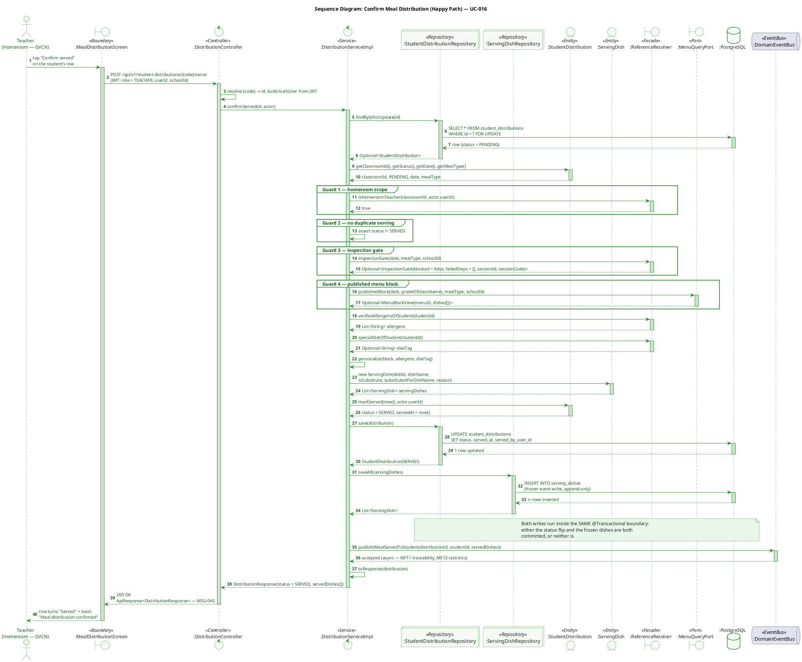

### 2.4 Sequence Diagram — Confirm Meal Distribution (Error Paths)

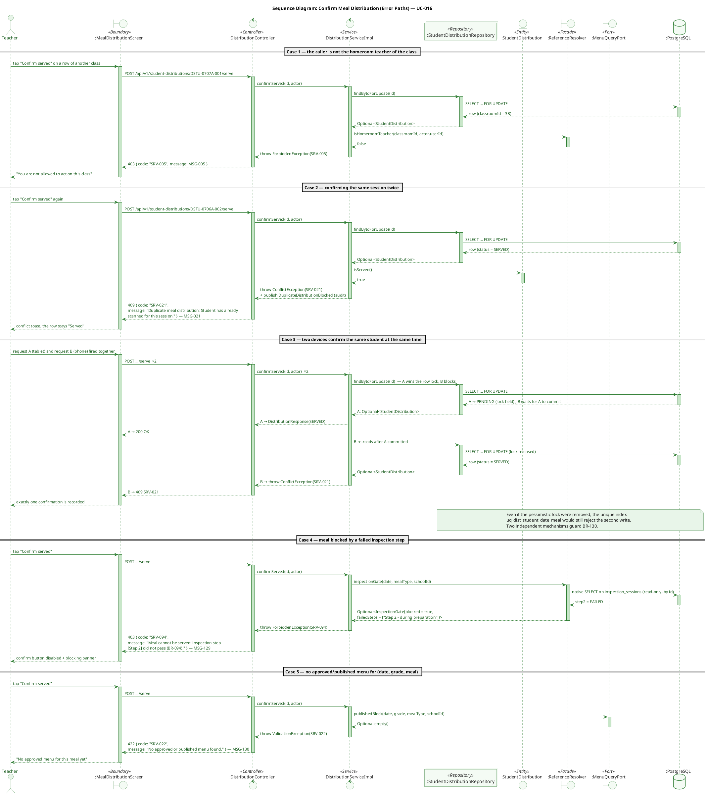

### 2.5 Sequence Diagram — Batch Confirm ("Save Distribution List")

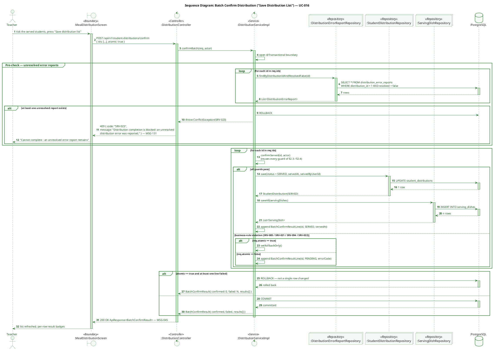

### 2.6 Sequence Diagram — Revoke Meal Distribution

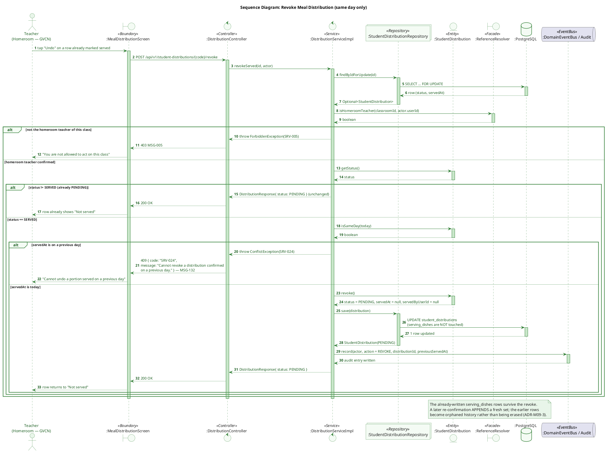

### 2.7 Sequence Diagram — Report Wrong Portion (UC-016 AF1)

```plantuml
@startuml MF09_F1_ReportError
title Sequence Diagram: Report Wrong Portion — UC-016 AF1

' Enable orthogonal lines
skinparam linetype ortho

' ==========================================
' GREEN COLOUR SCHEME CONFIGURATION
' ==========================================
skinparam backgroundColor #FFFFFF

' Common stereotype formatting
skinparam stereotype {
    CBackgroundColor #E8F5E9
    CBorderColor #2E7D32
    EBackgroundColor #E8F5E9
    EBorderColor #2E7D32
    ABackgroundColor #E8F5E9
    ABorderColor #2E7D32
    IBackgroundColor #E8F5E9
    IBorderColor #2E7D32
}

' ==========================================
' Note
' ==========================================
skinparam NoteBackgroundColor #E8F5E9
skinparam NoteBorderColor #2E7D32
skinparam NoteFontColor #212121
skinparam NoteFontName Arial

' ==========================================
' Lifelines by UML robustness stereotype
' (boundary / control / entity / database)
' ==========================================
skinparam BoundaryBackgroundColor #F4FBF4
skinparam BoundaryBorderColor #2E7D32
skinparam BoundaryFontColor #212121
skinparam BoundaryFontName Arial
skinparam BoundaryFontSize 13

skinparam ControlBackgroundColor #F4FBF4
skinparam ControlBorderColor #2E7D32
skinparam ControlFontColor #212121
skinparam ControlFontName Arial
skinparam ControlFontSize 13

skinparam EntityBackgroundColor #F4FBF4
skinparam EntityBorderColor #2E7D32
skinparam EntityFontColor #212121
skinparam EntityFontName Arial
skinparam EntityFontSize 13

skinparam CollectionsBackgroundColor #F4FBF4
skinparam CollectionsBorderColor #2E7D32
skinparam CollectionsFontColor #212121

skinparam DatabaseBackgroundColor #F4FBF4
skinparam DatabaseBorderColor #2E7D32
skinparam DatabaseFontColor #212121
skinparam DatabaseFontName Arial
skinparam DatabaseFontSize 13

skinparam sequence {
    ActorBackgroundColor #E8F5E9
    ActorBorderColor #2E7D32
    ActorFontColor #1B5E20
    ActorFontName Arial
    ActorFontSize 13

    ParticipantBackgroundColor #F4FBF4
    ParticipantBorderColor #2E7D32
    ParticipantFontColor #212121
    ParticipantFontName Arial
    ParticipantFontSize 13

    ArrowColor #2E7D32
    ArrowFontColor #1B5E20
    ArrowFontName Arial
    ArrowFontSize 12

    LifeLineBackgroundColor #C8E6C9
    LifeLineBorderColor #2E7D32

    GroupBackgroundColor #F4FBF4
    GroupBorderColor #2E7D32
    GroupHeaderFontColor #1B5E20
    GroupHeaderBackgroundColor #4CAF50
    GroupFontColor #212121
    GroupFontName Arial
}

autonumber

actor       "Teacher"                             as Teacher
boundary    ":MealDistributionScreen"              as UI       <<Boundary>>
control     ":DistributionController"              as Ctrl     <<Controller>>
control     ":DistributionServiceImpl"             as Svc      <<Service>>
collections ":StudentDistributionRepository"       as DistRepo <<Repository>>
collections ":DistributionErrorReportRepository"   as ErrRepo  <<Repository>>
entity      ":DistributionErrorReport"             as Report   <<Entity>>
boundary    ":ReferenceResolver"                   as Ref      <<Facade>>
database    ":PostgreSQL"                          as DB
queue       ":DomainEventBus"                      as Bus      <<EventBus>>
actor       "Service Caterers"                    as Caterer

Teacher -> UI : open "Report wrong portion", type the reason
activate UI
UI -> Ctrl : POST /api/v1/student-distributions/{code}/error-report\n{ reason: "Vegetarian portion given to an unregistered student" }
activate Ctrl
Ctrl -> Ctrl : validate reason (not blank, ≤ 500 chars)
alt reason is blank or too long
  Ctrl --> UI : 400 { code: "SRV-001", message: MSG-138 }
  UI --> Teacher : inline field error
end
Ctrl -> Svc : reportError(id, req, actor)
activate Svc

Svc -> DistRepo : findById(id)
activate DistRepo
DistRepo -> DB : SELECT * FROM student_distributions WHERE id = ?
activate DB
DB --> DistRepo : row
deactivate DB
DistRepo --> Svc : Optional<StudentDistribution>
deactivate DistRepo
alt session not found in the caller's school
  Svc --> Ctrl : throw NotFoundException(SRV-004)
  Ctrl --> UI : 404 MSG-004
  UI --> Teacher : "Serving session not found"
end

Svc -> Ref : isHomeroomTeacher(classroomId, actor.userId)
activate Ref
Ref --> Svc : true
deactivate Ref

Svc -> Report : new DistributionErrorReport(code, distributionId,\nreportedByUserId = actor.userId, reason, resolved = false, reportedAt = now())
activate Report
Report --> Svc : report(resolved = false)
deactivate Report

Svc -> ErrRepo : save(report)
activate ErrRepo
ErrRepo -> DB : INSERT INTO distribution_error_reports
activate DB
DB --> ErrRepo : 1 row inserted
deactivate DB
ErrRepo --> Svc : DistributionErrorReport
deactivate ErrRepo

Svc -> Bus : publish(DistributionErrorReported{distributionId, reason})
activate Bus
Bus -> Caterer : notify — re-issue the correct portion
Bus --> Svc : accepted
deactivate Bus

Svc --> Ctrl : DistributionErrorResponse{ resolved: false }
deactivate Svc
Ctrl --> UI : 201 Created ApiResponse<DistributionErrorResponse>
deactivate Ctrl
UI --> Teacher : "Error report sent - the class cannot be completed yet"
deactivate UI

note over ErrRepo, DB
  From this moment confirmBatch() on any session of the class
  returns 409 SRV-023 (MSG-131) until resolved = true — see §2.5.
end note
@enduml
```

### 2.8 State Chart — Student Distribution Lifecycle

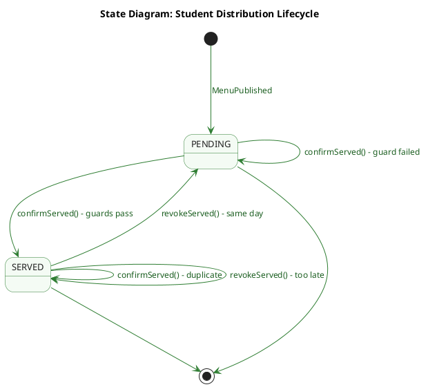

### 2.9 State Chart — Distribution Error Report Lifecycle

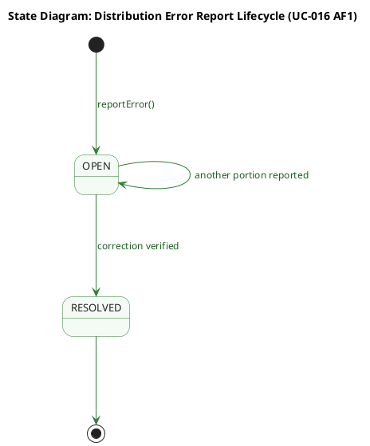

### 2.10 State Chart — Class Distribution Progress (derived, UC-132)

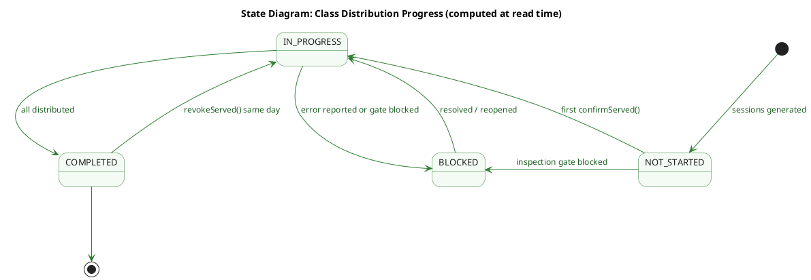

---

## 3. Feature 2 — Meal Consumption Recording

Lets the homeroom teacher record how much of the served meal each student actually ate (BR-121), individually or in batch. Backs UC-080, UC-056.

### 3.1 Class Diagram

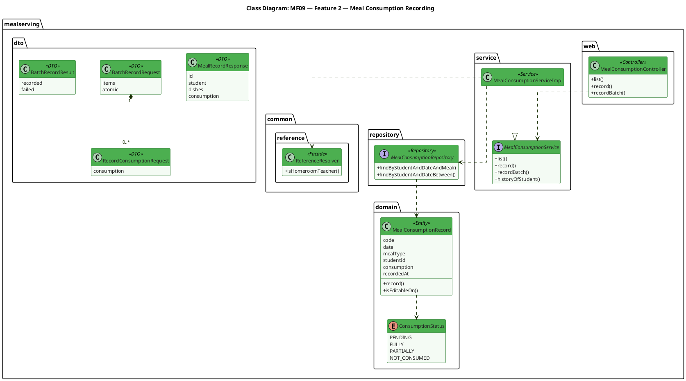

**Description.** `MealConsumptionRecord` is created in `PENDING` together with the serving session (§2.2), is unique per (student, date, meal), and is editable only on the serving day (§3.3). The DTO layer maps the entity's Java-safe names (`studentName`, `className`) onto the mock-compatible JSON keys via `@JsonProperty` — `class` is a Java keyword (ADR-M09-5 / CF-M09-6).

### 3.2 Sequence Diagram — Record Meal Consumption

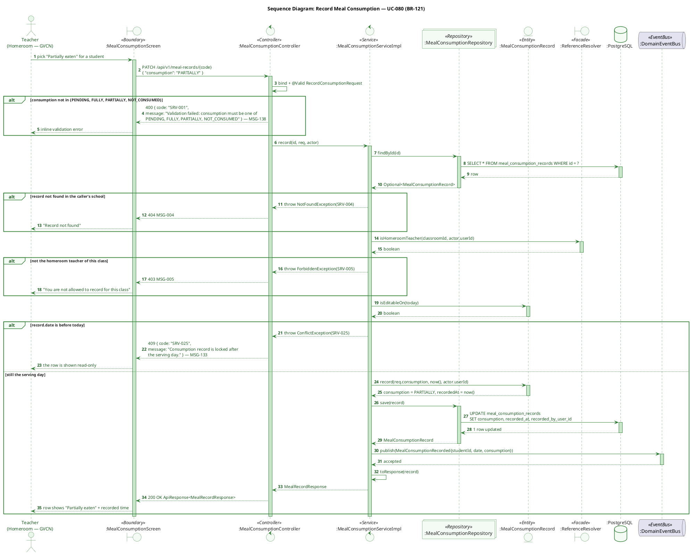

### 3.3 State Chart — Meal Consumption Record Lifecycle

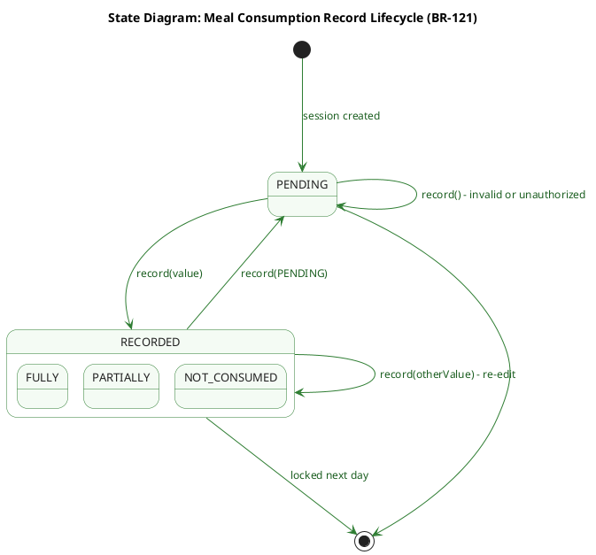

---

## 4. Feature 3 — Meal History (Parent / Teacher, read-only)

A pure read projection over data already owned by Feature 1 and Feature 2 — there is no dedicated `meal_history` table (CF-M09-7). Backs UC-133, UC-053, UC-056 (teacher's per-student view).

### 4.1 Class Diagram

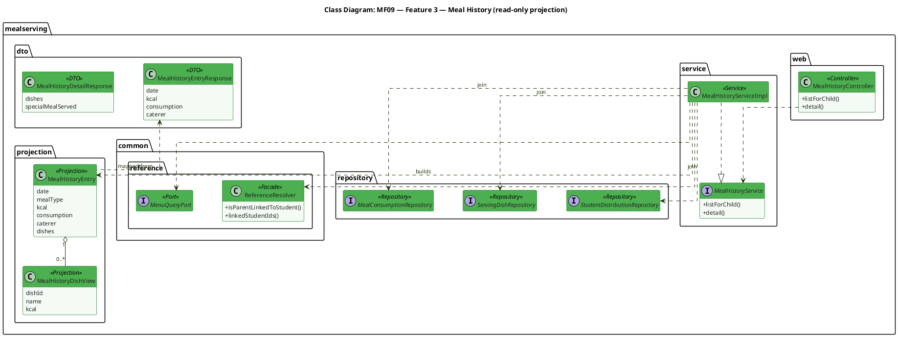

**Description.** `MealHistoryEntry`/`MealHistoryDishView` are pure projections, never persisted: the service joins `student_distributions` ⋈ `serving_dishes` ⋈ `meal_consumption_records` ⋈ `Dish.kcal` (MF05, by frozen `dish_id`) at read time (ADR-M09-2, CF-M09-7). `caterer` is the one field read straight from a frozen column instead of recomputed (ADR-M09-8), so a later change of caterer never rewrites a family's past history.

### 4.2 Sequence Diagram — View Child Meal History

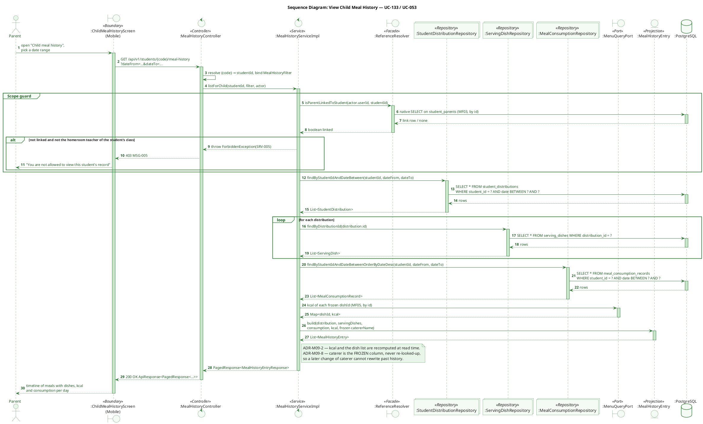

---

## 5. Feature 4 — Special Meal View (read-only)

Read-only visibility into special/substitute meal plans for students with a verified allergy or diet requirement, split across two roles: teachers see their class's requirements before/during service (BR-125), parents see the history of what was actually arranged for their child. Backs UC-142, UC-143 (UC-141 is out of MF09's scope — see CF-M09-13).

### 5.1 Class Diagram

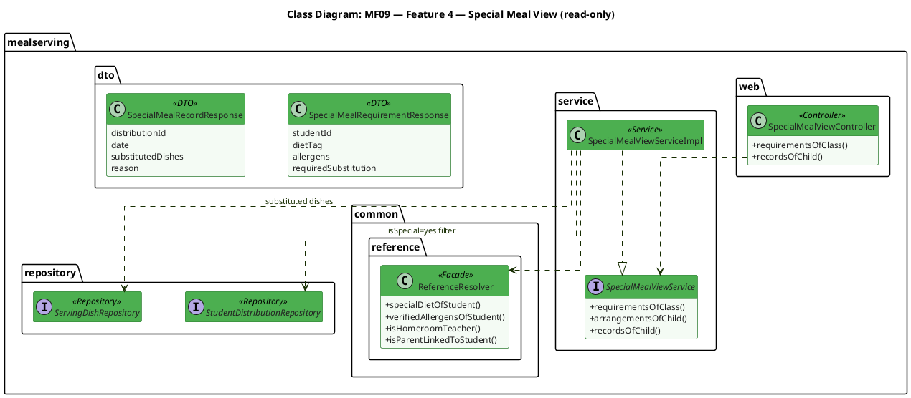

**Description.** `SpecialMealRecordResponse` (UC-142, parent-facing) needs no new table — it is `student_distributions` filtered to sessions that produced at least one substitute `ServingDish`. `SpecialMealRequirementResponse` (UC-143, teacher-facing) reads MF03's `special_meals` by native query instead, following the same "read by id, never by ORM relation" discipline (AP-M09-07, M09-D06).

### 5.2 Sequence Diagram — View Special Meal Requirements of Class

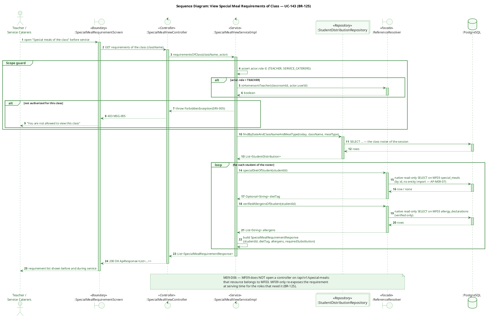

### 5.3 Sequence Diagram — View Special Meal Records of a Child (UC-142)

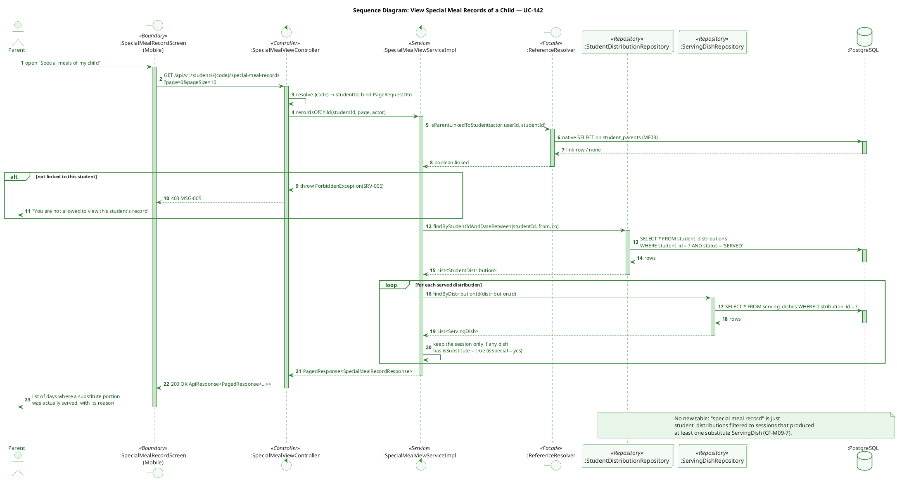

---

## 6. Feature 5 — Allergy Alert (read-only)

Surfaces, per serving session, which students have a *verified* allergy that conflicts with today's menu, so caterers and teachers can double-check before handing out portions (BR-123). Backs UC-103.

### 6.1 Class Diagram

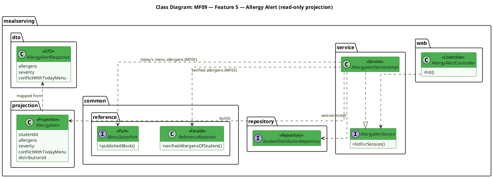

**Description.** `AllergyAlert` is a projection, not a table: for every session in the roster the service intersects the student's *verified* allergens (BR-031) with the allergen tags of today's published menu, and sets `conflictWithTodayMenu = true` only on a real intersection (ADR-M09-2, CF-M09-8). The endpoint is advisory — the actual block-and-substitute enforcement stays in `confirmServed()` (§2.3).

### 6.2 Sequence Diagram — List Allergy Alerts for a Session

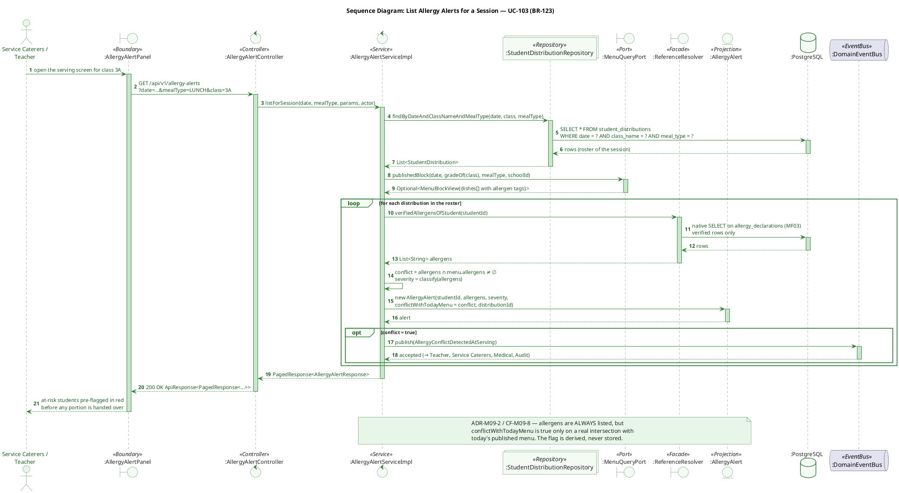

---

## Appendix — Cross-Feature Notes

- **No `MealSession` entity.** A "serving session" is always the composite key `(date, mealType)` scoped by `schoolId`/`className`, matched to how the mock UI represents it (button-tap confirmation, not a physical scan device) — TDS §2.3 CF-M09-2, ADR-M09-3. This is why every sequence diagram above resolves the session by `(date, mealType)` rather than by a session id.
- **Cross-module reads are always by id, never by JPA relation.** Every arrow from an MF09 `Service`/`ServiceImpl` class to another module in the diagrams above goes through `ReferenceResolver` or a narrowly-scoped `Port` interface (`MenuQueryPort`), consistent with the "no `@ManyToOne` across module boundaries" rule (AP-M09-07) reflected in the DBML's external stub tables in §1.
- **Biometric/face-scan flows are intentionally absent.** UC-079 appears in the traceability matrix under Meal Serving but BR-051 explicitly forbids biometric capture for children; it is not modeled here and belongs to MF04's delivery-staff verification instead (CF-M09-1).
- **Only two objects in MF09 carry persisted state.** `StudentDistribution` (§2.8) and `MealConsumptionRecord` (§3.3), plus the auxiliary `DistributionErrorReport` (§2.9). `ServingDish` has no state chart on purpose: it is append-only, so it has exactly one state and no transition (ADR-M09-1). The class-progress chart in §2.10 is derived at read time and is included only because it is where the other lifecycles interact.
- **Guards and error codes are the join between the artifacts.** Every `[guard]` in a state chart is the same condition as an `alt` branch in the matching sequence diagram and the same `SRV-xxx` code in TDS §10 — so the three views can be reviewed against each other rather than independently. Codes used above: `SRV-001` (validation), `SRV-004` (not found), `SRV-005` (scope), `SRV-021` (duplicate serving), `SRV-022` (no menu), `SRV-023` (unresolved error report), `SRV-024` (revoke after the day), `SRV-025` (consumption locked), `SRV-094` (inspection gate).
- **Two lifecycle rules are enforced by the database, not only by the diagrams.** `uq_dist_student_date_meal`/`uq_mcr_student_date_meal` make a second session or record for the same `(student, date, meal)` impossible, and `ck_dist_served_at`/`ck_dist_served_same_day` make an inconsistent `SERVED` row impossible — so the state charts above hold even if a service method is bypassed.
