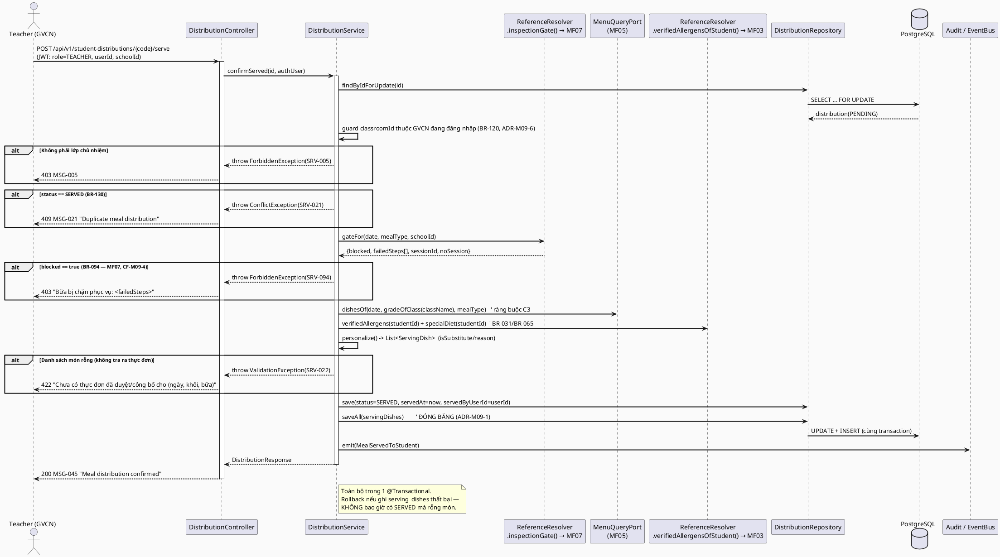
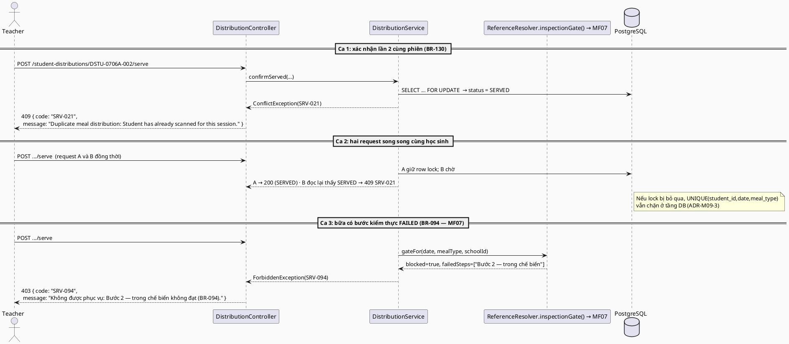
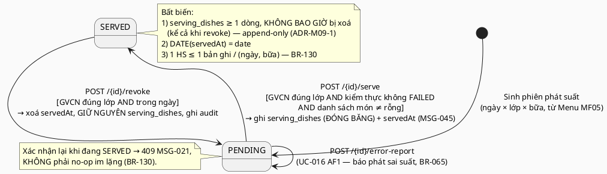
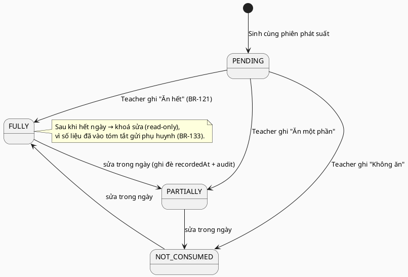

# ENGINEERING DOCUMENTATION STANDARD (EDS) v2.0 — TDS Backend
# MF09 — Meal Serving & Distribution (Phục vụ & Phân phát Bữa ăn)

| Field | Value |
|-------|-------|
| **Document ID** | `SFMS-MF09-IMP-001` |
| **Version** | `2.0` |
| **Date** | `2026-08-03` |
| **Status** | **`Approved`** |
| **Document Owner** | Trần Tuấn Minh (MinhTTHE186258) |
| **Author** | Trần Tuấn Minh — UI/UX & Frontend, chủ module MF09/MF11, Lead FE↔BE contract Reviewer |
| **Reviewed by** | `[Nguyễn Đức Mạnh — §5 Schema + §9 API · Nguyễn Phương Thảo — §13 Test · Bùi Quang Huy — §2 Traceability — Pending]` |
| **DPO Sign-off** | `[ ] Pending` — **bắt buộc**: module chứa **PII trẻ em** (họ tên HS, lớp, hồ sơ dị ứng đã xác minh, lịch sử tiêu thụ bữa ăn) |
| **Approved by** | `[Nguyễn Văn Nam — Principal Architect — Pending]` |
| **Last Review** | `2026-08-03` — Bước 0 + Bước 1 theo `02_Module_Completion_Workflow.md` §7 |
| **Based on EDS** | `v2.0` |

> **Stack (ADR-000 / `01_MVP_Backend_Implementation_Plan.md` §3):** Spring Boot **4.1.x (Java 25 LTS)** · PostgreSQL 16 · **Flyway** (V1 = toàn bộ schema, do Nam giữ) · **Spring Security + JWT** (RBAC 7 role, tin JWT do MF01 phát hành) · springdoc-OpenAPI (Swagger) · MapStruct.
>
> **MF09 là P1 — mắt xích giữa của trục xương sống:** `Login theo role → Menu theo khối → **phân suất & thống kê theo món** → tạo sự cố → điều tra: sự cố → HS → món → lô → NCC → mẫu`. Bảng `serving_dishes` (suất **đóng băng** lúc trao tay) là nơi duy nhất trả lời được câu hỏi điều tra *"em nào đã ăn món nghi nhiễm?"* — mọi thiết kế dưới đây xoay quanh việc giữ dữ liệu đó **bất biến**.
>
> Convention list/search/filter, `PagedResponse<T>`, `Specification`, `@RestControllerAdvice` **copy nguyên** từ vertical slice mẫu **MF02** (`TDS-MF02_Backend.md` §17) — không phát minh lại.

---

## CHANGELOG

> **Policy 4.4 — Immutable History:** Không xóa thông tin cũ.

| Ngày | Người thực hiện | Nội dung thay đổi |
|------|-----------------|-------------------|
| 2026-07-28 | Trần Tuấn Minh | Tạo bản đầu (v1.0). Nguồn: UC file `MF09_Meal_Serving_Distribution.md`, traceability §1.9, `business_rules.md` §5/§10, `error_message.md`, mock (`mock-server.ts` / `db.ts` / `mock-data.ts`), màn hình `teacher/*` + `service-caterers/meal-service` + `parent/*`, `data_model.puml` (package "Phục vụ & Phản hồi" + ràng buộc C3), `semantic-audit.ts` §6/§7/§11b, ADR-000, MVP plan §3. Toàn bộ ví dụ code viết bằng **Java + JPA + Flyway SQL** (không TypeScript/Prisma). |
| 2026-07-28 | Trần Tuấn Minh | **Self-review (cùng ngày, sau khi đọc nốt các màn FE chưa xem ở lượt đầu:** `parent/special-meals`, `parent/meal-history/[id]`, `teacher/dashboard`, `service-caterers/cook-sheet`**):** (1) UC-141 thực chất **không** đọc resource `special-meals` — màn Phụ huynh dùng `derivedMealPlans()` (dẫn xuất từ `menus`+`menu-templates`, thuộc **MF05**), sửa §2.1/§9.1 và thêm **CF-M09-13**; (2) bỏ 2 endpoint tự phát minh `/meal-service/overview`, `/meal-service/portions` (UC-047) — trùng lặp `cookSheet()`/`classPortionLines()` đã thuộc MF05 và cổng kiểm thực thuộc MF07; MF09 chỉ đóng góp `GET /student-distributions` đã có sẵn, thêm **CF-M09-14**; (3) xác nhận với reviewer nghiệp vụ rằng field `caterer`/`catererSupplierId` trong lịch sử bữa ăn là **cần thiết** → thêm `CatererAssignmentPort` (MF04) + cột snapshot `caterer_partner_id`/`caterer_name` trên `student_distributions`, ghi thành **ADR-M09-8** (đóng băng lúc tạo phiên, cùng nguyên tắc với ADR-M09-1, không tra Partner sống mỗi lần đọc lịch sử). |
| 2026-08-03 | Trần Tuấn Minh | **Bước 0 — rà chủ sở hữu resource** (`02_Module_Completion_Workflow.md` §2.1/§7). 5 lệnh chạy trên code đã merge (V1–V15, 66 bảng, 38 path) + 2 lệnh A-BIS trên `07_implement/`. **Kết quả: 4 bảng và 3 path chính của MF09 sạch tuyệt đối** — không bảng nào tồn tại, không TDS nào khác khai. **MF09 KHÔNG dính C2** (0/21 chỗ `REFERENCES users(id)`; cả 6 bảng đích `schools`/`students`/`classrooms`/`menus`/`dishes`/`partners` đều PK `UUID`, MF09 đã khai đúng kiểu). Ba va chạm quyền sở hữu đã xử lý: **`M09-D06`** (`/special-meals` gỡ khỏi §9.1), **`M09-D07`** (`{studentId}` → `{code}` dưới `/students`), **`M09-D08`** (bỏ 5/6 port). |
| 2026-08-03 | Trần Tuấn Minh | **Bước 1 — rà & chốt tài liệu, Status Draft → Approved.** 10 quyết định `M09-D01`…`M09-D10` (§3). Sửa **4 lệch quy ước** mà Bước 0 không bắt được (§7 câu 7): **`M09-D01`** thêm cột `code` + `UNIQUE(school_id, code)` cho cả 4 bảng (D1 — TDS bản v1.0 **tự mâu thuẫn**: §3 bắt buộc mà §5.2 không có); **`M09-D02`** 4 entity `extends BaseEntity`, DDL tạo đủ 4 cột audit, bỏ `created_at` tự khai (D9); **`M09-D03`** package `com.sfms.mf09` → **`com.sfms.mf09`** (§0-BIS, 10 chỗ); **`M09-D04`** ADR-M09-5/C8/AP-M09-08 bị **D4 ghi đè** — JSON trả **ISO-8601**, không `dd/MM/yyyy` (đóng L3 của TestSpec). Thêm **`M09-D05`** số V (`V16`/`V17`), **`M09-D09`** §10 gỡ ghi chú lỗi thời + thêm 429/MSG-141, **`M09-D10`** bổ sung 2 TC bắt buộc D11/D12 vào TestSpec. Nguồn: `00_Common_Conventions.md` D1–D10 · `02_Module_Completion_Workflow.md` §6 (D11–D13) · `TestSpec-MF09` §2 (L1–L26). |

---

## MỤC LỤC

1. [Tổng quan Module](#1-tổng-quan-module) · 2. [Ma trận Truy vết](#2-ma-trận-truy-vết) · 3. [Architecture Decisions](#3-architecture-decisions-inline-adr) · 4. [NFR & SLA](#4-non-functional-requirements--sla) · 5. [Static Modeling](#5-static-modeling) · 6. [Dynamic Modeling](#6-dynamic-modeling) · 7. [Domain Event Catalog](#7-domain-event-catalog) · 8. [Interface Specification](#8-interface-specification) · 9. [API Specification](#9-api-specification) · 10. [Error Codes](#10-bảng-mã-lỗi) · 11. [Triển khai](#11-quy-trình-triển-khai) · 12. [Rollback Runbook](#12-rollback--incident-runbook) · 13. [Kiểm thử](#13-kịch-bản-kiểm-thử) · 14. [Xác minh](#14-phương-pháp-xác-minh) · 15. [API Samples](#15-mẫu-thử-thực-tế) · 16. [Authorization Matrix](#16-authorization-matrix) · 17. [AI Prompt Constraints](#17-ai-prompt-constraints-case-20)

---

## 1. Tổng quan Module

> MF09 quản lý **phiên phục vụ bữa ăn** từ lúc bếp chia suất tới lúc giáo viên trao tận tay từng học sinh và ghi nhận mức tiêu thụ: sổ phân phát theo **từng học sinh** (`StudentDistribution`), **suất ăn thực tế đã trao — đóng băng** (`ServingDish`), **ghi nhận tiêu thụ** (`TeacherMealRecord`), **cảnh báo dị ứng khi phục vụ** (BR-123), **chặn phát trùng** (BR-130), và các màn **chỉ đọc** cho Phụ huynh (lịch sử bữa ăn, suất ăn đặc biệt) + Service Caterers (bảng chia suất theo lớp).

| Field | Value |
|-------|-------|
| **Module Name** | Meal Serving & Distribution (MF09) |
| **Bounded Context** | Meal Serving & Consumption |
| **Data Classification** | **PII — Sensitive (trẻ em)**: họ tên HS, lớp, allergen đã xác minh, mức tiêu thụ từng bữa |
| **Compliance Scope** | PDPD (Nghị định 13/2023/NĐ-CP) — theo ADR-000. **BR-051 cấm tuyệt đối sinh trắc học với học sinh** (xem CF-M09-1) |
| **Upstream Dependencies** | **MF01** (JWT: `userId/role/schoolId`) · **MF02** (`Classroom` — lớp chủ nhiệm, sĩ số, khối) · **MF03** (`Student`, hồ sơ dị ứng **đã xác minh** BR-031) · **MF04** (`Partner` — NCC suất ăn đang phục vụ trường, snapshot lúc tạo phiên, xem ADR-M09-8) · **MF05** (`Menu`/`MealBlock`/`Dish`/`MenuTemplate` — suất phân công theo khối × ngày × bữa; suất riêng theo chế độ ăn) · **MF07** (`InspectionSession` — cổng kiểm thực ba bước, xem CF-M09-4) |
| **Downstream Consumers** | **MF10** (thông báo tóm tắt hằng ngày cho phụ huynh — BR-133) · **MF11** (điều tra sự cố: HS → **món đã ăn** → lô → NCC → mẫu, qua `serving_dishes.dish_id`) · **MF13** (thống kê phân phát/tiêu thụ theo món, lớp, ngày) |

**Phạm vi 13 Use Case (đúng traceability §1.9):**
- **Phân phát & xác nhận (Teacher):** UC-016 (Confirm Meal Distribution), UC-080 (Student Meal Consumption), UC-056 (Monitor Student Meal History), UC-143 (View Special Meal Requirements).
- **Phục vụ & giám sát (Service Caterers):** UC-047 (Manage Meal Service), UC-132 (View Meal Distribution List), UC-079 (Scan Face Data — **xem CF-M09-1**).
- **Dùng chung Caterers/Teacher:** UC-103 (View Allergy Alerts).
- **Phụ huynh (chỉ đọc):** UC-053 (Monitor Child Meal History), UC-055 (Monitor School Meals), UC-133 (View Meal History), UC-141 (View Special Meal Arrangements), UC-142 (View Special Meal Records).

> ⚠️ Kế hoạch `00_Team_Work_Assignment_Plan.md` §3 ghi MF09 có "12 UC"; **traceability §1.9 liệt kê 13 UC** — tài liệu này bám theo traceability (nguồn chuẩn theo §2c).

**Vai trò liên quan (BR-007):** Teacher (chủ thể xác nhận phát suất + ghi tiêu thụ — BR-120/121), Service Caterers (chia suất, xem, **không** phát), Parent (chỉ đọc con mình), Medical Staff / School Administration (giám sát), System Admin (vận hành).

**Thư mục màn hình đã đọc (nguồn 6 — `03_Design/08_FrontEnd/Web/src/app/(app)/`):**
- `teacher/distribution` (08_DistributionList — UC-016 bước 1–2, BR-120/123/125/130) · `teacher/distribution/[id]` (09_DistributionDetail + 10_DistributionConfirmation — UC-016 bước 3–5, UC-103).
- `teacher/meal-records` (07_MealRecords — UC-080, UC-056, BR-121/125).
- `teacher/special-meals` (06_SpecialMealRequirements — UC-143, BR-065/066/082, chỉ đọc).
- `teacher/dashboard` (01_TeacherHome — widget tổng hợp phát suất hôm nay + cảnh báo dị ứng, đọc `student-distributions` lọc theo lớp rồi tự gộp bằng `distributionSummaries()`; đọc bổ sung khi self-review 2026-07-28, không có UC riêng, dùng lại đúng API đã khai ở §9).
- `service-caterers/meal-service` (24/25/26_MealServiceManagement — UC-047, UC-132, BR-125/082, chỉ đọc).
- `parent/meal-history` + `parent/meal-history/[id]` (12/13_MealHistory — UC-133, UC-053, BR-121).
- `parent/special-meal-records` (11_SpecialMealRecords — UC-142, BR-065/121/123) · `parent/special-meals` (UC-141).
- `parent/school-meals` (14_SchoolMealsDashboard — UC-055; đọc resource `menus` của **MF05**).

**Resource mock thuộc MF09 (`db.ts`):** `student-distributions` (nguồn: `STUDENT_DISTRIBUTIONS`), `meal-records` (nguồn: `TEACHER_MEAL_RECORDS`). Đọc kèm (**không sở hữu**): `special-meals`, `students`, `classrooms`, `menus`, `menu-templates`, `dishes`, `inspections`.

---

## 2. Ma trận Truy vết

> **Nguồn:** cột BR/MSG lấy **nguyên văn** `traceability_matrix.md` §1.9; tên UC nguyên văn UC file `MF09_Meal_Serving_Distribution.md`; nội dung BR tra `business_rules.md` §5 (BR-051, BR-060), §7 (BR-065), §10 (BR-120..BR-133), §4 (BR-201). **Policy:** chỉ dùng mã có trong §1.9 — không bịa mã mới, không lấy số từ `Report 3.md` phụ lục.

### 2.1. UC ↔ BR ↔ MSG ↔ Code

| UC ID | Tên UC (nguyên văn) | Actor | Business Rules (§1.9) | System Messages (§1.9) | Thành phần Code (Java) |
|-------|---------------------|-------|-----------------------|------------------------|------------------------|
| UC-047 | Manage Meal Service | Service Caterers | BR-120, BR-121, BR-125, BR-130 | MSG-021, MSG-045 | `DistributionService.list()` (đã có) — phần suất nấu/trạng thái kiểm thực **không** thuộc MF09, xem **CF-M09-14** |
| UC-016 | Confirm Meal Distribution | Teacher | BR-120, BR-121 | MSG-045 | `DistributionService.confirmServed()`, `confirmBatch()`, `reportError()` |
| UC-080 | Student Meal Consumption | Teacher | BR-121 | MSG-004, MSG-005 | `MealConsumptionService.record()`, `recordBatch()` |
| UC-079 | Scan Face Data | Service Caterers | BR-051, BR-060 | MSG-014 | **Không hiện thực trong MF09** — xem CF-M09-1 (`DeliveryFaceVerifyService` thuộc MF04) |
| UC-103 | View Allergy Alerts | Service Caterers / Teacher | BR-123, BR-125 | MSG-004, MSG-005 | `AllergyAlertService.listForSession()` (derived) |
| UC-132 | View Meal Distribution List | Service Caterers | BR-120 | MSG-004, MSG-005 | `DistributionService.list()` (`StudentDistributionSpec`), `summary()` |
| UC-053 | Monitor Child Meal History | Parent | BR-121, BR-133, BR-201 | MSG-004, MSG-005 | `MealHistoryService.listForChild()` (derived) |
| UC-055 | Monitor School Meals | Parent | BR-133 | MSG-004, MSG-005 | *(đọc `MenuQueryPort` của MF05 — MF09 chỉ chèn phần “đã phục vụ”)* |
| UC-056 | Monitor Student Meal History | Teacher | BR-121 | MSG-004, MSG-005 | `MealConsumptionService.listByClass()`, `historyOfStudent()` |
| UC-133 | View Meal History | Parent | BR-121, BR-133 | MSG-004, MSG-005 | `MealHistoryService.listForChild()`, `detail()` |
| UC-141 | View Special Meal Arrangements | Parent | BR-065, BR-201 | MSG-004, MSG-005 | **Ngoài phạm vi MF09** — thuộc MF05, xem **CF-M09-13** |
| UC-142 | View Special Meal Records | Parent | BR-065 | MSG-004, MSG-005 | `SpecialMealViewService.recordsOfChild()` (lọc `isSpecial=yes`) |
| UC-143 | View Special Meal Requirements | Teacher | BR-125, BR-065 | MSG-004, MSG-005 | `SpecialMealViewService.requirementsOfClass()` (đọc `special_meals`, read-only) |

### 2.2. Business Rules — nội dung (nguyên văn `business_rules.md`)

| BR | Nội dung (nguyên văn, rút gọn) | Áp ở |
|----|--------------------------------|------|
| **BR-051** | Nhân viên giao hàng phải đăng ký dữ liệu khuôn mặt để xác thực tại cổng trường. **"Lưu ý: Không áp dụng xác thực sinh trắc học với học sinh (trẻ em) vì lý do bảo mật dữ liệu cá nhân (PDPD)."** | *(cấm trong MF09 — CF-M09-1)* |
| **BR-060** | Hệ thống xác minh vị trí GPS của nhân viên giao hàng để đảm bảo giao hàng trong khu vực cho phép. | *(miền MF04/MF06 — CF-M09-1)* |
| **BR-065** | Với HS có **dị ứng đã xác minh** hoặc chế độ ăn đặc biệt, hệ thống **bắt buộc** Service Caterers tạo **kế hoạch bữa ăn riêng**. | `ServingDish.isSubstitute`, `SpecialMealViewService`, AF1 UC-016 |
| **BR-120** | **Giáo viên (Teacher)** xác nhận việc phân phát bữa ăn cho học sinh **trong lớp của mình**. | `confirmServed()` + guard lớp chủ nhiệm |
| **BR-121** | Hệ thống ghi nhận và theo dõi **lịch sử tiêu thụ bữa ăn** của từng học sinh. | `meal_records.consumption`, `MealHistoryService` |
| **BR-123** | Khi quét ID học sinh có **dị ứng thực phẩm đã đăng ký** trong phiên phục vụ, hệ thống **tự động kích hoạt cảnh báo trực quan và âm thanh** trên màn hình phục vụ để ngăn phân phát sai suất. | `allergyWarning` (derived), `AllergyAlertService` |
| **BR-125** | Giáo viên và nhân viên phục vụ phải **xem được yêu cầu bữa ăn đặc biệt** của từng HS trong lớp **trước và trong** giờ phục vụ. | `assignedMeal`/`specialMeal` (derived), UC-143/103 |
| **BR-130** | Hệ thống **chặn phân phát trùng lặp** — một HS **không thể được quét hai lần** trong cùng một phiên phục vụ bữa ăn. | `confirmServed()` idempotent + unique index |
| **BR-133** | Hệ thống **tự động biên soạn** thực đơn đã phục vụ + cấu trúc dinh dưỡng, gửi **thông báo tóm tắt hằng ngày** đến phụ huynh. | `DailyParentSummaryJob` → event `DailyMealSummaryCompiled` |
| **BR-201** | Một tài khoản phụ huynh liên kết **tối đa 5 hồ sơ học sinh**; đạt giới hạn thì chặn liên kết thêm. | Guard scope Parent (chỉ đọc con đã liên kết) |

### 2.3. ⚠️ Mâu thuẫn giữa các nguồn (ghi rõ, KHÔNG tự chọn bên đúng)

| # | Mô tả mâu thuẫn | Xử lý trong TDS |
|---|-----------------|-----------------|
| **CF-M09-1** | **UC-079 "Scan Face Data" (BR-051, BR-060, MSG-014)** nằm trong traceability §1.9 (Meal Serving) nhưng: (a) **không có** Use Case Spec trong `MF09_Meal_Serving_Distribution.md`; (b) **BR-051 ghi rõ "Không áp dụng xác thực sinh trắc học với học sinh (trẻ em) vì PDPD"**; (c) BR-051/BR-060 thuộc §5 "Supplier & Caterer" (nhân viên **giao hàng**), và `business_rules.md` §Tổng hợp xếp BR-051/BR-060 vào *Supplier & Caterer Mgmt*, **không** vào *Meal Serving*; (d) mock **không có** luồng quét mặt nào ở màn phục vụ. | **KHÔNG hiện thực quét mặt học sinh trong MF09.** Giữ UC-079 trong §2.1 (traceability là nguồn chuẩn) nhưng đánh dấu "thuộc MF04 — Delivery face verify". Cần **Huy (Lead Traceability)** quyết định chuyển UC-079 sang §1.4 hay bổ sung UC spec. **Không được** để AI sinh code sinh trắc học cho HS — vi phạm BR-051 + PDPD. |
| **CF-M09-2** | **"Quét ID học sinh" (BR-123/BR-130)** giả định có thiết bị quét thẻ/mã HS. Mock **không có** luồng quét — giáo viên **bấm nút** xác nhận từng em (`teacher/distribution`), và "phiên phục vụ" được biểu diễn bằng cặp `(date, mealType)` chứ không có entity `MealSession`. | Backend triển khai BR-130 theo **ngữ nghĩa nghiệp vụ** ("một HS chỉ được xác nhận phát 1 lần cho 1 bữa của 1 ngày"), hiện thực bằng **bất biến `UNIQUE(student_id, date, meal_type)`** + transition `PENDING → SERVED` **một chiều, idempotent**. Cổng vào có thể là nút bấm **hoặc** máy quét — hợp đồng API không đổi (ADR-M09-3). |
| **CF-M09-3** | **BR-135 (thông báo trễ phục vụ > 20 phút)** có trong `business_rules.md` §10 và được **FE nhắc tới** (`teacher/distribution` header) nhưng **KHÔNG** nằm trong cột Business Rules của bất kỳ UC nào tại traceability §1.9. | **Không** đưa BR-135 vào phạm vi hiện thực MF09 v1.0 (theo quy tắc: chỉ dùng mã có trong §1.9). Ghi lại đây để Huy xác nhận có bổ sung BR-135 vào §1.9 hay bỏ khỏi FE. Thiết kế đã chừa chỗ: `plannedServeTime` (xem §5.2, cột **nullable**, chưa dùng). |
| **CF-M09-4** | **BR-094 (bữa ăn không được phục vụ nếu bất kỳ bước kiểm thực nào thất bại)** được mock **thực thi cứng** ở màn phát suất (`mealServingGate`, `teacher/distribution/[id]` chặn nút xác nhận) và `semantic-audit.ts` §7 có luật `PHAT_SUAT_DU_KIEM_THUC_TRUOT`; `data_model.puml` ràng buộc **C3** cũng nói vậy. Nhưng **BR-094 thuộc miền MF07**, không có trong cột BR của §1.9. | Backend **vẫn phải chặn** (nếu không, quy định an toàn thực phẩm bị vô hiệu và luật audit §7 sẽ đỏ). Hiện thực bằng **phép đọc-only sang MF07 theo ID** — ~~`InspectionGatePort`~~ → **`referenceResolver.inspectionGate()`** (`M09-D08`, 03/08), **không** import entity MF07 (§4b kế hoạch). Ghi rõ đây là ràng buộc **liên module**, trích BR-094 của MF07 chứ không nhận là BR của MF09. |
| **CF-M09-5** | **§2b-2 kế hoạch** khai `mealPrefix` = *"Lọc field `meal` dạng startsWith — cho màn phân suất MF09"*, và §2b-3 bước 4 ghi *"chỉ module MF09"*. Nhưng trong mock, `mealPrefix` lọc `r.meal` và comment nguồn ghi **"UC-118 — field `meal` dạng 'Trưa 02/07'"** = resource `samples` (**MF08**). `student-distributions` **không có** field `meal`, mà có `mealType` (enum `BREAKFAST/LUNCH/SNACK`). | MF09 **không dùng** `mealPrefix`. Lọc bữa dùng **`mealType=<enum>`** (lọc exact field, đúng §2b-2 dòng `<field>=<value>`). Đề nghị Nam sửa §2b-2/§2b-3 gán `mealPrefix` về **MF08**. |
| **CF-M09-6** | **§2b-3 bảng SEARCH_FIELDS** gợi ý MF09: `StudentDistribution` → `studentName`, `className`. Mock **không có** field nào tên vậy — field thật là `name` và `class` (`class` còn là **từ khóa Java**, không đặt tên thuộc tính như vậy được). | `SEARCH_FIELDS` thật = **`studentName`, `className`, `studentId`** ở tầng **JPA/DB** (`student_name`, `class_name`), nhưng **JSON response giữ nguyên `name` và `class`** để không phá hợp đồng FE (map bằng `@JsonProperty`, ADR-M09-5). |
| **CF-M09-7** | **Lịch sử bữa ăn của Phụ huynh** (UC-133/UC-053, màn `parent/meal-history`) đọc **mảng tĩnh `MEAL_HISTORY`** trong `mock-data.ts` — **không** nằm trong `db.ts`, tức **không có resource REST nào** phục vụ nó; đồng thời nó **trùng thông tin** với `student-distributions` (món đã phát) + `meal-records` (mức tiêu thụ) nhưng có seed **khác nhau** (ngày 26–01/07 vs 02–07/07). | Backend **KHÔNG** tạo bảng `meal_history`. Lịch sử bữa ăn là **projection dẫn xuất** từ `student_distributions` ⋈ `serving_dishes` ⋈ `meal_records` ⋈ `dishes(kcal)` (ADR-M09-2). Endpoint mới `GET /api/v1/students/{studentId}/meal-history`. **Cần sửa đồng thời mock FE** (quy tắc chống lệch §0 kế hoạch) — Minh chịu trách nhiệm. |
| **CF-M09-8** | Mock lưu sẵn `allergyWarning`, `assignedMeal`, `specialMeal`, `isSpecial`, `dietTag` **thành field vật lý** trên `student-distributions`; seed từng **tự mâu thuẫn** (bản sửa 27/07/2026: có `allergyWarning` trong khi `isSpecial:"no"` và thực đơn chay không chạm dị ứng). `data_model.puml` đánh dấu `servedDishes` là danh sách con, các field còn lại là nhãn hiển thị. | **Không lưu field dẫn xuất** (§5 kế hoạch): `assignedMeal`/`specialMeal`/`allergyWarning`/`isSpecial`/`dietTag` **tính runtime** từ Menu (MF05) ⋈ hồ sơ dị ứng đã xác minh (MF03) tại thời điểm **đọc trước khi phát**. **Ngoại lệ có chủ đích:** `serving_dishes` (suất **thực tế** đã trao) **được lưu và đóng băng** — đây không phải dẫn xuất mà là **sự kiện lịch sử** (ADR-M09-1). |
| **CF-M09-9** | Mock dùng **generic `PUT /:resource/:id`** (merge tất cả field body) cho việc xác nhận phát suất và ghi tiêu thụ ⇒ **không có** kiểm tra BR-130, BR-094, không kiểm giáo viên có đúng lớp; FE tự chặn bằng `toast.error` (client-side). FE còn gọi **N lần PUT** cho N học sinh khi bấm "Lưu phân phát". | Backend thay bằng **endpoint nghiệp vụ** `POST /student-distributions/{id}/serve` + `POST /student-distributions/confirm` (batch, 1 transaction) — enforce BR-130/BR-120/BR-094 **phía server**, không tin client. Vẫn giữ `PATCH` generic cho các field không nhạy cảm để FE chuyển dần. |
| **CF-M09-10** | Resource `distributions` (tổng hợp ngày × lớp) **đã bị bỏ 21/07/2026**, nay dẫn xuất bằng `distributionSummaries()` ở FE; nhưng UC-132 vẫn yêu cầu Service Caterers thấy *"classroom name, student count, special meal count, serving status"*. | Backend cung cấp `GET /student-distributions/summary` **tính runtime** (`GROUP BY date, class_name`) — **không** tạo bảng tổng hợp (ADR-M09-2), tránh đúng lỗi "bếp đọc số liệu đóng băng" mà mock đã sửa. |
| **CF-M09-11** | **UC-055 "Monitor School Meals"**: traceability §1.9 chỉ ghi **BR-133**; UC file ghi **BR-069, BR-070, BR-075** (khai báo nguyên liệu/allergen, công bố thực đơn) — đều thuộc **miền MF05**. Màn FE `parent/school-meals` đọc resource `menus` (MF05). | Theo §2c: dùng **traceability làm chuẩn** → MF09 chỉ chịu trách nhiệm phần **BR-133** (tóm tắt bữa **đã phục vụ**); phần thực đơn công bố + allergen do **MF05** cung cấp. Ghi lại để Huy đối chiếu. |
| **CF-M09-12** | Nhiều UC có **BR ở UC file nhưng không có ở traceability §1.9**: UC-016 (UC file thêm BR-065, BR-123, BR-125, BR-130), UC-047 (thêm **BR-100** — miền tuân thủ/báo cáo), UC-053 (thêm BR-031), UC-103 (thêm BR-065), UC-132 (thêm BR-121, BR-123, BR-065), UC-143 (thêm **BR-025** — sĩ số lớp, miền MF02), UC-133/UC-141 (thêm BR-031/BR-069/BR-070). | Cột BR trong §2.1 **giữ nguyên §1.9** (nguồn chuẩn). Các BR "thừa" ở UC file **vẫn được thỏa mãn gián tiếp** vì cùng nằm trong §1.9 dưới UC khác (BR-065/123/125/130 đều có mặt). Riêng **BR-100** và **BR-025** không thuộc phạm vi MF09 — không hiện thực. Danh sách này để Huy đồng bộ UC file ↔ traceability. |
| **CF-M09-13** (phát hiện khi self-review 2026-07-28) | **UC-141 "View Special Meal Arrangements"** có trong traceability §1.9 (Meal Serving) và bản v1.0 của TDS này từng gán nhầm cho `SpecialMealViewService.arrangementsOfChild()` đọc resource `special-meals`. Đọc lại `parent/special-meals/page.tsx` xác nhận: màn này **không** đọc `special-meals` (đó là resource của UC-143, Teacher) — nó gọi `derivedMealPlans()` (`lib/special-meal-plans.ts`), tính hoàn toàn từ `menus` + `menu-templates`/`MenuVariant` (MF05) chiếu qua hồ sơ dị ứng HS (MF03). Không có bảng/API nào của MF09 liên quan. | **UC-141 chuyển ra ngoài phạm vi hiện thực của MF09** — cùng cách xử lý CF-M09-11 (UC-055). Endpoint `GET /students/{id}/special-meal-arrangements` (nếu cần) do **MF05** cung cấp. Cần Huy xác nhận traceability §1.9 nên ghi UC-141 dưới MF05 thay vì MF09. |
| **CF-M09-14** (phát hiện khi self-review 2026-07-28) | Bản v1.0 tự phát minh 2 endpoint `GET /meal-service/overview` và `GET /meal-service/portions` (UC-047) để "phục vụ trọn màn `service-caterers/meal-service`". Đọc lại file đó xác nhận: phần tính suất nấu (`cookSheet()`, `classPortionLines()`) đọc `menus`/`menu-templates` (**MF05**), trạng thái sẵn sàng phục vụ đọc `inspections` qua `mealServingGate()` (**MF07**). Phần **duy nhất** thuộc MF09 là cột "Suất phân công gần nhất" — đã được phục vụ đủ bởi `GET /student-distributions` có sẵn. | **Bỏ 2 endpoint đó** — nếu giữ, sẽ có 2 nơi tính cùng một con số (MF05 và MF09), dễ lệch nhau khi công thức đổi. MF09 chỉ tiếp tục expose `DistributionService.list()`; phần overview/portions là API của MF05. |

---

## 3. Architecture Decisions (inline ADR)

> ### ⚠️ Quy ước chung bắt buộc — `07_implement/00_Common_Conventions.md` (D1–D7)
>
> Áp dụng **D1–D7** của `00_Common_Conventions.md` cho toàn bộ tài liệu này. Các ADR bên dưới chỉ ghi phần **riêng của module**; khi xung đột, thứ tự ưu tiên là: **`00_Common_Conventions.md` > ADR module (§3) > hợp đồng mock FE**.
>
> | | Quy ước | Ảnh hưởng tới tài liệu này |
> |---|---|---|
> | **D1** | `id` trong JSON **và** path param = **mã nghiệp vụ**; UUID chỉ là PK nội bộ | §5.2 phải có `code VARCHAR(32)` + `UNIQUE(school_id, code)`; §9.2 path param dùng `{code}` |
> | **D2** | Envelope lỗi `{ "error": { "code", "message", "details" } }` ở `@RestControllerAdvice` | §10 — mã module là `error.code` |
> | **D3** | `baseURL` = `/api/v1` | §9 — mọi path |
> | **D4** | JSON ngày/giờ **luôn ISO-8601** (`LocalDate` / `Instant`) | §9.2 — **bỏ** mọi `@JsonFormat("dd/MM/yyyy")` |
> | **D5** | Nhận `body.id` client gửi → kiểm trùng → **409**; vắng thì server sinh | §9.2 — mọi `POST` |
> | **D6** | 8 enum dùng chung ở `common/enums/`, tất cả **SCREAMING_SNAKE** | §5.1, §5.2, §9.2 — không tự khai lại enum đã có ở D6 |
> | **D7** | Backend trả `code` + `message` **tiếng Anh** (nguyên văn `error_message.md`); FE tra bảng nhãn | §10 |
>
> *Bổ sung 2026-07-29 theo `review.md` mục A — 7 mismatch xuyên module, phần lớn là lệch **giữa các TDS với nhau** chứ không phải lệch FE↔BE.*


> ### 🔴 Quyết định Bước 0 + Bước 1 (2026-08-03) — `M09-D01` … `M09-D10`
>
> Mười quyết định dưới đây **ghi đè** mọi mô tả cũ trong tài liệu này khi mâu thuẫn. Chúng là kết quả của Bước 0 (rà chủ sở hữu resource) và Bước 1 (rà & chốt tài liệu) theo `02_Module_Completion_Workflow.md` §7.
>
> | # | Quyết định | Lý do / bằng chứng |
> |---|---|---|
> | **`M09-D01`** | **Cả 4 bảng thêm `code VARCHAR(32) NOT NULL` + `UNIQUE(school_id, code)`.** JSON trả `code` dưới tên `id` qua `@JsonProperty("id")`. Path param dùng `{code}`. FK trong JSON (`studentId`, `catererPartnerId`, `dishId`) là **code** của bảng đích (`HS-3A-001`, `CAT-001`, `com-trang`); FK trong DB vẫn UUID. | **D1**. Bản v1.0 **tự mâu thuẫn**: §3 ghi *"§5.2 phải có `code VARCHAR(32)`"* nhưng §5.2 không bảng nào có, trong khi §9.2 lại trả `"id": "DSTU-0706A-001"`. `TestSpec-MF09` **L1** đã bắt. D1 điểm đích danh MF09. |
> | **`M09-D02`** | **4 entity `extends BaseEntity`**, **không** tự khai `createdAt`/`createdBy`/`updatedAt`/`updatedBy`. **DDL VẪN tạo đủ 4 cột** `created_at`/`updated_at`/`created_by VARCHAR(180)`/`updated_by VARCHAR(180)`. Ba cột nghiệp vụ `served_by`/`recorded_by`/`reported_by` **đổi tên** thành `served_by_user_id`/`recorded_by_user_id`/`reported_by_user_id`. | **D9**. `StudentDistribution` + `ServingDish` đang tự khai `@Column(name="created_at") private Instant createdAt = Instant.now()` ⇒ **duplicate column, build đỏ ngay** (đúng ca đắt nhất của MF06, xem §2.1 bảng D). Đổi tên 3 cột nghiệp vụ theo khuôn `<hành_động>_by_<loại>_id` của D9 — `TestSpec-MF09` **L7** đã đề xuất, nay chốt. |
> | **`M09-D03`** | **Package = `com.sfms.mf09`**, không phải `com.sfms.meal`+`serving` (tên cũ). | **§0-BIS** khuôn `com.sfms.mf<NN>`. **18 chỗ** trong TDS+TestSpec ghi tên cũ (10 dạng `com.sfms.…`, 8 dạng đường dẫn `com/sfms/…`) — **đã sửa hết 2026-08-03**. Bảng D của §2.1 ghi MF09 sạch cột "Package sai" là **SAI**: grep của bảng đó khớp theo khuôn `inventory/inspection/feedback/incident/platform`, không bắt được tên cũ của MF09. Đây là **lần thứ ba** bảng D sai (sau MF07 và MF08) — **đừng tin bảng D, tự grep**. |
> | **`M09-D04`** ⚠️ | **ADR-M09-5 phần định dạng ngày bị D4 GHI ĐÈ.** JSON trả **ISO-8601**: `"date": "2026-07-06"` (`LocalDate`), `"servedAt": "2026-07-06T03:53:00Z"` (`Instant`). **Bỏ mọi `@JsonFormat("dd/MM/yyyy")`**. Backend **parse khoan dung cả 2 dạng khi NHẬN**, **luôn trả ISO**. Phần **tên field** của ADR-M09-5 (`name`/`class` qua `@JsonProperty`) **giữ nguyên**. **AP-M09-08 và C8 đã sửa lại** — bản cũ bắt Reject đúng hành vi mà D4 yêu cầu. | **D4** (Approved 30/07). `TestSpec-MF09` **L3** gọi đây là *"xung đột trực diện"* và đã viết test theo D4. FE bù bằng `lib/format.ts` ở tầng render — việc của Minh. |
> | **`M09-D05`** | Migration: **`V16__mf09_meal_serving.sql`** + **`V17__seed_mf09.sql`**. **KHÔNG** thêm bảng vào `V1__init_schema.sql`. | `ls db/migration/` ngày 03/08: V1–V15 đã dùng (MF08 chốt V14/V15). Mô hình *"V1 = toàn schema, Nam giữ"* **đã bị bỏ từ MF02** — §7 changelog `00_Team_Work_Assignment_Plan.md` mục 3 sửa ở 14 file; §11.2 của bản v1.0 còn sót. |
> | **`M09-D06`** | **`GET /api/v1/special-meals` GỠ khỏi bảng §9.1.** MF09 **không** mở controller cho path này — MF03 sở hữu (`mf03/web/SpecialMealRequestController`, đã merge). UC-143 được phục vụ bằng **phép đọc** sang MF03, không phải endpoint của MF09. | Bước 0 câu 2. Hai `@RequestMapping` cùng path ⇒ **app không khởi động**. §9.2 dòng 969 của bản v1.0 **đã ghi đúng** *"read-only, sở hữu bởi MF05/MF03"* nhưng vẫn để trong bảng endpoint — mâu thuẫn nội tại. |
> | **`M09-D07`** | 3 endpoint dưới `/students` đổi path param: **`/api/v1/students/{code}/meal-history`**, `…/meal-history/{distributionCode}`, `…/special-meal-records`. MF09 mở **controller riêng** (`MealHistoryController`), **không** sửa `StudentController` của MF03. | Bước 0 câu 2 + **D1**. MF03 đã có **2** controller dưới `/students`: `StudentController` (`/api/v1/students`) và `StudentHealthFileController` (`/api/v1/students/{code}`) — **đều dùng `{code}`**. Spring cho phép controller thứ 3 vì sub-path khác. **Cần Huy xác nhận** (§2.1 mục B). |
> | **`M09-D08`** | **Bỏ 5/6 port của §8.3** — `InspectionGatePort`, `StudentProfilePort`, `ClassroomPort`, `ParentStudentLinkPort`, `CatererAssignmentPort` đều là **tra cứu thuần** ⇒ **THÊM DÒNG vào `common/reference/ReferenceResolver`**. Chỉ **`MenuQueryPort`** (MF05) được giữ dạng port. **ADR-M09-4 bị quyết định này ghi đè.** | §7 câu 6 + tiền lệ **`M08-D08`**: `ReferenceResolver:534` đã có `inspectionPassedAllSteps()` kèm comment *"MF07 đã merge nhưng KHÔNG expose port nào… tra cứu thuần đi qua ReferenceResolver, KHÔNG dựng InspectionGatePort riêng (= AP-AI-016)"* — **đúng tên port mà MF09 định dựng lại**. `inspection_sessions` có đủ `date`/`meal_type`/`school_id` để tra trực tiếp. **MF09 không phải stub port nào**: cả 5 module bị phụ thuộc (MF02/03/04/05/07) đều đã merge. |
> | **`M09-D09`** | §10: **gỡ ghi chú lỗi thời** *"SRV-094/022/023/024/025 chưa có MSG chính thức"* — `error_message.md` v1.5+ **đã cấp** MSG-129…133. Thêm dòng **`SRV-429` / 429 / MSG-141**. Mã phiên kiểm thực trong ví dụ §9.2 sửa `INS-2026-0707-L` → **`INSP-20260707-L`**. | `TestSpec-MF09` **L23/L24/L25**. Để nguyên thì TC đối chiếu `$.error.details[0].value` so với mã **không tra ra phiên nào** ⇒ điều tra sự cố truy ngược sai phiên. |
> | **`M09-D10`** | **Bổ sung 2 TC bắt buộc vào TestSpec**: `MF09-TC-CON-006` (**D11**) và `MF09-TC-INT-019` (**D12**). | §6 D11/D12 + §7 Bước 1 việc 3. `grep "oneOf" TestSpec-MF09` ra **0** ⇒ chưa phủ. MF09 **có** D11 thật: `GET /student-distributions` trả shape khác nhau giữa Teacher (đủ field) và Service Caterers (không thấy PII trẻ em — ADR-M09-6). |
>
> **Áp dụng thứ tự ưu tiên `00_Common_Conventions.md` > ADR module > mock FE:** `M09-D01`/`M09-D02`/`M09-D04` là D1/D9/D4 **ghi đè ADR-M09-5 + C8 + AP-M09-08** của chính tài liệu này. `M09-D08` ghi đè **ADR-M09-4**. Mọi mục dưới đây đọc theo bảng trên khi mâu thuẫn.

> Áp dụng nguyên **ADR-000** (stack, stub external service ở dev). Các quyết định dưới đây **inline** (chỉ ảnh hưởng MF09) — không tách file `ADR-MF09_*.md`, theo quy ước §2c-5 (chỉ tách khi quyết định ảnh hưởng >1 module).

### ADR-M09-1 — `serving_dishes` là **sự kiện đóng băng**, không phải dẫn xuất
- **Bối cảnh:** Trước 22/07/2026 suất ăn chỉ tồn tại dưới dạng chuỗi `assignedMeal` và được **dẫn xuất lại mỗi lần xem** ⇒ (a) không trả lời được *"em nào đã ăn món nhiễm?"* khi điều tra sự cố (MF11); (b) HS đổi chế độ ăn sau đó thì **lịch sử bị viết lại** — suất đã phát tháng trước hiện ra theo hồ sơ dị ứng của hôm nay.
- **Quyết định:** Tại thời điểm `POST /student-distributions/{id}/serve`, service **tính** danh sách món từ Menu (MF05) ⋈ hồ sơ dị ứng đã xác minh (MF03) rồi **ghi bảng `serving_dishes`** (`dish_id`, `dish_name`, `is_substitute`, `substituted_for_dish_name`, `reason`). Sau khi ghi: **append-only, không UPDATE, không DELETE**.
- **Hệ quả:** (+) Trục điều tra MF11 nối bằng `dish_id` thật. (+) Lịch sử bất biến. (−) Ghi trùng tên món (`dish_name`) cạnh `dish_id` — **cố ý**: món có thể bị đổi tên/xóa ở MF05 nhưng bản ghi lịch sử phải đọc được nguyên trạng.
- **Chốt chặn:** `serving_dishes` **rỗng** khi `status=SERVED` là **lỗi dữ liệu** (`semantic-audit.ts` luật `PHAT_ROI_KHONG_CO_MON`) → service **từ chối** xác nhận nếu danh sách món tính ra rỗng (SRV-022).

### ADR-M09-2 — Mọi thứ **ngoài** `serving_dishes` là dẫn xuất, tính runtime
- **Quyết định:** `assignedMeal`, `specialMeal`, `allergyWarning`, `isSpecial`, `dietTag`, số liệu tổng hợp ngày × lớp (`planned/distributed/specialMeals/status`), và **lịch sử bữa ăn của phụ huynh** đều **KHÔNG có cột vật lý** — tính bằng query/projection lúc đọc (CF-M09-7, CF-M09-8, CF-M09-10).
- **Hệ quả:** (+) Không lặp lại lỗi seed tự mâu thuẫn của mock (`allergyWarning` tồn tại trong khi `isSpecial="no"`). (+) Bếp/dashboard luôn thấy việc GV vừa phát. (−) Query đọc nặng hơn ⇒ index `(date, class_name, meal_type)` + `(student_id, date)` (§5.2) và cache Caffeine mức phiên (ADR-000: Redis tắt ở dev).
- **Ranh giới rõ:** *dẫn xuất* = tính lại được từ nguồn hiện tại; *sự kiện* = phải giữ nguyên trạng dù nguồn đổi. `serving_dishes` và `meal_records.consumption` thuộc nhóm **sự kiện**.

### ADR-M09-3 — BR-130 (chặn phát trùng) enforce ở **DB + service**, cổng vào bất khả tri
- **Bối cảnh:** BR-130/BR-123 nói "quét ID học sinh" nhưng mock dùng nút bấm (CF-M09-2); FE chỉ chặn bằng `toast.error` (CF-M09-9).
- **Quyết định:** "Phiên phục vụ" = cặp **`(date, meal_type)`** (khớp field `mealType` mock thêm 22/07/2026 để tra được phiên kiểm thực). Bất biến DB: `UNIQUE(student_id, date, meal_type)` trên `student_distributions`. Transition `PENDING → SERVED` **một chiều trong cùng request**: gọi lần 2 khi đã `SERVED` → **409 SRV-021 (MSG-021)**; service dùng `@Transactional` + `SELECT ... FOR UPDATE` trên chính dòng đó để chặn 2 request song song.
- **Hệ quả:** Đổi từ nút bấm sang máy quét thẻ sau này **không đổi hợp đồng API**. FE hiện cho phép bỏ đánh dấu (`SERVED → PENDING`, xóa `servedAt`) — backend cho phép qua endpoint **riêng** `POST /{id}/revoke` chỉ GVCN của lớp + **trong ngày**, ghi audit (không im lặng ghi đè).

### ADR-M09-4 — Cổng kiểm thực ba bước là **port đọc-only sang MF07**, không import entity
> 🔴 **BỊ `M09-D08` GHI ĐÈ (2026-08-03) — đọc §8.3 thay cho mục này.** Quyết định *"dựng port riêng"* dưới đây **không còn hiệu lực**: `ReferenceResolver` đã có sẵn hạ tầng đọc `inspection_sessions` (MF08 để lại comment đúng tên `InspectionGatePort` và giải thích vì sao **không** dựng). Phần **ngữ nghĩa** của ADR này (chặn khi `blocked`, **không** chặn khi không có phiên) **vẫn đúng và vẫn giữ**.

- **Quyết định (bản v1.0 — đã thay):** ~~Interface `InspectionGatePort { GateResult gateFor(...); }`~~ → **`referenceResolver.inspectionGate(date, mealType, schoolId)`** trả `Optional<InspectionGate{blocked, failedSteps[], sessionId, sessionCode}>` — đọc bảng `inspection_sessions` của MF07 bằng native query **theo ID**, không `@ManyToOne` cross-module (§4b kế hoạch). `Optional.empty()` thay cho cờ `noSession`.
- **Hệ quả:** `blocked=true` → `serve()` trả **403 SRV-094** (trích BR-094 của MF07 — CF-M09-4). `noSession=true` → **không chặn**, chỉ gắn cờ cảnh báo trong response (`warning`), khớp đúng hành vi mock (quy định chỉ nói tới "bước kiểm tra **thất bại**").

### ADR-M09-5 — Giữ **nguyên tên field JSON của mock**, đổi tên ở tầng Java/DB
> 🔴 **VẾ ĐỊNH DẠNG NGÀY BỊ `M09-D04` / D4 GHI ĐÈ (2026-08-03).** Vế **tên field** vẫn giữ nguyên.

- **Bối cảnh:** mock dùng `name`, `class` (từ khóa Java), `date` dạng `dd/MM/yyyy`, `servedAt` dạng `"HH:mm dd/MM/yyyy"`.
- **Quyết định (phần CÒN HIỆU LỰC):** Entity/cột DB dùng `studentName`/`student_name`, `className`/`class_name`, `date` kiểu **`LocalDate`**, `servedAt` kiểu **`Instant`**; DTO map lại bằng `@JsonProperty("name")`/`@JsonProperty("class")`.
- **Quyết định (phần ĐÃ THAY):** ~~`@JsonFormat` để JSON khớp 100% mock (`06/07/2026`, `10:53 06/07/2026`)~~ → **D4 (Approved 30/07) yêu cầu ISO-8601**: `"date":"2026-07-06"`, `"servedAt":"2026-07-06T03:53:00Z"`. **Bỏ mọi `@JsonFormat("dd/MM/yyyy")`**. Backend **parse khoan dung cả 2 dạng khi nhận**, **luôn trả ISO**. FE bù ở tầng render bằng `lib/format.ts` (việc của Minh) — *"đổi baseURL FE là chạy"* vẫn đạt, chỉ khác là chuyển đổi làm **một lần ở FE** thay vì ghim vào hợp đồng backend.
- **Hệ quả:** `SEARCH_FIELDS` khai theo tên **thuộc tính Java** (CF-M09-6). ⚠️ **`AP-M09-08` đã được sửa theo** — bản v1.0 xếp *"ngày ISO thay vì `dd/MM/yyyy`"* vào loại **phải Reject**, tức bắt Reject đúng hành vi mà quy ước chung đòi hỏi (`TestSpec-MF09` **L3** gọi đây là *"xung đột trực diện"*).

### ADR-M09-6 — Cách ly phạm vi đọc theo vai (PII trẻ em)
- **Quyết định:** Ba tầng guard, tất cả lấy danh tính **từ JWT**, không tin body/query:
  - **Teacher** → chỉ lớp mình **chủ nhiệm** (`Classroom.homeroomTeacherId = JWT.userId`, đọc qua `referenceResolver.isHomeroomTeacher()` — M09-D08) — BR-120.
  - **Parent** → chỉ HS **đã liên kết** với tài khoản (≤ 5 HS — BR-201), qua `referenceResolver.isParentLinkedToStudent()` (M09-D08).
  - **Service Caterers / Medical / School Admin** → phạm vi `schoolId` trong JWT, **chỉ đọc**, **không** được ghi `SERVED` (BR-120 giao quyền xác nhận cho Teacher).
- **Hệ quả:** Sai phạm vi → **403 SRV-005 (MSG-005)**, không trả 404 để tránh rò rỉ sự tồn tại của bản ghi. Mock hiện guard ở **component** (`teacher/distribution/[id]` tự so `d.class !== teacherClass.id`) — backend phải guard thật (CF-M09-9).

### ADR-M09-7 — BR-133 (tóm tắt hằng ngày) chạy **bất đồng bộ**, không chặn giao dịch phát suất
- **Quyết định:** Job `DailyParentSummaryJob` (`@Scheduled`, cuối mỗi bữa theo cấu hình trường) tổng hợp `serving_dishes` + `meal_records` + kcal món, phát event `DailyMealSummaryCompiled` → **MF10** gửi thông báo. MF09 **không** tự gửi email/push (ADR-000: SMTP stub ở dev).
- **Hệ quả:** Phát suất không bao giờ chậm vì hàng đợi thông báo. Job **idempotent theo `(student_id, date)`** — chạy lại không gửi trùng.

### ADR-M09-8 — Đơn vị cung cấp suất ăn (`caterer`) là **snapshot lúc tạo phiên**, không tra cứu sống
- **Bối cảnh:** Self-review 2026-07-28 phát hiện response mẫu §9.2 (lịch sử bữa ăn) có field `caterer`/`catererSupplierId` nhưng thiết kế §5 (bản v1.0) không có cột/port nào cung cấp nó — chỉ tồn tại trong mảng tĩnh `MEAL_HISTORY` của mock, gán 1 lần lúc load bằng dò tên (`partnerIdOfName`). Đã xác nhận với reviewer nghiệp vụ: **field này cần giữ** (phụ huynh cần biết đơn vị nấu bữa ăn của con).
- **Quyết định:** ~~Thêm `CatererAssignmentPort`~~ → **`referenceResolver.currentCatererOf(schoolId, date)`** (**M09-D08** — MF04 đã merge V6/V7, tra cứu thuần; xem §8.3) trả về NCC suất ăn đang có hợp đồng phục vụ trường tại một ngày. Khi hệ thống sinh phiên phát suất `PENDING` (event `MenuPublished` → `DistributionPlanHandler`, xem §7.2), gọi **một lần** và **ghi cứng** `catererPartnerId`/`catererName` vào chính dòng `student_distributions` đó — cùng nguyên tắc đóng băng với `serving_dishes` (**ADR-M09-1**): NCC phục vụ trường có thể đổi theo hợp đồng mới, nhưng lịch sử bữa ăn cũ phải phản ánh đúng NCC **tại thời điểm đó**, không phải NCC hiện tại.
- **Hệ quả:** (+) Lịch sử bữa ăn không bị "viết lại" khi trường đổi NCC. (+) Không cần tra `Partner` mỗi lần đọc lịch sử — nhanh hơn. (−) Cần đảm bảo `DistributionPlanHandler` luôn gọi port này khi sinh phiên; nếu port trả rỗng (trường chưa gán NCC), 2 cột này để `NULL`, response ẩn field thay vì báo lỗi (không chặn phát suất).

---

## 4. Non-Functional Requirements & SLA

### 4.1. Performance & Availability

| Category | Requirement | Target SLA | Đo |
|----------|-------------|------------|-----|
| Latency | `GET /student-distributions` (1 lớp ~50 HS, p99) | `< 300ms` | k6 |
| Latency | `POST /student-distributions/{id}/serve` (có lock + gate MF07) | `< 400ms` | k6 |
| Latency | `POST /student-distributions/confirm` (batch 50 HS, 1 transaction) | `< 1.5s` | k6 |
| Latency | `GET /students/{id}/meal-history` (projection 3 bảng, 30 ngày) | `< 500ms` | k6 |
| Throughput | Giờ cao điểm 10:30–11:15: ~30 lớp × 50 HS xác nhận trong 45 phút | `≥ 100 req/s` | Load test |
| Availability | Uptime tháng | `99.9%` | Uptime monitor |

### 4.2. Data Integrity & Retention

| Category | Requirement | Target | Compliance |
|----------|-------------|--------|------------|
| Invariant | 1 HS **≤ 1** bản ghi phát suất / (ngày, bữa) | 100% | **BR-130** |
| Invariant | `status=SERVED` ⇒ `served_at` NOT NULL **và** `serving_dishes` ≥ 1 dòng | 100% | ADR-M09-1, audit `PHAT_ROI_KHONG_CO_MON` |
| Invariant | `DATE(served_at)` = `date` của bản ghi | 100% | audit `PHAT_SAI_NGAY` |
| Invariant | `student_distributions.class_name` = lớp hiện tại của HS lúc tạo phiên | 100% | audit `HOC_SINH_SAI_LOP` |
| Invariant | Không tồn tại suất `SERVED` cho bữa có phiên kiểm thực FAILED | 100% | BR-094 (MF07), C3 `data_model.puml` |
| Durability | Không mất bản ghi phát suất | RPO = 0 | Transaction log |
| Retention | `serving_dishes` + `meal_records` **append-only**, giữ tối thiểu **5 năm** (phục vụ điều tra sự cố + thanh tra ATTP) | 100% | BR-121, PDPD |
| Privacy | Xóa/ẩn danh HS (PDPD) → **ẩn danh** `student_name`, **giữ** `student_id` + `dish_id` cho chuỗi truy xuất | 100% | PDPD, BR-121 |

### 4.3. Security

| Category | Requirement | Compliance |
|----------|-------------|------------|
| Access control | RBAC `@PreAuthorize`; **chỉ Teacher chủ nhiệm** được ghi `SERVED` | BR-007, BR-120, ADR-M09-6 |
| Scope isolation | Teacher → lớp mình · Parent → con mình (≤5) · Caterers/Medical/Admin → trường mình, **read-only** | BR-201, ADR-M09-6 |
| Biometric | **CẤM** thu thập/lưu/so khớp dữ liệu sinh trắc học của **học sinh** | **BR-051** (PDPD) — CF-M09-1 |
| Audit | Mọi `serve`/`revoke`/`record consumption`/`report error` ghi audit (actor, IP, thời điểm) | BR-120, BR-121 |
| Encryption in transit | TLS 1.3+ mọi endpoint | PDPD |

### 4.4. Scalability & Capacity Planning

> 12 tháng: 1 trường ~30 lớp × 40 HS × 1–2 bữa × 200 ngày học ≈ **240k–480k** dòng `student_distributions`/năm, `serving_dishes` gấp ~4 lần (≈ **1–2 triệu** dòng/năm/trường). **Partition theo tháng** trên `student_distributions(date)` khi vượt 5 triệu dòng; index phủ `(date, class_name, meal_type)` và `(student_id, date DESC)`. Truy vấn Parent/Teacher luôn **có `date` hoặc `student_id`** trong WHERE — không cho phép quét toàn bảng.

---

## 5. Static Modeling

### 5.1. Class Diagram (PlantUML)

```plantuml
@startuml MF09_ClassDiagram
title Class Diagram: MF09 - Meal Serving & Distribution (UML 2.51)

' ==========================================
' CẤU HÌNH BỐ CỤC VÀ MÀU SẮC RATIONAL ROSE
' ==========================================
skinparam classAttributeIconSize 0
skinparam linetype ortho
skinparam nodesep 60
skinparam ranksep 60
skinparam backgroundColor #FFFFFF

' Định dạng cho Class / Interface / Abstract Class
skinparam class {
    BackgroundColor #FFFFCC
    BorderColor #800000
    FontColor #000080
    FontName Arial
    FontSize 13
    HeaderBackgroundColor #FFFFCC
    AttributeFontColor #000080
    AttributeFontName Arial
    AttributeFontSize 12
}

skinparam interface {
    BackgroundColor #FFFFCC
    BorderColor #800000
    FontColor #000080
    FontName Arial
}

' Định dạng Mũi tên & Liên kết (Relationships & Arrows)
skinparam arrow {
    Color #000080
    FontColor #000080
    FontName Arial
    FontSize 11
}

' Định dạng Icon Stereotype (C, I, A, E)
skinparam stereotype {
    CBackgroundColor #FFFFCC
    CBorderColor #800000
    EBackgroundColor #FFFFCC
    EBorderColor #800000
    ABackgroundColor #FFFFCC
    ABorderColor #800000
    IBackgroundColor #FFFFCC
    IBorderColor #800000
}

' === ENTITIES (sở hữu bởi MF09) ===
class StudentDistribution {
  + id: UUID
  + schoolId: UUID
  + date: LocalDate
  + mealType: MealType
  + studentId: UUID        ' -> MF03 (ID, không import)
  + studentName: String    ' snapshot lúc tạo phiên (JSON: "name")
  + className: String      ' snapshot (JSON: "class")
  + classroomId: UUID      ' -> MF02 (ID)
  + menuId: UUID           ' -> MF05 (ID) — thực đơn của (ngày, khối, bữa)
  + catererPartnerId: UUID ' -> MF04 (ID), snapshot lúc tạo phiên (ADR-M09-8)
  + catererName: String    ' snapshot tên hiển thị (ADR-M09-8)
  + status: DistributionStatus
  + servedAt: Instant
  + servedByUserId: UUID       ' Teacher xác nhận (BR-120)
  + plannedServeTime: LocalTime  ' nullable — chừa cho BR-135 (CF-M09-3)
  + createdAt: Instant
  ' assignedMeal / specialMeal / allergyWarning / isSpecial / dietTag = DERIVED (ADR-M09-2)
}

class ServingDish <<Immutable Event>> {
  + id: UUID
  + distributionId: UUID
  + dishId: UUID                    ' -> MF05 Dish (khoá truy xuất MF11)
  + dishName: String                ' snapshot tên món lúc phát
  + isSubstitute: boolean           ' BR-065
  + substitutedForDishName: String
  + reason: String                  ' "Dị ứng Tôm" / "Chế độ Vegetarian"
  ' APPEND-ONLY: không UPDATE, không DELETE (ADR-M09-1)
}

class MealConsumptionRecord {
  + id: UUID
  + schoolId: UUID
  + date: LocalDate
  + mealType: MealType
  + studentId: UUID
  + studentName: String       ' JSON: "student"
  + className: String
  + dishesLabel: String        ' JSON: "dishes" — nhãn hiển thị
  + specialDiet: String
  + specialMealServed: String
  + consumption: ConsumptionStatus  ' BR-121
  + recordedAt: Instant
  + recordedByUserId: UUID
}

class DistributionErrorReport {
  + id: UUID
  + distributionId: UUID
  + reportedByUserId: UUID
  + reason: String        ' UC-016 AF1 (BR-065)
  + resolved: boolean
  + reportedAt: Instant
}

' === VALUE OBJECTS / PROJECTIONS (không có bảng) ===
class DistributionSummary <<Projection>> {
  + date: LocalDate
  + className: String
  + planned: int
  + distributed: int
  + specialMeals: int
  + status: SummaryStatus   ' PENDING | IN_PROGRESS | COMPLETED
}
class MealHistoryEntry <<Projection>> {
  + date: LocalDate
  + mealType: MealType
  + kcal: int
  + servedAt: Instant
  + consumption: ConsumptionStatus
  + dishes: List<ServingDish>
}
class AllergyAlert <<Projection>> {
  + studentId: UUID
  + studentName: String
  + className: String
  + allergens: List<String>
  + severity: String
  + assignedSpecialMeal: String
  + conflictWithTodayMenu: boolean   ' BR-123
}

enum MealType { BREAKFAST\nLUNCH\nSNACK }
enum DistributionStatus { PENDING\nSERVED }
enum ConsumptionStatus { PENDING\nFULLY\nPARTIALLY\nNOT_CONSUMED }

' === THAM CHIẾU MODULE KHÁC (BẰNG ID — §4b kế hoạch) ===
' M09-D08: 5 port của bản v1.0 đã GỠ (tra cứu thuần ⇒ ReferenceResolver). Giữ đúng 1 port.
interface MenuQueryPort <<port>>        ' MF05: món của (ngày, khối, bữa) + suất riêng — HÀNH VI, giữ port
class ReferenceResolver <<common>> {
  + inspectionGate(date, mealType, schoolId)     ' MF07 — cổng kiểm thực ba bước (BR-094)
  + verifiedAllergensOfStudent(studentId)        ' MF03 — dị ứng ĐÃ XÁC MINH (BR-031)
  + specialDietOfStudent(studentId)              ' MF03 — chế độ ăn (BR-066)
  + isHomeroomTeacher(classroomId, teacherId)    ' MF02 — lớp chủ nhiệm (BR-120)
  + isParentLinkedToStudent(parentId, studentId) ' MF03 — con của phụ huynh (BR-201)
  + linkedStudentIds(parentUserId)               ' MF03 — BR-201 (≤5 HS)
  + currentCatererOf(schoolId, date)             ' MF04 — NCC suất ăn (ADR-M09-8)
}

' === SERVICES ===
interface DistributionService <<interface>>
interface MealConsumptionService <<interface>>
interface MealHistoryService <<interface>>
interface SpecialMealViewService <<interface>>
interface AllergyAlertService <<interface>>

StudentDistribution "1" *-- "0..n" ServingDish : đóng băng lúc trao tay
StudentDistribution "1" -- "0..n" DistributionErrorReport
DistributionService ..> MenuQueryPort
DistributionService ..> ReferenceResolver
MealConsumptionService ..> ReferenceResolver
MealHistoryService ..> ReferenceResolver
AllergyAlertService ..> ReferenceResolver

@enduml
```

> **Đối chiếu `data_model.puml`** (package "Phục vụ & Phản hồi"): `StudentDistribution`, `ServingDish`, `TeacherMealRecord`, `SpecialMealRequest` + quan hệ `StudentDistribution "1" *-- "n" ServingDish : suất ĐÓNG BĂNG lúc trao tay`, `ServingDish "n" --> "1" Dish`, ràng buộc **C3** (*"Phát suất phải trỏ tới thực đơn có thật của đúng (ngày, khối, bữa), và bữa đó phải có phiên kiểm thực ĐẠT"*). `SpecialMealRequest` **do MF05/MF03 sở hữu** — MF09 chỉ đọc (UC-141/142/143).

### 5.2. Data Structure — JPA Entity + Flyway migration (Java 25 / Spring Boot 4.1)

> ⚠️ **SỬA 2026-08-03 (Bước 1).** Ba thay đổi cắt ngang toàn mục này, **ghi đè** mọi đoạn code còn sót ở các mục khác:
> - **`M09-D05`** — migration là **`V16__mf09_meal_serving.sql`** (+ `V17__seed_mf09.sql`), **KHÔNG** nhét vào `V1__init_schema.sql`. Câu *"V1 do Nam giữ"* của bản v1.0 đã lỗi thời từ MF02.
> - **`M09-D01`** (D1) — cả 4 bảng có **`code VARCHAR(32) NOT NULL`** + **`UNIQUE(school_id, code)`**; JSON trả `code` dưới tên `id`.
> - **`M09-D02`** (D9) — entity **`extends BaseEntity`**, KHÔNG tự khai 4 cột audit (nhưng **DDL vẫn tạo đủ**); `served_by`→`served_by_user_id`, `recorded_by`→`recorded_by_user_id`, `reported_by`→`reported_by_user_id`.
>
> Field dẫn xuất **không** có cột (ADR-M09-2). **Không dùng Prisma.**

```java
// StudentDistribution.java  — M09-D02: extends BaseEntity (created_at/updated_at/created_by/updated_by
//                             do AuditorAware điền, KHÔNG khai lại ở đây — D9)
@Entity @Table(name = "student_distributions",
  uniqueConstraints = {
      @UniqueConstraint(                          // BR-130 — chốt chặn cuối
          name = "uq_dist_student_date_meal",
          columnNames = {"student_id", "date", "meal_type"}),
      @UniqueConstraint(                          // M09-D01 / D1
          name = "uq_dist_school_code",
          columnNames = {"school_id", "code"}) },
  indexes = { @Index(name="ix_dist_date_class_meal", columnList="date,class_name,meal_type"),
              @Index(name="ix_dist_student_date",   columnList="student_id,date"),
              @Index(name="ix_dist_school_date",    columnList="school_id,date") })
public class StudentDistribution extends BaseEntity {
  @Id @GeneratedValue(strategy = GenerationType.UUID) private UUID id;   // D1 — PK nội bộ, KHÔNG lộ ra JSON
  @Column(nullable = false, length = 32) @JsonProperty("id")
  private String code;                                                   // D1 — "DSTU-0706A-001"
  @Column(name="school_id", nullable = false) private UUID schoolId;
  @Column(nullable = false) private LocalDate date;                          // JSON dd/MM/yyyy (ADR-M09-5)
  @Enumerated(EnumType.STRING) @Column(name="meal_type", nullable = false)
  private MealType mealType;                                                 // BR-130 "phiên phục vụ"
  @Column(name="student_id", nullable = false) private UUID studentId;       // -> MF03 (ID)
  @Column(name="student_name", nullable = false) private String studentName; // SEARCH_FIELDS, JSON "name"
  @Column(name="class_name", nullable = false) private String className;     // SEARCH_FIELDS, JSON "class"
  @Column(name="classroom_id", nullable = false) private UUID classroomId;   // -> MF02 (ID), guard BR-120
  @Column(name="menu_id") private UUID menuId;                               // -> MF05 (ID), ràng buộc C3
  @Column(name="caterer_partner_id") private UUID catererPartnerId;          // -> MF04 Partner (ID), snapshot (ADR-M09-8)
  @Column(name="caterer_name") private String catererName;                   // snapshot tên hiển thị lúc tạo phiên
  @Enumerated(EnumType.STRING) @Column(nullable = false)
  private DistributionStatus status = DistributionStatus.PENDING;
  @Column(name="served_at") private Instant servedAt;                        // NOT NULL khi SERVED
  @Column(name="served_by_user_id") private UUID servedByUserId;             // Teacher (BR-120) — M09-D02/D9
  @Column(name="planned_serve_time") private LocalTime plannedServeTime;     // nullable — chừa BR-135 (CF-M09-3)
  // M09-D02: KHÔNG khai createdAt/updatedAt/createdBy/updatedBy — BaseEntity giữ (D9)

  @OneToMany(mappedBy = "distribution", cascade = CascadeType.PERSIST, fetch = FetchType.LAZY)
  private List<ServingDish> servedDishes = new ArrayList<>();                // ADR-M09-1
}
public enum MealType { BREAKFAST, LUNCH, SNACK }
public enum DistributionStatus { PENDING, SERVED }

// ServingDish.java — APPEND-ONLY (ADR-M09-1). Không setter public, không @PreUpdate.
// M09-D02: extends BaseEntity nhưng RULE append-only làm updated_at/updated_by đứng yên — đó là ĐÚNG.
@Entity @Table(name = "serving_dishes",
  uniqueConstraints = @UniqueConstraint(name="uq_sdish_school_code",
      columnNames = {"school_id", "code"}),                            // M09-D01 / D1
  indexes = { @Index(name="ix_sdish_dist", columnList="distribution_id"),
              @Index(name="ix_sdish_dish", columnList="dish_id") })   // trục điều tra MF11
public class ServingDish extends BaseEntity {
  @Id @GeneratedValue(strategy = GenerationType.UUID) private UUID id;
  @Column(nullable = false, length = 32) @JsonProperty("id")
  private String code;                                                 // D1 — "SDSH-0706A-001-1"
  @Column(name="school_id", nullable = false) private UUID schoolId;   // M09-D01 — cần cho UNIQUE(school_id, code)
  @ManyToOne(fetch = FetchType.LAZY) @JoinColumn(name="distribution_id", nullable = false)
  private StudentDistribution distribution;
  @Column(name="dish_id", nullable = false) private UUID dishId;             // -> MF05 Dish (ID)
  @Column(name="dish_name", nullable = false) private String dishName;       // snapshot (ADR-M09-1)
  @Column(name="is_substitute", nullable = false) private boolean isSubstitute = false;  // BR-065
  @Column(name="substituted_for_dish_name") private String substitutedForDishName;
  @Column private String reason;                                             // "Dị ứng Tôm"
  // M09-D02: 4 cột audit do BaseEntity giữ (D9)
}

// MealConsumptionRecord.java  (resource mock: "meal-records")
@Entity @Table(name = "meal_consumption_records",
  uniqueConstraints = {
      @UniqueConstraint(name="uq_mcr_student_date_meal",
          columnNames = {"student_id", "date", "meal_type"}),
      @UniqueConstraint(name="uq_mcr_school_code",                       // M09-D01 / D1
          columnNames = {"school_id", "code"}) },
  indexes = { @Index(name="ix_mcr_date_class", columnList="date,class_name"),
              @Index(name="ix_mcr_student_date", columnList="student_id,date") })
public class MealConsumptionRecord extends BaseEntity {
  @Id @GeneratedValue(strategy = GenerationType.UUID) private UUID id;
  @Column(nullable = false, length = 32) @JsonProperty("id")
  private String code;                                                   // D1 — "MR-TD-3A-004"
  @Column(name="school_id", nullable = false) private UUID schoolId;
  @Column(nullable = false) private LocalDate date;
  @Enumerated(EnumType.STRING) @Column(name="meal_type", nullable = false) private MealType mealType;
  @Column(name="student_id", nullable = false) private UUID studentId;
  @Column(name="student_name", nullable = false) private String studentName;  // JSON "student"
  @Column(name="class_name", nullable = false) private String className;
  @Column(name="dishes_label") private String dishesLabel;                    // JSON "dishes"
  @Column(name="special_diet") private String specialDiet;
  @Column(name="special_meal_served") private String specialMealServed;       // BR-125
  @Enumerated(EnumType.STRING) @Column(nullable = false)
  private ConsumptionStatus consumption = ConsumptionStatus.PENDING;          // BR-121
  @Column(name="recorded_at") private Instant recordedAt;
  @Column(name="recorded_by_user_id") private UUID recordedByUserId;      // M09-D02 / D9
  // M09-D02: 4 cột audit do BaseEntity giữ (D9)
}
public enum ConsumptionStatus { PENDING, FULLY, PARTIALLY, NOT_CONSUMED }

// DistributionErrorReport.java — UC-016 AF1 (báo lỗi phân phát sai suất)
@Entity @Table(name = "distribution_error_reports",
  uniqueConstraints = @UniqueConstraint(name="uq_der_school_code",
      columnNames = {"school_id", "code"}),                              // M09-D01 / D1
  indexes = @Index(name="ix_der_dist", columnList="distribution_id"))
public class DistributionErrorReport extends BaseEntity {
  @Id @GeneratedValue(strategy = GenerationType.UUID) private UUID id;
  @Column(nullable = false, length = 32) @JsonProperty("id")
  private String code;                                                   // D1 — "DERR-2026-0007"
  @Column(name="school_id", nullable = false) private UUID schoolId;      // M09-D01
  @Column(name="distribution_id", nullable = false) private UUID distributionId;
  @Column(name="reported_by_user_id", nullable = false) private UUID reportedByUserId;   // M09-D02 / D9
  @Column(nullable = false, length = 500) private String reason;
  @Column(nullable = false) private boolean resolved = false;   // AF1: chặn hoàn tất tới khi xử lý xong
  @Column(name="reported_at", nullable = false) private Instant reportedAt = Instant.now();
  // M09-D02: 4 cột audit do BaseEntity giữ (D9). `reported_at` là mốc NGHIỆP VỤ (khác created_at) — giữ.
}
```

> **`code` sinh thế nào (C1 của §2.1 workflow):** dùng `common/code/CodeGenerator` với **`scope = "<resource>:<năm>"`** theo tiền lệ MF03 — `codeGenerator.next("mf09_distribution:" + Year.now().getValue(), …)`. Bảng `code_sequences` thật là counter phẳng `(scope VARCHAR(64) PK, next_value BIGINT)`, **không** có `school_id`/`year`; **không đề xuất sửa bảng dùng chung**.

```sql
-- V16__mf09_meal_serving.sql (M09-D05 — KHÔNG sửa V1 đã merge)
-- FK ngoại module: schools/students/classrooms/menus/dishes/partners đều PK UUID (đã verify Bước 0)
CREATE TABLE student_distributions (
  id            UUID PRIMARY KEY DEFAULT gen_random_uuid(),
  code          VARCHAR(32) NOT NULL,               -- D1/M09-D01: 'DSTU-0706A-001', JSON trả dưới tên "id"
  school_id     UUID NOT NULL REFERENCES schools(id),
  date          DATE NOT NULL,
  meal_type     VARCHAR(12) NOT NULL CHECK (meal_type IN ('BREAKFAST','LUNCH','SNACK')),
  student_id    UUID NOT NULL,                       -- -> students(id), MF03
  student_name  VARCHAR(120) NOT NULL,               -- snapshot lúc tạo phiên
  class_name    VARCHAR(20)  NOT NULL,
  classroom_id  UUID NOT NULL,                       -- -> classrooms(id), MF02
  menu_id       UUID,                                -- -> menus(id), MF05 (ràng buộc C3)
  caterer_partner_id UUID,                            -- -> partners(id), MF04 (snapshot lúc tạo phiên, ADR-M09-8)
  caterer_name        VARCHAR(180),                   -- snapshot tên hiển thị (không tra Partner sống)
  status        VARCHAR(12) NOT NULL DEFAULT 'PENDING' CHECK (status IN ('PENDING','SERVED')),
  served_at     TIMESTAMPTZ,
  served_by_user_id  UUID,                           -- Teacher xác nhận (BR-120) — M09-D02/D9
  planned_serve_time TIME,                           -- nullable, chừa BR-135 (CF-M09-3)
  -- D9 / M09-D02: 4 cột audit — DDL tạo, BaseEntity điền, Entity KHÔNG khai lại
  created_at    TIMESTAMPTZ NOT NULL DEFAULT now(),
  updated_at    TIMESTAMPTZ NOT NULL DEFAULT now(),
  created_by    VARCHAR(180),
  updated_by    VARCHAR(180),
  -- D1 / M09-D01: mã nghiệp vụ duy nhất trong phạm vi trường
  CONSTRAINT uq_dist_school_code UNIQUE (school_id, code),
  -- BR-130: 1 HS chỉ 1 bản ghi/(ngày, bữa) — chặn phát trùng ở tầng DB
  CONSTRAINT uq_dist_student_date_meal UNIQUE (student_id, date, meal_type),
  -- SERVED thì bắt buộc có mốc thời gian (audit TRANG_THAI_VS_GIO_PHAT)
  CONSTRAINT ck_dist_served_at CHECK (
    (status = 'SERVED' AND served_at IS NOT NULL AND served_by_user_id IS NOT NULL)
    OR (status = 'PENDING' AND served_at IS NULL)),
  -- audit PHAT_SAI_NGAY: giờ phục vụ phải cùng ngày với phiên
  CONSTRAINT ck_dist_served_same_day CHECK (
    served_at IS NULL OR (served_at AT TIME ZONE 'Asia/Ho_Chi_Minh')::date = date)
);
CREATE INDEX ix_dist_date_class_meal ON student_distributions(date, class_name, meal_type);
CREATE INDEX ix_dist_student_date    ON student_distributions(student_id, date DESC);
CREATE INDEX ix_dist_school_date     ON student_distributions(school_id, date);

CREATE TABLE serving_dishes (
  id                         UUID PRIMARY KEY DEFAULT gen_random_uuid(),
  code                       VARCHAR(32) NOT NULL,   -- D1/M09-D01: 'SDSH-0706A-001-1'
  school_id                  UUID NOT NULL REFERENCES schools(id),   -- M09-D01: cần cho UNIQUE(school_id, code)
  distribution_id            UUID NOT NULL REFERENCES student_distributions(id) ON DELETE RESTRICT,
  dish_id                    UUID NOT NULL,          -- -> dishes(id), MF05 — KHOÁ truy xuất MF11
  dish_name                  VARCHAR(180) NOT NULL,  -- snapshot: món có thể đổi tên sau (ADR-M09-1)
  is_substitute              BOOLEAN NOT NULL DEFAULT FALSE,   -- BR-065
  substituted_for_dish_name  VARCHAR(180),
  reason                     VARCHAR(200),
  -- D9 / M09-D02: 4 cột audit (updated_* đứng yên vì RULE append-only — đúng thiết kế)
  created_at                 TIMESTAMPTZ NOT NULL DEFAULT now(),
  updated_at                 TIMESTAMPTZ NOT NULL DEFAULT now(),
  created_by                 VARCHAR(180),
  updated_by                 VARCHAR(180),
  CONSTRAINT uq_sdish_school_code UNIQUE (school_id, code),          -- D1 / M09-D01
  -- suất riêng phải nói rõ thay món nào và vì sao (BR-065)
  CONSTRAINT ck_sdish_substitute CHECK (
    is_substitute = FALSE OR (substituted_for_dish_name IS NOT NULL AND reason IS NOT NULL))
);
CREATE INDEX ix_sdish_dist ON serving_dishes(distribution_id);
CREATE INDEX ix_sdish_dish ON serving_dishes(dish_id);          -- "em nào đã ăn món X?" (MF11)

-- APPEND-ONLY (ADR-M09-1): chặn UPDATE/DELETE ở tầng DB, không trông vào kỷ luật code
CREATE RULE serving_dishes_no_update AS ON UPDATE TO serving_dishes DO INSTEAD NOTHING;
CREATE RULE serving_dishes_no_delete AS ON DELETE TO serving_dishes DO INSTEAD NOTHING;

CREATE TABLE meal_consumption_records (
  id                  UUID PRIMARY KEY DEFAULT gen_random_uuid(),
  code                VARCHAR(32) NOT NULL,          -- D1/M09-D01: 'MR-TD-3A-004'
  school_id           UUID NOT NULL REFERENCES schools(id),
  date                DATE NOT NULL,
  meal_type           VARCHAR(12) NOT NULL CHECK (meal_type IN ('BREAKFAST','LUNCH','SNACK')),
  student_id          UUID NOT NULL,
  student_name        VARCHAR(120) NOT NULL,
  class_name          VARCHAR(20)  NOT NULL,
  dishes_label        VARCHAR(500),
  special_diet        VARCHAR(60),
  special_meal_served VARCHAR(255),                              -- BR-125
  consumption         VARCHAR(16) NOT NULL DEFAULT 'PENDING'
                      CHECK (consumption IN ('PENDING','FULLY','PARTIALLY','NOT_CONSUMED')),  -- BR-121
  recorded_at         TIMESTAMPTZ,
  recorded_by_user_id UUID,                          -- M09-D02 / D9
  -- D9 / M09-D02: 4 cột audit
  created_at          TIMESTAMPTZ NOT NULL DEFAULT now(),
  updated_at          TIMESTAMPTZ NOT NULL DEFAULT now(),
  created_by          VARCHAR(180),
  updated_by          VARCHAR(180),
  CONSTRAINT uq_mcr_school_code       UNIQUE (school_id, code),      -- D1 / M09-D01
  CONSTRAINT uq_mcr_student_date_meal UNIQUE (student_id, date, meal_type),
  CONSTRAINT ck_mcr_recorded CHECK (consumption = 'PENDING' OR recorded_at IS NOT NULL)
);
CREATE INDEX ix_mcr_date_class    ON meal_consumption_records(date, class_name);
CREATE INDEX ix_mcr_student_date  ON meal_consumption_records(student_id, date DESC);

CREATE TABLE distribution_error_reports (
  id                  UUID PRIMARY KEY DEFAULT gen_random_uuid(),
  code                VARCHAR(32) NOT NULL,          -- D1/M09-D01: 'DERR-2026-0007'
  school_id           UUID NOT NULL REFERENCES schools(id),           -- M09-D01
  distribution_id     UUID NOT NULL REFERENCES student_distributions(id),
  reported_by_user_id UUID NOT NULL REFERENCES user_accounts(id),     -- M09-D02/D9; bảng là user_accounts (C2)
  reason              VARCHAR(500) NOT NULL,
  resolved            BOOLEAN NOT NULL DEFAULT FALSE,
  reported_at         TIMESTAMPTZ NOT NULL DEFAULT now(),             -- mốc NGHIỆP VỤ, khác created_at
  -- D9 / M09-D02: 4 cột audit
  created_at          TIMESTAMPTZ NOT NULL DEFAULT now(),
  updated_at          TIMESTAMPTZ NOT NULL DEFAULT now(),
  created_by          VARCHAR(180),
  updated_by          VARCHAR(180),
  CONSTRAINT uq_der_school_code UNIQUE (school_id, code)              -- D1 / M09-D01
);
CREATE INDEX ix_der_dist ON distribution_error_reports(distribution_id);
```

> **Bất biến DB (không chỉ ở service):** `uq_dist_student_date_meal` (**BR-130**), `ck_dist_served_at` + `ck_dist_served_same_day` (audit `TRANG_THAI_VS_GIO_PHAT`/`PHAT_SAI_NGAY`), `ck_sdish_substitute` (**BR-065**), RULE append-only trên `serving_dishes` (**ADR-M09-1**). Service vẫn kiểm trước để trả đúng mã MSG, nhưng DB là chốt chặn cuối.
>
> ⚠️ **Không có cột** `assigned_meal`, `special_meal`, `allergy_warning`, `is_special`, `diet_tag` — tất cả dẫn xuất (ADR-M09-2, CF-M09-8). **Không có bảng** `meal_history` (CF-M09-7) và **không có bảng** tổng hợp ngày × lớp (CF-M09-10).

---

## 6. Dynamic Modeling

### 6.1. Sequence — Confirm Meal Distribution, Happy Path (UC-016, BR-120/123/125/130 + cổng BR-094)



### 6.2. Sequence — Error Path: phát trùng + kiểm thực trượt (BR-130 / BR-094)



### 6.3. State Machine — StudentDistribution (BR-120/130)



### 6.4. State Machine — MealConsumptionRecord (BR-121, UC-080)



> **⚠️ Invariant bất biến:** (1) `serving_dishes` **không bao giờ** bị UPDATE/DELETE — kể cả `revoke`; (2) không tồn tại `SERVED` với `serving_dishes` rỗng; (3) 1 HS ≤ 1 bản ghi phát suất/(ngày, bữa); (4) không có `SERVED` cho bữa mà MF07 báo `blocked`.

---

## 7. Domain Event Catalog

### 7.1. Events Published

| Event Name | Trigger | Publisher | Subscriber(s) | Async? |
|------------|---------|-----------|---------------|--------|
| `MealServedToStudent` | Xác nhận phát suất thành công (UC-016) | `DistributionService` | MF13 (thống kê theo món), MF11 (chỉ mục truy xuất `dishId`), Audit | Yes |
| `MealDistributionRevoked` | GVCN bỏ đánh dấu trong ngày | `DistributionService` | Audit (bắt buộc — không im lặng) | No |
| `DuplicateDistributionBlocked` | Xác nhận lần 2 cùng phiên (BR-130) | `DistributionService` | Audit (dấu hiệu quy trình/thiết bị lỗi) | Yes |
| `MealConsumptionRecorded` | Ghi mức tiêu thụ (UC-080, BR-121) | `MealConsumptionService` | MF13, MF10 (đầu vào BR-133) | Yes |
| `DistributionErrorReported` | Báo phát sai suất (UC-016 AF1, BR-065) | `DistributionService` | **Service Caterers** (cấp lại suất đúng), Audit | Yes |
| `AllergyConflictDetectedAtServing` | Món của phiên chạm allergen **đã xác minh** của HS (BR-123) | `AllergyAlertService` | Teacher + Service Caterers (cảnh báo), Medical Staff, Audit | Yes |
| `DailyMealSummaryCompiled` | Job cuối bữa tổng hợp món đã phục vụ + dinh dưỡng (BR-133) | `DailyParentSummaryJob` | **MF10** (gửi thông báo phụ huynh) | Yes |

### 7.2. Events Consumed

| Event Name | Source | Handler | Action thực hiện |
|------------|--------|---------|------------------|
| `MenuPublished` | MF05 | `DistributionPlanHandler` | Sinh phiên phát suất `PENDING` cho từng HS của khối × ngày × bữa (`menu_id` = thực đơn nguồn — ràng buộc C3); gọi `referenceResolver.currentCatererOf()` **một lần** và ghi snapshot `catererPartnerId`/`catererName` (ADR-M09-8) |
| `AllergyDeclarationVerified` | MF03 | `AllergyProfileHandler` | Làm mới cache hồ sơ dị ứng; tính lại cảnh báo BR-123 cho phiên **chưa phát** (**không** đụng bản ghi đã `SERVED` — ADR-M09-1) |
| `InspectionStepFailed` | MF07 | `ServingGateHandler` | Đánh dấu bữa `blocked`; nếu đã có suất `SERVED` → phát cảnh báo đối soát (luật audit `PHAT_SUAT_DU_KIEM_THUC_TRUOT`) |
| `StudentTransferredClass` | MF03/MF02 | `DistributionPlanHandler` | Cập nhật lớp cho phiên **PENDING** tương lai; **không** sửa lịch sử đã phát |

### 7.3. Payload Schema (Java record)

```java
// MealServedToStudent.java — @version 1.0
public record MealServedToStudent(
    UUID    eventId,          // dedup
    String  eventType,        // "MealServedToStudent"
    Instant occurredAt,       // ISO-8601
    String  version,          // "1.0"
    UUID    distributionId,
    UUID    schoolId,
    UUID    studentId,
    String  className,
    LocalDate date,
    MealType mealType,
    List<ServedDishPayload> servedDishes,   // ĐÓNG BĂNG (ADR-M09-1)
    String  causedBy          // userId Teacher (từ JWT)
) {
  public record ServedDishPayload(
      UUID   dishId,
      String dishName,
      boolean isSubstitute,           // BR-065
      String substitutedForDishName,
      String reason
  ) {}
}

// DailyMealSummaryCompiled.java — @version 1.0 (BR-133) → MF10
public record DailyMealSummaryCompiled(
    UUID      eventId,
    String    eventType,      // "DailyMealSummaryCompiled"
    Instant   occurredAt,
    String    version,        // "1.0"
    UUID      studentId,
    LocalDate date,
    List<String> servedDishNames,
    int       totalKcal,                 // tính runtime từ Dish (MF05)
    ConsumptionStatus consumption,       // BR-121
    Optional<String>  specialMealNote    // BR-065, rỗng nếu không có suất riêng
) {}
```

---

## 8. Interface Specification

> **Policy:** interface khai `@version`; breaking change → ADR mới. Viết **Java** (không TypeScript).

### 8.1. Service Interfaces

```java
// DistributionService.java — @version 1.0  (UC-016, UC-132, UC-047)
public interface DistributionService {

  /** UC-132/UC-016 — danh sách phát suất theo bộ lọc §2b. Teacher: chỉ lớp mình (BR-120). */
  PagedResponse<DistributionResponse> list(Map<String,String> params, AuthUser actor);

  /** UC-016 bước 3 — chi tiết 1 học sinh (kèm allergyWarning/assignedMeal dẫn xuất, BR-123/125). */
  DistributionDetailResponse getDetail(UUID id, AuthUser actor);

  /**
   * UC-016 bước 4–5 — xác nhận đã trao suất; ĐÓNG BĂNG serving_dishes (ADR-M09-1).
   * @throws ConflictException  SRV-021 khi đã SERVED trong cùng phiên (BR-130, MSG-021)
   * @throws ForbiddenException SRV-005 khi không phải GVCN của lớp (BR-120)
   * @throws ForbiddenException SRV-094 khi bữa có bước kiểm thực FAILED (BR-094 — MF07)
   * @throws ValidationException SRV-022 khi không tra ra thực đơn của (ngày, khối, bữa)
   */
  DistributionResponse confirmServed(UUID id, AuthUser actor);

  /** UC-016 — xác nhận hàng loạt (FE "Lưu phân phát"), 1 transaction, trả kết quả từng dòng. */
  BatchConfirmResult confirmBatch(BatchConfirmRequest req, AuthUser actor);

  /** Bỏ đánh dấu trong ngày — GIỮ NGUYÊN serving_dishes, ghi audit (ADR-M09-3). */
  DistributionResponse revokeServed(UUID id, AuthUser actor);

  /** UC-016 AF1 — báo phát sai suất; thông báo Service Caterers cấp lại (BR-065). */
  DistributionErrorResponse reportError(UUID id, ReportErrorRequest req, AuthUser actor);

  /** UC-132/UC-047 — tổng hợp ngày × lớp, TÍNH RUNTIME, không bảng riêng (ADR-M09-2). */
  List<DistributionSummaryResponse> summary(LocalDate date, MealType mealType, AuthUser actor);
}

// MealConsumptionService.java — @version 1.0  (UC-080, UC-056)
public interface MealConsumptionService {
  PagedResponse<MealRecordResponse> list(Map<String,String> params, AuthUser actor);   // UC-056
  MealRecordResponse record(UUID id, RecordConsumptionRequest req, AuthUser actor);    // UC-080 (BR-121)
  BatchRecordResult  recordBatch(BatchRecordRequest req, AuthUser actor);              // FE lưu chung 1 lần
  List<MealRecordResponse> historyOfStudent(UUID studentId, LocalDate from, LocalDate to, AuthUser actor);
}

// MealHistoryService.java — @version 1.0  (UC-133, UC-053 — PROJECTION, không bảng — CF-M09-7)
public interface MealHistoryService {
  /** @throws ForbiddenException SRV-005 nếu studentId không thuộc phụ huynh đang đăng nhập (BR-201) */
  PagedResponse<MealHistoryEntryResponse> listForChild(UUID studentId, MealHistoryFilter f, AuthUser actor);
  MealHistoryDetailResponse detail(UUID studentId, UUID distributionId, AuthUser actor);
}

// SpecialMealViewService.java — @version 1.0  (UC-141, UC-142, UC-143 — CHỈ ĐỌC)
public interface SpecialMealViewService {
  List<SpecialMealRequirementResponse> requirementsOfClass(String className, AuthUser actor); // UC-143 (BR-125/065)
  List<SpecialMealArrangementResponse> arrangementsOfChild(UUID studentId, AuthUser actor);   // UC-141 (BR-065/201)
  PagedResponse<SpecialMealRecordResponse> recordsOfChild(UUID studentId, PageRequestDto p, AuthUser actor); // UC-142
}

// AllergyAlertService.java — @version 1.0  (UC-103 — PROJECTION, BR-123/125)
public interface AllergyAlertService {
  /** HS có hồ sơ dị ứng ĐÃ XÁC MINH trong phiên hiện tại/sắp tới; đánh dấu xung đột với thực đơn. */
  PagedResponse<AllergyAlertResponse> listForSession(LocalDate date, MealType mealType,
                                                     Map<String,String> params, AuthUser actor);
}

// UC-047 (Manage Meal Service, Service Caterers) — KHÔNG có MealServiceService riêng.
// Self-review 2026-07-28 (CF-M09-14): phần "suất nấu theo lớp" (cookSheet/portions) và
// "trạng thái sẵn sàng phục vụ" thuộc MF05/MF07. MF09 chỉ đóng góp DistributionService.list()
// đã khai báo ở trên (cột "Suất phân công gần nhất" trong dialog chi tiết lớp).
```

### 8.2. Repository Interfaces (Spring Data JPA)

```java
public interface StudentDistributionRepository
    extends JpaRepository<StudentDistribution, UUID>, JpaSpecificationExecutor<StudentDistribution> {

  @Lock(LockModeType.PESSIMISTIC_WRITE)                       // BR-130 chống race (ADR-M09-3)
  @Query("select d from StudentDistribution d where d.id = :id")
  Optional<StudentDistribution> findByIdForUpdate(@Param("id") UUID id);

  boolean existsByStudentIdAndDateAndMealTypeAndStatus(
      UUID studentId, LocalDate date, MealType mealType, DistributionStatus status);   // BR-130

  List<StudentDistribution> findByDateAndClassNameAndMealType(
      LocalDate date, String className, MealType mealType);                            // UC-016/132

  /** Tổng hợp ngày × lớp — TÍNH RUNTIME (ADR-M09-2, CF-M09-10). */
  @Query("""
     select d.date as date, d.className as className,
            count(d) as planned,
            sum(case when d.status = 'SERVED' then 1 else 0 end) as distributed
       from StudentDistribution d
      where d.schoolId = :schoolId and d.date = :date
        and (:mealType is null or d.mealType = :mealType)
      group by d.date, d.className
     """)
  List<DistributionSummaryProjection> summarize(@Param("schoolId") UUID schoolId,
                                                @Param("date") LocalDate date,
                                                @Param("mealType") MealType mealType);
}

public interface ServingDishRepository extends JpaRepository<ServingDish, UUID> {
  List<ServingDish> findByDistributionId(UUID distributionId);

  /** Trục điều tra MF11: "học sinh nào đã ăn món X trong khoảng ngày?" */
  @Query("""
     select sd from ServingDish sd
      where sd.dishId = :dishId
        and sd.distribution.date between :from and :to
        and sd.distribution.status = 'SERVED'
     """)
  List<ServingDish> findServedByDishId(@Param("dishId") UUID dishId,
                                       @Param("from") LocalDate from, @Param("to") LocalDate to);
  // KHÔNG có deleteBy* / update — append-only (ADR-M09-1)
}

public interface MealConsumptionRepository
    extends JpaRepository<MealConsumptionRecord, UUID>, JpaSpecificationExecutor<MealConsumptionRecord> {
  Optional<MealConsumptionRecord> findByStudentIdAndDateAndMealType(UUID studentId, LocalDate d, MealType m);
  List<MealConsumptionRecord> findByStudentIdAndDateBetweenOrderByDateDesc(UUID studentId, LocalDate f, LocalDate t);
}

public interface DistributionErrorReportRepository extends JpaRepository<DistributionErrorReport, UUID> {
  List<DistributionErrorReport> findByDistributionIdAndResolvedFalse(UUID distributionId);   // UC-016 AF1
}
```

### 8.3. Tham chiếu sang module khác — `ReferenceResolver` + **1** port (SỬA 2026-08-03: `M09-D08`)

> 🔴 **`M09-D08` ghi đè bản v1.0 của mục này và ghi đè ADR-M09-4.** Bản v1.0 khai **6 port**; Bước 0 câu 6 cho thấy **5/6 là tra cứu thuần** ⇒ theo luật *"tra cứu thuần → THÊM DÒNG vào `common/reference/ReferenceResolver`, KHÔNG khai Port; chỉ khai Port khi cần HÀNH VI của module kia"*.
>
> Bằng chứng quyết định: `ReferenceResolver:534` **đã có** `inspectionPassedAllSteps()` kèm comment do MF08 để lại — *"MF07 đã merge (V12/V13) nhưng KHÔNG expose port nào cho việc này… tra cứu thuần đi qua ReferenceResolver, KHÔNG dựng `InspectionGatePort` riêng (viết lại hạ tầng có sẵn = AP-AI-016)"*. Đó là **đúng tên port** MF09 định dựng lại.
>
> **MF09 không phải stub port nào** — cả 5 module bị phụ thuộc (MF02/MF03/MF04/MF05/MF07) **đều đã merge** tính đến 03/08/2026.

**A. 7 method THÊM VÀO `ReferenceResolver`** *(additive only — §5 workflow: "chỉ được THÊM DÒNG, không refactor")*

| Method mới | Thay port cũ | Nguồn đọc | Dùng cho |
|---|---|---|---|
| `Optional<InspectionGate> inspectionGate(LocalDate date, MealType mealType, UUID schoolId)`<br>`record InspectionGate(boolean blocked, List<String> failedSteps, UUID sessionId, String sessionCode)` | ~~`InspectionGatePort`~~ | `inspection_sessions` — có đủ `date`, `meal_type`, `school_id`, `step1/2/3`, `overall`, `code` | BR-094 (MF07), C6. `Optional.empty()` = **không có phiên** ⇒ **không chặn**, chỉ cảnh báo |
| `List<String> verifiedAllergensOfStudent(UUID studentId)` | ~~`StudentProfilePort`~~ | `allergy_declarations` (MF03) | BR-031/BR-123. Đã có bản gộp-theo-khối `verifiedAllergenCountsByGrade()`, thiếu bản per-student |
| `Optional<String> specialDietOfStudent(UUID studentId)` | ~~`StudentProfilePort`~~ | MF03 | BR-066 |
| `boolean isHomeroomTeacher(UUID classroomId, UUID teacherUserId)` | ~~`ClassroomPort`~~ | `classrooms.homeroom_teacher_id` (MF02) | **BR-120** — guard ghi |
| `boolean isParentLinkedToStudent(UUID parentUserId, UUID studentId)` | ~~`ParentStudentLinkPort`~~ | `student_parents` (MF03) | **BR-201** |
| `List<UUID> linkedStudentIds(UUID parentUserId)` | ~~`ParentStudentLinkPort`~~ | `student_parents` | BR-201 (≤5 HS) |
| `Optional<CatererRef> currentCatererOf(UUID schoolId, LocalDate date)`<br>`record CatererRef(UUID partnerId, String code, String name)` | ~~`CatererAssignmentPort`~~ | `supplier_partnerships` + `partners` (MF04) | **ADR-M09-8** — snapshot lúc tạo phiên |

*(`classroomCode`, `classroomIdByCode`, `dishCode`, `dishName`, `dishIdByCode`, `menuCode`, `menuIdByCode`, `userCode`, `userIdByCode`, `schoolCode`, `partnerCode`, `partnerName` — **đã có sẵn**, MF09 chỉ gọi.)*

**B. Port DUY NHẤT được giữ** — `MenuQueryPort` (MF05):

```java
public interface MenuQueryPort {          // MF05 — GIỮ (M09-D08)
  // Lý do giữ: đây KHÔNG phải tra 1–2 cột. Nó là truy vấn nhiều dòng qua menus ⋈ menu_dishes ⋈ dishes
  // ⋈ dish_ingredients (allergen) kèm luật chọn bản APPROVED/PUBLISHED — tức HÀNH VI của MF05.
  // Nhét vào ReferenceResolver sẽ đặt logic thực đơn ở hạ tầng dùng chung. Cần Thảo (chủ MF05) mở port.
  /** Món của (ngày, khối, bữa) từ thực đơn APPROVED/PUBLISHED — ràng buộc C3. */
  Optional<MenuBlockView> publishedBlock(LocalDate date, String grade, MealType mealType, UUID schoolId);
  record MenuBlockView(UUID menuId, List<DishView> dishes) {}
  record DishView(UUID dishId, String dishCode, String name, List<String> allergens,
                  int kcal, String dietTag) {}
}
```

> **Nếu Thảo chưa mở `MenuQueryPort` kịp:** stub + `log.warn` theo tiền lệ `M07-D08`, và chọn giá trị stub theo hướng **KHÔNG khoá nghiệp vụ** (`M08-D08`) — trả `Optional.empty()` ⇒ `serve()` trả **422 SRV-022** *"chưa có thực đơn"*, đúng ngữ nghĩa, không âm thầm cho phát suất không có món.
>
> ⚠️ **Vẫn giữ nguyên luật cấm import chéo:** không `@ManyToOne Student`/`InspectionSession`/`Menu` trong `com.sfms.mf09` (**AP-M09-07**). `ReferenceResolver` đọc bằng native query theo ID, không phải import entity — đó là lý do nó hợp lệ.

---

## 9. API Specification

### 9.1. Endpoints Table

> Cột **Mock?**: `✅` = đã có trong `mock-server.ts` (generic REST trên resource `student-distributions` / `meal-records`), `❌ MỚI` = backend bổ sung, **cần sửa đồng thời mock FE** (quy tắc chống lệch §0 kế hoạch — Minh chịu trách nhiệm). Path thật thêm tiền tố `/api/v1`.

| Method | Path | Auth | Roles | Rate Limit | Mock? |
|--------|------|------|-------|------------|-------|
| `GET`  | `/api/v1/student-distributions` | JWT | Teacher (lớp mình), Service Caterers, School Admin, Medical | 300/min | ✅ `GET /student-distributions` |
| `GET`  | `/api/v1/student-distributions/{code}` | JWT | Teacher (lớp mình), Service Caterers, School Admin | 300/min | ✅ `GET /student-distributions/:id` |
| `POST` | `/api/v1/student-distributions/{code}/serve` | JWT | **Teacher (GVCN)** | 120/min | ❌ MỚI *(mock dùng `PUT` generic — CF-M09-9)* |
| `POST` | `/api/v1/student-distributions/confirm` | JWT | **Teacher (GVCN)** | 30/min | ❌ MỚI *(FE đang gọi N × PUT)* |
| `POST` | `/api/v1/student-distributions/{code}/revoke` | JWT | **Teacher (GVCN)** | 60/min | ❌ MỚI *(mock: `PUT` status=PENDING)* |
| `POST` | `/api/v1/student-distributions/{code}/error-report` | JWT | Teacher (GVCN) | 30/min | ❌ MỚI *(mock: chỉ `toast.info`)* — UC-016 AF1 |
| `GET`  | `/api/v1/student-distributions/summary` | JWT | Service Caterers, School Admin, Teacher | 300/min | ❌ MỚI *(FE dẫn xuất `distributionSummaries()`)* — UC-132 |
| `GET`  | `/api/v1/meal-records` | JWT | Teacher (lớp mình) | 300/min | ✅ `GET /meal-records` |
| `PATCH`| `/api/v1/meal-records/{code}` | JWT | **Teacher (GVCN)** | 120/min | ✅ *(mock `PUT /meal-records/:id`)* |
| `POST` | `/api/v1/meal-records/batch` | JWT | **Teacher (GVCN)** | 30/min | ❌ MỚI *(FE gọi N × PUT)* — UC-080 |
| `GET`  | `/api/v1/allergy-alerts` | JWT | Service Caterers, Teacher, Medical | 300/min | ❌ MỚI *(FE dẫn xuất tại chỗ)* — UC-103 |
| `GET`  | `/api/v1/students/{code}/meal-history` | JWT | **Parent (con mình)**, Teacher (lớp mình) | 300/min | ❌ MỚI *(FE đọc mảng tĩnh `MEAL_HISTORY` — CF-M09-7)*. **M09-D07** |
| `GET`  | `/api/v1/students/{code}/meal-history/{distributionCode}` | JWT | Parent (con mình), Teacher | 300/min | ❌ MỚI — UC-133 chi tiết. **M09-D07** |
| `GET`  | `/api/v1/students/{code}/special-meal-records` | JWT | **Parent (con mình)** | 300/min | ✅ *(FE lọc `student-distributions?isSpecial=yes`)* — UC-142. **M09-D07** |

> 🔴 **`M09-D01` (D1) — mọi `{id}` trong bảng này đã đổi thành `{code}` = mã nghiệp vụ** (`DSTU-0706A-001`, `MR-TD-3A-004`, `HS-3A-001`), **không** phải UUID. Bản v1.0 dùng `{id}` UUID trong khi §9.2 lại trả `"id": "DSTU-0706A-001"` — tự mâu thuẫn (`TestSpec-MF09` L1).
>
> 🔴 **`M09-D07` — 3 endpoint dưới `/students` mở bằng controller RIÊNG của MF09** (`MealHistoryController`), **không** sửa `StudentController` của MF03. MF03 đã có 2 controller dưới path này (`StudentController` @ `/api/v1/students`, `StudentHealthFileController` @ `/api/v1/students/{code}`) — **đều dùng `{code}`**, MF09 theo đúng khuôn đó. Spring cho phép vì sub-path khác nhau. **Cần Huy (chủ MF03) xác nhận** trước khi merge.
>
> 🔴 **`M09-D06` — `GET /api/v1/special-meals` ĐÃ GỠ khỏi bảng này.** MF03 sở hữu path (`mf03/web/SpecialMealRequestController`, đã merge V4/V5). Hai `@RequestMapping` cùng path ⇒ **app không khởi động**. UC-143 (Teacher xem suất riêng của lớp) được phục vụ bằng **phép đọc** sang MF03 — MF09 **không** mở endpoint. Ghi chú *"read-only, sở hữu bởi MF05/MF03"* của bản v1.0 đúng về bản chất nhưng sai chỗ đặt: nó nằm trong **bảng endpoint của MF09**, tức vẫn tuyên bố sở hữu.

> **Đã bỏ khỏi bảng này (self-review 2026-07-28):** `GET /students/{id}/special-meal-arrangements` (UC-141 — xem **CF-M09-13**, thuộc MF05) và `GET /meal-service/overview` + `GET /meal-service/portions` (UC-047 — xem **CF-M09-14**, thuộc MF05/MF07). Không phải MF09 bỏ sót — đây là 2 chỗ bản v1.0 tự nhận nhầm phạm vi, đã xác nhận lại với code FE.

> **Response list bất biến (§2b kế hoạch):** mọi `GET` danh sách trả `{ items, total, page, pageSize, pageCount }` — không wrapper, đủ 5 field, `pageCount ≥ 1` kể cả khi rỗng, `page` đã clamp.
>
> **Query params MF09** (theo §2b-2): `page`, `pageSize`, `search`, `dateFrom`, `dateTo` (trên cột `date`, §2b-5), và lọc **exact**: `date`, `class`, `status`, `isSpecial`, `studentId`, `mealType`, `consumption`; lọc phủ định `not:status=SERVED`. **KHÔNG dùng `mealPrefix`** (CF-M09-5) và **không dùng `step`/`stepStatus`** (MF07).
>
> **`SEARCH_FIELDS`** (cố định, không OR mọi cột — §2b-3 bước 5): `student_distributions` → **`studentName`, `className`, `studentId`**; `meal_consumption_records` → **`studentName`, `className`, `dishesLabel`** (CF-M09-6).

### 9.2. Request / Response Schemas

#### `GET /api/v1/student-distributions?date=06/07/2026&class=3A&mealType=LUNCH&status=PENDING` (UC-016/132)

**200 — khớp nguyên shape mock (`STUDENT_DISTRIBUTIONS`):**
```json
{
  "items": [
    {
      "id": "DSTU-0706A-001",
      "date": "06/07/2026",
      "mealType": "LUNCH",
      "studentId": "HS-3A-001",
      "name": "Nguyễn Minh Khang",
      "class": "3A",
      "assignedMeal": "Cơm trắng · Thịt kho trứng cút · Canh bí đỏ thịt băm · Su su xào",
      "specialMeal": "Canh bí đỏ thịt băm (thay Canh bí đỏ nấu tôm)",
      "dietTag": null,
      "allergens": ["Tôm", "Cua"],
      "allergyWarning": "Dị ứng Tôm, Cua",
      "isSpecial": "yes",
      "status": "PENDING",
      "servedAt": null,
      "servedDishes": []
    }
  ],
  "total": 10, "page": 1, "pageSize": 8, "pageCount": 2
}
```
> `assignedMeal` / `specialMeal` / `allergyWarning` / `isSpecial` / `dietTag` **tính runtime** từ `menu_id` (MF05) ⋈ allergen đã xác minh (MF03) — không có cột (ADR-M09-2, CF-M09-8).

#### `POST /api/v1/student-distributions/{id}/serve` (UC-016, BR-120/123/125/130)

**Request Body:** *(rỗng — mọi thứ suy từ `{id}` + JWT; server tự tính `servedDishes`, ADR-M09-1)*
```json
{}
```

**200 OK (MSG-045):**
```json
{
  "id": "DSTU-0706A-001",
  "status": "SERVED",
  "servedAt": "10:53 06/07/2026",
  "servedDishes": [
    { "dishId": "com-trang", "dishName": "Cơm trắng", "isSubstitute": false },
    { "dishId": "thit-kho-trung-cut", "dishName": "Thịt kho trứng cút", "isSubstitute": false },
    { "dishId": "canh-bi-do-thit-bam", "dishName": "Canh bí đỏ thịt băm", "isSubstitute": true,
      "substitutedForDishName": "Canh bí đỏ nấu tôm", "reason": "Dị ứng Tôm" },
    { "dishId": "su-su-xao", "dishName": "Su su xào", "isSubstitute": false }
  ],
  "message": "Meal distribution list confirmed for class 3A."
}
```

**409 Conflict (MSG-021, BR-130):**
```json
{ "error": { "code": "SRV-021",
  "message": "Duplicate meal distribution: Student has already scanned for this session.",
  "details": [{ "field": "status", "message": "Bản ghi đã ở trạng thái SERVED lúc 10:47 06/07/2026" }] } }
```

**403 Forbidden (BR-094 — cổng kiểm thực, MF07):**
```json
{ "error": { "code": "SRV-094",
  "message": "Không được phục vụ Bữa trưa 07/07/2026: Bước 2 — trong chế biến không đạt (BR-094).",
  "details": [{ "field": "inspectionSessionId", "message": "INS-2026-0707-L" }] } }
```

**403 Forbidden (BR-120 — không phải GVCN của lớp):**
```json
{ "error": { "code": "SRV-005", "message": "Access denied: You do not have permission to access this resource." } }
```

**422 Unprocessable (ADR-M09-1 — không tra ra thực đơn, ràng buộc C3):**
```json
{ "error": { "code": "SRV-022",
  "message": "Chưa có thực đơn Bữa trưa 06/07/2026 cho Khối 3 ở trạng thái đã duyệt/đã công bố — không ghi nhận phát suất được." } }
```

#### `POST /api/v1/student-distributions/confirm` (UC-016 — "Lưu phân phát", 1 transaction)

**Request:**
```json
{ "ids": ["DSTU-0706A-001", "DSTU-0706A-003", "DSTU-0706A-005"], "atomic": true }
```
**200 (MSG-045):**
```json
{ "confirmed": 2, "failed": 1,
  "results": [
    { "id": "DSTU-0706A-001", "status": "SERVED", "servedAt": "10:53 06/07/2026" },
    { "id": "DSTU-0706A-003", "status": "SERVED", "servedAt": "10:53 06/07/2026" },
    { "id": "DSTU-0706A-005", "status": "PENDING", "error": { "code": "SRV-021",
      "message": "Duplicate meal distribution: Student has already scanned for this session." } }
  ] }
```
> `atomic=true` → **toàn bộ rollback** nếu có 1 dòng lỗi (mặc định); `atomic=false` → ghi nhận từng dòng, trả `results` như trên. FE hiện gọi N request rời rạc — chuyển sang endpoint này khi tích hợp.

#### `PATCH /api/v1/meal-records/{id}` (UC-080, BR-121)

**Request:** `{ "consumption": "PARTIALLY" }`
**200:**
```json
{ "id": "MR-TD-3A-004", "date": "2026-07-28", "studentId": "HS-3A-004", "student": "Phạm Đức Minh",
  "dishes": "Cơm trắng · Đậu phụ sốt cà chua · Canh bí đỏ chay · Su su xào",
  "specialDiet": "Vegetarian", "specialMealServed": "Suất chay đã phát",
  "consumption": "PARTIALLY", "recordedAt": "2026-07-28T04:25:00Z" }
```
**422 (giá trị ngoài enum BR-121):**
```json
{ "error": { "code": "SRV-001", "message": "Validation failed: one or more required fields are missing or invalid.",
  "details": [{ "field": "consumption", "message": "must be one of PENDING, FULLY, PARTIALLY, NOT_CONSUMED" }] } }
```

> ⚠️ **Sửa 2026-07-29 (review mục G2/G3):**
> - **G2** — thông điệp cũ liệt kê `"must be one of FULLY, PARTIALLY, NOT_CONSUMED"`, **bỏ sót `PENDING`** dù `enum ConsumptionStatus` ở §5.2 và CHECK constraint đều có giá trị này, và `PENDING` chính là **trạng thái khởi tạo** của mọi `TeacherMealRecord`. Nếu người hiện thực copy thông điệp này làm danh sách hợp lệ cho validator thì mọi bản ghi mới sẽ bị 422 ngay khi tạo.
> - **G3** — response bổ sung `specialMealServed` (BR-125). Field này đang được màn `teacher/meal-records` hiển thị nhưng DTO không trả về.
> - Ngày/giờ đổi sang ISO theo **D4**; thông điệp lỗi dùng nguyên văn **MSG-138**.

#### `GET /api/v1/student-distributions/summary?date=06/07/2026&mealType=LUNCH` (UC-132)

**200 — dẫn xuất runtime (CF-M09-10):**
```json
{ "items": [
    { "id": "DST-20260706-3A", "date": "06/07/2026", "class": "3A",
      "planned": 10, "distributed": 3, "specialMeals": 3, "status": "IN_PROGRESS" },
    { "id": "DST-20260706-3B", "date": "06/07/2026", "class": "3B",
      "planned": 3,  "distributed": 1, "specialMeals": 2, "status": "IN_PROGRESS" }
  ],
  "total": 2, "page": 1, "pageSize": 8, "pageCount": 1 }
```
> `status`: `distributed=0` → `PENDING`; `0 < distributed < planned` → `IN_PROGRESS`; `distributed = planned` → `COMPLETED` (khớp `distributionSummaries()` mock).

#### `GET /api/v1/students/{studentId}/meal-history?dateFrom=2026-06-26&dateTo=2026-07-01` (UC-133/053)

**200 — projection, không bảng (CF-M09-7):**
```json
{ "items": [
    { "id": "DSTU-0701A-001", "date": "2026-07-01", "meal": "LUNCH", "kcal": 695,
      "servedAt": "2026-07-01T03:45:00Z", "consumption": "FULLY",
      "caterer": "Cty TNHH Suất ăn An Bình", "catererPartnerId": "CAT-001",
      "dishes": [ { "dishId": "com-trang", "name": "Cơm trắng", "kcal": 260 },
                  { "dishId": "ca-basa-sot-ca-chua", "name": "Cá basa sốt cà chua", "kcal": 190 } ],
      "specialMealNote": null, "feedbackOpen": true }
  ],
  "total": 4, "page": 1, "pageSize": 8, "pageCount": 1 }
```
> `kcal` tổng và `kcal` từng món lấy từ **`Dish` (MF05)** theo `dish_id` đã đóng băng; `feedbackOpen` dẫn xuất từ cửa sổ 24h của **MF10** (BR-139) — MF09 chỉ chuyển tiếp cờ, không tự định nghĩa. `caterer`/`catererPartnerId` đọc thẳng từ cột `caterer_name`/`caterer_partner_id` **đã đóng băng** trên `student_distributions` lúc sinh phiên (**ADR-M09-8**) — **không** tra `Partner` sống mỗi lần đọc lịch sử; nếu 2 cột này `NULL` (trường chưa gán NCC lúc đó), response bỏ qua field thay vì trả `null` trần.
>
> ⚠️ **Sửa 2026-07-29 (review mục G1):** bản trước ghi field là `catererSupplierId` với giá trị mẫu `"PTN-0007"` — **trỏ nhầm thực thể**. Tiền tố `PTN-` trong hợp đồng FE là `SupplierPartnership.id` (**quan hệ hợp tác**), còn nhà thầu nấu ăn là `Partner.id` với tiền tố `CAT-` (VD `CAT-001`); `PTN-0007` không tồn tại ở bất kỳ đâu. Nối nhầm bảng ở đây nghĩa là **truy xuất sai nhà thầu khi điều tra sự cố**. Đã đổi tên field thành `catererPartnerId` cho khớp cột `caterer_partner_id` ở §5.2 và ADR-M09-8. Ngày/giờ đổi sang ISO theo `00_Common_Conventions.md` **D4**; `meal` dùng enum `MealType` theo **D6**.

#### `GET /api/v1/allergy-alerts?date=06/07/2026&mealType=LUNCH&class=3A` (UC-103, BR-123)

**200:**
```json
{ "items": [
    { "studentId": "HS-3A-001", "studentName": "Nguyễn Minh Khang", "class": "3A",
      "allergens": ["Tôm", "Cua"], "severity": "SEVERE",
      "assignedSpecialMeal": "Canh bí đỏ thịt băm (thay Canh bí đỏ nấu tôm)",
      "conflictWithTodayMenu": true, "distributionId": "DSTU-0706A-001", "status": "PENDING" }
  ],
  "total": 1, "page": 1, "pageSize": 8, "pageCount": 1 }
```
> `severity = "Severe"` → FE tô đỏ (BR-123). Trường hợp AF1 UC-103 (*"Allergy Conflict with Today's Menu"*) đặt `conflictWithTodayMenu=true`; **MSG-051 không có trong §1.9** nên response **không** mang mã MSG-051 (CF-M09-12) — chỉ trả cờ dữ liệu để FE hiển thị.

---

## 10. Bảng mã lỗi

> Tiền tố `SRV-` (Serving). Ánh xạ về `error_message.md` — **không đổi nội dung MSG gốc**.

| Code | HTTP | MSG nguồn | Message (nguyên văn `error_message.md`) | Trigger | BR |
|------|------|-----------|------------------------------------------|---------|-----|
| `SRV-004` | 401 | **MSG-004** | Session expired. Please log in again. | Access token hết hạn (mọi endpoint) | BR-004 |
| `SRV-005` | 403 | **MSG-005** | Access denied: You do not have permission to access this resource. | Sai RBAC · Teacher không phải GVCN lớp đó · Parent đọc HS không liên kết | BR-007, BR-120, BR-201 |
| `SRV-021` | 409 | **MSG-021** | Duplicate meal distribution: Student has already scanned for this session. | Xác nhận phát lần 2 trong cùng `(ngày, bữa)` (UC-016/047) | **BR-130** |
| `SRV-014` | 401 | **MSG-014** | Face recognition failed: Biometric identity could not be verified. | *(UC-079 — **không hiện thực trong MF09**, thuộc MF04; liệt kê để giữ vết traceability §1.9)* | BR-051, BR-060 — CF-M09-1 |
| `SRV-094` | 403 | **MSG-129** | Meal cannot be served: inspection step [Step Name] did not pass. | Bữa có `InspectionSession` FAILED (UC-016) | BR-094 (MF07) — CF-M09-4 |
| `SRV-022` | 422 | **MSG-130** | No approved or published menu found for [Meal] on [Date] for grade [Grade]. Meal distribution cannot be recorded. | `MenuQueryPort` không trả block ⇒ `servingDishes` rỗng | ADR-M09-1, C3 |
| `SRV-023` | 409 | **MSG-131** | Distribution completion is blocked: an unresolved distribution error was reported. | Còn `DistributionErrorReport.resolved=false` khi hoàn tất lớp | BR-065 (AF1 UC-016) |
| `SRV-024` | 409 | **MSG-132** | Cannot revoke a distribution that was confirmed on a previous day. | `revoke` sau ngày phát | ADR-M09-3 |
| `SRV-025` | 409 | **MSG-133** | Consumption record is locked after the serving day. | Sửa tiêu thụ sau ngày phục vụ (đã vào tóm tắt BR-133) | BR-121, BR-133 |
| `SRV-001` | 400 | **MSG-138** | Validation failed: one or more required fields are missing or invalid. | DTO sai (enum `consumption`/`mealType`, ngày sai định dạng). ⚠️ `consumption` hợp lệ gồm **4** giá trị kể cả `PENDING` — xem §9.2 | — |
| `SRV-404` | 404 | **MSG-137** | Resource not found. | `distribution`/`meal-record` không tồn tại **trong phạm vi được phép đọc** | — |
| `SRV-409` | 409 | **MSG-139** | A record with this identifier already exists. | **D5** — client gửi `id` (=`code`) đã tồn tại ở `POST`. *(MF09 hiện không có endpoint tạo mới nhận `id` — xem `TestSpec` L5. Khai sẵn để nếu về sau có thì không tự đặt mã mới.)* | D5 |
| `SRV-429` | 429 | **MSG-141** | Too many requests. Please try again later. | Vượt rate limit khai ở §9.1 (300/120/60/30 per min) | — |
| `SRV-500` | 500 | — | Internal error | Lỗi hệ thống | — |

**Success MSG liên quan:** **MSG-045** (*Meal distribution list confirmed for class [Class Name].* — UC-016/047, trả kèm response 200 của `/serve` và `/confirm`).

> 🔴 **`M09-D09` — SỬA 2026-08-03. Ghi chú cũ ở đây đã bị GỠ vì lỗi thời.** Bản v1.0 ghi *"`SRV-094`, `SRV-022`, `SRV-023`, `SRV-024`, `SRV-025` là mã cục bộ TDS — chưa có MSG chính thức, chờ Huy quyết định"*. **Sai từ `error_message.md` v1.5**: 5 mã đó **đã được cấp** MSG-129/130/131/132/133 (bảng §1, dòng 102–106) và đã điền vào cột "MSG nguồn" ở trên. Không còn mục nào "thiếu oracle" (`TestSpec-MF09` **L24**).
>
> **Thêm mới cùng đợt:** `SRV-429`/MSG-141 (`TestSpec-MF09` **L25** — §9.1 khai rate limit cho **mọi** endpoint nhưng §10 không có dòng nào cho 429; MSG-141 là mã dùng chung, MF02 đã gán `SCH-014`) và `SRV-409`/MSG-139 (D5).
>
> **`SRV-014`** liệt kê để giữ vết §1.9 nhưng **không có endpoint nào của MF09 phát ra** (CF-M09-1 — BR-051 cấm sinh trắc học trẻ em). `MF09-TC-SEC-009` assert đúng điều đó.
>
> **Mọi `message` trả về là tiếng Anh nguyên văn `error_message.md` (D7)** — chi tiết cụ thể (tên bước kiểm thực trượt, mã phiên `INSP-20260707-L`, tên món) nằm ở **`$.error.details`**, **không** nhét vào `message`. Bản v1.0 §9.2 trả message tiếng Việt cho `SRV-094`/`SRV-022` — đã sửa (`TestSpec-MF09` **L6**).

---

## 11. Quy trình Triển khai

### 11.1. Prerequisites
- [ ] Quyết định §3 (ADR-M09-1..7) đã chốt; ADR-000 (stack) Accepted; DPO sign-off (PII trẻ em).
- [ ] **MF01** nền chung: JWT filter phát `AuthUser{userId, role, schoolId}`; `PagedResponse<T>` + `@RestControllerAdvice` (Nam dựng) có ở `common/`.
- [x] **MF02** `classrooms.homeroom_teacher_id` (guard BR-120) · **MF03** `students` + `allergy_declarations` + `student_parents` (BR-031/BR-201) · **MF04** `partners` + `supplier_partnerships` (ADR-M09-8) · **MF05** `menus`/`dishes` (ràng buộc C3) · **MF07** `inspection_sessions` (cổng BR-094) — **cả 5 đã merge tính đến 03/08/2026** (V3, V4/V5, V6/V7, V8/V9, V12/V13). Xác nhận bằng `ls db/migration/`, không suy từ §3 bảng trạng thái (bảng đó đã sai 2 ô cho MF04/MF05).
- [ ] **7 method mới của `ReferenceResolver`** (§8.3 A) đã thêm — additive only, **không refactor** method có sẵn.
- [ ] **`MenuQueryPort`** (§8.3 B) — Thảo mở port bên MF05, hoặc dùng stub trả `Optional.empty()` (⇒ 422 SRV-022, không khoá nghiệp vụ sai hướng).

### 11.2. Pre-Migration Checklist
- [ ] Backup DB: `pg_dump -h [host] -U sfms sfms > backup_20260803.sql`
- [x] 🔴 **`M09-D05` — migration là `V16__mf09_meal_serving.sql` + `V17__seed_mf09.sql`.** **KHÔNG** sửa `V1__init_schema.sql` (đã merge — sửa = **Flyway checksum mismatch trên máy cả nhóm**). Câu *"V1 = toàn schema, Nam giữ"* của bản v1.0 **đã lỗi thời từ MF02** (`00_Team_Work_Assignment_Plan.md` changelog 02/08 mục 3 sửa ở 14 file, sót chỗ này). `ls db/migration/` ngày 03/08: V1–V15 đã dùng.
- [ ] Seed từ `mock-data.ts`: `STUDENT_DISTRIBUTIONS` (33 dòng: hôm nay 3A ×10, 06/07 3A ×10 + 3B ×3, 07/07 3A ×10), `serving_dishes` của 4 dòng `SERVED`, `TEACHER_MEAL_RECORDS` (19 dòng) → `meal_consumption_records`.
- [ ] **Kiểm seed trước khi nạp** bằng chính luật `semantic-audit.ts` §6: không dòng nào `SERVED` mà thiếu `servedAt`/`servedDishes`; `DATE(servedAt) = date`; `class` khớp lớp thật của HS; tên HS khớp `students`.

### 11.3. Implementation Steps (Flyway — KHÔNG dùng `npx prisma`)

**Chặng 1 — Schema & seed:**
```bash
./mvnw -pl app flyway:migrate
# V16__mf09_meal_serving.sql  (4 bảng §5.2 — student_distributions / serving_dishes /
#                              meal_consumption_records / distribution_error_reports;
#                              mỗi bảng có code + UNIQUE(school_id,code) + 4 cột audit)
# V17__seed_mf09.sql          (33 phiên phát suất, 4 bản ghi SERVED kèm serving_dishes, 19 meal record)
```
> **D13 — seed phải có tài khoản cho MỌI role trong `@PreAuthorize`.** Đã kiểm `V900__test_fixtures.sql`: `teacher`, `parent`, `medical-staff`, `school-admin`, `service-caterers` **đều có tài khoản ACTIVE** ⇒ MF09 **không phải seed thêm role nào**. Nhưng **phải kiểm 2 điều kiện dữ liệu** mà `@WithMockUser` không mang được: (a) tài khoản `teacher` dùng để test **thực sự là GVCN** của lớp trong fixture (`classrooms.homeroom_teacher_id`); (b) tài khoản `parent` **thực sự đã liên kết** HS trong `student_parents`. Mật khẩu chung seed ACTIVE là **`P@ssw0rd123`** (V900 dòng 11) — sai 4 lần khoá tài khoản (BR-002).
> ⚠️ **Bất biến DB bắt buộc:** `uq_dist_student_date_meal` (BR-130), `ck_dist_served_at`, `ck_dist_served_same_day`, `ck_sdish_substitute` (BR-065), RULE append-only `serving_dishes`. Nếu seed vi phạm → migration fail (**đó là mục đích**).

**Chặng 2 — Service + validate (port từ BR + `semantic-audit.ts`):**
```
- StudentDistributionSpec: SEARCH_FIELDS = studentName/className/studentId (CF-M09-6);
  lọc exact date/class/status/isSpecial/mealType/studentId + not:<field> + dateFrom/dateTo theo §2b
  (KHÔNG dùng mealPrefix — CF-M09-5)
- BR-130: confirmServed() trong @Transactional + findByIdForUpdate() (PESSIMISTIC_WRITE);
  đã SERVED → 409 SRV-021 (MSG-021), KHÔNG no-op im lặng
- BR-120: guard referenceResolver.isHomeroomTeacher(classroomId, JWT.userId) trước mọi thao tác ghi
- BR-094 (MF07): referenceResolver.inspectionGate() — blocked → 403 SRV-094; Optional.empty() → cảnh báo, không chặn
- ADR-M09-1: tính servingDishes từ MenuQueryPort ⋈ referenceResolver.verifiedAllergensOfStudent(); rỗng → 422 SRV-022;
  ghi serving_dishes CÙNG transaction với UPDATE status
- BR-121: recordBatch() ghi consumption + recordedAt + recordedByUserId; sau ngày phục vụ → 409 SRV-025
- BR-123: allergyWarning tính runtime (allergen ĐÃ XÁC MINH ∩ allergen món của phiên) — KHÔNG lưu cột
- BR-201: MealHistoryService + special-meal-* guard referenceResolver.isParentLinkedToStudent()
- BR-133: DailyParentSummaryJob (@Scheduled) idempotent theo (student_id, date) → event sang MF10
- CẤM: mọi code sinh trắc học học sinh (BR-051 — CF-M09-1)
```

**Chặng 3 — Verification sau deploy:**
```bash
curl -s "$H/api/v1/student-distributions?date=06/07/2026&class=3A&pageSize=8" \
  -H "Authorization: Bearer $JWT" | jq '{total, page, pageCount, keys: (.|keys)}'
# Expected: keys = ["items","page","pageCount","pageSize","total"]
```

### 11.4. Deployment Checklist
- [ ] Migration OK; shape paged response đủ 5 field; tập rỗng → `200 {items:[],total:0,page:1,pageSize:8,pageCount:1}`.
- [ ] `POST /{id}/serve` lần 2 → **409 MSG-021**; lần 1 → **200 MSG-045** kèm `servedDishes` ≥ 1.
- [ ] Không tồn tại dòng `SERVED` nào có `serving_dishes` rỗng (query §14.1).
- [ ] Teacher lớp 3A **không** đọc/ghi được bản ghi lớp 3B → 403 SRV-005.
- [ ] Parent **không** đọc được lịch sử bữa ăn của HS chưa liên kết → 403 SRV-005 (BR-201).
- [ ] Service Caterers gọi `/serve` → **403** (BR-120 giao quyền cho Teacher).
- [ ] Audit log sinh cho `serve` / `revoke` / `record consumption` / `error-report`.
- [ ] Grep toàn repo: **0 kết quả** cho `face`/`biometric` trong package `com.sfms.mf09` (BR-051).

---

## 12. Rollback & Incident Runbook

### 12.1. Trigger Conditions

| Điều kiện | Ngưỡng | Người quyết định |
|-----------|--------|------------------|
| Xuất hiện dòng `SERVED` mà `serving_dishes` rỗng (mất dấu món đã trao) | **bất kỳ** | Tech Lead + chủ module |
| Xuất hiện >1 bản ghi phát suất cho cùng `(student_id, date, meal_type)` (vi phạm BR-130) | **bất kỳ** | Tech Lead |
| Suất `SERVED` cho bữa có phiên kiểm thực FAILED (BR-094) | **bất kỳ** | Tech Lead + Medical Staff |
| Rò rỉ phạm vi: Teacher/Parent đọc được HS ngoài phạm vi | **bất kỳ** | Tech Lead + **DPO** (PII trẻ em) |
| Error rate `/student-distributions/*` | > 5% / 5 phút | On-call |
| Latency p99 `/serve` | > 2× baseline trong giờ ăn | On-call |

### 12.2. Rollback Procedure (Flyway)
```bash
# Nếu V{n} MF09 lỗi:
./mvnw -pl app flyway:undo     # hoặc restore backup_20260728.sql nếu undo không khả dụng
kubectl rollout undo deployment/sfms-api
kubectl rollout status deployment/sfms-api
curl -s "$H/api/v1/student-distributions?pageSize=1" -H "Authorization: Bearer $JWT" | jq '.total'
```
> ⚠️ **TUYỆT ĐỐI KHÔNG rollback bằng cách xoá `serving_dishes`** — đây là bản ghi lịch sử phục vụ điều tra sự cố (ADR-M09-1) và đã bị RULE chặn ở tầng DB. Nếu buộc phải sửa dữ liệu sai, **ghi bản ghi bù** + audit, không xoá.
>
> Sau mọi rollback, chạy 3 truy vấn đối soát ở §14.1 — **cả 3 phải trả 0 dòng**.

### 12.3. Notification Protocol

| Thời điểm | Người nhận | Kênh |
|-----------|------------|------|
| Ngay khi phát hiện | On-call | Slack `#incident` |
| Trong 30 phút — nếu lộ PII học sinh | **DPO** | Email *(bắt buộc, PDPD)* |
| Trong giờ phục vụ — nếu `/serve` chết | Teacher + Service Caterers | Thông báo trong app + quy trình giấy dự phòng |
| Nếu phát hiện suất `SERVED` sai/thiếu món | Medical Staff + School Administration | Email (ảnh hưởng chuỗi truy xuất MF11) |

### 12.4. Post-Incident Review
PIR trong **48h**: Timeline · Root Cause (5 Whys) · Impact (số HS / số bữa / có ảnh hưởng chuỗi truy xuất MF11 không) · Remediation · Prevention.

---

## 13. Kịch bản Kiểm thử

> Test Data Classification: **SYNTHETIC** (seed từ `mock-data.ts`). Oracle mọi expected value lấy từ **BR/MSG/UC** — không giả định. Nguồn luật: `semantic-audit.ts` §6 (sổ phát suất), §7 (kiểm thực trượt mà vẫn phát), §11b (suất riêng).

### 13.1. Unit Tests

#### TC-UNIT-001 — BR-130 chặn phát trùng (UC-016)
```gherkin
Feature: Confirm Meal Distribution — Duplicate prevention
  Background:
    Given test data classification: SYNTHETIC
    And bản ghi DSTU-0706A-002 (HS-3A-002, 06/07/2026, LUNCH) đang ở trạng thái SERVED

  Scenario: xác nhận lần 2 trong cùng phiên
    When DistributionService.confirmServed("DSTU-0706A-002", teacher3A)
    Then throw ConflictException code SRV-021
    And message khớp MSG-021 "Duplicate meal distribution: Student has already scanned for this session."
    And servedAt của bản ghi KHÔNG thay đổi
    And serving_dishes KHÔNG bị ghi thêm dòng nào
```
**Hàm test:** `DistributionService.confirmServed()` · **Invariant:** 1 HS ≤ 1 lần phát/(ngày, bữa) — BR-130.

#### TC-UNIT-002 — ADR-M09-1 không cho phép SERVED rỗng món
```gherkin
  Scenario: không tra ra thực đơn của (ngày, khối, bữa)
    Given MenuQueryPort.publishedBlock(07/07/2026, "Khối 3", LUNCH) trả Optional.empty()
    When DistributionService.confirmServed("DSTU-0707A-001", teacher3A)
    Then throw ValidationException code SRV-022
    And bản ghi vẫn PENDING
    And KHÔNG có dòng serving_dishes nào được tạo
```
**Invariant:** `status=SERVED ⇒ serving_dishes ≥ 1` (luật audit `PHAT_ROI_KHONG_CO_MON`).

#### TC-UNIT-003 — BR-065 suất riêng phải nêu món bị thay + lý do
```gherkin
  Scenario: HS dị ứng Tôm đã xác minh, thực đơn có "Canh bí đỏ nấu tôm"
    Given referenceResolver.verifiedAllergensOfStudent("HS-3A-001") = ["Tôm","Cua"]
    When personalize(menuBlock, student=HS-3A-001)
    Then kết quả chứa ServingDish{ isSubstitute=true,
         substitutedForDishName="Canh bí đỏ nấu tôm", reason chứa "Tôm" }
    And mọi ServingDish có isSubstitute=true đều có substitutedForDishName ≠ null AND reason ≠ null
```

#### TC-UNIT-004 — BR-123 cảnh báo dị ứng là DẪN XUẤT, không đọc cột
```gherkin
  Scenario: thực đơn chay không chạm allergen của HS
    Given HS-3A-001 có allergens ["Tôm","Cua"] và thực đơn hôm nay là MENU-TD-3 (chay)
    When DistributionService.getDetail("DSTU-TD-3A-001", teacher3A)
    Then response.allergyWarning là null
    And response.allergens = ["Tôm","Cua"]      # vẫn hiện thông tin, không hiện cảnh báo đỏ
    And response.isSpecial = "no"
  # Chống đúng lỗi seed mock đã sửa 27/07/2026: allergyWarning tồn tại trong khi isSpecial="no"
```

#### TC-UNIT-005 — BR-121 enum tiêu thụ (UC-080)
```gherkin
  Scenario Outline: ghi nhận mức tiêu thụ hợp lệ
    When MealConsumptionService.record(id, "<value>", teacher3A)
    Then consumption = "<value>" AND recordedAt ≠ null
    Examples: | value | FULLY | PARTIALLY | NOT_CONSUMED |
  Scenario: giá trị ngoài enum
    When MealConsumptionService.record(id, "ATE_HALF", teacher3A)
    Then throw ValidationException code SRV-001
```

### 13.2. Integration Tests

#### TC-INT-001 — BR-130 race condition 2 request song song
```gherkin
  Scenario: hai thiết bị cùng xác nhận 1 học sinh
    Given database seed: DSTU-TD-3A-001 ở trạng thái PENDING
    When gửi đồng thời 2 × POST /api/v1/student-distributions/DSTU-TD-3A-001/serve
    Then đúng 1 request trả 200 (MSG-045) và 1 request trả 409 (SRV-021)
    And database có đúng 1 dòng student_distributions cho (HS-3A-001, hôm nay, LUNCH)
    And database có đúng 1 bộ serving_dishes cho bản ghi đó
```
**Mock strategy:** Testcontainers PostgreSQL 16 (ràng buộc `uq_dist_student_date_meal` + row lock thật).

#### TC-INT-002 — BR-094 chặn phục vụ khi kiểm thực trượt (CF-M09-4)
```gherkin
  Scenario: bữa 07/07/2026 có Bước 2 FAILED
    Given referenceResolver.inspectionGate(07/07/2026, LUNCH) = {blocked:true, failedSteps:["Bước 2 — trong chế biến"]}
    When POST /api/v1/student-distributions/DSTU-0707A-001/serve (JWT Teacher 3A)
    Then response 403 với code SRV-094 và message nêu đúng bước không đạt
    And bản ghi vẫn PENDING
    And truy vấn đối soát "SERVED trong ngày có phiên FAILED" trả 0 dòng
  # Port trực tiếp luật semantic-audit §7 PHAT_SUAT_DU_KIEM_THUC_TRUOT
```

#### TC-INT-003 — ADR-M09-1 lịch sử KHÔNG bị viết lại khi HS đổi chế độ ăn
```gherkin
  Scenario: HS đổi hồ sơ dị ứng sau khi đã nhận suất
    Given DSTU-0706A-002 đã SERVED với serving_dishes gồm "Canh bí đỏ nấu tôm"
    When MF03 phát AllergyDeclarationVerified(HS-3A-002, allergen="Tôm")
    And GET /api/v1/students/HS-3A-002/meal-history
    Then bản ghi 06/07/2026 VẪN hiển thị "Canh bí đỏ nấu tôm"
    And serving_dishes của DSTU-0706A-002 không thay đổi (append-only)
    And các phiên PENDING tương lai của HS-3A-002 mới được tính lại suất riêng
```

#### TC-INT-004 — BR-120 chỉ GVCN của lớp được xác nhận
```gherkin
  Scenario: giáo viên lớp khác xác nhận hộ
    Given JWT của Teacher chủ nhiệm lớp 3B
    When POST /api/v1/student-distributions/DSTU-TD-3A-001/serve   # bản ghi lớp 3A
    Then response 403 code SRV-005 (MSG-005)
    And bản ghi vẫn PENDING
  Scenario: Service Caterers cố xác nhận thay giáo viên
    Given JWT role = SERVICE_CATERERS
    When POST /api/v1/student-distributions/DSTU-TD-3A-001/serve
    Then response 403 code SRV-005     # BR-120 giao quyền xác nhận cho Teacher
```

#### TC-INT-005 — CF-M09-10 tổng hợp ngày × lớp phản ánh việc GV vừa phát
```gherkin
  Scenario: bếp xem tổng hợp ngay sau khi giáo viên xác nhận
    Given lớp 3A ngày 06/07/2026 có 10 phiên, 3 đã SERVED
    When GET /api/v1/student-distributions/summary?date=06/07/2026&mealType=LUNCH
    Then item lớp 3A có planned=10, distributed=3, status="IN_PROGRESS"
    When Teacher xác nhận thêm 7 em
    And gọi lại endpoint trên
    Then item lớp 3A có distributed=10, status="COMPLETED"
  # Không được đọc từ bảng tổng hợp đóng băng (lỗi mock đã bỏ 21/07/2026)
```

#### TC-INT-006 — CF-M09-7 lịch sử bữa ăn là projection, khớp nguồn thật
```gherkin
  Scenario: lịch sử bữa ăn dựng từ serving_dishes + meal_records
    Given HS-3A-001 có DSTU-0706A-001 SERVED (4 món) và meal record consumption=FULLY
    When GET /api/v1/students/HS-3A-001/meal-history?dateFrom=2026-07-06&dateTo=2026-07-06
    Then items[0].dishes có đúng 4 phần tử, mỗi phần tử có dishId ≠ null
    And items[0].consumption = "FULLY"
    And items[0].kcal = tổng kcal 4 món tra từ Dish (MF05)
    And KHÔNG tồn tại bảng meal_history trong schema
```

### 13.3. E2E / Security Tests

#### TC-E2E-001 — Luồng hoàn chỉnh UC-016 (Teacher, happy path)
```gherkin
  Scenario: giáo viên phát suất cả lớp rồi ghi tiêu thụ
    Given Teacher 3A đã đăng nhập, JWT hợp lệ
    When GET /api/v1/student-distributions?date=<hôm nay>&class=3A&mealType=LUNCH
    Then response 200 với total=10, tất cả status="PENDING"
    When POST /api/v1/student-distributions/confirm với 10 ids
      | Header           | Value             |
      | Authorization    | Bearer [token]    |
      | Content-Type     | application/json  |
      | X-Correlation-Id | [uuid]            |
    Then response 200 với confirmed=10, failed=0
    And mỗi bản ghi có servedDishes ≥ 1 và servedAt cùng ngày
    When POST /api/v1/meal-records/batch với 10 mức tiêu thụ
    Then response 200 và mọi record có recordedAt ≠ null
    And event DailyMealSummaryCompiled được phát cho 10 học sinh (BR-133)
```

#### TC-E2E-002 — Cách ly PII theo vai (BR-201, BR-120, ADR-M09-6)
```gherkin
  Scenario: phụ huynh đọc lịch sử của trẻ không phải con mình
    Given Parent P1 liên kết HS-3A-001 và HS-1B-007 (2/5 — BR-201)
    When GET /api/v1/students/HS-3B-002/meal-history
    Then response 403 code SRV-005      # KHÔNG trả 404 để không lộ sự tồn tại bản ghi
  Scenario: phụ huynh đọc đúng con mình
    When GET /api/v1/students/HS-1B-007/meal-history
    Then response 200 và mọi item có studentId = "HS-1B-007"
  Scenario: giáo viên xem sổ tiêu thụ lớp khác
    Given JWT Teacher chủ nhiệm 3A
    When GET /api/v1/meal-records?class=3B
    Then response 200 với items rỗng (đã lọc theo phạm vi) HOẶC 403 SRV-005 — KHÔNG trả dữ liệu lớp 3B
```

#### TC-E2E-003 — BR-051: cấm sinh trắc học với học sinh (CF-M09-1)
```gherkin
  Scenario: không có endpoint sinh trắc học nào trong MF09
    When liệt kê toàn bộ endpoint của package com.sfms.mf09 qua /v3/api-docs
    Then KHÔNG có path nào chứa "face", "biometric", "scan-face"
    And KHÔNG có cột nào trong 4 bảng MF09 lưu dữ liệu sinh trắc học
  # BR-051: "Không áp dụng xác thực sinh trắc học với học sinh (trẻ em) vì PDPD"
```

#### TC-E2E-004 — Append-only của `serving_dishes` (ADR-M09-1)
```gherkin
  Scenario: cố sửa/xoá bản ghi món đã phát
    Given DSTU-0706A-002 đã SERVED với 4 dòng serving_dishes
    When chạy trực tiếp: UPDATE serving_dishes SET dish_name='X' WHERE distribution_id='DSTU-0706A-002'
    Then không dòng nào bị thay đổi (RULE serving_dishes_no_update)
    When POST /api/v1/student-distributions/DSTU-0706A-002/revoke (GVCN, trong ngày)
    Then status về PENDING, servedAt = null
    And 4 dòng serving_dishes VẪN còn nguyên
    And audit log ghi MealDistributionRevoked kèm actor + lý do
```

#### TC-E2E-005 — Hợp đồng phân trang §2b (Minh review)
```gherkin
  Scenario: page vượt pageCount → clamp, không lỗi
    When GET /api/v1/student-distributions?date=06/07/2026&class=3A&page=99&pageSize=8
    Then response 200 với page = pageCount (không phải 99)
  Scenario: tập rỗng sau lọc
    When GET /api/v1/student-distributions?date=01/01/2020
    Then response 200 { items: [], total: 0, page: 1, pageSize: 8, pageCount: 1 }   # KHÔNG phải 404
  Scenario: search chỉ chạy trên SEARCH_FIELDS
    When GET /api/v1/student-distributions?search=Khang
    Then trả các dòng có studentName chứa "Khang"
    When GET /api/v1/student-distributions?search=10:47
    Then trả items rỗng      # servedAt KHÔNG nằm trong SEARCH_FIELDS
```

---

## 14. Phương pháp Xác minh

### 14.1. Database Inspection

```sql
-- 1) ADR-M09-1: không có SERVED nào rỗng món (audit PHAT_ROI_KHONG_CO_MON)
SELECT d.id FROM student_distributions d
LEFT JOIN serving_dishes sd ON sd.distribution_id = d.id
WHERE d.status = 'SERVED'
GROUP BY d.id HAVING COUNT(sd.id) = 0;                              -- Expected: 0 rows

-- 2) BR-130: không HS nào có >1 bản ghi phát suất trong cùng (ngày, bữa)
SELECT student_id, date, meal_type, COUNT(*) FROM student_distributions
GROUP BY student_id, date, meal_type HAVING COUNT(*) > 1;            -- Expected: 0 rows

-- 3) audit TRANG_THAI_VS_GIO_PHAT + PHAT_SAI_NGAY
SELECT id FROM student_distributions
WHERE (status = 'SERVED' AND served_at IS NULL)
   OR (status <> 'SERVED' AND served_at IS NOT NULL)
   OR (served_at IS NOT NULL
       AND (served_at AT TIME ZONE 'Asia/Ho_Chi_Minh')::date <> date); -- Expected: 0 rows

-- 4) BR-094 (MF07): không suất SERVED nào thuộc bữa có phiên kiểm thực FAILED
SELECT d.id, d.date, d.meal_type FROM student_distributions d
JOIN inspection_sessions i ON i.date = d.date AND i.meal_type = d.meal_type
WHERE d.status = 'SERVED' AND i.overall = 'FAILED';                  -- Expected: 0 rows

-- 5) BR-065: suất riêng luôn nêu món bị thay + lý do
SELECT id FROM serving_dishes
WHERE is_substitute = TRUE
  AND (substituted_for_dish_name IS NULL OR reason IS NULL);         -- Expected: 0 rows

-- 6) ADR-M09-2: không tồn tại cột dẫn xuất nào bị lén thêm vào
SELECT column_name FROM information_schema.columns
WHERE table_name = 'student_distributions'
  AND column_name IN ('assigned_meal','special_meal','allergy_warning','is_special','diet_tag');
                                                                      -- Expected: 0 rows

-- 7) Trục truy xuất MF11: học sinh nào đã ăn món nghi nhiễm?
SELECT d.student_id, d.student_name, d.class_name, d.date, sd.dish_name
FROM serving_dishes sd JOIN student_distributions d ON d.id = sd.distribution_id
WHERE sd.dish_id = :dishId AND d.status = 'SERVED' AND d.date BETWEEN :from AND :to;
```

### 14.2. Log / Audit Verification
```bash
# Mọi thao tác ghi của MF09 phải có audit
kubectl logs -l app=sfms-api | grep -E 'SERVE Distribution|REVOKE Distribution|RECORD Consumption|REPORT DistributionError'

# BR-130: đếm số lần chặn phát trùng (dấu hiệu quy trình/thiết bị lỗi nếu tăng đột biến)
kubectl logs -l app=sfms-api | jq 'select(.eventType == "DuplicateDistributionBlocked") | {studentId, date, mealType}'

# PDPD: log KHÔNG được chứa PII trẻ em ở dạng thô ngoài trường được phép
kubectl logs -l app=sfms-api | grep -iE 'biometric|faceId|allergenNote'   # Expected: no output
```

### 14.3. Tool-based Verification
```bash
# Shape paged response đủ 5 field + page đã clamp (§2b)
curl -s "$H/api/v1/student-distributions?page=99&pageSize=8" -H "Authorization: Bearer $JWT" \
 | jq '{keys: (.|keys), page, pageCount}'
# Expected: keys = ["items","page","pageCount","pageSize","total"] và page == pageCount

# Swagger: không có endpoint sinh trắc học nào (BR-051 — CF-M09-1)
curl -s "$H/v3/api-docs" | jq '.paths | keys[]' | grep -iE 'face|biometric'   # Expected: no output

# Đối chiếu hợp đồng FE: field JSON phải là "name"/"class" chứ không phải studentName/className
curl -s "$H/api/v1/student-distributions?pageSize=1" -H "Authorization: Bearer $JWT" \
 | jq '.items[0] | keys'
# Expected chứa: "name", "class", "mealType", "assignedMeal", "allergens", "isSpecial", "status"
```

---

## 15. Mẫu thử thực tế

### 15.1. Happy Path
```bash
# Xác nhận đã phát suất cho 1 học sinh (UC-016, BR-120)
curl -X POST "$H/api/v1/student-distributions/DSTU-TD-3A-001/serve" \
  -H "Authorization: Bearer $JWT_TEACHER_3A" \
  -H "Content-Type: application/json" \
  -H "X-Correlation-Id: $(uuidgen)" -d '{}'
```
**200 (MSG-045):**
```json
{ "id": "DSTU-TD-3A-001", "status": "SERVED", "servedAt": "10:53 28/07/2026",
  "servedDishes": [
    { "dishId": "com-trang", "dishName": "Cơm trắng", "isSubstitute": false },
    { "dishId": "dau-phu-sot-ca-chua", "dishName": "Đậu phụ sốt cà chua", "isSubstitute": false },
    { "dishId": "canh-bi-do-chay", "dishName": "Canh bí đỏ chay", "isSubstitute": false },
    { "dishId": "su-su-xao", "dishName": "Su su xào", "isSubstitute": false } ],
  "message": "Meal distribution list confirmed for class 3A." }
```

```bash
# Ghi nhận tiêu thụ hàng loạt (UC-080, BR-121)
curl -X POST "$H/api/v1/meal-records/batch" \
  -H "Authorization: Bearer $JWT_TEACHER_3A" -H "Content-Type: application/json" \
  -d '{ "records": [ { "id": "MR-TD-3A-001", "consumption": "FULLY" },
                     { "id": "MR-TD-3A-004", "consumption": "PARTIALLY" } ] }'
```
**200:** `{ "recorded": 2, "failed": 0, "recordedAt": "11:25 28/07/2026" }`

### 15.2. Error Paths
```bash
# Xác nhận lần 2 cùng phiên → 409 MSG-021 (BR-130)
curl -X POST "$H/api/v1/student-distributions/DSTU-0706A-002/serve" \
  -H "Authorization: Bearer $JWT_TEACHER_3A" -d '{}'
```
**409:**
```json
{ "error": { "code": "SRV-021",
  "message": "Duplicate meal distribution: Student has already scanned for this session." } }
```

```bash
# Giáo viên lớp 3B xác nhận bản ghi lớp 3A → 403 MSG-005 (BR-120)
curl -X POST "$H/api/v1/student-distributions/DSTU-TD-3A-001/serve" \
  -H "Authorization: Bearer $JWT_TEACHER_3B" -d '{}'
```
**403:**
```json
{ "error": { "code": "SRV-005",
  "message": "Access denied: You do not have permission to access this resource." } }
```

```bash
# Bữa có bước kiểm thực không đạt → 403 SRV-094 (BR-094 — MF07)
curl -X POST "$H/api/v1/student-distributions/DSTU-0707A-001/serve" \
  -H "Authorization: Bearer $JWT_TEACHER_3A" -d '{}'
```
**403:**
```json
{ "error": { "code": "SRV-094",
  "message": "Không được phục vụ Bữa trưa 07/07/2026: Bước 2 — trong chế biến không đạt (BR-094)." } }
```

```bash
# Phụ huynh đọc lịch sử của trẻ không liên kết → 403 (BR-201)
curl -X GET "$H/api/v1/students/HS-3B-002/meal-history" -H "Authorization: Bearer $JWT_PARENT_P1"
```
**403:** `{ "error": { "code": "SRV-005", "message": "Access denied: You do not have permission to access this resource." } }`

```bash
# Không có JWT → 401 MSG-004
curl -X GET "$H/api/v1/student-distributions"
```
**401:** `{ "error": { "code": "SRV-004", "message": "Session expired. Please log in again." } }`

---

## 16. Authorization Matrix

> Least Privilege — 7 role (BR-007). `Own class` = lớp **chủ nhiệm** của Teacher (BR-120) · `Own child` = HS đã liên kết với tài khoản Parent, tối đa 5 (BR-201) · `School` = trong `schoolId` của JWT.

| Endpoint | SYS ADMIN | SCHOOL ADMIN | TEACHER | MEDICAL STAFF | SERVICE CATERERS | PARENT | SUPPLIER |
|----------|-----------|--------------|---------|---------------|------------------|--------|----------|
| `GET /student-distributions` (UC-132/016) | ✅ All | ✅ School | ✅ **Own class** | ✅ School | ✅ School | ❌ | ❌ |
| `GET /student-distributions/{id}` (UC-016) | ✅ All | ✅ School | ✅ Own class | ✅ School | ✅ School | ❌ | ❌ |
| `POST /student-distributions/{id}/serve` (UC-016, **BR-120**) | ❌ | ❌ | ✅ **Own class** | ❌ | ❌ | ❌ | ❌ |
| `POST /student-distributions/confirm` (UC-016) | ❌ | ❌ | ✅ Own class | ❌ | ❌ | ❌ | ❌ |
| `POST /student-distributions/{id}/revoke` | ❌ | ❌ | ✅ Own class (trong ngày) | ❌ | ❌ | ❌ | ❌ |
| `POST /student-distributions/{id}/error-report` (AF1) | ❌ | ❌ | ✅ Own class | ❌ | ❌ | ❌ | ❌ |
| `GET /student-distributions/summary` (UC-132/047) | ✅ All | ✅ School | ✅ Own class | ✅ School | ✅ School | ❌ | ❌ |
| `GET /meal-records` (UC-056) | ✅ All | ✅ School | ✅ Own class | ✅ School | ❌ | ❌ | ❌ |
| `PATCH /meal-records/{id}` · `POST /meal-records/batch` (UC-080, **BR-121**) | ❌ | ❌ | ✅ **Own class** | ❌ | ❌ | ❌ | ❌ |
| `GET /allergy-alerts` (UC-103, BR-123) | ✅ All | ✅ School | ✅ Own class | ✅ School | ✅ **School** | ❌ | ❌ |
| `GET /special-meals` (UC-143, BR-125/065) | ✅ All | ✅ School | ✅ Own class | ✅ School | ✅ School | ❌ | ❌ |
| `GET /students/{id}/meal-history` (UC-133/053) | ✅ All | ✅ School | ✅ Own class | ✅ School | ❌ | ✅ **Own child** | ❌ |
| `GET /students/{id}/special-meal-records` (UC-142) | ✅ All | ✅ School | ✅ Own class | ✅ School | ❌ | ✅ **Own child** | ❌ |

> **UC-047 (`/meal-service/*`) và UC-141 (`/special-meal-arrangements`) đã bỏ khỏi bảng này** — không thuộc MF09 (xem CF-M09-13, CF-M09-14). Auth matrix của 2 endpoint đó do MF05 định nghĩa.

**Chú thích:** ✅ = được phép · ❌ = từ chối (**403 SRV-005**, không phải 404 — tránh lộ sự tồn tại bản ghi PII trẻ em).

> **BR-120:** quyền **xác nhận phát suất** thuộc **duy nhất Teacher chủ nhiệm** — Service Caterers chỉ *xem* bảng chia suất (đúng ghi chú màn `service-caterers/meal-service`: *"Service Caterers chỉ xem, giáo viên là người quét phát"*).
> **BR-201:** Parent chỉ đọc HS đã liên kết (≤5); mọi request `studentId` ngoài danh sách → 403.
> **BR-051:** **không role nào** — kể cả System Admin — có endpoint sinh trắc học với học sinh trong MF09 (CF-M09-1).

---

## 17. AI Prompt Constraints (CASE 2.0)

> ⭐⭐ Block dưới đây được **inject trực tiếp** vào AI prompt khi sinh code MF09. Kế thừa convention MF02 (`TDS-MF02_Backend.md` §17) — **không lặp lại** phần chung, chỉ nêu phần riêng của MF09. Stack = Java 25 / Spring Boot 4.1.x / PostgreSQL 16 / Flyway / Spring Security + JWT / MapStruct.

### 17.1 Constraint Summary Table

| # | Constraint | Source (ADR/BR) | Last Verified |
|---|-----------|-----------------|---------------|
| **C1** | Mọi `GET` danh sách trả `PagedResponse<T> {items,total,page,pageSize,pageCount}` (đủ 5 field, không wrapper, `pageCount≥1`, `page` clamp). `search` **chỉ** trên `SEARCH_FIELDS` = `studentName,className,studentId` (distributions) / `studentName,className,dishesLabel` (meal records). Lọc exact `date/class/status/isSpecial/mealType/studentId`, `not:<field>`, `dateFrom/dateTo` trên cột `date`. **KHÔNG dùng `mealPrefix`** (thuộc MF08). | §2b kế hoạch, MF02 ADR-M02-1, CF-M09-5/6 | 2026-07-28 |
| **C2** | `serving_dishes` là **sự kiện đóng băng, APPEND-ONLY**: ghi đúng 1 lần trong cùng transaction với `status=SERVED`; **KHÔNG BAO GIỜ** UPDATE/DELETE (kể cả khi `revoke`). `status=SERVED` mà `serving_dishes` rỗng là **lỗi** → chặn bằng 422 SRV-022 trước khi ghi. | **ADR-M09-1**, audit `PHAT_ROI_KHONG_CO_MON`, C3 `data_model.puml` | 2026-07-28 |
| **C3** | **KHÔNG lưu field dẫn xuất**: `assignedMeal`, `specialMeal`, `allergyWarning`, `isSpecial`, `dietTag`, tổng hợp ngày×lớp, lịch sử bữa ăn phụ huynh — tất cả **tính runtime**. **KHÔNG tạo bảng** `meal_history` và **không** bảng tổng hợp phân phát. | **ADR-M09-2**, §5 kế hoạch, CF-M09-7/8/10 | 2026-07-28 |
| **C4** | **BR-130**: bất biến `UNIQUE(student_id, date, meal_type)` ở **DB** + `@Transactional` với `findByIdForUpdate()` (`PESSIMISTIC_WRITE`) ở **service**. Xác nhận lần 2 → **409 SRV-021 (MSG-021)**, **KHÔNG** no-op im lặng. "Phiên phục vụ" = `(date, mealType)`, không phải chỉ `date`. | **BR-130**, ADR-M09-3, CF-M09-2 | 2026-07-28 |
| **C5** | **BR-120 + ADR-M09-6**: `userId/role/schoolId` đọc **từ JWT**, KHÔNG tin body/query. Chỉ **Teacher chủ nhiệm** được `serve/revoke/record`; Parent chỉ đọc **con đã liên kết** (BR-201); Caterers/Medical/Admin **read-only**. Sai phạm vi → **403 SRV-005**, KHÔNG trả 404. | **BR-120, BR-201, BR-007**, ADR-M09-6 | 2026-07-28 |
| **C6** *(sửa `M09-D08`)* | **BR-094 (MF07)**: trước khi ghi `SERVED`, gọi **`referenceResolver.inspectionGate(date, mealType, schoolId)`**; `blocked=true` → **403 SRV-094**; **`Optional.empty()` (không có phiên) → KHÔNG chặn**, chỉ cảnh báo. Truy cập MF07 **qua `ReferenceResolver` theo ID**, KHÔNG import entity module khác, **KHÔNG dựng `InspectionGatePort`** (viết lại hạ tầng có sẵn = AP-AI-016). | BR-094 (MF07), **`M09-D08`** *(ghi đè ADR-M09-4)*, CF-M09-4, tiền lệ `M08-D08` | **2026-08-03** |
| **C7** | **BR-051 — CẤM TUYỆT ĐỐI** sinh code thu thập/lưu/so khớp **dữ liệu sinh trắc học của học sinh** (face/biometric/scan-face) trong MF09. UC-079 thuộc **MF04** (nhân viên giao hàng). | **BR-051** (PDPD), CF-M09-1 | 2026-07-28 |
| **C8** ⚠️ *(sửa `M09-D04`)* | JSON response giữ nguyên **TÊN field** mock (`name`, `class`) qua `@JsonProperty`; Java/DB dùng `studentName`/`class_name`. Món tham chiếu **`dishId`** (= `code` của món, D1), không phải tên. **🔴 ĐỊNH DẠNG NGÀY ĐÃ ĐỔI: JSON trả ISO-8601** (`"date":"2026-07-06"`, `"servedAt":"2026-07-06T03:53:00Z"`) — **bỏ mọi `@JsonFormat("dd/MM/yyyy")`**. Backend parse khoan dung cả 2 dạng khi **nhận**, luôn trả ISO. | **D4** (Approved 30/07) **ghi đè** ADR-M09-5; `M09-D04`; `TestSpec-MF09` L3 | **2026-08-03** |
| **C9** *(mới `M09-D01`)* | **D1** — mọi bảng có `code VARCHAR(32)` + `UNIQUE(school_id, code)`; JSON `id` = `code` qua `@JsonProperty("id")`; path param `{code}`; FK trong JSON là **code** của bảng đích. UUID **không bao giờ** lộ ra JSON. `code` sinh bằng `CodeGenerator` với `scope = "<resource>:<năm>"` (tiền lệ MF03). | **D1**, `M09-D01`, `TestSpec-MF09` L1 | **2026-08-03** |
| **C10** *(mới `M09-D02`)* | **D9** — 4 entity `extends BaseEntity`, **không** tự khai `createdAt`/`createdBy`/`updatedAt`/`updatedBy`; **DDL vẫn tạo đủ 4 cột**. Cột "ai làm" nghiệp vụ đặt tên `served_by_user_id`/`recorded_by_user_id`/`reported_by_user_id`. Package **`com.sfms.mf09`** (`M09-D03`). | **D9**, §0-BIS, `M09-D02`/`M09-D03` | **2026-08-03** |

### 17.2 Constraint Injection Block (Copy-Paste vào AI Prompt)

```
[CONSTRAINT BLOCK — Module: MF09 Meal Serving & Distribution]  (ban 2.0 — 2026-08-03)
Stack: Java 25 / Spring Boot 4.1.x / PostgreSQL 16 / Flyway / Spring Security + JWT / MapStruct / springdoc-OpenAPI.
Package = com.sfms.mf09  (M09-D03 — KHONG dung com.sfms.mf09).
Migration = V16__mf09_meal_serving.sql + V17__seed_mf09.sql  (M09-D05 — KHONG sua V1 da merge).
Theo TDS SFMS-MF09-IMP-001 v2.0 + 00_Common_Conventions.md D1-D10 + convention MF02:

0. D1 (M09-D01): moi bang co code VARCHAR(32) NOT NULL + UNIQUE(school_id, code).
   JSON tra code duoi ten "id" qua @JsonProperty("id"). Path param la {code}, KHONG phai UUID.
   FK trong JSON la code cua bang dich (studentId="HS-3A-001", dishId="com-trang", catererPartnerId="CAT-001").
   Sinh code bang CodeGenerator voi scope = "<resource>:<nam>" (tien le MF03).
0b. D9 (M09-D02): 4 entity extends BaseEntity, KHONG tu khai createdAt/createdBy/updatedAt/updatedBy,
   nhung DDL VAN tao du 4 cot. Cot nghiep vu: served_by_user_id / recorded_by_user_id / reported_by_user_id.
0c. D4 (M09-D04): JSON ngay/gio LUON ISO-8601. BO moi @JsonFormat("dd/MM/yyyy").
   Parse khoan dung ca 2 dang khi NHAN, luon TRA ISO. (Vế nay GHI DE ADR-M09-5 va C8 ban cu.)
0d. M09-D08: tham chieu module khac qua common/reference/ReferenceResolver (THEM DONG, khong refactor).
   KHONG dung InspectionGatePort / ClassroomPort / StudentProfilePort / ParentStudentLinkPort /
   CatererAssignmentPort — 5 port do da bi go, chung la tra cuu thuan. Chi MenuQueryPort (MF05) duoc giu.
0e. M09-D06: KHONG mo controller cho /api/v1/special-meals (MF03 so huu). M09-D07: 3 endpoint duoi
   /api/v1/students/{code}/... mo bang MealHistoryController RIENG, khong sua StudentController cua MF03.

1. GET danh sách trả PagedResponse{items,total,page,pageSize,pageCount}; search chỉ trên
   SEARCH_FIELDS cố định (studentName/className/studentId); lọc exact + not: + dateFrom/dateTo
   qua Specification. KHÔNG dùng mealPrefix (thuộc MF08).
2. serving_dishes APPEND-ONLY, ghi cùng transaction với status=SERVED, không bao giờ UPDATE/DELETE.
   Nếu danh sách món tính ra rỗng → 422 SRV-022, KHÔNG ghi SERVED.
3. KHÔNG lưu field dẫn xuất (assignedMeal/specialMeal/allergyWarning/isSpecial/dietTag/summary/
   meal-history) — tính runtime. KHÔNG tạo bảng meal_history, không bảng tổng hợp phân phát.
4. BR-130: UNIQUE(student_id,date,meal_type) ở DB + @Transactional + PESSIMISTIC_WRITE ở service;
   xác nhận lần 2 → 409 SRV-021 (MSG-021), không no-op.
5. Đọc userId/role/schoolId TỪ JWT. Chỉ Teacher chủ nhiệm được serve/revoke/record (BR-120);
   Parent chỉ đọc con đã liên kết (BR-201); sai phạm vi → 403 SRV-005 (không phải 404).
6. Truoc khi ghi SERVED: referenceResolver.inspectionGate(date, mealType, schoolId) — blocked → 403 SRV-094
   (BR-094 cua MF07); Optional.empty() = khong co phien → KHONG chan, chi canh bao.
   Tham chieu module khac BANG ID qua ReferenceResolver, KHONG import entity.
7. CAM sinh bat ky code sinh trac hoc nao cho hoc sinh (BR-051 — PDPD). UC-079 thuoc MF04.
8. JSON giu nguyen TEN field mock ("name","class") qua @JsonProperty; entity/DB dung
   studentName/class_name/LocalDate/Instant. Mon tham chieu dishId (= code cua mon), khong phai ten.
   ⚠️ DINH DANG ngay theo muc 0c (ISO), KHONG theo mock.
9. D11: GET /student-distributions doi shape theo vai (Teacher day field · Service Caterers an PII tre em)
   ⇒ PHAI khai oneOf voi record chi-de-sinh-tai-lieu, ten schema giu tien to "PagedResponse" (S7).
10. D12: moi field SUA DUOC phai cung ten JSON o ca Request lan Response, va cung KIEU.
   Field dan xuat (allergyWarning/isSpecial/dietTag/assignedMeal/specialMeal) la READ-ONLY —
   gui len phai bi bo qua VA khong lam doi DB.

[CONTEXT BLOCK]
- Bounded Context: Meal Serving & Consumption · Data Classification: PII tre em (Sensitive)
- Compliance: PDPD · DPO sign-off bat buoc
- Interfaces: §8 (Java — ReferenceResolver + 1 port MenuQueryPort sang MF05) · Error codes: §10 (SRV-) · Auth matrix: §16
- Migration: V16/V17 (KHONG npx prisma, KHONG sua V1)

[TASK BLOCK]
Implement {feature} thỏa constraints trên. Output Java theo §8.
Test JUnit5 + Testcontainers cover §13 (đặc biệt TC-INT-001 race BR-130, TC-INT-002 gate BR-094,
TC-INT-003 lịch sử không bị viết lại, TC-E2E-003 không có endpoint sinh trắc học).
```

### 17.3 Constraint Quality Checklist
- [x] Mỗi constraint traceable về BR/ADR cụ thể (BR-051/094/120/130/201, ADR-M09-1..6, §2b kế hoạch).
- [x] Không có constraint generic ("dùng best practices").
- [x] `Last Verified` ≤ 2 sprints (2026-07-28).
- [x] ≥ 3 constraint cụ thể; reference §8 Interface + §16 Auth Matrix.
- [x] Ràng buộc stack (Java/Flyway) nêu tường minh; cấm Prisma/TypeScript.
- [x] Có constraint **cấm** rõ ràng (C7 — sinh trắc học trẻ em), không chỉ constraint "phải làm".

### 17.4 Anti-Pattern Detection

| AP-ID | Anti-Pattern | Dấu hiệu | Hành động |
|-------|-------------|----------|-----------|
| AP-AI-001 | Unconstrained Gen | Code không match C1–C8 | Reject — inject lại constraints |
| AP-AI-003 | Implicit Decision | Tự chọn cách chặn phát trùng/gate ngoài §3 | Reject — bổ sung decision §3 trước |
| AP-AI-005 | Hallucinated Contract | Import service/type ngoài §8 (vd `MealSessionEntity`) | Reject — verify contract |
| AP-AI-006 | Trust FE identity | Đọc `classId`/`teacherId`/`studentId` từ body thay vì JWT | Reject — vi phạm C5 |
| AP-AI-007 | Wrong stack | Sinh Prisma/TypeScript | Reject — sai stack |
| **AP-M09-01** | **Frozen record mutated** | `serving_dishes` có setter public / `save()` lần 2 / `deleteBy*` / bị xoá khi `revoke` | Reject — vi phạm C2/ADR-M09-1 |
| **AP-M09-02** | **Store derived field** | Thêm cột `assigned_meal`/`allergy_warning`/`is_special`, hoặc tạo bảng `meal_history`/bảng tổng hợp | Reject — vi phạm C3/ADR-M09-2 |
| **AP-M09-03** | **Silent duplicate** | `confirmServed()` trả 200 khi đã `SERVED` (no-op) thay vì 409 SRV-021 | Reject — vi phạm C4/BR-130 |
| **AP-M09-04** | **Gate bypass** | Ghi `SERVED` mà không gọi `referenceResolver.inspectionGate()`, hoặc coi `Optional.empty()` là `blocked` | Reject — vi phạm C6/BR-094 |
| **AP-M09-05** | **Child biometric** | Bất kỳ field/endpoint/thư viện `face`/`biometric` gắn với học sinh | **Reject cứng** — vi phạm C7/BR-051/PDPD |
| **AP-M09-06** | **Cross-scope leak** | Query không lọc lớp chủ nhiệm / con đã liên kết; trả 404 thay vì 403 khi sai phạm vi | Reject — vi phạm C5/BR-120/BR-201 |
| **AP-M09-07** | **Cross-module entity import** | `@ManyToOne Student` / `@ManyToOne InspectionSession` trong package `com.sfms.mf09` | Reject — vi phạm C6/§4b kế hoạch |
| **AP-M09-08** ⚠️ **SỬA `M09-D04`** | **Renamed JSON contract** | Response trả `studentName`/`className` thay vì `name`/`class` | Reject — vi phạm C8. **🔴 Vế *"ngày ISO thay vì `dd/MM/yyyy`"* ĐÃ BỊ GỠ**: D4 (Approved 30/07) **yêu cầu** ISO. Bản v1.0 bắt Reject **đúng hành vi mà quy ước chung đòi hỏi** — nếu để nguyên, AI sinh code sẽ bị ép quay lại `@JsonFormat("dd/MM/yyyy")` và gãy `contract-check.ts` ở Bước 3 |
| **AP-M09-09** *(mới `M09-D01`)* | **UUID lộ ra JSON** | Response trả `"id":"7f3a…-uuid"` thay vì `"DSTU-0706A-001"`; path nhận UUID; DTO thiếu `@JsonProperty("id")` trên `code` | Reject — vi phạm C9/D1 |
| **AP-M09-10** *(mới `M09-D02`/`M09-D08`)* | **Viết lại hạ tầng đã có** | Tự khai `createdAt`/`updatedBy` trong entity thay vì `extends BaseEntity`; **hoặc** dựng `InspectionGatePort`/`ClassroomPort`/`StudentProfilePort`/`ParentStudentLinkPort`/`CatererAssignmentPort` thay vì thêm dòng vào `ReferenceResolver` | Reject — vi phạm C10/D9 và **AP-AI-016**. Cột `created_at` tự khai gây **duplicate column, build đỏ ngay** |

### 17.5 ⚠️ Ghi chú mâu thuẫn cho reviewer (nhắc lại từ §2.3)
- **CF-M09-1 (Huy + Nam quyết):** UC-079 "Scan Face Data" trong §1.9 nhưng BR-051 **cấm sinh trắc học với trẻ em**, và UC không có spec trong UC file MF09 → **không hiện thực**, đề nghị chuyển UC-079 sang §1.4 (MF04).
- **CF-M09-3 (Huy):** BR-135 (trễ >20 phút) có trong `business_rules.md` §10 và FE nhắc tới nhưng **không có** trong §1.9 → chưa hiện thực; cột `planned_serve_time` đã chừa sẵn.
- **CF-M09-4 (Nam + Thảo):** BR-094 thuộc MF07 nhưng **bắt buộc** enforce ở MF09 (mock + `semantic-audit.ts` + ràng buộc C3 đều yêu cầu) → hiện thực qua port, trích BR của MF07.
- **CF-M09-5 / CF-M09-6 (Nam):** `mealPrefix` thực chất thuộc **MF08**, không phải MF09; `SEARCH_FIELDS` gợi ý ở §2b (`studentName`/`className`) khác tên field mock (`name`/`class`) → cần sửa §2b của kế hoạch.
- **CF-M09-7 (Minh — chính mình):** `parent/meal-history` đang đọc **mảng tĩnh** ngoài `db.ts` → backend làm projection, **phải sửa mock FE cùng lúc** khi tích hợp.
- **CF-M09-9 (Mạnh):** mock dùng `PUT` generic không kiểm BR nào → backend thay bằng endpoint nghiệp vụ; FE phải chuyển từ N × PUT sang `/confirm` batch.
- **CF-M09-12 (Huy):** nhiều BR có ở UC file nhưng thiếu ở §1.9 (BR-065/123/125/130 ở UC-016, BR-100 ở UC-047, BR-025 ở UC-143…) → cần đồng bộ hai nguồn.
- **CF-M09-13 (Huy):** UC-141 gán nhầm cho MF09 ở bản v1.0 — màn Phụ huynh thực chất dùng logic dẫn xuất thực đơn của MF05, không đọc gì của MF09. Đề nghị chuyển ghi chú UC-141 sang §1.6 (MF05) trong traceability.
- **CF-M09-14 (Nam + Mạnh):** UC-047 bản v1.0 tự phát minh 2 endpoint trùng logic MF05 (`cookSheet`)/MF07 (gate) — đã bỏ khỏi §9.1, MF09 chỉ giữ endpoint danh sách đã có.
- **ADR-M09-8 (đã xác nhận, không còn treo):** field `caterer` trong lịch sử bữa ăn được reviewer nghiệp vụ xác nhận là cần thiết 2026-07-28 → đã thêm cột snapshot `caterer_partner_id`/`caterer_name` trên `student_distributions`. ✅ **Cập nhật 2026-08-03 (`M09-D08`):** port bị gỡ, MF04 đã merge (V6/V7) ⇒ đọc thẳng `supplier_partnerships` qua `referenceResolver.currentCatererOf()`. **Mạnh KHÔNG cần dựng endpoint mới.**

---

## PHỤ LỤC

### A. Glossary

| Thuật ngữ | Định nghĩa |
|-----------|------------|
| Phiên phục vụ (meal session) | Cặp `(date, mealType)` — đơn vị áp dụng BR-130 "một HS không được quét hai lần trong cùng phiên" (ADR-M09-3) |
| Suất đóng băng (frozen serving) | `serving_dishes` ghi tại thời điểm trao tay, append-only, không tính lại khi hồ sơ HS thay đổi (ADR-M09-1) |
| Suất riêng (special meal) | Món thay thế cho HS có dị ứng **đã xác minh** hoặc chế độ ăn đặc biệt — `isSubstitute=true` kèm `substitutedForDishName` + `reason` (BR-065) |
| Cảnh báo dị ứng (allergy warning) | Cờ **dẫn xuất** khi allergen đã xác minh của HS ∩ allergen món của phiên ≠ ∅ (BR-123) |
| Cổng kiểm thực (serving gate) | Kiểm tra phiên kiểm thực ba bước của bữa trước khi cho phép phát suất; FAILED → chặn, chưa có phiên → cảnh báo (BR-094, MF07) |
| Mức tiêu thụ (consumption) | `FULLY` / `PARTIALLY` / `NOT_CONSUMED`, ghi bởi GVCN sau bữa ăn (BR-121) |
| Tóm tắt hằng ngày | Bản tổng hợp món đã phục vụ + dinh dưỡng + mức tiêu thụ, gửi phụ huynh cuối mỗi ngày (BR-133, phát sang MF10) |
| Derived field | Số/nhãn tính runtime, không lưu cột (ADR-M09-2) — phân biệt với **sự kiện lịch sử** phải giữ nguyên trạng |
| Trục truy xuất | Chuỗi `studentId → distributionId → dishId → batchId → supplierId → sampleId` nối bằng **ID**, phục vụ điều tra sự cố (MF11) |

### B. Tài liệu tham chiếu

| Document | Path |
|----------|------|
| UC MF09 | `02_Requirements/02_UseCases/MF09_Meal_Serving_Distribution.md` |
| Traceability §1.9 | `02_Requirements/03_TraceabilityMatrix/traceability_matrix.md` |
| Business Rules §5 (BR-051/060), §7 (BR-065), §10 (BR-120..133), §4 (BR-201) | `02_Requirements/00_BusinessRules/business_rules.md` |
| Error/System Messages (MSG-004/005/014/021/045) | `02_Requirements/00_BusinessRules/error_message.md` |
| Mock API + seed | `03_Design/08_FrontEnd/Web/src/lib/api/mock-server.ts`, `db.ts`, `mock-data.ts` (`STUDENT_DISTRIBUTIONS`, `TEACHER_MEAL_RECORDS`, `MEAL_HISTORY`, `distributionSummaries`, `mealServingGate`) |
| Màn hình FE | `src/app/(app)/teacher/{distribution,meal-records,special-meals}`, `service-caterers/meal-service`, `parent/{meal-history,special-meal-records,special-meals,school-meals}` |
| Data Model | `03_Design/01_Diagrams/01_Class_Diagram/data_model.puml` (package "Phục vụ & Phản hồi" + ràng buộc **C3**) |
| Test rule | `03_Design/08_FrontEnd/Web/scripts/semantic-audit.ts` §6 (sổ phát suất), §7 (kiểm thực trượt), §11b (suất riêng) |
| Hợp đồng phân trang/search/filter | `07_implement/00_Team_Work_Assignment_Plan.md` §2b |
| Convention vertical slice mẫu | `07_implement/MF02_School_Class_Management/TDS-MF02_Backend.md` §17 |
| ADR nền (stack, stub external service) | `03_Design/02_ADR/ADR-000.md` |
| Stack & Flyway V1 | `07_implement/01_MVP_Backend_Implementation_Plan.md` §3 |

---

## ✅ DANH SÁCH MÃ ĐÃ TRÍCH DẪN (đối chiếu nhanh khi review)

**Use Cases (13) — nguồn UC file `MF09_Meal_Serving_Distribution.md` + traceability §1.9:**
UC-016, UC-047†, UC-053, UC-055, UC-056, UC-079*, UC-080, UC-103, UC-132, UC-133, UC-141‡, UC-142, UC-143.
*(*) **UC-079 "Scan Face Data"** có trong traceability §1.9 nhưng **không có UC spec** trong UC file MF09 và mâu thuẫn BR-051 → **không hiện thực trong MF09** (xem CF-M09-1).*
*(†) **UC-047** — phần suất nấu/trạng thái kiểm thực thuộc MF05/MF07; MF09 chỉ đóng góp `DistributionService.list()` đã có (xem **CF-M09-14**).*
*(‡) **UC-141** — logic thực tế thuộc MF05 (dẫn xuất từ `menus`/`menu-templates`), **không hiện thực trong MF09** (xem **CF-M09-13**).*

**Business Rules (10) — nguồn `business_rules.md`, đúng theo traceability §1.9:**
BR-051*, BR-060*, BR-065, BR-120, BR-121, BR-123, BR-125, BR-130, BR-133, BR-201.
*(*) **BR-051 / BR-060** thuộc §5 "Supplier & Caterer" (nhân viên giao hàng) — trích để giữ vết §1.9 qua UC-079, **không** hiện thực trong MF09; BR-051 còn là **lệnh cấm** (không sinh trắc học với học sinh).*

**BR trích chéo module (KHÔNG tính là BR của MF09, có nêu rõ nguồn):**
**BR-094** (MF07 — cổng kiểm thực ba bước, CF-M09-4) · **BR-031** (MF03 — chỉ dùng allergen **đã xác minh**) · **BR-007** (RBAC 7 role) · **BR-004** (phiên đăng nhập, MSG-004) · **BR-139** (MF10 — cửa sổ phản hồi 24h, chỉ chuyển tiếp cờ `feedbackOpen`).
**BR bị UC file cite nhưng KHÔNG có ở §1.9 → không hiện thực:** BR-100 (UC-047), BR-025 (UC-143), BR-069/BR-070/BR-075 (UC-055/133/141), BR-135 (không UC nào cite ở §1.9 — CF-M09-3).

**System Messages — nguồn `error_message.md`, đúng theo traceability §1.9:**
Error/Blocking: **MSG-004**, **MSG-005**, **MSG-021**, **MSG-014***.
Success: **MSG-045**.
*(*) MSG-014 chỉ thuộc UC-079 — không endpoint MF09 nào phát ra. **MSG-051** (allergy conflict) xuất hiện ở AF1 UC-103 trong UC file nhưng **không có** ở cột System Messages §1.9 → response chỉ trả cờ `conflictWithTodayMenu`, không mang mã MSG-051 (CF-M09-12).*
*Mã cục bộ TDS (chưa có MSG chính thức, chờ Huy quyết định bổ sung): **SRV-094, SRV-022, SRV-023, SRV-024, SRV-025** — xem ghi chú §10.*

**Quyết định kiến trúc (inline §3, KHÔNG tách file):** ADR-M09-1 (`serving_dishes` đóng băng, append-only), ADR-M09-2 (mọi thứ khác là dẫn xuất, tính runtime), ADR-M09-3 (BR-130 enforce DB + service, cổng vào bất khả tri), ADR-M09-4 (cổng kiểm thực sang MF07 — *bị `M09-D08` ghi đè: qua `ReferenceResolver`, không dựng port*), ADR-M09-5 (giữ tên field JSON của mock — *vế định dạng ngày bị `M09-D04`/D4 ghi đè: JSON trả ISO-8601*), ADR-M09-6 (cách ly phạm vi đọc theo vai — PII trẻ em), ADR-M09-7 (BR-133 chạy bất đồng bộ), **ADR-M09-8** (đơn vị cung cấp suất ăn — snapshot lúc tạo phiên, đọc MF04 qua `ReferenceResolver`, đã xác nhận cần thiết bởi reviewer nghiệp vụ 2026-07-28). Trích stack nền từ **ADR-000**; convention list/paging/error-handling từ **MF02 (ADR-M02-1/2)**.

**Xung đột đã ghi nhận (14): CF-M09-1 … CF-M09-14** — xem §2.3 và tóm tắt §17.5. **CF-M09-13/14 là lỗi tự phát hiện khi self-review** (không phải mâu thuẫn nguồn tài liệu), đã sửa trực tiếp trong bản này. Các CF còn lại vẫn **chưa tự chọn bên đúng**; chờ Huy (Traceability), Mạnh (Schema/API), Nam (kiến trúc) xác nhận.
