# MF10 — Feedback & Announcement Management
## Design Diagrams (Database, Class, Sequence, State)

> **Stack:** Spring Boot 4.1.x (Java 25) · PostgreSQL 16 · Flyway · Spring Security + JWT · MapStruct-free manual mappers · STOMP/WebSocket broadcast · FCM push
> **Bounded Context:** Meal Feedback · School Announcements · In-App/Push Notification — **one** Java package `com.sfms.mf10` (`M10-D03`)
> **Based on:** TDS `TDS-MF10_Backend.md` (`M10-D01` … `M10-D14`) · Flyway `V18__mf10_feedback_announcement.sql` + `V19__seed_mf10.sql` + `V34__mf10_device_tokens.sql` · merged code under `04_Development/Backend/src/main/java/com/sfms/mf10/`

> **Diagram conventions** — class and state charts follow `MF04_Supplier_Partner_Management/Design-Diagram-Review-Guide.md` v1.2:
> - **Class diagrams** — Rational-Rose palette, `linetype ortho`, **flat layout with no `package` blocks** (layers are shown by stereotype and by `[hidden]` ranking edges only). One stereotype per class, no aggregation `o--`, no `JpaRepository`, no getters/setters. Rendered aspect ratio kept inside 0.7 – 1.2.
> - **Sequence diagrams** — UML *robustness* lifelines: `actor` (human) → `boundary` (screen or subscribed browser) → `control` (controller, service, policy, port) → `entity` (repository) → `database` (PostgreSQL, object storage). Every call shows its return message and every lifeline is explicitly `activate`/`deactivate`d. Fail-fast guards are self-messages carrying `⇒ status CODE (MSG-xxx)`; `alt` is reserved for real forks and never nests deeper than two. No `note` blocks — anything worth saying is in the message label or the description.
> - **State charts** — drawn only for an enum whose values the code actually writes from an explicit business action (guide section 5.1b). Minimal form: short verb labels, no `entry`/`do`, no notes, no guards on the arrows.

---

## 1. Database Architecture (DBML)

> Reflects `V18__mf10_feedback_announcement.sql` (10 tables) + `V34__mf10_device_tokens.sql` (1 table) = **11 tables**. Cross-module references that have a hard FK in the current schema (`meal_session_id → student_distributions.id` from MF09, `dish_id → dishes.id` from MF05, `student_id`/`classroom_id` from MF03/MF02) are modeled as real foreign keys. All user references point to **`user_accounts.id`** — the table `users` has never existed (`M10-D04`). `notifications.code` is the **only** exception to the module's `(school_id, code)` uniqueness pattern, because `school_id` is nullable for platform-wide notices and `UNIQUE` cannot police duplicates across a nullable column (`M10-D01`).

```dbml
// Use DBML to define your database structure
// Docs: https://dbml.dbdiagram.io/docs
// Module: MF10 — Feedback & Announcement Management
// Source: TDS-MF10_Backend.md | Flyway V18 + V19 + V34

Table feedbacks {
  id                    uuid         [pk, default: `gen_random_uuid()`, note: "Internal PK, never exposed in API"]
  code                  varchar(32)  [not null, note: "M10-D01/D12: business code FB-2026-8809; returned in JSON as \"id\""]
  school_id             uuid         [not null, ref: > schools.id, note: "Always derived from JWT, never from request body"]
  submitter_user_id     uuid         [not null, ref: > user_accounts.id, note: "Parent or Teacher who submitted"]
  submitter_role        varchar(10)  [not null, note: "CHECK: PARENT | TEACHER"]
  scope                 varchar(10)  [not null, note: "CHECK: DISH | SESSION | CLASS"]
  student_id            uuid         [null, ref: > students.id, note: "NULL when scope = CLASS"]
  classroom_id          uuid         [null, ref: > classrooms.id]
  class_name            varchar(20)  [not null, note: "Denormalized display label, e.g. \"3A\" — also searchable"]
  meal_date             date         [not null, note: "Date of the meal being reviewed"]
  meal_type             varchar(12)  [not null, note: "CHECK: BREAKFAST | LUNCH | SNACK (common/enums MealType, M10-D09)"]
  meal_session_id       uuid         [not null, ref: > student_distributions.id, note: "ON DELETE RESTRICT; hard FK to MF09 distribution session"]
  dish_id               uuid         [null, ref: > dishes.id, note: "NULL when scope = SESSION"]
  dish_name             varchar(160) [null, note: "Denormalized display/search field"]
  rating                int          [not null, note: "CHECK: 1..5"]
  tags                  jsonb        [not null, default: '[]', note: "BR-140: quality-concern tags"]
  comment               text         [null, note: "May contain health-related text — never logged verbatim (§4.3)"]
  portion_size          varchar(12)  [null, note: "TOO_SMALL | ADEQUATE | TOO_LARGE — Teacher-only field (UC-086)"]
  illness_keyword       boolean      [not null, default: false, note: "BR-142: server-derived, client value ignored (M10-D14)"]
  submitted_at          timestamptz  [not null, default: `now()`, note: "Business timestamp (BR-139 window), distinct from created_at"]
  deleted_at            timestamptz  [null, note: "Soft delete (UC-046 AF2); excluded from all reads except audit"]
  created_at            timestamptz  [not null, default: `now()`, note: "BaseEntity audit column (M10-D02)"]
  updated_at            timestamptz  [not null, default: `now()`]
  created_by            varchar(180) [null]
  updated_by            varchar(180) [null]

  indexes {
    (school_id, meal_date) [name: "ix_fb_school_date"]
    submitter_user_id [name: "ix_fb_submitter"]
    (school_id, illness_keyword) [name: "ix_fb_illness"]
    classroom_id [name: "ix_fb_classroom"]
    (school_id, code) [unique, name: "uq_fb_school_code"]
    (submitter_user_id, meal_session_id, dish_id, student_id) [unique, name: "uq_fb_once"]
  }

  Note: "One feedback per (submitter x meal session x dish x student) — uq_fb_once. Editing/deleting is only allowed within 24h of the meal being served (BR-139), enforced in FeedbackWindowPolicy rather than the DB because it depends on now() and on MF09's served_at. ck_fb_low_rating_needs_tag enforces BR-140 at DB level: a Parent rating below 3 requires at least one tag."
}

Table feedback_responses {
  id                  uuid         [pk, default: `gen_random_uuid()`]
  code                varchar(32)  [not null, note: "M10-D01: FBR-2026-001"]
  school_id           uuid         [not null, ref: > schools.id]
  feedback_id         uuid         [not null, ref: > feedbacks.id]
  responder_user_id   uuid         [not null, ref: > user_accounts.id, note: "Service Caterers actor who replied"]
  content             text         [not null, note: "CHECK: non-blank (UC-163 EX1)"]
  responded_at        timestamptz  [not null, default: `now()`]
  late_response       boolean      [not null, default: false, note: "responded_at > feedback.submitted_at + 48h (UC-163 EX2) — recorded, never blocked"]
  created_at          timestamptz  [not null, default: `now()`]
  updated_at          timestamptz  [not null, default: `now()`]
  created_by          varchar(180) [null]
  updated_by          varchar(180) [null]

  indexes {
    feedback_id [name: "ix_fbr_feedback"]
    (school_id, code) [unique, name: "uq_fbr_school_code"]
  }

  Note: "BR-143: a caterer may reply any number of times (append semantics); each row is one reply, ordered by responded_at."
}

Table feedback_attachments {
  id                    uuid         [pk, default: `gen_random_uuid()`]
  code                  varchar(32)  [not null, note: "FBATT-2026-001"]
  school_id             uuid         [not null, ref: > schools.id]
  feedback_id           uuid         [not null, ref: > feedbacks.id, note: "ON DELETE CASCADE"]
  storage_key           varchar(255) [not null, note: "Private key issued by common StorageService — never a public URL (M10-D11)"]
  original_name         varchar(255) [not null]
  content_type          varchar(100) [not null, note: "CHECK: image/jpeg | image/png | image/webp | application/pdf — verified by MAGIC BYTES, client Content-Type never trusted"]
  size_bytes            bigint       [not null, note: "CHECK: 0 < size <= 5242880 (5 MB)"]
  uploaded_by_user_id   uuid         [not null, ref: > user_accounts.id]
  created_at            timestamptz  [not null, default: `now()`]
  updated_at            timestamptz  [not null, default: `now()`]
  created_by            varchar(180) [null]
  updated_by            varchar(180) [null]

  indexes {
    feedback_id [name: "ix_fbatt_feedback"]
    (school_id, code) [unique, name: "uq_fbatt_school_code"]
  }

  Note: "Photo evidence attached to a feedback item. Downloaded only through an authorized, audited endpoint — never a pre-signed/public link (§4.3)."
}

Table illness_keywords {
  id           uuid         [pk, default: `gen_random_uuid()`]
  keyword      varchar(60)  [not null, unique, note: "BR-142: business-configurable list, not hardcoded in Java"]
  active       boolean      [not null, default: true]
  created_at   timestamptz  [not null, default: `now()`]
  updated_at   timestamptz  [not null, default: `now()`]
  created_by   varchar(180) [null]
  updated_by   varchar(180) [null]

  Note: "Configuration table, no business code (never addressed by a path param). Matching is diacritic- and case-insensitive, performed in the Java layer (java.text.Normalizer) — no pg_trgm/unaccent extension required."
}

Table announcements {
  id               uuid         [pk, default: `gen_random_uuid()`]
  code             varchar(32)  [not null, note: "M10-D01/D12: ANN-2026-113"]
  school_id        uuid         [not null, ref: > schools.id]
  title            varchar(255) [not null]
  content          text         [not null, note: "HTML sanitized before persisting — largest XSS surface in the system (§4.3)"]
  audience_codes   jsonb        [not null, default: '[]', note: "Normalized filter codes, e.g. PARENT_GRADE_3, TEACHER (M10-D08)"]
  audience_label   varchar(255) [not null, note: "Derived display string — read-only for clients (M10-D14)"]
  status           varchar(12)  [not null, default: 'DRAFT', note: "CHECK: DRAFT | PUBLISHED"]
  urgent           boolean      [not null, default: false, note: "BR-138: bypasses quiet hours, dispatched within 60s"]
  author_user_id   uuid         [not null, ref: > user_accounts.id, note: "Business field \"who authored\" — distinct from BaseEntity.created_by (D9)"]
  author_name      varchar(180) [not null]
  published_at     timestamptz  [null, note: "NULL while DRAFT (never an empty string, M10-D10); set once on first publish"]
  created_at       timestamptz  [not null, default: `now()`]
  updated_at       timestamptz  [not null, default: `now()`]
  created_by       varchar(180) [null]
  updated_by       varchar(180) [null]

  indexes {
    (school_id, status, published_at) [name: "ix_ann_school_status"]
    audience_codes [name: "ix_ann_audience", note: "GIN index for JSONB containment filtering"]
    (school_id, code) [unique, name: "uq_ann_school_code"]
  }

  Note: "ck_ann_published_at enforces the state invariant at DB level: PUBLISHED requires published_at NOT NULL, DRAFT requires NULL. PUBLISHED -> DRAFT is refused by the service with FBA-STATE — see state machine §6.1."
}

Table announcement_revisions {
  id                    uuid         [pk, default: `gen_random_uuid()`]
  announcement_id       uuid         [not null, ref: > announcements.id]
  revised_by_user_id    uuid         [not null, ref: > user_accounts.id, note: "BR-144: identity of the actor, not just a timestamp"]
  revised_by_name       varchar(180) [not null]
  note                  varchar(500) [not null]
  revised_at            timestamptz  [not null, default: `now()`]
  created_at            timestamptz  [not null, default: `now()`]
  updated_at            timestamptz  [not null, default: `now()`]
  created_by            varchar(180) [null]
  updated_by            varchar(180) [null]

  indexes {
    (announcement_id, revised_at) [name: "ix_annrev_ann"]
  }

  Note: "APPEND-ONLY (BR-144, ADR-M10-3): DB RULEs r_annrev_no_update / r_annrev_no_delete silently discard any UPDATE/DELETE, so edit history cannot be rewritten even by a buggy caller. No business code — read only nested inside the announcement detail response."
}

Table notifications {
  id                 uuid         [pk, default: `gen_random_uuid()`]
  code               varchar(32)  [not null, unique, note: "M10-D01 exception: UNIQUE on code alone, because school_id is nullable for platform-wide notices"]
  school_id          uuid         [null, ref: > schools.id, note: "NULL = platform-wide (e.g. maintenance notice)"]
  audience           varchar(8)   [not null, note: "CHECK: ALL | ROLES"]
  recipient_roles    jsonb        [null, note: "Kebab-case RoleKey list (M10-D08), meaningful only when audience = ROLES"]
  type               varchar(20)  [not null, note: "CHECK: one of the 7 shared NotificationType values (M10-D07)"]
  title              varchar(255) [not null]
  content            text         [not null]
  link               varchar(255) [null, note: "Internal path only (starts with /) — never an external URL or javascript: scheme (§4.3)"]
  link_label         varchar(80)  [null]
  sent_at            timestamptz  [not null, default: `now()`, note: "Business timestamp"]
  created_at         timestamptz  [not null, default: `now()`]
  updated_at         timestamptz  [not null, default: `now()`]
  created_by         varchar(180) [null]
  updated_by         varchar(180) [null]

  indexes {
    (school_id, sent_at) [name: "ix_ntf_school_sent"]
  }

  Note: "One row per dispatch EVENT, not one per recipient (audience-based, no fan-out). `critical` is NOT a column — derived at runtime from type IN (INCIDENT_ALERT, FOOD_RECALL, ALLERGY_ALERT) per M10-D07/BR-138."
}

Table notification_reads {
  id                uuid         [pk, default: `gen_random_uuid()`]
  notification_id   uuid         [not null, ref: > notifications.id]
  user_id           uuid         [not null, ref: > user_accounts.id]
  read_at           timestamptz  [not null, default: `now()`]
  created_at        timestamptz  [not null, default: `now()`]
  updated_at        timestamptz  [not null, default: `now()`]
  created_by        varchar(180) [null]
  updated_by        varchar(180) [null]

  indexes {
    (notification_id, user_id) [unique, name: "uq_ntfread"]
  }

  Note: "CF-M10-10: read state is per-user, not a global flag on notifications, so one notification row can be independently marked read by every recipient. markRead() is idempotent via uq_ntfread."
}

Table notification_preferences {
  user_id           uuid         [pk, ref: > user_accounts.id, note: "One row per user — PK is the user id, not a generated UUID"]
  type_enabled      jsonb        [not null, default: '{}', note: "Per-NotificationType opt-in map, exactly the 7 D6 keys"]
  email_fallback    boolean      [not null, default: true, note: "BR-159"]
  quiet_start       time         [not null, default: '22:00', note: "BR-158 default quiet-hours start"]
  quiet_end         time         [not null, default: '06:00']
  created_at        timestamptz  [not null, default: `now()`]
  updated_at        timestamptz  [not null, default: `now()`]
  created_by        varchar(180) [null]
  updated_by        varchar(180) [null]

  Note: "UC-088. Quiet hours AND the per-type opt-out are both ignored for critical notifications (BR-138/158)."
}

Table notification_deliveries {
  id               uuid         [pk, default: `gen_random_uuid()`]
  notification_id  uuid         [not null, ref: > notifications.id]
  user_id          uuid         [not null, ref: > user_accounts.id]
  channel          varchar(8)   [not null, note: "CHECK: PUSH | EMAIL"]
  attempt          int          [not null, default: 0, note: "CHECK: attempt <= 3 (BR-159 retry cap)"]
  status           varchar(16)  [not null, note: "CHECK: QUEUED | DEFERRED | SENT | FAILED | FALLBACK_EMAIL"]
  next_retry_at    timestamptz  [null]
  last_error       varchar(500) [null]
  created_at       timestamptz  [not null, default: `now()`]
  updated_at       timestamptz  [not null, default: `now()`]
  created_by       varchar(180) [null]
  updated_by       varchar(180) [null]

  indexes {
    (status, next_retry_at) [name: "ix_ntfdlv_retry"]
  }

  Note: "BR-159: up to 3 retries with backoff before falling back to email. Table exists since V18; the DeliveryRetryScheduler pipeline is DESIGNED but NOT yet wired in the MVP build — it needs the per-(school, role) user list that MF01 has not exposed yet (TDS §2.5 debt). See state machine §6.3."
}

Table device_tokens {
  id             uuid         [pk, default: `gen_random_uuid()`]
  user_id        uuid         [not null, ref: > user_accounts.id]
  token          varchar(400) [not null, unique, note: "uq_devtok_token — one physical device/browser maps to one user at a time"]
  platform       varchar(8)   [not null, note: "CHECK: ANDROID | IOS | WEB"]
  last_used_at   timestamptz  [not null, default: `now()`]
  created_at     timestamptz  [not null, default: `now()`]
  updated_at     timestamptz  [not null, default: `now()`]
  created_by     varchar(180) [null]
  updated_by     varchar(180) [null]

  indexes {
    user_id [name: "ix_devtok_user"]
  }

  Note: "V34 — FCM push registry (mobile + web). Logging in as a different account on the same device upserts user_id (handled in DeviceTokenService, not by a DB constraint). No business code: never addressed by a path param."
}

// ============================================================
// External tables — owned by other modules, referenced by id only
// ============================================================

Table schools {
  id uuid [pk]
  Note: "Owned by MF01/MF02. Tenant/school scoping for feedbacks, feedback_responses, feedback_attachments, announcements, notifications."
}

Table user_accounts {
  id uuid [pk]
  Note: "Owned by MF01. Every *_user_id column in MF10 (submitter, responder, uploader, author, revisor, reader, recipient) points here."
}

Table students {
  id uuid [pk]
  Note: "Owned by MF03. feedbacks.student_id — NULL when scope = CLASS."
}

Table classrooms {
  id uuid [pk]
  Note: "Owned by MF02. feedbacks.classroom_id."
}

Table dishes {
  id uuid [pk]
  Note: "Owned by MF05. feedbacks.dish_id — NULL when scope = SESSION."
}

Table student_distributions {
  id uuid [pk]
  Note: "Owned by MF09. feedbacks.meal_session_id — ON DELETE RESTRICT hard FK to the distribution session."
}

// ── Relationships summary ──────────────────────────────────────────────────
// feedbacks.school_id                     → schools.id
// feedbacks.submitter_user_id             → user_accounts.id
// feedbacks.student_id                    → students.id (nullable, MF03)
// feedbacks.classroom_id                  → classrooms.id (nullable, MF02)
// feedbacks.meal_session_id               → student_distributions.id (MF09, ON DELETE RESTRICT)
// feedbacks.dish_id                       → dishes.id (MF05, nullable)
// feedback_responses.feedback_id          → feedbacks.id      (1 : 0..n)
// feedback_attachments.feedback_id        → feedbacks.id      (1 : 0..n, ON DELETE CASCADE)
// announcements.author_user_id            → user_accounts.id
// announcement_revisions.announcement_id  → announcements.id  (1 : 0..n, append-only)
// notifications.school_id                 → schools.id (nullable)
// notification_reads.notification_id      → notifications.id  (1 : 0..n, per-user)
// notification_deliveries.notification_id → notifications.id  (1 : 0..n, per-user/channel)
// notification_preferences.user_id        → user_accounts.id  (1 : 1)
// device_tokens.user_id                   → user_accounts.id  (1 : 0..n)
```

---

## 2. Feature 1 — Submit & Manage Meal Feedback (UC-085, UC-086, UC-046)

### 2.1 Class Diagram

```plantuml
@startuml MF10_F1_ClassDiagram
title Design-level Class Diagram: Submit and Manage Meal Feedback

' ==========================================
' LAYOUT AND RATIONAL ROSE COLOUR SCHEME
' Top-level skinparam only — the nested block form
' is not used in class diagrams (guide section 6).
' ==========================================
skinparam classAttributeIconSize 0
skinparam linetype ortho
skinparam nodesep 60
skinparam ranksep 60
skinparam backgroundColor #FFFFFF

' Vertical layout: web -> service -> repository -> domain
top to bottom direction
hide empty members

' Class / Abstract Class
skinparam classBackgroundColor #F4FBF4
skinparam classBorderColor #2E7D32
skinparam classFontColor #212121
skinparam classFontSize 13
skinparam classHeaderBackgroundColor #4CAF50
skinparam classAttributeFontColor #212121
skinparam classAttributeFontSize 12

' Interface
skinparam interfaceBackgroundColor #f7ed93ff
skinparam interfaceBorderColor #000000ff
skinparam interfaceFontColor #000000ff

' Relationships & Arrows
skinparam arrowColor #162c00ff
skinparam arrowFontColor #162c00ff
skinparam arrowFontSize 11

' Stereotype icons
skinparam stereotypeCBackgroundColor #f6eedcff
skinparam stereotypeCBorderColor #000000ff
skinparam stereotypeEBackgroundColor #f6eedcff
skinparam stereotypeEBorderColor #000000ff
skinparam stereotypeABackgroundColor #f6eedcff
skinparam stereotypeABorderColor #000000ff
skinparam stereotypeIBackgroundColor #f6eedcff
skinparam stereotypeIBorderColor #000000ff

' ────────── mf10.web ──────────
class FeedbackController <<Controller>> {
  +list(query, actor) : PagedResponse
  +getDetail(code, actor) : Object
  +submit(req, actor) : FeedbackOwnerResponse
  +update(code, req, actor) : FeedbackOwnerResponse
  +retract(code, actor) : void
  +eligibleMeals(actor, studentCode) : List
  +uploadAttachment(code, file, actor) : FeedbackAttachmentResponse
  +downloadAttachment(code, attCode, actor) : Resource
}

' ────────── mf10.service ──────────
interface FeedbackService <<Service>> {
  +submit(req : SubmitFeedbackRequest, actor : AuthUser) : FeedbackOwnerResponse
  +update(code : String, req : UpdateFeedbackRequest, actor : AuthUser) : FeedbackOwnerResponse
  +retract(code : String, actor : AuthUser) : void
  +resolveSchoolId(actor : AuthUser) : UUID
}
class FeedbackServiceImpl <<Service>> {
  -feedbackRepository : FeedbackRepository
  -feedbackResponseRepository : FeedbackResponseRepository
  -attachmentRepository : FeedbackAttachmentRepository
  -attachmentSupport : FeedbackAttachmentSupport
  -referenceResolver : ReferenceResolver
  -codeGenerator : CodeGenerator
  -windowPolicy : FeedbackWindowPolicy
  -illnessKeywordDetector : IllnessKeywordDetector
  -notificationPort : NotificationPort
  -storageService : StorageService
}
class FeedbackWindowPolicy <<Component>> {
  +WINDOW : Duration = PT24H
  -referenceResolver : ReferenceResolver
  -clock : Clock
  +assertOpen(mealSessionId : UUID) : Instant
  +editableUntil(servedAt : Instant) : Instant
}
class IllnessKeywordDetector <<Component>> {
  -repository : IllnessKeywordRepository
  +detect(text : String) : boolean
}
class FeedbackAttachmentSupport <<Component>> {
  -storageService : StorageService
  -attachmentRepository : FeedbackAttachmentRepository
  -codeGenerator : CodeGenerator
}
class FeedbackSpec <<Specification>> {
  +SEARCH_FIELDS : List = comment, dishName, className
  +build(query, schoolId, submitterUserId) : Specification
}

' ────────── mf10.repository ──────────
interface FeedbackRepository <<Repository>> {
  +findBySchoolIdAndCodeAndDeletedAtIsNull(schoolId, code) : Optional
  +existsBySubmitterUserIdAndMealSessionIdAndDishIdAndStudentIdAndDeletedAtIsNull(...) : boolean
}
interface FeedbackAttachmentRepository <<Repository>> {
  +findByFeedbackId(feedbackId) : List
  +findByFeedbackIdAndCode(feedbackId, code) : Optional
}
interface IllnessKeywordRepository <<Repository>> {
  +findByActiveTrue() : List
}

' ────────── common: shared kernel ──────────
interface ReferenceResolver <<Port>> {
  +distributionIdByCode(code, schoolId) : Optional
  +servedAtOf(distributionId) : Optional
  +servedMealsWithin(studentId, window) : List
  +studentByCode(code, schoolId) : Optional
  +isParentLinkedToStudent(userId, studentId) : boolean
  +isHomeroomTeacher(classroomId, userId) : boolean
  +dishIdByCode(code) : Optional
}
interface StorageService <<Port>> {
  +store(key : String, file : MultipartFile) : String
  +load(key : String) : Resource
}
interface CodeGenerator <<Port>> {
  +next(scope : String, prefix : String, width : int) : String
}
interface NotificationPort <<Port>> {
  +publish(command : NotificationCommand) : String
}

' ────────── mf10.domain ──────────
abstract class BaseEntity <<MappedSuperclass>> {
  +id : UUID <<PK>>
  +createdAt : Instant
  +updatedAt : Instant
  +createdBy : String
  +updatedBy : String
}
class Feedback <<Entity>> {
  +code : String <<business id>>
  +schoolId : UUID <<FK>>
  +submitterUserId : UUID <<FK>>
  +submitterRole : SubmitterRole
  +scope : FeedbackScope
  +studentId : UUID <<FK>>
  +classroomId : UUID <<FK>>
  +className : String
  +mealDate : LocalDate
  +mealType : MealType
  +mealSessionId : UUID <<FK>>
  +dishId : UUID <<FK>>
  +dishName : String
  +rating : int
  +tags : List
  +comment : String
  +portionSize : PortionSize
  +illnessKeyword : boolean <<derived>>
  +submittedAt : Instant
  +deletedAt : Instant
}
class FeedbackAttachment <<Entity>> {
  +code : String <<business id>>
  +schoolId : UUID <<FK>>
  +feedbackId : UUID <<FK>>
  +storageKey : String
  +originalName : String
  +contentType : String
  +sizeBytes : long
  +uploadedByUserId : UUID <<FK>>
}
class IllnessKeyword <<Entity>> {
  +keyword : String
  +active : boolean
}
enum SubmitterRole {
  PARENT
  TEACHER
}
enum FeedbackScope {
  DISH
  SESSION
  CLASS
}
enum PortionSize {
  TOO_SMALL
  ADEQUATE
  TOO_LARGE
}
enum MealType <<external>> {
  BREAKFAST
  LUNCH
  SNACK
}

' ═══════════ Relationships ═══════════
FeedbackController        ..> FeedbackService            : «use»
FeedbackService           <|.. FeedbackServiceImpl
FeedbackServiceImpl       ..> FeedbackRepository         : «use»
FeedbackServiceImpl       ..> FeedbackAttachmentRepository : «use»
FeedbackServiceImpl       ..> FeedbackWindowPolicy       : «check»
FeedbackServiceImpl       ..> IllnessKeywordDetector     : «screen»
FeedbackServiceImpl       ..> FeedbackAttachmentSupport  : «store»
FeedbackServiceImpl       ..> FeedbackSpec               : «filter»
FeedbackServiceImpl       ..> ReferenceResolver          : «resolve»
FeedbackServiceImpl       ..> CodeGenerator              : «issue code»
FeedbackServiceImpl       ..> NotificationPort           : «alert»
FeedbackServiceImpl       ..> StorageService             : «read file»
FeedbackWindowPolicy      ..> ReferenceResolver          : «served at»
IllnessKeywordDetector    ..> IllnessKeywordRepository   : «use»
FeedbackAttachmentSupport ..> StorageService             : «store»
FeedbackRepository        ..> Feedback                   : «manage»
FeedbackAttachmentRepository ..> FeedbackAttachment      : «manage»
IllnessKeywordRepository  ..> IllnessKeyword             : «manage»

BaseEntity <|-- Feedback
BaseEntity <|-- FeedbackAttachment
BaseEntity <|-- IllnessKeyword

Feedback "1" *-- "0..*" FeedbackAttachment : owns >
Feedback "1" --> "1" SubmitterRole  : sent by >
Feedback "1" --> "1" FeedbackScope  : scoped as >
Feedback "1" --> "0..1" PortionSize : rates >
Feedback "1" --> "1" MealType       : for meal >

' ═══════════════════════════════════════════════════════════════
' Layout: [hidden] links only — invisible on the rendered diagram.
' ═══════════════════════════════════════════════════════════════
FeedbackController  -[hidden]-> FeedbackService
FeedbackService     -[hidden]-> FeedbackServiceImpl
FeedbackServiceImpl -[hidden]-> FeedbackRepository
FeedbackRepository  -[hidden]-> BaseEntity

' each tier is capped at two boxes per row, then split downwards
ReferenceResolver    -[hidden]right-> StorageService
CodeGenerator        -[hidden]right-> NotificationPort
StorageService       -[hidden]-> CodeGenerator

FeedbackWindowPolicy -[hidden]right-> IllnessKeywordDetector
FeedbackAttachmentSupport -[hidden]right-> FeedbackSpec
IllnessKeywordDetector -[hidden]-> FeedbackAttachmentSupport

FeedbackRepository   -[hidden]-> FeedbackAttachmentRepository
FeedbackAttachmentRepository -[hidden]-> IllnessKeywordRepository

Feedback             -[hidden]right-> FeedbackAttachment
IllnessKeyword       -[hidden]right-> SubmitterRole
FeedbackAttachment   -[hidden]-> IllnessKeyword

FeedbackScope        -[hidden]right-> PortionSize
MealType             -[hidden]right-> PortionSize
SubmitterRole        -[hidden]-> FeedbackScope
@enduml
```

**Description.** Screens are not drawn here — they appear as `boundary` lifelines in the sequence charts, which is where the interaction actually happens. `FeedbackController` only adapts HTTP to `FeedbackService`; every rule lives one layer down. `FeedbackServiceImpl` composes four narrow collaborators instead of holding the logic itself: `FeedbackWindowPolicy` owns BR-139 (the 24-hour window, resolved from MF09's `served_at` through the shared `ReferenceResolver`, per `M10-D06`), `IllnessKeywordDetector` owns BR-142 (matching against the `illness_keywords` table, never a hardcoded list), `FeedbackAttachmentSupport` owns the `M10-D11` upload path (magic-byte sniffing plus the common `StorageService`), and `FeedbackSpec` owns the `§2b` list contract with its three fixed `SEARCH_FIELDS`. Persistence goes exclusively through the three repositories. `MealType` carries `<<external>>` because D6 keeps it in `common/enums` — the module must not redeclare it — while `SubmitterRole`, `FeedbackScope` and `PortionSize` are MF10's own. All three entities inherit `BaseEntity`, which is why none of them declares `id` or the four audit columns (D9). The most consequential design point is invisible in the boxes and stated in the notes of the sequence charts instead: one `Feedback` entity is mapped to **two different DTO families**, and the choice is made by the caller's role, which is what turns BR-145 from a UI convention into an API guarantee.

---

### 2.2 Sequence Diagram — Submit Meal Feedback (Happy Path)

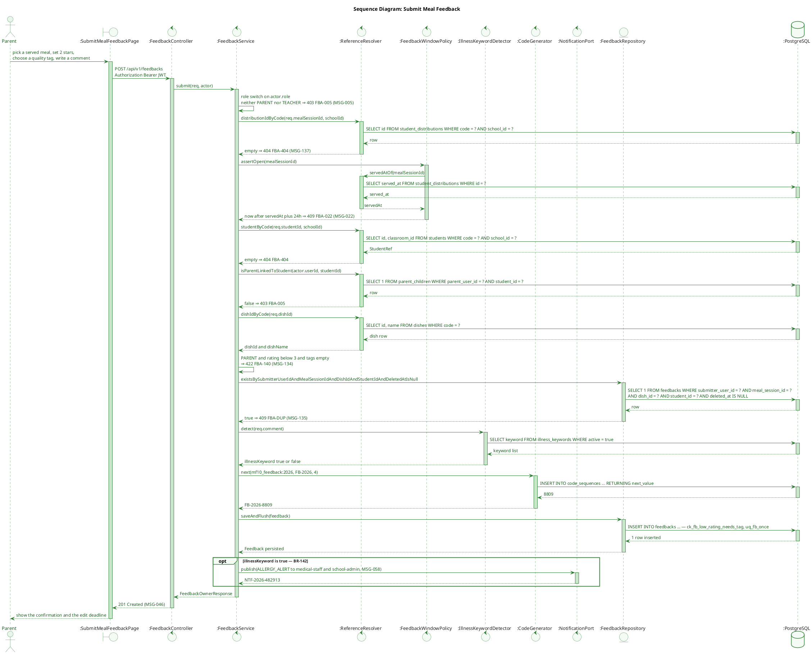

**Description.** The guards appear in the order the method runs them, cheapest first: the role switch costs nothing, then the meal-session code is resolved, then the BR-139 window, then the two ownership checks, then the BR-140 field rule, and only last the duplicate probe. Each is drawn as a self-message or as a `⇒ code` on a return arrow rather than an `alt` branch, because none of them is a fork — they are fail-fast exits, and translating them into `alt/else` is exactly what pushed the previous revision of this diagram to four levels of nesting. Every external identifier arriving in the body (`mealSessionId`, `studentId`, `dishId`) is a **business code** that `ReferenceResolver` translates into an internal UUID, so a caller cannot smuggle in a UUID for a row it should not see (`M10-D01`), and `isParentLinkedToStudent` re-checks ownership on the server instead of trusting the payload. The single genuine branch is the last one: the BR-142 alert is an `opt`, because `notifyAfterSubmit` publishes nothing when the comment is clean.

---

### 2.3 Sequence Diagram — Upload and Download Feedback Evidence (M10-D11)

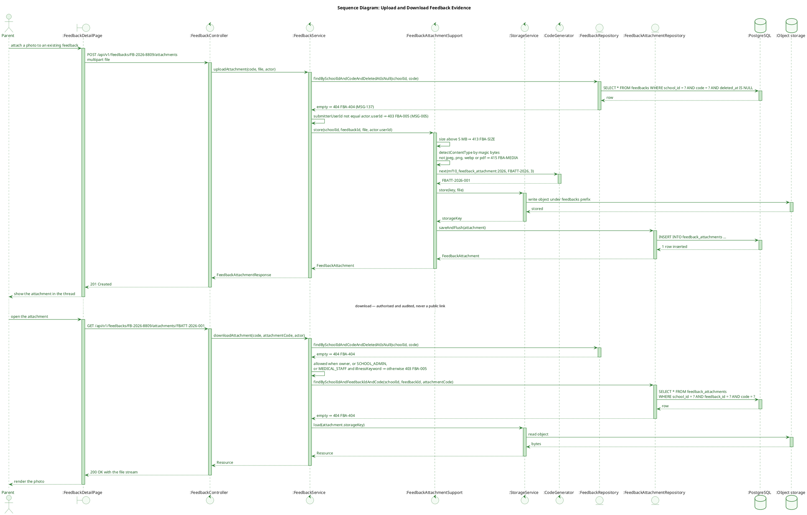

**Description.** Evidence photos are the only place MF10 touches object storage, and `M10-D11` routes them through the shared `StorageService` so the module never writes files itself. Two checks live inside `FeedbackAttachmentSupport` rather than in the controller: the 5 MB ceiling and the content type — and the type is decided by **sniffing magic bytes**, never by trusting the client header, so renaming an executable to `.jpg` fails here. The download half is the more interesting one: the file is not a public or pre-signed URL but an authorised endpoint, and its permission test is deliberately broader than the edit rule — the submitter, any School Administration user, and Medical Staff on illness-flagged rows only. That asymmetry exists because a photo attached to a suspected food-poisoning report is evidence the school nurse needs, while an ordinary complaint photo stays with its author.

---

### 2.4 Sequence Diagram — Edit & Retract Feedback (UC-046 AF1/AF2/EX1)

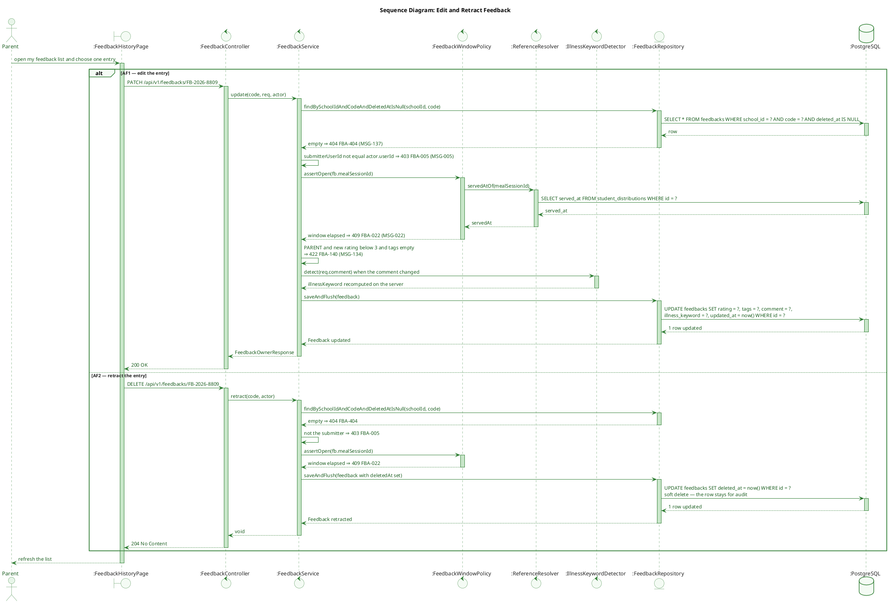

**Description.** All three branches share the same two guards in the same order — ownership first (`submitterUserId == actor.userId`), then `FeedbackWindowPolicy` — which is precisely why the diagram shows one policy lifeline serving `submit`, `update` and `retract` rather than three copies of a 24-hour comparison. `PATCH` also re-runs BR-140 and the BR-142 detector on the *new* text, so a parent cannot edit a flagged comment into an unflagged one (or vice versa) without the server re-deciding. `DELETE` sets `deleted_at` instead of removing the row: the record may already be feeding the weekly aggregate or an open incident investigation, so it disappears from every read path while remaining available for audit.

---

### 2.5 Sequence Diagram — View Feedback List & Detail with Anonymization (UC-161/162, BR-145)

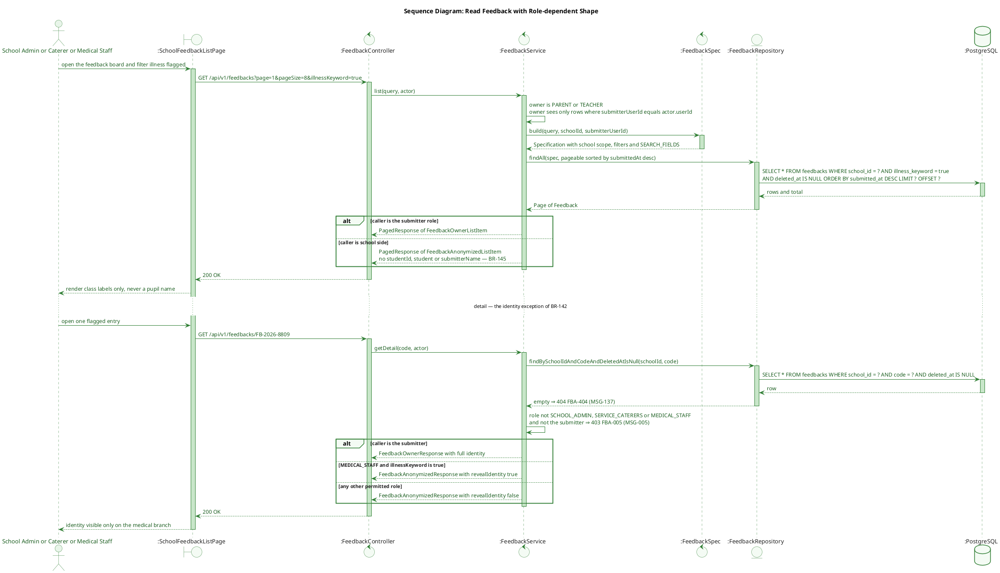

**Description.** One endpoint, two response shapes: the decision is taken inside the service from the JWT role, never from a query parameter, so there is no "give me the full version" switch a client could flip. Parents and teachers are additionally *row*-restricted (the spec receives their `submitterUserId`), while school-side roles are *field*-restricted — two different privacy mechanisms that are easy to confuse and are therefore kept visibly separate in the diagram. The one exception, Medical Staff reading a row that BR-142 already flagged, is granted inside `getDetail` as a `revealIdentity` flag on the anonymised DTO. Note what the diagram does **not** show: there is no audit write on that path. The TDS asks for one, and an earlier revision of this diagram drew an `AuditLogger` lifeline that does not exist in the merged code — deviation 9 below.

---

## 3. Feature 2 — Caterer Response to Feedback (UC-163, BR-143)

### 3.1 Class Diagram

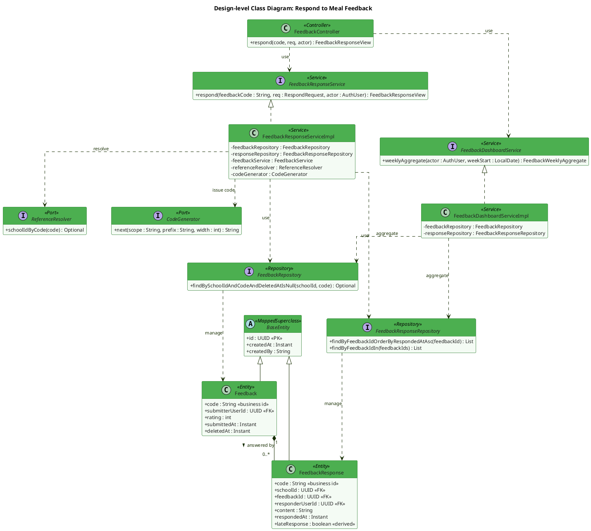

**Description.** Two services share this diagram because they share both repositories: `FeedbackResponseServiceImpl` writes replies and `FeedbackDashboardServiceImpl` reads the same two tables to build the weekly aggregate (BR-141). The reply path reuses `FeedbackRepository` only to *load* the target and never to mutate it — a reply is a new row in `feedback_responses`, so the original feedback stays byte-identical to what the parent wrote. Two rules from UC-163 land in different places: the "no blank reply" rule is a hard rejection (service `FBA-REQ` plus a DB `CHECK`), while the "48-hour" rule is only a *recording* (`lateResponse = true`) because the use case asks the system to *log the delay*, not to prevent a late apology. The absence of `FeedbackWindowPolicy` is intentional and is the module's clearest example of two business rules protecting two different actors: BR-139 closes the parent's edit window after 24 hours, BR-143 leaves the caterer's reply channel open indefinitely. `FeedbackResponseServiceImpl` depending on the `FeedbackService` **interface** is drawn as it is in the code (deviation 6) — an interface dependency, so no layering rule is broken.

---

### 3.2 Sequence Diagram — Respond to a Feedback Item

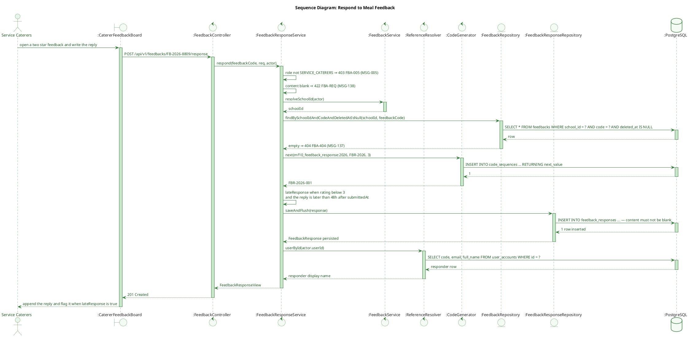

**Description.** The reply flow reads the target feedback for two reasons only — to prove it exists inside the caller's school and to read `rating` and `submittedAt` for the 48-hour lateness computation — and then writes a brand-new row. Because `lateResponse` is derived from the *original* submission timestamp rather than from a stored SLA field, it stays correct even if the reply arrives months later. What the code does **not** do is notify the parent: `respond()` writes the reply row and returns, so the submitter only finds the answer by re-opening the app. UC-046 promises the opposite — that the parent can view the caterer response — and the diagram shows the gap rather than an aspirational `NotificationPort` call (deviation 10 below).

---

## 4. Feature 3 — Announcement Management (UC-017, UC-089, UC-105, UC-125, UC-126)

### 4.1 Class Diagram

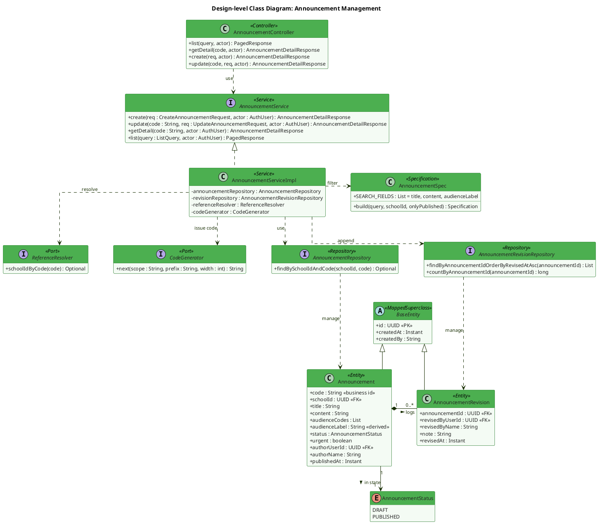

**Description.** `AnnouncementServiceImpl` is the only class allowed to write either table, and it writes them together: no code path updates an announcement without appending a revision. The split between `audienceCodes` (a JSONB list with a GIN index) and `audienceLabel` (a derived display string) is what makes role/grade-scoped visibility implementable at all — the mock's single free-text `audience` field is why every role currently sees every announcement (`review.md` H7). `AnnouncementSpec` takes an `onlyPublished` flag rather than reading the role itself, keeping the filter object testable in isolation while the service decides policy. Note what is **not** on this diagram: `AnnouncementServiceImpl` has no edge to `NotificationPort`, because the merged code injects only four dependencies and publishes nothing when an announcement goes live. That contradicts BR-138 and is recorded as deviation 2 rather than drawn as an aspiration.

---

### 4.2 Sequence Diagram — Create Announcement (Draft or Publish) (UC-017, BR-138/144)

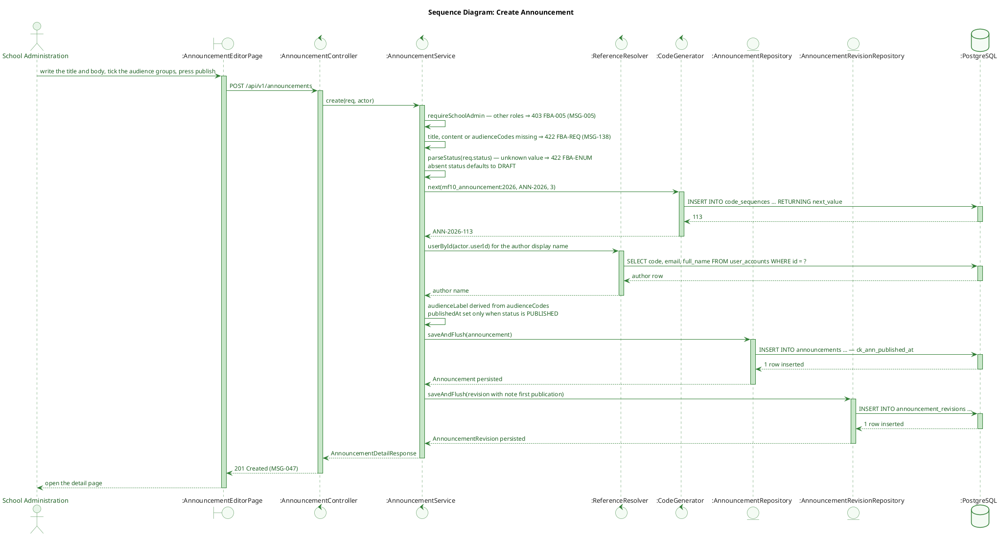

**Description.** Creation and publication are one call, distinguished only by the `status` field, which is why `publishedAt` is set as the row is built rather than by a separate publish endpoint — there is no window in which a `PUBLISHED` row exists without its timestamp, and `ck_ann_published_at` makes that structural. A missing `status` defaults to `DRAFT`, so a client that forgets the field cannot accidentally broadcast to parents. The first revision is written even for a draft, so the BR-144 trail starts at creation rather than at the first edit. Two things the TDS expects are absent from the code and therefore from this diagram: HTML sanitisation of `content` (deviation 11) and the BR-138 dispatch on publish (deviation 2).

---

### 4.3 Sequence Diagram — Update & Publish Announcement (UC-089, BR-144)

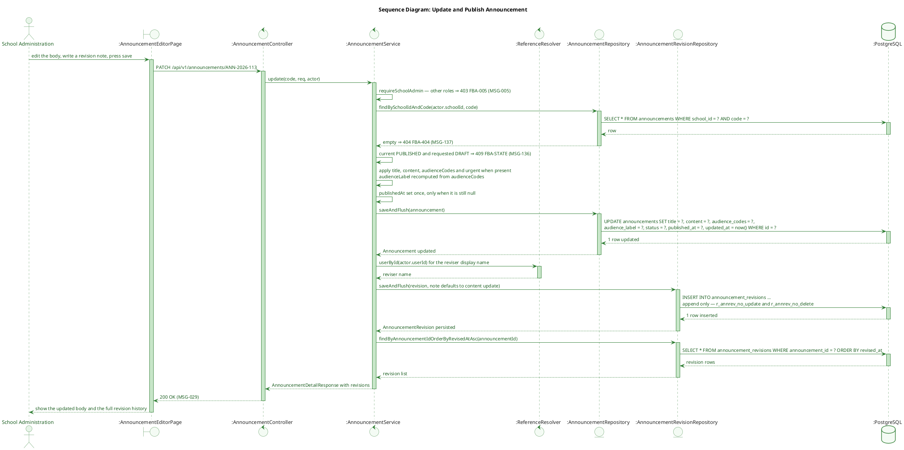

**Description.** Every successful `PATCH` writes exactly two rows — the updated announcement and one new revision — and the revision's author is read from the JWT rather than from the request body, which is what makes the BR-144 trail non-forgeable (the mock takes `editor` from the payload, so history there can be written under any name). `publishedAt` is set the first time the status becomes `PUBLISHED` and never touched again, so later typo fixes do not silently move the moment parents were notified. The `PUBLISHED → DRAFT` request is refused explicitly with `FBA-STATE` rather than ignored, because a silent no-op would leave the administrator believing the notice had been withdrawn.

---

### 4.4 Sequence Diagram — View Announcements Filtered by Role & Audience (UC-125/126/105, CF-M10-6)

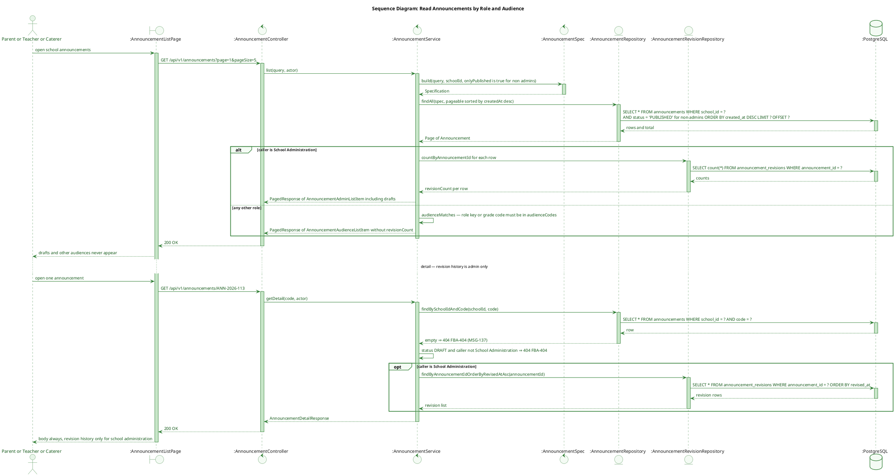

**Description.** Two orthogonal filters decide visibility, and the diagram keeps them separate on purpose: `publishedOnly` is pushed into the `Specification` (a SQL `WHERE`), while `audienceMatches` currently runs in Java after paging. Both must hold — a test that only verifies the draft rule would still allow a grade-1 parent to read a grade-3 notice. Revision history is a third, finer-grained decision: it is not merely omitted from the payload for non-administrators, it is never even queried, so the extra `count`/`select` cost is only paid by the one role entitled to see it (UC-105 step 5).

---

## 5. Feature 4 — In-App, Push & Email Notification (UC-058, UC-136, UC-088)

### 5.1 Class Diagram

```plantuml
@startuml MF10_F4_ClassDiagram
title Design-level Class Diagram: Notification Dispatch and Inbox

' ==========================================
' LAYOUT AND RATIONAL ROSE COLOUR SCHEME
' Top-level skinparam only — the nested block form
' is not used in class diagrams (guide section 6).
' ==========================================
skinparam classAttributeIconSize 0
skinparam linetype ortho
skinparam nodesep 60
skinparam ranksep 60
skinparam backgroundColor #FFFFFF

' Vertical layout: web -> service -> repository -> domain
top to bottom direction
hide empty members

' Class / Abstract Class
skinparam classBackgroundColor #F4FBF4
skinparam classBorderColor #2E7D32
skinparam classFontColor #212121
skinparam classFontSize 13
skinparam classHeaderBackgroundColor #4CAF50
skinparam classAttributeFontColor #212121
skinparam classAttributeFontSize 12

' Interface
skinparam interfaceBackgroundColor #f7ed93ff
skinparam interfaceBorderColor #000000ff
skinparam interfaceFontColor #000000ff

' Relationships & Arrows
skinparam arrowColor #162c00ff
skinparam arrowFontColor #162c00ff
skinparam arrowFontSize 11

' Stereotype icons
skinparam stereotypeCBackgroundColor #f6eedcff
skinparam stereotypeCBorderColor #000000ff
skinparam stereotypeEBackgroundColor #f6eedcff
skinparam stereotypeEBorderColor #000000ff
skinparam stereotypeABackgroundColor #f6eedcff
skinparam stereotypeABorderColor #000000ff
skinparam stereotypeIBackgroundColor #f6eedcff
skinparam stereotypeIBorderColor #000000ff

' ────────── mf10.web ──────────
class NotificationController <<Controller>> {
  +list(query, actor) : PagedResponse
  +markRead(code, actor) : void
}
class NotificationPreferenceController <<Controller>> {
  +getMine(actor) : NotificationPreferenceResponse
  +updateMine(req, actor) : NotificationPreferenceResponse
}
class DeviceTokenController <<Controller>> {
  +register(req, actor) : void
  +unregister(token, actor) : void
}

' ────────── mf10.port ──────────
interface NotificationPort <<Port>> {
  +publish(command : NotificationCommand) : String
}
class NotificationPortImpl <<Adapter>> {
  -notificationRepository : NotificationRepository
  -codeGenerator : CodeGenerator
  -broadcaster : NotificationBroadcaster
  +publish(command) : String
}
interface PushGatewayPort <<Port>> {
  +sendToTokens(tokens : List, title : String, body : String, data : Map) : List
}

' ────────── mf10.service ──────────
interface NotificationService <<Service>> {
  +listForCurrentUser(query : ListQuery, actor : AuthUser) : PagedResponse
  +markRead(code : String, actor : AuthUser) : void
  +getMyPreference(actor : AuthUser) : NotificationPreferenceResponse
  +updateMyPreference(req : UpdatePreferenceRequest, actor : AuthUser) : NotificationPreferenceResponse
}
class NotificationServiceImpl <<Service>> {
  -notificationRepository : NotificationRepository
  -readRepository : NotificationReadRepository
  -preferenceRepository : NotificationPreferenceRepository
  -referenceResolver : ReferenceResolver
}
class NotificationBroadcaster <<Component>> {
  -messagingTemplate : SimpMessagingTemplate
  +broadcast(n : UserNotification) : void
}
class PushNotificationServiceImpl <<Service>> {
  -deviceTokenRepository : DeviceTokenRepository
  -pushGatewayPort : PushGatewayPort
  +sendToUser(userId, title, body, data) : void
}
class DeviceTokenServiceImpl <<Service>> {
  -repository : DeviceTokenRepository
  +register(request, actor) : void
  +unregister(token, actor) : void
}

' ────────── mf10.repository ──────────
interface NotificationRepository <<Repository>> {
  +findVisibleToSchool(schoolId) : List
  +findByCode(code) : Optional
}
interface NotificationReadRepository <<Repository>> {
  +findByUserIdAndNotificationIdIn(userId, ids) : List
  +existsByNotificationIdAndUserId(notificationId, userId) : boolean
}
interface NotificationPreferenceRepository <<Repository>> {
  +findById(userId) : Optional
}
interface NotificationDeliveryRepository <<Repository>> {
  +findByStatusInAndNextRetryAtBefore(statuses, now) : List
}
interface DeviceTokenRepository <<Repository>> {
  +findByUserId(userId) : List
  +findByToken(token) : Optional
}

' ────────── mf10.domain ──────────
abstract class BaseEntity <<MappedSuperclass>> {
  +id : UUID <<PK>>
  +createdAt : Instant
  +createdBy : String
}
class UserNotification <<Entity>> {
  +code : String <<business id>>
  +schoolId : UUID <<FK>>
  +audience : NotificationAudience
  +recipientRoles : List
  +type : NotificationType
  +title : String
  +content : String
  +link : String
  +linkLabel : String
  +sentAt : Instant
  +isCritical() : boolean <<derived>>
}
class NotificationRead <<Entity>> {
  +notificationId : UUID <<FK>>
  +userId : UUID <<FK>>
  +readAt : Instant
}
class NotificationDelivery <<Entity>> {
  +notificationId : UUID <<FK>>
  +userId : UUID <<FK>>
  +channel : Channel
  +attempt : int
  +status : DeliveryStatus
  +nextRetryAt : Instant
  +lastError : String
}
class NotificationPreference <<Entity>> {
  +userId : UUID <<PK>>
  +typeEnabled : Map
  +emailFallback : boolean
  +quietStart : LocalTime
  +quietEnd : LocalTime
  +createdAt : Instant
  +updatedAt : Instant
}
class DeviceToken <<Entity>> {
  +userId : UUID <<FK>>
  +token : String
  +platform : DevicePlatform
  +lastUsedAt : Instant
}
enum NotificationType <<external>> {
  MENU_PUBLISHED
  INSPECTION_ALERT
  CAPA_ASSIGNED
  EXPIRY_ALERT
  INCIDENT_ALERT
  FOOD_RECALL
  ALLERGY_ALERT
}
enum NotificationAudience {
  ALL
  ROLES
}
enum DeliveryStatus {
  QUEUED
  DEFERRED
  SENT
  FAILED
  FALLBACK_EMAIL
}
enum Channel {
  PUSH
  EMAIL
}
enum DevicePlatform {
  ANDROID
  IOS
  WEB
}

' ═══════════ Relationships ═══════════
NotificationController           ..> NotificationService     : «use»
NotificationPreferenceController ..> NotificationService     : «use»
DeviceTokenController            ..> DeviceTokenServiceImpl  : «use»
NotificationPort  <|.. NotificationPortImpl
NotificationService <|.. NotificationServiceImpl
NotificationPortImpl    ..> NotificationRepository   : «use»
NotificationPortImpl    ..> NotificationBroadcaster  : «broadcast»
NotificationServiceImpl ..> NotificationRepository   : «use»
NotificationServiceImpl ..> NotificationReadRepository : «use»
NotificationServiceImpl ..> NotificationPreferenceRepository : «use»
PushNotificationServiceImpl ..> DeviceTokenRepository : «use»
PushNotificationServiceImpl ..> PushGatewayPort       : «send»
DeviceTokenServiceImpl  ..> DeviceTokenRepository     : «use»
NotificationRepository  ..> UserNotification          : «manage»
NotificationReadRepository ..> NotificationRead       : «manage»
NotificationPreferenceRepository ..> NotificationPreference : «manage»
NotificationDeliveryRepository ..> NotificationDelivery : «manage»
DeviceTokenRepository   ..> DeviceToken               : «manage»

BaseEntity <|-- UserNotification
BaseEntity <|-- NotificationRead
BaseEntity <|-- NotificationDelivery
BaseEntity <|-- DeviceToken

UserNotification "1" --> "0..*" NotificationRead     : read by >
UserNotification "1" --> "0..*" NotificationDelivery : delivered by >
UserNotification "1" --> "1" NotificationType     : typed as >
UserNotification "1" --> "1" NotificationAudience : targets >
NotificationDelivery "1" --> "1" DeliveryStatus : in state >
NotificationDelivery "1" --> "1" Channel        : over >
DeviceToken "1" --> "1" DevicePlatform : on >

' ═══════════════════════════════════════════════════════════════
' Layout: [hidden] links only.
' ═══════════════════════════════════════════════════════════════
NotificationController  -[hidden]-> NotificationPort
NotificationPort        -[hidden]-> NotificationService
NotificationService     -[hidden]-> NotificationRepository
NotificationRepository  -[hidden]-> BaseEntity

NotificationController  -[hidden]right-> NotificationPreferenceController
NotificationPreferenceController -[hidden]right-> DeviceTokenController
NotificationPort        -[hidden]right-> PushGatewayPort
NotificationPortImpl    -[hidden]right-> NotificationServiceImpl
NotificationServiceImpl -[hidden]right-> NotificationBroadcaster
NotificationBroadcaster -[hidden]right-> PushNotificationServiceImpl
PushNotificationServiceImpl -[hidden]right-> DeviceTokenServiceImpl
NotificationRepository  -[hidden]right-> NotificationReadRepository
NotificationReadRepository -[hidden]right-> NotificationPreferenceRepository
NotificationPreferenceRepository -[hidden]right-> NotificationDeliveryRepository
NotificationDeliveryRepository -[hidden]right-> DeviceTokenRepository
UserNotification    -[hidden]right-> NotificationRead
NotificationRead    -[hidden]right-> NotificationDelivery
NotificationDelivery -[hidden]right-> NotificationPreference
NotificationPreference -[hidden]right-> DeviceToken
NotificationType    -[hidden]right-> NotificationAudience
NotificationAudience -[hidden]right-> DeliveryStatus
DeliveryStatus      -[hidden]right-> Channel
Channel             -[hidden]right-> DevicePlatform
DeviceToken         -[hidden]-> NotificationType
@enduml
```

**Description.** The module exposes exactly one write door — `NotificationPort` — and everything behind it is private to MF10, which is the structural reason quiet hours (BR-158), per-type opt-out (BR-158b) and retry/fallback (BR-159) *can* be one implementation rather than five copies. Reading is split from writing: `NotificationServiceImpl` serves the bell and the preferences screen, while `NotificationPortImpl` persists the row and hands off to `NotificationBroadcaster` for the live STOMP push. Two facts are deliberately not stored — `critical` (derived from `type`) and `read` (derived from a per-user row in `notification_reads`) — because storing either would let one caller's or one recipient's action be mistaken for a global truth. `NotificationDelivery` and `DeliveryStatus` are drawn because the table and enum exist in `V18`, but nothing writes them yet: `NotificationDeliveryRepository` has no incoming dependency edge, which is the diagram's honest way of showing deviation 4. `NotificationPreference` is the one entity that does not inherit `BaseEntity` — its PK is `user_id`, so it declares its own audit columns (deviation 7).

---

### 5.2 Sequence Diagram — Publish a Notification through NotificationPort (UC-058)

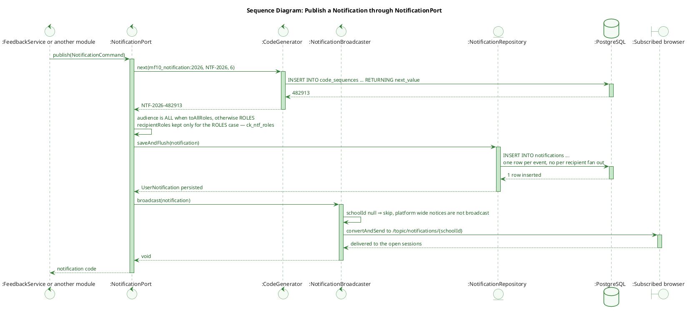

**Description.** This is the whole of what `publish()` does today, and it is deliberately short: issue a code, write **one** `notifications` row per event — not one per recipient — and hand it to `NotificationBroadcaster`, which pushes it to the school STOMP topic so open browsers update without polling. `NotificationPort` is the only write door into that table, which is what would let the BR-158/158b/159 policy live in a single place. Would, not does: no per-recipient pipeline exists yet. `notification_deliveries`, `QuietHoursPolicy` and the retry scheduler are in the TDS and the table has existed since `V18`, but nothing writes it, so drawing them here would describe behaviour the system does not have (deviation 4). The one conditional that is real sits inside the broadcaster: a platform-wide notice has no `schoolId` and therefore no topic, so it is stored and never broadcast.

---

### 5.3 Sequence Diagram — Notification Inbox & Per-User Read State (UC-136, CF-M10-10)

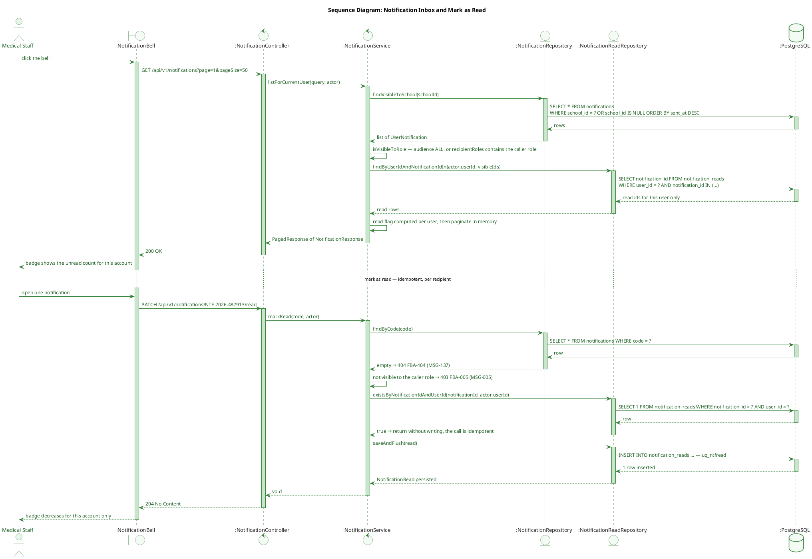

**Description.** The last three interactions exist to make one invariant visible: user B's view is unaffected by user A marking the same notification read, because "read" is a row in `notification_reads` rather than a column on `notifications`. `markRead` is idempotent by construction — the service checks first and the `uq_ntfread` unique index catches the race — so a double-click or a retried request cannot create duplicates. Role visibility is re-evaluated on both read and write paths, so a user cannot mark read (and thereby confirm the existence of) a notification addressed to a different role.

---

### 5.4 Sequence Diagram — Manage Notification Preferences (UC-088, BR-158b)

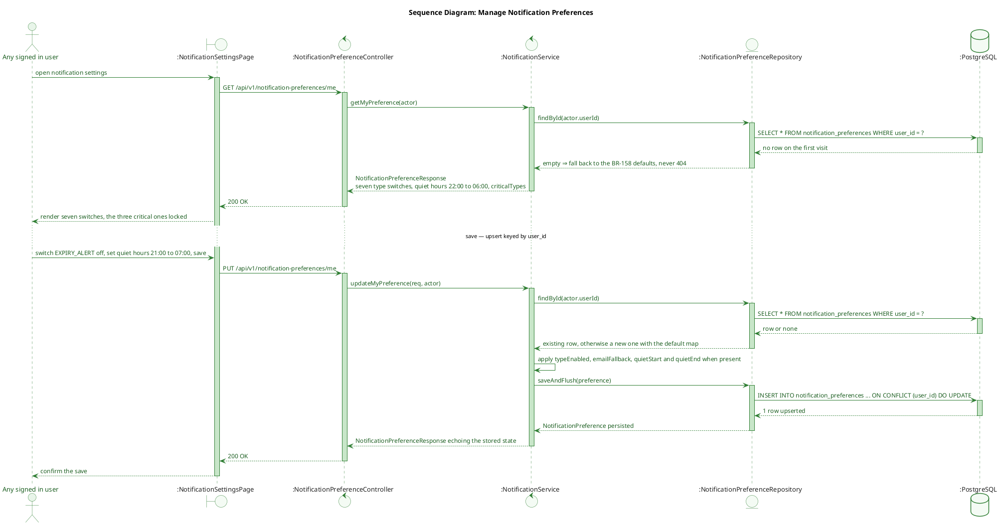

**Description.** The endpoint answers with the BR-158 defaults when no row exists yet, so a first-time user and a configured user are indistinguishable to the client — no empty-state branch, and no chance of the frontend inventing a second set of defaults. Saving is an upsert keyed by `user_id`, matching the table primary key, and each field is applied only when present so a partial payload cannot silently reset the others. The response carries `criticalTypes` so the UI can lock those three switches; the API still accepts a request that turns one off, because refusing it would misreport what was stored. Whether that stored preference is ever honoured is a different question — the dispatcher that would read it is not built (deviation 4).

---

## 6. Entity Lifecycles (State Charts)

> **One state chart, not four.** The decision follows the review guide section 5.1b — count the values the
> code actually writes, do not read the TDS. `grep -rn "setStatus(|setActive(|setState(" com/sfms/mf10`
> returns exactly three call sites outside the setters themselves, and all three are
> `AnnouncementServiceImpl` writing `AnnouncementStatus`. Everything else fails the test; section 6.2
> records why, because a removed diagram is a design statement too.

### 6.1 State Chart — Announcement (UC-017 / UC-089)

```plantuml
@startuml MF10_S1_AnnouncementState
title State Diagram: Announcement Lifecycle

' Orthogonal connector mode
skinparam linetype ortho

' ==========================================
' GREEN COLOUR SCHEME
' ==========================================
skinparam backgroundColor #FFFFFF

' ==========================================
' State
' ==========================================
skinparam state {
    BackgroundColor #F4FBF4
    BorderColor #2E7D32
    FontColor #212121
    FontSize 13
}

' ==========================================
' Arrow
' ==========================================
skinparam arrow {
    Color #2E7D32
    FontColor #1B5E20
    FontSize 12
}

' ==========================================
' Start / End
' ==========================================
skinparam startColor #2E7D32
skinparam endColor #2E7D32

[*] --> DRAFT : save as draft
[*] --> PUBLISHED : create and publish

DRAFT --> PUBLISHED : publish
@enduml
```

**Description.** Two states and three transitions is the whole lifecycle, because `create` accepts either
status and `update` is the only other writer. Content edits are **not** drawn as self-transitions: they
change `title`, `content`, `audienceCodes` and append a revision, but they never touch `status`, so under
the guide they belong in prose rather than on the chart. `PUBLISHED -> DRAFT` is likewise absent — the
service rejects it with `FBA-STATE`, and a transition the code refuses to perform is not part of the
machine. There is no final `[*]`: the module exposes no delete endpoint, so `PUBLISHED` is a legitimate
terminal resting state that simply never ends.

### 6.2 Lifecycles deliberately not drawn

| Candidate | What the code shows | Why no chart |
|---|---|---|
| `Feedback` "editable / locked / retracted" | No status column at all. `setDeletedAt` is called from exactly one method, `retract()` | `EDITABLE` and `LOCKED` are a **guard inside** `FeedbackWindowPolicy.assertOpen` comparing `now()` against `servedAt + 24h` — a condition, not a position in a lifecycle. Drawing them repeats the mistake the guide records for MF08's `RETAINED{WithinHold/Eligible/Locked}`. The 24-hour rule is visible where it actually runs: the `assertOpen` self-message in the sequence charts and `FeedbackWindowPolicy.WINDOW` in the class diagram |
| `DeliveryStatus` (`QUEUED`/`DEFERRED`/`SENT`/`FAILED`/`FALLBACK_EMAIL`) | `setStatus` exists on `NotificationDelivery` but **no service, port or scheduler calls it** — zero write sites | Zero writes means no lifecycle to chart yet. The enum, the table (`V18`) and the BR-158/159 intent are all real, but the dispatcher that would drive them is not built (deviation 4 below). Charting it would describe behaviour the system does not have |
| Per-recipient read state | Not an enum and not a column — "read" is the existence of a `notification_reads` row | A two-value derived predicate. The design decision it encodes (per-user rather than global) is already carried by the `notification_reads` entity and its `uq_ntfread` unique key in the class diagram |
| `IllnessKeyword.active`, `NotificationAudience`, `Channel`, `DevicePlatform`, `SubmitterRole`, `FeedbackScope`, `PortionSize` | Set once at creation, or a static classification label | Category flags, not lifecycles |

---

## Appendix — Cross-Feature Notes

### A. Where each business rule is enforced

| Rule | Enforcement point | Second line of defence |
|---|---|---|
| **BR-138** urgent notice, no approval step | `NotificationPortImpl.publish` + `isCritical()` derived from `type` | `critical` is not a column, so no caller can self-declare it (`M10-D07`) |
| **BR-139** 24h feedback window | `FeedbackWindowPolicy.assertOpen` — used by `submit`, `update`, `retract` | none possible at DB level (depends on `now()` + MF09 `served_at`) → §2.2/§2.4 tests |
| **BR-140** low rating needs a tag | `FeedbackServiceImpl.submit/update` → `FBA-140` | `ck_fb_low_rating_needs_tag` |
| **BR-141** weekly aggregate | `FeedbackDashboardService.weeklyAggregate` | cron job not yet implemented (TDS §2.5 debt) |
| **BR-142** illness keyword screening | `IllnessKeywordDetector` + `illness_keywords` table | client-sent `illnessKeyword` discarded (`M10-D14`) |
| **BR-143** caterer reply | `FeedbackResponseServiceImpl.respond` (append) | `content` non-blank `CHECK` |
| **BR-144** revision history | `AnnouncementServiceImpl.addRevision` on every create/update | DB RULEs `r_annrev_no_update` / `r_annrev_no_delete` |
| **BR-145** anonymized aggregates | two DTO families chosen by JWT role | `M10-D13` `oneOf` in `/v3/api-docs` so the contract is visible to FE codegen |
| **BR-158/158b** quiet hours | `QuietHoursPolicy.shouldDefer` (per-recipient preference) | defaults returned when no row exists |
| **BR-159** retry then email | `DeliveryRetryScheduler` | `attempt <= 3` `CHECK` |

### B. Identifier and shape conventions used in every diagram

- **`id` in JSON is the business code** (`FB-2026-8809`, `ANN-2026-113`, `NTF-2026-482913`, `FBR-2026-001`); UUIDs never leave the server (`M10-D01`). Path params use the code.
- **Foreign keys in JSON are the target's code** (`studentId: "HS-3A-001"`, `dishId: "DISH-018"`); foreign keys in the database stay UUID.
- **Dates are ISO-8601** — `"2026-07-01"` (`LocalDate`) / `"2026-07-01T13:15:00Z"` (`Instant`); `publishedAt` is `null`, never `""` (`M10-D10`).
- **Errors use the D2 envelope** `{ error: { code, message, details[] } }` with English messages (D7). MF10 codes: `FBA-005` (403), `FBA-022` (409), `FBA-140` (422), `FBA-REQ` (422), `FBA-DUP` (409), `FBA-STATE` (409), `FBA-404` (404), `FBA-409` (409).
- **List endpoints return** `{ items, total, page, pageSize, pageCount }` with `pageCount >= 1` and an empty result as `200`, never `404` (Team Plan §2b).

### C. Known deviations between the merged code and the TDS

| # | TDS says | Merged code does | Handling |
|---|---|---|---|
| 1 | `MealServingPort` is an MF10-declared port for MF09's `servedAt` (TDS ADR-M10-1, section 8.1) | No such port — `FeedbackWindowPolicy` and `FeedbackServiceImpl` call the shared `ReferenceResolver` | **Cosmetic.** `M10-D06` already supersedes the ADR; diagrams drawn from the code |
| 2 | Publishing an announcement raises a notification through `NotificationPort` (BR-138, TDS section 7.1 `AnnouncementPublished`) | `AnnouncementServiceImpl` injects only 4 dependencies — **no `NotificationPort`**; nothing is published | **Doc gap.** Root cause is real: none of the 7 shared `NotificationType` values means "announcement published" (D6). Endpoint not built; the class diagram shows no such edge |
| 3 | A negative rating raises MSG-057 to the caterers (TDS section 7.1 `NegativeFeedbackRaised`) | `notifyAfterSubmit` publishes the BR-142 alert only; the `rating < 3` branch is commented out for the same missing enum value | **Doc gap.** Awaiting Huy's decision on extending the shared enum |
| 4 | BR-158/158b/159 dispatch pipeline — quiet hours, retry cap, email fallback (TDS section 6.4) | `notification_deliveries` table exists since `V18`; **no code writes it**. `NotificationPortImpl` persists the notification row and broadcasts over STOMP, nothing more | **Doc gap.** Blocked on the per-school-and-role user list that MF01 does not expose. No state chart drawn (section 6.2) |
| 5 | TDS section 7 lists 10 domain events | `grep publishEvent com/sfms/mf10` returns **0** | **Cosmetic.** No queue or outbox lifeline appears in any diagram |
| 6 | `FeedbackResponseService` is independent of `FeedbackService` | `FeedbackResponseServiceImpl` injects the `FeedbackService` **interface** to reuse school resolution | **Cosmetic.** Interface, not implementation, so no ADR breach; drawn as a dependency |
| 7 | Every MF10 entity extends `BaseEntity` (`M10-D02`) | Nine do; **`NotificationPreference` does not** — its PK is `user_id`, so it declares its own four audit columns | **Cosmetic.** Diagram omits the inheritance edge for that one entity, matching the code |
| 8 | `IllnessKeywordDetector.detect(comment, tags)` (TDS section 8.1) | Signature is `detect(String text)` — a single argument | **Cosmetic.** Class diagram follows the code |
| 9 | ADR-M10-5: a Medical Staff read of an illness-flagged row reveals the pupil identity **and is audited** | `getDetail` sets `revealIdentity` and returns; **no audit record is written** | **Raise issue.** The exception is the module's only lawful PII disclosure, and without a trail it cannot be distinguished from a leak after the fact. Drawn as the code behaves |
| 10 | TDS section 7.1 event `FeedbackResponded`; UC-046 says the submitter can view the caterer reply | `respond()` persists the reply and returns — no `NotificationPort` call | **Doc gap.** The parent is never told. Endpoint not built; no notification arrow in the diagram |
| 11 | TDS section 4.3: announcement `content` is sanitised before persisting — the largest stored-XSS surface in the system | `grep -rn "sanitiz|Jsoup|escapeHtml" com/sfms/mf10` returns **0**; `create` and `update` store the body verbatim | **Raise issue.** Announcements are broadcast to every parent of a school, so this is the highest-value XSS sink in the module. Diagram shows no sanitise step |


---

### D. Scope note — how this file was verified

All sixteen diagrams were reworked against `MF04_Supplier_Partner_Management/Design-Diagram-Review-Guide.md`
v1.2 and verified with the guide's own tooling, not by eye:

| Check | Result |
|---|---|
| Guide section 8.2 script, all 16 diagrams | **OK 16/16** — no `package`, no `o--`, no nested `skinparam` in class diagrams, no double stereotype, no `FontName Arial`, no white font, no Vietnamese, no `note`, no `collections` or `queue` lifelines, `alt` nesting at most 2, `activate` and `deactivate` balanced |
| Guide section 8.1 render, PlantUML 1.2024.7 with smetana | **16/16 clean**, no warnings |
| Guide section 8.3 aspect ratio, class diagrams and state chart | `F1` 1.06 · `F2` 1.06 · `F3` 1.12 · `F4` 1.12 · state chart 1.04 — all inside 0.7 – 1.2 |
| State charts | 4 → **1** (guide section 5.1b); the three removed are justified in section 6.2 |
| Sequence diagrams | 11 kept. The former *Submit Feedback — Error Paths* diagram was dropped once its guards became `⇒ code` self-messages on the main flow, and its slot reused for the attachment upload and download flow, which had no diagram before (guide section 4.6) |

Three statements in the previous revision described behaviour the merged code does not have — an
`AuditLogger` lifeline, a `NotificationPort` call after a caterer reply, and a `sanitize(content)` step.
All three were removed from the diagrams and recorded as deviations 9, 10 and 11 instead of being drawn
as if they existed.

---|---|
| Guide section 8.2 script, class + state charts | **OK 5/5** — no `package`, no `o--`, no nested `skinparam`, no double stereotype, no `Arial`, no white font, no Vietnamese, no `entry`/`do`, no notes |
| Guide section 8.1 render, PlantUML 1.2024.7 + smetana | **5/5 clean**, no warnings |
| Guide section 8.3 aspect ratio | `F1` 1.06 · `F2` 1.06 · `F3` 1.12 · `F4` 1.12 · state chart 1.04 — all inside 0.7 – 1.2 |
| State charts | 4 → **1** (guide section 5.1b); the three removed are justified in section 6.2 |

The **eleven sequence diagrams were left untouched** and still fail the guide's section 4 rules — they
carry `skinparam FontName Arial`, white group-header text, Vietnamese labels, `note` blocks, and
`MF10_F4_DispatchNotification` nests `alt` four deep against a limit of two. They also draw repositories
as `collections` where the guide fixes `entity`, and a `queue` lifeline for a STOMP topic. Reworking them
is a separate pass.

---

*Diagrams derived from `TDS-MF10_Backend.md` (`M10-D01` … `M10-D14`), Flyway `V18` / `V19` / `V34`, and the merged implementation in `com.sfms.mf10`. House style matches `MF08_Design_Diagrams.md`: Rational-Rose class palette, robustness-stereotype sequence lifelines with explicit returns, and green-tone state charts.*
