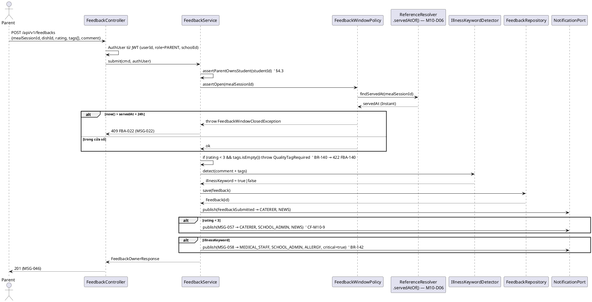
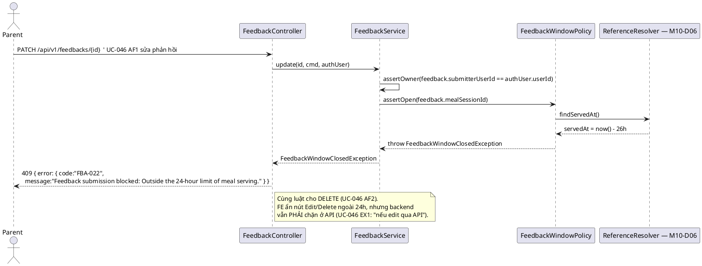
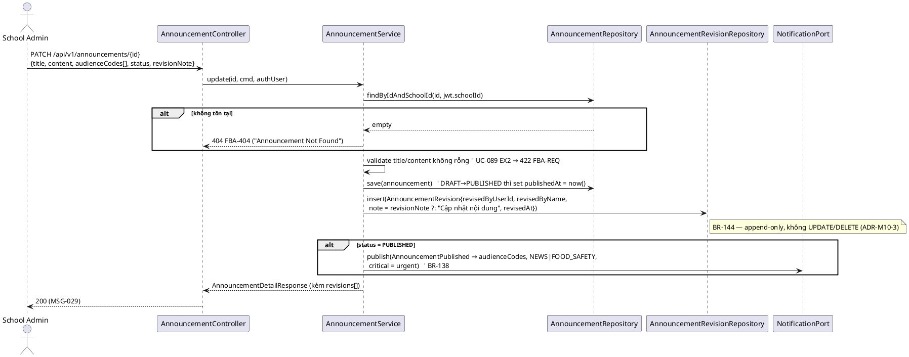
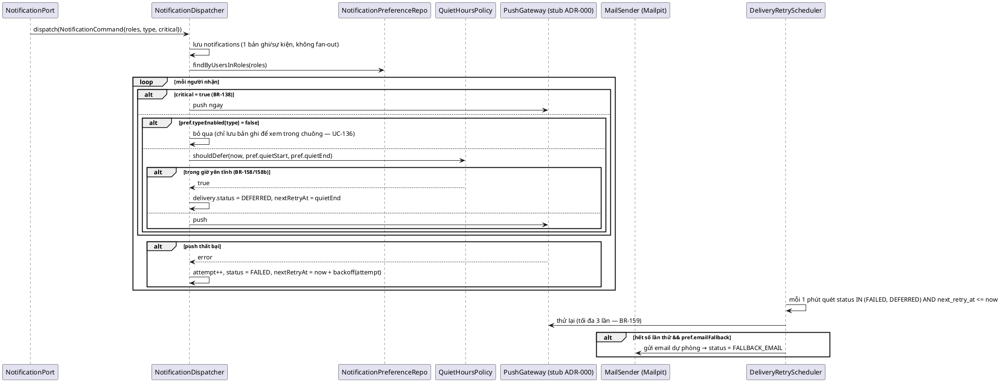
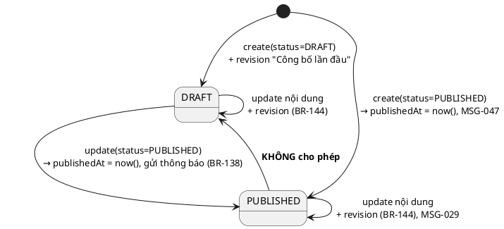
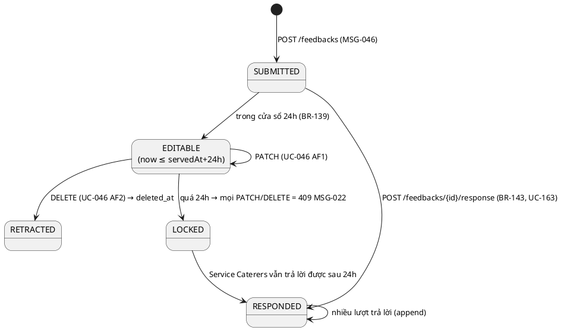

# ENGINEERING DOCUMENTATION STANDARD (EDS) v2.0 — TDS Backend
# MF10 — Feedback & Announcement Management

| Field | Value |
|-------|-------|
| **Document ID** | `SFMS-MF10-IMP-001` |
| **Version** | `1.3` |
| **Date** | `2026-07-28` *(v1.1: 2026-08-03; v1.2: 2026-08-04; v1.3: 2026-08-04)* |
| **Status** | `Approved` — **Backend ✅**, **Frontend 🟡 (Bước 2b+3, 2/4 resource — 2026-08-04)**: `announcements`/`notification-preferences` nối thật, `feedbacks`/`notifications` còn mock (xem `real-resources.ts`) |
| **Document Owner** | Nguyễn Đức Mạnh (ManhNDHE160692) |
| **Author** | Nguyễn Đức Mạnh — Lead Backend & DB Reviewer (chủ MF04, MF08, **MF10**) |
| **Reviewed by** | `[Huy — §2 Traceability | Minh — §8/§9 FE↔BE contract | Thảo — §13 Test]` Pending |
| **DPO Sign-off** | `[ ] Pending` — **module có PII**: phản hồi gắn học sinh + phụ huynh (BR-145 yêu cầu ẩn danh khi tổng hợp) |
| **Approved by** | `[Nguyễn Văn Nam — Principal Architect]` Pending |
| **Last Review** | `2026-08-03` |
| **Based on EDS** | `v2.0` |

> **Stack (ADR-000 / `01_MVP_Backend_Implementation_Plan.md` §3):** Spring Boot **4.1.x (Java 25 LTS)** · PostgreSQL 16 · **Flyway** (🔴 **`M10-D05`**: mô hình *"V1 = toàn bộ schema, do Nam giữ"* **đã bị bỏ từ MF02** — mỗi module một file `V{n}__`; MF10 dùng **`V18`/`V19`**) · **Spring Security + JWT** (RBAC 7 role, tin cậy JWT do MF01 phát hành) · springdoc-OpenAPI (Swagger) · MapStruct.
>
> **MF10 là module P2** (`00_Team_Work_Assignment_Plan.md` §3) — kế thừa nguyên convention của **MF02** (vertical slice mẫu): `PagedResponse<T>` + `Specification` (§2b kế hoạch), `@RestControllerAdvice` + error-code catalog, MapStruct, tham chiếu module khác **bằng ID**. Tài liệu này **không** định nghĩa lại các pattern đó, chỉ trỏ về MF02 và khai phần riêng của MF10.

---

## CHANGELOG

> **Policy 4.4 — Immutable History:** Không xóa thông tin cũ.

| Ngày | Người thực hiện | Nội dung thay đổi |
|------|-----------------|-------------------|
| 2026-07-28 | Nguyễn Đức Mạnh | Tạo bản đầu (v1.0). Nguồn: UC file `MF10_Feedback_Announcement_Management.md`, traceability §1.10, `business_rules.md` §13 (BR-138..145) + §14 (BR-158/158b/159), `error_message.md`, mock (`mock-server.ts` / `db.ts` / `mock-data.ts` / `hooks.ts` / `notify.ts`), `data_model.puml` (Feedback, Announcement, UserNotification), `semantic-audit.ts`, ADR-000, MVP plan §3. Toàn bộ ví dụ code viết bằng **Java + JPA + Flyway SQL** (không TypeScript/Prisma). Ghi nhận **11 mâu thuẫn nguồn** tại §2.3. |
| 2026-08-04 | Nguyễn Đức Mạnh | **Bước 2b + Bước 3 (2/4 resource) — chi tiết đầy đủ ở `real-resources.ts` (khối MF10) + `02_Module_Completion_Workflow.md` §9.** Tóm tắt: `npm run gen:api` thật (backend chạy thật, khắc phục xong sự cố port 5432 bị native `postgresql-x64-18` chiếm — chạy container Postgres MF10 dùng ở `5433`, không đụng service Windows sẵn có). Nối `announcements` (6 vai đọc, School Admin ghi — `AnnouncementList`/`AnnouncementDetail` dùng chung + 3 màn School Admin) và `notification-preferences` (`service-caterers/notification-settings`, GET/PUT `/me`). `feedbacks`/`notifications` CHƯA nối — lý do kiến trúc/luồng nghiệp vụ (không phải field-rename), ghi đủ ở `real-resources.ts`. Verify thật qua Next rewrite: 401 không token, 200 có token, `PATCH`/`PUT` ghi thật đã curl xác nhận đúng response. `npx tsc --noEmit` + `npm run audit` sạch. |
| 2026-08-03 | Nguyễn Đức Mạnh | **Bước 0 — rà chủ sở hữu resource** (`02_Module_Completion_Workflow.md` §2.1/§7). 5 lệnh trên code đã merge (V1–V17, **70 bảng**, **42 path**) + 2 lệnh A-BIS trên `07_implement/`. **Kết quả: 9 bảng và 5 nhóm path của MF10 sạch tuyệt đối** — không bảng nào đã tồn tại, không path nào đã có controller, không TDS nào khác khai. Hai điểm phải xử lý: **`M10-D04`** — MF10 **dính C2** với **7 chỗ** `REFERENCES users(id)` (bảng thật tên `user_accounts`, PK `UUID`); **`M10-D06`** — `MealServingPort` là **tra cứu thuần** ⇒ chuyển sang `ReferenceResolver` (tiền lệ `M08-D08`/`M09-D08`), chỉ giữ `NotificationPort` (hành vi, **MF10 sở hữu** — MF12 §9.3.9 đã ghi rõ *"không sở hữu resource này, gọi qua interface"*). Thêm **`M10-D05`** số V = `V18`/`V19`. Ghi chú: `/api/v1/messages` ở §15 là **Mailpit `:8025`**, không phải endpoint SFMS — dương tính giả của lệnh grep. |
| 2026-08-04 | Nguyễn Đức Mạnh | **Bước 2 (backend) — xong, chưa sang Bước 2b/Bước 3.** Package `com.sfms.mf10` đầy đủ: 10 entity (`Feedback`, `FeedbackResponse`, `FeedbackAttachment`, `IllnessKeyword`, `Announcement`, `AnnouncementRevision`, `UserNotification`, `NotificationRead`, `NotificationPreference`, `NotificationDelivery`) + 7 enum riêng module, `NotificationPort`/`NotificationPortImpl` (M10-D06 — port DUY NHẤT MF10 expose), 8 repository, 3 nhóm DTO (`FeedbackDtos`/`AnnouncementDtos`/`NotificationDtos`), 6 service (`FeedbackService`, `FeedbackResponseService`, `FeedbackDashboardService`, `AnnouncementService`, `NotificationService` + impl) + `FeedbackWindowPolicy` (BR-139) + `IllnessKeywordDetector` (BR-142, so khớp không dấu ở TẦNG JAVA — xem dưới) + `FeedbackAttachmentSupport` (M10-D11, kiểm magic bytes 4 định dạng), 4 controller (13 endpoint đúng §9.1), `FbaError`/`FbaMessages`/`FbaExceptions` (đối chiếu §10 từng chuỗi), `FBA` đăng ký vào `ModuleCodeResolver` (4 resource: feedbacks/announcements/notifications/notification-preferences), 3 method mới trên `ReferenceResolver` (`servedAtOf`/`servedMealsWithin`/`distributionIdByCode`/`distributionCode`/`studentName` — M10-D06, KHÔNG dựng `MealServingPort`). `V18`/`V19` (migration 10 bảng + seed 1 feedback/1 announcement+revision/1 notification/10 illness keywords/2 tài khoản synthetic teacher+caterer cho SCH-MF03-0001). Compile sạch (`mvn -o compile`), **4 IT test thật** (Testcontainers Postgres 16, `com.sfms.mf10.web.*IT`): `FeedbackAnnouncementFlowIT` (gửi phản hồi UC-085 happy path → BR-140 thiếu tag 422 → BR-139 ngoài cửa sổ 409 → trùng phản hồi 409 → danh sách ẨN DANH cho School Admin BR-145 → trả lời UC-163 → chuông nhận `ALLERGY_ALERT` critical → tạo/sửa announcement BR-144 revisions → chặn PUBLISHED→DRAFT 409 → CF-M10-6 lọc audience; + cài đặt thông báo UC-088) và `RoleShapeAndWriteContractIT` (2 TC bắt buộc D11/D12 theo TestSpec §CONTRACT TEST CASES: `oneOf` thật trong `/v3/api-docs`, field dẫn xuất `illnessKeyword` bị bỏ qua, bẫy cùng-tên-khác-kiểu `audience`/`audienceCodes` không đổi DB) — **4/4 pass**. Sau đó chạy **`mvn -o verify` toàn bộ project (491 test)**: **0 lỗi do MF10** — 4 IT của MF10 pass, không phá vỡ test module khác. Chạy full verify (việc chưa module nào làm từ khi MF09/V17 merge) lộ ra **9 lỗi CÓ SẴN TRƯỚC, không liên quan MF10**, sửa 1/9 (bookkeeping, an toàn), để lại 8/9 cho đúng chủ: (1) **`UserListIT` đếm cứng `total=27`** (GET /users toàn nền tảng) — đã lệch từ `V11__seed_mf06.sql` (+2 user) và `V17__seed_mf09.sql` (+1 user) nhưng chưa ai chạy full verify để bắt; MF10 (V19, +2) là giọt nước cuối cùng làm nó **hiện ra**. Sửa `27→32`/`pageCount 6→7` (bookkeeping thuần, khớp lịch sử tự sửa nhiều lần của chính file này 22→26→27). **ĐÃ SỬA.** (2) **`InspectionRoleFieldParityIT` (MF07) đếm cứng 3 dòng `/inspections`** — lệch vì `V15__seed_mf08.sql` (MF08, của chính Mạnh) seed thêm `inspection_sessions` vào cùng trường `SCH-HN-0042`; fail cả khi chạy ĐƠN LẺ (không phải cross-test pollution). **CHƯA SỬA** — thuộc MF07/MF08, ngoài phạm vi Bước 2 của MF10, cần Thảo (MF07) xác nhận số đếm mới. (3) **`IdorIT`/`ParentScopeIT` (MF03, 8 test) lỗi `DuplicateKey` trên `U-9906`/`U-9907`** — hai test này tự tạo tài khoản `U-9906`/`U-9907` LÚC CHẠY (`createStudentOfAnotherParent()`) tại trường `SCH-MF03-0001`, nhưng `V17__seed_mf09.sql` **đã tĩnh seed sẵn `U-9907`** ở đúng trường đó từ trước (dòng 13, GVCN lớp 3A) — đụng độ dải mã `U-99xx` giữa seed tĩnh (Flyway) và seed động (test runtime), lỗi từ khi V17 merge, KHÔNG liên quan MF10. **CHƯA SỬA** — cần Minh (MF09) đổi mã `U-9907` của V17 sang dải khác hoặc Huy (MF03) đổi dải mã test runtime. **Việc CHƯA làm (khác với "không làm được"):** Bước 2b (`npm run gen:api`), test coverage mới phủ 4/54 TC của TestSpec-MF10 (đủ chứng minh luồng chính + 2 TC bắt buộc D11/D12 chạy đúng trên Postgres thật, KHÔNG đủ để coi là hoàn thành theo TestSpec — đúng tinh thần MF06/07/08 đã làm), `WeeklyFeedbackDigestJob` (BR-141, cron) không hiện thực (chỉ có `weeklyAggregate()` truy vấn theo yêu cầu), pipeline `notification_deliveries`/retry/quiet-hours (BR-158/159) chưa nối vào `NotificationPortImpl` (bảng đã có ở V18, cần danh sách user theo (school,role) mà MF01 chưa expose — ghi nợ). **Hai lỗ hổng D6 phát hiện MỚI ở Bước 2 (không phải lỗi code, là lỗ hổng THIẾT KẾ của `common/enums/NotificationType`):** CF-M10-9 (MSG-057, phản hồi rating<3) và BR-138/047 (thông báo công bố announcement) đều KHÔNG có giá trị nào trong 7 giá trị D6 khớp ngữ nghĩa — cả hai nhánh notify bị bỏ qua có chủ đích (comment tại chỗ), KHÔNG tự bịa giá trị enum thứ 8. Cần Huy quyết định: bổ sung D6 hay chấp nhận 2 luồng này không có kênh thông báo tự động. **Simplification khác đã ghi trong code:** không bật extension `pg_trgm`/`unaccent` (so khớp từ khóa bệnh lý không dấu chạy ở tầng Java qua `Normalizer`, không ở DB); `eligibleMeals()` trả `dishes: []` (chưa có tra cứu "món trong 1 phiên phát suất" qua `ReferenceResolver`); lọc audience của `GET /announcements`/`GET /notifications` cho vai không phải School Admin thực hiện ở tầng Java sau khi đã phân trang DB (khối lượng nhỏ ở MVP, chấp nhận được). |
| 2026-08-03 | Nguyễn Đức Mạnh | **Bước 1 — rà & chốt tài liệu, Status `Draft` → `Approved`.** 14 quyết định `M10-D01`…`M10-D14` (§3). Đóng toàn bộ **L1–L17** của `TestSpec-MF10` §2 và **F1/F2** của §8.1. Bốn lệch quy ước mà Bước 0 **không** bắt được (§7 câu 7): **`M10-D01`** thêm `code VARCHAR(32)` + `UNIQUE(school_id, code)` cho 4 resource lộ qua path param (D1 — bản v1.0 **tự mâu thuẫn**: §3 bắt buộc mà §5.2 không bảng nào có, trong khi §9.2 trả `"id": "FB-8809"`); **`M10-D02`** 8 entity `extends BaseEntity`, DDL tạo đủ 4 cột audit, bỏ 5 chỗ tự khai `created_at`/`updated_at` (D9 — **bảng D của §2.1 ghi MF10 cột "Cột audit tự khai" = `—` là SAI**, đây là **lần thứ tư** bảng đó sai); **`M10-D03`** package `com.sfms.feedback`+`announcement`+`notification` → **`com.sfms.mf10`** (§0-BIS); **`M10-D04`** 7 FK `users(id)` → `user_accounts(id)`. Thêm **`M10-D07`** `NotificationType` **7 giá trị** của `common/enums` + bỏ cột `critical` (D6/L2/F1), **`M10-D08`** `RoleKey` kebab-case (D6/L3), **`M10-D09`** `MealType`/`AllergySeverity` lấy từ `common/enums`, không tự khai (D6/L4), **`M10-D10`** ISO-8601 (D4/L14), **`M10-D11`** bảng `feedback_attachments` + endpoint upload qua `StorageService` (D10/L8/**F2**), **`M10-D12`** `scope = "<resource>:<năm>"` cho `code_sequences` (C1), **`M10-D13`** khai `oneOf` cho `GET /feedbacks` + `GET /announcements` (D11), **`M10-D14`** liệt kê field **dẫn xuất/read-only** (D12). Nguồn: `00_Common_Conventions.md` D1–D10 · `02_Module_Completion_Workflow.md` §6 (D11–D13) · `TestSpec-MF10` §2 (L1–L17) + §8.1 (F1–F9). |

---

## MỤC LỤC

1. [Tổng quan Module](#1-tổng-quan-module) · 2. [Ma trận Truy vết](#2-ma-trận-truy-vết) · 3. [Architecture Decisions](#3-architecture-decisions-inline-adr) · 4. [NFR & SLA](#4-non-functional-requirements--sla) · 5. [Static Modeling](#5-static-modeling) · 6. [Dynamic Modeling](#6-dynamic-modeling) · 7. [Domain Event Catalog](#7-domain-event-catalog) · 8. [Interface Specification](#8-interface-specification) · 9. [API Specification](#9-api-specification) · 10. [Error Codes](#10-bảng-mã-lỗi) · 11. [Triển khai](#11-quy-trình-triển-khai) · 12. [Rollback Runbook](#12-rollback--incident-runbook) · 13. [Kiểm thử](#13-kịch-bản-kiểm-thử) · 14. [Xác minh](#14-phương-pháp-xác-minh) · 15. [API Samples](#15-mẫu-thử-thực-tế) · 16. [Authorization Matrix](#16-authorization-matrix) · 17. [AI Prompt Constraints](#17-ai-prompt-constraints-case-20)

---

## 1. Tổng quan Module

> MF10 gồm **ba nhóm nghiệp vụ nối liền nhau**: (1) **Phản hồi bữa ăn** — phụ huynh/giáo viên gửi đánh giá trong cửa sổ 24 giờ, hệ thống dò từ khóa bệnh lý và chuyển Y tế; (2) **Thông báo trường (Announcement)** — Ban giám hiệu soạn nháp/công bố tới nhóm đối tượng, mọi lần sửa ghi lịch sử sửa đổi; (3) **Thông báo cá nhân (Notification)** — kênh điều phối liên vai (chuông + email dự phòng), có giờ yên tĩnh và cấu hình theo người dùng.

| Field | Value |
|-------|-------|
| **Module Name** | Feedback & Announcement Management (MF10) |
| **Bounded Context** | Communication & Feedback |
| **Data Classification** | `Confidential` — phản hồi gắn **PII học sinh + phụ huynh** (studentId, tên, lớp, nội dung sức khỏe). Dữ liệu tổng hợp cho BGH/đơn vị suất ăn phải **ẩn danh** (BR-145). |
| **Compliance Scope** | PDPD — theo ADR-000. Nội dung phản hồi có thể chứa dữ liệu sức khỏe (BR-142) → không log nguyên văn `comment` ra application log. |
| **Upstream Dependencies** | **MF01** (JWT: `userId`/`role`/`schoolId`; danh mục vai để định tuyến notification) · **MF02** (`schoolId`, `classroomId` — phạm vi trường/lớp) · **MF03** (`studentId`, quan hệ phụ huynh–học sinh: phụ huynh chỉ phản hồi cho con mình) · **MF05** (`dishId` — thư viện món) · **MF09** (`StudentDistribution.servedAt` — **mốc tính cửa sổ 24 giờ BR-139**) |
| **Downstream Consumers** | **MF11** (phản hồi có từ khóa bệnh lý → đầu vào nghi vấn sự cố, BR-142) · **MF13** (thống kê hài lòng theo tuần/tháng, BR-141) · **mọi module** phát thông báo qua `NotificationPort` (MF05 thực đơn chờ duyệt, MF06 hết hạn lô, MF07 kiểm thực fail, MF11 sự cố…) |

**Phạm vi 15 Use Case (đúng traceability §1.10):**
- **Phản hồi (7):** UC-085 (Submit Meal & Food Quality Feedback — Parent), UC-086 (Submit Meal Feedback — Teacher), UC-046 (Manage Meal Feedback — Parent), UC-161 (View List Meal Feedback), UC-162 (View Meal Feedback Detail), UC-163 (Respond Meal Feedback — Service Caterers), UC-164 (View Meal Feedback Dashboard).
- **Thông báo trường (5):** UC-017 (Create Announcement), UC-089 (Update Announcement), UC-105 (View Announcement Detail), UC-125 (View List Announcement — School Administration), UC-126 (View List Announcements — Parent/Teacher).
- **Thông báo cá nhân (3):** UC-088 (Manage Notification Preferences), UC-058 (Receive Notification), UC-136 (View Notification History).

> ⚠️ Kế hoạch `00_Team_Work_Assignment_Plan.md` §3 ghi MF10 = **"7 UC"**; **traceability §1.10 liệt kê 15 UC**. Tài liệu này bám theo traceability (nguồn chuẩn duy nhất theo §2c kế hoạch). Con số 7 ở kế hoạch chỉ phản ánh nhóm "phản hồi", chưa tính announcement + notification.

**Vai trò liên quan (BR-007):** Parent (gửi/sửa/xóa phản hồi của con mình), Teacher (gửi phản hồi cấp lớp), Service Caterers (đọc + trả lời phản hồi — BR-143), School Administration (dashboard tổng hợp ẩn danh + toàn quyền announcement), Medical Staff (nhận cảnh báo từ khóa bệnh lý — BR-142), System Admin (không có nghiệp vụ riêng ở MF10 ngoài xem audit), Supplier (chỉ nhận announcement gửi tới mình).

**Thư mục màn hình đã đọc (nguồn 6 — `03_Design/08_FrontEnd/Web/src/app/(app)/`):**

| Đường dẫn | UC phủ |
|---|---|
| `parent/feedback/` (trung tâm phản hồi — lịch sử + bộ lọc + dialog chi tiết) | UC-046 |
| `parent/feedback/meal/` (`16_SubmitMealFeedback.md`) | UC-085 (biến thể theo **món**) |
| `parent/feedback/quality/` (`17_SubmitFoodQualityFeedback.md`) | UC-085 (biến thể theo **phiên ăn**) |
| `school-admin/feedback/` (bảng phản hồi + 3 stat card + lọc "bệnh lý"/"dưới 3 sao") | UC-161, UC-162, UC-164 |
| `school-admin/announcements/` · `create/` · `[id]/` · `[id]/edit/` | UC-125, UC-017, UC-105, UC-089 |
| `parent|teacher|medical-staff|service-caterers|supplier/announcements/` + `[id]/` (dùng chung `components/app/announcements/announcement-list.tsx` + `announcement-detail.tsx`) | UC-126, UC-105 |
| `components/app/notification-bell.tsx` (chuông + dialog chi tiết + deep link) | UC-058, UC-136 |
| `service-caterers/notification-settings/` (`09_NotificationSettings`) | UC-088 |
| `lib/notify.ts` (`useNotify()` — điểm phát thông báo dùng chung của mọi màn) | UC-058 |

---

## 2. Ma trận Truy vết

> **Nguồn:** cột BR/MSG lấy **nguyên văn** `traceability_matrix.md` §1.10; tên UC nguyên văn từ UC file `MF10_Feedback_Announcement_Management.md` (UC-126/088/058/136 không có UC spec riêng — xem CF-M10-2); nội dung BR tra `business_rules.md` §13 (BR-138..145) + §14 (BR-158, BR-158b, BR-159). **Policy:** chỉ dùng mã có trong §1.10, không bịa mã mới.

### 2.1. UC ↔ BR ↔ MSG ↔ Code

| UC ID | Tên UC (nguyên văn) | Actor | Business Rules (§1.10) | System Messages (§1.10) | Thành phần Code (Java) |
|-------|---------------------|-------|------------------------|--------------------------|------------------------|
| UC-085 | Submit Meal & Food Quality Feedback | Parent | BR-139, BR-140, BR-142 | MSG-022, MSG-046, MSG-057, MSG-058 | `FeedbackService.submit()`, `IllnessKeywordDetector`, `FeedbackController#create` |
| UC-086 | Submit Meal Feedback | Teacher | BR-139 | MSG-022, MSG-046 | `FeedbackService.submit()` (`submitterRole=TEACHER`, cấp lớp) |
| UC-046 | Manage Meal Feedback | Parent | BR-139, BR-141, BR-143 | MSG-046, MSG-057 | `FeedbackService.listMine()/update()/retract()`, `FeedbackResponseService.findByFeedback()` |
| UC-017 | Create Announcement | School Administration | BR-138, BR-144 | MSG-047 | `AnnouncementService.create()` (+ revision "Công bố lần đầu") |
| UC-089 | Update Announcement | School Administration | BR-144 | MSG-029, MSG-047 | `AnnouncementService.update()` (+ `AnnouncementRevision` append) |
| UC-105 | View Announcement Detail | School Administration | — | MSG-004, MSG-005 | `AnnouncementService.getDetail()` (revision chỉ cho School Admin) |
| UC-125 | View List Announcement | School Administration | — | MSG-004, MSG-005 | `AnnouncementService.listForAdmin()` (`AnnouncementSpec`) |
| UC-126 | View List Announcements | Parent / Teacher | — | MSG-004, MSG-005 | `AnnouncementService.listForAudience()` (chỉ `PUBLISHED` + đúng audience) |
| UC-088 | Manage Notification Preferences | User | BR-158, BR-158b | MSG-004, MSG-005 | `NotificationPreferenceService.getMine()/update()` |
| UC-058 | Receive Notification | User | BR-138, BR-158, BR-159 | MSG-004 | `NotificationDispatcher.dispatch()`, `DeliveryRetryScheduler` |
| UC-136 | View Notification History | User | — | MSG-004, MSG-005 | `NotificationService.listForCurrentUser()`, `markRead()` |
| UC-161 | View List Meal Feedback | School Administration / Service Caterers | BR-140, BR-142 | MSG-004, MSG-005 | `FeedbackService.listForSchool()` (`FeedbackSpec`, DTO ẩn danh) |
| UC-162 | View Meal Feedback Detail | School Administration / Service Caterers | BR-145 | MSG-004, MSG-005 | `FeedbackService.getAnonymizedDetail()` |
| UC-163 | Respond Meal Feedback | Service Caterers | BR-143 | MSG-004, MSG-005 | `FeedbackResponseService.respond()` (đánh dấu `lateResponse` >48h) |
| UC-164 | View Meal Feedback Dashboard | School Administration | BR-141, BR-145 | MSG-004, MSG-005 | `FeedbackDashboardService.weeklyAggregate()` |

### 2.2. Business Rules — nội dung (nguyên văn `business_rules.md` §13, §14)

| BR | Nội dung (nguyên văn rút gọn) | Áp ở |
|----|-------------------------------|------|
| **BR-138** | Cảnh báo **quan trọng về ATTP** (VD thu hồi thực phẩm) **phát ngay** đến mọi người dùng liên quan, **không** qua quy trình phê duyệt của quản trị viên. | `AnnouncementService.create(urgent=true)`, `NotificationDispatcher` (bỏ qua quiet hours) |
| **BR-139** | Phụ huynh và giáo viên chỉ nộp phản hồi bữa ăn trong vòng **24 giờ** kể từ khi bữa ăn được **phục vụ**. | `FeedbackWindowPolicy.assertOpen()` (mốc = `servedAt` từ MF09) |
| **BR-140** | Phụ huynh đánh giá **dưới 3 sao** → hệ thống **bắt buộc** nhắc chọn **tag quan tâm chất lượng** từ danh sách có sẵn. | `FeedbackService.submit()/update()` validate |
| **BR-141** | Hệ thống **tự động biên soạn** biểu đồ phản hồi tổng hợp **hàng tuần** và gửi báo cáo tới quản lý catering + ban giám hiệu. | `WeeklyFeedbackDigestJob` (cron) + `FeedbackDashboardService` |
| **BR-142** | Hệ thống **tự động phân tích** nội dung phản hồi của phụ huynh, phát hiện **từ khóa bệnh lý** ("đau bụng", "nôn mửa"…); khi phát hiện → **kích hoạt cảnh báo khẩn cấp** và báo ngay **Medical Staff**. | `IllnessKeywordDetector` + `NotificationDispatcher` (type `ALLERGY`, MSG-058) |
| **BR-143** | **Service Caterers** có thể trả lời phản hồi của phụ huynh. | `FeedbackResponseService.respond()` (UC-163) |
| **BR-144** | Mỗi lần cập nhật thông báo phải tạo một **mục lịch sử sửa đổi** kèm **timestamp** và **ID người thực hiện**. | `AnnouncementService.update()` → `announcement_revisions` (append-only) |
| **BR-145** | Dữ liệu phản hồi được **tổng hợp ẩn danh** vào dashboard của trường. | `FeedbackAnonymizedResponse` (DTO không mang `studentId`/tên), `weeklyAggregate()` |
| **BR-158** | Mặc định **không gửi push không khẩn cấp** trong khoảng **22:00–06:00**; cảnh báo khẩn cấp **không bị ảnh hưởng**. | `QuietHoursPolicy.shouldDefer()` |
| **BR-158b** | Người dùng **cấu hình được** giờ yên tĩnh theo cài đặt cá nhân. | `notification_preferences.quiet_start/quiet_end` (UC-088) |
| **BR-159** | Push thất bại → hệ thống **tự động thử lại**; hết số lần thử → chuyển **email dự phòng**. | `NotificationDelivery` + `DeliveryRetryScheduler` |

### 2.3. ⚠️ Mâu thuẫn giữa các nguồn (ghi rõ, KHÔNG tự chọn bên đúng)

| # | Mô tả mâu thuẫn | Xử lý trong TDS |
|---|-----------------|-----------------|
| **CF-M10-1** | **Mã MSG của Announcement bị mượn từ module Menu.** UC file MF10 dùng **MSG-071** (lưu nháp), **MSG-072** (công bố), **MSG-074** (cập nhật) cho announcement; mock cũng toast MSG-074 (`school-admin/announcements/[id]/edit/page.tsx` dòng 73) và ghi audit `(BR-144, MSG-074)` (`mock-server.ts` dòng 176). Nhưng `error_message.md` định nghĩa **MSG-071 = "Menu draft was saved successfully"**, **MSG-072 = "Special meal plan saved successfully"**, **MSG-074 = "Menu updated successfully"**, và §4 xếp cả ba vào module **Menu & Diet Management**. Traceability §1.10 chỉ cho UC-017 → **MSG-047**, UC-089 → **MSG-029, MSG-047**. | Theo quy tắc §2c: **traceability là chuẩn** → dùng **MSG-047** (công bố) và **MSG-029** (cập nhật). **KHÔNG** dùng MSG-071/072/074 trong §10. Trạng thái "lưu nháp thành công" hiện **không có mã MSG** nào phủ → dùng mã cục bộ `FBA-DRAFT` (§10) và đề nghị Huy quyết định có cấp MSG mới hay không. Cần sửa mock FE (toast + audit) khi triển khai. |
| **CF-M10-2** | **4 UC trong traceability §1.10 không có UC spec trong UC file MF10**: UC-126 (View List Announcements — Parent/Teacher), UC-088 (Manage Notification Preferences), UC-058 (Receive Notification), UC-136 (View Notification History). Ngược lại UC file có **UC-085/086/046/017/089/105/125/161/162/163/164** đủ 11 bảng. | Giữ đủ 15 UC theo traceability (nguồn chuẩn); thiết kế 4 UC thiếu spec theo **BR-138/158/158b/159** + mock (`notification-bell.tsx`, `notification-settings/page.tsx`, `announcement-list.tsx`). Cần **Huy** bổ sung UC spec. |
| **CF-M10-3** | **BR của cùng một UC lệch giữa UC file và traceability.** UC file ghi UC-085/UC-086/UC-046 đều = "BR-139, BR-140, BR-142, BR-143, BR-145"; traceability §1.10 hẹp hơn: UC-085 = BR-139/140/142, UC-086 = **chỉ BR-139**, UC-046 = BR-139/**BR-141**/BR-143. | §2.1 dùng **traceability** (chuẩn). Hiện thực vẫn áp BR-140 cho phản hồi <3 sao của **Parent** (đúng nguyên văn BR-140 "khi phụ huynh đánh giá"); với **Teacher** không ép tag (theo traceability UC-086 chỉ BR-139). Ghi rõ để Huy đối chiếu. |
| **CF-M10-4** | **BR-143/UC-163 "Respond Meal Feedback" không có chỗ chứa trong mock.** `Feedback` (`mock-data.ts` 2697) **không có** field trả lời; `db.ts` không có resource `feedback-responses`; không màn Service Caterers nào đọc/trả lời phản hồi (chỉ `school-admin/feedback` đọc read-only). | Thiết kế **MỚI**: bảng `feedback_responses` + `POST /feedbacks/{id}/response` (§5.2, §9). Đánh dấu là phần **backend làm thêm so với mock** → theo quy tắc chống lệch (§0 kế hoạch) phải bổ sung màn FE cho Service Caterers **cùng lúc** khi triển khai. |
| **CF-M10-5** | **UC-046 AF1/AF2 (sửa/xóa phản hồi trong 24h) không có trong mock.** Màn `parent/feedback` chỉ liệt kê lịch sử + dialog xem; không nút Edit/Delete, không gọi `useUpdate`/`useDelete` cho `feedbacks`. | Thiết kế **MỚI**: `PATCH /feedbacks/{id}` + `DELETE /feedbacks/{id}`, chặn ngoài cửa sổ 24h → **MSG-022**. Cần sync FE. |
| **CF-M10-6** | **Mock để lọt thông báo nháp cho mọi vai.** `announcement-list.tsx` (dùng chung cho Parent/Teacher/Medical/Caterers/Supplier) gọi `usePagedList("announcements", { page, pageSize, search, urgent })` — **không lọc `status=PUBLISHED`, không lọc `audience`** → phụ huynh nhìn thấy cả bản **DRAFT** và thông báo gửi vai khác. UC-105/125/126 yêu cầu "announcements accessible to the actor". | Backend **PHẢI** lọc: vai ≠ School Administration chỉ thấy `status=PUBLISHED` **và** audience khớp vai/khối của mình (§9 `GET /announcements`). Đây là chỗ backend **chặt hơn** mock có chủ đích — cần sửa mock FE khi triển khai. |
| **CF-M10-7** | **`audience` của Announcement là chuỗi tự do.** Mock ghép nhiều nhóm bằng `Array.from(audiences).join(", ")` (`create/page.tsx` dòng 65) → giá trị kiểu `"Phụ huynh khối 3, Giáo viên"`; màn edit lại dùng `<Select>` một-giá-trị với tập tùy chọn **khác** tập ở màn create (`"Giáo viên + Phụ huynh"`, `"Toàn trường"`). Không truy vấn được "thông báo nào gửi tới vai X / khối Y". | Backend lưu **cấu trúc**: `audience_codes JSONB` (danh sách mã chuẩn hóa, VD `PARENT_GRADE_3`, `TEACHER`) + `audience_label` (chuỗi hiển thị, giữ nguyên hợp đồng đọc của FE). Lọc theo mã, hiển thị theo label. Cần sync FE (create/edit dùng chung 1 danh mục). |
| **CF-M10-8** | **`SEARCH_FIELDS` gợi ý trong kế hoạch §2b không khớp entity thật.** Kế hoạch ghi `MF10 Feedback → title, senderName, content`; nhưng entity `Feedback` (mock + `data_model.puml`) **không có** field `title`/`senderName`/`content` — chỉ có `student`, `class`, `dish`, `comment`, `tags`. | TDS khai `SEARCH_FIELDS` **theo entity thật**: `Feedback → comment, dish, className`; `Announcement → title, content, audienceLabel`. Ghi rõ để cập nhật lại bảng §2b của kế hoạch. Không đổi hợp đồng FE (FE không phụ thuộc cột cụ thể — §2b-5 kế hoạch). |
| **CF-M10-9** | **MSG-057 chưa được mock phát.** Traceability gán MSG-057 ("Negative meal feedback rating (<3 stars) received from parent") cho UC-085/UC-046, nhưng mock chỉ `notify()` khi có **từ khóa bệnh lý** (MSG-058); đánh giá <3 sao không sinh thông báo nào. | Backend phát **NotificationEvent MSG-057** tới **Service Caterers** (+ School Administration) khi `rating < 3` — độc lập với nhánh MSG-058. Cần bổ sung ở FE mock. |
| **CF-M10-10** | **Cờ `read` của notification là toàn cục trong mock.** `UserNotification.read: boolean` nằm trên chính bản ghi thông báo, trong khi một thông báo gửi **nhiều vai/nhiều người** (`audience="ROLES"`, `recipientRoles: [...]`) → một người đọc là mọi người "đã đọc". | Backend tách bảng **`notification_reads` (notification_id, user_id, read_at)**; API trả `read` **tính theo người đang đăng nhập** nên **shape JSON của FE không đổi**. Ghi rõ vì đây là khác biệt mô hình (không phải khác hợp đồng). |
| **CF-M10-11** | **BR-139 dựa vào cờ dựng sẵn trong mock.** Cửa sổ 24h ở FE lấy từ `MEAL_HISTORY[].feedbackOpen` (boolean **cứng trong seed**), không tính từ `servedAt`. Ngoài ra `Feedback.date` là chuỗi `dd/MM/yyyy`, `submittedAt` là `toLocaleString("vi-VN")` — không phải kiểu thời gian chuẩn. | Backend tính cửa sổ **thật**: `now() ≤ servedAt + 24h`, `servedAt` lấy từ **MF09** (`StudentDistribution`/`TeacherMealRecord`) tham chiếu bằng **ID**; kiểu dữ liệu `Instant`/`LocalDate` (chuẩn dữ liệu §5 kế hoạch: "ngày = ISO/Instant"). Endpoint `GET /feedbacks/eligible-meals` thay thế `feedbackOpen`. Cần sync FE. |

> **Ghi chú lệch nhãn UC (không phải mâu thuẫn nguồn chuẩn):** comment đầu file `school-admin/announcements/create/page.tsx` ghi *"UC-088 Create Announcement"*; traceability §1.10 định nghĩa **UC-017 = Create Announcement**, **UC-088 = Manage Notification Preferences**. TDS dùng UC-017 cho màn create. Đề nghị sửa comment mock.

---

## 3. Architecture Decisions (inline ADR)

> ### ⚠️ Quy ước chung bắt buộc — `07_implement/00_Common_Conventions.md` (D1–D7)
>
> Áp dụng **D1–D7** của `00_Common_Conventions.md` cho toàn bộ tài liệu này. Các ADR bên dưới chỉ ghi phần **riêng của module**; khi xung đột, thứ tự ưu tiên là: **`00_Common_Conventions.md` > ADR module (§3) > hợp đồng mock FE**.
>
> | | Quy ước | Ảnh hưởng tới tài liệu này |
> |---|---|---|
> | **D1** | `id` trong JSON **và** path param = **mã nghiệp vụ**; UUID chỉ là PK nội bộ | §5.2 phải có `code VARCHAR(32)` + `UNIQUE(school_id, code)`; §9.2 path param dùng `{code}` |
> | **D2** | Envelope lỗi `{ "error": { "code", "message", "details" } }` ở `@RestControllerAdvice` | §10 — mã module là `error.code` |
> | **D3** | `baseURL` = `/api/v1` | §9 — mọi path |
> | **D4** | JSON ngày/giờ **luôn ISO-8601** (`LocalDate` / `Instant`) | §9.2 — **bỏ** mọi `@JsonFormat("dd/MM/yyyy")` |
> | **D5** | Nhận `body.id` client gửi → kiểm trùng → **409**; vắng thì server sinh | §9.2 — mọi `POST` |
> | **D6** | 8 enum dùng chung ở `common/enums/`, tất cả **SCREAMING_SNAKE** | §5.1, §5.2, §9.2 — không tự khai lại enum đã có ở D6 |
> | **D7** | Backend trả `code` + `message` **tiếng Anh** (nguyên văn `error_message.md`); FE tra bảng nhãn | §10 |
>
> *Bổ sung 2026-07-29 theo `review.md` mục A — 7 mismatch xuyên module, phần lớn là lệch **giữa các TDS với nhau** chứ không phải lệch FE↔BE.*


> ### 🔴 Quyết định Bước 0 + Bước 1 (2026-08-03) — `M10-D01` … `M10-D14`
>
> **Đọc bảng này TRƯỚC mọi mục còn lại.** Khi bảng này mâu thuẫn với phần thân tài liệu (viết 28/07, trước khi D1–D13 tồn tại), **bảng này thắng** — đúng thứ tự ưu tiên `00_Common_Conventions.md` > ADR module (§3) > mock FE. Cột "Vì sao" trỏ thẳng quy ước hoặc dòng `TestSpec-MF10` §2 đã bắt được lỗi.
>
> | # | Quyết định | Vì sao |
> |---|---|---|
> | **`M10-D01`** | **4 resource lộ qua path param thêm `code VARCHAR(32) NOT NULL`**: `feedbacks` (`FB-2026-8809`), `announcements` (`ANN-2026-113`), `notifications` (`NTF-2026-482913`), `feedback_responses` (`FBR-2026-001`). Kèm `UNIQUE(school_id, code)` — riêng `notifications` dùng **`UNIQUE(code)`** vì `school_id` **nullable** (thông báo toàn nền tảng) và `UNIQUE` trên cột NULL không chặn được trùng. JSON trả `code` dưới tên `id` qua `@JsonProperty("id")`; path param dùng `{code}`. FK trong JSON là **code** của bảng đích (`studentId: "HS-3A-001"`, `dishId: "DISH-018"`, `classroomId: "3A"`); FK trong DB **vẫn UUID**. Ba bảng phụ **không** cần `code` vì không lộ qua path: `announcement_revisions` (đọc lồng trong detail), `notification_reads`, `notification_deliveries`, `notification_preferences` (PK = `user_id`), `illness_keywords` (bảng cấu hình). | **D1**. Bản v1.0 **tự mâu thuẫn**: §3 ghi *"§5.2 phải có `code VARCHAR(32)`"* nhưng §5.2 không bảng nào có, còn §9.2 lại trả `"id": "FB-8809"`. `TestSpec-MF10` **L1** và `review.md` A1 đều xếp đây là **blocker**. D1 §"Việc phải làm" nêu **đích danh MF10**. |
> | **`M10-D02`** | **8 entity `extends BaseEntity`** — `Feedback`, `FeedbackResponse`, `FeedbackAttachment`, `IllnessKeyword`, `Announcement`, `AnnouncementRevision`, `UserNotification`, `NotificationRead`, `NotificationPreference`, `NotificationDelivery`. **Không** tự khai `createdAt`/`updatedAt`/`createdBy`/`updatedBy`; **DDL VẪN tạo đủ 4 cột** `created_at`/`updated_at`/`created_by VARCHAR(180)`/`updated_by VARCHAR(180)`. Cột `submitted_at` của `feedbacks` **giữ nguyên** (nghiệp vụ ≠ audit: đó là mốc BR-139 đối chiếu, và FE đọc `submittedAt`); `responded_at`, `revised_at`, `sent_at`, `read_at` cùng lý do. **Bỏ** `announcements.created_at`/`updated_at` và `feedbacks.updated_at`, `notification_preferences.updated_at`, `notification_deliveries.created_at` tự khai — đã có ở `BaseEntity`. | **D9**. `Announcement` + `NotificationDelivery` + `Feedback` đang tự khai `@Column(name="created_at") … = Instant.now()` ⇒ **duplicate column, build đỏ ngay** (ca đắt nhất của MF06, xem §2.1 bảng D). ⚠️ **Bảng D của `02_Module_Completion_Workflow.md` §2.1 ghi ô "Cột audit tự khai" của MF10 là `—`** — **SAI**, đếm thật là **5 chỗ ở khối ```java + 5 chỗ ở khối ```sql**. Đây là **lần thứ tư** ô đó sai (MF07, MF08, MF09, nay MF10); lý do lần này: MF10 khai `created_at` ở **cả hai** tầng, và grep của bảng D đếm theo khuôn `CREATE TABLE` từng bảng nên gộp mất. |
> | **`M10-D03`** | **Package = `com.sfms.mf10`** cho toàn module — **không** `com.sfms.feedback` + `com.sfms.announcement` + `com.sfms.notification`. Cấu trúc: `mf10/domain/`, `mf10/repo/`, `mf10/service/`, `mf10/web/`, `mf10/dto/`, `mf10/port/`. | **§0-BIS** khuôn `com.sfms.mf<NN>`. Ba tên cũ xuất hiện **4 chỗ trong TDS** (§1, §5.1, §5.2) + **5 chỗ trong TestSpec** (§1 Thông tin Module, §4 boilerplate) — đã sửa hết 2026-08-03. Ba package cho **một** bounded context còn vi phạm chính §1 của tài liệu này (*"Bounded Context: Communication & Feedback"* — số ít). |
> | **`M10-D04`** | **7 FK `REFERENCES users(id)` → `UUID REFERENCES user_accounts(id)`**: `feedbacks.submitter_user_id`, `feedback_responses.responder_user_id`, `announcements.author_user_id`, `announcement_revisions.revised_by_user_id`, `notification_reads.user_id`, `notification_preferences.user_id`, `notification_deliveries.user_id`. | **C2** (`02_Module_Completion_Workflow.md` §2.1). Bảng `users` **chưa bao giờ tồn tại** — `V1__init_schema.sql:129` tạo `user_accounts (id UUID PRIMARY KEY …)`. Migration sẽ fail ở **lệnh đầu tiên**. Đã rà thêm **kiểu** của mọi FK ngoại module theo bài học MF07: `schools(id)`, `students(id)`, `classrooms(id)`, `dishes(id)`, `student_distributions(id)` **đều PK `UUID`** và MF10 đã khai đúng `UUID` ⇒ **không** dính vế "sai kiểu" của C2. |
> | **`M10-D05`** | Migration: **`V18__mf10_feedback_announcement.sql`** + **`V19__seed_mf10.sql`**. **KHÔNG** thêm bảng vào `V1__init_schema.sql`. | `ls db/migration/` ngày 03/08: V1–V17 đã dùng (MF09 chốt V16/V17). §5.2 và §11 của bản v1.0 còn ghi *"Trích `V1__init_schema.sql`"* / *"V1 do Nam giữ"* — mô hình đó **đã bị bỏ từ MF02**, sửa ở 14 file theo changelog `00_Team_Work_Assignment_Plan.md` mục 3. |
> | **`M10-D06`** | **Bỏ `MealServingPort` (§8.1)** — cả hai phương thức là **tra cứu thuần** ⇒ **THÊM DÒNG vào `common/reference/ReferenceResolver`**: `servedAtOf(UUID distributionId)` và `servedMealsWithin(UUID studentId, Duration window)`. **Giữ `NotificationPort`** — đó là **hành vi** (áp BR-138/158/158b/159 tập trung), và **MF10 sở hữu** nó. **`ADR-M10-1` phần "khai port" bị quyết định này ghi đè**; phần ngữ nghĩa (mốc 24h = `servedAt`, không lưu cờ `feedbackOpen`) **giữ nguyên**. | §7 câu 6 + tiền lệ **`M08-D08`**/**`M09-D08`**. MF09 **đã merge** (`V16`/`V17`): `student_distributions` có đủ `served_at`, `student_id`, `date`, `meal_type`, `status` để tra trực tiếp — `mealSessionId` chính là `student_distributions.id`. **MF10 không phải stub port nào**: cả 5 module bị phụ thuộc (MF01/02/03/05/09) đều đã merge. Chiều ngược lại: `NotificationPort` là port **duy nhất** MF10 expose, 4 module chờ nó (MF05/06/07/11 + MF12 §9.3.9). |
> | **`M10-D07`** | **`NotificationType` = 7 giá trị của `common/enums/NotificationType`**: `MENU_PUBLISHED`, `INSPECTION_ALERT`, `CAPA_ASSIGNED`, `EXPIRY_ALERT`, `INCIDENT_ALERT`, `FOOD_RECALL`, `ALLERGY_ALERT`. Bộ 4 giá trị cũ (`ALLERGY`/`FOOD_SAFETY`/`NEWS`/`SYSTEM`) **bị loại khỏi hợp đồng API**. Hệ quả: **bỏ cột `notifications.critical`** — `critical` là **dẫn xuất** `type ∈ {INCIDENT_ALERT, FOOD_RECALL, ALLERGY_ALERT}`, tính runtime, trả trong JSON nhưng **không lưu**. `notification_preferences.type_enabled` dùng đúng 7 khóa đó. | **D6** + `TestSpec-MF10` **L2** (blocker `review.md` H5). Bản v1.0 mang **hai taxonomy trong một module**: §5.2 khai 4 giá trị còn §9.2 `notification-preferences/me` dùng 7 ⇒ người dùng tắt `EXPIRY_ALERT` nhưng thông báo mang `type: "SYSTEM"`, dispatcher không biết lọc gì. Enum đã tồn tại trong code merge — **không** khai lại trong module (D6). Đóng **F1** phần TDS; ánh xạ 7 loại → màu badge vẫn treo cho **Minh** (`lib/labels.ts`). |
> | **`M10-D08`** | **`recipient_roles` chứa `RoleKey` kebab-case**: `["medical-staff","school-admin","service-caterers","teacher","parent","supplier","system-admin"]`. **Từ chối** nhãn BR-007 (`"Medical Staff"`, `"School Administration"`) → **422**. `audience_codes` của announcement giữ khuôn SCREAMING_SNAKE riêng (`PARENT_GRADE_3`, `TEACHER`) vì nó là **tập đối tượng**, không phải vai — hai thứ khác nhau, ghi rõ ở §9.2. | **D6** (`common/enums/RoleKey` đã có, parse nghiêm ngặt) + `TestSpec-MF10` **L3** (blocker `review.md` H6). |
> | **`M10-D09`** | **Không tự khai lại enum đã có ở `common/enums/`**: `MealType` (`BREAKFAST/LUNCH/SNACK`) và `NotificationType` **import** từ `common/enums`. Bốn enum **riêng của MF10** vẫn khai trong `mf10/domain/`: `SubmitterRole`, `FeedbackScope`, `PortionSize`, `AnnouncementStatus`, `NotificationAudience`, `Channel`, `DeliveryStatus` — chúng **không** nằm trong 8 enum dùng chung của D6. | **D6** + `TestSpec-MF10` **L4**. Bản v1.0 khai `public enum MealType { BREAKFAST, LUNCH, SNACK }` **trong module** — trùng `common/enums/MealType`, và mock đang gửi `"Bữa trưa"` (`parent/feedback/meal/page.tsx:91`) nên phải từ chối nhãn tiếng Việt ở tầng parse. |
> | **`M10-D10`** | **Mọi field ngày/giờ trong JSON là ISO-8601**: `"mealDate": "2026-07-01"` (`LocalDate`), `"submittedAt": "2026-07-01T13:15:00Z"` (`Instant`). **Bỏ mọi `@JsonFormat("dd/MM/yyyy")`.** `publishedAt` khi `DRAFT` là **`null`**, **không** phải `""`. Backend **parse khoan dung cả 2 dạng khi NHẬN**, **luôn trả ISO**. `submittedAt`/`respondedAt`/`revisedAt`/`sentAt` do **server** đặt — bỏ qua giá trị client gửi. | **D4** (Approved 30/07) + `TestSpec-MF10` **L14** / `review.md` A4 + H8. Mock gửi `new Date().toLocaleString("vi-VN")` và `todayStamp()` = `"29/07/2026"`. FE bù bằng `lib/format.ts` ở tầng render — việc của Minh. |
> | **`M10-D11`** | **Thêm bảng `feedback_attachments`** (`feedback_id`, `storage_key`, `original_name`, `content_type`, `size_bytes`, `uploaded_by_user_id`) + **`POST /api/v1/feedbacks/{code}/attachments`** (multipart) và **`GET /api/v1/feedbacks/{code}/attachments/{attachmentCode}`** (tải xuống có `@PreAuthorize` + audit). File đi qua **`common/storage/StorageService`** — **không** tự viết I/O, **không** presign. Ảnh phản hồi là **riêng tư** (có thể chứa dữ liệu sức khỏe, §4.3) ⇒ JSON trả **`attachmentId`** (code), **không** trả URL công khai. Whitelist `image/jpeg`, `image/png`, `image/webp`, `application/pdf`; ≤ 5 MB; kiểm **magic bytes**, không tin `Content-Type` của client. | **D10** nêu **đích danh** *"MF10 ảnh đính kèm phản ánh"* + **D10-BIS** (§7 Bước 1 việc 2). `TestSpec-MF10` **L8** và **F2**: mock `parent/feedback/quality/page.tsx` đã có state `fileName` + icon `Paperclip` mà **file không đi đâu cả** — chức năng nửa vời ở **cả hai phía**. `MF10-TC-SEC-009` đã viết test nhưng **không có contract để test** cho tới quyết định này. |
> | **`M10-D12`** | **Sinh mã qua `common/code/CodeGenerator` với `scope = "<resource>:<năm>"`**: `codeGenerator.next("mf10_feedback:" + Year.now().getValue(), "FB")` → `FB-2026-8809`. Tương tự `mf10_announcement:<năm>` → `ANN-2026-113`, `mf10_notification:<năm>` → `NTF-2026-482913`, `mf10_feedback_response:<năm>` → `FBR-2026-001`. **KHÔNG** đề xuất sửa bảng `code_sequences`. | **C1** (`02_Module_Completion_Workflow.md` §2.1). Bảng thật là `V1:31` — `(scope VARCHAR(64) PK, next_value BIGINT)`, **không** có `school_id`/`year`. Nhét năm **vào chính chuỗi `scope`** là lời giải MF03 đang chạy; zero thay đổi schema, zero ảnh hưởng MF01/02/04. ⚠️ Đây là **thay đổi khuôn mã so với §9.2 bản v1.0** (`FB-8809` → `FB-2026-8809`) — ghi rõ cho Minh sửa mock `` `FB-${String(Date.now()).slice(-6)}` ``. |
> | **`M10-D13`** | **Khai `oneOf` cho 2 endpoint danh sách đổi shape theo vai** (D11): `GET /api/v1/feedbacks` → `PagedResponseFeedbackListItem` = `oneOf[FeedbackOwnerListItem, FeedbackAnonymizedListItem]`; `GET /api/v1/announcements` → `PagedResponseAnnouncementListItem` = `oneOf[AnnouncementAdminListItem, AnnouncementAudienceListItem]`. Tên schema **giữ tiền tố `PagedResponse`** (S7). **Không** dùng `PagedResponse<?>`. | **D11** (`02_Module_Completion_Workflow.md` §6). MF10 là ca **rõ nhất sau MF09**: `GET /feedbacks` **ẩn** `studentId`/`student`/`submitterName` với School Admin + Caterers (**BR-145, PII trẻ em**) nhưng **giữ** cho chủ sở hữu; `GET /announcements` chỉ trả `revisionCount` cho School Administration (L13). Khác biệt là **tập FIELD**, không phải tập dòng ⇒ `oneOf` **bắt buộc**. Không khai thì springdoc sinh `items: {}` và FE phải đăng nhập từng vai gọi thử — đúng hai phiên curl mà MF03 đã tốn. TC: **`MF10-TC-CON-001`**. |
> | **`M10-D14`** | **Liệt kê field DẪN XUẤT (read-only)** — FE **không** gửi lên, backend **bỏ qua** nếu nhận: `feedbacks` → `illnessKeyword` (server tính lại, L9), `submittedAt`, `editableUntil`, `student`, `class`, `dish`, `responses`, `responded`; `announcements` → `audience` (label, dẫn xuất từ `audienceCodes`), `author`, `publishedAt`, `revisions`, `revisionCount`; `notifications` → `read` (tính theo user, CF-M10-10), `critical` (dẫn xuất từ `type`, `M10-D07`), `sentAt`. **Mọi field sửa được phải cùng TÊN và cùng KIỂU ở cả Request lẫn Response.** Hai chỗ bản v1.0 lệch, đã sửa ở §9.2: (a) response trả `dish` (**tên món**) còn request nhận `dishId` (**mã**) — thêm `dishId` vào response; (b) response trả `audience` (chuỗi) còn request nhận `audienceCodes` (mảng) — response trả **cả hai**, `audienceCodes` là thứ sửa được. | **D12**. Bẫy Jackson *"200 mà không lưu gì"*: gửi `{"dish":"Gà rang gừng"}` hoặc `{"audience":"Toàn trường"}` ⇒ field không khớp ⇒ **bỏ im lặng, form báo thành công**. Biến thể nguy hiểm hơn — cùng tên khác kiểu — cũng có ở MF10: `tags` là mảng ở cả hai chiều ✅ nhưng `audience` thì response=string / request=array. TC: **`MF10-TC-CON-002`**. |
>
> **Ba ADR của chính tài liệu này bị ghi đè:** `ADR-M10-1` (vế "khai `MealServingPort`" → `M10-D06`; vế ngữ nghĩa giữ nguyên) · `ADR-M10-4` (vẫn đúng, nhưng `NotificationPort` nay là port **duy nhất** MF10 expose — `M10-D06`) · phần định dạng ngày rải rác ở §9.2 (→ `M10-D10`). Mọi mục dưới đây đọc theo bảng trên khi mâu thuẫn.
>
> **Ba việc còn TREO — cần người khác quyết, không tự quyết thay** *(gom từ `TestSpec-MF10` §8.1 F3/F5/F6, vẫn mở sau Bước 1)*: **F3** Huy quyết có cấp MSG mới cho *"Announcement draft saved"* hay chấp nhận không có mã (hiện dùng `FBA-DRAFT` cục bộ); **F5** Huy xác nhận ngưỡng **48 giờ** "trả lời trễ" (chỉ có ở UC-163 EX2, không BR nào đứng sau) và việc BR-141 nằm ở cột BR của UC-046; **F6** Huy + Thảo quyết BR-142 có lọc ngữ cảnh từ khóa không (`"sốt"` khớp cả *"món có sốt cà chua"*) — 1 case của `MF10-TC-005` để `@Disabled` cho tới khi có quyết định. Ba việc này **không chặn Bước 2**: F3 chỉ đổi bảng ánh xạ §10, F5 chỉ đổi một hằng số, F6 đã có test `@Disabled` chờ sẵn.

> Theo quyết định ở `00_Team_Work_Assignment_Plan.md` §2c-5: **không tách file `ADR-MF10_*.md`** — quyết định trong phạm vi 1 module viết inline tại đây. Stack nền trích từ **ADR-000** (không viết lại).

### ADR-M10-1 — Cửa sổ 24 giờ tính từ `servedAt` của MF09, không lưu cờ `feedbackOpen`
| Option | Đánh giá |
|---|---|
| A. Lưu cột `feedback_open` trên bản ghi bữa ăn | ❌ Field **dẫn xuất** theo thời gian — sai ngay khi qua 24h nếu không có job cập nhật (vi phạm chuẩn dữ liệu §5 kế hoạch: "không lưu field dẫn xuất") |
| **B. Tính runtime: `now() ≤ servedAt + 24h`** ✅ | Luôn đúng, không job, kiểm được ở service **và** ở DB (`CHECK` không làm được vì phụ thuộc `now()` → enforce ở service + test) |

**Decision:** B. `FeedbackWindowPolicy` là nơi **duy nhất** biết luật BR-139; `submit()`, `update()`, `retract()` đều gọi nó. `servedAt` tham chiếu **bằng ID**, không import entity MF09.

> 🔴 **VẾ "KHAI PORT" BỊ `M10-D06` GHI ĐÈ (2026-08-03) — đọc §8.1 thay cho câu này.** Bản v1.0 quyết định *"`servedAt` đọc qua `MealServingPort` (interface do MF10 khai, MF09 hiện thực)"*. **Không còn hiệu lực**: MF09 đã merge (`V16`) và đây là **tra cứu thuần** ⇒ dùng `referenceResolver.servedAtOf()` / `servedMealsWithin()` (tiền lệ `M08-D08`/`M09-D08`, luật §7 câu 6 của `02_Module_Completion_Workflow.md`). Vế **ngữ nghĩa** của ADR này — mốc 24h tính runtime từ `servedAt`, **không** lưu cờ `feedbackOpen` — **vẫn đúng và vẫn giữ**.

### ADR-M10-2 — Một bảng `feedbacks` cho cả 3 luồng gửi (món / phiên ăn / lớp)
Mock có 3 màn gửi khác nhau (`feedback/meal`, `feedback/quality`, và UC-086 của Teacher chưa có màn) nhưng **cùng ghi vào resource `feedbacks`** (comment `feedback/quality/page.tsx` dòng 34: *"Cùng resource với phản hồi theo món — nhà trường đọc chung một chỗ"*). Giữ nguyên: một bảng + hai cột phân biệt `submitter_role` (`PARENT`|`TEACHER`) và `scope` (`DISH`|`SESSION`|`CLASS`). **Không** tách 3 bảng — trường đọc một danh sách, dashboard tổng hợp một lần.

### ADR-M10-3 — Lịch sử sửa đổi là bảng append-only, không phải JSON nhúng
Mock lưu `revisions: [{at, by, note}]` **trong chính bản ghi** announcement. BR-144 yêu cầu timestamp + **ID người thực hiện**; JSON nhúng không đặt được FK về `users`, không index theo người/thời gian, và có thể bị `Object.assign` ghi đè (đúng như mock đang làm ở `PUT /announcements/:id`).
**Decision:** bảng `announcement_revisions` (append-only, không UPDATE/DELETE — cùng nguyên tắc audit bất biến BR-162). API vẫn trả mảng `revisions[]` lồng trong detail → **hợp đồng FE không đổi**.

### ADR-M10-4 — Phát thông báo qua `NotificationPort`, không để module khác INSERT thẳng
Mock cho mọi màn gọi `useNotify()` → `POST /notifications`. Backend: `NotificationPort.publish(NotificationCommand)` là **cửa duy nhất**; nó áp BR-158 (quiet hours), BR-158b (cấu hình cá nhân), BR-159 (retry + email fallback) tập trung. Module khác (MF05/06/07/11) **inject port**, không `notificationRepository.save()` trực tiếp — nếu không, mỗi module tự bịa một chính sách gửi.

### ADR-M10-5 — Ẩn danh ở tầng DTO, không xóa dữ liệu gốc (BR-145)
Bảng `feedbacks` **vẫn giữ** `student_id`/`submitter_user_id` (cần cho UC-046 "lịch sử của tôi", cho MF11 khi điều tra sự cố, và cho audit). Ẩn danh thực hiện bằng **hai DTO khác nhau**:
- `FeedbackOwnerResponse` — trả cho **chính người gửi** (đầy đủ).
- `FeedbackAnonymizedResponse` — trả cho **School Administration / Service Caterers** (UC-161/162/164): có `className`, `mealDate`, `rating`, `tags`, `comment`, **không** có `studentId`, `studentName`, `submitterName`.
Mapper MapStruct riêng cho từng DTO; controller chọn theo role trong JWT. Mock hiện trả nguyên bản ghi (`GET /feedbacks` generic) → CF-M10-9/§2.3, phải sửa FE.

> **Ngoại lệ có kiểm soát:** **Medical Staff** khi xử lý phản hồi có `illnessKeyword=true` (BR-142) **được** xem `studentId`/tên — không thể điều tra sức khỏe trên dữ liệu ẩn danh. Quyền này giới hạn đúng tập bản ghi `illnessKeyword=true` và **ghi audit** mỗi lần đọc.

### ADR-M10-6 — Từ khóa bệnh lý: bảng cấu hình, không hardcode trong code Java
Mock hardcode 10 từ khóa (`ILLNESS_KEYWORDS`, `mock-data.ts` 2716). Danh sách này là **tri thức nghiệp vụ thay đổi được** (Y tế bổ sung "phát ban", "chóng mặt"…). Lưu ở bảng `illness_keywords` (seed đúng 10 từ của mock), so khớp **không dấu, không phân biệt hoa/thường** (`unaccent` + `lower`). Không dùng ML/AI ở MVP — BR-142 chỉ yêu cầu "phát hiện từ khóa".

---

## 4. Non-Functional Requirements & SLA

### 4.1. Performance & Availability
| Chỉ tiêu | Mục tiêu | Ghi chú |
|---|---|---|
| `GET /feedbacks` (list, page 8) | p99 < **300 ms** | Index `(school_id, meal_date DESC)`; search chỉ trên `SEARCH_FIELDS` (§2b-5 kế hoạch) |
| `POST /feedbacks` | p99 < **400 ms** | Bao gồm dò từ khóa + enqueue notification (**không** gửi push đồng bộ) |
| `GET /feedbacks/dashboard` | p99 < **800 ms** | Aggregate theo tuần; cache 5 phút (caffeine — ADR-000 tắt Redis ở dev) |
| `GET /announcements` | p99 < **300 ms** | Index `(school_id, status, published_at DESC)` |
| `GET /notifications` (chuông) | p99 < **250 ms** | Truy vấn nóng nhất (mọi màn đều render chuông); index `(school_id, sent_at DESC)` + join `notification_reads` |
| Uptime | **99.9 %** | Chuẩn hệ thống trường học (§2a kế hoạch) |
| Phát thông báo khẩn (BR-138) | **≤ 60 giây** từ lúc tạo tới lúc gửi | Không qua hàng đợi trễ, không chịu quiet hours |

### 4.2. Data Integrity & Retention
- `announcement_revisions`, `notification_deliveries`: **append-only** (không UPDATE/DELETE) — cùng nguyên tắc audit bất biến BR-162.
- Xóa phản hồi (UC-046 AF2) là **soft delete** (`deleted_at`): dữ liệu đã vào thống kê tuần (BR-141) và có thể là đầu mối sự cố (BR-142) — xóa cứng làm mất dấu vết điều tra. Bản ghi soft-deleted **không** vào dashboard, **không** trả ở mọi API trừ audit.
- Retention: phản hồi & thông báo giữ tối thiểu **hết năm học** (đối chiếu báo cáo tuân thủ MF13); `notification_deliveries` giữ **90 ngày**.
- Mọi mốc thời gian kiểu `Instant` (UTC), FE tự format — **không** lưu chuỗi `dd/MM/yyyy` như mock (CF-M10-11).

### 4.3. Security
- Nội dung `comment` có thể chứa **dữ liệu sức khỏe** (BR-142) → **cấm** log nguyên văn; log chỉ `feedbackId` + `illnessKeyword=true/false`.
- Phụ huynh chỉ gửi/sửa/xóa phản hồi cho **con mình** (`studentId` phải thuộc quan hệ phụ huynh–học sinh của MF03) và chỉ đọc phản hồi **do mình gửi** — kiểm bằng `submitter_user_id`, **không** tin `studentId` trong body.
- `schoolId`/`role`/`userId` luôn đọc từ **JWT**, không từ body/query (kế thừa C2 của MF02).
- Announcement: HTML trong `content` phải **sanitize** (thoát thẻ) trước khi lưu — thông báo hiển thị cho hàng nghìn phụ huynh, là bề mặt XSS lớn nhất của hệ thống.
- Deep link `link` của notification chỉ nhận **đường dẫn nội bộ** (bắt đầu bằng `/`) — chặn `javascript:`/URL ngoài.

### 4.4. Scalability & Capacity Planning
- Quy mô mẫu (theo seed `ROLE_RECORDS`): 4.380 Parent + 214 Teacher / trường. Giả định 30 % phụ huynh phản hồi 1 lần/tuần → ~1.300 bản ghi/tuần/trường (~70 k/năm) — trong tầm 1 bảng PostgreSQL, chưa cần partition.
- Notification là bảng **ghi nhiều đọc nhiều**: một sự kiện gửi vai `parent` sinh **1 bản ghi** (audience-based), không fan-out 4.380 dòng; `notification_reads` mới là bảng phình (chỉ ghi khi người dùng mở) — index `(user_id, notification_id)` UNIQUE.
- `WeeklyFeedbackDigestJob` (BR-141) chạy 1 lần/tuần/trường ngoài giờ cao điểm (Chủ nhật 03:00, sau backup BR-160 02:00).

---

## 5. Static Modeling

### 5.1. Class Diagram (PlantUML)

```plantuml
@startuml MF10_Static
skinparam classAttributeIconSize 0
package "com.sfms.mf10 (feedback)" {          ' M10-D03
  class Feedback {
    - UUID id
    - UUID schoolId
    - UUID submitterUserId
    - SubmitterRole submitterRole
    - FeedbackScope scope
    - UUID studentId
    - UUID classroomId
    - String className
    - LocalDate mealDate
    - MealType mealType
    - UUID mealSessionId
    - UUID dishId
    - String dishName
    - int rating
    - List<String> tags
    - String comment
    - PortionSize portionSize
    - boolean illnessKeyword
    - Instant submittedAt
    - Instant deletedAt
  }
  class FeedbackResponse {
    - UUID id
    - UUID feedbackId
    - UUID responderUserId
    - String content
    - Instant respondedAt
    - boolean lateResponse
  }
  class IllnessKeyword {
    - UUID id
    - String keyword
    - boolean active
  }
  Feedback "1" o-- "0..n" FeedbackResponse : BR-143
}
package "com.sfms.mf10 (announcement)" {  ' M10-D03
  class Announcement {
    - UUID id
    - UUID schoolId
    - String title
    - String content
    - List<String> audienceCodes
    - String audienceLabel
    - AnnouncementStatus status
    - boolean urgent
    - UUID authorUserId
    - String authorName
    - Instant publishedAt
    - Instant createdAt
  }
  class AnnouncementRevision {
    - UUID id
    - UUID announcementId
    - UUID revisedByUserId
    - String revisedByName
    - String note
    - Instant revisedAt
  }
  Announcement "1" *-- "0..n" AnnouncementRevision : BR-144 (append-only)
}
package "com.sfms.mf10 (notification)" {  ' M10-D03
  class UserNotification {
    - UUID id
    - UUID schoolId
    - NotificationAudience audience
    - List<String> recipientRoles
    - NotificationType type
    - String title
    - String content
    - String link
    - String linkLabel
    - boolean critical
    - Instant sentAt
  }
  class NotificationRead {
    - UUID notificationId
    - UUID userId
    - Instant readAt
  }
  class NotificationPreference {
    - UUID userId
    - Map<String,Boolean> typeEnabled
    - boolean emailFallback
    - LocalTime quietStart
    - LocalTime quietEnd
  }
  class NotificationDelivery {
    - UUID id
    - UUID notificationId
    - UUID userId
    - Channel channel
    - int attempt
    - DeliveryStatus status
    - Instant nextRetryAt
  }
  UserNotification "1" o-- "0..n" NotificationRead
  UserNotification "1" o-- "0..n" NotificationDelivery : BR-159
}
Feedback ..> UserNotification : BR-142 / MSG-057
Announcement ..> UserNotification : BR-138 (urgent → phát ngay)
note right of Feedback
  Tham chiếu MF03/MF05/MF09 bằng **ID**
  (studentId, dishId, mealSessionId) —
  KHÔNG import entity module khác (§4b kế hoạch)
end note
@enduml
```

> **Ánh xạ `data_model.puml`:** `Feedback` (dòng 726) và `Announcement` (741) giữ nguyên tên field hợp đồng; `UserNotification` (752) tách thêm `NotificationRead`/`NotificationDelivery`/`NotificationPreference` (ADR-M10-4, CF-M10-10). Quan hệ `Feedback → Student` (855), `Feedback → Dish` (856), `Announcement → SchoolRecord` (843), `UserNotification → RoleRecord` (844) hiện thực bằng **cột ID**, không JOIN entity.

### 5.2. Data Structure — JPA Entity + Flyway migration (Java 25 / Spring Boot 4.1)

> 🔴 **`M10-D05`** — migration là **`V18__mf10_feedback_announcement.sql`** (+ `V19__seed_mf10.sql`), **KHÔNG** nhét vào `V1__init_schema.sql`. Câu *"V1 do Nam giữ"* của bản v1.0 đã lỗi thời từ MF02.
> 🔴 **`M10-D01`** (D1) — 4 bảng lộ qua path param có **`code VARCHAR(32) NOT NULL`**; JSON trả `code` dưới tên `id`.
> 🔴 **`M10-D02`** (D9) — entity **`extends BaseEntity`**, KHÔNG tự khai 4 cột audit (nhưng **DDL vẫn tạo đủ**).
> 🔴 **`M10-D03`** (§0-BIS) — package **`com.sfms.mf10`**, không phải `com.sfms.feedback`/`announcement`/`notification`.
> 🔴 **`M10-D04`** (C2) — mọi FK người dùng trỏ **`user_accounts(id)`**, bảng `users` chưa bao giờ tồn tại.
> 🔴 **`M10-D07`** (D6) — `NotificationType` **7 giá trị** import từ `common/enums`; **bỏ cột `critical`** (dẫn xuất).
> 🔴 **`M10-D11`** (D10) — thêm bảng **`feedback_attachments`**.
>
> Dưới đây là entity MF10 + đoạn SQL. **Không dùng Prisma.** Số dẫn xuất (điểm trung bình, số phản hồi bệnh lý…) **không** là cột — tính runtime (kế thừa ADR-M02-2).

```java
// package com.sfms.mf10.domain;  — M10-D03
// import com.sfms.common.domain.BaseEntity;   // M10-D02 (D9)
// import com.sfms.common.enums.MealType;      // M10-D09 (D6) — KHÔNG khai lại trong module
// import com.sfms.common.enums.NotificationType;

// Feedback.java — UC-085/086/046/161/162, BR-139..145
// M10-D02: extends BaseEntity (created_at/updated_at/created_by/updated_by do BaseEntity giữ — D9)
@Entity @Table(name = "feedbacks",
  uniqueConstraints = @UniqueConstraint(               // M10-D01 / D1
      name = "uq_fb_school_code", columnNames = {"school_id", "code"}),
  indexes = { @Index(name="ix_fb_school_date",   columnList="school_id,meal_date"),
              @Index(name="ix_fb_submitter",     columnList="submitter_user_id"),
              @Index(name="ix_fb_illness",       columnList="school_id,illness_keyword"),
              @Index(name="ix_fb_classroom",     columnList="classroom_id") })
public class Feedback extends BaseEntity {
  /** M10-D01 / D1 — mã nghiệp vụ 'FB-2026-8809'; JSON trả nó dưới tên "id". UUID PK ở BaseEntity KHÔNG lộ ra API. */
  @JsonProperty("id")
  @Column(name="code", nullable=false, length=32) private String code;
  @Column(name="school_id", nullable=false) private UUID schoolId;          // MF02 (JWT)

  @Column(name="submitter_user_id", nullable=false) private UUID submitterUserId;  // MF01 — FK user_accounts (M10-D04)
  @Enumerated(EnumType.STRING) @Column(name="submitter_role", nullable=false)
  private SubmitterRole submitterRole;                                     // PARENT (UC-085) | TEACHER (UC-086)
  @Enumerated(EnumType.STRING) @Column(nullable=false)
  private FeedbackScope scope;                                             // DISH | SESSION | CLASS (ADR-M10-2)

  @Column(name="student_id")   private UUID studentId;                     // MF03 — NULL khi scope=CLASS
  @Column(name="classroom_id") private UUID classroomId;                   // MF02
  @Column(name="class_name", nullable=false) private String className;     // SEARCH_FIELDS (nhãn hiển thị "3A")

  @Column(name="meal_date", nullable=false) private LocalDate mealDate;    // ngày bữa ăn được phản hồi
  @Enumerated(EnumType.STRING) @Column(name="meal_type", nullable=false)
  private MealType mealType;                    // M10-D09: common/enums/MealType — BREAKFAST | LUNCH | SNACK
  /** MF09 — chính là `student_distributions.id` (đã merge V16). Mốc BR-139 đọc qua
   *  referenceResolver.servedAtOf(mealSessionId) — M10-D06, KHÔNG dựng MealServingPort. */
  @Column(name="meal_session_id", nullable=false) private UUID mealSessionId;

  @Column(name="dish_id")   private UUID dishId;                           // MF05 — NULL khi scope=SESSION/CLASS
  @Column(name="dish_name") private String dishName;                       // SEARCH_FIELDS; "(cả phiên ăn)" khi SESSION

  @Column(nullable=false) private int rating;                              // 1..5 (CHECK)
  @Column(columnDefinition="jsonb", nullable=false) private String tagsJson = "[]"; // BR-140
  @Column(columnDefinition="text") private String comment;                 // SEARCH_FIELDS — KHÔNG log nguyên văn (§4.3)
  @Enumerated(EnumType.STRING) @Column(name="portion_size")
  private PortionSize portionSize;                                         // UC-086 (Teacher): TOO_SMALL|ADEQUATE|TOO_LARGE

  /** BR-142 — M10-D14 (D12): DẪN XUẤT, server tính lại, BỎ QUA giá trị client gửi (L9). */
  @Column(name="illness_keyword", nullable=false) private boolean illnessKeyword = false;
  /** Mốc nghiệp vụ BR-139 (KHÁC created_at của BaseEntity) — server đặt, bỏ qua client (M10-D10). */
  @Column(name="submitted_at", nullable=false) private Instant submittedAt = Instant.now();
  @Column(name="deleted_at")  private Instant deletedAt;                   // UC-046 AF2 — soft delete (§4.2)
  // M10-D02: KHÔNG khai createdAt/updatedAt/createdBy/updatedBy — BaseEntity giữ (D9).
  // UC-046 AF1 dùng BaseEntity.updatedAt, không khai cột riêng.
}
public enum SubmitterRole { PARENT, TEACHER }
public enum FeedbackScope { DISH, SESSION, CLASS }
public enum PortionSize   { TOO_SMALL, ADEQUATE, TOO_LARGE }
// M10-D09 (D6): MealType KHÔNG khai ở đây — import com.sfms.common.enums.MealType.
//   Bản v1.0 khai `public enum MealType { BREAKFAST, LUNCH, SNACK }` trong module ⇒ trùng enum dùng chung.

// FeedbackResponse.java — UC-163, BR-143 (MỚI, chưa có trong mock — CF-M10-4)
@Entity @Table(name = "feedback_responses",
  uniqueConstraints = @UniqueConstraint(               // M10-D01 / D1
      name = "uq_fbr_school_code", columnNames = {"school_id", "code"}),
  indexes = { @Index(name="ix_fbr_feedback", columnList="feedback_id") })
public class FeedbackResponse extends BaseEntity {
  @JsonProperty("id")
  @Column(name="code", nullable=false, length=32) private String code;              // 'FBR-2026-001'
  @Column(name="school_id", nullable=false) private UUID schoolId;                  // cần cho UNIQUE(school_id, code)
  @Column(name="feedback_id", nullable=false) private UUID feedbackId;
  /** Service Caterers — D9 khuôn `<hành_động>_by_<loại>_id`, FK user_accounts (M10-D04). */
  @Column(name="responder_user_id", nullable=false) private UUID responderUserId;
  @Column(columnDefinition="text", nullable=false) private String content;
  @Column(name="responded_at", nullable=false) private Instant respondedAt = Instant.now(); // mốc nghiệp vụ
  /** UC-163 EX2: trả lời đánh giá tiêu cực sau 48h → ghi nhận trễ (không chặn). DẪN XUẤT (M10-D14). */
  @Column(name="late_response", nullable=false) private boolean lateResponse = false;
}

// IllnessKeyword.java — BR-142 (ADR-M10-6). Bảng CẤU HÌNH, không lộ qua path ⇒ không cần `code` (M10-D01).
@Entity @Table(name = "illness_keywords")
public class IllnessKeyword extends BaseEntity {
  @Column(nullable=false, unique=true) private String keyword;
  @Column(nullable=false) private boolean active = true;
}

// FeedbackAttachment.java — M10-D11 (D10/D10-BIS, L8/F2). Ảnh phản hồi là dữ liệu RIÊNG TƯ (§4.3).
@Entity @Table(name = "feedback_attachments",
  uniqueConstraints = @UniqueConstraint(
      name = "uq_fbatt_school_code", columnNames = {"school_id", "code"}),
  indexes = { @Index(name="ix_fbatt_feedback", columnList="feedback_id") })
public class FeedbackAttachment extends BaseEntity {
  @JsonProperty("id")
  @Column(name="code", nullable=false, length=32) private String code;              // 'FBATT-2026-001'
  @Column(name="school_id", nullable=false) private UUID schoolId;
  @Column(name="feedback_id", nullable=false) private UUID feedbackId;
  /** D10 — khoá lưu trữ nội bộ do common/storage/StorageService cấp. KHÔNG lộ ra JSON, KHÔNG presign. */
  @Column(name="storage_key", nullable=false, length=255) private String storageKey;
  @Column(name="original_name", nullable=false, length=255) private String originalName;
  @Column(name="content_type", nullable=false, length=100) private String contentType; // đã kiểm magic bytes
  @Column(name="size_bytes", nullable=false) private long sizeBytes;                   // ≤ 5 MB
  @Column(name="uploaded_by_user_id", nullable=false) private UUID uploadedByUserId;   // FK user_accounts
}

// Announcement.java — UC-017/089/105/125/126, BR-138/144
@Entity @Table(name = "announcements",
  uniqueConstraints = @UniqueConstraint(               // M10-D01 / D1
      name = "uq_ann_school_code", columnNames = {"school_id", "code"}),
  indexes = { @Index(name="ix_ann_school_status", columnList="school_id,status"),
              @Index(name="ix_ann_published",     columnList="school_id,published_at") })
public class Announcement extends BaseEntity {
  @JsonProperty("id")
  @Column(name="code", nullable=false, length=32) private String code;     // 'ANN-2026-113'
  @Column(name="school_id", nullable=false) private UUID schoolId;
  @Column(nullable=false) private String title;                            // SEARCH_FIELDS
  @Column(columnDefinition="text", nullable=false) private String content; // SEARCH_FIELDS — sanitize (§4.3)
  /** CF-M10-7: mã chuẩn hoá để LỌC (PARENT_ALL, PARENT_GRADE_3, TEACHER, MEDICAL_STAFF, CATERER, SUPPLIER). */
  @Column(name="audience_codes", columnDefinition="jsonb", nullable=false) private String audienceCodesJson;
  /** Chuỗi HIỂN THỊ, giữ đúng hợp đồng đọc của FE ("Phụ huynh khối 3, Giáo viên"). */
  @Column(name="audience_label", nullable=false) private String audienceLabel;
  @Enumerated(EnumType.STRING) @Column(nullable=false)
  private AnnouncementStatus status = AnnouncementStatus.DRAFT;            // UC-017 mặc định Draft
  @Column(nullable=false) private boolean urgent = false;                  // BR-138
  /** D9/L16 — field NGHIỆP VỤ "ai soạn", KHÁC created_by của BaseEntity. FK user_accounts (M10-D04). */
  @Column(name="author_user_id", nullable=false) private UUID authorUserId;
  @Column(name="author_name", nullable=false) private String authorName;   // hiển thị "Phạm Quốc Toản (BGH)"
  /** M10-D10 (D4/L14): NULL khi DRAFT — KHÔNG phải chuỗi rỗng "". */
  @Column(name="published_at") private Instant publishedAt;
  // M10-D02: KHÔNG khai createdAt/updatedAt — BaseEntity giữ (D9). Bản v1.0 tự khai ⇒ duplicate column.
}
public enum AnnouncementStatus { DRAFT, PUBLISHED }

// AnnouncementRevision.java — BR-144 (append-only, ADR-M10-3)
// M10-D02: extends BaseEntity nhưng RULE append-only làm updated_at/updated_by đứng yên — đó là ĐÚNG.
// Không lộ qua path param (đọc lồng trong detail) ⇒ không cần cột `code` (M10-D01).
@Entity @Table(name = "announcement_revisions",
  indexes = { @Index(name="ix_annrev_ann", columnList="announcement_id,revised_at") })
public class AnnouncementRevision extends BaseEntity {
  @Column(name="announcement_id", nullable=false) private UUID announcementId;
  @Column(name="revised_by_user_id", nullable=false) private UUID revisedByUserId;  // BR-144: ID người thực hiện
  @Column(name="revised_by_name", nullable=false) private String revisedByName;     // hợp đồng FE: revisions[].by
  @Column(nullable=false) private String note;                                      // revisions[].note
  @Column(name="revised_at", nullable=false) private Instant revisedAt = Instant.now(); // revisions[].at
}

// UserNotification.java — UC-058/136, BR-138/158/159
@Entity @Table(name = "notifications",
  uniqueConstraints = @UniqueConstraint(               // M10-D01 / D1 — KHÔNG kèm school_id (xem ghi chú dưới)
      name = "uq_ntf_code", columnNames = {"code"}),
  indexes = { @Index(name="ix_ntf_school_sent", columnList="school_id,sent_at") })
public class UserNotification extends BaseEntity {
  /** M10-D01 — 'NTF-2026-482913'. UNIQUE trên MỘT cột `code` chứ không phải (school_id, code):
   *  school_id NULLABLE (thông báo toàn nền tảng) và UNIQUE không chặn được trùng trên cột NULL. */
  @JsonProperty("id")
  @Column(name="code", nullable=false, length=32) private String code;
  @Column(name="school_id") private UUID schoolId;                          // NULL = thông báo toàn nền tảng
  @Enumerated(EnumType.STRING) @Column(nullable=false)
  private NotificationAudience audience;                                    // ALL | ROLES
  /** M10-D08 (D6): RoleKey KEBAB-CASE — ["medical-staff","school-admin"]. Từ chối nhãn BR-007 → 422. */
  @Column(name="recipient_roles", columnDefinition="jsonb") private String recipientRolesJson;
  /** M10-D07 (D6): common/enums/NotificationType — 7 giá trị, KHÔNG phải 4 giá trị của bản v1.0. */
  @Enumerated(EnumType.STRING) @Column(nullable=false)
  private NotificationType type;
  @Column(nullable=false) private String title;
  @Column(columnDefinition="text", nullable=false) private String content;
  @Column private String link;                                              // chỉ path nội bộ (§4.3)
  @Column(name="link_label") private String linkLabel;
  @Column(name="sent_at", nullable=false) private Instant sentAt = Instant.now();  // mốc nghiệp vụ

  /** BR-138/158 — M10-D07/M10-D14: `critical` KHÔNG còn là cột. Dẫn xuất, tính runtime, trả trong JSON.
   *  Cảnh báo khẩn bỏ qua quiet hours VÀ bỏ qua cờ tắt-theo-loại của người dùng. */
  @Transient
  public boolean isCritical() {
    return type == NotificationType.INCIDENT_ALERT
        || type == NotificationType.FOOD_RECALL
        || type == NotificationType.ALLERGY_ALERT;
  }
  // M10-D02: KHÔNG khai createdAt/updatedAt/createdBy/updatedBy — BaseEntity giữ (D9).
}
public enum NotificationAudience { ALL, ROLES }
// M10-D07/M10-D09 (D6): NotificationType KHÔNG khai ở đây — import com.sfms.common.enums.NotificationType
//   { MENU_PUBLISHED, INSPECTION_ALERT, CAPA_ASSIGNED, EXPIRY_ALERT,
//     INCIDENT_ALERT, FOOD_RECALL, ALLERGY_ALERT }.
//   Bản v1.0 khai 4 giá trị { ALLERGY, FOOD_SAFETY, NEWS, SYSTEM } ⇒ HAI taxonomy trong một module (L2, blocker H5).

// NotificationRead.java — CF-M10-10 (đọc theo TỪNG người, không phải cờ toàn cục). Không lộ qua path ⇒ không `code`.
@Entity @Table(name = "notification_reads",
  uniqueConstraints = @UniqueConstraint(name="uq_ntfread", columnNames={"notification_id","user_id"}))
public class NotificationRead extends BaseEntity {
  @Column(name="notification_id", nullable=false) private UUID notificationId;
  @Column(name="user_id", nullable=false) private UUID userId;              // FK user_accounts (M10-D04)
  @Column(name="read_at", nullable=false) private Instant readAt = Instant.now();  // mốc nghiệp vụ
}

// NotificationPreference.java — UC-088, BR-158b. PK = user_id ⇒ không cần `code` (M10-D01).
@Entity @Table(name = "notification_preferences")
public class NotificationPreference {   // KHÔNG extends BaseEntity: PK là user_id, không phải UUID sinh mới
  @Id @Column(name="user_id") private UUID userId;                          // 1 dòng / người — FK user_accounts
  /** M10-D07: 7 khóa của common/enums/NotificationType —
   *  {"MENU_PUBLISHED":true,"INSPECTION_ALERT":true,"CAPA_ASSIGNED":true,"EXPIRY_ALERT":false,
   *   "INCIDENT_ALERT":true,"FOOD_RECALL":true,"ALLERGY_ALERT":true}. */
  @Column(name="type_enabled", columnDefinition="jsonb", nullable=false) private String typeEnabledJson;
  @Column(name="email_fallback", nullable=false) private boolean emailFallback = true;   // BR-159
  @Column(name="quiet_start", nullable=false) private LocalTime quietStart = LocalTime.of(22,0); // BR-158
  @Column(name="quiet_end",   nullable=false) private LocalTime quietEnd   = LocalTime.of(6,0);
  @Column(name="created_at", nullable=false) private Instant createdAt;     // D9: DDL vẫn có 4 cột audit,
  @Column(name="updated_at") private Instant updatedAt;                     //     entity này tự giữ vì không kế thừa
  @Column(name="created_by", length=180) private String createdBy;
  @Column(name="updated_by", length=180) private String updatedBy;
}

// NotificationDelivery.java — BR-159 (retry + email fallback). Không lộ qua path ⇒ không `code`.
@Entity @Table(name = "notification_deliveries",
  indexes = { @Index(name="ix_ntfdlv_retry", columnList="status,next_retry_at") })
public class NotificationDelivery extends BaseEntity {
  @Column(name="notification_id", nullable=false) private UUID notificationId;
  @Column(name="user_id", nullable=false) private UUID userId;                         // FK user_accounts
  @Enumerated(EnumType.STRING) @Column(nullable=false) private Channel channel;         // PUSH | EMAIL
  @Column(nullable=false) private int attempt = 0;
  @Enumerated(EnumType.STRING) @Column(nullable=false) private DeliveryStatus status;   // QUEUED|DEFERRED|SENT|FAILED|FALLBACK_EMAIL
  @Column(name="next_retry_at") private Instant nextRetryAt;
  @Column(name="last_error") private String lastError;
  // M10-D02: KHÔNG khai createdAt — BaseEntity giữ (D9).
}
public enum Channel { PUSH, EMAIL }
public enum DeliveryStatus { QUEUED, DEFERRED, SENT, FAILED, FALLBACK_EMAIL }
```

```sql
-- V18__mf10_feedback_announcement.sql (Flyway) — M10-D05. KHÔNG sửa V1__init_schema.sql.
-- M10-D01: cột `code` + UNIQUE. M10-D02: 4 cột audit của D9 (DDL tạo, BaseEntity điền, Entity KHÔNG khai lại).
-- M10-D04: mọi FK người dùng trỏ user_accounts(id) — bảng `users` CHƯA BAO GIỜ tồn tại.
CREATE TABLE feedbacks (
  id UUID PRIMARY KEY DEFAULT gen_random_uuid(),
  code VARCHAR(32) NOT NULL,                                 -- D1/M10-D01: 'FB-2026-8809', JSON trả dưới tên "id"
  school_id UUID NOT NULL REFERENCES schools(id),
  submitter_user_id UUID NOT NULL REFERENCES user_accounts(id),   -- M10-D04 (C2)
  submitter_role VARCHAR(10) NOT NULL,                       -- PARENT | TEACHER
  scope VARCHAR(10) NOT NULL,                                -- DISH | SESSION | CLASS
  student_id UUID REFERENCES students(id),                   -- NULL khi scope = CLASS
  classroom_id UUID REFERENCES classrooms(id),
  class_name VARCHAR(20) NOT NULL,
  meal_date DATE NOT NULL,
  meal_type VARCHAR(12) NOT NULL                             -- M10-D09: common/enums/MealType
    CHECK (meal_type IN ('BREAKFAST','LUNCH','SNACK')),
  -- MF09 đã merge (V16) ⇒ FK CỨNG được, không còn là "ID lỏng liên module" như bản v1.0 ghi.
  -- ON DELETE RESTRICT: phiên phát suất đã có phản hồi thì không xoá được.
  meal_session_id UUID NOT NULL REFERENCES student_distributions(id) ON DELETE RESTRICT,
  dish_id UUID REFERENCES dishes(id),                        -- MF05 đã merge (V8) ⇒ FK cứng
  dish_name VARCHAR(160),
  rating INT NOT NULL CHECK (rating BETWEEN 1 AND 5),
  tags JSONB NOT NULL DEFAULT '[]',
  comment TEXT,
  portion_size VARCHAR(12),                                  -- UC-086
  illness_keyword BOOLEAN NOT NULL DEFAULT FALSE,            -- BR-142 — server tính lại (L9/M10-D14)
  submitted_at TIMESTAMPTZ NOT NULL DEFAULT now(),           -- mốc NGHIỆP VỤ BR-139, khác created_at
  deleted_at TIMESTAMPTZ,
  -- D9 / M10-D02: 4 cột audit
  created_at TIMESTAMPTZ NOT NULL DEFAULT now(),
  updated_at TIMESTAMPTZ NOT NULL DEFAULT now(),
  created_by VARCHAR(180),
  updated_by VARCHAR(180),
  CONSTRAINT uq_fb_school_code UNIQUE (school_id, code),     -- D1 / M10-D01
  -- BR-140: dưới 3 sao BẮT BUỘC có tag quan tâm chất lượng (chốt chặn ở DB, không chỉ ở service)
  CONSTRAINT ck_fb_low_rating_needs_tag
    CHECK (rating >= 3 OR submitter_role <> 'PARENT' OR jsonb_array_length(tags) > 0),
  -- Một người chỉ phản hồi MỘT lần cho một (phiên ăn × món); sửa dùng PATCH (UC-046 AF1)
  CONSTRAINT uq_fb_once UNIQUE (submitter_user_id, meal_session_id, dish_id, student_id)
);
CREATE INDEX ix_fb_school_date ON feedbacks(school_id, meal_date DESC);
CREATE INDEX ix_fb_illness ON feedbacks(school_id, illness_keyword) WHERE illness_keyword;
-- Search chỉ trên SEARCH_FIELDS (§2b-5) — index trigram cho ILIKE %q%
CREATE INDEX ix_fb_search ON feedbacks USING gin (
  (lower(coalesce(comment,'') || ' ' || coalesce(dish_name,'') || ' ' || class_name)) gin_trgm_ops);

CREATE TABLE feedback_responses (                            -- BR-143 / UC-163 (MỚI — CF-M10-4)
  id UUID PRIMARY KEY DEFAULT gen_random_uuid(),
  code VARCHAR(32) NOT NULL,                                 -- D1/M10-D01: 'FBR-2026-001'
  school_id UUID NOT NULL REFERENCES schools(id),
  feedback_id UUID NOT NULL REFERENCES feedbacks(id),
  responder_user_id UUID NOT NULL REFERENCES user_accounts(id),   -- M10-D04 (C2)
  content TEXT NOT NULL CHECK (length(btrim(content)) > 0), -- UC-163 EX1: không nhận nội dung rỗng
  responded_at TIMESTAMPTZ NOT NULL DEFAULT now(),
  late_response BOOLEAN NOT NULL DEFAULT FALSE,             -- UC-163 EX2: >48h chỉ GHI NHẬN, không chặn
  created_at TIMESTAMPTZ NOT NULL DEFAULT now(),            -- D9 / M10-D02
  updated_at TIMESTAMPTZ NOT NULL DEFAULT now(),
  created_by VARCHAR(180),
  updated_by VARCHAR(180),
  CONSTRAINT uq_fbr_school_code UNIQUE (school_id, code)
);
CREATE INDEX ix_fbr_feedback ON feedback_responses(feedback_id);

-- M10-D11 (D10/D10-BIS, L8/F2) — ảnh đính kèm phản ánh. RIÊNG TƯ: lưu storage_key, JSON trả `code`,
-- KHÔNG trả URL công khai, KHÔNG presign. Tải xuống qua endpoint có @PreAuthorize + audit.
CREATE TABLE feedback_attachments (
  id UUID PRIMARY KEY DEFAULT gen_random_uuid(),
  code VARCHAR(32) NOT NULL,                                 -- 'FBATT-2026-001'
  school_id UUID NOT NULL REFERENCES schools(id),
  feedback_id UUID NOT NULL REFERENCES feedbacks(id) ON DELETE CASCADE,
  storage_key VARCHAR(255) NOT NULL,                         -- do common/storage/StorageService cấp
  original_name VARCHAR(255) NOT NULL,
  content_type VARCHAR(100) NOT NULL                         -- đã kiểm MAGIC BYTES, không tin client
    CHECK (content_type IN ('image/jpeg','image/png','image/webp','application/pdf')),
  size_bytes BIGINT NOT NULL CHECK (size_bytes > 0 AND size_bytes <= 5242880),  -- ≤ 5 MB
  uploaded_by_user_id UUID NOT NULL REFERENCES user_accounts(id),
  created_at TIMESTAMPTZ NOT NULL DEFAULT now(),            -- D9 / M10-D02
  updated_at TIMESTAMPTZ NOT NULL DEFAULT now(),
  created_by VARCHAR(180),
  updated_by VARCHAR(180),
  CONSTRAINT uq_fbatt_school_code UNIQUE (school_id, code)
);
CREATE INDEX ix_fbatt_feedback ON feedback_attachments(feedback_id);

CREATE TABLE illness_keywords (                              -- BR-142 (ADR-M10-6). Bảng cấu hình ⇒ không `code`.
  id UUID PRIMARY KEY DEFAULT gen_random_uuid(),
  keyword VARCHAR(60) NOT NULL UNIQUE,
  active BOOLEAN NOT NULL DEFAULT TRUE,
  created_at TIMESTAMPTZ NOT NULL DEFAULT now(),            -- D9 / M10-D02
  updated_at TIMESTAMPTZ NOT NULL DEFAULT now(),
  created_by VARCHAR(180),
  updated_by VARCHAR(180)
);

CREATE TABLE announcements (
  id UUID PRIMARY KEY DEFAULT gen_random_uuid(),
  code VARCHAR(32) NOT NULL,                                 -- D1/M10-D01: 'ANN-2026-113'
  school_id UUID NOT NULL REFERENCES schools(id),
  title VARCHAR(255) NOT NULL,
  content TEXT NOT NULL,
  audience_codes JSONB NOT NULL DEFAULT '[]',                -- CF-M10-7 — thứ LỌC được
  audience_label VARCHAR(255) NOT NULL,                      -- chuỗi HIỂN THỊ, dẫn xuất (M10-D14)
  status VARCHAR(12) NOT NULL DEFAULT 'DRAFT'                -- DRAFT | PUBLISHED
    CHECK (status IN ('DRAFT','PUBLISHED')),
  urgent BOOLEAN NOT NULL DEFAULT FALSE,                     -- BR-138
  author_user_id UUID NOT NULL REFERENCES user_accounts(id), -- M10-D04 (C2); D9/L16: ≠ created_by
  author_name VARCHAR(180) NOT NULL,
  published_at TIMESTAMPTZ,                                  -- M10-D10: NULL khi DRAFT, KHÔNG phải ''
  created_at TIMESTAMPTZ NOT NULL DEFAULT now(),             -- D9 / M10-D02
  updated_at TIMESTAMPTZ NOT NULL DEFAULT now(),
  created_by VARCHAR(180),
  updated_by VARCHAR(180),
  CONSTRAINT uq_ann_school_code UNIQUE (school_id, code),
  -- PUBLISHED bắt buộc có mốc công bố; DRAFT bắt buộc chưa có
  CONSTRAINT ck_ann_published_at
    CHECK ((status = 'PUBLISHED' AND published_at IS NOT NULL)
        OR (status = 'DRAFT'     AND published_at IS NULL))
);
CREATE INDEX ix_ann_school_status ON announcements(school_id, status, published_at DESC);
CREATE INDEX ix_ann_audience ON announcements USING gin (audience_codes);

CREATE TABLE announcement_revisions (                        -- BR-144, append-only (ADR-M10-3). Không lộ path ⇒ không `code`.
  id UUID PRIMARY KEY DEFAULT gen_random_uuid(),
  announcement_id UUID NOT NULL REFERENCES announcements(id),
  revised_by_user_id UUID NOT NULL REFERENCES user_accounts(id),   -- M10-D04 (C2)
  revised_by_name VARCHAR(180) NOT NULL,
  note VARCHAR(500) NOT NULL,
  revised_at TIMESTAMPTZ NOT NULL DEFAULT now(),
  -- D9 / M10-D02: 4 cột audit (updated_* đứng yên vì RULE append-only — đúng thiết kế, giống serving_dishes của MF09)
  created_at TIMESTAMPTZ NOT NULL DEFAULT now(),
  updated_at TIMESTAMPTZ NOT NULL DEFAULT now(),
  created_by VARCHAR(180),
  updated_by VARCHAR(180)
);
CREATE INDEX ix_annrev_ann ON announcement_revisions(announcement_id, revised_at);
-- Bất biến BR-144: không sửa/xóa lịch sử (đặt ở DB, không trông vào kỷ luật code)
CREATE RULE r_annrev_no_update AS ON UPDATE TO announcement_revisions DO INSTEAD NOTHING;
CREATE RULE r_annrev_no_delete AS ON DELETE TO announcement_revisions DO INSTEAD NOTHING;

CREATE TABLE notifications (
  id UUID PRIMARY KEY DEFAULT gen_random_uuid(),
  -- M10-D01: UNIQUE trên MỘT cột `code`, KHÔNG phải (school_id, code) — school_id nullable,
  -- mà UNIQUE không chặn trùng khi một cột NULL. Đây là ngoại lệ DUY NHẤT của D1 trong MF10.
  code VARCHAR(32) NOT NULL UNIQUE,                          -- 'NTF-2026-482913'
  school_id UUID REFERENCES schools(id),                     -- NULL = toàn nền tảng (VD bảo trì)
  audience VARCHAR(8) NOT NULL CHECK (audience IN ('ALL','ROLES')),
  recipient_roles JSONB,                                     -- M10-D08: RoleKey kebab-case, chỉ có nghĩa khi 'ROLES'
  -- M10-D07 (D6): 7 giá trị của common/enums/NotificationType. Bộ 4 giá trị cũ đã bị loại (L2).
  type VARCHAR(20) NOT NULL CHECK (type IN
    ('MENU_PUBLISHED','INSPECTION_ALERT','CAPA_ASSIGNED','EXPIRY_ALERT',
     'INCIDENT_ALERT','FOOD_RECALL','ALLERGY_ALERT')),
  title VARCHAR(255) NOT NULL,
  content TEXT NOT NULL,
  link VARCHAR(255),
  link_label VARCHAR(80),
  -- M10-D07: cột `critical` ĐÃ BỎ — dẫn xuất từ `type`, tính runtime (xem UserNotification.isCritical()).
  sent_at TIMESTAMPTZ NOT NULL DEFAULT now(),
  created_at TIMESTAMPTZ NOT NULL DEFAULT now(),             -- D9 / M10-D02
  updated_at TIMESTAMPTZ NOT NULL DEFAULT now(),
  created_by VARCHAR(180),
  updated_by VARCHAR(180),
  -- audience=ROLES thì PHẢI khai vai nhận (không để "thiếu dữ liệu" mang nghĩa nghiệp vụ)
  CONSTRAINT ck_ntf_roles
    CHECK (audience = 'ALL' OR (recipient_roles IS NOT NULL AND jsonb_array_length(recipient_roles) > 0))
);
CREATE INDEX ix_ntf_school_sent ON notifications(school_id, sent_at DESC);

CREATE TABLE notification_reads (                            -- CF-M10-10. Không lộ qua path ⇒ không `code`.
  id UUID PRIMARY KEY DEFAULT gen_random_uuid(),
  notification_id UUID NOT NULL REFERENCES notifications(id),
  user_id UUID NOT NULL REFERENCES user_accounts(id),        -- M10-D04 (C2)
  read_at TIMESTAMPTZ NOT NULL DEFAULT now(),
  created_at TIMESTAMPTZ NOT NULL DEFAULT now(),             -- D9 / M10-D02
  updated_at TIMESTAMPTZ NOT NULL DEFAULT now(),
  created_by VARCHAR(180),
  updated_by VARCHAR(180),
  CONSTRAINT uq_ntfread UNIQUE (notification_id, user_id)
);

CREATE TABLE notification_preferences (                      -- UC-088, BR-158b. PK = user_id ⇒ không `code`.
  user_id UUID PRIMARY KEY REFERENCES user_accounts(id),     -- M10-D04 (C2)
  -- M10-D07: đúng 7 khóa của common/enums/NotificationType
  type_enabled JSONB NOT NULL DEFAULT '{}',
  email_fallback BOOLEAN NOT NULL DEFAULT TRUE,              -- BR-159
  quiet_start TIME NOT NULL DEFAULT '22:00',                 -- BR-158 mặc định
  quiet_end   TIME NOT NULL DEFAULT '06:00',
  created_at TIMESTAMPTZ NOT NULL DEFAULT now(),             -- D9 / M10-D02
  updated_at TIMESTAMPTZ NOT NULL DEFAULT now(),
  created_by VARCHAR(180),
  updated_by VARCHAR(180)
);

CREATE TABLE notification_deliveries (                       -- BR-159. Không lộ qua path ⇒ không `code`.
  id UUID PRIMARY KEY DEFAULT gen_random_uuid(),
  notification_id UUID NOT NULL REFERENCES notifications(id),
  user_id UUID NOT NULL REFERENCES user_accounts(id),        -- M10-D04 (C2)
  channel VARCHAR(8) NOT NULL CHECK (channel IN ('PUSH','EMAIL')),
  attempt INT NOT NULL DEFAULT 0 CHECK (attempt <= 3),       -- BR-159: retry ≤ 3 rồi mới FALLBACK_EMAIL
  status VARCHAR(16) NOT NULL
    CHECK (status IN ('QUEUED','DEFERRED','SENT','FAILED','FALLBACK_EMAIL')),
  next_retry_at TIMESTAMPTZ,
  last_error VARCHAR(500),
  created_at TIMESTAMPTZ NOT NULL DEFAULT now(),             -- D9 / M10-D02
  updated_at TIMESTAMPTZ NOT NULL DEFAULT now(),
  created_by VARCHAR(180),
  updated_by VARCHAR(180)
);
CREATE INDEX ix_ntfdlv_retry ON notification_deliveries(status, next_retry_at);
```

> **Bất biến DB (không chỉ ở service):** `ck_fb_low_rating_needs_tag` (BR-140), `uq_fb_once` (một phản hồi/người/bữa/món), `ck_ann_published_at` (DRAFT không có mốc công bố), `ck_ntf_roles` (audience=ROLES phải có vai nhận), RULE chặn UPDATE/DELETE trên `announcement_revisions` (BR-144). Service vẫn kiểm trước để **trả đúng mã MSG**, nhưng DB là chốt chặn cuối.
>
> **BR-139 không đặt được ở DB** (phụ thuộc `now()` và `servedAt` của module khác) → enforce ở `FeedbackWindowPolicy` + bắt buộc có test §13.1 TC-U01/U02.

---

## 6. Dynamic Modeling

### 6.1. Sequence — Submit Meal Feedback Happy Path (UC-085, BR-139/140/142)



### 6.2. Sequence — Error Path: ngoài cửa sổ 24 giờ (UC-085 AF2 / UC-046 EX1, MSG-022)



### 6.3. Sequence — Update Announcement + revision (UC-089, BR-144) — khớp handler mock



### 6.4. Sequence — Dispatch Notification: quiet hours + retry (UC-058, BR-158/158b/159)



### 6.5. State Machine — Announcement (UC-017/089, BR-144)



> **⚠️ Invariant:** (1) `PUBLISHED → DRAFT` bị **cấm** — thông báo đã tới tay phụ huynh thì không "rút về nháp" được (muốn gỡ thì đăng thông báo đính chính, giữ vết BR-144); (2) mọi transition **đều** sinh 1 `announcement_revision`; (3) không API nào **xóa** announcement.

### 6.6. State Machine — Feedback (UC-046, BR-139/143)



> **Lưu ý:** trạng thái **không** lưu thành cột — `EDITABLE/LOCKED` **dẫn xuất** từ `servedAt + 24h` (ADR-M10-1), `RESPONDED` dẫn xuất từ `EXISTS(feedback_responses)`, `RETRACTED` = `deleted_at IS NOT NULL`. Đúng chuẩn dữ liệu §5 kế hoạch: **không lưu field dẫn xuất**.

---

## 7. Domain Event Catalog

### 7.1. Events Published (Phát ra)

| Event | Trigger | Payload chính | Consumer | BR/MSG |
|---|---|---|---|---|
| `FeedbackSubmitted` | `POST /feedbacks` thành công | feedbackId, schoolId, mealSessionId, rating, scope | MF13 (thống kê), Service Caterers (notification) | MSG-046 |
| `NegativeFeedbackRaised` | `rating < 3` | feedbackId, rating, tags, className | Service Caterers, School Administration | **MSG-057**, BR-140 |
| `IllnessKeywordDetected` | dò thấy từ khóa bệnh lý | feedbackId, studentId, className, matchedKeywords | **Medical Staff** (critical), School Administration, MF11 (đầu mối sự cố) | **MSG-058**, BR-142 |
| `FeedbackUpdated` | `PATCH /feedbacks/{id}` | feedbackId, changedFields | Service Caterers (UC-046 AF1 "notifying the Service Caterers of the modification") | BR-139 |
| `FeedbackRetracted` | `DELETE /feedbacks/{id}` | feedbackId | MF13 (loại khỏi thống kê) | BR-139 |
| `FeedbackResponded` | `POST /feedbacks/{id}/response` | feedbackId, responderUserId, lateResponse | người gửi phản hồi gốc (Parent/Teacher) | BR-143 |
| `AnnouncementPublished` | create/update với `status=PUBLISHED` | announcementId, audienceCodes, urgent | mọi vai trong audience | **MSG-047**, BR-138 |
| `AnnouncementRevised` | mọi lần update | announcementId, revisionId, revisedByUserId | audit (MF01) | **BR-144**, MSG-029 |
| `WeeklyFeedbackDigestReady` | job Chủ nhật 03:00 | schoolId, weekStart, avgRating, negativeCount | School Administration + quản lý catering | **BR-141**, BR-145 |
| `NotificationDeliveryFailed` | hết số lần retry | notificationId, userId, lastError | vận hành (log/alert), chuyển email | BR-159 |

### 7.2. Events Consumed (Tiêu thụ)

| Event | Nguồn | Xử lý ở MF10 |
|---|---|---|
| `MealServed` (StudentDistribution/TeacherMealRecord) | **MF09** | Mở cửa sổ phản hồi 24h (`servedAt`) — nguồn duy nhất của BR-139 (ADR-M10-1) |
| `MenuPublished` | **MF05** | Sinh notification `NEWS` cho Parent/Teacher |
| `IncidentOpened` / `IncidentUpdated` | **MF11** | Sinh notification `FOOD_SAFETY` (`critical=true` nếu mức nghiêm trọng cao — BR-138) |
| `BatchExpiring` / `InspectionFailed` | **MF06 / MF07** | Sinh notification `FOOD_SAFETY` tới Service Caterers / Medical Staff |
| `StudentParentLinked` | **MF03** | Cập nhật tập học sinh mà phụ huynh được phản hồi (kiểm quyền §4.3) |

### 7.3. Payload Schema (Java record — KHÔNG TypeScript)

```java
public record FeedbackSubmittedEvent(
    UUID    eventId,
    Instant occurredAt,
    UUID    feedbackId,
    UUID    schoolId,
    UUID    mealSessionId,
    UUID    dishId,          // null khi scope != DISH
    String  className,
    int     rating,
    boolean illnessKeyword,
    List<String> tags
) {}

public record IllnessKeywordDetectedEvent(
    UUID    eventId,
    Instant occurredAt,
    UUID    feedbackId,
    UUID    studentId,       // Medical Staff được xem (ngoại lệ ADR-M10-5)
    String  className,
    List<String> matchedKeywords,
    String  msgCode          // "MSG-058"
) {}

public record AnnouncementPublishedEvent(
    UUID    eventId,
    Instant occurredAt,
    UUID    announcementId,
    UUID    schoolId,
    List<String> audienceCodes,
    boolean urgent,          // BR-138 → critical, bỏ qua quiet hours
    String  msgCode          // "MSG-047"
) {}

public record NotificationCommand(
    UUID         schoolId,       // null = toàn nền tảng
    List<String> recipientRoles, // rỗng + audience=ALL → mọi vai
    NotificationType type,
    String       title,
    String       content,
    String       link,           // chỉ path nội bộ
    String       linkLabel,
    boolean      critical        // BR-138/158
) {}
```

---

## 8. Interface Specification

> **Policy:** interface khai `@version`; breaking change → quyết định kiến trúc mới ở §3. Viết **Java** (không TypeScript).

### 8.1. Service Interfaces

```java
/** @version 1.0 — UC-085/086/046/161/162 */
public interface FeedbackService {
    /** UC-085/086. Ném FeedbackWindowClosedException (MSG-022), QualityTagRequiredException (BR-140). */
    FeedbackOwnerResponse submit(SubmitFeedbackCommand cmd, AuthUser actor);

    /** UC-046 AF1 — chỉ chủ sở hữu, chỉ trong cửa sổ 24h. */
    FeedbackOwnerResponse update(UUID feedbackId, UpdateFeedbackCommand cmd, AuthUser actor);

    /** UC-046 AF2 — soft delete (§4.2). */
    void retract(UUID feedbackId, AuthUser actor);

    /** UC-046 — lịch sử của chính người gửi (đầy đủ, kèm response của caterer). */
    PagedResponse<FeedbackOwnerResponse> listMine(FeedbackQuery query, AuthUser actor);

    /** UC-161 — School Administration / Service Caterers; DTO **ẩn danh** (BR-145, ADR-M10-5). */
    PagedResponse<FeedbackAnonymizedResponse> listForSchool(FeedbackQuery query, AuthUser actor);

    /** UC-162 — chi tiết ẩn danh; Medical Staff xem được danh tính nếu illnessKeyword (BR-142). */
    FeedbackAnonymizedResponse getAnonymizedDetail(UUID feedbackId, AuthUser actor);

    /** BR-139 — danh sách bữa còn trong cửa sổ 24h (thay MEAL_HISTORY.feedbackOpen của mock). */
    List<EligibleMealResponse> eligibleMeals(AuthUser actor, UUID studentId);
}

/** @version 1.0 — UC-163, BR-143 */
public interface FeedbackResponseService {
    /** Ném EmptyResponseException (UC-163 EX1); đặt lateResponse=true nếu >48h & rating<3 (EX2). */
    FeedbackResponseDto respond(UUID feedbackId, RespondCommand cmd, AuthUser actor);
    List<FeedbackResponseDto> findByFeedback(UUID feedbackId);
}

/** @version 1.0 — UC-164, BR-141/145 */
public interface FeedbackDashboardService {
    /** Tổng hợp ẩn danh theo tuần: avgRating, phân bố sao, top tags, số phản hồi bệnh lý. */
    FeedbackWeeklyAggregate weeklyAggregate(UUID schoolId, LocalDate weekStart);
    /** Job BR-141 — biên soạn + phát WeeklyFeedbackDigestReady. */
    void compileAndSendWeeklyDigest(UUID schoolId);
}

/** @version 1.0 — UC-017/089/105/125/126 */
public interface AnnouncementService {
    AnnouncementDetailResponse create(CreateAnnouncementCommand cmd, AuthUser actor);   // UC-017
    AnnouncementDetailResponse update(UUID id, UpdateAnnouncementCommand cmd, AuthUser actor); // UC-089 + BR-144
    /** UC-105 — revisions[] CHỈ trả cho School Administration. */
    AnnouncementDetailResponse getDetail(UUID id, AuthUser actor);
    /** UC-125 — School Administration: thấy cả DRAFT của trường mình. */
    PagedResponse<AnnouncementListItem> listForAdmin(AnnouncementQuery q, AuthUser actor);
    /** UC-126 — vai khác: CHỈ PUBLISHED + audience khớp (CF-M10-6). */
    PagedResponse<AnnouncementListItem> listForAudience(AnnouncementQuery q, AuthUser actor);
}

/** @version 1.0 — UC-058/136/088 */
public interface NotificationService {
    /** UC-136 — chuông: chỉ thông báo audience=ALL hoặc chứa vai của người dùng; `read` theo user. */
    PagedResponse<NotificationResponse> listForCurrentUser(PageQuery q, AuthUser actor);
    void markRead(UUID notificationId, AuthUser actor);        // ghi notification_reads
    NotificationPreferenceDto getMyPreference(AuthUser actor); // UC-088
    NotificationPreferenceDto updateMyPreference(UpdatePreferenceCommand cmd, AuthUser actor); // BR-158b
}

/**
 * Cửa DUY NHẤT để mọi module phát thông báo (ADR-M10-4). @version 1.0
 * M10-D06: đây là port DUY NHẤT MF10 expose — và là HÀNH VI (áp BR-138/158/158b/159 tập trung),
 * không phải tra cứu, nên đúng là port chứ không phải dòng trong ReferenceResolver.
 * Bốn module chờ nó: MF05, MF06, MF07, MF11 (+ MF12 §9.3.9 đã ghi rõ "gọi qua interface").
 * Đặt ở com.sfms.mf10.port.NotificationPort (M10-D03).
 */
public interface NotificationPort {
    /** Trả `code` của thông báo (D1 — KHÔNG trả UUID ra ngoài module). */
    String publish(NotificationCommand command);
}

// 🔴 M10-D06 — `MealServingPort` ĐÃ GỠ. Hai phương thức của nó là TRA CỨU THUẦN
//    (đọc student_distributions.served_at của MF09, đã merge V16) ⇒ THÊM DÒNG vào
//    common/reference/ReferenceResolver, KHÔNG dựng port riêng (= AP-AI-016, tiền lệ M08-D08/M09-D08):
//
//      /** BR-139 — mốc phục vụ của một phiên phát suất; empty nếu chưa phục vụ (status=PENDING). */
//      public Optional<Instant> servedAtOf(UUID distributionId) { … }
//
//      /** BR-139 — các bữa của HS còn trong cửa sổ `window` tính từ served_at. */
//      public List<ServedMealRef> servedMealsWithin(UUID studentId, Duration window) { … }
//      public record ServedMealRef(UUID id, String code, LocalDate date, String mealType,
//                                  Instant servedAt) {}
//
//    ADR-M10-1 phần "khai port" bị ghi đè; phần ngữ nghĩa (mốc 24h = servedAt, không lưu
//    cờ feedbackOpen) giữ nguyên. Ghi theo §5 kế hoạch: CHỈ THÊM DÒNG vào ReferenceResolver.
```

### 8.2. Repository Interfaces (Spring Data JPA)

```java
public interface FeedbackRepository
        extends JpaRepository<Feedback, UUID>, JpaSpecificationExecutor<Feedback> {

    Optional<Feedback> findByIdAndDeletedAtIsNull(UUID id);

    boolean existsBySubmitterUserIdAndMealSessionIdAndDishIdAndDeletedAtIsNull(
            UUID submitterUserId, UUID mealSessionId, UUID dishId);

    /** UC-164 / BR-141 — tổng hợp ẩn danh, KHÔNG select cột danh tính. */
    @Query("""
           select new com.sfms.mf10.dto.FeedbackWeeklyAggregate(
                    avg(f.rating), count(f),
                    sum(case when f.rating < 3 then 1 else 0 end),
                    sum(case when f.illnessKeyword = true then 1 else 0 end))
             from Feedback f
            where f.schoolId = :schoolId
              and f.deletedAt is null
              and f.mealDate between :from and :to
           """)
    FeedbackWeeklyAggregate aggregate(@Param("schoolId") UUID schoolId,
                                      @Param("from") LocalDate from,
                                      @Param("to")   LocalDate to);
}

public interface FeedbackResponseRepository extends JpaRepository<FeedbackResponse, UUID> {
    List<FeedbackResponse> findByFeedbackIdOrderByRespondedAtAsc(UUID feedbackId);
}

public interface AnnouncementRepository
        extends JpaRepository<Announcement, UUID>, JpaSpecificationExecutor<Announcement> {
    Optional<Announcement> findByIdAndSchoolId(UUID id, UUID schoolId);
}

public interface AnnouncementRevisionRepository extends JpaRepository<AnnouncementRevision, UUID> {
    List<AnnouncementRevision> findByAnnouncementIdOrderByRevisedAtAsc(UUID announcementId);
}

public interface NotificationRepository
        extends JpaRepository<UserNotification, UUID>, JpaSpecificationExecutor<UserNotification> {

    /** UC-136 — lọc theo vai + trạng thái đọc của CHÍNH người dùng (CF-M10-10). */
    @Query(value = """
           select n.*, (r.id is not null) as is_read
             from notifications n
             left join notification_reads r
                    on r.notification_id = n.id and r.user_id = :userId
            where (n.school_id = :schoolId or n.school_id is null)
              and (n.audience = 'ALL' or n.recipient_roles @> to_jsonb(:role::text))
            order by n.sent_at desc
           """, nativeQuery = true)
    Page<NotificationRow> findForUser(@Param("userId") UUID userId,
                                      @Param("schoolId") UUID schoolId,
                                      @Param("role") String role,
                                      Pageable pageable);
}

public interface NotificationReadRepository extends JpaRepository<NotificationRead, UUID> {
    boolean existsByNotificationIdAndUserId(UUID notificationId, UUID userId);
}

public interface NotificationPreferenceRepository extends JpaRepository<NotificationPreference, UUID> { }

public interface NotificationDeliveryRepository extends JpaRepository<NotificationDelivery, UUID> {
    List<NotificationDelivery> findByStatusInAndNextRetryAtBefore(
            Collection<DeliveryStatus> statuses, Instant now);   // BR-159 scheduler
}

public interface IllnessKeywordRepository extends JpaRepository<IllnessKeyword, UUID> {
    List<IllnessKeyword> findByActiveTrue();                     // BR-142 (cache 10 phút)
}
```

---

## 9. API Specification

### 9.1. Endpoints Table

> Cột **Mock?**: mock (`mock-server.ts`) phục vụ `/feedbacks`, `/notifications` bằng **generic REST**, và có **2 handler nghiệp vụ riêng** cho announcement: `POST /announcements` (tự tạo revision "Công bố lần đầu") + `PUT /announcements/:id` (tự append revision — BR-144). Path thật thêm tiền tố `/api/v1`.

> 🔴 **`M10-D01` (D1) — mọi path param là `{code}` (mã nghiệp vụ), KHÔNG phải UUID.** `GET /api/v1/feedbacks/FB-2026-8809`, `PATCH /api/v1/announcements/ANN-2026-113`. Bảng dưới đã đổi `{id}` → `{code}`.
> 🔴 **`M10-D13` (D11)** — 2 endpoint đánh dấu ⭐ trả **shape khác nhau theo vai** ⇒ khai `oneOf`, xem §9.2.
> 🔴 **`M10-D11` (D10)** — 2 endpoint đính kèm file ở cuối bảng là **MỚI** so với bản v1.0 (đóng **F2**).

| Method | Path | Auth | Roles | Rate Limit | Mock? |
|--------|------|------|-------|------------|-------|
| `POST` | `/api/v1/feedbacks` | JWT | Parent, Teacher | 20/min/user | ✅ (POST `/feedbacks`) |
| `GET` ⭐ | `/api/v1/feedbacks` | JWT | Parent (của mình), Teacher (của mình), School Administration, Service Caterers | 300/min | ✅ `/feedbacks` |
| `GET`  | `/api/v1/feedbacks/{code}` | JWT | như trên | 300/min | ✅ `/feedbacks/:id` |
| `PATCH`| `/api/v1/feedbacks/{code}` | JWT | Parent (chủ sở hữu) | 20/min | ❌ **MỚI** (UC-046 AF1 — CF-M10-5) |
| `DELETE`| `/api/v1/feedbacks/{code}` | JWT | Parent (chủ sở hữu) | 20/min | ❌ **MỚI** (UC-046 AF2 — CF-M10-5) |
| `POST` | `/api/v1/feedbacks/{code}/response` | JWT | Service Caterers | 60/min | ❌ **MỚI** (UC-163/BR-143 — CF-M10-4) |
| `GET`  | `/api/v1/feedbacks/dashboard` | JWT | School Administration | 60/min | ❌ **MỚI** (UC-164/BR-141 — CF-M10-8) |
| `GET`  | `/api/v1/feedbacks/eligible-meals` | JWT | Parent, Teacher | 60/min | ❌ **MỚI** (BR-139 — thay `MEAL_HISTORY.feedbackOpen`, CF-M10-11) |
| `POST` | `/api/v1/feedbacks/{code}/attachments` | JWT | Parent, Teacher (chủ sở hữu) | 10/min | ❌ **MỚI** — `M10-D11`/D10 (multipart qua `StorageService`) |
| `GET`  | `/api/v1/feedbacks/{code}/attachments/{attachmentCode}` | JWT | chủ sở hữu · Medical Staff (khi `illnessKeyword`) · School Administration | 60/min | ❌ **MỚI** — `M10-D11` (tải xuống, có audit) |
| `POST` | `/api/v1/announcements` | JWT | School Administration | 30/min | ✅ (handler riêng, BR-144) |
| `GET` ⭐ | `/api/v1/announcements` | JWT | **mọi vai đã đăng nhập** (kết quả **lọc theo vai** — CF-M10-6) | 300/min | ✅ `/announcements` |
| `GET`  | `/api/v1/announcements/{code}` | JWT | mọi vai (DRAFT chỉ School Administration) | 300/min | ✅ `/announcements/:id` |
| `PATCH`| `/api/v1/announcements/{code}` | JWT | School Administration | 30/min | ✅ (PUT `/announcements/:id`, BR-144) |
| `GET`  | `/api/v1/notifications` | JWT | mọi vai (chỉ thông báo gửi cho vai mình) | 600/min | ✅ `/notifications` |
| `PATCH`| `/api/v1/notifications/{code}/read` | JWT | mọi vai | 600/min | ✅ (PUT `/notifications/:id` `{read:true}`) |
| `GET`  | `/api/v1/notification-preferences/me` | JWT | mọi vai | 60/min | ❌ **MỚI** (UC-088 — mock chỉ giữ `useState`, CF-M10-7) |
| `PUT`  | `/api/v1/notification-preferences/me` | JWT | mọi vai | 30/min | ❌ **MỚI** (UC-088/BR-158b) |

> **Response list bất biến (§2b kế hoạch):** mọi `GET` danh sách trả `{ items, total, page, pageSize, pageCount }` — không wrapper, đủ 5 field, `pageCount ≥ 1` kể cả khi rỗng, `page` đã clamp.
>
> **`SEARCH_FIELDS` của MF10 (thay bảng gợi ý §2b-5 — xem CF-M10-8):**
> - `feedbacks` → `comment`, `dish_name`, `class_name`
> - `announcements` → `title`, `content`, `audience_label`
> - `notifications` → `title`, `content`
>
> **Query params hỗ trợ (theo §2b-2):** `page`, `pageSize`, `search`, `dateFrom`/`dateTo` (áp trên `meal_date` với feedback, `published_at` với announcement, `sent_at` với notification), lọc exact `<field>=<value>` (VD `status=PUBLISHED`, `urgent=true`, `illnessKeyword=true`, `mealType=LUNCH`) và phủ định `not:<field>=<value>` (VD tab "chưa trả lời" = `not:responded=true`).
>
> 🔴 **`M10-D13` / D11 — hai endpoint ⭐ phải khai `oneOf`, KHÔNG dùng `PagedResponse<?>`:**
>
> | Endpoint | Vai | Schema | Field bị ẨN |
> |---|---|---|---|
> | `GET /api/v1/feedbacks` | Parent / Teacher (của mình) | `FeedbackOwnerListItem` | — (đầy đủ) |
> | | School Administration · Service Caterers | `FeedbackAnonymizedListItem` | `studentId`, `student`, `submitterName`, `submitterUserId` — **BR-145, PII trẻ em** |
> | `GET /api/v1/announcements` | School Administration | `AnnouncementAdminListItem` | — (kèm `revisionCount`, thấy cả `DRAFT`) |
> | | vai khác | `AnnouncementAudienceListItem` | `revisionCount` (L13); chỉ `PUBLISHED` + audience khớp (CF-M10-6) |
>
> Tên schema **giữ tiền tố `PagedResponse`** (S7): `PagedResponseFeedbackListItem`, `PagedResponseAnnouncementListItem` — khai bằng record chỉ-để-sinh-tài-liệu, mẫu `StudentDtos.PagedResponseStudentResponse` của MF03. Assert ở **`MF10-TC-CON-001`**: `/v3/api-docs` có `oneOf`, `items` **đúng kiểu** (không phải `{}`).
>
> ⚠️ **Ngoại lệ BR-142 không đổi:** Medical Staff xem được danh tính **chỉ khi** `illnessKeyword=true` và **phải ghi audit** — đó là endpoint **detail** (`GET /feedbacks/{code}`), không phải danh sách, nên không thuộc `oneOf` ở trên. Xem `MF10-TC-009`.
>
> 🔴 **`M10-D14` / D12 — field DẪN XUẤT (read-only), FE KHÔNG gửi lên, backend BỎ QUA nếu nhận:**
>
> | Resource | Field dẫn xuất |
> |---|---|
> | `feedbacks` | `illnessKeyword` *(server tính lại — L9)*, `submittedAt`, `editableUntil`, `student`, `class`, `dish`, `responses`, `responded` |
> | `announcements` | `audience` *(label, dẫn xuất từ `audienceCodes`)*, `author`, `publishedAt`, `revisions`, `revisionCount` |
> | `notifications` | `read` *(theo user — CF-M10-10)*, `critical` *(dẫn xuất từ `type` — `M10-D07`)*, `sentAt` |
>
> **Hai chỗ bản v1.0 lệch tên/kiểu giữa Request và Response — đã sửa ở §9.2:**
> 1. `dish` — response trả **tên món** (`"Gà rang gừng"`), request nhận **`dishId`** (`"DISH-018"`). ⇒ response trả **cả hai**; `dishId` là thứ sửa được, `dish` là dẫn xuất.
> 2. `audience` — response trả **chuỗi** (`"Phụ huynh khối 3, Giáo viên"`), request nhận **`audienceCodes`** (mảng). ⇒ response trả **cả hai**; gửi `{"audience": "Toàn trường"}` là **bẫy 200-mà-không-lưu-gì** của Jackson.
>
> Assert ở **`MF10-TC-CON-002`**: gửi field dẫn xuất và field đúng tên sai kiểu → **DB không đổi**.

### 9.2. Request / Response Schemas

#### `POST /api/v1/feedbacks` (UC-085 — Parent, theo món)
**Request:**
```json
{ "mealSessionId": "DSTU-0706A-001", "studentId": "HS-3A-001", "scope": "DISH",
  "mealDate": "2026-07-01", "mealType": "LUNCH",
  "dishId": "DISH-018", "rating": 2,
  "tags": ["Món ăn nguội", "Khẩu phần ít"],
  "comment": "Con về kêu đau bụng nhẹ buổi chiều." }
```
> 🔴 `mealSessionId` là **`code`** của `student_distributions` (`DSTU-0706A-001`), không phải UUID — **D1** áp cho cả khoá ngoại trong JSON. `illnessKeyword` **không** nhận từ client (`M10-D14`/L9).

**201 (MSG-046) — `FeedbackOwnerResponse`:**
```json
{ "id": "FB-2026-8809", "studentId": "HS-3A-001", "student": "Nguyễn Minh Khang", "class": "3A",
  "classroomId": "3A", "mealSessionId": "DSTU-0706A-001",
  "date": "2026-07-01", "mealType": "LUNCH", "dishId": "DISH-018", "dish": "Gà rang gừng",
  "scope": "DISH", "rating": 2, "tags": ["Món ăn nguội", "Khẩu phần ít"],
  "comment": "Con về kêu đau bụng nhẹ buổi chiều.",
  "submittedAt": "2026-07-01T13:15:00Z", "illnessKeyword": true,
  "editableUntil": "2026-07-02T03:45:00Z", "responses": [], "attachments": [] }
```
> `M10-D12`: `id` sinh bằng `codeGenerator.next("mf10_feedback:" + Year.now().getValue(), "FB")` → khuôn **`FB-<năm>-<số>`**. Khác bản v1.0 (`FB-8809`) — Minh sửa mock `` `FB-${String(Date.now()).slice(-6)}` ``.
> `M10-D14` (D12): response trả **cả** `dishId` (sửa được) **lẫn** `dish` (dẫn xuất) — bản v1.0 chỉ khớp một nửa. Gửi `{"dish":"…"}` lên PATCH ⇒ Jackson bỏ im lặng, **200 mà không lưu gì**.

*(`illnessKeyword=true` → phát MSG-058 tới Medical Staff; `rating<3` → phát MSG-057 tới Service Caterers. Cả hai đi qua `NotificationPort` với `type` ∈ 7 giá trị D6 — `ALLERGY_ALERT` cho nhánh bệnh lý.)*
**409 (MSG-022, BR-139):** `{ "error": { "code": "FBA-022", "message": "Feedback submission blocked: Outside the 24-hour limit of meal serving.", "details": [] } }`
**422 (BR-140 — dẫn xuất, chưa có MSG chính thức):** `{ "error": { "code": "FBA-140", "message": "Quality concern tag is required for ratings below 3 stars.", "details": [{ "field": "tags", "message": "must not be empty when rating < 3" }] } }`
**409 (đã phản hồi bữa/món này):** `{ "error": { "code": "FBA-DUP", "message": "Feedback already submitted for this meal." } }`

#### `POST /api/v1/feedbacks` (UC-086 — Teacher, cấp lớp)
**Request:** `{ "mealSessionId": "DSTU-0706A-001", "scope": "CLASS", "classroomId": "3A", "mealDate": "2026-07-01", "mealType": "LUNCH", "rating": 4, "portionSize": "ADEQUATE", "comment": "Học sinh ăn hết suất, không có phàn nàn." }`
**201 (MSG-046):** như trên với `studentId=null`, `scope="CLASS"`, `portionSize="ADEQUATE"`.
**422 (UC-086 EX1 — thiếu trường bắt buộc):** `{ "error": { "code": "FBA-REQ", "message": "Rating and description are required." } }` *(UC file dẫn MSG-004 cho ngữ cảnh này; `error_message.md` định nghĩa MSG-004 = "Session expired" → **không** dùng MSG-004 cho lỗi validate, xem §10 ghi chú.)*

#### `PATCH /api/v1/feedbacks/{code}` (UC-046 AF1) — MỚI
**Request:** `{ "rating": 4, "tags": [], "comment": "Đã trao đổi với cô, con ăn lại bình thường." }`
**200:** bản ghi sau cập nhật (kèm `updatedAt`) — phát `FeedbackUpdated` tới Service Caterers.
**409 (MSG-022):** ngoài cửa sổ 24h. **403 (MSG-005):** không phải chủ sở hữu.
> 🔴 **`M10-D14` / D12 — 8 field DẪN XUẤT bị BỎ QUA nếu client gửi lên:** `illnessKeyword`, `submittedAt`, `editableUntil`, `student`, `class`, `dish`, `responses`, `responded`. Ba field **sửa được**: `rating`, `tags`, `comment` — cùng tên **và cùng kiểu** ở cả Request lẫn Response (`tags` là mảng ở cả hai chiều ✅). Gửi `{"illnessKeyword": false}` kèm comment *"con đau bụng"* ⇒ DB vẫn lưu `true` (`MF10-TC-006`).

#### `DELETE /api/v1/feedbacks/{code}` (UC-046 AF2) — MỚI
**204** (soft delete). **409 (MSG-022)** khi quá 24h.

#### `POST /api/v1/feedbacks/{code}/attachments` (`M10-D11` / D10 · D10-BIS) — MỚI
**Request:** `multipart/form-data`, part `file`. **Đi qua `common/storage/StorageService`** — module **không** tự viết I/O, **không** presign (D10-BIS: multipart qua backend).
**201:** `{ "id": "FBATT-2026-001", "feedbackId": "FB-2026-8809", "originalName": "anh-mon-an.jpg", "contentType": "image/jpeg", "sizeBytes": 184320, "uploadedAt": "2026-07-01T13:16:00Z" }`
> **Riêng tư, KHÔNG trả URL.** Ảnh phản hồi có thể chứa dữ liệu sức khỏe (§4.3) ⇒ lưu `storage_key` nội bộ, JSON chỉ trả **`id` của tài liệu**; muốn xem phải gọi endpoint tải xuống có `@PreAuthorize` + audit. Đúng phân loại "riêng tư" của D10-BIS.
> Whitelist `image/jpeg`, `image/png`, `image/webp`, `application/pdf`; ≤ **5 MB**; kiểm **magic bytes**, **không tin** `Content-Type` client gửi.
**415:** `{ "error": { "code": "FBA-MEDIA", "message": "Unsupported attachment type.", "details": [] } }`
**413:** `{ "error": { "code": "FBA-SIZE", "message": "Attachment exceeds the 5 MB limit.", "details": [] } }`

#### `GET /api/v1/feedbacks/{code}/attachments/{attachmentCode}` (`M10-D11`) — MỚI
**200:** luồng nhị phân + `Content-Disposition: attachment`. Vai được phép: **chủ sở hữu** · **Medical Staff** khi `illnessKeyword=true` (ngoại lệ BR-142, **ghi audit**) · **School Administration**. Mọi lần tải **ghi audit** — cùng cơ chế `MF10-TC-009`.
**403 (MSG-005)** với vai khác, kể cả Service Caterers *(họ đọc phản hồi ẩn danh, ảnh có thể lộ danh tính)*.

#### `GET /api/v1/feedbacks?page=1&pageSize=8&illnessKeyword=true` (UC-161 — School Admin / Caterers) ⭐ D11
**200 — `PagedResponseFeedbackListItem`, nhánh `FeedbackAnonymizedListItem` (BR-145, ADR-M10-5):**
```json
{ "items": [
    { "id": "FB-2026-8809", "class": "3A", "date": "2026-06-30", "mealType": "LUNCH",
      "dishId": "DISH-018", "dish": "Gà rang gừng", "rating": 2,
      "tags": ["Món ăn nguội", "Khẩu phần ít"],
      "comment": "Con về kêu đau bụng nhẹ buổi chiều.",
      "illnessKeyword": true, "responded": false, "submittedAt": "2026-06-30T13:15:00Z" }
  ],
  "total": 1, "page": 1, "pageSize": 8, "pageCount": 1 }
```
> **KHÔNG** có `studentId`, `student`, `submitterName`, `submitterUserId` — khác mock hiện tại (trả nguyên bản ghi). Xem CF-M10-9.
>
> 🔴 **`M10-D13` / D11** — cùng path này với **Parent/Teacher** trả nhánh `FeedbackOwnerListItem` (**có** `studentId`/`student`). Hai shape ⇒ springdoc phải thấy `oneOf`, nếu không thì `items` tụt xuống `{}` và FE phải đăng nhập từng vai gọi thử mới biết. Đây là **lần thứ tư** hệ thống gặp pattern này (`GET /schools`, `GET /students`, `GET /student-distributions`, nay `GET /feedbacks`) và **lần thứ hai liên tiếp là PII trẻ em**. Khai:
>
> ```java
> @Schema(name = "PagedResponseFeedbackListItem")   // S7 — GIỮ tiền tố PagedResponse
> public record PagedResponseFeedbackListItem(
>     @ArraySchema(schema = @Schema(oneOf = { FeedbackOwnerListItem.class,
>                                             FeedbackAnonymizedListItem.class }))
>     List<Object> items,
>     long total, int page, int pageSize, int pageCount) {}
> ```

#### `POST /api/v1/feedbacks/{code}/response` (UC-163, BR-143) — MỚI
**Request:** `{ "content": "Chúng tôi đã điều chỉnh thời gian giữ nóng món gà; xin lỗi Quý phụ huynh." }`
**201:** `{ "id": "FBR-2026-001", "feedbackId": "FB-2026-8809", "content": "…", "respondedAt": "2026-07-02T02:10:00Z", "lateResponse": true, "responder": "Cty TNHH Suất ăn An Bình" }`
> `M10-D14`: `lateResponse`, `respondedAt`, `responder` là **dẫn xuất** — server đặt. Field sửa được duy nhất: `content`.
> ⚠️ Ngưỡng **48 giờ** của `lateResponse` chỉ có ở **UC-163 EX2**, **không BR nào đứng sau** — **F5**, chờ Huy xác nhận. Không chặn Bước 2: đổi ngưỡng là đổi một hằng số.
**422 (UC-163 EX1):** `{ "error": { "code": "FBA-REQ", "message": "Response content must not be empty." } }`
*(UC-163 EX2: trả lời đánh giá tiêu cực sau **48 giờ** → `lateResponse=true`, **ghi nhận** chứ không chặn.)*

#### `GET /api/v1/feedbacks/dashboard?weekStart=2026-06-29` (UC-164, BR-141/145) — MỚI
**200:**
```json
{ "weekStart": "2026-06-29", "weekEnd": "2026-07-05",
  "totalFeedbacks": 42, "averageRating": 4.1,
  "ratingDistribution": { "1": 1, "2": 3, "3": 5, "4": 14, "5": 19 },
  "negativeCount": 4, "illnessFlaggedCount": 1, "respondedRate": 0.75,
  "topTags": [ { "tag": "Món ăn nguội", "count": 6 }, { "tag": "Khẩu phần ít", "count": 4 } ],
  "byClass": [ { "class": "3A", "count": 12, "averageRating": 3.9 } ] }
```
> Không trường nào định danh học sinh/phụ huynh (BR-145). `byClass` là mức chi tiết nhỏ nhất được phép — khớp cách mock hiển thị (`school-admin/feedback` chỉ badge lớp).

#### `GET /api/v1/feedbacks/eligible-meals?studentId=HS-3A-001` (BR-139) — MỚI
**200:** `[ { "mealSessionId": "DSTU-0706A-001", "date": "2026-07-01", "mealType": "LUNCH", "servedAt": "2026-07-01T03:45:00Z", "closesAt": "2026-07-02T03:45:00Z", "dishes": [ { "dishId": "DISH-018", "name": "Gà rang gừng" } ] } ]`
> 🔴 **`M10-D06`** — `servedAt` đọc qua `referenceResolver.servedMealsWithin(studentId, Duration.ofHours(24))`, **không** qua `MealServingPort`. Nguồn: `student_distributions` của MF09 (**đã merge V16**) — `status='SERVED'` ⇒ `served_at IS NOT NULL` là bất biến DB (`ck_dist_served_at`), nên không cần xử lý nhánh "đã phục vụ mà thiếu mốc".
*(Danh sách rỗng → FE hiện MSG-022 "Không còn món ăn nào trong cửa sổ phản hồi 24 giờ" như mock đang làm.)*

#### `POST /api/v1/announcements` (UC-017, BR-138/144) — khớp handler mock
**Request:**
```json
{ "title": "Thông báo thực đơn tuần 30", "content": "Kính gửi Quý phụ huynh…",
  "audienceCodes": ["PARENT_GRADE_3", "TEACHER"], "urgent": false, "status": "PUBLISHED" }
```
**201 (MSG-047):**
```json
{ "id": "ANN-2026-113", "title": "Thông báo thực đơn tuần 30",
  "audience": "Phụ huynh khối 3, Giáo viên", "audienceCodes": ["PARENT_GRADE_3","TEACHER"],
  "publishedAt": "2026-07-28T02:00:00Z", "status": "PUBLISHED",
  "author": "Phạm Quốc Toản (BGH)", "urgent": false, "content": "Kính gửi Quý phụ huynh…",
  "revisions": [ { "at": "2026-07-28T02:00:00Z", "by": "Phạm Quốc Toản", "note": "Công bố lần đầu" } ] }
```
> 🔴 **`M10-D14` / D12 — cặp `audience` ↔ `audienceCodes` là bẫy nguy hiểm nhất của MF10.** Response trả **cả hai**; thứ **sửa được** là `audienceCodes` (mảng), `audience` là **nhãn dẫn xuất** (chuỗi). Gửi `{"audience": "Toàn trường"}` ⇒ **cùng tên, khác KIỂU** ⇒ Jackson bỏ im lặng, **201/200 mà đối tượng nhận không đổi** — mà đây chính là thứ mock đang gửi (`mock-server.ts:147` mặc định `body.audience ?? "Toàn trường"`). Không lỗi, không cảnh báo, form báo thành công, và **thông báo đi sai người**.
> 🔴 **`M10-D08`** — `audienceCodes` (`PARENT_GRADE_3`, `TEACHER`, `PARENT_ALL`, `MEDICAL_STAFF`, `CATERER`, `SUPPLIER`) là **tập ĐỐI TƯỢNG** của announcement, khuôn SCREAMING_SNAKE. Đừng lẫn với `recipientRoles` của **notification** — thứ đó là **`RoleKey` kebab-case** (`"teacher"`, `"medical-staff"`). Hai khái niệm khác nhau, hai khuôn khác nhau, cùng tồn tại trong module này.
*(`status=DRAFT` → `publishedAt: null`, không gửi thông báo, trả **201 `FBA-DRAFT`-context** — xem CF-M10-1 về mã MSG cho bản nháp.)*
**422 (UC-017 EX1):** `{ "error": { "code": "FBA-REQ", "message": "Title, content and target group are required." } }`

#### `PATCH /api/v1/announcements/{code}` (UC-089, BR-144) — khớp handler mock
**Request:** `{ "title": "…", "content": "…", "status": "PUBLISHED", "revisionNote": "Bổ sung thực đơn bữa phụ thứ Năm" }`
**200 (MSG-029):** bản ghi sau cập nhật, `revisions[]` **dài thêm 1 mục** `{ at, by, note }`.
**404 (UC-089 EX1):** `{ "error": { "code": "FBA-404", "message": "Announcement Not Found" } }`
**409 (invariant §6.5):** `{ "error": { "code": "FBA-STATE", "message": "Published announcement cannot be reverted to draft." } }`

#### `GET /api/v1/announcements?page=1&pageSize=5&urgent=true` (UC-125/126) ⭐ D11
**200:** `PagedResponseAnnouncementListItem` (**không** `PagedResponse<?>` — `M10-D13`/S7), `oneOf`:
- **`AnnouncementAdminListItem`** (School Administration): `{ id, title, audience, audienceCodes, status, publishedAt, author, urgent, revisionCount }` — thấy cả `DRAFT`.
- **`AnnouncementAudienceListItem`** (vai khác): `{ id, title, audience, audienceCodes, status, publishedAt, author, urgent }` — **không** `revisionCount`.

> **Khác mock (CF-M10-6):** vai ≠ School Administration **chỉ** nhận `status=PUBLISHED` và `audienceCodes` khớp vai/khối của mình; `revisionCount` chỉ trả cho School Administration (L13).
> ⚠️ Đây là ca D11 **nhẹ hơn** `GET /feedbacks`: khác biệt gồm **cả** tập dòng (`WHERE status='PUBLISHED' AND audience khớp`) **lẫn** tập field (`revisionCount`). Theo §6 D11 — *"lọc dòng không cần `oneOf`, lọc field thì cần"* — vế **field** làm `oneOf` **bắt buộc**. Nếu sau này bỏ `revisionCount` khỏi list cho mọi vai thì gỡ `oneOf` được, và khi đó phải viết TC parity thay thế.

#### `GET /api/v1/notifications?page=1&pageSize=50` (UC-058/136)
**200:** item: `{ id, audience, recipientRoles, type, title, content, sentAt, read, critical, link, linkLabel }`
```json
{ "items": [
    { "id": "NTF-2026-482913", "audience": "ROLES",
      "recipientRoles": ["medical-staff", "school-admin"],
      "type": "ALLERGY_ALERT", "title": "Phản hồi có dấu hiệu bệnh lý",
      "content": "Phụ huynh lớp 3A báo con đau bụng sau bữa trưa 30/06.",
      "sentAt": "2026-06-30T13:15:00Z", "read": false, "critical": true,
      "link": "/school-admin/feedback", "linkLabel": "Xem phản hồi" } ],
  "total": 1, "page": 1, "pageSize": 50, "pageCount": 1 }
```
> 🔴 **`M10-D07` (D6)** — `type` là **1 trong 7** giá trị `common/enums/NotificationType`. Bộ 4 giá trị của bản v1.0 (`ALLERGY`/`FOOD_SAFETY`/`NEWS`/`SYSTEM`) **đã bị loại khỏi hợp đồng** — gửi lên → **422**. `critical` là **dẫn xuất** (`type ∈ {INCIDENT_ALERT, FOOD_RECALL, ALLERGY_ALERT}`), **không** phải cột, **không** nhận từ client.
> 🔴 **`M10-D08` (D6)** — `recipientRoles` là `RoleKey` **kebab-case**. Gửi `["Medical Staff"]` → **422** (`RoleKey.parse` nghiêm ngặt).
> **`read` tính theo người đang đăng nhập** (CF-M10-10) — shape JSON của FE **không đổi**, chỉ mô hình lưu đổi.
> ⚠️ **Ánh xạ 7 loại → 4 màu badge** của `notification-bell.tsx` vẫn **treo** — **F1**, việc của **Minh** (`lib/labels.ts`). Không chặn Bước 2: backend không biết gì về màu.

#### `GET|PUT /api/v1/notification-preferences/me` (UC-088, BR-158/158b) — MỚI
**GET 200 / PUT Request:**
```json
{ "typeEnabled": { "MENU_PUBLISHED": true, "INSPECTION_ALERT": true, "CAPA_ASSIGNED": true,
                   "EXPIRY_ALERT": false, "INCIDENT_ALERT": true, "FOOD_RECALL": true, "ALLERGY_ALERT": true },
  "emailFallback": true, "quietStart": "22:00", "quietEnd": "06:00" }
```
> `INCIDENT_ALERT`, `FOOD_RECALL`, `ALLERGY_ALERT` là **CRITICAL** (khớp mock `notification-settings`): API **chấp nhận** giá trị `false` nhưng dispatcher **bỏ qua** cờ tắt cho loại critical (BR-138) — trả kèm `"criticalTypes": [...]` để FE hiển thị khóa.
> 🔴 **`M10-D07`** — 7 khóa của `type_enabled` **chính là** 7 giá trị `common/enums/NotificationType`, không phải một danh sách riêng. Đây là chỗ bản v1.0 **tự mâu thuẫn**: endpoint này dùng 7 khóa còn §5.2 khai enum 4 giá trị ⇒ người dùng tắt `EXPIRY_ALERT` nhưng thông báo mang `type: "SYSTEM"` thì dispatcher **không biết lọc gì** (L2, blocker `review.md` H5).
> `criticalTypes` là **dẫn xuất** (`M10-D14`) — server tính, client gửi lên thì bỏ qua.

---

## 10. Bảng mã lỗi

> Tiền tố `FBA-` (Feedback & Announcement). Ánh xạ về `error_message.md` — **không đổi nội dung MSG gốc**.

| Code | HTTP | MSG nguồn | Message (nguyên văn) | Trigger | BR |
|------|------|-----------|----------------------|---------|-----|
| FBA-004 | 401 | MSG-004 | Session expired. Please log in again. | Access token hết hạn | BR-004 |
| FBA-005 | 403 | MSG-005 | Access denied: You do not have permission to access this resource. | Sai RBAC / phụ huynh thao tác phản hồi không phải của mình / cross-school | BR-007 |
| FBA-022 | 409 | MSG-022 | Feedback submission blocked: Outside the 24-hour limit of meal serving. | POST/PATCH/DELETE feedback ngoài cửa sổ 24h (UC-085 AF2, UC-046 EX1) | BR-139 |
| FBA-140 | 422 | **MSG-134** | A quality concern tag is required for ratings below 3 stars. | `rating < 3` mà `tags` rỗng (Parent) | BR-140 |
| FBA-REQ | 422 | **MSG-138** | Validation failed: one or more required fields are missing or invalid. | Thiếu title/content/audience (UC-017 EX1, UC-089 EX2); thiếu rating/mô tả (UC-086 EX1); response rỗng (UC-163 EX1) | — |
| FBA-DUP | 409 | **MSG-135** | You have already submitted feedback for this meal. | Gửi trùng phản hồi cho cùng (người, phiên ăn, món) | BR-139 |
| FBA-STATE | 409 | **MSG-136** | A published announcement cannot be reverted to draft. | PATCH `PUBLISHED → DRAFT` | BR-144 |
| FBA-404 | 404 | **MSG-137** | Resource not found. | `code` không tồn tại hoặc ngoài phạm vi trường (UC-089 EX1) | — |
| FBA-409 | 409 | **MSG-139** | A record with this value already exists. | 🔴 **`M10-D01`/D5** — client gửi `body.id` mà `code` đã tồn tại trong trường (L15). Vắng `id` ⇒ server sinh theo `M10-D12`. | — |
| FBA-ENUM | 422 | **MSG-138** | Validation failed: one or more required fields are missing or invalid. | 🔴 **`M10-D07`/`M10-D08`/`M10-D09`** — `type` ngoài 7 giá trị D6 (VD `"FOOD_SAFETY"`), `recipientRoles` dùng nhãn BR-007 (VD `"Medical Staff"`), `mealType` dùng nhãn tiếng Việt (VD `"Bữa trưa"`) | — |
| FBA-MEDIA | 415 | **MSG-138** | Unsupported attachment type. | 🔴 **`M10-D11`/D10** — loại file ngoài whitelist, hoặc **magic bytes** không khớp `Content-Type` client khai | — |
| FBA-SIZE | 413 | **MSG-138** | Attachment exceeds the 5 MB limit. | 🔴 **`M10-D11`/D10** — file > 5 MB | — |
| FBA-429 | 429 | **MSG-141** | Too many requests. Please try again later. | Vượt rate limit §9.1 (`POST /feedbacks` 20/min/user) | — |

**Success MSG liên quan (đúng traceability §1.10):**

| MSG | Nội dung (nguyên văn) | Dùng ở |
|---|---|---|
| **MSG-046** | Meal feedback submitted successfully. Thank you for your feedback! | `POST /feedbacks` (UC-085/086) |
| **MSG-047** | Announcement published successfully to target audience. | `POST`/`PATCH /announcements` với `status=PUBLISHED` (UC-017/089) |
| **MSG-029** | Profile updated successfully. | `PATCH /announcements/{id}` (UC-089 — traceability §1.10 gán MSG-029 cho UC này) |
| **MSG-057** | Negative meal feedback rating (<3 stars) received from parent. | Notification tới Service Caterers khi `rating < 3` (UC-085/046) |
| **MSG-058** | Illness keywords detected in parent feedback. Potential incident flag. | Notification **critical** tới Medical Staff (UC-085, BR-142) |

> **Ghi chú 1 (CF-M10-1):** `FBA-DRAFT` (lưu nháp thành công) **không** ánh xạ về MSG nào. UC file dùng MSG-071/072/074 nhưng ba mã đó thuộc module **Menu** trong `error_message.md` §4. Cần **Huy** quyết định: cấp MSG mới cho "Announcement draft saved" hay chấp nhận không có MSG.
>
> **Ghi chú 2:** UC-086 EX1 và UC-161/162 dẫn **MSG-004/MSG-005** cho ngữ cảnh *"validation error"* / *"thiếu trường"*. Nhưng `error_message.md` định nghĩa **MSG-004 = "Session expired"** và **MSG-005 = "Access denied"** — không phải lỗi validate. TDS dùng MSG-004/005 **đúng nghĩa gốc** (401/403) và tạo mã cục bộ `FBA-REQ` cho validate. Ghi để Huy đối chiếu.
>
> **Ghi chú 3:** MSG-057/MSG-058 là **thông báo (notification)**, không phải HTTP error — chúng đi vào `notifications.content`, không vào body lỗi.

---

## 11. Quy trình Triển khai

### 11.1. Prerequisites

> 🔴 **Cập nhật 2026-08-03 sau Bước 0 — mục này viết 28/07 khi chưa module nào merge. Nay `V1`–`V17` đã merge: MF01/02/03/04/05/06/07/08/09 đều xong, MF10 KHÔNG chờ ai.**

- **MF01 đã merge** (`V1` — JWT, bảng **`user_accounts`** *(không phải `users`)*, `roles`) và **MF02 đã merge** (`V3` — `schools`, `classrooms`).
- **MF09 đã merge** (`V16`/`V17`) — `student_distributions.served_at` có sẵn cho BR-139. 🔴 **`M10-D06`**: đọc qua `referenceResolver.servedAtOf()`, **không** dựng `MealServingPort`, **không** adapter tạm.
- **MF03 đã merge** (`V4`/`V5`) — quan hệ phụ huynh–học sinh qua `referenceResolver.isParentLinkedToStudent()` / `linkedStudentIds()` (§4.3).
- **MF05 đã merge** (`V8`/`V9`) — `dishes(id)` cho FK `feedbacks.dish_id`.
- Extension PostgreSQL: `pg_trgm` (index search), `unaccent` (so khớp từ khóa bệnh lý không dấu — ADR-M10-6).

### 11.2. Pre-Migration Checklist
- [ ] Chạy `ls db/migration/` xác nhận **`V18`/`V19` còn trống** trước khi đặt tên file (`M10-D05`). **Không** sửa file `V` đã merge — checksum mismatch trên máy cả nhóm.
- [ ] Xác nhận FK trỏ **`user_accounts(id)`**, **không** phải `users(id)` (`M10-D04`/C2) — bảng `users` **chưa bao giờ tồn tại**, migration fail ở lệnh đầu tiên.
- [ ] Xác nhận 5 bảng đích của FK đều **PK `UUID`**: `schools`, `students`, `classrooms`, `dishes`, `student_distributions` — và MF10 khai đúng kiểu (bài học MF07: C2 rộng hơn tên bảng, phải rà cả **kiểu**).
- [ ] Đã bật `pg_trgm` + `unaccent` (kiểm trong `V1__init_schema.sql`; nếu chưa có thì `CREATE EXTENSION IF NOT EXISTS` ở đầu `V18`).
- [ ] Backup DB dev trước khi chạy `V18`/`V19` của MF10.
- [ ] Đã chốt danh mục `audienceCodes` với Minh (FE) — CF-M10-7.
- [ ] Đã thống nhất với Thảo (QA) tập từ khóa bệnh lý seed = đúng 10 từ của `mock-data.ts` (`ILLNESS_KEYWORDS`).

### 11.3. Implementation Steps (Flyway — KHÔNG dùng `npx prisma`)

```bash
# 1) Migration schema MF10 — M10-D05. KHÔNG gộp vào V1 (mô hình đó bỏ từ MF02).
#    src/main/resources/db/migration/V18__mf10_feedback_announcement.sql
#    (10 bảng: feedbacks, feedback_responses, feedback_attachments (M10-D11),
#     illness_keywords, announcements, announcement_revisions, notifications,
#     notification_reads, notification_preferences, notification_deliveries)

# 2) Seed dữ liệu từ mock-data.ts
#    V19__seed_mf10.sql — 3 FEEDBACKS, 4 ANNOUNCEMENTS (kèm revisions),
#    5 NOTIFICATIONS, 10 ILLNESS_KEYWORDS
#    ⚠️ Chuyển đổi khi seed (mock cố ý đóng băng ở bản cũ — Team Plan §0):
#       dd/MM/yyyy → ISO (D4/M10-D10) · nhãn tiếng Việt → SCREAMING_SNAKE (D6)
#       · 4 giá trị NotificationType cũ → 7 giá trị D6 (M10-D07)
#       · nhãn vai BR-007 → RoleKey kebab-case (M10-D08)
#       · sinh cột `code` khuôn FB-2026-* / ANN-2026-* / NTF-2026-* (M10-D01/D12)
#    D13 ✅ đã kiểm: V900__test_fixtures.sql seed đủ tài khoản ACTIVE cho cả 5 vai
#       trong @PreAuthorize của MF10 — parent (U-0005/15/17), teacher (U-0004/08/09/10/11),
#       school-admin (U-0001), service-caterers (U-0003/13/14), medical-staff (U-0002/12).
#       Mật khẩu chung: P@ssw0rd123 (V900 dòng 11), KHÔNG phải Passw0rd123.

# 3) Chạy migration
mvn flyway:migrate            # hoặc để Spring Boot tự chạy khi khởi động
mvn -q -DskipTests package

# 4) Khởi động
docker compose -f docker-compose.dev.yml up -d db mailpit
java -jar target/sfms-backend.jar --spring.profiles.active=dev

# 5) Kiểm tra nhanh sau khi deploy
curl -s localhost:8080/actuator/health
# Expected: {"status":"UP"}
curl -s -H "Authorization: Bearer $TOKEN" \
     "localhost:8080/api/v1/announcements?page=1&pageSize=5" | jq 'keys'
# Expected: ["items","page","pageCount","pageSize","total"]
```

### 11.4. Deployment Checklist
- [ ] Swagger hiện đủ 17 endpoint §9.1; thử từng cái, đối chiếu shape với mock (Minh xác nhận).
- [ ] `GET /feedbacks` với role School Administration **không** trả `studentId`/`student` (BR-145).
- [ ] `GET /announcements` với role Parent **không** trả bản `DRAFT` (CF-M10-6).
- [ ] Tạo announcement → `revisions[0].note = "Công bố lần đầu"` (khớp mock).
- [ ] Sửa announcement → `revisions.length` tăng đúng 1; thử `UPDATE`/`DELETE` trực tiếp trên `announcement_revisions` → không đổi dữ liệu (RULE).
- [ ] Gửi phản hồi `rating=2` không tag → 422 `FBA-140`; có tag → 201 + notification MSG-057.
- [ ] Gửi phản hồi chứa "đau bụng" → `illnessKeyword=true` + notification `ALLERGY` critical tới Medical Staff.
- [ ] Đặt `quietStart=22:00` rồi phát thông báo thường lúc 23:00 → `delivery.status=DEFERRED`; phát thông báo `critical=true` → `SENT` ngay (BR-138/158).
- [ ] `docker compose up` sạch từ máy trắng — seed MF10 lên đủ 3 phản hồi + 4 thông báo + 5 notification.

---

## 12. Rollback & Incident Runbook

### 12.1. Trigger Conditions
| Điều kiện | Ngưỡng | Hành động |
|---|---|---|
| `POST /feedbacks` lỗi 5xx | > 2 % trong 10 phút | Rollback bản deploy |
| Rò rỉ danh tính trong DTO ẩn danh (BR-145) | **bất kỳ 1 lần** | **Rollback ngay** + thông báo DPO (dữ liệu PII đã lộ ra vai không có quyền) |
| Thông báo khẩn (BR-138) không tới trong 60 s | 1 lần | Chuyển gửi thủ công + điều tra `notification_deliveries` |
| Bão notification (dispatcher lặp) | > 10× lưu lượng chuẩn | Tắt `DeliveryRetryScheduler` (feature flag), giữ API đọc |
| Migration `V18` MF10 lỗi giữa chừng | 1 lần | Rollback theo §12.2 |

### 12.2. Rollback Procedure (Flyway)

```bash
# Bước 1: Revert migration MF10 (nếu có schema change)
mvn flyway:undo -Dflyway.target=11        # về trước V12__mf10_*
# (Flyway Community không có undo → chạy script bù V14__rollback_mf10.sql:
#  DROP TABLE notification_deliveries, notification_preferences, notification_reads,
#             notifications, announcement_revisions, announcements,
#             illness_keywords, feedback_responses, feedbacks CASCADE;)

# Bước 2: Re-deploy phiên bản cũ
docker compose -f docker-compose.dev.yml up -d --force-recreate backend:previous

# Bước 3: Verify rollback thành công
curl -s localhost:8080/actuator/health          # Expected: {"status":"UP"}
psql -c "\dt feedbacks"                          # Expected: không còn bảng (nếu revert schema)

# Bước 4: Smoke test
curl -s -H "Authorization: Bearer $TOKEN" localhost:8080/api/v1/announcements | jq '.pageCount'
```

> ⚠️ **`announcement_revisions` là dữ liệu tuân thủ (BR-144).** Trước khi DROP, **export ra file** (`\copy announcement_revisions TO 'revisions_backup.csv' CSV HEADER`) — mất lịch sử sửa đổi là mất bằng chứng, không phục hồi được.

### 12.3. Notification Protocol
| Vai trò | Khi nào báo | Kênh |
|---|---|---|
| Nam (Architect/Approver) | Mọi rollback | Nhóm dự án |
| Huy (Traceability) | Khi phát hiện MSG/BR dùng sai trong lỗi trả về | Nhóm + issue |
| Minh (FE contract) | Khi shape JSON đổi (đặc biệt DTO ẩn danh, announcement audience) | Nhóm + PR mock FE |
| Thảo (QA) | Mọi rollback + mọi lỗi liên quan BR-139/140/142 | Nhóm |
| **DPO** | Rò rỉ danh tính phản hồi (BR-145) | Ngay lập tức |

### 12.4. Post-Incident Review (PIR)
Trong 48h: nguyên nhân gốc · BR nào bị vi phạm · test nào lẽ ra phải bắt được (bổ sung vào §13) · có cần cập nhật mock FE để hai bên không nói hai chuyện khác nhau (§0 kế hoạch).

---

## 13. Kịch bản Kiểm thử

> **Nguồn oracle:** mọi expected value trích từ **BR/UC/MSG**, không dùng giả định. `semantic-audit.ts` **không có luật nào cho MF10** (đã grep `feedback|announce|notification` → 0 kết quả; 54 luật tập trung ở MF05/07/08/09/11) — nên oracle chính của module này là `business_rules.md` §13/§14 + hành vi mock.

### 13.1. Unit Tests

| ID | Kịch bản | Input | Expected | Nguồn |
|---|---|---|---|---|
| TC-U01 | Trong cửa sổ 24h | `servedAt = now-23h` | `assertOpen()` không ném | BR-139 |
| TC-U02 | Ngoài cửa sổ 24h | `servedAt = now-24h01m` | ném `FeedbackWindowClosedException` → FBA-022 (MSG-022) | BR-139, UC-085 AF2 |
| TC-U03 | Đúng biên 24h | `servedAt = now-24h` | **không** ném (biên đóng: `now ≤ servedAt+24h`) | BR-139 |
| TC-U04 | <3 sao không tag (Parent) | `rating=2, tags=[]` | ném `QualityTagRequiredException` → FBA-140 | BR-140 |
| TC-U05 | <3 sao có tag | `rating=2, tags=["Món ăn nguội"]` | lưu thành công | BR-140 |
| TC-U06 | 3 sao không tag | `rating=3, tags=[]` | lưu thành công (BR-140 chỉ áp **dưới** 3) | BR-140 |
| TC-U07 | Teacher <3 sao không tag | `role=TEACHER, rating=2, tags=[]` | lưu thành công (traceability UC-086 chỉ BR-139) | CF-M10-3 |
| TC-U08 | Dò từ khóa bệnh lý | `comment="Con về kêu đau bụng nhẹ"` | `illnessKeyword=true`, matched=["đau bụng"] | BR-142 |
| TC-U09 | Từ khóa **không dấu / hoa thường** | `comment="be bi NON sau khi an"` | `illnessKeyword=true` (unaccent + lower) | BR-142, ADR-M10-6 |
| TC-U10 | Không có từ khóa | `comment="Con ăn hết suất, khen ngon."` | `illnessKeyword=false` | BR-142 |
| TC-U11 | Quiet hours chặn thông báo thường | `now=23:30, quiet=22:00–06:00, critical=false` | `status=DEFERRED`, `nextRetryAt=06:00` | BR-158 |
| TC-U12 | Quiet hours **không** chặn khẩn | `now=23:30, critical=true` | `status=SENT` ngay | BR-138, BR-158 |
| TC-U13 | Quiet hours cá nhân hóa | `quiet=21:00–07:00 (user), now=21:30` | `DEFERRED` (theo cấu hình người dùng, không theo mặc định) | BR-158b |
| TC-U14 | Retry rồi email fallback | push fail 3 lần, `emailFallback=true` | `status=FALLBACK_EMAIL`, gửi 1 email | BR-159 |
| TC-U15 | Retry hết, tắt email | push fail 3 lần, `emailFallback=false` | `status=FAILED`, không gửi email | BR-159 |
| TC-U16 | Revision khi update | update lần 1, 2, 3 | `revisions.size()==4` (1 "Công bố lần đầu" + 3) | BR-144 |
| TC-U17 | Revision ghi ID người thực hiện | update bởi `user X` | `revisedByUserId == X.id`, `revisedAt != null` | BR-144 |
| TC-U18 | DTO ẩn danh không mang danh tính | map `Feedback` → `FeedbackAnonymizedResponse` | không field `studentId`/`student`/`submitterName` | BR-145 |
| TC-U19 | Trả lời trễ >48h | `rating=2`, đáp sau 50h | `lateResponse=true`, **không** ném lỗi | UC-163 EX2 |
| TC-U20 | Trả lời rỗng | `content="   "` | ném → FBA-REQ | UC-163 EX1 |

### 13.2. Integration Tests (JUnit 5 + Testcontainers PostgreSQL 16)

| ID | Kịch bản | Bước | Expected |
|---|---|---|---|
| TC-I01 | Happy path gửi phản hồi | POST /feedbacks (rating=5, trong 24h) | 201, body có `id`, `illnessKeyword=false`; DB có 1 dòng |
| TC-I02 | Chặn ngoài 24h ở tầng API | seed `servedAt=now-30h` → POST | 409 `FBA-022`, message **nguyên văn MSG-022** |
| TC-I03 | BR-140 chặn ở cả DB | INSERT thẳng `rating=2, tags='[]'` (role PARENT) | vi phạm `ck_fb_low_rating_needs_tag` |
| TC-I04 | BR-142 sinh notification | POST comment chứa "nôn" | DB `notifications` có 1 dòng `type=ALLERGY`, `recipient_roles @> ["medical-staff"]`, `critical=true` |
| TC-I05 | MSG-057 khi <3 sao | POST rating=2 + tag | có notification tới `service-caterers` mang nội dung MSG-057 |
| TC-I06 | Không trùng phản hồi | POST 2 lần cùng (user, session, dish) | lần 2 → 409 `FBA-DUP` (`uq_fb_once`) |
| TC-I07 | UC-046 sửa trong 24h | PATCH rating 2→4 | 200, `updatedAt` khác null, `tags` cập nhật |
| TC-I08 | UC-046 xóa = soft delete | DELETE | 204; DB `deleted_at != null`; `GET /feedbacks` **không** trả bản ghi |
| TC-I09 | Phân trang đúng hợp đồng §2b | seed 20 phản hồi, `?page=99&pageSize=8` | `page=3` (clamp), `pageCount=3`, `total=20`, đủ 5 field |
| TC-I10 | Tập rỗng | `?search=zzz` | **200** `{items:[],total:0,page:1,pageSize:8,pageCount:1}` — không 404 |
| TC-I11 | Search chỉ trên SEARCH_FIELDS | seed comment="nguội", dishName="Gà"; `?search=nguoi` | khớp bản ghi (trgm, không phân biệt dấu/hoa thường) |
| TC-I12 | UC-017 tạo announcement | POST status=PUBLISHED | 201, `publishedAt != null`, `revisions[0].note="Công bố lần đầu"` |
| TC-I13 | UC-017 lưu nháp | POST status=DRAFT | 201, `publishedAt=null`, **không** sinh notification |
| TC-I14 | BR-144 append revision | PATCH kèm `revisionNote` | 200, `revisions` dài thêm 1, mục cuối đúng note + tên người sửa |
| TC-I15 | BR-144 bất biến | `UPDATE announcement_revisions SET note='x'` | 0 dòng đổi (RULE `DO INSTEAD NOTHING`) |
| TC-I16 | Không revert PUBLISHED→DRAFT | PATCH status=DRAFT trên bản PUBLISHED | 409 `FBA-STATE` |
| TC-I17 | UC-089 EX1 | PATCH id không tồn tại | 404 `FBA-404` "Announcement Not Found" |
| TC-I18 | UC-164 dashboard ẩn danh | GET /feedbacks/dashboard | 200; JSON **không chứa** chuỗi `studentId`/tên học sinh |
| TC-I19 | BR-141 job tuần | chạy `compileAndSendWeeklyDigest` | sinh notification tới `school-admin` + `service-caterers` |
| TC-I20 | UC-136 `read` theo từng người | user A mark read → user B đọc list | A thấy `read=true`, B thấy `read=false` (CF-M10-10) |
| TC-I21 | UC-088 lưu preference | PUT preferences rồi GET | trả đúng giá trị vừa lưu (không mất khi restart — khác mock `useState`) |

### 13.3. E2E / Security Tests

| ID | Kịch bản | Expected | BR |
|---|---|---|---|
| TC-S01 | Không JWT gọi mọi endpoint MF10 | 401 `FBA-004` (MSG-004) | BR-004 |
| TC-S02 | Parent GET `/feedbacks` | chỉ thấy phản hồi **do mình gửi** | §4.3 |
| TC-S03 | Parent POST phản hồi cho **con người khác** | 403 `FBA-005` (MSG-005) | §4.3, BR-007 |
| TC-S04 | Parent PATCH phản hồi của phụ huynh khác | 403 `FBA-005` | §4.3 |
| TC-S05 | School Admin GET `/feedbacks/{id}` | body **không** có `studentId`/`student` | BR-145 |
| TC-S06 | Service Caterers GET `/feedbacks` | ẩn danh; thấy được phản hồi để trả lời | BR-143, BR-145 |
| TC-S07 | Medical Staff GET phản hồi `illnessKeyword=true` | thấy `studentId` + **có audit log** cho lần đọc | BR-142, ADR-M10-5 |
| TC-S08 | Medical Staff GET phản hồi `illnessKeyword=false` | ẩn danh (không ngoại lệ) | ADR-M10-5 |
| TC-S09 | Parent GET `/announcements` | **không** có bản `DRAFT` nào | CF-M10-6 |
| TC-S10 | Supplier GET `/announcements` gửi riêng Giáo viên | không thấy | UC-126 |
| TC-S11 | Teacher POST `/announcements` | 403 `FBA-005` (chỉ School Administration) | BR-007 |
| TC-S12 | Parent POST `/feedbacks/{id}/response` | 403 `FBA-005` (chỉ Service Caterers) | BR-143 |
| TC-S13 | Cross-school: School Admin trường A đọc announcement trường B | 404/403 (không lộ tồn tại) | BR-007 |
| TC-S14 | XSS trong `content` announcement | `<script>` bị escape, không trả về nguyên văn thực thi được | §4.3 |
| TC-S15 | `link` notification là URL ngoài | 422 — chỉ nhận path nội bộ | §4.3 |
| TC-S16 | Log không chứa nội dung phản hồi | grep application log không thấy `comment` | §4.3, PDPD |

---

## 14. Phương pháp Xác minh

### 14.1. Database Inspection

```sql
-- BR-144: mọi announcement PUBLISHED phải có ≥1 revision
SELECT a.id, a.title, count(r.id) AS revisions
  FROM announcements a LEFT JOIN announcement_revisions r ON r.announcement_id = a.id
 WHERE a.status = 'PUBLISHED'
 GROUP BY a.id, a.title HAVING count(r.id) = 0;
-- Expected: 0 rows

-- BR-140: không tồn tại phản hồi Parent <3 sao mà không có tag
SELECT id, rating, tags FROM feedbacks
 WHERE submitter_role = 'PARENT' AND rating < 3 AND jsonb_array_length(tags) = 0;
-- Expected: 0 rows

-- BR-139: không có phản hồi nào submit sau 24h kể từ khi phục vụ
SELECT f.id, f.submitted_at, d.served_at
  FROM feedbacks f JOIN student_distributions d ON d.id = f.meal_session_id
 WHERE f.submitted_at > d.served_at + interval '24 hours';
-- Expected: 0 rows

-- CF-M10-6: không announcement DRAFT nào bị lộ qua audience (kiểm bằng API, đây là kiểm dữ liệu)
SELECT id, title FROM announcements WHERE status = 'DRAFT' AND published_at IS NOT NULL;
-- Expected: 0 rows (ck_ann_published_at đã chặn)

-- BR-159: không delivery nào kẹt QUEUED quá 1 giờ
SELECT id, status, created_at FROM notification_deliveries
 WHERE status = 'QUEUED' AND created_at < now() - interval '1 hour';
-- Expected: 0 rows
```

### 14.2. Log / Audit Verification

```bash
# BR-144 / BR-162: mọi thao tác announcement có audit
grep -E "CREATE Announcement|UPDATE Announcement" app.log | head
# Expected: mỗi dòng có actor + announcementId + timestamp

# §4.3 (PDPD): log KHÔNG chứa nội dung phản hồi
grep -iE "đau bụng|nôn|tiêu chảy" app.log
# Expected: No output

# BR-142: cảnh báo bệnh lý có đi tới Medical Staff
grep "IllnessKeywordDetected" app.log | grep "medical-staff"
# Expected: ≥1 dòng cho mỗi feedback illnessKeyword=true

# ADR-M10-5: mỗi lần Medical Staff xem danh tính đều có audit
grep "READ FeedbackIdentity" app.log
```

### 14.3. Tool-based Verification

```bash
# Verify shape paged response đủ 5 field (§2b — checklist của Mạnh)
curl -s -H "Authorization: Bearer $TOKEN" \
  "localhost:8080/api/v1/feedbacks?page=1&pageSize=8" \
  | jq 'keys == ["items","page","pageCount","pageSize","total"]'
# Expected: true

# Verify DTO ẩn danh (BR-145) — role School Administration
curl -s -H "Authorization: Bearer $ADMIN_TOKEN" \
  "localhost:8080/api/v1/feedbacks?page=1&pageSize=50" \
  | jq '[.items[] | has("studentId") or has("student")] | any'
# Expected: false

# Verify Parent không thấy DRAFT (CF-M10-6)
curl -s -H "Authorization: Bearer $PARENT_TOKEN" \
  "localhost:8080/api/v1/announcements?pageSize=50" \
  | jq '[.items[].status] | unique'
# Expected: ["PUBLISHED"]

# Verify email fallback qua Mailpit (ADR-000)
curl -s localhost:8025/api/v1/messages | jq '.total'
```

---

## 15. Mẫu thử thực tế

### 15.1. Happy Path

```bash
H=localhost:8080
# Gửi phản hồi bữa trưa (UC-085, Parent) — trong cửa sổ 24h
curl -X POST "$H/api/v1/feedbacks" -H "Authorization: Bearer $PARENT_TOKEN" \
  -H "Content-Type: application/json" -d '{
    "mealSessionId":"b6f1e2c0-0000-0000-0000-000000000001","studentId":"HS-3A-001",
    "scope":"DISH","mealDate":"2026-07-01","mealType":"LUNCH","dishId":"DISH-018",
    "rating":2,"tags":["Món ăn nguội"],"comment":"Con về kêu đau bụng nhẹ buổi chiều."}'
```
**201 (MSG-046):** `{"id":"…","rating":2,"illnessKeyword":true,"editableUntil":"2026-07-02T03:45:00Z","responses":[]}`
*(→ sinh 2 notification: MSG-057 tới Service Caterers, MSG-058 critical tới Medical Staff.)*

```bash
# Trả lời phản hồi (UC-163, Service Caterers)
curl -X POST "$H/api/v1/feedbacks/FB-8809/response" -H "Authorization: Bearer $CATERER_TOKEN" \
  -H "Content-Type: application/json" \
  -d '{"content":"Đã điều chỉnh thời gian giữ nóng món gà. Xin lỗi Quý phụ huynh."}'
```
**201:** `{"id":"FBR-001","lateResponse":false,"respondedAt":"2026-07-01T14:20:00Z"}`

```bash
# Cập nhật thông báo (UC-089, BR-144)
curl -X PATCH "$H/api/v1/announcements/ANN-112" -H "Authorization: Bearer $ADMIN_TOKEN" \
  -H "Content-Type: application/json" \
  -d '{"title":"Thông báo thực đơn tuần 27 (29/06–03/07)","content":"…nội dung cập nhật…",
       "status":"PUBLISHED","revisionNote":"Bổ sung ghi chú bữa phụ thứ 4"}'
```
**200 (MSG-029):** `{"id":"ANN-112","revisions":[{"at":"2026-06-28T01:10:00Z","by":"Phạm Quốc Toản","note":"Bổ sung ghi chú bữa phụ thứ 4"},{"at":"2026-07-28T02:05:00Z","by":"…","note":"Bổ sung ghi chú bữa phụ thứ 4"}]}`

### 15.2. Error Paths

```bash
# Ngoài cửa sổ 24 giờ (BR-139)
curl -X POST "$H/api/v1/feedbacks" -H "Authorization: Bearer $PARENT_TOKEN" \
  -H "Content-Type: application/json" \
  -d '{"mealSessionId":"<phiên đã phục vụ 30h trước>","studentId":"HS-3A-001",
       "scope":"SESSION","mealDate":"2026-06-29","mealType":"LUNCH","rating":4}'
```
**409:** `{"error":{"code":"FBA-022","message":"Feedback submission blocked: Outside the 24-hour limit of meal serving."}}`

```bash
# Dưới 3 sao mà không nêu quan ngại chất lượng (BR-140)
curl -X POST "$H/api/v1/feedbacks" -H "Authorization: Bearer $PARENT_TOKEN" \
  -H "Content-Type: application/json" \
  -d '{"mealSessionId":"…","studentId":"HS-3A-001","scope":"DISH","mealDate":"2026-07-01",
       "mealType":"LUNCH","dishId":"DISH-018","rating":2,"tags":[],"comment":"Không ngon"}'
```
**422:** `{"error":{"code":"FBA-140","message":"Quality concern tag is required for ratings below 3 stars.","details":[{"field":"tags","message":"must not be empty when rating < 3"}]}}`

```bash
# Thông báo không tồn tại (UC-089 EX1)
curl -X PATCH "$H/api/v1/announcements/ANN-999" -H "Authorization: Bearer $ADMIN_TOKEN" \
  -H "Content-Type: application/json" -d '{"title":"x","content":"y"}'
```
**404:** `{"error":{"code":"FBA-404","message":"Announcement Not Found"}}`

```bash
# Không có JWT
curl -X GET "$H/api/v1/feedbacks"
```
**401:** `{"error":{"code":"FBA-004","message":"Session expired. Please log in again."}}`

```bash
# Phụ huynh trả lời phản hồi (chỉ Service Caterers được — BR-143)
curl -X POST "$H/api/v1/feedbacks/FB-8809/response" -H "Authorization: Bearer $PARENT_TOKEN" \
  -H "Content-Type: application/json" -d '{"content":"…"}'
```
**403:** `{"error":{"code":"FBA-005","message":"Access denied: You do not have permission to access this resource."}}`

---

## 16. Authorization Matrix

> Least Privilege — 7 role (BR-007). `Own` = chỉ bản ghi do chính mình tạo. `School` = trong trường mình (`schoolId` từ JWT). `Anon` = xem được nhưng **dữ liệu đã ẩn danh** (BR-145).

| Endpoint | SYS ADMIN | SCHOOL ADMIN | MEDICAL STAFF | SERVICE CATERERS | TEACHER | PARENT | SUPPLIER |
|----------|-----------|--------------|---------------|------------------|---------|--------|----------|
| `POST /feedbacks` (UC-085/086) | ❌ | ❌ | ❌ | ❌ | ✅ (cấp lớp) | ✅ (con mình) | ❌ |
| `GET /feedbacks` (UC-046/161) | ❌ | ✅ School **Anon** | ✅ **Anon** *(danh tính chỉ khi `illnessKeyword`)* | ✅ School **Anon** | ✅ Own | ✅ Own | ❌ |
| `GET /feedbacks/{id}` (UC-162) | ❌ | ✅ **Anon** | ✅ **Anon** + ngoại lệ BR-142 | ✅ **Anon** | ✅ Own | ✅ Own | ❌ |
| `PATCH`/`DELETE /feedbacks/{id}` (UC-046) | ❌ | ❌ | ❌ | ❌ | ✅ Own ≤24h | ✅ Own ≤24h | ❌ |
| `POST /feedbacks/{id}/response` (UC-163) | ❌ | ❌ | ❌ | ✅ School | ❌ | ❌ | ❌ |
| `GET /feedbacks/dashboard` (UC-164) | ❌ | ✅ School | ❌ | ❌ | ❌ | ❌ | ❌ |
| `GET /feedbacks/eligible-meals` | ❌ | ❌ | ❌ | ❌ | ✅ Own | ✅ (con mình) | ❌ |
| `POST`/`PATCH /announcements` (UC-017/089) | ❌ | ✅ School | ❌ | ❌ | ❌ | ❌ | ❌ |
| `GET /announcements` (UC-125/126) | ➖ | ✅ School (kể cả DRAFT) | ✅ PUBLISHED | ✅ PUBLISHED | ✅ PUBLISHED | ✅ PUBLISHED | ✅ PUBLISHED |
| `GET /announcements/{id}` (UC-105) | ➖ | ✅ + `revisions[]` | ✅ (không revisions) | ✅ | ✅ | ✅ | ✅ |
| `GET /notifications` · `PATCH /{id}/read` (UC-058/136) | ✅ | ✅ | ✅ | ✅ | ✅ | ✅ | ✅ |
| `GET`/`PUT /notification-preferences/me` (UC-088) | ✅ | ✅ | ✅ | ✅ | ✅ | ✅ | ✅ |

> **BR-145:** School Administration & Service Caterers **không bao giờ** nhận `studentId`/tên người gửi qua API MF10. **BR-142 (ngoại lệ ADR-M10-5):** Medical Staff xem được danh tính **chỉ** với bản ghi `illnessKeyword=true`, mỗi lần đọc ghi audit. **BR-138:** thông báo `urgent` phát ngay tới toàn bộ audience, không qua phê duyệt và không chịu quiet hours. ➖ = System Admin không có nghiệp vụ announcement cấp trường (chỉ xem audit qua MF01).

---

## 17. AI Prompt Constraints (CASE 2.0)

> MF10 kế thừa convention của **MF02** (§2b phân trang, `Specification`, `PagedResponse`, JWT-first). Block dưới đây chỉ thêm ràng buộc **riêng của MF10**. Stack = Java 25 / Spring Boot 4.1.x / Flyway / Spring Security + JWT.

### 17.1 Constraint Summary Table

| # | Constraint | Source | Last Verified |
|---|-----------|--------|---------------|
| C1 | Mọi `GET` danh sách trả `PagedResponse<T>{items,total,page,pageSize,pageCount}` (đủ 5 field, không wrapper, `pageCount≥1`, `page` clamp). `search` **chỉ** trên `SEARCH_FIELDS`: feedback = `comment,dish_name,class_name`; announcement = `title,content,audience_label`; notification = `title,content` — **KHÔNG** OR mọi cột (§2b-5, CF-M10-8). | §2b kế hoạch, CF-M10-8 | 2026-07-28 |
| C2 | `userId`/`role`/`schoolId` đọc từ **JWT**, không tin body/query. Parent chỉ thao tác phản hồi **của mình** cho **con mình** (kiểm qua MF03); Teacher chỉ phản hồi **lớp mình**; cross-school/cross-owner → 403 `FBA-005`. | BR-007, §4.3 | 2026-07-28 |
| C3 | **BR-139** enforce ở service qua `FeedbackWindowPolicy` với `servedAt` lấy từ **`referenceResolver.servedAtOf()`** *(🔴 `M10-D06` — KHÔNG phải `MealServingPort`)* — **KHÔNG** lưu cờ `feedbackOpen`, **KHÔNG** tin `mealDate` client gửi. Áp cho cả `POST`, `PATCH`, `DELETE`; vi phạm → 409 `FBA-022` (MSG-022). | BR-139, ADR-M10-1, CF-M10-11 | 2026-07-28 |
| C4 | **BR-140**: `rating < 3` + `submitterRole=PARENT` ⇒ `tags` không rỗng. Enforce **cả** service (trả 422 `FBA-140`) **lẫn** DB (`ck_fb_low_rating_needs_tag`). Không áp cho Teacher (traceability UC-086 chỉ BR-139 — CF-M10-3). | BR-140, CF-M10-3 | 2026-07-28 |
| C5 | **BR-142**: dò từ khóa từ bảng `illness_keywords` (unaccent + lower), **không hardcode** danh sách trong Java. Phát hiện ⇒ `illnessKeyword=true` + notification `ALLERGY` `critical=true` tới `medical-staff` (MSG-058). `rating<3` ⇒ notification MSG-057 tới `service-caterers` (**nhánh độc lập**, mock đang thiếu — CF-M10-9). | BR-142, ADR-M10-6, CF-M10-9 | 2026-07-28 |
| C6 | **BR-144**: mọi create/update announcement **PHẢI** append `announcement_revisions` (timestamp + `revisedByUserId`). Bảng append-only (RULE chặn UPDATE/DELETE); **KHÔNG** lưu revisions dạng JSON nhúng như mock. `PUBLISHED → DRAFT` bị cấm (409 `FBA-STATE`). | BR-144, ADR-M10-3 | 2026-07-28 |
| C7 | **BR-145**: hai DTO tách bạch — `FeedbackOwnerResponse` (chủ sở hữu, đầy đủ) và `FeedbackAnonymizedResponse` (School Admin/Caterers, **không** `studentId`/tên). Dashboard chỉ tổng hợp tới mức **lớp**. Ngoại lệ duy nhất: Medical Staff + `illnessKeyword=true` + ghi audit. | BR-145, ADR-M10-5 | 2026-07-28 |
| C8 | **BR-138/158/158b/159**: mọi module phát thông báo qua `NotificationPort.publish()` — **cấm** `notificationRepository.save()` trực tiếp. Dispatcher áp thứ tự: `critical` → gửi ngay (bỏ qua quiet hours + cờ tắt); ngược lại kiểm `typeEnabled` → `quietStart/quietEnd` của **người dùng** → retry ≤3 lần → email fallback. `read` lưu ở `notification_reads` theo từng user (CF-M10-10). | BR-138/158/158b/159, ADR-M10-4 | 2026-07-28 |
| C9 | Announcement: `audienceCodes` (JSONB, mã chuẩn hoá) dùng để **lọc**; `audienceLabel` chỉ để **hiển thị**. Vai ≠ School Administration chỉ nhận `status=PUBLISHED` **và** audience khớp (CF-M10-6). `content` phải sanitize; `link` notification chỉ nhận path nội bộ. | CF-M10-6/7, §4.3 | 2026-07-28 |

### 17.2 Constraint Injection Block (Copy-Paste)

```
[CONSTRAINT BLOCK — Module: MF10 Feedback & Announcement Management]
Stack: Java 25 / Spring Boot 4.1.x / PostgreSQL 16 / Flyway (V so ke tiep con trong — xem 00_Common_Conventions.md §0-BIS) /
       Spring Security + JWT / MapStruct / springdoc-OpenAPI.
Theo TDS SFMS-MF10-IMP-001 + ADR-000:

1. GET danh sách trả PagedResponse{items,total,page,pageSize,pageCount}; search CHỈ trên SEARCH_FIELDS
   (feedback: comment,dish_name,class_name · announcement: title,content,audience_label · notification: title,content);
   lọc exact/not:/dateFrom/dateTo theo §2b bằng Specification.
2. Đọc userId/role/schoolId TỪ JWT. Parent chỉ thao tác phản hồi của mình cho con mình; Teacher chỉ lớp mình;
   sai chủ sở hữu hoặc cross-school → 403 FBA-005.
3. BR-139: cửa sổ 24h tính từ servedAt (referenceResolver.servedAtOf() — M10-D06), áp cho POST/PATCH/DELETE; vi phạm → 409 FBA-022
   (message nguyên văn MSG-022). KHÔNG lưu cờ feedbackOpen, KHÔNG tin ngày client gửi.
4. BR-140: rating<3 (Parent) bắt buộc tags không rỗng — validate ở service (422 FBA-140) VÀ CHECK ở DB.
   Không áp cho Teacher.
5. BR-142: dò từ khóa từ bảng illness_keywords (unaccent+lower, không hardcode) → illnessKeyword=true +
   notification ALLERGY critical tới medical-staff (MSG-058). rating<3 → notification MSG-057 tới service-caterers.
6. BR-144: create/update announcement luôn append announcement_revisions (timestamp + revisedByUserId);
   bảng append-only; PUBLISHED→DRAFT bị cấm (409 FBA-STATE).
7. BR-145: DTO ẩn danh cho School Admin/Service Caterers (không studentId/tên); dashboard tổng hợp tối đa tới mức lớp;
   ngoại lệ Medical Staff chỉ với illnessKeyword=true và phải ghi audit.
8. BR-138/158/158b/159: phát thông báo CHỈ qua NotificationPort; critical bỏ qua quiet hours & cờ tắt;
   thường thì kiểm typeEnabled → quiet hours cá nhân → retry ≤3 → email fallback; read lưu ở notification_reads theo user.
9. Announcement lọc theo audienceCodes (JSONB), hiển thị theo audienceLabel; vai ngoài School Administration
   chỉ thấy PUBLISHED khớp audience. Sanitize content; link notification chỉ path nội bộ.

[CONTEXT BLOCK]
- Bounded Context: Communication & Feedback · Data Classification: Confidential (PII + dữ liệu sức khỏe) · Compliance: PDPD
- Interfaces: §8 (Java) · Error codes: §10 (FBA-) · Auth matrix: §16
- Tham chiếu MF03/MF05/MF09 bằng ID (studentId/dishId/mealSessionId), KHÔNG import entity module khác
- Migration: Flyway V18__mf10_feedback_announcement.sql + V19__seed_mf10.sql (M10-D05; KHÔNG npx prisma)

[TASK BLOCK]
Implement {feature} thỏa constraints trên. Output Java theo §8. Test JUnit5 + Testcontainers cover §13.
```

### 17.3 Constraint Quality Checklist
- [x] Mỗi constraint traceable tới BR/ADR/CF cụ thể.
- [x] Không constraint generic.
- [x] Last Verified ≤ 2 sprints (2026-07-28).
- [x] ≥ 3 constraint cụ thể; reference §8 + §16.
- [x] Ràng buộc stack (Java/Flyway) nêu tường minh; cấm Prisma/TypeScript.

### 17.4 Anti-Pattern Detection

| AP-ID | Anti-Pattern | Dấu hiệu | Hành động |
|-------|-------------|----------|-----------|
| AP-AI-001 | Unconstrained Gen | Code không match C1–C9 | Reject — inject lại |
| AP-AI-003 | Implicit Decision | Tự chọn cách ẩn danh/cách gửi thông báo ngoài §3 | Reject — bổ sung decision §3 |
| AP-AI-005 | Hallucinated Contract | Import service/type ngoài §8 | Reject — verify contract |
| AP-AI-006 | Trust FE identity | Đọc `studentId`/`role` từ body thay vì JWT | Reject — vi phạm C2 |
| AP-AI-007 | Wrong stack | Sinh Prisma/TypeScript | Reject — sai stack |
| AP-AI-011 | Leak PII | DTO trả School Admin/Caterers còn `studentId`/tên | Reject — vi phạm C7/BR-145 |
| AP-AI-012 | Hardcode keyword list | `List.of("đau bụng", …)` trong Java | Reject — vi phạm C5/ADR-M10-6 |
| AP-AI-013 | Bypass NotificationPort | Module khác `notificationRepository.save()` | Reject — vi phạm C8/ADR-M10-4 |
| AP-AI-014 | Mutable revision | UPDATE/DELETE `announcement_revisions`, hoặc lưu revisions dạng JSON nhúng | Reject — vi phạm C6/BR-144 |
| AP-AI-015 | Trust client time | Tính cửa sổ 24h từ `mealDate`/`submittedAt` client gửi | Reject — vi phạm C3/BR-139 |
| AP-AI-016 | Global read flag | Cột `read` trên bảng `notifications` | Reject — vi phạm C8/CF-M10-10 |

### 17.5 ⚠️ Ghi chú mâu thuẫn cho reviewer (nhắc lại từ §2.3)
- **CF-M10-1:** UC file dùng MSG-071/072/074 (vốn là mã của module **Menu**) cho announcement — TDS dùng MSG-047/MSG-029 theo traceability; "lưu nháp" chưa có MSG → chờ Huy.
- **CF-M10-2:** UC-126, UC-088, UC-058, UC-136 có trong traceability §1.10 nhưng **thiếu UC spec** — chờ Huy bổ sung.
- **CF-M10-3:** BR của UC-085/086/046 lệch giữa UC file và traceability — TDS theo traceability.
- **CF-M10-4/5:** UC-163 (trả lời) và UC-046 AF1/AF2 (sửa/xóa) **chưa có trong mock** — backend làm mới, cần Minh bổ sung màn FE cùng lúc.
- **CF-M10-6:** mock để lọt announcement `DRAFT` + sai audience cho mọi vai — backend chặt hơn, phải sửa mock.
- **CF-M10-7:** `audience` chuỗi tự do, hai màn create/edit dùng hai danh mục khác nhau — backend tách `audienceCodes`/`audienceLabel`.
- **CF-M10-8:** `SEARCH_FIELDS` gợi ý ở §2b kế hoạch (`title,senderName,content`) không tồn tại trên entity `Feedback` — TDS khai lại theo entity thật.
- **CF-M10-9:** MSG-057 chưa được mock phát — backend phát tới Service Caterers.
- **CF-M10-10:** cờ `read` toàn cục trong mock → backend tách `notification_reads` (JSON trả về FE không đổi).
- **CF-M10-11:** BR-139 trong mock dựa vào `feedbackOpen` cứng + chuỗi ngày `dd/MM/yyyy` → backend tính thật từ `servedAt`, kiểu `Instant`.

---

## PHỤ LỤC

### A. Glossary

| Thuật ngữ | Định nghĩa |
|-----------|------------|
| Cửa sổ phản hồi 24 giờ | Khoảng `servedAt … servedAt+24h` mà phụ huynh/giáo viên được gửi/sửa/xóa phản hồi (BR-139) |
| Quality concern tag | Tag quan ngại chất lượng, bắt buộc khi phụ huynh chấm dưới 3 sao (BR-140) |
| Illness keyword | Từ khóa bệnh lý trong nội dung phản hồi ("đau bụng", "nôn"…) → cảnh báo Y tế (BR-142) |
| Anonymized aggregate | Dữ liệu phản hồi tổng hợp bỏ danh tính người gửi/học sinh, chi tiết tối đa tới mức lớp (BR-145) |
| Revision history | Lịch sử sửa đổi thông báo, append-only, kèm timestamp + ID người thực hiện (BR-144) |
| Audience code | Mã chuẩn hoá nhóm nhận thông báo (`PARENT_GRADE_3`, `TEACHER`…) dùng để lọc — khác `audienceLabel` chỉ để hiển thị |
| Quiet hours | Giờ yên tĩnh mặc định 22:00–06:00, chặn push **không** khẩn cấp (BR-158), người dùng cấu hình được (BR-158b) |
| Critical notification | Thông báo khẩn (thu hồi thực phẩm, sự cố, dị ứng) — phát ngay, bỏ qua quiet hours và cờ tắt (BR-138) |
| Email fallback | Gửi email khi push thất bại sau số lần thử tối đa (BR-159) |
| Late response | Trả lời đánh giá tiêu cực sau 48 giờ — chỉ **ghi nhận**, không chặn (UC-163 EX2) |
| Soft delete (retract) | Rút phản hồi: đặt `deleted_at`, giữ bản ghi cho audit/điều tra (§4.2) |

### B. Tài liệu tham chiếu

| Document | Path |
|----------|------|
| UC MF10 | `02_Requirements/02_UseCases/MF10_Feedback_Announcement_Management.md` |
| Traceability §1.10 | `02_Requirements/03_TraceabilityMatrix/traceability_matrix.md` |
| Business Rules §13 (BR-138..145) + §14 (BR-158, BR-158b, BR-159) | `02_Requirements/00_BusinessRules/business_rules.md` |
| Error/System Messages | `02_Requirements/00_BusinessRules/error_message.md` |
| Mock API + seed | `03_Design/08_FrontEnd/Web/src/lib/api/mock-server.ts` (handler announcement dòng 140–178), `db.ts` (`announcements`, `feedbacks`, `notifications`), `mock-data.ts` (`ANNOUNCEMENTS` 2153, `FEEDBACKS` 2734, `NOTIFICATIONS` 2962, `ILLNESS_KEYWORDS` 2716) |
| Hooks & phát thông báo (FE) | `src/lib/api/hooks.ts`, `src/lib/notify.ts`, `src/components/app/notification-bell.tsx` |
| Màn hình FE | `src/app/(app)/{parent/feedback,school-admin/feedback,school-admin/announcements,*/announcements,service-caterers/notification-settings}` |
| Data Model | `03_Design/01_Diagrams/01_Class_Diagram/data_model.puml` (Feedback 726, Announcement 741, UserNotification 752) |
| Test rule | `03_Design/08_FrontEnd/Web/scripts/semantic-audit.ts` — **không có luật nào cho MF10** (đã grep) |
| Hợp đồng phân trang/search/filter | `07_implement/00_Team_Work_Assignment_Plan.md` §2b |
| ADR nền (stack, stub external service) | `03_Design/02_ADR/ADR-000.md` · `ADR-001.md` |
| Stack & Flyway V1 | `07_implement/01_MVP_Backend_Implementation_Plan.md` §3 |
| TDS mẫu (convention) | `07_implement/MF02_School_Class_Management/TDS-MF02_Backend.md` |

---

## ✅ DANH SÁCH MÃ ĐÃ TRÍCH DẪN (đối chiếu nhanh khi review)

**Use Cases (15) — nguồn traceability §1.10 (tên UC nguyên văn UC file khi có):**
UC-017 (Create Announcement), UC-046 (Manage Meal Feedback), **UC-058** (Receive Notification), UC-085 (Submit Meal & Food Quality Feedback), UC-086 (Submit Meal Feedback), **UC-088** (Manage Notification Preferences), UC-089 (Update Announcement), UC-105 (View Announcement Detail), UC-125 (View List Announcement), **UC-126** (View List Announcements), **UC-136** (View Notification History), UC-161 (View List Meal Feedback), UC-162 (View Meal Feedback Detail), UC-163 (Respond Meal Feedback), UC-164 (View Meal Feedback Dashboard).
*(4 mã in đậm có trong traceability §1.10 nhưng **thiếu UC spec** trong UC file — xem CF-M10-2.)*

**Business Rules (11) — nguồn `business_rules.md` §13 + §14, đúng theo traceability §1.10:**
BR-138, BR-139, BR-140, BR-141, BR-142, BR-143, BR-144, BR-145, BR-158, BR-158b, BR-159.
*(BR-004 và BR-007 chỉ được **tham chiếu** cho phiên đăng nhập/RBAC — thuộc miền MF01, không tính là BR chính của MF10.)*

**System Messages — nguồn `error_message.md`, đúng theo traceability §1.10:**
Error/Blocking: MSG-004, MSG-005, MSG-022.
Success: MSG-029, MSG-046, MSG-047.
Alert/Notification: MSG-057, MSG-058.
*(MSG-071/MSG-072/MSG-074 bị UC file cite nhầm — thuộc module **Menu** trong `error_message.md`, **KHÔNG dùng**, xem CF-M10-1. `FBA-140`, `FBA-REQ`, `FBA-DUP`, `FBA-STATE`, `FBA-DRAFT`, `FBA-404` là **mã cục bộ TDS** dẫn xuất từ BR-140/BR-144 và validation — chưa có MSG chính thức, xem ghi chú §10.)*

**Quyết định kiến trúc (inline §3, KHÔNG tách file):** ADR-M10-1 (cửa sổ 24h tính runtime từ `servedAt`), ADR-M10-2 (một bảng `feedbacks` cho 3 luồng gửi), ADR-M10-3 (revision là bảng append-only), ADR-M10-4 (`NotificationPort` là cửa duy nhất), ADR-M10-5 (ẩn danh ở tầng DTO + ngoại lệ Medical Staff), ADR-M10-6 (từ khóa bệnh lý ở bảng cấu hình). Trích stack nền từ **ADR-000**; kế thừa `PagedResponse`/`Specification`/error-handling từ **TDS-MF02**.