# MF11 — Incident & Emergency Management — Design Diagrams

| Field | Value |
|---|---|
| **Module** | MF11 — Incident & Emergency Management (merged with Violation Management) |
| **Derived from** | `TDS-MF11_Backend.md` (v1.2, 2026-08-04) — §5 Static Modeling, §6 Dynamic Modeling, §8 Interface Specification, §9 API Specification |
| **Notation** | DBML (database), PlantUML (class + sequence diagrams) |
| **Language** | English (source TDS is Vietnamese; identifiers, comments and business-rule references are kept consistent with the source) |
| **Scope** | 13 owned tables, 9 service interfaces, 20 use cases across 6 features: Source Report & Triage (UC-073/074/114), Incident Investigation (UC-041/009/116/120), CAPA Lifecycle (UC-005/038/082/168), Incident Closure & Report (UC-013/033/031/121), Violation Management (UC-179/180/181/182), Weekly Override-Abuse Report (UC-183) |

This document restates the approved backend design (`TDS-MF11_Backend.md`) as three standard artifacts: (1) a DBML schema for the module's 13 owned tables, (2) per-feature class diagrams showing the entity/DTO/controller/service/repository/port layering, and (3) per-feature sequence diagrams for the interactions that carry real business logic — including the error paths that a food-safety incident investigation cannot afford to get wrong. Pure read/list endpoints without branching logic are covered by the class diagrams alone.

---

## 1. Database Architecture (DBML)

> MF11 owns **13 business tables** (Flyway `V20__mf11_incident.sql`, seed `V21__seed_mf11.sql`). Two design choices shape almost every table below: (1) **ADR-M11-1** — a strict 3-table pipeline `IncidentSourceReport (RPT) → IncidentRecordDraft (REC) → Incident (INC)`, never collapsed into one table, so every investigation can always be traced back to the raw reports that started it; (2) **ADR-M11-7** — every reference to another module's data (`students`, `dishes`, `inventory batches`) is a bare `UUID` column resolved through a read-only port or `ReferenceResolver`, **never** a JPA `@ManyToOne`/DB foreign key, so MF11 never locks its build order to MF03/MF05/MF06. Only `schools` (MF01), `inspection_sessions` (MF07) and `partners` (MF04) get a real FK, because those three are stable, already-merged identity tables.

```dbml
Project sfms_mf11 {
  database_type: 'PostgreSQL'
  Note: '''
    MF11 — Incident & Emergency Management (merged with Violation Management).
    Migration: V20__mf11_incident.sql (schema) + V21__seed_mf11.sql (seed).
    All 13 owned tables carry a business `code` (UNIQUE per school) exposed as
    JSON field "id" (ADR-M11-5); the UUID primary key never leaves the API.
  '''
}

// ============================================================
// Owned by MF11 — Report -> Record -> Incident pipeline (ADR-M11-1)
// ============================================================

Table incident_source_reports {
  id                      uuid         [pk, default: `gen_random_uuid()`]
  code                    varchar(24)  [not null, note: 'RPT-2026-034']
  school_id               uuid         [not null, ref: > schools.id]
  reported_by_id          uuid         [not null, note: 'MF01 user id, no FK on purpose (M11-D06)']
  reported_by_label       varchar(120) [not null, note: 'snapshot, e.g. "Dao Van Quan (Teacher 4A)"']
  reported_at             timestamptz  [not null]
  class_name              varchar(20)
  symptoms                "text[]"     [not null, default: `'{}'`]
  suspected_meal_text     varchar(300) [note: 'raw free text, NOT bound to a dish id (BR-151 never auto-links)']
  meal_date               date
  description             text         [not null]
  evidence_photos         integer      [not null, default: 0]
  severity_level          varchar(8)   [note: 'nullable, read-only after triage']
  status                  source_report_status [not null, default: 'PENDING_TRIAGE']
  merged_into_incident_id uuid         [note: 'set only when status = MERGED']
  draft_record_id         uuid

  indexes {
    (school_id, code)                [unique, name: 'uq_rpt_code']
    (school_id, status, reported_at) [name: 'ix_rpt_status']
  }

  Note: '''
    CHECK ck_rpt_merged: status = MERGED requires merged_into_incident_id NOT NULL.
    CHECK ck_rpt_after_meal: reported_at >= meal_date (a report can never predate its own meal).
    BR-146 (rev. 2026-07-20): the system only DETECTS and SUGGESTS a cluster signal
    (>=3 students, matching symptom, 24h window) — it never auto-creates an Incident,
    and never auto-quarantines anything (CF-M11-5).
  '''
}

Table incident_records {
  id            uuid        [pk, default: `gen_random_uuid()`]
  code          varchar(24) [not null, note: 'REC-2026-022']
  school_id     uuid        [not null, ref: > schools.id]
  content       text        [not null, note: 'official record body, hand-authored by Medical Staff (BR-154)']
  status        record_draft_status [not null, default: 'DRAFT']
  created_by_id uuid        [not null]
  created_at    timestamptz [not null, default: `now()`]
  updated_at    timestamptz
  incident_id   uuid        [note: 'set only when status = OPENED']
  location      varchar(200) [note: 'form field of the specialreport2173_1 template']
  occurred_at   timestamptz
  pdf_exported  boolean     [not null, default: false]

  indexes {
    (school_id, code) [unique, name: 'uq_rec_code']
  }

  Note: 'CHECK ck_rec_opened: status = OPENED requires incident_id NOT NULL. This is the middle tier of RPT -> REC -> INC (ADR-M11-1) — it can also terminate at CLOSED_NOT_FOOD_SAFETY without ever producing an Incident.'
}

Table incident_record_sources {
  record_id uuid [not null, ref: > incident_records.id]
  report_id uuid [not null, ref: > incident_source_reports.id]

  indexes {
    (record_id, report_id) [pk]
  }

  Note: 'N-1 join: several IncidentSourceReport rows are merged into one IncidentRecordDraft (ADR-M11-1). report_id is ON DELETE RESTRICT — a report that has been merged can never be deleted out from under its record.'
}

Table incidents {
  id                             uuid        [pk, default: `gen_random_uuid()`]
  code                           varchar(24) [not null, note: 'INC-2026-015']
  school_id                      uuid        [not null, ref: > schools.id]
  incident_record_id             uuid        [not null, ref: > incident_records.id, note: 'MANDATORY, UNIQUE — ADR-M11-1']
  title                          varchar(200) [not null]
  reported_at                    timestamptz [not null]
  occurred_at                    timestamptz [note: 'anchor #1 for the 24h quarantine window, BR-149']
  reported_by_label              varchar(200) [not null]
  severity                       incident_severity [note: 'NULL = not yet classified (CF-M11-12); JSON still renders "PENDING"']
  status                         incident_status [not null, default: 'SEVERITY_PENDING']
  symptoms                       "text[]"    [not null, default: `'{}'`]
  suspected_meal_text            varchar(300)
  meal_date                      date
  meal_time_label                varchar(60)
  first_aid_notes                text
  clinical_risk_assessment       text        [note: 'UC-009']
  investigation_lab_result       text
  investigation_lab_result_files integer     [not null, default: 0]
  root_cause                     text        [note: 'BR-150']
  root_cause_status              root_cause_status
  evidence_final                 boolean     [not null, default: false]
  measures_draft                 text
  official_clinical_notes        text
  traceability_map_status        trace_map_status [not null, default: 'COMPILING', note: 'BR-151, SLA COMPILING -> READY <= 4h']
  report_exported                boolean     [not null, default: false, note: 'one-way whole-record read-only lock, ADR-M11-8']
  closed_at                      timestamptz
  closed_by_id                   uuid
  closing_statement              text
  created_at                     timestamptz [not null, default: `now()`]

  indexes {
    (school_id, code)     [unique, name: 'uq_inc_code']
    (incident_record_id)  [unique, name: 'uq_inc_record']
    (school_id, status)   [name: 'ix_inc_school_status']
    (reported_at)         [name: 'ix_inc_reported_at']
    (school_id, severity) [name: 'ix_inc_severity']
  }

  Note: '''
    CHECK ck_inc_severity_set: status <> SEVERITY_PENDING requires severity NOT NULL (BR-147).
    CHECK ck_inc_closed: status = CLOSED requires closed_at, closed_by_id, closing_statement all set (BR-155).
    CHECK ck_inc_after_meal: reported_at >= meal_date.
    This is the aggregate root of the investigation; its child collections
    (affected students, suspected dishes, quarantined batches, evidence, events)
    are the four tables directly below.
  '''
}

Table incident_affected_students {
  id           uuid        [pk, default: `gen_random_uuid()`]
  incident_id  uuid        [not null, ref: > incidents.id]
  student_id   uuid        [not null, note: 'MF03 student id, NO FK on purpose (M11-D11) — legal record must survive a student being deleted']
  student_name varchar(120) [not null, note: 'snapshot (ADR-M11-7)']
  class_name   varchar(20) [not null]
  recovered    boolean     [not null, default: false, note: 'BR-155 closure gate']
  recovered_at timestamptz

  indexes {
    (incident_id, student_id) [unique, name: 'uq_ias_inc_student']
    (student_id)               [name: 'ix_ias_student']
    (class_name)               [name: 'ix_ias_class', note: 'backs the Teacher read-scope derivation, ADR-M11-10']
  }

  Note: 'CHECK ck_ias_recovered: recovered = true requires recovered_at NOT NULL.'
}

Table incident_suspected_dishes {
  id          uuid        [pk, default: `gen_random_uuid()`]
  incident_id uuid        [not null, ref: > incidents.id]
  dish_id     uuid        [not null, note: 'MF05 dish id — the real key, not a name']
  dish_name   varchar(180) [not null, note: 'snapshot']

  indexes {
    (incident_id, dish_id) [unique, name: 'uq_isd_inc_dish']
  }
}

Table incident_quarantine_batches {
  id                uuid        [pk, default: `gen_random_uuid()`]
  incident_id       uuid        [not null, ref: > incidents.id]
  batch_id          uuid        [not null, note: 'MF06 inventory batch id']
  batch_code        varchar(40) [not null]
  reason            varchar(300) [not null, note: 'MANDATORY — BR-149 rev. 2026-07-27']
  quarantined_at    timestamptz [not null, default: `now()`]
  quarantined_by_id uuid        [not null]

  indexes {
    (incident_id, batch_id) [unique, name: 'uq_iqb_inc_batch']
    (batch_id)               [name: 'ix_iqb_batch']
  }

  Note: '''
    CHECK ck_iqb_reason: reason must be non-blank.
    ONE-WAY (BR-217, ADR-M11-3): there is no released_at column, and
    `CREATE RULE iqb_no_delete ... DO INSTEAD NOTHING` blocks DELETE at the DB level.
    A caterer returns a quarantined batch straight to its supplier — there is no unlock endpoint.
  '''
}

Table incident_quarantine_release_log {
  id          uuid        [pk, default: `gen_random_uuid()`]
  incident_id uuid        [not null, ref: > incidents.id]
  batch_codes "text[]"    [not null]
  dish_label  varchar(180)
  reason      varchar(300) [not null]
  released_at timestamptz [not null]

  Note: 'HISTORICAL, read-only — only rows dated 2026-07-19 to 2026-07-27 exist. The release mechanism was withdrawn by BR-217; no new rows are ever written (CF-M11-2).'
}

Table incident_evidence {
  id          uuid        [pk, default: `gen_random_uuid()`]
  incident_id uuid        [not null, ref: > incidents.id]
  type        varchar(60) [not null]
  description varchar(500) [not null]
  file_count  integer     [not null, default: 0]
  captured_at timestamptz [not null, default: `now()`, note: 'BR-150 root-cause investigation evidence']

  indexes {
    (incident_id) [name: 'ix_iev_evidence_inc']
  }
}

Table incident_events {
  id          uuid        [pk, default: `gen_random_uuid()`]
  code        varchar(24) [not null, note: 'IEV-014-01']
  incident_id uuid        [not null, ref: > incidents.id]
  at          timestamptz [not null]
  type        incident_event_type [not null]
  description varchar(500) [not null]
  actor_label varchar(120) [not null]

  indexes {
    (incident_id, at) [name: 'ix_iev_incident_at']
  }

  Note: '''
    APPEND-ONLY (ADR-M11-2): `CREATE RULE incident_events_no_update/no_delete ... DO INSTEAD NOTHING`
    blocks both UPDATE and DELETE at the database level, not just by code discipline. Every write
    happens inside the same @Transactional method that changes the owning entity's state, so the
    investigation timeline is always evidence ("what time was the batch locked?"), never a
    reconstruction from a status column.
  '''
}

Table corrective_actions {
  id                        uuid        [pk, default: `gen_random_uuid()`]
  code                      varchar(24) [not null, note: 'CAPA-2026-033']
  school_id                 uuid        [not null, ref: > schools.id]
  source_label              varchar(200) [not null, note: 'display label only, NOT a key']
  incident_id               uuid        [ref: > incidents.id, note: 'origin 1 — BR-152']
  inspection_id             uuid        [ref: > inspection_sessions.id, note: 'origin 2 — BR-095 (MF07)']
  description               text        [not null]
  assignee_label            varchar(120) [not null]
  assignee_supplier_id      uuid        [ref: > partners.id, note: 'MF04']
  status                    capa_status [not null, default: 'DRAFT', note: 'BR-216 6-state lifecycle']
  submitted_for_approval_at timestamptz
  approved_at               timestamptz
  evidence_submitted_at     timestamptz
  reject_reason             varchar(500)
  evidence_note             text
  evidence_photos           integer     [not null, default: 0]
  rework_reason              varchar(500)
  rework_requested_at        timestamptz
  deadline                   varchar(40) [note: 'DEPRECATED (BR-216 rev. 2026-07-21 dropped the hard 12h SLA) — read-only, kept nullable so incident-detail-view.tsx does not break, CF-M11-21(d)']

  indexes {
    (school_id, code)     [unique, name: 'uq_capa_code']
    (incident_id)         [unique, name: 'uq_capa_one_per_incident', note: 'partial unique WHERE incident_id IS NOT NULL — 1 Incident = 1 CAPA, BR-216']
    (school_id, status)   [name: 'ix_capa_status']
    (assignee_supplier_id) [name: 'ix_capa_assignee', note: 'backs the Service Caterers read-scope derivation, ADR-M11-10']
  }

  Note: '''
    CHECK ck_capa_source: exactly one of (incident_id, inspection_id) is set — a CAPA has exactly
    one origin (BR-152 incident vs BR-095 failed inspection).
    CHECK ck_capa_approved: approved_at requires submitted_for_approval_at <= approved_at.
    CHECK ck_capa_evidence: status IN (SUBMITTED_EVIDENCE, COMPLETED) requires
    evidence_submitted_at NOT NULL and evidence_photos > 0.
  '''
}

Table violation_records {
  id                             uuid        [pk, default: `gen_random_uuid()`]
  code                           varchar(24) [not null, note: 'VIO-2026-010']
  school_id                      uuid        [not null, ref: > schools.id]
  type                           varchar(20) [not null, default: 'Quy trinh', note: 'fixed value — BR-183 rev. 2026-07-26']
  subject                        varchar(200) [not null]
  recorded_by_id                 uuid        [not null]
  recorded_by_label              varchar(120) [not null]
  date                           date        [not null]
  severity                       violation_severity [not null]
  resolution                     resolution_status   [not null, default: 'PENDING']
  status                         violation_status     [not null, default: 'OPEN']
  violation_type                 violation_type
  description                    text        [not null, note: 'HTML record body']
  occurred_at                    timestamptz [not null, note: 'BR-211']
  location_of_incident           varchar(200) [not null, note: 'BR-211']
  caterers_representative_id     uuid        [not null, note: 'MF04 — BR-183/187, unit-level not individual']
  caterers_representative_label  varchar(160) [not null]
  witness_label                  varchar(120)
  self_reported                  boolean     [not null, default: false, note: 'BR-189']
  repeat_suspect                 boolean     [not null, default: false, note: 'BR-187 — best-effort, non-blocking suggestion']
  related_incident_id            uuid        [ref: > incidents.id]
  source_inspection_id           uuid        [ref: > inspection_sessions.id, note: 'MF07']
  pdf_exported                   boolean     [not null, default: false, note: 'BR-211']
  pdf_generated_at               timestamptz
  pdf_version                    integer     [not null, default: 0]
  action_taken                   text        [note: 'BR-185']
  unit_sanction_level            unit_sanction_level [note: 'BR-185 rev. 2026-07-26']
  handled_by_id                  uuid
  reject_reason                  varchar(500)
  staff_name                     varchar(120) [note: 'DEPRECATED 2026-07-26 (CF-M11-4) — read-only, historical rows only, absent from every request DTO']
  staff_position                 varchar(60)  [note: 'DEPRECATED — see staff_name']
  disciplinary_level             varchar(40)  [note: 'DEPRECATED — see staff_name']

  indexes {
    (school_id, code)                            [unique, name: 'uq_vio_code']
    (school_id, date)                             [name: 'ix_vio_school_date']
    (violation_type, date)                        [name: 'ix_vio_type_date', note: 'BR-190 weekly aggregation']
    (caterers_representative_id, severity, date)  [name: 'ix_vio_rep_severity', note: 'BR-187 repeat-suspect lookback']
    (related_incident_id)                         [name: 'ix_vio_incident']
  }

  Note: '''
    CHECK ck_vio_resolution: resolution <> PENDING requires action_taken, handled_by_id and
    unit_sanction_level all set (BR-185).
    CHECK ck_vio_closed: status = CLOSED requires resolution IN (APPROVED, REJECTED).
    CHECK ck_vio_reject: resolution = REJECTED requires a non-blank reject_reason.
    BR-183 (rev. 2026-07-26) merged what used to be a staff-level record into a single
    unit-level (Service Caterers company) record — see the 3 deprecated columns above.
  '''
}

Table violation_files {
  id           uuid        [pk, default: `gen_random_uuid()`]
  violation_id uuid        [not null, ref: > violation_records.id]
  kind         file_kind   [not null, note: 'EVIDENCE | SIGNED_RECORD']
  name         varchar(200) [not null]
  storage_key  varchar(400) [not null]
  size_label   varchar(20)
  uploaded_at  timestamptz [not null, default: `now()`]

  indexes {
    (violation_id, kind) [name: 'ix_vfile_violation']
  }

  Note: 'kind = SIGNED_RECORD is the BR-211 gate: at least one such row must exist before a violation resolution may leave PENDING — see the class diagram in §6.1.'
}

// ============================================================
// Enums
// ============================================================
Enum source_report_status {
  PENDING_TRIAGE
  DRAFTING
  DRAFTED
  MERGED
  CLOSED_NOT_FOOD_SAFETY
}

Enum record_draft_status {
  DRAFT
  COMPLETED
  OPENED
  CLOSED_NOT_FOOD_SAFETY
}

Enum incident_status {
  SEVERITY_PENDING
  INVESTIGATING
  CAPA_PENDING
  CAPA_APPROVED
  VALIDATED
  CLOSED
}

Enum incident_severity {
  LOW
  MEDIUM
  HIGH
}

Enum root_cause_status {
  PRELIMINARY
  FINAL
}

Enum trace_map_status {
  COMPILING
  READY
}

Enum capa_status {
  DRAFT
  PENDING_ADMIN_APPROVAL
  APPROVED_FOR_IMPLEMENTATION
  IN_PROGRESS
  SUBMITTED_EVIDENCE
  COMPLETED
}

Enum violation_severity {
  LOW
  MEDIUM
  HIGH
}

Enum resolution_status {
  PENDING
  PENDING_APPROVAL
  APPROVED
  REJECTED
}

Enum violation_status {
  OPEN
  CLOSED
}

Enum violation_type {
  HYGIENE_VIOLATION
  PROCEDURE_SKIP
  OVERRIDE_ABUSE
  UNAUTHORIZED_ACTION
  OTHER
}

Enum unit_sanction_level {
  WRITTEN_REMINDER
  CONTRACT_WARNING
  CONTRACT_PENALTY
  TERMINATION_PROPOSAL
}

Enum incident_event_type {
  REPORTED
  SEVERITY_SET
  QUARANTINE
  RELEASE
  SAMPLE_SENT
  TRACE_READY
  CAPA_SUBMITTED
  CAPA_APPROVED
  CAPA_EVIDENCE
  CAPA_VALIDATED
  REPORT_SENT
  CLOSED
}

Enum file_kind {
  EVIDENCE
  SIGNED_RECORD
}

// ============================================================
// External tables — owned by other modules, referenced by id only
// ============================================================
Table schools {
  id uuid [pk]
  Note: 'Owned by MF01. Tenant/school scoping only.'
}

Table inspection_sessions {
  id uuid [pk]
  Note: 'Owned by MF07. Second origin of a CorrectiveAction (BR-095) and optional source of a ViolationRecord.'
}

Table partners {
  id uuid [pk]
  Note: 'Owned by MF04. assignee_supplier_id / caterers_representative_id resolve here (the "Service Caterers unit", not an individual).'
}
```

**Description.** MF11's schema is dominated by one architectural fact: **almost everything is a locked, append-only record of what happened**, not a mutable projection of the current state. `incident_source_reports → incident_records → incidents` is a strict one-directional pipeline (ADR-M11-1) — a raw report can be merged into a record, a record can be opened into an incident, but nothing ever collapses back down, and the DB enforces the forward-only shape with `ck_rpt_merged`/`ck_rec_opened` plus the `uq_inc_record` unique constraint (one record opens at most one incident). `incident_quarantine_batches` has no `released_at` column and a DB `RULE` blocking `DELETE` outright, because BR-217 turned quarantine into a one-way action — the caterer returns the batch to its supplier, there is no "undo". `incident_events` is the clearest case: a Postgres `RULE` blocks both `UPDATE` and `DELETE`, because the table's entire purpose is to answer "at what time was this batch locked?" during a poisoning investigation, a question a status column alone cannot answer (ADR-M11-2). `corrective_actions` enforces "1 Incident = 1 CAPA" with a **partial unique index** (`WHERE incident_id IS NOT NULL`) rather than a plain unique constraint, because a CAPA can also originate from a failed 3-step inspection (BR-095, MF07) with no `incident_id` at all — those rows must not collide. Finally, three columns on `violation_records` (`staff_name`, `staff_position`, `disciplinary_level`) are kept only for two historical rows after BR-183 moved violations from staff-level to unit-level on 2026-07-26 — they are nullable, absent from every write DTO, and exist purely so old records stay readable.

---

## 2. Feature 1 — Source Report & Triage Pipeline

Covers the intake side of the module: Teacher/Parent file a raw report, Medical Staff merges one or more reports into an official record, finalizes it, and — as a distinct, always-manual decision — opens a full investigation. Backs UC-073, UC-074, UC-114.

### 2.1 Class Diagram

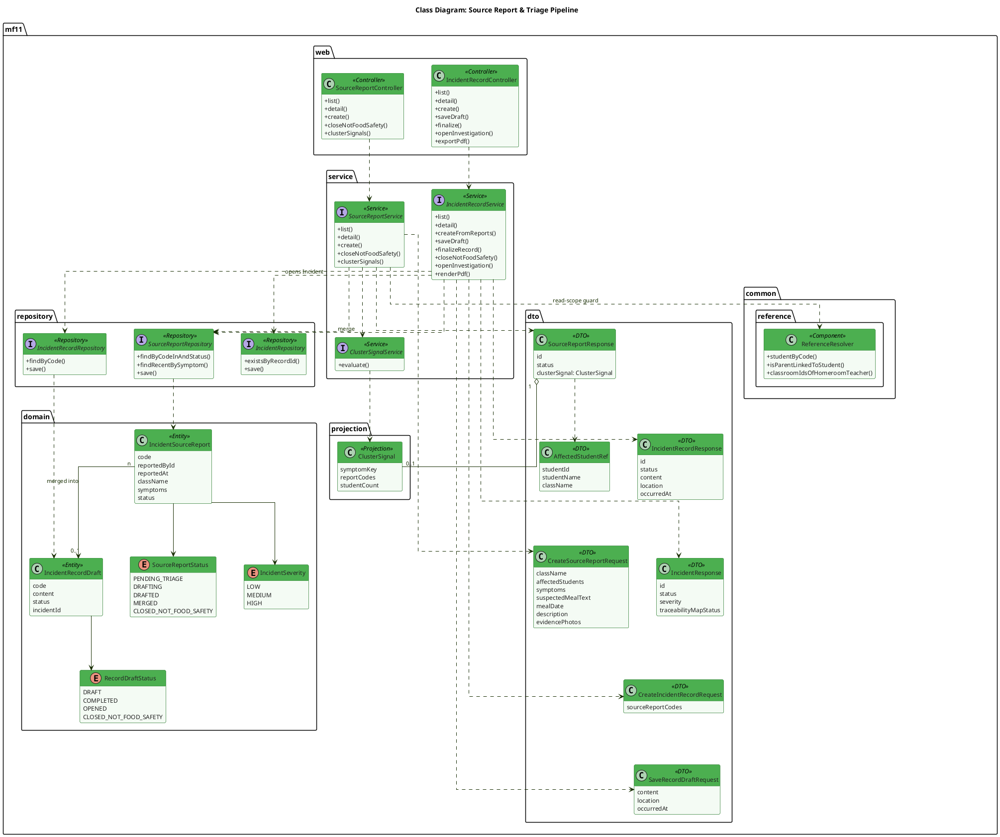

**Description.** `SourceReportController` and `IncidentRecordController` never touch each other's repositories directly — every write goes through the matching service. `SourceReportServiceImpl.create()` is deliberately thin: it validates, persists a `PENDING_TRIAGE` row, and asks `ClusterSignalService` for a **suggestion only** (BR-146, rev. 2026-07-20) — it never creates an `Incident`, quarantines a batch, or starts a traceability map itself, correcting an earlier reading of the use-case file that implied full automation (CF-M11-5). `IncidentRecordServiceImpl.openInvestigation()` is the one method allowed to construct an `Incident`, and only from a record already `COMPLETED`; this is the DB-enforced boundary in ADR-M11-1 (`incidents.incident_record_id NOT NULL UNIQUE`).

### 2.2 Sequence Diagram — Report a Food Safety Concern/Incident

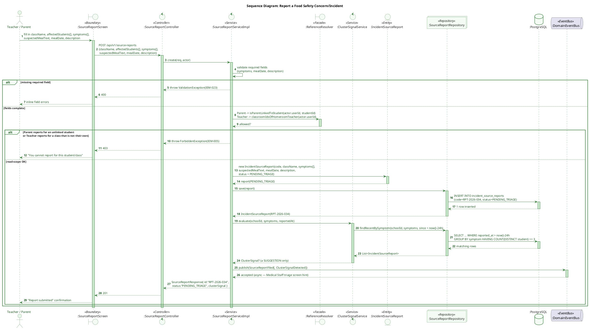

**Description.** Backs UC-073 (Parent) / UC-074 (Teacher). The only two guards are field completeness and read-scope (a parent may only report for a linked child, BR-201; a teacher only for their own homeroom class). The cluster-signal check is intentionally decoupled from any incident-creating side effect — `ClusterSignal` is data the Medical Staff triage screen can display as a hint, nothing more, which is the exact correction the 2026-07-20 revision of BR-146/BR-149 made to an earlier design that auto-created and auto-quarantined.

### 2.3 Sequence Diagram — Triage: Merge Reports → Finalize Record → Open Investigation

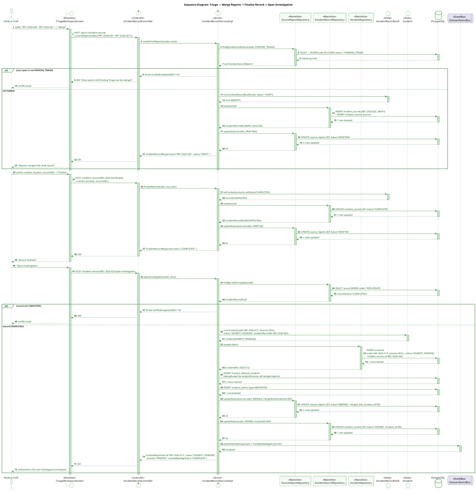

**Description.** Backs UC-114 as extended on 2026-07-15: what used to be a single confirmation click is now three deliberate, separately-authorized steps — merge, finalize, open — matching the fact that the middle artifact (`REC`) is now a real hand-authored legal record (BR-154), not a rubber stamp. "Opening an investigation" is the only action that ever produces an `Incident` row, and it always resolves the affected-student list by deduplicating across every merged `RPT`, which is why a single student mentioned in two overlapping reports still appears once in `incident_affected_students`. `severity` starts `NULL` (rendered as ` "PENDING"` in JSON per CF-M11-12 / ADR-M11-5) because classification is a separate, later, Medical-Staff-only action covered in Feature 2.

### 2.4 State Chart — Source Report Lifecycle

Backs UC-073/074/114. A raw `IncidentSourceReport` moves forward only: triage either merges it (§2.3, `createFromReports`) or a Medical Staff decision closes it as unrelated to food safety, and once merged its terminal `MERGED` state carries the id of the incident it fed.

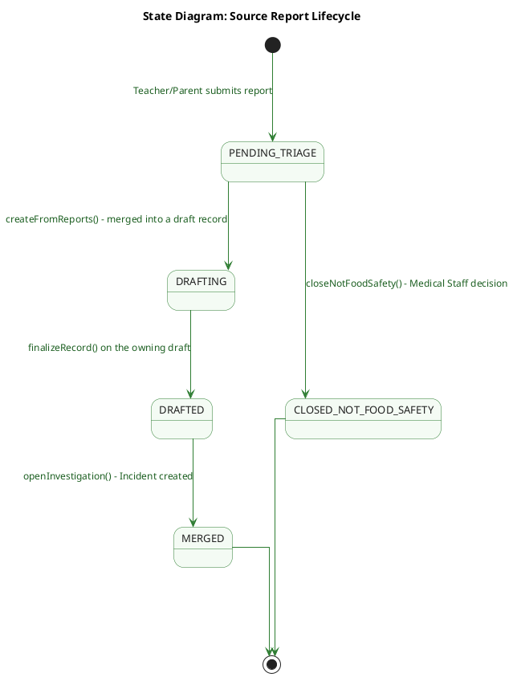

### 2.5 State Chart — Incident Record Draft Lifecycle

Backs UC-114. `IncidentRecordDraft` is the deliberately hand-authored middle tier of ADR-M11-1: `DRAFT` while still being merged/edited, `COMPLETED` once Medical Staff finalizes the content, then either `OPENED` (an `Incident` now exists) or `CLOSED_NOT_FOOD_SAFETY` from either non-terminal state.

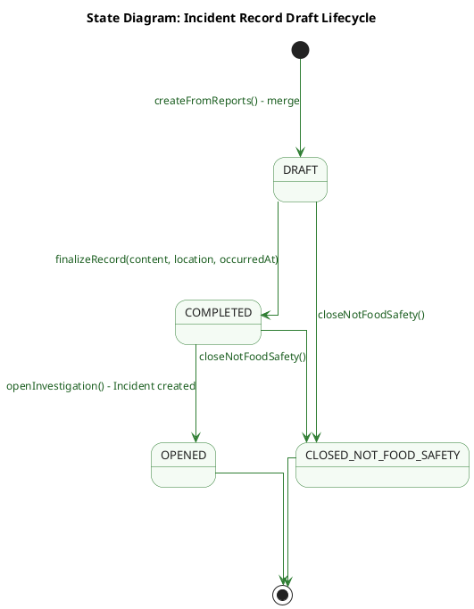

---

## 3. Feature 2 — Incident Investigation

Owns the core clinical/food-safety workflow once an `Incident` exists: severity classification with an emergency-alert side effect, one-way batch quarantine, root-cause evidence, and the derived traceability map. Backs UC-041, UC-009, UC-116, UC-120.

### 3.1 Class Diagram

```plantuml
@startuml MF11_F2_ClassDiagram
title Class Diagram: Incident Investigation

skinparam classAttributeIconSize 0
skinparam linetype ortho
skinparam nodesep 55
skinparam ranksep 85
skinparam minClassWidth 130
skinparam wrapWidth 260
skinparam backgroundColor #FFFFFF

skinparam class {
    BackgroundColor #F4FBF4
    BorderColor #2E7D32
    FontColor #212121
    FontName Arial
    FontSize 13

    HeaderBackgroundColor #4CAF50
    HeaderFontColor #FFFFFF

    AttributeFontColor #212121
    AttributeFontName Arial
    AttributeFontSize 12
}

skinparam interface {
    BackgroundColor #f7ed93ff
    BorderColor #000000ff
    FontColor #000000ff
    FontName Arial
}

skinparam arrow {
    Color #162c00ff
    FontColor #162c00ff
    FontName Arial
    FontSize 11
}

skinparam stereotype {
    CBackgroundColor #f6eedcff
    CBorderColor #000000ff
    EBackgroundColor #f6eedcff
    EBorderColor #000000ff
    ABackgroundColor #f6eedcff
    ABorderColor #000000ff
    IBackgroundColor #f6eedcff
    IBorderColor #000000ff
}

hide empty members

package "mf11.domain" {
  class Incident <<Entity, AggregateRoot>> {
    code
    incidentRecordId
    severity
    status
    rootCauseStatus
    traceabilityMapStatus
  }
  class IncidentAffectedStudent <<Entity>> {
    studentId
    recovered
  }
  class IncidentSuspectedDish <<Entity>> {
    dishId
  }
  class IncidentQuarantineBatch <<Entity, Immutable>> {
    batchId
    reason
    quarantinedAt
  }
  class InvestigationEvidence <<Entity>> {
    type
    description
  }
  class IncidentEvent <<Entity, Append-Only>> {
    code
    at
    type
  }
  enum IncidentStatus {
    SEVERITY_PENDING
    INVESTIGATING
    CAPA_PENDING
    CAPA_APPROVED
    VALIDATED
    CLOSED
  }
  enum TraceMapStatus {
    COMPILING
    READY
  }
  enum RootCauseStatus {
    PRELIMINARY
    FINAL
  }
  enum IncidentEventType {
    REPORTED
    SEVERITY_SET
    QUARANTINE
    SAMPLE_SENT
    TRACE_READY
    CAPA_SUBMITTED
    CAPA_APPROVED
    CAPA_EVIDENCE
    CAPA_VALIDATED
    REPORT_SENT
    CLOSED
  }
}

package "mf11.projection" {
  class SuspectedDishCandidate <<Projection>> {
    dishId
    batches: List<BatchCandidate>
  }
  class TraceabilityMap <<Projection>> {
    incidentCode
    status
    nodes: List<TraceNode>
  }
}

package "mf11.dto" {
  class AssessIncidentRequest <<DTO>> {
    severity
    clinicalRiskAssessment
    suspectedDishIds
    firstAidNotes
  }
  class QuarantineBatchRequest <<DTO>> {
    batchCode
    reason
  }
  class QuarantineResult <<DTO>> {
    quarantined
    rejected
  }
  class AddEvidenceRequest <<DTO>> {
    type
    description
    files
  }
  class SaveRootCauseRequest <<DTO>> {
    rootCause
    rootCauseStatus
    evidenceFinal
  }
  class IncidentResponse <<DTO>> {
    id
    severity
    status
    emergencyAlert: EmergencyAlertResult
  }
  class IncidentCaterersResponse <<DTO>> {
    id
    status
    severity
    quarantinedBatches
  }
 IncidentCaterersResponse ..> IncidentResponse : narrower projection
  class IncidentEventResponse <<DTO>> {
    id
    at
    type
    description
    actorLabel
  }
}

package "mf11.web" {
  class IncidentController <<Controller>> {
    + list()
    + detail()
    + assess()
    + quarantineBatches()
    + addEvidence()
    + saveRootCause()
    + traceabilityMap()
    + events()
  }
}

package "mf11.service" {
  interface IncidentQueryService <<Service>> {
    + list()
    + detail()
  }
  interface IncidentInvestigationService <<Service>> {
    + suspectedDishCandidates()
    + assessAndStart()
    + saveAssessmentDraft()
    + quarantineBatches()
    + addEvidence()
    + saveRootCause()
    + traceabilityMap()
    + requestSampleRetrieval()
    + events()
  }
  class EmergencyAlertDispatcher <<Component>> {
    + dispatch()
  }
}

package "mf11.repository" {
  interface IncidentRepository <<Repository>> {
    + findByCodeForUpdate()
    + findBySchoolAndStatus()
    + save()
  }
  interface IncidentEventRepository <<Repository>> {
    + findByIncidentIdOrderByAt()
    + append()
  }
}

package "mf11.port" {
  interface InventoryBatchPort <<Port>> {
    + batchesOfDishes()
    + markQuarantined()
    + isAtTerminalState()
    + receivingSessionOf()
    + isSuppliedBy()
  }
  interface ServingDishPort <<Port>> {
    + dishesServedBetween()
    + studentsWhoAte()
  }
  interface FoodSamplePort <<Port>> {
    + findByIncident()
    + requestRetrieval()
  }
  interface NotificationPort <<Port>> {
    + notify()
  }
}

' ---------- web -> service ----------
IncidentController ..> IncidentQueryService
IncidentController ..> IncidentInvestigationService

' ---------- service -> repository / port ----------
IncidentInvestigationService ..> IncidentRepository
IncidentInvestigationService ..> IncidentEventRepository
IncidentInvestigationService ..> ServingDishPort : 24h serving window
IncidentInvestigationService ..> InventoryBatchPort : batch candidates
IncidentInvestigationService ..> FoodSamplePort
IncidentInvestigationService ..> EmergencyAlertDispatcher
IncidentQueryService ..> IncidentRepository
EmergencyAlertDispatcher ..> NotificationPort : HighSeverityAlertRaised

' ---------- repository -> domain ----------
IncidentRepository ..> Incident
IncidentEventRepository ..> IncidentEvent

' ---------- aggregate root -> children ----------
Incident "1" *-- "n" IncidentAffectedStudent
Incident "1" *-- "n" IncidentSuspectedDish
Incident "1" *-- "n" IncidentQuarantineBatch : one-way
Incident "1" *-- "n" InvestigationEvidence
Incident "1" *-- "n" IncidentEvent : append-only log

' ---------- domain -> enum ----------
Incident --> IncidentStatus
Incident --> TraceMapStatus
Incident --> RootCauseStatus
IncidentEvent --> IncidentEventType

' ---------- service -> dto / projection ----------
IncidentInvestigationService ..> AssessIncidentRequest
IncidentInvestigationService ..> QuarantineBatchRequest
IncidentInvestigationService ..> AddEvidenceRequest
IncidentInvestigationService ..> SaveRootCauseRequest
IncidentInvestigationService ..> QuarantineResult
IncidentInvestigationService ..> SuspectedDishCandidate
IncidentInvestigationService ..> TraceabilityMap
IncidentQueryService ..> IncidentResponse
IncidentQueryService ..> IncidentCaterersResponse
IncidentQueryService ..> IncidentEventResponse

' ---------- layout hints (balance width vs height) ----------
AssessIncidentRequest -[hidden]down- QuarantineBatchRequest
AddEvidenceRequest -[hidden]down- SaveRootCauseRequest
QuarantineResult -[hidden]down- IncidentResponse
IncidentCaterersResponse -[hidden]down- IncidentEventResponse
IncidentStatus -[hidden]down- TraceMapStatus
RootCauseStatus -[hidden]down- IncidentEventType
IncidentAffectedStudent -[hidden]down- IncidentSuspectedDish
IncidentQuarantineBatch -[hidden]down- InvestigationEvidence
InventoryBatchPort -[hidden]down- ServingDishPort
FoodSamplePort -[hidden]down- NotificationPort
@enduml
```

**Description.** `Incident` is the aggregate root for the entire investigation; `IncidentController` fans out to two services depending on intent — `IncidentQueryService` for read-only projections that must respect the D11 role-cut (`IncidentResponse` for Medical/School Admin vs. `IncidentCaterersResponse` for Service Caterers and Teacher, which strips `symptoms`, `firstAidNotes`, `clinicalRiskAssessment`, `rootCause` and student names — PDPD, §16 authorization matrix), and `IncidentInvestigationService` for every write. `InventoryBatchPort` and `ServingDishPort` are read-only ports over MF06/MF09 rather than `@ManyToOne` associations (ADR-M11-7), which is what lets MF11's own 5 owned tables be built without waiting on either module's internal schema.

### 3.2 Sequence Diagram — Assess Severity & Dispatch High-Severity Emergency Alert

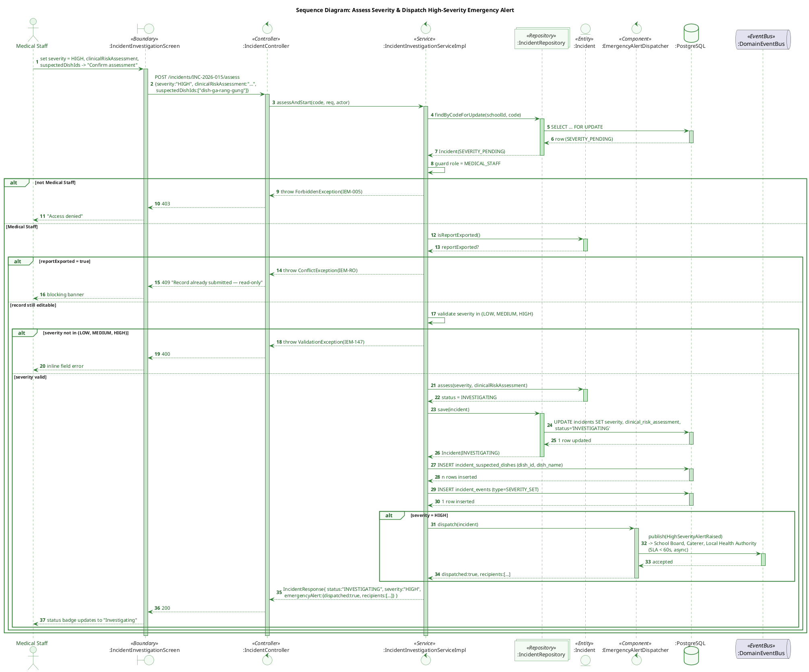

**Description.** Backs UC-009/UC-041. Four guards gate the transition out of `SEVERITY_PENDING`: role (only Medical Staff, BR-147), the whole-record read-only lock (ADR-M11-8 — a record already submitted as an official report can never be reassessed), input validity, and — implicitly — the pessimistic row lock that prevents two concurrent `assess` calls from racing. The `HIGH`-severity alert is fired through an outbox event rather than synchronously, precisely so that a slow notification channel (email/SMS, ADR-000 SMTP stub in dev) can never delay the transaction that matters most during an active incident.

### 3.3 Sequence Diagram — Quarantine Suspected Batches (One-Way)

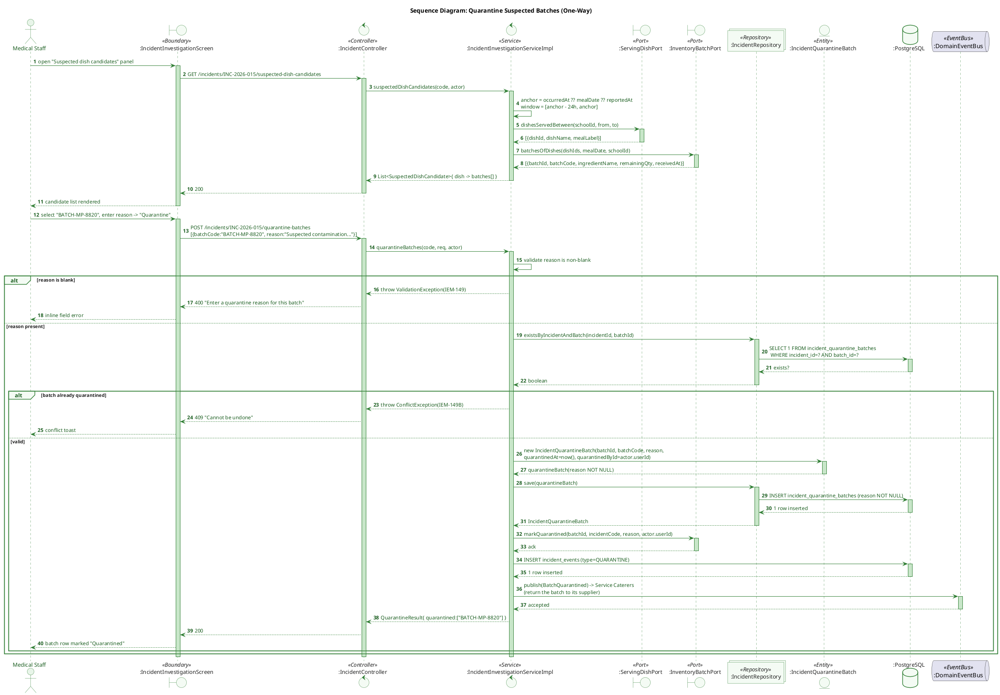

**Description.** Backs UC-041/UC-009. The candidate list is derived, never stored: the 24-hour investigation window's anchor timestamp falls back through `occurredAt → mealDate → reportedAt` (BR-149, revised 2026-07-27), and the dish list comes from `ServingDishPort` (MF09's actual serving records, not MF05's menu catalog) so the candidates are dishes that were truly served, not merely planned. Quarantine itself is a **one-way** action (ADR-M11-3): the mandatory `reason` is enforced at the API boundary (`IEM-149`) and re-quarantining an already-locked batch is a hard `409` (`IEM-149B`), never a silent no-op — there is deliberately no unlock endpoint after BR-217 replaced "quarantine pending lab result" with "quarantine, then return to supplier immediately."

### 3.4 Sequence Diagram — Error Paths

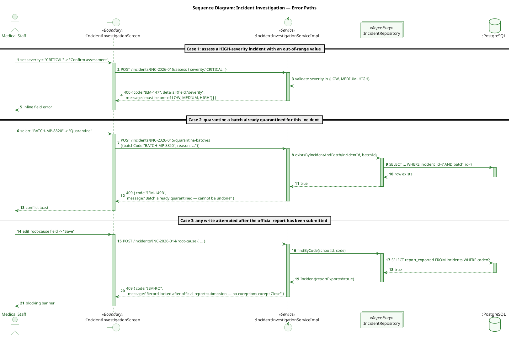

**Description.** Three rejection paths that share one property: none of them are UI-only checks. `IEM-147` and `IEM-149B` are re-validated server-side even though the mock's original client already blocked them with `toast.error`/`disabled` (CF-M11-9) — a food-safety investigation cannot trust the client to enforce BR-147/BR-217. `IEM-RO` is the broadest guard: once `reportExported = true`, **every** write endpoint on the incident and its child tables returns it, with the sole exception of `IncidentClosureService.close()`, because closing happens logically *after* the report is locked, not before (ADR-M11-8).

### 3.5 State Chart — Incident Lifecycle

Backs UC-041/UC-009/UC-116/UC-120 and every downstream feature that reads `Incident.status`. The six states are strictly forward-moving: severity classification (§3.2) starts the investigation, the CAPA lifecycle of Feature 3 drives the two middle transitions, and the report-then-close pattern of Feature 4 closes the loop.

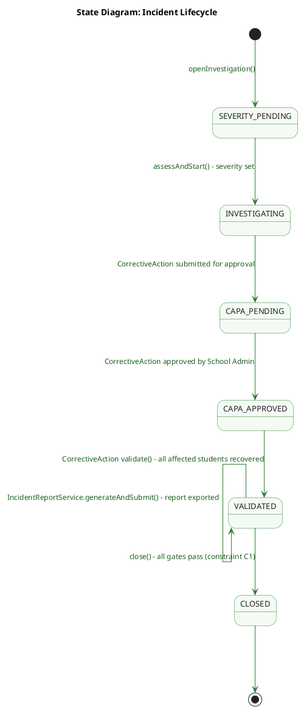

---

## 4. Feature 3 — Corrective Action Plan (CAPA) Lifecycle

A 6-state workflow shared by three roles: Medical Staff drafts and validates, School Administration approves the plan **before** it is carried out, Service Caterers executes and submits evidence. Backs UC-005, UC-038, UC-082, UC-168.

### 4.1 Class Diagram

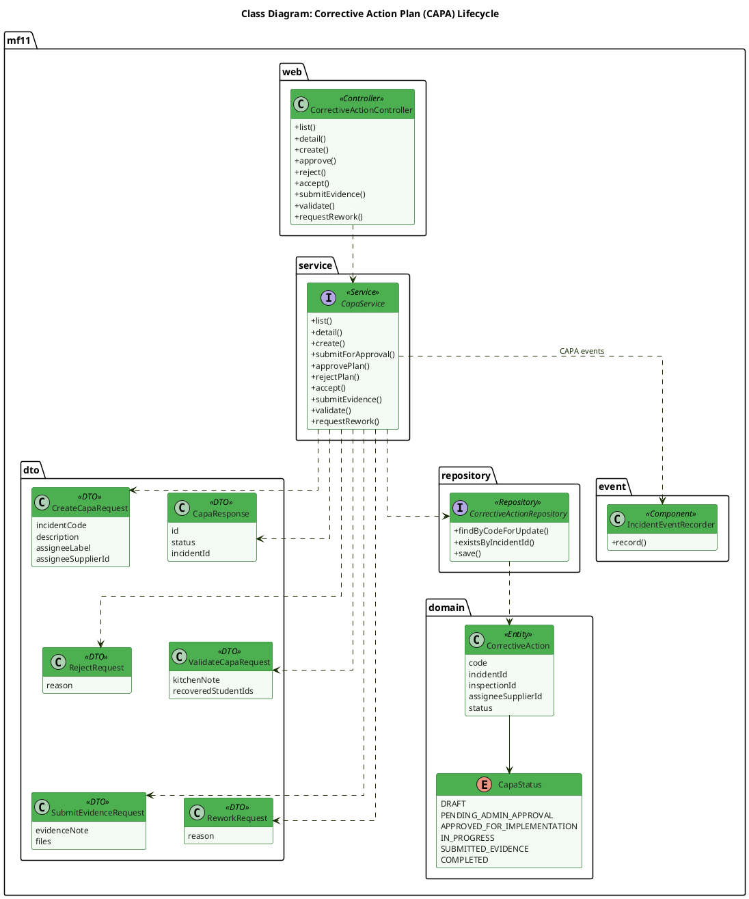

**Description.** `ADR-M11-4` is encoded here as two separate mechanisms working together: the DB partial unique index `uq_capa_one_per_incident` makes "1 Incident = 1 CAPA" physically impossible to violate, and `CapaService` exposes **six narrow, role-guarded action endpoints** rather than one generic `PUT` — each one checks both the caller's role and the CAPA's current status before transitioning, closing the gap the mock's original `PUT`-merge design left open (a Service Caterers account could otherwise set `status=COMPLETED` directly, CF-M11-9). `IncidentEventRecorder` is the same append-only writer used across every feature — every CAPA transition also leaves a row in `incident_events`.

### 4.2 Sequence Diagram — CAPA Lifecycle Across Three Roles

```plantuml
@startuml MF11_F3_CapaLifecycle
title Sequence Diagram: CAPA Lifecycle Across Three Roles

skinparam linetype ortho
skinparam backgroundColor #FFFFFF

skinparam stereotype {
    CBackgroundColor #E8F5E9
    CBorderColor #2E7D32
    EBackgroundColor #E8F5E9
    EBorderColor #2E7D32
    ABackgroundColor #E8F5E9
    ABorderColor #2E7D32
    IBackgroundColor #E8F5E9
    IBorderColor #2E7D32
}

skinparam NoteBackgroundColor #E8F5E9
skinparam NoteBorderColor #2E7D32
skinparam NoteFontColor #212121
skinparam NoteFontName Arial

skinparam BoundaryBackgroundColor #F4FBF4
skinparam BoundaryBorderColor #2E7D32
skinparam BoundaryFontColor #212121
skinparam BoundaryFontName Arial
skinparam BoundaryFontSize 13

skinparam ControlBackgroundColor #F4FBF4
skinparam ControlBorderColor #2E7D32
skinparam ControlFontColor #212121
skinparam ControlFontName Arial
skinparam ControlFontSize 13

skinparam EntityBackgroundColor #F4FBF4
skinparam EntityBorderColor #2E7D32
skinparam EntityFontColor #212121
skinparam EntityFontName Arial
skinparam EntityFontSize 13

skinparam CollectionsBackgroundColor #F4FBF4
skinparam CollectionsBorderColor #2E7D32
skinparam CollectionsFontColor #212121
skinparam CollectionsFontName Arial
skinparam CollectionsFontSize 13

skinparam DatabaseBackgroundColor #F4FBF4
skinparam DatabaseBorderColor #2E7D32
skinparam DatabaseFontColor #212121
skinparam DatabaseFontName Arial
skinparam DatabaseFontSize 13

skinparam sequence {
    ActorBackgroundColor #E8F5E9
    ActorBorderColor #2E7D32
    ActorFontColor #1B5E20
    ActorFontName Arial
    ActorFontSize 13

    ParticipantBackgroundColor #F4FBF4
    ParticipantBorderColor #2E7D32
    ParticipantFontColor #212121
    ParticipantFontName Arial
    ParticipantFontSize 13

    ArrowColor #2E7D32
    ArrowFontColor #1B5E20
    ArrowFontName Arial
    ArrowFontSize 12

    LifeLineBackgroundColor #C8E6C9
    LifeLineBorderColor #2E7D32

    GroupBackgroundColor #F4FBF4
    GroupBorderColor #2E7D32
    GroupHeaderFontColor #1B5E20
    GroupHeaderBackgroundColor #C8E6C9
    GroupFontColor #212121
    GroupFontName Arial
}

autonumber

actor       "Medical Staff"                          as M
actor       "School Admin"                           as A
actor       "Service Caterers"                       as SCa
boundary    ":CapaWorkflowScreen"                    as UI      <<Boundary>>
control     ":CorrectiveActionController"            as C       <<Controller>>
control     ":CapaServiceImpl"                       as S       <<Service>>
collections ":CorrectiveActionRepository"            as R       <<Repository>>
entity      ":CorrectiveAction"                      as CAPA    <<Entity>>
database    ":PostgreSQL"                            as DB
queue       ":DomainEventBus"                        as MQ      <<EventBus>>

M -> UI : fill description, assignee -> "Create CAPA"
activate UI
UI -> C : POST /corrective-actions\n{incidentCode:"INC-2026-015", description, assignee}
activate C
C -> S : create(req, actor)
activate S
S -> R : existsByIncidentId(incidentId)
activate R
R -> DB : check uq_capa_one_per_incident
activate DB
DB --> R : exists?
deactivate DB
R --> S : boolean
deactivate R
alt this incident already has a CAPA
  S --> C : throw ConflictException(IEM-216)
  C --> UI : 409 IEM-216 "1 Incident = 1 CAPA"
  UI --> M : conflict toast
else no CAPA yet
  S -> CAPA : new CorrectiveAction(status=PENDING_ADMIN_APPROVAL,\n submittedForApprovalAt=now)
  activate CAPA
  CAPA --> S : capa(PENDING_ADMIN_APPROVAL)
  deactivate CAPA
  S -> R : save(capa)
  activate R
  R -> DB : INSERT corrective_actions (PENDING_ADMIN_APPROVAL,\n submitted_for_approval_at=now)
  activate DB
  DB --> R : 1 row inserted
  deactivate DB
  R --> S : CorrectiveAction(CAPA-2026-034)
  deactivate R
  S -> DB : UPDATE incidents SET status='CAPA_PENDING'
  activate DB
  DB --> S : 1 row updated
  deactivate DB
  S -> DB : INSERT incident_events (CAPA_SUBMITTED)
  activate DB
  DB --> S : 1 row inserted
  deactivate DB
  S -> MQ : publish(CapaSubmittedForApproval) -> School Admin
  activate MQ
  MQ --> S : accepted
  deactivate MQ
  S --> C : CapaResponse{ status:"PENDING_ADMIN_APPROVAL" }
  C --> UI : 201
  UI --> M : "CAPA submitted for approval"
end
deactivate S
deactivate C
deactivate UI

A -> UI : open CAPA-2026-034 -> "Approve"
activate UI
UI -> C : POST /corrective-actions/CAPA-2026-034/approve
activate C
C -> S : approvePlan(code, actor)
activate S
S -> S : guard role=SCHOOL_ADMIN\nguard status=PENDING_ADMIN_APPROVAL
S -> CAPA : approve(now())
activate CAPA
CAPA --> S : status = APPROVED_FOR_IMPLEMENTATION, approvedAt
deactivate CAPA
S -> R : save(capa)
activate R
R -> DB : UPDATE status='APPROVED_FOR_IMPLEMENTATION', approved_at=now
activate DB
DB --> R : 1 row updated
deactivate DB
R --> S : CorrectiveAction(APPROVED_FOR_IMPLEMENTATION)
deactivate R
S -> DB : UPDATE incidents SET status='CAPA_APPROVED'\nINSERT incident_events (CAPA_APPROVED)
activate DB
DB --> S : rows updated
deactivate DB
S -> MQ : publish(CapaApproved) -> Service Caterers
activate MQ
MQ --> S : accepted
deactivate MQ
S --> C : CapaResponse{ status:"APPROVED_FOR_IMPLEMENTATION" }
deactivate S
C --> UI : 200
deactivate C
UI --> A : "Plan approved"
deactivate UI

SCa -> UI : open CAPA-2026-034 -> "Accept"
activate UI
UI -> C : POST /corrective-actions/CAPA-2026-034/accept
activate C
C -> S : accept(code, actor)
activate S
S -> S : guard role=SERVICE_CATERERS\nguard status=APPROVED_FOR_IMPLEMENTATION
S -> CAPA : startWork()
activate CAPA
CAPA --> S : status = IN_PROGRESS
deactivate CAPA
S -> R : save(capa)
activate R
R -> DB : UPDATE status='IN_PROGRESS'
activate DB
DB --> R : 1 row updated
deactivate DB
R --> S : CorrectiveAction(IN_PROGRESS)
deactivate R
S --> C : CapaResponse{ status:"IN_PROGRESS" }
deactivate S
C --> UI : 200
deactivate C
UI --> SCa : "CAPA accepted"
deactivate UI

SCa -> UI : attach evidenceNote, files[] -> "Submit evidence"
activate UI
UI -> C : POST /corrective-actions/CAPA-2026-034/submit-evidence\n{evidenceNote, files[]}
activate C
C -> S : submitEvidence(code, req, actor)
activate S
S -> S : guard files.size >= 1 (UC-082 step 5)
S -> CAPA : submitEvidence(evidenceNote, files, now())
activate CAPA
CAPA --> S : status = SUBMITTED_EVIDENCE, evidenceSubmittedAt
deactivate CAPA
S -> R : save(capa)
activate R
R -> DB : UPDATE status='SUBMITTED_EVIDENCE', evidence_submitted_at=now
activate DB
DB --> R : 1 row updated
deactivate DB
R --> S : CorrectiveAction(SUBMITTED_EVIDENCE)
deactivate R
S -> DB : INSERT incident_events (CAPA_EVIDENCE)
activate DB
DB --> S : 1 row inserted
deactivate DB
S -> MQ : publish(CapaEvidenceSubmitted) -> Medical Staff
activate MQ
MQ --> S : accepted
deactivate MQ
S --> C : CapaResponse{ status:"SUBMITTED_EVIDENCE" }
deactivate S
C --> UI : 200
deactivate C
UI --> SCa : "Evidence submitted"
deactivate UI

M -> UI : review evidence, mark students recovered -> "Validate"
activate UI
UI -> C : POST /corrective-actions/CAPA-2026-034/validate\n{kitchenNote, recoveredStudentIds[]}
activate C
C -> S : validate(code, req, actor)
activate S
S -> DB : guard: are all affected students recovered?
activate DB
DB --> S : notRecoveredCount
deactivate DB
alt students still not recovered
  S --> C : throw ConflictException(IEM-155)
  C --> UI : 409 IEM-155 "N students not yet confirmed recovered"
  UI --> M : conflict toast
else all recovered
  S -> CAPA : validate()
  activate CAPA
  CAPA --> S : status = COMPLETED
  deactivate CAPA
  S -> R : save(capa)
  activate R
  R -> DB : UPDATE status='COMPLETED'; incidents SET status='VALIDATED'\nUPDATE incident_affected_students SET recovered=true
  activate DB
  DB --> R : rows updated
  deactivate DB
  R --> S : CorrectiveAction(COMPLETED)
  deactivate R
  S -> DB : INSERT incident_events (CAPA_VALIDATED)
  activate DB
  DB --> S : 1 row inserted
  deactivate DB
  S --> C : CapaResponse{ status:"COMPLETED" }
  C --> UI : 200
  UI --> M : "CAPA validated"
end
deactivate S
deactivate C
deactivate UI
@enduml
```

**Description.** Backs UC-005 (approve/reject), UC-038 (accept/submit-evidence), UC-082 (submit-evidence detail), UC-168 (validate/rework). The chain enforces BR-153's core requirement — School Administration approves the **plan** before Service Caterers may act on it, not after the fact — by making `accept` require `APPROVED_FOR_IMPLEMENTATION` as a precondition. Rejecting a plan (`AF`, not drawn above) sends the CAPA back to `DRAFT` with a mandatory `rejectReason` (BR-216 step 2); Medical Staff revises and resubmits through the same `submit-for-approval` transition. `validate`'s gate reuses the same recovered-student check that also blocks incident closure in Feature 4, so a CAPA cannot be marked complete while a child is still symptomatic even if every corrective step was executed correctly. The one alternate flow not drawn above (`AF1`, UC-168) is `rework`: it sends a `COMPLETED`/rejected CAPA back to `IN_PROGRESS` with a mandatory `reason`, keeping the already-approved plan as-is — no re-approval loop (BR-216 step 5).

### 4.3 Sequence Diagram — Error Path: Duplicate CAPA & Plan Rejection

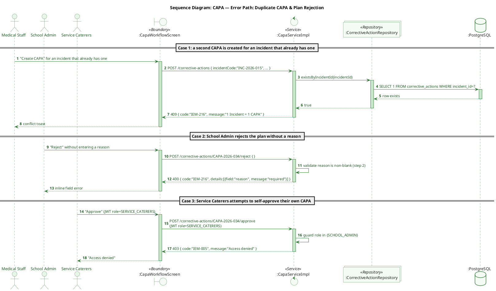

**Description.** Case 1 shows the two-layer defense typical of MF11: an application-level check that fails fast with a business-readable message, backstopped by a DB constraint that would reject the row even if the service check were bypassed. Case 3 encodes the separation-of-duty requirement explicit in §4.3 of the TDS — the person who drafts a CAPA (Medical Staff), the person who approves it (School Administration), and the person who executes it (Service Caterers) must always be three different roles.

### 4.4 State Chart — CAPA Lifecycle

Backs UC-005/UC-038/UC-082/UC-168 (BR-216). The six forward states are shown across the top row; the two documented exceptions — School Admin's `reject` sending the plan back to `DRAFT`, and Medical Staff's `rework` sending a completed/rejected plan back to `IN_PROGRESS` — are the only backward edges the workflow allows.

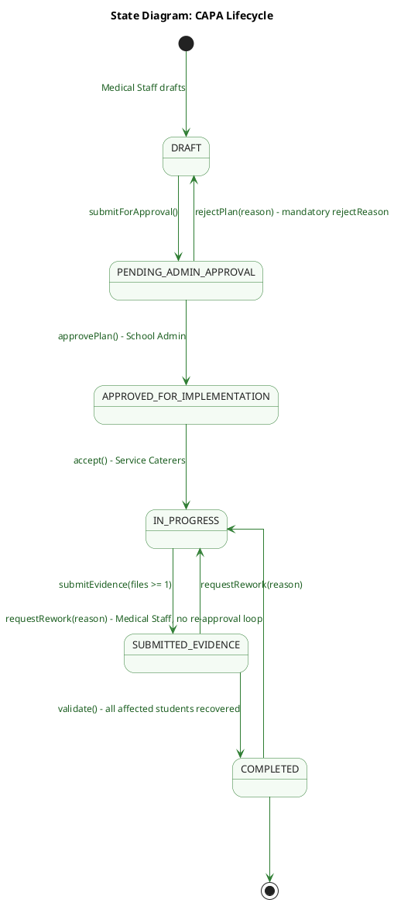

---

## 5. Feature 4 — Incident Closure & Official Report

The final stage of an investigation: Medical Staff generates the official report (which locks the whole record), then School Administration closes the incident once every CAPA and every affected student is accounted for. Backs UC-013, UC-033, UC-031, UC-121.

### 5.1 Class Diagram

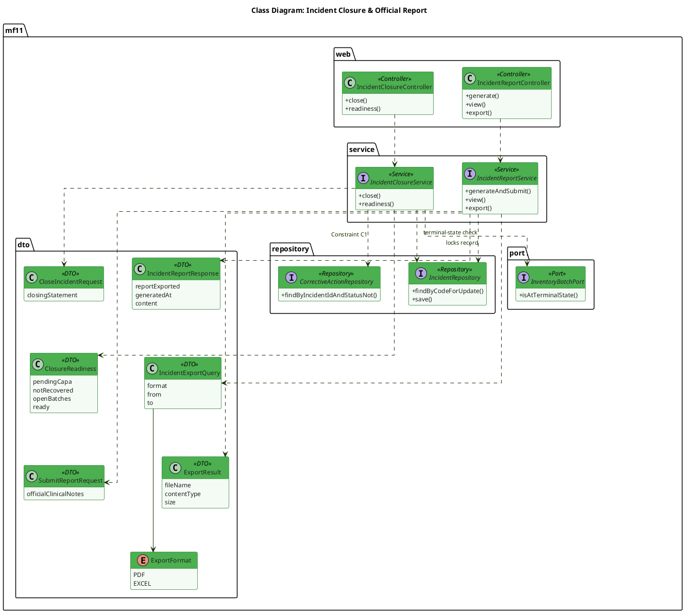

**Description.** `IncidentClosureService.close()` and `IncidentReportService.generateAndSubmit()` are two independent locks on the same aggregate root, applied in a specific order: the official report can be submitted while the incident is still `VALIDATED` (locking the record for edits — ADR-M11-8), and closing happens *after* that, as the one write endpoint explicitly exempted from the read-only lock. `readiness()` exists purely so the School Admin UI can render a pre-flight checklist instead of discovering the blocking conditions only after clicking "Close".

### 5.2 Sequence Diagram — Close Incident (Guarded, Constraint C1)

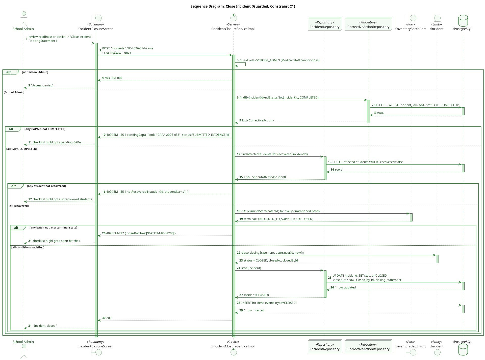

**Description.** Backs UC-013. Three independent gates must all pass, evaluated server-side regardless of what the client already checked: no open CAPA (constraint C1), no unrecovered student (BR-155), and no quarantined batch still short of a terminal disposition at MF06 (BR-217 — this replaced an older audit rule that wrongly assumed quarantined batches get released before closure, CF-M11-11). All three conditions can coexist on the same incident, so the response carries independent detail arrays rather than a single generic message.

### 5.3 Sequence Diagram — Generate & Submit Official Incident Report

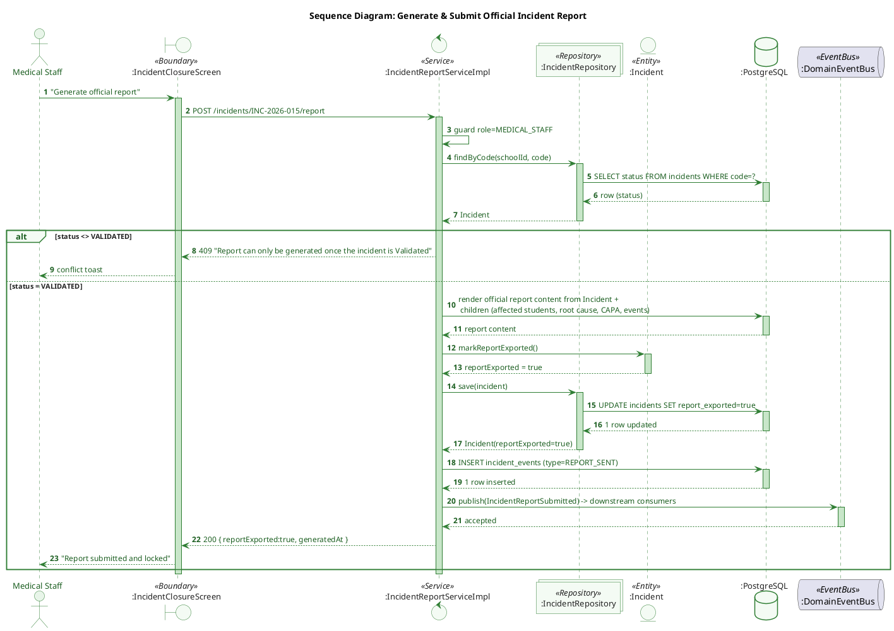

**Description.** Backs UC-033 (generate, Medical Staff) / UC-031 (export PDF/Excel, School Admin) / UC-121 (view, School Admin). The decision recorded in ADR-M11-8 is deliberately blunt: submitting the official report is a **whole-record**, **all-actor**, **no-unlock** lock, matching the real-world fact that a document already filed with a regulator or the school board cannot be quietly edited afterward — any correction has to happen through a supplementary record outside the system, which is the correct behavior for administrative paperwork with legal weight, not a system limitation to work around.

---

## 6. Feature 5 — Violation Management (Unit-Level)

Records violations committed by the Service Caterers **unit** (never an individual — BR-183, revised 2026-07-26), tracks their resolution through a severity-based approval branch, and gates the resolution behind a hand-signed, scanned record (BR-211). Backs UC-179, UC-180, UC-181, UC-182.

### 6.1 Class Diagram

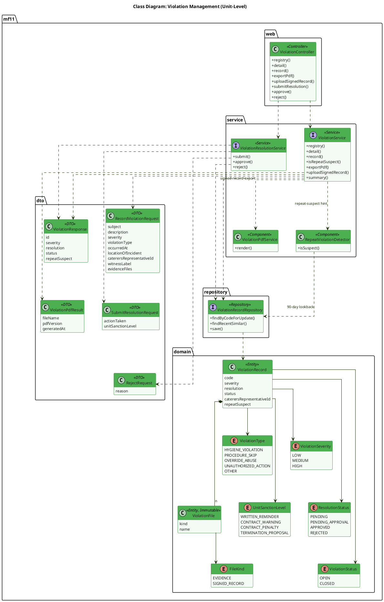

**Description.** Every field that used to identify an individual staff member (`staffName`, `staffPosition`, `disciplinaryLevel`) is now read-only and absent from `RecordViolationRequest` — BR-183's 2026-07-26 revision moved the unit of accountability from person to Service Caterers **unit**, keyed by `caterersRepresentativeId`, and the three legacy columns exist only so the two historical rows recorded before the change (`VIO-2026-005`, `VIO-2026-007`) stay readable. `RepeatViolationDetector` is intentionally advisory: it sets `repeatSuspect=true` and returns a warning (`MSG-088`) but never blocks the save, matching BR-187's explicit "best-effort, no auto-escalation" wording.

### 6.2 Sequence Diagram — Record a Unit Violation

```plantuml
@startuml MF11_F5_RecordViolation
title Sequence Diagram: Record a Unit Violation

skinparam linetype ortho
skinparam backgroundColor #FFFFFF

skinparam stereotype {
    CBackgroundColor #E8F5E9
    CBorderColor #2E7D32
    EBackgroundColor #E8F5E9
    EBorderColor #2E7D32
    ABackgroundColor #E8F5E9
    ABorderColor #2E7D32
    IBackgroundColor #E8F5E9
    IBorderColor #2E7D32
}

skinparam NoteBackgroundColor #E8F5E9
skinparam NoteBorderColor #2E7D32
skinparam NoteFontColor #212121
skinparam NoteFontName Arial

skinparam BoundaryBackgroundColor #F4FBF4
skinparam BoundaryBorderColor #2E7D32
skinparam BoundaryFontColor #212121
skinparam BoundaryFontName Arial
skinparam BoundaryFontSize 13

skinparam ControlBackgroundColor #F4FBF4
skinparam ControlBorderColor #2E7D32
skinparam ControlFontColor #212121
skinparam ControlFontName Arial
skinparam ControlFontSize 13

skinparam EntityBackgroundColor #F4FBF4
skinparam EntityBorderColor #2E7D32
skinparam EntityFontColor #212121
skinparam EntityFontName Arial
skinparam EntityFontSize 13

skinparam CollectionsBackgroundColor #F4FBF4
skinparam CollectionsBorderColor #2E7D32
skinparam CollectionsFontColor #212121
skinparam CollectionsFontName Arial
skinparam CollectionsFontSize 13

skinparam DatabaseBackgroundColor #F4FBF4
skinparam DatabaseBorderColor #2E7D32
skinparam DatabaseFontColor #212121
skinparam DatabaseFontName Arial
skinparam DatabaseFontSize 13

skinparam sequence {
    ActorBackgroundColor #E8F5E9
    ActorBorderColor #2E7D32
    ActorFontColor #1B5E20
    ActorFontName Arial
    ActorFontSize 13

    ParticipantBackgroundColor #F4FBF4
    ParticipantBorderColor #2E7D32
    ParticipantFontColor #212121
    ParticipantFontName Arial
    ParticipantFontSize 13

    ArrowColor #2E7D32
    ArrowFontColor #1B5E20
    ArrowFontName Arial
    ArrowFontSize 12

    LifeLineBackgroundColor #C8E6C9
    LifeLineBorderColor #2E7D32

    GroupBackgroundColor #F4FBF4
    GroupBorderColor #2E7D32
    GroupHeaderFontColor #1B5E20
    GroupHeaderBackgroundColor #C8E6C9
    GroupFontColor #212121
    GroupFontName Arial
}

autonumber

actor       "Medical Staff / Service Caterers"       as U
boundary    ":ViolationRegistryScreen"               as UI      <<Boundary>>
control     ":ViolationController"                   as C       <<Controller>>
control     ":ViolationServiceImpl"                  as S       <<Service>>
control     ":RepeatViolationDetector"               as RD      <<Component>>
collections ":ViolationRecordRepository"             as R       <<Repository>>
entity      ":ViolationRecord"                       as VIO     <<Entity>>
database    ":PostgreSQL"                            as DB

U -> UI : fill subject, description, severity, violationType,\noccurredAt, locationOfIncident, caterersRepresentativeId,\nwitness, evidenceFiles[] -> "Save"
activate UI
UI -> C : POST /api/v1/violations\n{subject, description, severity, violationType,\n occurredAt, locationOfIncident, caterersRepresentativeId,\n witness, evidenceFiles[], relatedIncidentId?, sourceInspectionId?}
activate C
C -> S : record(req, actor)
activate S
S -> S : validate required fields (description, >=1 evidence photo,\n locationOfIncident)
alt missing required field
  S --> C : throw ValidationException(IEM-085)
  C --> UI : 400
  UI --> U : inline field errors
else fields complete
  S -> RD : isSuspect(caterersRepresentativeId, severity, schoolId)
  activate RD
  RD -> R : existsRecentSimilar(schoolId, repId, since = date - 90 days)
  activate R
  R -> DB : SELECT 1 FROM violation_records\n WHERE caterers_representative_id=? AND date > ?
  activate DB
  DB --> R : found?
  deactivate DB
  R --> RD : boolean
  deactivate R
  RD --> S : repeatSuspect (best-effort suggestion)
  deactivate RD

  S -> VIO : new ViolationRecord(code, type='Quy trinh',\n resolution='PENDING', status='OPEN')
  activate VIO
  VIO --> S : violation(OPEN, PENDING)
  deactivate VIO
  S -> R : save(violation)
  activate R
  R -> DB : INSERT violation_records\n(code=VIO-2026-010, type='Quy trinh', resolution='PENDING', status='OPEN')
  activate DB
  DB --> R : 1 row inserted
  deactivate DB
  R --> S : ViolationRecord(VIO-2026-010)
  deactivate R
  S -> DB : INSERT violation_files (kind=EVIDENCE, ...)
  activate DB
  DB --> S : n rows inserted
  deactivate DB
  S --> C : ViolationResponse{ id:"VIO-2026-010", resolution:"PENDING",\n repeatSuspect:true, warnings:[{...}] }
  C --> UI : 201 Created (+ warning if repeatSuspect)
  UI --> U : "Violation recorded" (+ repeat-suspect warning banner)
end
deactivate S
deactivate C
deactivate UI
@enduml
```

**Description.** Backs UC-179 (a single, unified dialog covering what used to be two separate use cases — UC-178 is merged in). The repeat-suspect check is a pure read against 90 days of history keyed on `caterersRepresentativeId` (unit), not on any free-text staff name; it never prevents the save, it only rides along in the `warnings` array of a normal `201` response, so the caller can act on it or ignore it.

### 6.3 Sequence Diagram — Violation Resolution & Approval Workflow

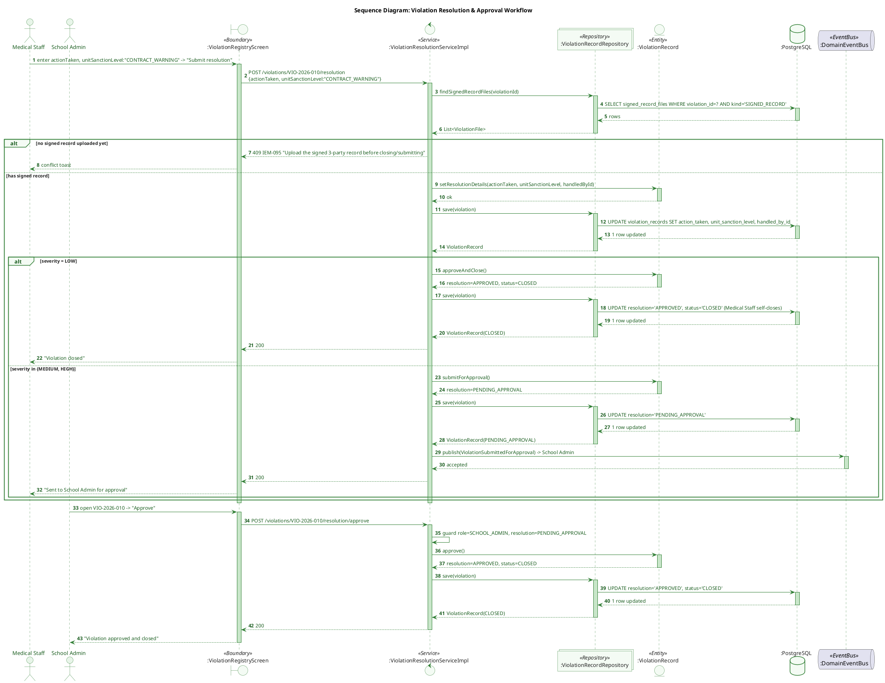

**Description.** Backs UC-180 (submit) / UC-182 (approve/reject). BR-211's gate is checked **before** anything else: a violation resolution can be saved as a draft without a signed record, but it can never leave `PENDING` — neither by direct self-closure (`LOW`) nor by being sent for approval (`MEDIUM`/`HIGH`) — without at least one `SIGNED_RECORD` file already uploaded (`IEM-095`, `MSG-095`). Once past that gate, BR-186 branches purely on `severity`: `LOW` lets Medical Staff close the loop directly, while `MEDIUM`/`HIGH` always requires a second, independent School Administration decision — the same separation-of-duty principle used for CAPA approval in Feature 3. The alternate flow not drawn above (`AF`, UC-182) is `reject`: it sets `resolution='REJECTED'` with a mandatory reason and leaves `status` at `OPEN` so Medical Staff can resubmit.

### 6.4 State Chart — Violation & Resolution Lifecycle

Backs UC-179/180/181/182. `ViolationStatus` has only two values, so the interesting lifecycle is the `resolution` sub-state a violation carries while it is still `OPEN` — modeled here as nested states, with `CLOSED` reached only once `resolution` reaches `APPROVED` (BR-186), whether directly (`LOW`, self-close) or through School Admin approval (`MEDIUM`/`HIGH`, BR-211 gate first).

```plantuml
@startuml MF11_F5_StateChart_Violation
title State Diagram: Violation & Resolution Lifecycle

skinparam nodesep 90
skinparam ranksep 110
skinparam linetype ortho
skinparam backgroundColor #FFFFFF

skinparam state {
    BackgroundColor #F4FBF4
    BorderColor #2E7D32
    FontColor #212121
    FontName Arial
    FontSize 13
}

skinparam arrow {
    Color #2E7D32
    FontColor #1B5E20
    FontName Arial
    FontSize 12
}

skinparam note {
    BackgroundColor #E8F5E9
    BorderColor #2E7D32
    FontColor #212121
    FontName Arial
    FontSize 12
}

skinparam startColor #2E7D32
skinparam endColor #2E7D32

state OPEN {
  state PENDING
  state PENDING_APPROVAL
  state REJECTED

  [*] --> PENDING : record()
 PENDING --> PENDING_APPROVAL : submit() - severity MEDIUM/HIGH,\nsigned record present
  PENDING_APPROVAL --> REJECTED : reject(reason) - School Admin
  REJECTED --> PENDING : Medical Staff resubmits
}
state CLOSED

OPEN --> CLOSED : resolution = APPROVED\n(PENDING -> CLOSED direct for LOW;\nPENDING_APPROVAL -> CLOSED via approve())
CLOSED --> [*]
@enduml
```

---

## 7. Feature 6 — Weekly Override-Abuse Report (Derived, Read-Only)

Surfaces manual-override abuse (e.g. bypassing a FEFO warning during stock withdrawal) as a weekly, per-caterer-unit rollup — computed on read, never stored as its own table. Backs UC-183.

### 7.1 Class Diagram

```plantuml
@startuml MF11_F6_ClassDiagram
title Class Diagram: Weekly Override-Abuse Report

skinparam classAttributeIconSize 0
skinparam linetype ortho
skinparam nodesep 55
skinparam ranksep 85
skinparam minClassWidth 130
skinparam wrapWidth 260
skinparam backgroundColor #FFFFFF

skinparam class {
    BackgroundColor #F4FBF4
    BorderColor #2E7D32
    FontColor #212121
    FontName Arial
    FontSize 13

    HeaderBackgroundColor #4CAF50
    HeaderFontColor #FFFFFF

    AttributeFontColor #212121
    AttributeFontName Arial
    AttributeFontSize 12
}

skinparam interface {
    BackgroundColor #f7ed93ff
    BorderColor #000000ff
    FontColor #000000ff
    FontName Arial
}

skinparam arrow {
    Color #162c00ff
    FontColor #162c00ff
    FontName Arial
    FontSize 11
}

skinparam stereotype {
    CBackgroundColor #f6eedcff
    CBorderColor #000000ff
    EBackgroundColor #f6eedcff
    EBorderColor #000000ff
    ABackgroundColor #f6eedcff
    ABorderColor #000000ff
    IBackgroundColor #f6eedcff
    IBorderColor #000000ff
}

hide empty members

package "mf11.projection" {
  class OverrideAbuseRow <<Projection>> {
    week
    caterersRepresentativeLabel
    overrideCount
    severity
    violationCode
  }
}

package "mf11.dto" {
  class OverrideAbuseResponse <<DTO>> {
    items
    total
    page
    pageSize
  }
  OverrideAbuseResponse ..> OverrideAbuseRow : mapped from
}

package "mf11.web" {
  class OverrideAbuseController <<Controller>> {
    + weekly()
    + export()
  }
}

package "mf11.service" {
  interface OverrideAbuseReportService <<Service>> {
    + weekly()
    + export()
  }
  class OverrideAbuseWeeklyJob <<Scheduled>> {
    + run()
  }
  interface ViolationService <<Service>> {
    + record()
  }
}

package "mf11.repository" {
  interface ViolationRecordRepository <<Repository>> {
    + aggregateOverrideAbuse()
  }
}

package "mf11.port" {
  interface InventoryOverridePort <<Port>> {
    + weeklyOverrideSignals()
  }
}

' ---------- web -> service ----------
OverrideAbuseController ..> OverrideAbuseReportService

' ---------- service -> repository / port ----------
OverrideAbuseReportService ..> ViolationRecordRepository : weekly aggregation
OverrideAbuseWeeklyJob ..> InventoryOverridePort : MF06 override signals
OverrideAbuseWeeklyJob ..> ViolationService : creates OVERRIDE_ABUSE violation
ViolationService ..> ViolationRecordRepository

' ---------- service -> dto / projection ----------
OverrideAbuseReportService ..> OverrideAbuseRow
OverrideAbuseReportService ..> OverrideAbuseResponse
@enduml
```

**Description.** ADR-M11-6 is the whole point of this feature: there is **no** `override_abuse` table. `OverrideAbuseReportService.weekly()` is a pure `GROUP BY` aggregation over `violation_records WHERE violation_type = 'OVERRIDE_ABUSE'`, and the only thing that ever *writes* is `OverrideAbuseWeeklyJob` — a `@Scheduled` job (Monday, weekly) that reads MF06's override signals and creates ordinary, unit-level `ViolationRecord` rows through the same `ViolationService` used by Feature 5, so the report and the registry (UC-181) always agree — a single source of truth, correcting an earlier design where a separate static table counted the same thing differently (CF-M11-10).

### 7.2 Sequence Diagram — View Weekly Override-Abuse Report

```plantuml
@startuml MF11_F6_WeeklyReport
title Sequence Diagram: View Weekly Override-Abuse Report

skinparam linetype ortho
skinparam backgroundColor #FFFFFF

skinparam stereotype {
    CBackgroundColor #E8F5E9
    CBorderColor #2E7D32
    EBackgroundColor #E8F5E9
    EBorderColor #2E7D32
    ABackgroundColor #E8F5E9
    ABorderColor #2E7D32
    IBackgroundColor #E8F5E9
    IBorderColor #2E7D32
}

skinparam NoteBackgroundColor #E8F5E9
skinparam NoteBorderColor #2E7D32
skinparam NoteFontColor #212121
skinparam NoteFontName Arial

skinparam BoundaryBackgroundColor #F4FBF4
skinparam BoundaryBorderColor #2E7D32
skinparam BoundaryFontColor #212121
skinparam BoundaryFontName Arial
skinparam BoundaryFontSize 13

skinparam ControlBackgroundColor #F4FBF4
skinparam ControlBorderColor #2E7D32
skinparam ControlFontColor #212121
skinparam ControlFontName Arial
skinparam ControlFontSize 13

skinparam EntityBackgroundColor #F4FBF4
skinparam EntityBorderColor #2E7D32
skinparam EntityFontColor #212121
skinparam EntityFontName Arial
skinparam EntityFontSize 13

skinparam CollectionsBackgroundColor #F4FBF4
skinparam CollectionsBorderColor #2E7D32
skinparam CollectionsFontColor #212121
skinparam CollectionsFontName Arial
skinparam CollectionsFontSize 13

skinparam DatabaseBackgroundColor #F4FBF4
skinparam DatabaseBorderColor #2E7D32
skinparam DatabaseFontColor #212121
skinparam DatabaseFontName Arial
skinparam DatabaseFontSize 13

skinparam sequence {
    ActorBackgroundColor #E8F5E9
    ActorBorderColor #2E7D32
    ActorFontColor #1B5E20
    ActorFontName Arial
    ActorFontSize 13

    ParticipantBackgroundColor #F4FBF4
    ParticipantBorderColor #2E7D32
    ParticipantFontColor #212121
    ParticipantFontName Arial
    ParticipantFontSize 13

    ArrowColor #2E7D32
    ArrowFontColor #1B5E20
    ArrowFontName Arial
    ArrowFontSize 12

    LifeLineBackgroundColor #C8E6C9
    LifeLineBorderColor #2E7D32

    GroupBackgroundColor #F4FBF4
    GroupBorderColor #2E7D32
    GroupHeaderFontColor #1B5E20
    GroupHeaderBackgroundColor #C8E6C9
    GroupFontColor #212121
    GroupFontName Arial
}

autonumber

actor       "School Admin"                           as A
boundary    ":OverrideAbuseReportScreen"             as UI      <<Boundary>>
control     ":OverrideAbuseController"               as C       <<Controller>>
control     ":OverrideAbuseReportServiceImpl"        as S       <<Service>>
collections ":ViolationRecordRepository"             as R       <<Repository>>
database    ":PostgreSQL"                            as DB

A -> UI : select week "2026-W27" -> view report
activate UI
UI -> C : GET /violations/override-abuse-report?week=2026-W27
activate C
C -> S : weekly(weekIso, schoolId, actor)
activate S
S -> S : parse week: ISO `2026-Wnn` accepted directly;\ndisplay-label strings resolved via the school's week-label table (transitional)
S -> R : aggregateOverrideAbuse(schoolId, weekIso, from, to)
activate R
R -> DB : SELECT caterers_representative_label, count(*), max(severity), max(code)\nFROM violation_records\nWHERE violation_type='OVERRIDE_ABUSE' AND date BETWEEN :from AND :to\nGROUP BY caterers_representative_label
activate DB
DB --> R : rows
deactivate DB
R --> S : List<OverrideAbuseRow>
deactivate R
S --> C : PagedResponse<OverrideAbuseRow>
deactivate S
C --> UI : 200 { items, total, page, pageSize, pageCount }
deactivate C
UI --> A : weekly table rendered
deactivate UI
@enduml
```

**Description.** The `week` parameter carries a documented, transitional dual-parsing rule: the backend accepts the canonical ISO form (`2026-W27`) but also recognizes the free-text label the current mock frontend sends (e.g. ` "Tuần 27 (29/06–05/07)"`), until the frontend is migrated to send ISO directly. Every number in the response is computed at request time from `violation_records`; nothing about this endpoint is cached state that could drift from the registry. Drilling down from a row (UC-183 step 4) is a plain filter into the Feature 5 Violation Registry (`?violationType=OVERRIDE_ABUSE&dateFrom=&dateTo=`), not a join into a second data source.

---

## Appendix — Cross-Feature Notes

- **Three locks, three different shapes.** MF11 uses locking at three distinct granularities and it matters which one applies where: `incident_quarantine_batches` (row-level, one-way, DB `RULE` blocks `DELETE` — ADR-M11-3/BR-217), `incident_events` (table-level, append-only, DB `RULE` blocks `UPDATE`/`DELETE` — ADR-M11-2), and `incidents.report_exported` (aggregate-level, one-way, service-enforced across every child table — ADR-M11-8). Confusing one for another is the most common design mistake this module guards against.
- **Cross-module reads are always by id, through a port or `ReferenceResolver`, never a JPA relation.** Every arrow from an MF11 service to another module in the diagrams above goes through `InventoryBatchPort` (MF06), `ServingDishPort` (MF09), `FoodSamplePort` (MF08), `NotificationPort` (MF10), or `ReferenceResolver` (MF01/MF03/MF04/MF07 lookups) — consistent with ADR-M11-7. Only `schools`, `inspection_sessions` and `partners` get a real foreign key in §1, because those three module boundaries are stable enough to commit to.
- **Read scope is derived, never a stored owner column** (ADR-M11-10). Teacher sees an `Incident` only if it has ≥1 affected student in their homeroom class; Service Caterers sees it only if their unit has an assigned CAPA **or** a quarantined batch traced to their supply — both conditions are evaluated with `EXISTS` at query time, and deliberately kept as an `OR` rather than narrowed to one, because seed data shows a supplier whose own batch was quarantined is not always the same unit assigned the CAPA (`M11-D19`).
- **The same endpoint returns a different field set depending on role** (`D11`, `M11-D15`) — `GET /incidents` and `GET /incidents/{code}` strip `symptoms`, `firstAidNotes`, `clinicalRiskAssessment`, `rootCause`, `officialClinicalNotes` and student names for Service Caterers and Teacher, because that is child health data under PDPD, not because those roles see fewer rows.
- **No `MealSession`-style shortcuts here.** Unlike MF09, MF11's aggregate root (`Incident`) is a long-lived case file that can stay open for weeks; every one of its six lifecycle features (Report/Triage, Investigation, CAPA, Closure/Report, Violation, Override-Abuse) writes to the same `incident_events` append-only log, which is why that table — not the `status` column of any single entity — is the closest thing this module has to a single source of truth for "what actually happened, and when."
