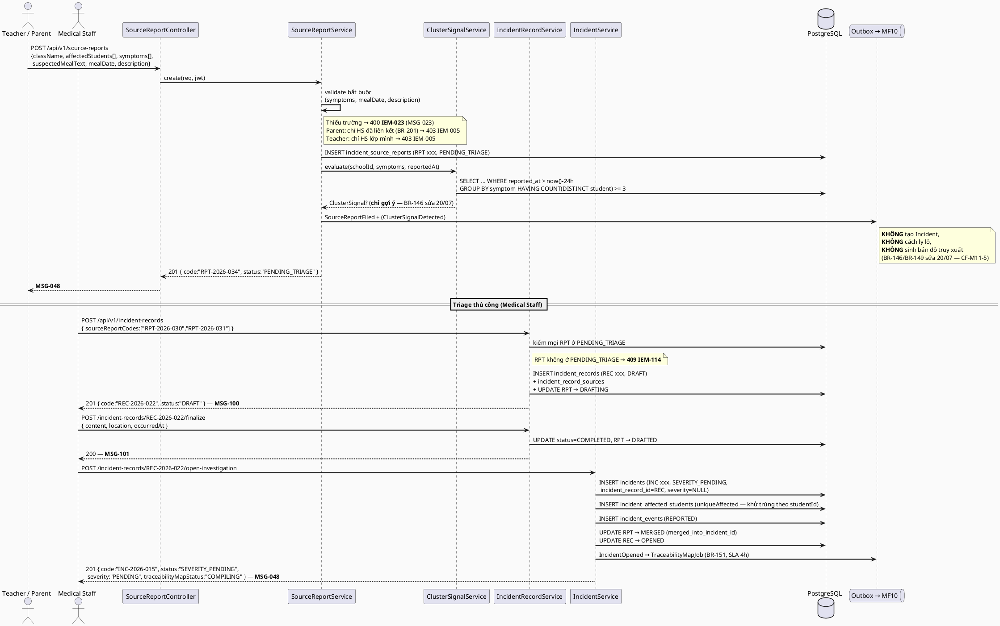
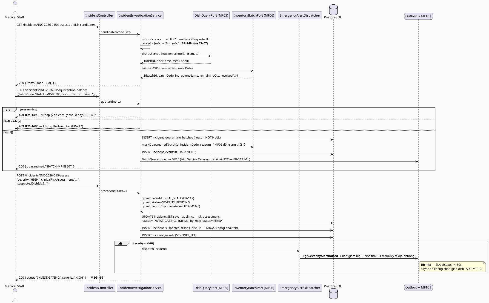
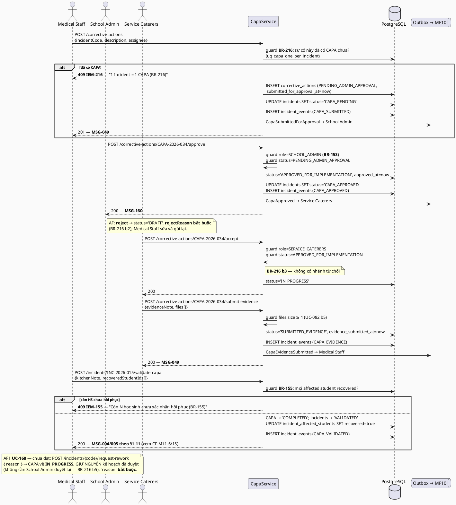
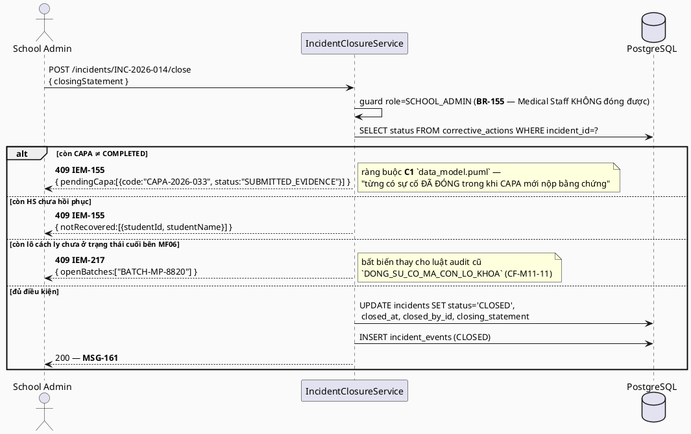
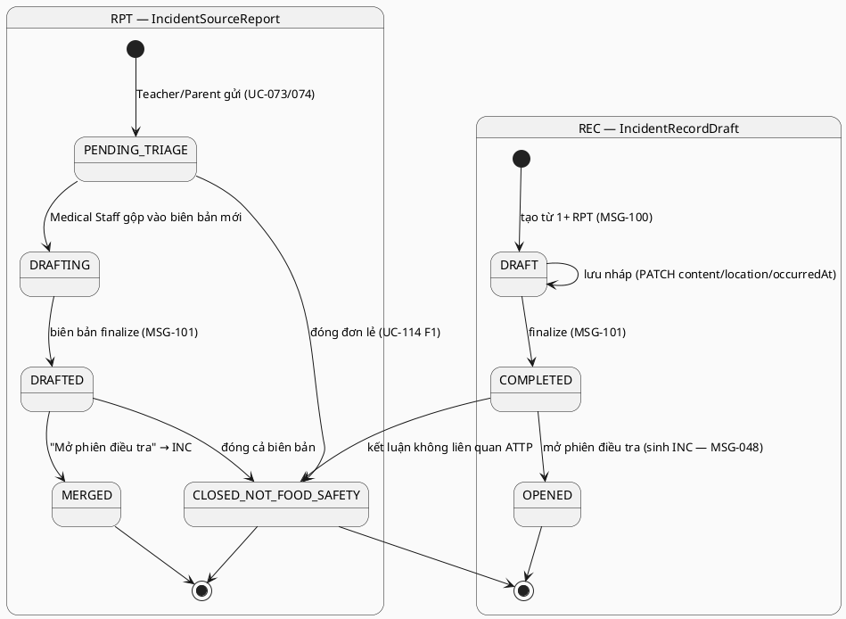
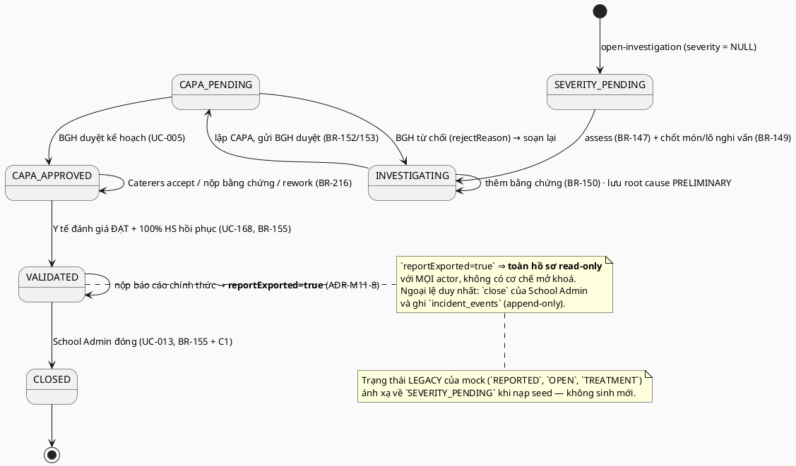
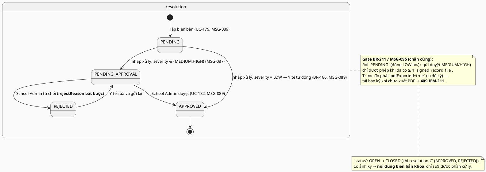

# ENGINEERING DOCUMENTATION STANDARD (EDS) v2.0 — TDS Backend
# MF11 — Incident & Emergency Management (Quản lý Sự cố & Khẩn cấp, gộp Violation Management)

| Field | Value |
|-------|-------|
| **Document ID** | `SFMS-MF11-IMP-001` |
| **Version** | `1.2` |
| **Date** | `2026-08-04` |
| **Status** | `Approved` |
| **Document Owner** | Trần Tuấn Minh (MinhTTHE186258) |
| **Author** | Trần Tuấn Minh — UI/UX & Frontend, chủ module MF09/MF11, Lead FE↔BE contract Reviewer |
| **Reviewed by** | `[Nguyễn Đức Mạnh — §5 Schema + §9 API · Nguyễn Phương Thảo — §13 Test · Bùi Quang Huy — §2 Traceability — Pending]` |
| **DPO Sign-off** | `[ ] Pending` — **bắt buộc**: module chứa **dữ liệu sức khoẻ trẻ em** (triệu chứng, sơ cứu, chẩn đoán lâm sàng, kết quả xét nghiệm) — nhóm dữ liệu nhạy cảm nhất toàn hệ thống |
| **Approved by** | `[Nguyễn Văn Nam — Principal Architect — Pending]` |
| **Last Review** | `2026-08-04` |
| **Based on EDS** | `v2.0` |

> **Stack (ADR-000 / `01_MVP_Backend_Implementation_Plan.md` §3):** Spring Boot **4.1.x (Java 25 LTS)** · PostgreSQL 16 · **Flyway** — ⚠️ **sửa v1.2:** mô hình *"V1 = toàn bộ schema, do Nam giữ"* **đã bị bỏ** từ khi MF02 dùng `V3`; MF11 dùng **`V20__mf11_incident.sql`** + **`V21__seed_mf11.sql`** (số V trống kế tiếp sau `V19__seed_mf10.sql`, đo bằng `ls db/migration/` ngày 04/08/2026 — `M11-D05`) · **Spring Security + JWT** (RBAC 7 role, tin JWT do MF01 phát hành) · springdoc-OpenAPI (Swagger) · MapStruct.
>
> **MF11 là P1 — mắt xích CUỐI của trục xương sống:** `Login theo role → Menu theo khối → phân suất & thống kê theo món → **tạo sự cố** → **điều tra: sự cố → HS → món → lô → NCC → mẫu**`. Đây là module **tiêu thụ** dữ liệu của gần như mọi module khác và nối chúng lại bằng **ID** — nếu một mắt xích nối bằng tên chuỗi, chuỗi truy xuất đứt mà **không có lỗi nào báo ra** (đúng loại lỗi mà `semantic-audit.ts` §9/§9b được viết ra để bắt).
>
> Convention list/search/filter, `PagedResponse<T>`, `Specification`, `@RestControllerAdvice` **copy nguyên** từ vertical slice mẫu **MF02** (`TDS-MF02_Backend.md` §17) — không phát minh lại. Convention giữ tên field JSON của mock **copy nguyên** từ **MF09** (`TDS-MF09_Backend.md` ADR-M09-5).

---

## CHANGELOG

> **Policy 4.4 — Immutable History:** Không xóa thông tin cũ.

| Ngày | Người thực hiện | Nội dung thay đổi |
|------|-----------------|-------------------|
| 2026-07-28 | Trần Tuấn Minh | Tạo bản đầu (v1.0). Nguồn: UC file `MF11_Incident_Emergency_Management.md` (20 UC), traceability **§1.11**, `business_rules.md` **§11** (BR-146..BR-155, BR-216, BR-217) + **§18** (BR-183..BR-190, BR-211), `error_message.md`, mock (`mock-server.ts` / `db.ts` / `mock-data.ts` — `SOURCE_REPORTS`, `INCIDENT_RECORDS`, `INCIDENTS`, `INCIDENT_EVENTS`, `CORRECTIVE_ACTIONS`, `VIOLATIONS`, `OVERRIDE_ABUSE_REPORT`), màn hình `medical-staff/{incidents,violations,corrective-actions}` + `school-admin/{incidents,violations,corrective-actions}` + `service-caterers/{incidents,corrective-actions}` + `teacher/incidents` + `parent/safety-concern`, `data_model.puml` (package "Sự cố & Khắc phục" + ràng buộc **C1**), `semantic-audit.ts` §4/§5/§9/§9b, ADR-000, MVP plan §3. Toàn bộ ví dụ code viết bằng **Java + JPA + Flyway SQL** (không TypeScript/Prisma). |
| 2026-07-28 | Trần Tuấn Minh | **v1.1 — rà soát chéo lại toàn bộ màn hình FE trước khi bàn giao review.** Đối chiếu 23 màn hình + **3 component dùng chung** (`incident-detail-view.tsx`, `incident-export-button.tsx`, `lib/incident-events.ts`) với §9. Sửa **4 lỗi** của bản v1.0: (1) §16 chặn nhầm **Teacher** đọc `source-reports`/`incidents` — 2 màn Teacher sẽ trả 403 nếu code theo v1.0; (2) scope `Assigned` của Service Caterers **không có khoá nào hiện thực được** → thêm **ADR-M11-10**; (3) §8 khai `CapaService.validate()/requestRework()` nhưng §9 không lộ endpoint trên resource CAPA (FE có **2 điểm vào**) → thêm 3 endpoint; (4) bỏ `deadline` khỏi CAPA mà không ghi, trong khi FE còn render cột "Hạn" → giữ cột deprecated. Bổ sung **8 endpoint còn thiếu** (mẫu/phiếu lab theo `incidentId`, sự kiện, export lẻ, aggregate vi phạm UC-189/BR-214) và **5 xung đột mới CF-M11-17..21**. |
| 2026-08-04 | Trần Tuấn Minh | **v1.2 — Bước 0 + Bước 1 của `02_Module_Completion_Workflow.md` §7. Status `Draft` → `Approved`.** Chốt **18 quyết định `M11-D01`…`M11-D18`** (§2.4) + **7 mục treo** (§2.5) không chặn code. **Kết quả Bước 0 (5 lệnh, đo trên code đã merge V1–V19):** `CREATE TABLE code_sequences` của §5.2 **trùng bảng đã tồn tại** (`V1:31`) và **sai cấu trúc** — bảng thật là counter phẳng `(scope VARCHAR(64) PK, next_value BIGINT)`, **không** có `school_id`/`prefix`/`year` (nhóm **C1** của workflow §2.1) ⇒ `M11-D01` gỡ, dùng quy ước `scope = "<resource>:<năm>"` theo tiền lệ MF03/MF05/MF06 đang chạy. **0 path trùng** với controller đã merge; 2 path từng bị MF07 khai (`/violations`, `/corrective-actions` + `/override-abuse`) **đã được MF07 gỡ** (`M07-D07`/`D08`) ⇒ MF11 giữ, và **phải expose 3 port cho module khác** (`M11-D08`): `IncidentStatusPort` (MF08 **đang chạy bằng stub** `IncidentStatusPortStub`, xoá khi MF11 lên), `CapaPort` (MF07 `InspectionServiceImpl:316` đang `log.warn` vì thiếu — BR-095 hiện **không** tự tạo CAPA), `ViolationQueryPort`. **Lỗi Bước 0 nặng thứ hai lại nằm ở §8.3:** MF11 tự khai `NotificationPort` **trùng tên và trùng vai trò** với `com.sfms.mf10.port.NotificationPort` — cửa DUY NHẤT của `M10-D06`, vốn đã nêu đích danh MF11 là 1 trong 4 module chờ ⇒ `M11-D07` gỡ. Thêm **4/8 port là viết lại `ReferenceResolver` có sẵn** (`StudentProfilePort`, `InspectionPort`, `PartnerPort`, và nửa `DishQueryPort`) ⇒ gỡ theo luật Bước 0 mục 6. **Bước 1:** sửa **D1** (bỏ `CREATE TABLE code_sequences`), **D4** (§17.1-C12 + §17.2 mục 12 còn ghi `@JsonFormat("dd/MM/yyyy")` — block này inject thẳng vào prompt sinh code, để nguyên là **mọi controller sinh ra sẽ vi phạm D4**), **§0-BIS** (package `com.sfms.incident` → **`com.sfms.mf11`**, 12 chỗ ở TDS + 10 ở TestSpec), số V `V20`/`V21`, **C2** (3 comment `-> users(id)` → `user_accounts`, PK UUID). Đóng **L33** bằng bằng chứng code: `V8__mf05_menu_diet.sql:35` **đã có** `dishes.code VARCHAR(64) UNIQUE` và `ReferenceResolver.dishIdByCode()` đang chạy ⇒ khoá món **không còn là điểm chặn**. **L35 vẫn treo**: `error_message.md` **v1.9** grep `IEM-` ra **0** ⇒ §10 nay kèm **bản soạn sẵn MSG-149…MSG-158** (tiếng Anh, khuôn v1.5) chờ **Huy** cấp. Bổ sung **TC bắt buộc D11 + D12** vào `TestSpec-MF11` theo §7 Bước 1 việc 3. |
| 2026-08-04 *(chiều)* | Trần Tuấn Minh | **v1.2 đợt 2 — nhóm duyệt TOÀN BỘ 7 mục treo §2.5. Không còn mục nào chặn Bước 2.** Thêm **`M11-D19`…`M11-D22`**. **Hai file dùng chung được sửa** *(việc của Huy, đã duyệt)*: **`error_message.md` → v1.11** cấp **MSG-149…158** (10 mã `IEM-*`) + **MSG-159/160/161** (thay `MSG-029` *"Profile updated successfully"* đang trả về sau khi **đóng một vụ ngộ độc thực phẩm** ở UC-005/009/013); **`traceability_matrix.md` → v1.4** §1.11 thêm **BR-216/BR-217/BR-188**, đánh dấu **BR-184 Deprecated**, đổi tên **UC-179 → "Record *Unit* Violation"**, và sửa **cửa sổ món nghi vấn 48h → 24h** cho khớp BR-149 bản 27/07 + BR-111. **Nam chốt `M11-D19`**: giữ cả 2 vế `OR` của ADR-M11-10 — bằng chứng schema: `BATCH-MP-8820` thuộc `SUP-003` còn CAPA thuộc `CAT-001`, bỏ vế 2 thì NCC có lô bị cách ly không đọc được sự cố về lô của mình. **Đội dự án chốt `M11-D20`**: `scope = quarantineBatches` cho BR-151. **Mạnh duyệt `M11-D18`** nguyên phương án sửa seed. **Hệ quả lớn nhất cho TestSpec:** hết `@Disabled` vì thiếu oracle — 4 nhóm assert nay bật đầy đủ (`message` nguyên văn, nhánh `OR` thứ hai của Caterers, nhánh scope bản đồ, seed đã có phương án). **Việc còn lại đều là hạng mục Bước 2/Bước 3**, không phải mục treo: 3 port `M11-D08`, sửa mock FE (Minh), `semantic-audit.ts` (Thảo), `data_model.puml` (Mạnh). |

---

## MỤC LỤC

1. [Tổng quan Module](#1-tổng-quan-module) · 2. [Ma trận Truy vết](#2-ma-trận-truy-vết) · 3. [Architecture Decisions](#3-architecture-decisions-inline-adr) · 4. [NFR & SLA](#4-non-functional-requirements--sla) · 5. [Static Modeling](#5-static-modeling) · 6. [Dynamic Modeling](#6-dynamic-modeling) · 7. [Domain Event Catalog](#7-domain-event-catalog) · 8. [Interface Specification](#8-interface-specification) · 9. [API Specification](#9-api-specification) · 10. [Error Codes](#10-bảng-mã-lỗi) · 11. [Triển khai](#11-quy-trình-triển-khai) · 12. [Rollback Runbook](#12-rollback--incident-runbook) · 13. [Kiểm thử](#13-kịch-bản-kiểm-thử) · 14. [Xác minh](#14-phương-pháp-xác-minh) · 15. [API Samples](#15-mẫu-thử-thực-tế) · 16. [Authorization Matrix](#16-authorization-matrix) · 17. [AI Prompt Constraints](#17-ai-prompt-constraints-case-20)

---

## 1. Tổng quan Module

> MF11 quản lý **toàn bộ vòng đời sự cố an toàn thực phẩm** — từ báo cáo thô của Giáo viên/Phụ huynh (`RPT-xxx`), qua bước **soạn biên bản sự cố** thủ công (`REC-xxx`), mở **phiên điều tra** (`INC-xxx`), phân loại mức độ, cách ly lô nguyên liệu, biên soạn bản đồ truy xuất, kết luận nguyên nhân gốc rễ, vòng đời **CAPA** 6 trạng thái, tới lúc Ban giám hiệu **đóng sự cố** — **cộng thêm** phân hệ **Quản lý Vi phạm** (`VIO-xxx`: biên bản vi phạm cấp đơn vị Nhà thầu, biên bản xử lý sai phạm, registry tổng hợp, báo cáo lạm dụng manual override hằng tuần).

| Field | Value |
|-------|-------|
| **Module Name** | Incident & Emergency Management (MF11) — gộp Violation Management (§18 `business_rules.md`) |
| **Bounded Context** | Food Safety Incident & Non-Conformance |
| **Data Classification** | **PII — Sensitive (trẻ em) + dữ liệu sức khoẻ**: họ tên HS, lớp, triệu chứng, sơ cứu, đánh giá rủi ro lâm sàng, kết quả xét nghiệm, tình trạng hồi phục. **Cao hơn MF09** một bậc. |
| **Compliance Scope** | PDPD (Nghị định 13/2023/NĐ-CP) · Quyết định **39/2006/QĐ-BYT** (quy chế điều tra ngộ độc thực phẩm — cửa sổ điều tra) · mẫu biên bản `00_Policies/specialreport2173_1.md` (BR-211, BR-154) |
| **Upstream Dependencies** | **MF01** (JWT `userId/role/schoolId`) · **MF02** (`Classroom`) · **MF03** (`Student` — HS bị ảnh hưởng, hồ sơ sức khoẻ) · **MF05** (`Dish`/`Menu` — món của bữa nghi vấn) · **MF06** (`InventoryBatch` — cách ly lô, bản đồ truy xuất) · **MF07** (`InspectionSession` — CAPA sinh từ kiểm thực BR-095, `sourceInspectionId` của biên bản vi phạm) · **MF08** (`FoodSample`, `SampleLabRequest` — mẫu lưu làm tang chứng) · **MF09** (`ServingDish` — *"em nào đã ăn món nghi nhiễm?"*) · **MF04** (`Partner` — đơn vị Nhà thầu, đại diện ký biên bản) |
| **Downstream Consumers** | **MF10** (thông báo khẩn BR-148, thông báo trạng thái CAPA) · **MF13** (báo cáo tổng hợp vi phạm theo kỳ — **BR-214/UC-189**, qua `GET /violations/summary`; truy xuất theo `incidentId`. ⚠️ **BR-213/UC-188 đã Deprecated 26/07/2026** — xem CF-M11-20) · **MF06** (lệnh cách ly lô) · **MF08** (chỉ định thu hồi mẫu theo `incidentId`) |

**Phạm vi 20 Use Case (đúng traceability §1.11):**
- **Tiếp nhận báo cáo (Teacher/Parent):** UC-074 (Report Food Safety Incident), UC-073 (Report Food Safety Concern).
- **Triage & biên bản (Medical Staff):** UC-114 (View Food Poisoning Incident List — **mở rộng 15/07/2026**: thêm bước soạn biên bản sự cố thủ công).
- **Điều tra (Medical Staff):** UC-041 (Manage Food Safety Incidents), UC-009 (Assign Incident Severity — **gộp trình bày vào UC-116**), UC-116 (View Food Safety Incident Detail), UC-033 (Generate Incident Report), UC-168 (Record Corrective Actions Report).
- **CAPA (3 vai):** UC-005 (Approval / Reject Corrective Action — School Admin), UC-038 (Manage Corrective Actions — Service Caterers), UC-082 (Submit Corrective Action Results — Service Caterers).
- **Đóng & xuất hồ sơ (School Admin):** UC-013 (Close Incident), UC-031 (Export Incident Reports), UC-121 (View Incident Report), UC-120 (View Incident Information — Service Caterers).
- **Quản lý Vi phạm:** UC-179 (Record Staff Violation — *dialog hợp nhất, đã gộp UC-178*), UC-180 (Record Violation Resolution), UC-181 (View Violation Registry), UC-182 (Approve/Reject Violation Resolution), UC-183 (View Weekly Override Abuse Report).

> ✅ Kế hoạch `00_Team_Work_Assignment_Plan.md` §3 ghi MF11 có **20 UC** — khớp đúng 20 dòng của traceability §1.11. Không có UC nào thiếu spec trong UC file (khác MF09, nơi UC-079 thiếu spec).

**Vai trò liên quan (BR-007):** Medical Staff (**chủ thể chính** — triage, điều tra, phân loại, cách ly, soạn CAPA, đánh giá khắc phục, lập biên bản vi phạm), School Administration (**duyệt CAPA BR-153, đóng sự cố BR-155, duyệt xử lý vi phạm BR-186**), Service Caterers (nhận & thực hiện CAPA, nộp bằng chứng, tự ghi nhận vi phạm), Teacher (báo cáo thô), Parent (báo cáo thô về con mình), System Admin (vận hành).

**Thư mục màn hình đã đọc (nguồn 6 — `03_Design/08_FrontEnd/Web/src/app/(app)/`):**
- `medical-staff/incidents` (danh sách + triage RPT — UC-114) · `medical-staff/incidents/records/[id]` (biên bản sự cố — UC-114 mở rộng, MSG-100/101) · `medical-staff/incidents/[id]` (**1.823 dòng — "Trung tâm ca sự cố"**, UC-116 + UC-009 + UC-041 + UC-033 + UC-168) · `medical-staff/incidents/[id]/evidence` (camera-first, BR-150) · `medical-staff/incidents/[id]/investigation` (redirect mỏng).
- `medical-staff/violations` + `/new` + `/[id]` + `/reports` (UC-179, UC-180, BR-211/183/185/187).
- `medical-staff/corrective-actions` + `/[id]` (UC-168 — đánh giá hiệu quả CAPA).
- `school-admin/incidents` + `/[id]` + `/[id]/close` (UC-114/116/013, BR-155) · `school-admin/corrective-actions` (UC-005, BR-153) · `school-admin/violations` + `/[id]` + `/override-report` (UC-181/182/183).
- `service-caterers/incidents` + `/[id]` (UC-120, **chỉ đọc, route mỏng**) · `service-caterers/corrective-actions` (UC-038/082).
- `teacher/incidents` (UC-074 — tạo `RPT-xxx` **+ khối "Lịch sử báo cáo" đọc `source-reports` của lớp mình**) · `parent/safety-concern` (UC-073 — **chỉ tạo**, không có màn xem lại).
- **Component dùng chung (v1.1 — bổ sung sau lượt rà soát):** `components/app/incident-detail-view.tsx` (**dùng bởi 3 route**: `school-admin/incidents/[id]`, `school-admin/incidents/[id]/close`, `service-caterers/incidents/[id]` — đọc `incidents` + `corrective-actions` + `incident-events` + `inventory` + **`receiving`**) · `components/app/incident-export-button.tsx` (AF1 UC-116, hiện là toast giả) · `lib/incident-events.ts` (`useAppendIncidentEvent` — **sẽ bỏ**, xem CF-M11-19).
- **4 dashboard** đọc dữ liệu MF11 để đếm: `medical-staff/dashboard`, `school-admin/dashboard`, `teacher/dashboard`, `service-caterers/dashboard` (xem ghi chú cuối §9.1).

**Resource mock thuộc MF11 (`db.ts`):** `source-reports` (`SOURCE_REPORTS`), `incident-records` (`INCIDENT_RECORDS`), `incidents` (`INCIDENTS`), `incident-events` (`INCIDENT_EVENTS`), `corrective-actions` (`CORRECTIVE_ACTIONS`), `violations` (`VIOLATIONS`), `override-abuse` (`OVERRIDE_ABUSE_REPORT`).
Đọc kèm (**không sở hữu**): `students` (MF03), `inventory` + `inventory-transactions` (MF06), `samples` + `sample-lab-requests` (MF08), `inspections` + `kitchen-inspections` (MF07), `partners` (MF04), `sent-reports` (MF13), `notifications` (MF10).

---

## 2. Ma trận Truy vết

> **Nguồn:** cột BR/MSG lấy **nguyên văn** `traceability_matrix.md` §1.11; tên UC nguyên văn UC file `MF11_Incident_Emergency_Management.md`; nội dung BR tra `business_rules.md` §11 (BR-146..BR-155, BR-216, BR-217) và §18 (BR-183..BR-190, BR-211). **Policy:** chỉ dùng mã có trong §1.11 — không bịa mã mới, không lấy số từ `Report 3.md` phụ lục.

### 2.1. UC ↔ BR ↔ MSG ↔ Code

| UC ID | Tên UC (nguyên văn) | Actor | Business Rules (§1.11) | System Messages (§1.11) | Thành phần Code (Java) |
|-------|---------------------|-------|------------------------|-------------------------|------------------------|
| UC-073 | Report Food Safety Concern | Parent | BR-146 | MSG-023, MSG-048 | `SourceReportService.createByParent()` |
| UC-074 | Report Food Safety Incident | Teacher | BR-146 | MSG-023, MSG-048 | `SourceReportService.createByTeacher()` |
| UC-041 | Manage Food Safety Incidents | Medical Staff | BR-146, BR-147, BR-148, BR-149, BR-150, BR-151, **BR-217** | ~~MSG-024~~ *(descope — CF-M11-7)*, MSG-048, **MSG-150, MSG-151, MSG-152, MSG-158** | `IncidentInvestigationService` (`assess`, `quarantine`, `addEvidence`, `saveRootCause`) |
| UC-009 | Assign Incident Severity | Medical Staff | BR-147, BR-148 | **MSG-159** *(v1.2 — thay MSG-029, `error_message.md` v1.11)* | `IncidentInvestigationService.assessAndStart()` + `EmergencyAlertDispatcher` |
| UC-038 | Manage Corrective Actions | Service Caterers | BR-152, **BR-216** | MSG-049, **MSG-154** | `CapaService.accept()`, `CapaService.submitEvidence()` |
| UC-082 | Submit Corrective Action Results | Service Caterers | BR-152, **BR-216** | MSG-049, **MSG-154** | `CapaService.submitEvidence()` (validate file bắt buộc) |
| UC-168 | Record Corrective Actions Report | Medical Staff | BR-152, BR-154, **BR-155, BR-216** | ~~MSG-004~~ *(sai ngữ nghĩa — CF-M11-15)*, MSG-005, **MSG-153** | `CapaService.validate()`, `CapaService.requestRework()` |
| UC-005 | Approval / Reject Corrective Action | School Administration | BR-153, **BR-216** | **MSG-160** *(v1.2 — thay MSG-029)* | `CapaService.approvePlan()`, `CapaService.rejectPlan()` |
| UC-013 | Close Incident | School Administration | BR-155, **BR-217** | **MSG-161** *(v1.2 — thay MSG-029)* | `IncidentClosureService.close()` (gate C1) |
| UC-033 | Generate Incident Report | Medical Staff | BR-154 | MSG-004, MSG-005 | `IncidentReportService.generateAndSubmit()` |
| UC-031 | Export Incident Reports | School Administration | BR-154 | MSG-004, MSG-005 | `IncidentReportService.export()` (PDF/Excel) |
| UC-114 | View Food Poisoning Incident List *(mở rộng 15/07/2026 — thêm bước soạn "biên bản sự cố" thủ công)* | School Administration, Medical Staff | BR-146, BR-149 | MSG-004, MSG-005, MSG-023, MSG-100, MSG-101, **MSG-149** | `SourceReportService.listForTriage()`, `IncidentRecordService` (`draft`, `finalize`, `openInvestigation`, `closeNotFoodSafety`) |
| UC-116 | View Food Safety Incident Detail *(15/07/2026 — gộp trình bày UC-009 vào cùng màn)* | School Administration, Medical Staff | BR-146–155 | MSG-004, MSG-005 | `IncidentQueryService.detail()` (aggregate 8 nguồn) |
| UC-120 | View Incident Information | Service Caterers | — | MSG-004, MSG-005 | `IncidentQueryService.detailForCaterers()` (projection thu hẹp) |
| UC-121 | View Incident Report | School Administration | BR-154 | MSG-004, MSG-005 | `IncidentReportService.view()` |
| UC-179 | Record **Unit** Violation *(đổi tên 04/08 theo traceability v1.4)* *(nay là dialog hợp nhất — gộp UC-178)* | Medical Staff, Service Caterers | BR-183, ~~BR-184~~ *(Deprecated 26/07)*, BR-187, **BR-188**, BR-190, BR-211 | MSG-085, MSG-086, MSG-088, MSG-095 | `ViolationService.record()`, `RepeatViolationDetector` (BR-187), `ViolationPdfService` (BR-211) |
| UC-180 | Record Violation Resolution | Medical Staff, School Administration | BR-185, BR-186, **BR-188**, BR-211 | MSG-085, MSG-087, MSG-095, **MSG-156, MSG-157** | `ViolationResolutionService.submit()` (gate MSG-095) |
| UC-181 | View Violation Registry | School Administration, Medical Staff | BR-189 | MSG-004, MSG-005 | `ViolationService.registry()` (`ViolationSpec`) |
| UC-182 | Approve/Reject Violation Resolution | School Administration | BR-186, **BR-188** | MSG-089, **MSG-157** *(v1.2 — gỡ MSG-029 sai ngữ nghĩa)* | `ViolationResolutionService.approve()`, `.reject()` |
| UC-183 | View Weekly Override Abuse Report | School Administration | BR-190 | MSG-004, MSG-005 | `OverrideAbuseReportService.weekly()` (**derived**, không bảng — ADR-M11-6) |

### 2.2. Business Rules — nội dung (nguyên văn `business_rules.md`)

| BR | Nội dung (nguyên văn, rút gọn) | Áp ở |
|----|--------------------------------|------|
| **BR-146** | Hệ thống **tự động phát hiện và hiển thị thông báo gợi ý** khi ≥ **3 học sinh** báo triệu chứng tương đồng trong **24 giờ**. Hệ thống **không tự động gộp báo cáo, không tự động khởi tạo** Incident — quyết định gộp `RPT` → `INC` **hoàn toàn thủ công** do Medical Staff. *(sửa 20/07/2026)* | `ClusterSignalService` (chỉ **gợi ý**), `IncidentRecordService.openInvestigation()` (thủ công) |
| **BR-147** | **Medical Staff** chịu trách nhiệm **phân loại mức độ nghiêm trọng** (Severity) của sự cố. | `assessAndStart()` — chỉ role Medical Staff |
| **BR-148** | Sự cố **High Severity** phải kích hoạt **ngay lập tức** cảnh báo đến: Ban giám hiệu · Công ty catering · Cơ quan y tế địa phương. | `EmergencyAlertDispatcher` → event `HighSeverityAlertRaised` (MF10) |
| **BR-149** | Medical Staff **tự chọn từng lô nguyên liệu cụ thể** cần cách ly — hệ thống Quarantine **ngay khi chọn**, kèm **lý do cách ly bắt buộc** nhập ngay tại dòng lô. **Không** tự động cách ly toàn bộ lô liên quan tới món. Cửa sổ chọn món nghi vấn = **24 giờ** *(sửa 27/07/2026)*, mốc gốc ưu tiên `occurredAt` → `mealDate` → `reportedAt`. | `QuarantineService.quarantineBatch()` (lý do bắt buộc, **một chiều**), `suspectedDishCandidates()` (cửa sổ 24h) |
| **BR-150** | Hệ thống phải hỗ trợ **điều tra nguyên nhân gốc rễ (RCA)** với khả năng **đính kèm bằng chứng**. | `InvestigationEvidence`, `Incident.rootCause` + `rootCauseStatus` |
| **BR-151** | Trong vòng **4 giờ** kể từ khi báo cáo sự cố, hệ thống **tự động biên soạn bản đồ truy xuất** cho tất cả lô nguyên liệu và nhà cung cấp liên quan. *(footnote 15/07/2026: phạm vi "liên quan" chưa chốt — đề xuất theo `quarantineBatchIds[]`)* | `TraceabilityMapService` (async, SLA 4h), `traceability_map_status` |
| **BR-152** | Sau mỗi sự cố phải có **CAPA** được tạo, phân công và theo dõi đến khi hoàn thành. Biện pháp khẩn cấp (khoá lô, sơ cứu, cảnh báo HIGH) **tách biệt hoàn toàn** khỏi CAPA. **Không đặt hạn SLA cứng.** | `CapaService`, `CorrectiveAction` |
| **BR-153** | **School Administration** phê duyệt/từ chối hành động khắc phục **được đề xuất**, **TRƯỚC KHI** Service Caterers thực hiện. *(sửa 20/07/2026 — duyệt kế hoạch trước, không phải duyệt kết quả sau)* | `CapaService.approvePlan()` — gate `PENDING_ADMIN_APPROVAL → APPROVED_FOR_IMPLEMENTATION` |
| **BR-154** | **Medical Staff** có thể tạo **báo cáo sự cố chính thức** để lưu hồ sơ và xuất báo cáo. | `IncidentReportService` |
| **BR-155** | Chỉ **School Administration** mới có quyền **đóng (Close)** sự cố sau khi xác nhận hoàn thành các hành động khắc phục. | `IncidentClosureService.close()` — role guard + gate C1 |
| **BR-183** | Mọi vi phạm do **Service Caterers** gây ra đều là **1 loại Biên bản Vi phạm duy nhất**, nhắm vào **đơn vị Nhà thầu** (không nhắm cá nhân): `reportedBy`, mô tả, ảnh bằng chứng, `severityLevel`, `caterersRepresentativeId`. *(sửa 26/07/2026 — gộp BR-184)* | `ViolationRecord`, `ViolationService.record()` |
| **BR-184** | **Deprecated 26/07/2026** — nội dung đã gộp hoàn toàn vào BR-183 (cấp đơn vị). Giữ số hiệu để tránh xáo trộn liên kết chéo; **không còn hiệu lực độc lập**. | *(không hiện thực riêng — xem CF-M11-3)* |
| **BR-185** | **Biên bản Xử lý Sai phạm** (`ViolationResolutionRecord`) ghi: `actionTaken`, `handledBy`, và `unitSanctionLevel` áp cho **đơn vị Nhà thầu** (Nhắc nhở văn bản / Cảnh cáo hợp đồng / Phạt vi phạm hợp đồng / Đề xuất chấm dứt hợp đồng). **Bỏ hẳn `disciplinaryLevel`** *(sửa 26/07/2026)*. | `ViolationResolutionService.submit()` |
| **BR-186** | Vi phạm **LOW**: Medical Staff trực tiếp phê duyệt/đóng. **MEDIUM/HIGH**: bắt buộc **School Administration** phê duyệt/từ chối trước khi đóng. | `ViolationResolutionService` — phân nhánh theo `severity` |
| **BR-187** | Vi phạm mới trùng **`caterersRepresentativeId`**/đơn vị Nhà thầu với biên bản khác cùng mức **≥ MEDIUM** trong **90 ngày** (mặc định, School Admin điều chỉnh được) → **cảnh báo nghi ngờ tái diễn**, best-effort, **không tự động escalate**. *(sửa 26/07/2026 — đổi căn cứ từ `staffName` sang `caterersRepresentativeId`)* | `RepeatViolationDetector` → MSG-088 (warning, **không chặn**) |
| **BR-189** | **School Administration** phải có màn hình xem **danh sách tổng hợp mọi loại vi phạm** theo mức độ và trạng thái. | `ViolationService.registry()` |
| **BR-190** | Hệ thống **tự động tổng hợp hằng tuần** các trường hợp lạm dụng manual override, thể hiện dưới dạng Biên bản Vi phạm (**cấp đơn vị Nhà thầu**) với `violationType = OVERRIDE_ABUSE`. | `OverrideAbuseWeeklyJob` + `OverrideAbuseReportService` |
| **BR-211** | Sau khi điền đủ trường bắt buộc → hệ thống **xuất PDF** (mẫu `specialreport2173_1.md`), người lập **in, ký tay** cùng Đại diện Nhà thầu, **chụp/scan tải lên** (`signedRecordPhotoUrl`, **bắt buộc**). Có ảnh ký → biên bản **Đã khoá**, không sửa nội dung. **Lưu biên bản KHÔNG bị chặn** bởi việc chưa có ảnh ký; nhưng **gate chặn cứng**: không cho "Đóng biên bản" (LOW) / "Gửi School Administration phê duyệt" (MEDIUM/HIGH) khi chưa có ảnh ký. | `ViolationPdfService`, gate **MSG-095** ở `ViolationResolutionService.submit()` |

**BR trích chéo (KHÔNG tính là BR của MF11 theo §1.11, nhưng bắt buộc dùng — ghi rõ nguồn):**

| BR | Nguồn | Vì sao MF11 phải dùng |
|----|-------|-----------------------|
| **BR-216** | `business_rules.md` §11 (mới 20/07/2026) | Vòng đời CAPA 6 trạng thái `DRAFT → PENDING_ADMIN_APPROVAL → APPROVED_FOR_IMPLEMENTATION → IN_PROGRESS → SUBMITTED_EVIDENCE → COMPLETED` + quy tắc **1 Incident = 1 CAPA**. Mock thực thi đúng bộ enum này ở cả 3 vai. **Không có trong §1.11** → xem **CF-M11-1**. |
| **BR-217** | `business_rules.md` §11 (sửa 27/07/2026) | Quy trình cách ly → Caterers **trả lô về NCC ngay** (không chờ kết quả lab) → **bỏ hẳn cơ chế mở khoá**. Quyết định cách ly là **một chiều**. **Không có trong §1.11** → xem **CF-M11-2**. |
| **BR-095 / BR-097** | MF07 | CAPA có **2 đường sinh**: sự cố (BR-152) **và** kiểm thực ba bước không đạt (BR-095) — chỉ thất bại nghiêm trọng mới đồng thời mở sự cố (BR-097). `CorrectiveAction.inspectionId` tồn tại chính vì đường thứ hai. |
| **BR-113** | MF08 | Chỉ định thu hồi mẫu lưu để xét nghiệm khi điều tra. MF11 chỉ **phát lệnh theo `incidentId`**, không sở hữu mẫu. |
| **BR-170 / BR-188** | §15 / §18 | Audit log **bất biến** cho mọi thao tác hồ sơ vi phạm và nhả lô. BR-188 **không có trong §1.11** dù kế hoạch §3 nhắc tới → **CF-M11-3**. |
| **BR-007 / BR-004** | MF01 | RBAC 7 role · phiên đăng nhập (MSG-004/005). |
| **BR-201** | MF03 | Parent chỉ báo cáo/đọc về HS đã liên kết (≤ 5). |

### 2.3. ⚠️ Mâu thuẫn giữa các nguồn (ghi rõ, KHÔNG tự chọn bên đúng)

| # | Mô tả mâu thuẫn | Xử lý trong TDS |
|---|-----------------|-----------------|
| **CF-M11-1** | **BR-216 (vòng đời CAPA 6 trạng thái, 1 Incident = 1 CAPA)** là quy tắc **trung tâm** của UC-005/038/082/168, được mock thực thi đầy đủ ở cả 3 vai (`medical-staff/incidents/[id]`, `school-admin/corrective-actions`, `service-caterers/corrective-actions`) và ghi rõ trong `business_rules.md` §11 — nhưng **KHÔNG xuất hiện** ở cột Business Rules của bất kỳ UC nào tại traceability §1.11 (chỉ có BR-152/153/155). | **Vẫn hiện thực đầy đủ BR-216** — nếu không, vòng đời CAPA không có định nghĩa và 3 màn hình của 3 vai sẽ nói ba chuyện khác nhau. Trích BR-216 với ghi chú *"nguồn `business_rules.md` §11, chưa có ở §1.11"*. **Huy (Lead Traceability)** quyết định bổ sung BR-216 vào §1.11 hay không. |
| **CF-M11-2** | **BR-217 (cách ly → trả lô về NCC → bỏ mở khoá)** cùng tình trạng: có trong `business_rules.md` §11, quyết định hành vi thật của hệ thống (khoá lô là **không thể hoàn tác**), nhưng **không có ở §1.11**. Đồng thời mock **vẫn còn** field `quarantineReleaseLog` (thêm 19/07, trước khi BR-217 bỏ mở khoá 27/07). | Hiện thực theo **BR-217 bản mới nhất**: `quarantineBatch()` **một chiều**, **không có** endpoint nhả lô. Giữ cột `quarantine_release_log` **read-only cho dữ liệu lịch sử** (biên bản lập trong khoảng 19–27/07 vẫn còn giá trị), **không ghi mới**. Ghi lại để Huy đồng bộ §1.11. |
| **CF-M11-3** | Kế hoạch `00_Team_Work_Assignment_Plan.md` §2 ghi MF11 *"gộp Violation-Staff **BR-184, 186, 188**"*. Nhưng: (a) **BR-184 đã Deprecated 26/07/2026** (gộp vào BR-183) — §1.11 vẫn liệt kê BR-184 ở UC-179; (b) **BR-188** (audit log bất biến cho hồ sơ vi phạm) **không có** ở bất kỳ dòng nào của §1.11. | Hiện thực **BR-183** (không hiện thực BR-184 như một loại biên bản riêng) và **vẫn ghi audit bất biến** theo BR-188 (bỏ đi thì hồ sơ vi phạm mất giá trị pháp lý). Ghi rõ cả hai lệch cho **Huy** + **Nam** xác nhận: sửa §1.11 (bỏ BR-184, thêm BR-188) hay sửa kế hoạch §2. |
| **CF-M11-4** | **UC-179 vẫn mang tên "Record Staff Violation"** và UC file mô tả *"identifying the staff member by free-text name"*, *"matching staff name … within 90-day lookback"*, `staffPosition`, `disciplinaryLevel` — toàn bộ đã bị **BR-183/185/187 sửa 26/07/2026 bãi bỏ** (chuyển sang cấp **đơn vị Nhà thầu**, `caterersRepresentativeId`, `unitSanctionLevel`). Mock đã đánh dấu `staffName`/`staffPosition`/`disciplinaryLevel` là `@deprecated` nhưng **giữ cột** cho 2 bản ghi seed cũ (`VIO-2026-007`, `VIO-2026-005`). | Backend theo **BR-183/185/187 bản mới** (cấp đơn vị). 3 cột `staff_name`, `staff_position`, `disciplinary_level` **giữ nullable, read-only** cho dữ liệu lịch sử — **không có** field nào trong request DTO ghi vào chúng. **MSG-088** đổi diễn giải: đối chiếu theo **đại diện/đơn vị Nhà thầu**, không theo tên nhân viên (nội dung MSG gốc vẫn ghi *"staff name matches"* — **không sửa MSG**, chỉ ghi lệch). Cần **Huy** đổi tên UC-179 và cập nhật MSG-088. |
| **CF-M11-5** | **BR-146 — UC file vs `business_rules.md`:** UC-073/UC-074 (UC file) ghi *"if trigger threshold met (BR-146), **automatically creates a food safety incident** and quarantines suspected batches (BR-149)"*; UC-074 postcondition ghi *"Incident record created with unique Incident ID (MSG-048) … Suspected batches quarantined … Traceability map generated"*. **BR-146 sửa 20/07/2026 bãi bỏ hoàn toàn cơ chế tự động này** (chỉ còn phát hiện + gợi ý), và **BR-149 sửa 20/07** bỏ cách ly tự động. Mock khớp bản BR mới: Teacher/Parent **chỉ tạo `RPT-xxx`**. | Hiện thực theo **`business_rules.md` bản mới nhất** (nguồn BR chuẩn theo §2c): `POST /source-reports` **chỉ tạo RPT**, phát signal gợi ý, **không** tạo `INC`, **không** cách ly, **không** sinh bản đồ truy xuất. `MSG-048` trả về khi **mở phiên điều tra** (UC-114), không phải khi gửi RPT. **UC-073/UC-074 cần Huy viết lại** cho khớp BR-146/149 bản 20/07/2026. |
| **CF-M11-6** | **MSG gán sai ngữ nghĩa ở §1.11:** UC-005 (duyệt CAPA) → **MSG-029** = *"Profile updated successfully"*; UC-013 (đóng sự cố) → **MSG-029** cũng vậy; UC-009 (phân loại mức độ) → **MSG-029**. Trong khi mock lại dùng **MSG-043** (*"Food safety inspection checklist submitted"*) cho duyệt CAPA và **MSG-046** (*"Meal feedback submitted"*) cho UC-168/UC-033 — cả hai đều là MSG của module khác. | **Response trả đúng mã §1.11** (MSG-029 cho UC-005/009/013; MSG-004/005 cho UC-168/033) để không bịa mã, **nhưng ghi rõ** rằng nội dung MSG-029 không mô tả đúng hành động. Đề nghị **Huy** cấp MSG mới cho "CAPA plan approved" / "Incident closed" / "Severity assigned". **Sửa mock FE** bỏ MSG-043/MSG-046 dùng nhầm — Minh chịu trách nhiệm. |
| **CF-M11-7** | **MSG-024** (*"Kitchen quarantine is active: Operation blocked due to safety violations."*, BR-105) được §1.11 gán cho **UC-041**. Nhưng cơ chế **khoá bếp đã descope 05/07/2026** (xem `mock-server.ts` dòng 16 + MSG-093: *"kitchen operations continue as normal"*), và BR-105 không nằm trong §1.11. | **Không endpoint nào của MF11 phát ra MSG-024.** Liệt kê ở §10 để giữ vết §1.11 với ghi chú "không hiện thực". Cần **Huy** gỡ MSG-024 khỏi UC-041 hoặc khôi phục BR-105. |
| **CF-M11-8** | **`SEARCH_FIELDS` gợi ý ở kế hoạch §2b-3** cho MF11: `Incident` → `title`, `description`, `reporterName`. Mock `Incident` **không có** field `description` lẫn `reporterName` — field thật là `title`, `reportedBy`, `suspectedDish`, `symptoms[]`. | `SEARCH_FIELDS` thật: `incidents` → **`title`, `reportedBy`, `suspectedDish`** · `source_reports` → **`reportedBy`, `className`, `suspectedMealText`, `description`** · `violations` → **`subject`, `recordedBy`, `caterersRepresentative`** · `corrective_actions` → **`description`, `assignee`, `source`**. Đề nghị **Nam** sửa bảng §2b-3. |
| **CF-M11-9** | **Mock dùng generic `PUT /:resource/:id`** (merge mọi field body) cho **toàn bộ** chuyển trạng thái: duyệt CAPA, đóng sự cố, chốt severity, khoá lô, đóng biên bản vi phạm. ⇒ **không có** kiểm tra BR-153 (duyệt trước khi thực hiện), BR-155/C1 (mọi CAPA COMPLETED trước khi đóng), BR-186 (LOW mới được Y tế tự đóng), BR-211/MSG-095 (gate ảnh ký), BR-149 (lý do cách ly bắt buộc) — **tất cả đang chặn ở client** bằng `toast.error`/`disabled`. | Backend thay bằng **endpoint nghiệp vụ** (§9) enforce **phía server**, không tin client. `PATCH` generic **chỉ** cho field soạn thảo không nhạy cảm (nháp nội dung, ghi chú) để FE chuyển dần. |
| **CF-M11-10** | **`override-abuse` là bảng seed tĩnh** trong mock (`OVERRIDE_ABUSE_REPORT`, 3 dòng, khoá theo `staffName`), trong khi **BR-190 nói hệ thống *tự động tổng hợp hằng tuần*** từ các Biên bản Vi phạm có `violationType = OVERRIDE_ABUSE` (cấp **đơn vị**, sau sửa 26/07). Hai nguồn đang **đếm hai kiểu** và bảng tĩnh còn dùng khoá đã bị bãi bỏ (`staffName`). | **Không tạo bảng `override_abuse`.** `GET /violations/override-abuse-report?week=` **dẫn xuất runtime** từ `violation_records` (`violation_type='OVERRIDE_ABUSE'`, `GROUP BY` tuần ISO × đơn vị Nhà thầu) — ADR-M11-6. Job `OverrideAbuseWeeklyJob` **sinh biên bản vi phạm** hằng tuần chứ không sinh bảng báo cáo riêng. **Cần sửa mock FE** cùng lúc — Minh chịu trách nhiệm. |
| **CF-M11-11** | **`semantic-audit.ts` §9b luật `DONG_SU_CO_MA_CON_LO_KHOA`** coi việc *"sự cố đã đóng mà `quarantineBatches` còn phần tử"* là **lỗi dữ liệu** (giả định có bước nhả lô). Nhưng **BR-217 sửa 27/07/2026 bỏ hẳn nhả lô** — lô đã cách ly được **trả về Nhà cung cấp**, nên `incident.quarantineBatches` **luôn còn** phần tử khi đóng. | Luật audit này **không còn đúng** với BR-217 bản mới. Backend **không** xoá `incident_quarantine_batches` khi đóng (đó là hồ sơ lịch sử của cuộc điều tra). Thay bằng bất biến mới: *khi Incident `CLOSED`, mọi lô trong danh sách phải ở trạng thái cuối `RETURNED_TO_SUPPLIER`/`DISPOSED` bên MF06* (§4.2). Cần **Thảo** cập nhật luật audit và **Mạnh** xác nhận trạng thái lô bên MF06. |
| **CF-M11-12** | **`Incident.severity` khởi tạo bằng `"PENDING"`** trong mock (`openInvestigation`, dòng 181: *"chỉ Medical Staff set qua khối đánh giá gộp"*), nhưng **BR-147** chỉ định nghĩa 3 mức **Low / Medium / High**. `severity` và `status` trong mock còn dùng chung kiểu `keyof typeof STATUS_BADGE` (một union nhãn hiển thị), không phải 2 enum tách bạch. | Backend tách **2 enum riêng**: `IncidentSeverity {LOW, MEDIUM, HIGH}` **nullable** (NULL = chưa phân loại, thay cho sentinel `"PENDING"`) và `IncidentStatus`. JSON **vẫn trả `"PENDING"`** khi `severity IS NULL` để không phá hợp đồng FE (`@JsonInclude` + custom serializer) — ADR-M11-5. Ghi lại để Mạnh xác nhận. |
| **CF-M11-13** | **BR-151 (bản đồ truy xuất trong 4 giờ)** có **footnote 15/07/2026 chưa chốt**: *"phạm vi 'liên quan' chưa được định nghĩa rõ (toàn sự cố hay chỉ lô của món nghi vấn)"* — đề xuất theo `quarantineBatchIds[]` nhưng **chưa khoá**. Mock đặt `traceabilityMapStatus` thủ công (`COMPILING` khi mở phiên, `READY` khi chốt đánh giá) — **không** có job 4 giờ nào. | ✅ **CHỐT 2026-08-04 (đội dự án) — `M11-D20`, mục treo H3 đóng.** `scope = quarantineBatches` — bản đồ dựng theo **lô đã cách ly**, chạy **async**, SLA `COMPILING → READY ≤ 4h` (§4.1). Nhánh *"scope toàn sự cố"* **loại bỏ hẳn**, không giữ `@Disabled`: bản đồ tràn toàn bữa sẽ kéo theo lô của những món **không ai nghi vấn**, làm loãng chuỗi truy xuất đúng lúc cần nó nhất, và tăng số NCC bị nêu tên trong hồ sơ có giá trị pháp lý. *(Trước 04/08 đây là "quyết định tạm".)* |
| **CF-M11-14** | **UC-082 EX1** (UC file) yêu cầu chặn nộp kết quả nếu thiếu **Health Department Clearance Certificate** khi sự cố HIGH gây đóng cửa bếp (dẫn **BR-153**). Nhưng: (a) BR-153 nói về **phê duyệt CAPA**, không về giấy chứng nhận; (b) **cơ chế đóng cửa bếp đã descope 05/07/2026** (CF-M11-7); (c) mock `service-caterers/corrective-actions` chỉ validate `photosAttached`. | **Không hiện thực** gate "Health Department Clearance" (điều kiện kích hoạt — đóng cửa bếp — không còn tồn tại). Giữ validate **bằng chứng ảnh bắt buộc** khi `submitEvidence()`. Ghi lại để Huy đối chiếu UC-082 với quyết định descope. |
| **CF-M11-15** | **UC-168 EX1** yêu cầu chặn validation khi còn HS có triệu chứng, hiển thị **MSG-004** (*"Session expired. Please log in again."*) — nội dung MSG hoàn toàn không khớp ngữ cảnh; §1.11 cũng gán MSG-004/005 cho UC-168. Mock dùng checkbox `allRecovered` chặn client-side, không mã MSG. | Backend chặn bằng mã cục bộ **`IEM-155`** (dẫn xuất BR-155) kèm chi tiết số HS chưa hồi phục, **không** trả MSG-004 (sai ngữ nghĩa, sẽ khiến FE đá người dùng ra màn đăng nhập). Ghi rõ để Huy cấp MSG mới. |
| **CF-M11-16** | **`incident-events` (sổ sự kiện append-only)** là quyết định thiết kế 22/07/2026 để có **mốc thời gian thật** cho dòng thời gian điều tra — **không** có BR/UC nào cấp phép, không có trong §1.11. | Vẫn hiện thực (không có nó thì dòng thời gian phải dựng lại từ cột trạng thái — chính lỗi mock đã sửa). Ghi là **quyết định kiến trúc inline ADR-M11-2**, không nhận là BR. |
| **CF-M11-17** | **Phạm vi đọc của Teacher — mâu thuẫn nội bộ bản v1.0 của chính tài liệu này.** §16 (v1.0) ghi Teacher `❌` cho `GET /source-reports` và `GET /incidents`, nhưng FE **đang gọi cả hai**: `teacher/incidents/page.tsx` dựng khối "Lịch sử báo cáo" bằng `DataTable resource="source-reports"` với `filters={className, status}`; `teacher/dashboard/page.tsx` đọc `incidents` (lọc theo `affectedStudents[].className`) **và** `source-reports` (đếm `PENDING_TRIAGE` của lớp). | **Sửa §16 (v1.1)**: Teacher `✅ Own class` cho cả hai — chỉ `RPT` có `class_name` = lớp chủ nhiệm, và chỉ `Incident` có **≥ 1 HS thuộc lớp** đó. Lọc ở **tầng repository** (không lọc ở FE như mock đang làm). Teacher **không** thấy `symptoms`/`firstAidNotes`/`clinicalRiskAssessment` của HS lớp khác. **Parent** giữ `❌` (màn `parent/safety-concern` chỉ tạo, không có màn xem lại — xác nhận bằng grep). |
| **CF-M11-18** | **Scope `Assigned` của Service Caterers không có khoá nào để hiện thực.** §16 (v1.0) dùng `Assigned` cho `GET /incidents`, `/incidents/{code}`, `/corrective-actions` — nhưng **`Incident` không có** field `catererId`/`assigneeSupplierId` ở cả mock (`mock-data.ts` interface `Incident`) lẫn schema §5.2. Chỉ `CorrectiveAction.assigneeSupplierId` là khoá thật. Màn `service-caterers/incidents` hiện dùng `DataTable resource="incidents"` **không lọc gì** — thấy toàn bộ sự cố của trường. | Chốt bằng **ADR-M11-10** (§3): scope Caterers = **`schoolId` + có liên đới**, "liên đới" xác định qua `corrective_actions.assignee_supplier_id` **hoặc** lô cách ly thuộc NCC đó. **Không** thêm cột `caterer_id` vào `Incident`. Cần **Nam** chốt phương án trước khi code — không để người hiện thực tự đoán. |
| **CF-M11-19** | **FE đang ghi trực tiếp vào 2 nơi mà TDS chuyển sang ghi phía server** — chưa được ghi thành việc phải sửa ở v1.0: (a) `lib/incident-events.ts` (`useAppendIncidentEvent`) **`POST /incident-events` từ client** ở 5 chỗ trong `medical-staff/incidents/[id]`; (b) `medical-staff/incidents/[id]:236` `useUpdate("inventory")` **ghi thẳng bảng kho của MF06** để khoá lô. | Backend **không mở** `POST /incident-events` (sổ sự kiện chỉ do service ghi trong cùng transaction — ADR-M11-2) và **không** cho MF11 ghi bảng của MF06 (đi qua `InventoryBatchPort` — ADR-M11-7). ⇒ **Breaking change bắt buộc cho FE**: bỏ `useAppendIncidentEvent`, bỏ `updateBatch`; sự kiện + trạng thái lô lấy từ response của `/assess`, `/quarantine-batches`. Minh chịu trách nhiệm sửa mock cùng lúc (§0 kế hoạch). Đường **đọc** sự kiện cũng đổi: FE hiện `GET /incident-events?pageSize=200` rồi lọc client → chuyển sang `GET /incidents/{code}/events`. |
| **CF-M11-20** | **Ranh giới báo cáo tổng hợp (UC-188/UC-189) chưa được nêu ở v1.0.** Màn `medical-staff/violations/reports` **nằm trong cây MF11** nhưng thực hiện **UC-189 / BR-214** (gửi báo cáo tổng hợp vi phạm) — đọc `violations` rồi `POST sent-reports`. `UC-189` xuất hiện **0 lần** trong v1.0. Đồng thời **UC-188 / BR-213 đã Deprecated 26/07/2026** (`send-incident-summary-dialog.tsx` không còn điểm gọi nào — xác nhận trong header `report-center/page.tsx`), nhưng v1.0 vẫn liệt BR-213 như đang hiệu lực. | **MF11 KHÔNG sở hữu `sent-reports`** (thuộc **MF13**, mã MSG-096..099 được `error_message.md` xếp vào nhóm Food Safety Inspection). MF11 chỉ cấp **đường đọc tổng hợp** `GET /violations/summary?dateFrom=&dateTo=` để MF13 dựng báo cáo. Sửa mục §1 "Downstream Consumers": **bỏ BR-213** (deprecated), giữ **BR-214**. Cần **Huy** xác nhận UC-189 thuộc §1.13 (MF13) chứ không phải §1.11. |
| **CF-M11-21** | **Mock FE mô tả lạc hậu so với BR bản mới** — CF-M11-4/5 (v1.0) mới bắt phần **UC file**, chưa bắt phần **giao diện**: (a) `incident-detail-view.tsx` alert cho Caterers ghi *"Lô ... **đã tự động** chuyển Quarantine"* + *"Hoàn thành CAPA được giao **trong 12 giờ** (BR-152)"* — cả hai đã bị **BR-149 (20/07)** và **BR-152/BR-216 (20-21/07)** bãi bỏ; (b) `service-caterers/incidents/page.tsx` mô tả *"tự động cách ly lô nghi vấn (BR-149)"*; (c) `school-admin/violations/override-report` alert vẫn ghi *"**Nhân viên** vượt quá 3 lần"* (BR-190 đã lên **cấp đơn vị** 26/07); (d) `incident-detail-view.tsx` render cột **"Hạn" = `capa.deadline`** — field đã deprecated theo BR-216; (e) cùng component **vẫn hiển thị "Sơ cứu đã thực hiện" (`firstAid`) cho role `service-caterers`** — trái projection PDPD ở §16. | Backend theo **BR bản mới**; 5 điểm trên là **việc sửa mock FE**, gom thành checklist ở §11.2. Riêng (d): giữ cột `deadline` **nullable, deprecated, read-only** trong response để FE cũ không vỡ (cùng cách đã áp cho `staff_name` — CF-M11-4); riêng (e): server **cắt `firstAidNotes`** khỏi projection Caterers ⇒ ô đó sẽ trắng cho tới khi FE bỏ hẳn — **có chủ ý**, không phải lỗi. |

---

### 2.4. ✅ Quyết định đã chốt ở Bước 0 + Bước 1 (v1.2 — 2026-08-04)

> **Nguồn:** `02_Module_Completion_Workflow.md` §7 Bước 0 (5 lệnh grep trên code đã merge `V1`–`V19`) và Bước 1 (rà D1–D13).
> Mọi con số dưới đây **đo từ code đang chạy**, không suy từ tài liệu — theo §1 của workflow.

#### A. Kết quả Bước 0 — "thứ tôi tưởng của mình / thực tế thuộc ai / phải làm gì"

| Thứ TDS-MF11 khai | Thực tế trong code đã merge | Phải làm |
|---|---|---|
| `CREATE TABLE code_sequences (school_id, prefix, year, next_value)` — §5.2 dòng 752 | **`V1__init_schema.sql:31`** — `(scope VARCHAR(64) PRIMARY KEY, next_value BIGINT)`. **Không** có `school_id`, **không** có `prefix`, **không** có `year`. `common/code/CodeGenerator.next(scope, prefix, width)` dùng `INSERT … ON CONFLICT (scope)` và **đang phục vụ MF01/02/03/04/05/06** | ⛔ **GỠ** khối `CREATE TABLE`. → `M11-D01` |
| **13** bảng nghiệp vụ MF11 (`incident_*` ×9, `corrective_actions`, `violation_records`, `violation_files`, `incident_record_sources`) — ⚠️ **v1.1 đếm "11" là SAI**, đếm máy `grep -c "^CREATE TABLE"` ra **13** *(14 trước khi gỡ `code_sequences`)* | **0/13 tồn tại** trong `V1`–`V19` | ✅ Giữ nguyên — MF11 là chủ |
| `/api/v1/incidents`, `/incident-records`, `/source-reports` | **0 controller** đã merge | ✅ Giữ nguyên |
| `/api/v1/violations`, `/corrective-actions` | MF07 **từng khai**, đã **gỡ** ở `M07-D07`/`M07-D08` (TDS-MF07 dòng 863–878 chỉ còn khối comment) | ✅ MF11 sở hữu — nhưng **kèm nghĩa vụ expose port** → `M11-D08` |
| `/api/v1/override-abuse` | MF07 gỡ (`M07-D07`); MF11 dùng path riêng `/violations/override-abuse-report` | ✅ Không va chạm |
| `/api/v1/auth` (xuất hiện trong §15 mẫu thử) | `iam` sở hữu | ✅ **Không phải lỗi** — chỉ là lệnh `curl … /auth/login` lấy JWT. Workflow §2.1 mục B đã tự đính chính *"tôi flag nhầm ở lần rà đầu"* |
| `sent-reports` | **MF13** sở hữu (CF-M11-20, `TDS-MF13_Backend.md` đã tồn tại) | ✅ Không khai — chỉ cấp `GET /violations/summary` |
| 8 port ở §8.3 | **4 trong 8** là viết lại `ReferenceResolver`; **1 trong 8** trùng cửa duy nhất của MF10 | ⛔ Còn **3** → `M11-D07` |

**Số V còn trống:** `V19__seed_mf10.sql` là file cuối ⇒ MF11 nhận **`V20`** (schema) + **`V21`** (seed).

#### B. 18 quyết định chốt

| # | Quyết định | Căn cứ | Đảo lại điều gì |
|---|---|---|---|
| **M11-D01** | **GỠ `CREATE TABLE code_sequences` khỏi §5.2.** Bảng đã tồn tại `V1:31` với cấu trúc khác hẳn. Mã của MF11 sinh qua `codeGenerator.next("mf11_<resource>:" + Year.now(clock).getValue(), "<PREFIX>-" + năm, width)` — **nhét năm vào chuỗi `scope`**, đúng tiền lệ `mf03_registration_no:2026`, `mf05_menu:2026`, `mf06_issue_slip:2026` đang chạy. Zero thay đổi schema dùng chung. | Bước 0 lệnh 1 · workflow §2.1 **C1** | §5.2 v1.1 tạo bảng riêng. Nếu giữ: **Flyway đỏ trên máy cả nhóm** ngay lần chạy đầu sau merge |
| **M11-D02** | Khuôn `scope` chốt cho 6 tiền tố: `mf11_source_report:<năm>`→`RPT-<năm>-<3>` · `mf11_incident_record:<năm>`→`REC-<năm>-<3>` · `mf11_incident:<năm>`→`INC-<năm>-<3>` · `mf11_capa:<năm>`→`CAPA-<năm>-<3>` · `mf11_violation:<năm>`→`VIO-<năm>-<3>`. **`IEV-<số INC>-<2>`** (sự kiện) **không** qua `code_sequences` — nó đánh số **trong phạm vi 1 sự cố**, sinh bằng `MAX(seq)+1` trong cùng transaction ghi event (bảng đã append-only nên không có race qua UPDATE). | ADR-M11-5 + C1 | ADR-M11-5 giả định bộ đếm có `school_id`/`year` |
| **M11-D03** | **`code_sequences` là counter TOÀN HỆ THỐNG, không theo trường** — hệ quả trực tiếp của cấu trúc thật. Mã `INC-2026-014` là **duy nhất toàn hệ thống**, không phải "số thứ 14 của trường SCH-001". Ràng buộc `UNIQUE(school_id, code)` ở §5.2 **giữ nguyên** (vô hại, chặt hơn cần thiết). | `V1:31` + `CodeGenerator` | Không có gì trong TDS nói ngược, nhưng người đọc `UNIQUE(school_id, code)` dễ **suy sai** rằng số đếm theo trường ⇒ ghi thành quyết định |
| **M11-D04** | **Package `com.sfms.mf11`** (12 chỗ TDS + 10 chỗ TestSpec + §17.2 block inject). `com.sfms.incident` là tên cũ. | §0-BIS | v1.1 |
| **M11-D05** | **`V20__mf11_incident.sql`** (**13** bảng + index + 3 RULE — v1.1 đếm "11" sai) + **`V21__seed_mf11.sql`**. **Không** sửa `V1`. §11.3/§12.2 v1.1 ghi *"append 11 bảng vào V1"* và `V12__seed_mf11` — **cả hai sai**: `V12` đã là `V12__mf07_inspection.sql`. | `ls db/migration/` | §11.3 v1.1 |
| **M11-D06** | **C2 — 3 comment trỏ bảng `users` đổi thành `user_accounts(id)`.** MF11 **không** dính lỗi thật của nhóm C2 (mọi cột người dùng đã là `UUID` không FK — `reported_by_id`, `created_by_id`, `quarantined_by_id`, `closed_by_id`, `recorded_by_id`, `handled_by_id`, `caterers_representative_id`), nhưng **comment sai tên bảng** là thứ người sinh code đọc để thêm FK. Bảng `users` **chưa bao giờ tồn tại**. Quyết định: **giữ không-FK** (snapshot-friendly, tránh chặn xoá tài khoản trên hồ sơ pháp lý giữ 10 năm) và **sửa comment**. | Bước 0 lệnh `REFERENCES` · workflow §2.1 **C2** | Comment §5.2 v1.1 |
| **M11-D07** | **§8.3 từ 8 port còn 3.** Gỡ: **`StudentProfilePort`** (`ReferenceResolver.studentByCode/studentsOfClassroom/verifiedAllergensOfStudent/isParentLinkedToStudent/classroomIdsOfHomeroomTeacher` **đã có đủ 3 method**) · **`InspectionPort`** (`inspectionCode/inspectionIdByCode` đã có) · **`PartnerPort`** (`partnerCode/partnerName/partnerStatus/currentCatererOf` đã có; `listCaterersRepresentatives` là **1 phép đọc thuần** ⇒ THÊM DÒNG vào `ReferenceResolver`, không mở port) · **`NotificationPort` của MF11** (trùng `com.sfms.mf10.port.NotificationPort` — xem `M11-D14`) · **nửa `DishQueryPort`** (tra mã món → `dishIdByCode/dishName`). **Giữ 3 port thật** vì cần **HÀNH VI**: `InventoryBatchPort` (MF06 — `markQuarantined` ghi trạng thái lô), `FoodSamplePort` (MF08 — `requestRetrieval` mở phiếu lab), `ServingDishPort` (MF09 — *"em nào đã ăn món này"*, join qua `serving_dishes`). | Bước 0 mục 6 (luật MF08 `M08-D06`/`D07`) | §8.3 v1.1 khai 8 port |
| **M11-D08** | **MF11 phải EXPOSE 3 port — đây là nghĩa vụ đổi lại việc được giữ `/violations` + `/corrective-actions`.** (1) **`com.sfms.mf08.port.IncidentStatusPort`** — interface **đã tồn tại trong code đã merge**, MF08 đang chạy bằng `IncidentStatusPortStub` (trả `false`/rỗng kèm `log.warn`, `M08-D08`); MF11 cung cấp bean thật **và XOÁ file stub** (2 bean cùng type ⇒ app không khởi động). (2) **`CapaPort.openFromFailedStep(...)`** — `mf07/service/InspectionServiceImpl:316` đang `log.warn` *"MF11/CapaPort chưa tồn tại"*, nghĩa là **BR-095 hiện KHÔNG chạy**; idempotency key = `sourceInspectionId + step` (`M07-D08`). (3) **`ViolationQueryPort`** — MF07 đọc biên bản (`M07-D07`). Đặt ở `com.sfms.mf11.port`, trừ (1) là implement interface của MF08. | `M07-D07`/`D08`, `M08-D08` + grep code | v1.1 **không nhắc** nghĩa vụ này ở bất kỳ đâu |
| **M11-D09** | **`corrective_actions.inspection_id` THÊM FK thật** `UUID REFERENCES inspection_sessions(id)`, và **`violation_records.source_inspection_id`** tương tự. `V12__mf07_inspection.sql` đã merge ⇒ bảng đích tồn tại, PK `UUID`. v1.1 để không-FK kèm comment *"-> MF07"* vì viết khi MF07 chưa lên. `V20` chạy sau `V12` nên an toàn. | Bước 0 câu 4 | §5.2 v1.1 |
| **M11-D10** | **`corrective_actions.assignee_supplier_id` THÊM FK** `REFERENCES partners(id)` (`V6` đã merge, PK `UUID`). Đóng luôn **L32**: mã đối tác hợp lệ là **`CAT-001`**/`SUP-00x`, **không** có tiền tố `PTN-` — FK sẽ chặn cứng ví dụ sai ở §9.2. | Bước 0 câu 3+4 | Ví dụ §9.2 dùng `PTN-0007` |
| **M11-D11** | **`incident_affected_students.student_id`, `incident_suspected_dishes.dish_id`, `incident_quarantine_batches.batch_id` GIỮ không-FK** — có chủ ý, **không** phải sót. Ba bảng này là **hồ sơ pháp lý giữ 10 năm** kèm cột snapshot (`student_name`, `dish_name`, `batch_code`); FK `ON DELETE RESTRICT` sẽ khoá vĩnh viễn việc xoá HS/món/lô, còn `CASCADE` sẽ **xoá mất bằng chứng**. Bù lại: service **bắt buộc** resolve ID qua `ReferenceResolver`/port trước khi ghi, ID không tra được → **400**. | ADR-M11-7 + §4.2 | Không đảo gì — ghi rõ để reviewer không "sửa thiếu FK" |
| **M11-D12** | **L33 ĐÓNG — `dishId` có thật, không còn là điểm chặn.** `V8__mf05_menu_diet.sql:35` khai `dishes.code VARCHAR(64) NOT NULL UNIQUE` (slug, VD `ca-basa-sot-ca-chua`) và `ReferenceResolver.dishIdByCode()/dishCode()/dishName()` đang chạy. `POST /incidents/{code}/assess` nhận `suspectedDishIds[]` = **`dishes.code`**; không tra được → **400**. TestSpec L33 ghi *"chặn cứng, chờ MF05 cấp Dish.code"* — **đã được cấp**. | `V8` + `ReferenceResolver` | L33 của TestSpec v1.0 |
| **M11-D13** | **D4 — §17.1 `C12` và §17.2 mục 12 SỬA sang ISO-8601.** Đây là mục nguy hiểm nhất của Bước 1: §17.2 là **Constraint Injection Block copy thẳng vào prompt sinh code**, đang ghi *"JSON giữ ngày dd/MM/yyyy qua @JsonFormat"* ⇒ để nguyên thì **mọi controller sinh ra vi phạm D4**, đúng thứ D4 gọi đích danh MF11 để dẹp. Backend **parse khoan dung cả 2 dạng khi NHẬN** (mock đang gửi `dd/MM/yyyy`), **luôn TRẢ ISO**. | D4 · TestSpec **L4** | ADR-M11-5 (nửa sau) + C12 + §17.2 mục 12 + mọi ví dụ §9.2 |
| **M11-D14** | **Dùng `com.sfms.mf10.port.NotificationPort.publish(NotificationCommand)`** cho BR-148 (cảnh báo khẩn HIGH) và mọi thông báo khác. MF11 **không** khai `NotificationPort` riêng. `M10-D06` đã chốt đây là **cửa duy nhất** và nêu đích danh MF11 trong 4 module chờ. Hai method của port cũ (`dispatch`, `dispatchEmergency`) map thành 2 `NotificationCommand` khác `templateKey`. | `M10-D06` + code đã merge | §8.3 v1.1 |
| **M11-D15** | **D11 áp cho `GET /incidents` và `GET /incidents/{code}`** — response **đổi tập FIELD theo vai** (Caterers/Teacher bị cắt `symptoms`, `firstAidNotes`, `clinicalRiskAssessment`, `investigationLabResult`, `rootCause`, và `affectedStudents[].studentName`). Đây **đúng loại D11** (lọc field), không phải loại "chỉ khác `WHERE`" như MF06/MF07. Khai `oneOf` với record chỉ-để-sinh-tài-liệu, tên **giữ tiền tố `PagedResponse`** (S7): `PagedResponseIncidentResponse` / `PagedResponseIncidentCaterersResponse`. Mẫu: `StudentDtos.PagedResponseStudentResponse`, và `TC-CON-006` của MF09. | workflow §6 **D11** | §9 v1.1 dùng `PagedResponse<?>` ngầm ⇒ springdoc sinh `items: {}` |
| **M11-D16** | **D12 — chốt danh sách field DẪN XUẤT (read-only) của MF11**, FE **không** được gửi lên: `severity` *(chỉ đổi qua `/assess`)*, `status` *(mọi resource — chỉ đổi qua endpoint nghiệp vụ)*, `traceabilityMapStatus`, `repeatSuspect` *(server tự dò — CF-M11-16)*, `reportExported`/`pdfExported`/`pdfVersion`/`pdfGeneratedAt`, `deadline` *(deprecated)*, `staffName`/`staffPosition`/`disciplinaryLevel` *(deprecated)*, `quarantineBatches[]`/`events[]`/`affectedStudents[]` *(qua endpoint riêng)*. Gửi lên ⇒ **bỏ qua im lặng** (Jackson) ⇒ TC bắt buộc assert **DB không đổi**. Thêm **biến thể sai KIỂU**: `symptoms` là **mảng** ở response, FE mock gửi **chuỗi** ⇒ cùng bẫy. | workflow §6 **D12** | v1.1 không phân loại read-only |
| **M11-D17** | **D13 — seed `V21` phải có tài khoản cho đủ 5 role xuất hiện trong `@PreAuthorize` của MF11**: `MEDICAL_STAFF`, `SCHOOL_ADMINISTRATION`, `SERVICE_CATERERS`, `TEACHER`, `PARENT`. Caterers + Teacher là 2 vai **bắt buộc dùng tài khoản seed thật** (không `@WithMockUser`) vì phạm vi đọc phụ thuộc claim `schoolId` **và** liên kết `partnerId`/lớp chủ nhiệm — `@WithMockUser` không mang các claim đó. Mật khẩu seed: **`P@ssw0rd123`**. | workflow §6 **D13** | v1.1 không kiểm seed |
| **M11-D19** *(nhóm duyệt 04/08 chiều)* | **CF-M11-18 — GIỮ CẢ 2 VẾ `OR` cho phạm vi đọc của Service Caterers** (Nam). Không thu về 1: `supplier_partnerships` (`V6`) cho phép nhiều đối tác/trường, và **lô cách ly thường thuộc NCC nguyên liệu (`SUP-00x`), không phải đơn vị suất ăn (`CAT-001`)** — seed thật: `BATCH-MP-8820` → `SUP-003`, còn CAPA của `INC-2026-014` → `CAT-001`. Bỏ vế 2 = NCC có lô bị cách ly **không đọc được sự cố về chính lô của mình**. | H2 · ADR-M11-10 · `V6` | *"chờ Nam chốt"* của v1.1 |
| **M11-D20** *(nhóm duyệt 04/08 chiều)* | **CF-M11-13 — `scope = quarantineBatches`** cho bản đồ truy xuất BR-151, SLA 4h. Nhánh *"toàn sự cố"* **loại bỏ**, không giữ `@Disabled`: tràn toàn bữa kéo theo lô của món không ai nghi vấn ⇒ loãng chuỗi truy xuất và nêu tên thừa NCC trong hồ sơ pháp lý. | H3 · footnote BR-151 15/07 | *"quyết định tạm"* của v1.1 |
| **M11-D21** *(nhóm duyệt 04/08 chiều)* | **13 MSG mới được cấp** (`error_message.md` **v1.11**, Huy): **MSG-149…158** cho 10 mã `IEM-*`, **MSG-159/160/161** thay `MSG-029` ở UC-009/005/013. **Hệ quả lớn nhất: hết `@Disabled` vì thiếu oracle** — TC nay assert **cả `message` nguyên văn**, không chỉ `code` + HTTP. | H1 + H5 | §10 v1.1 dùng message **tiếng Việt** cho 10 mã (trái D7) |
| **M11-D22** *(nhóm duyệt 04/08 chiều)* | **`traceability_matrix.md` v1.4 §1.11 sửa 4 chỗ** (Huy): thêm **BR-216/BR-217/BR-188** · **BR-184 → Deprecated** · **UC-179 đổi tên** *"Record Staff Violation"* → *"Record **Unit** Violation"* · **cửa sổ món nghi vấn 48h → 24h**. ⇒ oracle của MF11 nay trỏ thẳng §1.11, **không** còn phải ghi *"chưa có ở §1.11"*. | H4 + H6 | 4 chỗ ma trận lệch `business_rules.md` |
| **M11-D18** | **L36/L37 — seed sai bất biến: chọn phương án "hạ trạng thái", không "bịa dữ liệu".** `INC-2026-013` (status `CAPA_APPROVED` nhưng có event `CLOSED`): **bỏ `IEV-013-05`** — sổ sự kiện append-only mà có event không phản ánh trạng thái thật là hỏng chính giá trị pháp lý của sổ. 4 dòng `VIO` vi phạm `ck_vio_resolution`/gate BR-211: **hạ `resolution` về `PENDING`** thay vì bịa `unit_sanction_level` + ảnh ký không tồn tại. Lý do chung: seed là dữ liệu **minh hoạ**, bịa thêm bằng chứng ký để lách CHECK là dạy sai người đọc. | TestSpec **L36/L37** · §5.2 CHECK | TestSpec để ngỏ *"không tự chọn — Mạnh quyết"*; nay chốt, Mạnh **veto được** khi review |

#### C. Bảy lệch đã sửa tại chỗ trong v1.2 (không cần quyết định)

| Chỗ | v1.1 ghi | v1.2 |
|---|---|---|
| Header Stack | *"Flyway (V1 = toàn bộ schema, do Nam giữ)"* | `V20`/`V21` |
| §5.2 tiêu đề khối SQL | *"Trích V1\_\_init_schema.sql"* | `V20__mf11_incident.sql` |
| §5.2 · 3 comment | trỏ bảng `users` *(chưa bao giờ tồn tại)* | `user_accounts(id)`, ghi rõ **không** khai FK |
| §8.3 | 8 port | 3 port + §8.4 (port MF11 expose) |
| §10 | 10 mã cục bộ, message **tiếng Việt** | + bản soạn `MSG-149`…`MSG-158` **tiếng Anh** (D7) |
| §11.1/§11.3/§12.2 | `V1` append · `V12__seed_mf11` | `V20`/`V21` |
| §17.1 C12 + §17.2 mục 12 | `@JsonFormat("dd/MM/yyyy")` | ISO-8601 (D4) |

---

### 2.5. ✅ Bảy mục treo — **ĐÃ ĐÓNG HẾT 2026-08-04** (nhóm duyệt toàn bộ đề xuất §2.4)

> Bảng này giữ nguyên theo **Policy 4.4** để lưu vết: 7 mục dưới đây từng treo trong khoảng `Bước 1 (04/08 sáng) → nhóm duyệt (04/08 chiều)`. **Không còn mục nào chặn Bước 2.**

| # | Mục | Người chốt | ✅ Kết quả — **thay cho "hành vi mặc định"** |
|---|---|---|---|
| **H1** | **10 MSG cho mã cục bộ `IEM-*`** — `error_message.md` v1.9 grep `IEM-` ra **0**, trong khi cùng đợt đã cấp cho MF07 (MSG-145…148), MF08 (119…128), MF09 (129…133) | **Huy** | ✅ **`error_message.md` v1.11 đã cấp `MSG-149`…`MSG-158`** đúng bản soạn ở §10.1. **Hết `@Disabled` vì thiếu oracle** — mọi TC nay assert **cả `error.code`, HTTP status LẪN `message` nguyên văn tiếng Anh**. Ba mã còn lại giữ dùng chung: `IEM-001`→MSG-138 · `IEM-404`→MSG-137 · `IEM-429`→MSG-141 |
| **H2** | **CF-M11-18 — phạm vi `Liên đới` của Service Caterers** (2 vế `OR` của ADR-M11-10 có thu về 1 không) | **Nam** | ✅ **GIỮ CẢ 2 VẾ `OR`.** Không thu về 1: mô hình *"1 trường = 1 nhà thầu"* **không được xác nhận** — `supplier_partnerships` cho phép nhiều đối tác/trường, và lô cách ly có thể thuộc **NCC nguyên liệu** (`SUP-00x`) chứ không phải đơn vị suất ăn (`CAT-001`), nên vế thứ hai **không dư**. ⇒ `TC-SEC-014` **bỏ `@Disabled`**, test cả 2 nhánh |
| **H3** | **CF-M11-13 — footnote BR-151** *(phạm vi "liên quan" của bản đồ truy xuất)* | Đội dự án | ✅ **`scope = quarantineBatches`** (đúng đề xuất trong footnote), SLA `COMPILING → READY ≤ 4h`. Nhánh *"scope toàn sự cố"* **loại bỏ**, không giữ `@Disabled` — bản đồ tràn toàn bữa sẽ kéo theo lô của những món **không ai nghi vấn**, làm loãng chuỗi truy xuất đúng lúc cần nó nhất |
| **H4** | **CF-M11-1/3 — BR-216, BR-217, BR-188 chưa có ở traceability §1.11** | **Huy** | ✅ **`traceability_matrix.md` v1.4 §1.11 đã bổ sung cả 3.** Oracle nay trỏ thẳng §1.11, **không** còn phải ghi *"chưa có ở §1.11"*. Kèm theo: **BR-184 đánh dấu Deprecated** tại UC-179 và **UC-179 đổi tên** *"Record Staff Violation"* → *"Record **Unit** Violation"* |
| **H5** | **CF-M11-6 — MSG-029 gán cho UC-005/009/013** (*"Profile updated successfully"* — sai ngữ nghĩa) | **Huy** | ✅ **3 MSG Success mới**: UC-009 → **MSG-159** · UC-005 → **MSG-160** · UC-013 → **MSG-161**. Ma trận v1.4 đã gỡ MSG-029 khỏi cả ba, và **UC-168 gỡ MSG-004** → **MSG-153**. ⇒ TC nay assert **nội dung message**, không chỉ `code`. **Việc còn lại của Minh:** sửa mock FE đang mượn MSG-043 (MF07) và MSG-046 (MF10) |
| **H6** | **L38 — §1.11 ghi cửa sổ 48h, BR-149 bản 27/07 là 24h** | **Huy** | ✅ **Ghi chú 4 dưới §1.11 sửa thành 24h** (ma trận v1.4), đồng bộ BR-111 (hạn lưu mẫu 24h). Không còn hai nguồn nói hai số |
| **H7** | **`M11-D18` — phương án sửa seed L36/L37** | **Mạnh** (chủ `V21`) | ✅ **Duyệt nguyên phương án**: bỏ `IEV-013-05`; hạ 4 dòng `VIO` (`006`/`004`/`005`/`009`) về `resolution = PENDING`. **Không** bịa `unit_sanction_level` + ảnh ký |

> **Việc còn lại sau khi 7 mục đóng — là hạng mục Bước 2/Bước 3, không phải mục treo:**
> 1. **`M11-D08`** — 3 port MF11 nợ MF07/MF08 (§8.4). Bỏ sót **không làm test đỏ**.
> 2. **Sửa mock FE** (Minh): bỏ `useAppendIncidentEvent` + `useUpdate("inventory")` (CF-M11-19) · thay MSG-043/MSG-046 bằng MSG-160/MSG-161 · 5 mô tả lạc hậu của CF-M11-21 · `?week=` sang ISO (`2026-W27`).
> 3. **`semantic-audit.ts`** (Thảo): gỡ luật `DONG_SU_CO_MA_CON_LO_KHOA` (không còn đúng sau BR-217), thay bằng bất biến *"CLOSED ⇒ mọi lô ở trạng thái cuối"*.
> 4. **`data_model.puml`** (Mạnh): bổ sung `reject_reason` của `violation_records` và 13 bảng MF11.

> **Ba việc MF11 nợ module khác — không treo, là hạng mục Bước 2 bắt buộc** (`M11-D08`): bean thật cho `IncidentStatusPort` **+ xoá `IncidentStatusPortStub`** · `CapaPort` cho MF07 (BR-095 hiện **không chạy**) · `ViolationQueryPort`. Bỏ sót ⇒ MF08 vẫn chạy stub *im lặng không khoá nghiệp vụ* và BR-095 vẫn `log.warn` — cả hai **không** làm test đỏ, nên phải nhớ bằng dòng này.

---

## 3. Architecture Decisions (inline ADR)

> ### ⚠️ Quy ước chung bắt buộc — `07_implement/00_Common_Conventions.md` (D1–D7)
>
> Áp dụng **D1–D7** của `00_Common_Conventions.md` cho toàn bộ tài liệu này. Các ADR bên dưới chỉ ghi phần **riêng của module**; khi xung đột, thứ tự ưu tiên là: **`00_Common_Conventions.md` > ADR module (§3) > hợp đồng mock FE**.
>
> | | Quy ước | Ảnh hưởng tới tài liệu này |
> |---|---|---|
> | **D1** | `id` trong JSON **và** path param = **mã nghiệp vụ**; UUID chỉ là PK nội bộ | §5.2 phải có `code VARCHAR(32)` + `UNIQUE(school_id, code)`; §9.2 path param dùng `{code}` |
> | **D2** | Envelope lỗi `{ "error": { "code", "message", "details" } }` ở `@RestControllerAdvice` | §10 — mã module là `error.code` |
> | **D3** | `baseURL` = `/api/v1` | §9 — mọi path |
> | **D4** | JSON ngày/giờ **luôn ISO-8601** (`LocalDate` / `Instant`) | §9.2 — **bỏ** mọi `@JsonFormat("dd/MM/yyyy")` |
> | **D5** | Nhận `body.id` client gửi → kiểm trùng → **409**; vắng thì server sinh | §9.2 — mọi `POST` |
> | **D6** | 8 enum dùng chung ở `common/enums/`, tất cả **SCREAMING_SNAKE** | §5.1, §5.2, §9.2 — không tự khai lại enum đã có ở D6 |
> | **D7** | Backend trả `code` + `message` **tiếng Anh** (nguyên văn `error_message.md`); FE tra bảng nhãn | §10 |
>
> *Bổ sung 2026-07-29 theo `review.md` mục A — 7 mismatch xuyên module, phần lớn là lệch **giữa các TDS với nhau** chứ không phải lệch FE↔BE.*


> Áp dụng nguyên **ADR-000** (stack, stub external service ở dev). Các quyết định dưới đây **inline** (chỉ ảnh hưởng MF11) — không tách file `ADR-MF11_*.md`, theo quy ước §2c-5 (chỉ tách khi quyết định ảnh hưởng > 1 module).

### ADR-M11-1 — Chuỗi 3 bảng `RPT → REC → INC`, **không** gộp thành một
- **Bối cảnh:** 09/07/2026 từng gộp triage + mở điều tra làm 1 bước; 15/07/2026 **đảo ngược** vì bước giữa nay là **soạn văn bản chính thức** theo mẫu `specialreport2173_1.md` (BR-154), không còn là xác nhận suông.
- **Quyết định:** 3 thực thể tách bạch, quan hệ **N-1-1**: nhiều `IncidentSourceReport` (`RPT`, do Teacher/Parent tạo) → **1** `IncidentRecordDraft` (`REC`, Medical Staff soạn) → **0..1** `Incident` (`INC`, chỉ sinh khi "Mở phiên điều tra"). `REC` có thể kết thúc ở `CLOSED_NOT_FOOD_SAFETY` mà **không** sinh `INC`.
- **Hệ quả:** (+) Mọi `INC` **luôn** truy ngược được về biên bản gốc và các `RPT` nguồn (bất biến §4.2). (+) Đóng báo cáo không liên quan ATTP không để lại `INC` rác. (−) 3 bảng thay vì 1 ⇒ query danh sách triage phải `LEFT JOIN` — chấp nhận được vì tập dữ liệu nhỏ (hàng chục dòng/trường/năm).
- **Chốt chặn:** `Incident` **không** tạo được nếu không có `incident_record_id` trỏ tới một `REC` ở trạng thái `COMPLETED` (bất biến DB, §5.2).

### ADR-M11-2 — `incident_events` là **sổ append-only**, không dẫn xuất từ cột trạng thái
- **Bối cảnh:** Mô hình `Incident` chỉ lưu **trạng thái cuối**. Dựng lại dòng thời gian từ đó thì **mất mốc thời gian** — không trả lời được *"lúc mấy giờ khoá lô?"*, đúng câu hỏi mà điều tra ngộ độc cần.
- **Quyết định:** Bảng `incident_events` ghi **tại thời điểm hành động xảy ra** (`at`, `type`, `description`, `actor`), **APPEND-ONLY** — chặn UPDATE/DELETE ở tầng DB bằng RULE. 12 loại sự kiện khớp enum mock (`REPORTED`, `SEVERITY_SET`, `QUARANTINE`, `RELEASE`*, `SAMPLE_SENT`, `TRACE_READY`, `CAPA_SUBMITTED`, `CAPA_APPROVED`, `CAPA_EVIDENCE`, `CAPA_VALIDATED`, `REPORT_SENT`, `CLOSED`).
- **Hệ quả:** (+) Dòng thời gian là **bằng chứng**, không phải suy diễn. (+) Thoả luật audit `MOC_TRUOC_KHI_SU_CO_XAY_RA` / `DONG_THOI_GIAN_LUI`. (−) Ghi 2 nơi (state + event) trong cùng transaction — bắt buộc `@Transactional`, không được ghi lệch.
- ***`RELEASE`** giữ trong enum cho dữ liệu lịch sử (19–27/07/2026); **không sinh mới** sau BR-217 (CF-M11-2).

### ADR-M11-3 — Cách ly lô là **hành động một chiều**, lý do bắt buộc, enforce ở service
- **Bối cảnh:** BR-149 (sửa 27/07) + BR-217 (sửa 27/07): Caterers **trả lô về NCC ngay**, không chờ kết quả lab ⇒ **không còn đường lùi**. Trước đó khoá lô là thao tác nhẹ vì có nhả lô kèm dialog.
- **Quyết định:** `POST /incidents/{code}/quarantine-batches` nhận `[{batchId, reason}]`, **`reason` bắt buộc, không rỗng** (400 `IEM-149`). Ghi `incident_quarantine_batches` + phát event `BatchQuarantined` sang **MF06** (đổi trạng thái lô) và **MF10** (báo Service Caterers). **Không có** endpoint nhả lô. Gọi lại với lô đã cách ly → **409 `IEM-149B`**, không no-op im lặng.
- **Hệ quả:** (+) Quyết định có hệ quả hợp đồng với NCC luôn có lý do ghi vết (BR-170). (−) Sai sót không sửa được bằng hệ thống — chấp nhận theo quyết định người dùng 27/07/2026; bù lại bằng bắt buộc nhập lý do **tại chỗ** trước khi tick.

### ADR-M11-4 — CAPA: **1 Incident = 1 CAPA**, chuyển trạng thái qua **endpoint nghiệp vụ**, không `PUT` generic
- **Bối cảnh:** Seed cũ từng có 3 CAPA cùng trỏ `INC-2026-014` ⇒ màn duyệt của BGH hiện 3 dòng cho một sự cố (sửa 22/07/2026). Mock chuyển trạng thái bằng `PUT` merge ⇒ Service Caterers **có thể tự đặt** `status=COMPLETED` nếu gọi API trực tiếp (CF-M11-9).
- **Quyết định:** (a) Bất biến DB `UNIQUE(incident_id) WHERE incident_id IS NOT NULL` — 1 sự cố tối đa 1 CAPA (BR-216). (b) 6 endpoint hành động, mỗi endpoint **kiểm role + kiểm trạng thái nguồn** trước khi chuyển: `approve`/`reject` (School Admin), `accept`/`submit-evidence` (Service Caterers), `validate`/`rework` (Medical Staff). Chuyển sai thứ tự → **409 `IEM-216`**.
- **Hệ quả:** (+) BR-153 (duyệt **trước** khi thực hiện) không thể bị vượt mặt. (+) `reworkReason`/`rejectReason` bắt buộc theo BR-216 bước 2/bước 5. (−) FE phải đổi từ `PUT` sang 6 endpoint — Minh chịu trách nhiệm sửa mock cùng lúc (§0 kế hoạch).
- **Ngoại lệ:** CAPA sinh từ **kiểm thực ba bước** (BR-095, `inspection_id`) **không** có `incident_id` ⇒ không rơi vào unique index trên.

### ADR-M11-5 — Public ID là **mã nghiệp vụ**, không phải UUID; giữ nguyên tên field JSON của mock
- **Bối cảnh:** `RPT-2026-033`, `REC-2026-021`, `INC-2026-014`, `CAPA-2026-033`, `VIO-2026-008` **được in ra giấy** (biên bản ký tay BR-211, báo cáo gửi cơ quan chức năng BR-154) và được người dùng đọc/gọi tên hằng ngày. UUID không dùng được ở vai trò đó.
- **Quyết định:** Mỗi bảng có `id UUID` (PK nội bộ) **và** `code VARCHAR UNIQUE` (mã nghiệp vụ, sinh theo `<PREFIX>-<năm>-<số thứ tự trong năm, 3 chữ số>` bằng sequence per-school-per-year). **Path param và JSON `id` đều dùng `code`** để khớp 100% hợp đồng mock. ~~Ngày/giờ giữ định dạng `dd/MM/yyyy [HH:mm]` ở JSON qua `@JsonFormat`~~, entity dùng `LocalDate`/`Instant`.
- **⚠️ Cập nhật 2026-07-29 — hai nửa của ADR này nay có số phận khác nhau:**
  - **Phần định danh được NHÂN RỘNG.** Review 29/07 đối chiếu 12 TDS và kết luận đây là **quy ước duy nhất khớp FE 100%** trong khi 3 quy ước khác đang tồn tại song song ở các module còn lại. Đã nâng thành **D1** của `00_Common_Conventions.md`, áp cho cả 13 module. MF11 không phải sửa gì.
  - **Phần định dạng ngày bị GHI ĐÈ.** `@JsonFormat("dd/MM/yyyy [HH:mm]")` mâu thuẫn với `01_MVP_Backend_Implementation_Plan.md` §3 (*"ngày = ISO/Instant"*) và với 4 TDS khác đã trả ISO. Theo **D4**, JSON **luôn ISO-8601**; định dạng hiển thị là việc của tầng trình bày (FE `lib/format.ts`), không phải của hợp đồng API. ⇒ **Bỏ mọi `@JsonFormat` khỏi field ngày** trong MF08, MF09 và MF11.
- **Hệ quả:** (+) Đổi baseURL FE là chạy (điều kiện nghiệm thu §7 kế hoạch). (+) Mã ổn định trên văn bản in. (−) Cần index `UNIQUE(school_id, code)` và bộ sinh mã có khoá — dùng `INSERT ... RETURNING` trên bảng `code_sequences` thay vì đọc-rồi-ghi (tránh trùng mã khi 2 request song song).
- **Kế thừa:** cùng nguyên tắc **ADR-M09-5** của MF09 (giữ nguyên tên field JSON của mock), mở rộng cho định danh.

### ADR-M11-6 — Báo cáo override abuse (BR-190) là **dẫn xuất**, không phải bảng
- **Quyết định:** **Không** tạo bảng `override_abuse`. `GET /violations/override-abuse-report?week=` chạy `GROUP BY` tuần ISO × `caterers_representative_id` trên `violation_records` với `violation_type='OVERRIDE_ABUSE'`. Job `OverrideAbuseWeeklyJob` (`@Scheduled`, thứ Hai hằng tuần) **sinh Biên bản Vi phạm** (BR-183, cấp đơn vị) từ tín hiệu override của **MF06**, rồi báo cáo tự có dữ liệu.
- **Hệ quả:** (+) Một nguồn sự thật duy nhất — không lặp lại lỗi "hai bảng đếm hai kiểu" mà `caterer-violations` đã gây ra (bỏ 21/07/2026). (+) Drill-down từ báo cáo về Registry (UC-183 bước 4) chỉ là filter, không phải join bảng khác. (−) Query đọc nặng hơn ⇒ index `(violation_type, date)` + cache Caffeine theo tuần (ADR-000: Redis tắt ở dev).

### ADR-M11-7 — Tham chiếu **mọi module khác bằng ID qua port**, không `@ManyToOne` liên module
- **Bối cảnh:** MF11 là module **nối nhiều nhất**: HS (MF03) · món (MF05) · lô (MF06) · phiên kiểm thực (MF07) · mẫu lưu (MF08) · suất đã ăn (MF09) · đối tác (MF04) · thông báo (MF10). Import entity chéo sẽ khoá cứng thứ tự build và phá kế hoạch làm song song (§4b kế hoạch).
- **Quyết định:** port đọc-only (§8.3 — **v1.2: 3 port**, `M11-D07`), tham chiếu bằng **cột `VARCHAR`/`UUID` mang ID**, `@ManyToOne` **chỉ** trong nội bộ package `com.sfms.mf11`. Snapshot tên hiển thị (`student_name`, `class_name`, `dish_name`, `caterers_representative_name`) ghi kèm ID — **cố ý trùng lặp**, vì hồ sơ sự cố phải đọc được nguyên trạng kể cả khi nguồn đổi tên.
- **Hệ quả:** (+) 5 người code song song không đụng nhau. (−) Không có FK cứng liên module ⇒ bù bằng **integration test** port theo luật `semantic-audit.ts` §9 (`SU_CO_TRO_BAO_CAO_KHONG_TON_TAI`, `CAPA_GIAO_NCC_KHONG_TON_TAI`, `CACH_LY_LO_KHONG_LIEN_QUAN_BUA`).

### ADR-M11-8 — `reportExported` là **khoá một chiều toàn hồ sơ**, enforce ở tầng service
- **Bối cảnh:** Quyết định 18/07/2026 (QĐ 2+5): sau khi "Export & Submit Incident Report" thành công, **toàn bộ** hồ sơ chuyển read-only với **mọi** actor, **không có cơ chế mở khoá lại**. Mock chỉ là gate UI.
- **Quyết định:** `incidents.report_exported = TRUE` ⇒ mọi endpoint ghi trên `Incident` và các bảng con (`evidence`, `quarantine_batches`, `suspected_dishes`, `root_cause`) trả **409 `IEM-RO`**. Ngoại lệ **duy nhất**: `POST /incidents/{code}/close` của School Administration (BR-155/UC-013 — đóng sự cố là hành động **sau** khi hồ sơ khoá) và ghi `incident_events` (append-only, luôn được phép).
- **Hệ quả:** (+) Hồ sơ nộp cơ quan chức năng không bị sửa sau lưng. (−) Sai sót sau khi nộp phải xử lý bằng biên bản bổ sung ngoài hệ thống — đúng thực tế nghiệp vụ văn bản hành chính.

### ADR-M11-9 — Cảnh báo BR-148 chạy **bất đồng bộ**, không chặn giao dịch phân loại
- **Quyết định:** `assessAndStart()` với `severity=HIGH` ghi state trong transaction, rồi **phát event** `HighSeverityAlertRaised` (transactional outbox) → **MF10** gửi tới Ban giám hiệu / Nhà thầu / cơ quan y tế địa phương. MF11 **không** tự gửi email/SMS (ADR-000: SMTP stub ở dev).
- **Hệ quả:** (+) Phân loại mức độ không bao giờ chậm vì hàng đợi thông báo — quan trọng khi đang xử lý cấp cứu. (+) Retry/fallback theo BR-159 do MF10 lo. (−) "Ngay lập tức" (BR-148) trở thành **SLA dispatch < 60 giây** (§4.1), không phải đồng bộ trong request — ghi rõ để Nam/Thảo xác nhận mức chấp nhận.

### ADR-M11-10 — Phạm vi đọc theo vai: dẫn xuất từ **liên đới**, không thêm cột chủ sở hữu *(mới v1.1 — CF-M11-17, CF-M11-18)*
- **Bối cảnh:** Bản v1.0 dùng nhãn `Assigned` cho Service Caterers và chặn Teacher khỏi `source-reports`/`incidents` — cả hai đều **không khớp thực tế**: `Incident` không có field nào trỏ nhà thầu, còn Teacher thì đang đọc cả hai resource ở 2 màn. Sự cố ATTP theo bản chất **không có một chủ sở hữu duy nhất**: nó chạm nhiều lớp, nhiều nhà thầu, nhiều lô.
- **Quyết định:** Phạm vi đọc **dẫn xuất tại query**, không lưu cột chủ sở hữu trên `Incident`:

  | Vai | Định nghĩa phạm vi | Cách hiện thực (Specification) |
  |-----|--------------------|--------------------------------|
  | **Teacher** | `RPT` có `class_name` = lớp chủ nhiệm · `Incident` có **≥ 1** `incident_affected_students.class_name` = lớp đó | `EXISTS (select 1 from incident_affected_students s where s.incident_id = i.id and s.class_name = :homeroomClass)` |
  | **Service Caterers** | `Incident` **liên đới** đơn vị mình: có CAPA giao cho đơn vị (`corrective_actions.assignee_supplier_id`) **HOẶC** có lô cách ly thuộc NCC/đơn vị đó | `EXISTS (capa …) OR EXISTS (incident_quarantine_batches ⋈ InventoryBatchPort.supplierOf)` |
  | **Medical / School Admin** | Toàn bộ `schoolId` trong JWT | `i.schoolId = :jwtSchoolId` |
  | **Parent** | **Không** đọc `INC`/`RPT` — chỉ **tạo** `RPT` cho con đã liên kết (BR-201) | guard ở `SourceReportService.create()` |

- **Hệ quả:** (+) Không thêm cột dư thừa, không phải đồng bộ chủ sở hữu khi CAPA đổi người thực hiện. (+) Teacher thấy đúng phần liên quan lớp mình mà không cần field mới. (−) Query phạm vi có `EXISTS` lồng ⇒ bắt buộc index `incident_affected_students(class_name)` và `corrective_actions(assignee_supplier_id)`. (−) Với Caterers, "liên đới qua lô" cần một lượt gọi `InventoryBatchPort` — chấp nhận vì tập sự cố nhỏ (§4.4).
- **Kèm theo:** phạm vi **đọc được** ≠ **thấy đủ trường**. Dù lọt phạm vi, projection vẫn cắt theo vai (§16, C14): Caterers không thấy dữ liệu sức khoẻ; Teacher không thấy hồ sơ lâm sàng của HS lớp khác trong cùng sự cố.
- **Trạng thái:** ✅ **CHỐT 2026-08-04 (Nam) — `M11-D19`. GIỮ CẢ 2 VẾ `OR`.** *(mục treo **H2** / CF-M11-18 đóng)*
  Phương án thu về 1 vế bị loại vì mô hình *"1 trường = 1 nhà thầu"* **không đúng với schema đã merge**: `supplier_partnerships` (`V6`) cho phép **nhiều đối tác trên một trường**, và quan trọng hơn — **lô cách ly thường thuộc NCC nguyên liệu (`SUP-00x`), không phải đơn vị suất ăn (`CAT-001`)**. Ví dụ thật trong seed: `BATCH-MP-8820` (thịt gà) thuộc **`SUP-003`** qua phiếu nhận `RCV-20260629-02`, trong khi CAPA của `INC-2026-014` giao cho **`CAT-001`**. Bỏ vế thứ hai ⇒ **nhà cung cấp có lô bị cách ly không đọc được sự cố liên quan chính lô của mình** — tức bên phải xử lý hậu quả hợp đồng lại là bên không được thông báo.
  ⇒ `TC-SEC-014` **bỏ `@Disabled`**, test **cả hai** nhánh.

---

## 4. Non-Functional Requirements & SLA

### 4.1. Performance & Availability

| Category | Requirement | Target SLA | Đo |
|----------|-------------|------------|-----|
| Latency | `GET /incidents` (danh sách, p99) | `< 300ms` | k6 |
| Latency | `GET /incidents/{code}` (**aggregate 8 nguồn** qua port) | `< 800ms` | k6 |
| Latency | `POST /incidents/{code}/assess` (ghi state + event + outbox) | `< 500ms` | k6 |
| Latency | `GET /violations` (registry UC-181) | `< 300ms` | k6 |
| **Emergency** | **BR-148** — dispatch cảnh báo HIGH kể từ khi `assess` commit | **`< 60s`** (async, ADR-M11-9) | Log outbox + MF10 ack |
| **Compliance** | **BR-151** — bản đồ truy xuất `COMPILING → READY` | **`< 4 giờ`** kể từ khi mở phiên điều tra | Job metric |
| Throughput | Cao điểm điều tra 1 ca: ~10 người dùng đồng thời trên cùng `INC` | `≥ 50 req/s` | Load test |
| Availability | Uptime tháng | `99.9%` | Uptime monitor |

> **Ghi chú tải:** MF11 **không** phải module tải cao (vài sự cố/tháng/trường), nhưng là module **tải đột biến**: khi có sự cố thật, mọi vai vào cùng lúc và MF06/MF08/MF09 bị query chéo dồn dập. Nhật ký lỗi mock đã ghi đúng tình huống này: `ERR-5509 — "DB connection pool đạt 95% khi burst điều tra sự cố"`. ⇒ `GET /incidents/{code}` phải **tải lười** các khối phụ (mẫu, lô, vi phạm liên quan) qua endpoint con, **không** trả hết trong 1 response.

### 4.2. Data Integrity & Retention

| Category | Requirement | Target | Compliance |
|----------|-------------|--------|------------|
| Invariant | Mỗi `Incident` **phải** trỏ tới 1 `IncidentRecordDraft` ở trạng thái `OPENED` | 100% | ADR-M11-1, BR-146 (không tự động tạo) |
| Invariant | Mọi `RPT` trong `sourceReportIds` của `INC` **phải tồn tại** | 100% | audit `SU_CO_TRO_BAO_CAO_KHONG_TON_TAI` |
| Invariant | `reportedAt` của `INC` **≥** `mealDate` | 100% | audit `BAO_CAO_TRUOC_BUA_AN` |
| Invariant | `RPT.reportedAt` nằm trong **[mealDate, mealDate + 7 ngày]** | 100% | audit `BAO_CAO_NGUON_KHAC_BUA` |
| Invariant | `incident_events.at` **≥** mốc gốc của sự cố **và** không lùi so với mốc trước | 100% | audit `MOC_TRUOC_KHI_SU_CO_XAY_RA`, `DONG_THOI_GIAN_LUI` |
| Invariant | `CAPA.submittedForApprovalAt` **≥** `INC.reportedAt` | 100% | audit `CAPA_TRUOC_SU_CO` |
| Invariant | Mỗi lô trong `quarantine_batches` **phải** có phiếu xuất kho cho đúng bữa của sự cố | 100% | audit `CACH_LY_LO_KHONG_LIEN_QUAN_BUA` (BR-149) |
| Invariant | Mọi lô cách ly **phải** có `reason` khác rỗng | 100% | **BR-149** (sửa 27/07/2026) |
| Invariant | `Incident.status='CLOSED'` ⇒ **mọi** CAPA của nó ở `COMPLETED` | 100% | **BR-155**, ràng buộc **C1** `data_model.puml` |
| Invariant | `Incident.status='CLOSED'` ⇒ mọi lô đã cách ly ở trạng thái cuối bên MF06 (`RETURNED_TO_SUPPLIER`/`DISPOSED`) | 100% | BR-217 — **thay** luật `DONG_SU_CO_MA_CON_LO_KHOA` (CF-M11-11) |
| Invariant | `ViolationRecord.resolution IN ('APPROVED','PENDING_APPROVAL')` ⇒ **có** ≥ 1 `signed_record_file` | 100% | **BR-211**, MSG-095 |
| Invariant | `severity IN ('MEDIUM','HIGH')` ⇒ resolution **không** được `APPROVED` bởi Medical Staff | 100% | **BR-186** |
| Durability | Không mất bản ghi sự cố / vi phạm | RPO = 0 | Transaction log |
| Retention | `incident_events`, `violation_records`, `incident_reports` **append-only**, giữ tối thiểu **10 năm** (hồ sơ có thể dùng làm căn cứ pháp lý / chế tài hợp đồng) | 100% | BR-154, BR-188, BR-211 |
| Privacy | Xoá/ẩn danh HS (PDPD) → **ẩn danh** `student_name`, **giữ** `student_id` + `symptoms` cho dịch tễ | 100% | PDPD, BR-150 |
| Immutability | `incident_events` + file bằng chứng đã tải: **không UPDATE, không DELETE** | 100% | ADR-M11-2, BR-188 |

### 4.3. Security

| Category | Requirement | Compliance |
|----------|-------------|------------|
| Access control | RBAC `@PreAuthorize`; **chỉ Medical Staff** phân loại mức độ/cách ly lô/soạn CAPA; **chỉ School Administration** duyệt CAPA và đóng sự cố | BR-007, BR-147, BR-153, BR-155 |
| Scope isolation | Teacher → chỉ tạo `RPT` cho HS **lớp mình** · Parent → chỉ HS **đã liên kết** (≤5, BR-201) · Service Caterers → **chỉ đọc** `INC` được gán + ghi CAPA của mình | BR-120 (MF09), BR-201, UC-120 |
| Separation of duty | Người **soạn** CAPA (Medical Staff) ≠ người **duyệt** (School Admin) ≠ người **thực hiện** (Service Caterers) | BR-153, BR-216 |
| Sanction gate | Không đóng/gửi duyệt xử lý vi phạm khi chưa có **ảnh biên bản đã ký** | **BR-211**, MSG-095 |
| Audit | Mọi thao tác trên `Incident`/`CAPA`/`Violation` ghi audit **bất biến** (actor, IP, thời điểm, giá trị trước/sau) | BR-170, **BR-188** |
| Health data | Triệu chứng/sơ cứu/kết quả xét nghiệm chỉ lộ cho Medical Staff + School Admin; **Service Caterers không thấy** danh tính HS | PDPD, UC-120 |
| Encryption in transit | TLS 1.3+ mọi endpoint; file bằng chứng ký URL có hạn (< 15 phút) | PDPD |

### 4.4. Scalability & Capacity Planning

> 12 tháng, 1 trường: ~50–150 `RPT`/năm · ~10–20 `INC`/năm · ~20–40 `CAPA`/năm · ~30–60 `VIO`/năm · `incident_events` ~15 dòng/`INC`. **Rất nhỏ** — không cần partition. Ràng buộc thật **không phải kích thước** mà là **độ rộng của truy vấn chéo**: một màn chi tiết sự cố chạm 8 module. ⇒ (a) chi tiết chia thành **endpoint con tải lười**; (b) cache Caffeine cho bản đồ truy xuất và danh sách món nghi vấn (đầu vào bất biến sau khi chốt đánh giá); (c) mọi truy vấn port **bắt buộc** có `schoolId` + khoảng ngày trong `WHERE` — không cho phép quét toàn bảng của module khác.

---

## 5. Static Modeling

### 5.1. Class Diagram (PlantUML)

```plantuml
@startuml MF11_ClassDiagram
skinparam classAttributeIconSize 0
skinparam backgroundColor #FAFAFA
skinparam ClassBorderColor #C0392B
skinparam ClassHeaderBackgroundColor #FDE2E2

' === ENTITIES (sở hữu bởi MF11) ===
class IncidentSourceReport {
  + id: UUID
  + code: String            ' RPT-2026-033 (ADR-M11-5)
  + schoolId: UUID
  + reportedById: UUID      ' -> MF01 (ID)
  + reportedByLabel: String ' snapshot "Đào Văn Quân (GV 4A)"
  + reportedAt: Instant
  + className: String
  + symptoms: List<String>
  + suspectedMealText: String   ' THÔ — không binding khoá (BR-151 không tự nối)
  + mealDate: LocalDate
  + description: String
  + evidencePhotos: int
  + severityLevel: IncidentSeverity   ' nullable, read-only sau triage
  + status: SourceReportStatus
  + mergedIntoIncidentId: UUID
  + draftRecordId: UUID
}

class IncidentRecordDraft {
  + id: UUID
  + code: String            ' REC-2026-021
  + schoolId: UUID
  + content: String         ' HTML biên bản — Medical Staff tự viết (BR-154)
  + status: RecordDraftStatus
  + createdById: UUID
  + createdAt: Instant
  + updatedAt: Instant
  + incidentId: UUID
  + location: String            ' mẫu specialreport2173_1
  + occurredAt: Instant
  + pdfExported: boolean
}

class Incident {
  + id: UUID
  + code: String            ' INC-2026-014
  + schoolId: UUID
  + incidentRecordId: UUID  ' BẮT BUỘC (ADR-M11-1)
  + title: String
  + reportedAt: Instant
  + occurredAt: Instant     ' mốc gốc #1 cho cửa sổ 24h (BR-149)
  + reportedByLabel: String
  + severity: IncidentSeverity   ' NULL = chưa phân loại (CF-M11-12)
  + status: IncidentStatus
  + suspectedMealText: String
  + mealDate: LocalDate
  + mealTimeLabel: String
  + firstAidNotes: String
  + clinicalRiskAssessment: String   ' UC-009
  + investigationLabResult: String
  + investigationLabResultFiles: int
  + rootCause: String                ' BR-150
  + rootCauseStatus: RootCauseStatus ' PRELIMINARY | FINAL
  + evidenceFinal: boolean
  + measuresDraft: String
  + officialClinicalNotes: String
  + traceabilityMapStatus: TraceMapStatus  ' BR-151
  + reportExported: boolean          ' khoá 1 chiều (ADR-M11-8)
  + closedAt: Instant
  + closedById: UUID
  + closingStatement: String
}

class IncidentAffectedStudent {
  + id: UUID
  + incidentId: UUID
  + studentId: UUID         ' -> MF03 (ID)
  + studentName: String     ' snapshot (ADR-M11-7)
  + className: String
  + recovered: boolean      ' BR-155 gate
  + recoveredAt: Instant
}

class IncidentSuspectedDish {
  + id: UUID
  + incidentId: UUID
  + dishId: UUID            ' -> MF05 Dish (KHOÁ, không phải tên)
  + dishName: String        ' snapshot
}

class IncidentQuarantineBatch {
  + id: UUID
  + incidentId: UUID
  + batchId: UUID           ' -> MF06 InventoryBatch (ID)
  + batchCode: String       ' snapshot "BATCH-MP-8820"
  + reason: String          ' BẮT BUỘC (BR-149 sửa 27/07)
  + quarantinedAt: Instant
  + quarantinedById: UUID
  ' MỘT CHIỀU — không có cột releasedAt (BR-217, ADR-M11-3)
}

class InvestigationEvidence {
  + id: UUID
  + incidentId: UUID
  + type: String
  + description: String
  + fileCount: int
  + capturedAt: Instant
}

class IncidentEvent <<Append-Only>> {
  + id: UUID
  + code: String            ' IEV-014-01
  + incidentId: UUID
  + at: Instant
  + type: IncidentEventType
  + description: String
  + actorLabel: String
  ' APPEND-ONLY: không UPDATE, không DELETE (ADR-M11-2)
}

class CorrectiveAction {
  + id: UUID
  + code: String            ' CAPA-2026-033
  + schoolId: UUID
  + sourceLabel: String     ' nhãn hiển thị — KHÔNG dùng làm khoá
  + incidentId: UUID        ' đường sinh 1 (BR-152) — UNIQUE khi NOT NULL
  + inspectionId: UUID      ' đường sinh 2 (BR-095, MF07)
  + description: String
  + assigneeLabel: String
  + assigneeSupplierId: UUID   ' -> MF04 Partner (ID)
  + status: CapaStatus         ' BR-216
  + submittedForApprovalAt: Instant
  + approvedAt: Instant
  + evidenceSubmittedAt: Instant
  + rejectReason: String       ' bắt buộc khi từ chối (BR-216 b2)
  + evidenceNote: String
  + evidencePhotos: int
  + reworkReason: String       ' bắt buộc khi rework (UC-168 AF1)
  + reworkRequestedAt: Instant
}

class ViolationRecord {
  + id: UUID
  + code: String            ' VIO-2026-008
  + schoolId: UUID
  + type: String            ' "Quy trình" (cố định — BR-183 sửa 26/07)
  + subject: String
  + recordedById: UUID
  + recordedByLabel: String
  + date: LocalDate
  + severity: ViolationSeverity
  + resolution: ResolutionStatus
  + status: ViolationStatus
  + violationType: ViolationType
  + description: String     ' HTML nội dung biên bản
  + occurredAt: Instant
  + locationOfIncident: String              ' BR-211 (bắt buộc)
  + caterersRepresentativeId: UUID          ' -> MF04 (BR-183/187)
  + caterersRepresentativeLabel: String
  + witnessLabel: String
  + selfReported: boolean                   ' BR-189
  + repeatSuspect: boolean                  ' BR-187 (MSG-088)
  + relatedIncidentId: UUID
  + sourceInspectionId: UUID                ' -> MF07 (BR-183)
  + pdfExported: boolean
  + pdfGeneratedAt: Instant
  + pdfVersion: int
  + actionTaken: String                     ' BR-185
  + unitSanctionLevel: UnitSanctionLevel    ' BR-185 (sửa 26/07)
  + handledById: UUID
  + rejectReason: String
  --deprecated (chỉ đọc dữ liệu cũ, CF-M11-4)--
  + staffName: String
  + staffPosition: String
  + disciplinaryLevel: String
}

class ViolationFile {
  + id: UUID
  + violationId: UUID
  + kind: FileKind          ' EVIDENCE | SIGNED_RECORD
  + name: String
  + uploadedAt: Instant
  + sizeLabel: String
}

' === PROJECTIONS (không có bảng) ===
class OverrideAbuseRow <<Projection>> {
  + week: String
  + caterersRepresentativeLabel: String
  + overrideCount: int
  + threshold: int
  + context: String
  + severity: ViolationSeverity
  + violationCode: String
}
class TraceabilityMap <<Projection>> {
  + incidentCode: String
  + status: TraceMapStatus
  + nodes: List<TraceNode>   ' món -> lô -> NCC -> mẫu
}
class ClusterSignal <<Projection>> {
  + symptomKey: String
  + reportCodes: List<String>
  + studentCount: int        ' >= 3 trong 24h (BR-146)
  + windowFrom: Instant
  + windowTo: Instant
}

enum SourceReportStatus { PENDING_TRIAGE\nDRAFTING\nDRAFTED\nMERGED\nCLOSED_NOT_FOOD_SAFETY }
enum RecordDraftStatus  { DRAFT\nCOMPLETED\nOPENED\nCLOSED_NOT_FOOD_SAFETY }
enum IncidentStatus     { SEVERITY_PENDING\nINVESTIGATING\nCAPA_PENDING\nCAPA_APPROVED\nVALIDATED\nCLOSED }
enum IncidentSeverity   { LOW\nMEDIUM\nHIGH }
enum RootCauseStatus    { PRELIMINARY\nFINAL }
enum TraceMapStatus     { COMPILING\nREADY }
enum CapaStatus         { DRAFT\nPENDING_ADMIN_APPROVAL\nAPPROVED_FOR_IMPLEMENTATION\nIN_PROGRESS\nSUBMITTED_EVIDENCE\nCOMPLETED }
enum ViolationSeverity  { LOW\nMEDIUM\nHIGH }
enum ResolutionStatus   { PENDING\nPENDING_APPROVAL\nAPPROVED\nREJECTED }
enum ViolationStatus    { OPEN\nCLOSED }
enum ViolationType      { HYGIENE_VIOLATION\nPROCEDURE_SKIP\nOVERRIDE_ABUSE\nUNAUTHORIZED_ACTION\nOTHER }
enum UnitSanctionLevel  { WRITTEN_REMINDER\nCONTRACT_WARNING\nCONTRACT_PENALTY\nTERMINATION_PROPOSAL }
enum IncidentEventType  { REPORTED\nSEVERITY_SET\nQUARANTINE\nRELEASE\nSAMPLE_SENT\nTRACE_READY\nCAPA_SUBMITTED\nCAPA_APPROVED\nCAPA_EVIDENCE\nCAPA_VALIDATED\nREPORT_SENT\nCLOSED }

' === PORTS (đọc module khác BẰNG ID — ADR-M11-7) ===
interface StudentProfilePort <<port>>   ' MF03: HS, hồ sơ sức khoẻ
interface DishQueryPort <<port>>        ' MF05: món của (ngày, bữa) — cửa sổ 24h BR-149
interface InventoryBatchPort <<port>>   ' MF06: lô, cách ly, phiếu xuất
interface InspectionPort <<port>>       ' MF07: phiên kiểm thực (BR-095)
interface FoodSamplePort <<port>>       ' MF08: mẫu lưu, phiếu gửi lab (BR-113)
interface ServingDishPort <<port>>      ' MF09: "em nào đã ăn món X?"
interface PartnerPort <<port>>          ' MF04: đơn vị Nhà thầu, đại diện ký
interface NotificationPort <<port>>     ' MF10: cảnh báo BR-148, thông báo CAPA

' === SERVICES ===
interface SourceReportService <<interface>>
interface IncidentRecordService <<interface>>
interface IncidentInvestigationService <<interface>>
interface IncidentClosureService <<interface>>
interface IncidentReportService <<interface>>
interface CapaService <<interface>>
interface ViolationService <<interface>>
interface ViolationResolutionService <<interface>>
interface OverrideAbuseReportService <<interface>>

IncidentSourceReport "n" --> "0..1" IncidentRecordDraft : gộp N báo cáo (ADR-M11-1)
IncidentRecordDraft  "1" --> "0..1" Incident : "Mở phiên điều tra"
Incident "1" *-- "n" IncidentAffectedStudent
Incident "1" *-- "n" IncidentSuspectedDish
Incident "1" *-- "n" IncidentQuarantineBatch
Incident "1" *-- "n" InvestigationEvidence
Incident "1" *-- "n" IncidentEvent : sổ append-only
Incident "1" o-- "0..1" CorrectiveAction : 1 Incident = 1 CAPA (BR-216)
ViolationRecord "n" --> "0..1" Incident : relatedIncidentId
ViolationRecord "1" *-- "n" ViolationFile
@enduml
```

### 5.2. Data Structure — JPA Entity + Flyway migration (Java 25 / Spring Boot 4.1)

> ⚠️ **Sửa v1.2 (`M11-D05`):** dòng cũ ghi *"Flyway `V1__init_schema.sql` do Nam giữ"* — mô hình đó **đã bị bỏ** từ khi MF02 dùng `V3`. Schema MF11 nằm ở **`V20__mf11_incident.sql`**, seed ở **`V21__seed_mf11.sql`**; **không** sửa file V đã merge. Dưới đây là phần MF11 + entity. **Không dùng Prisma.** Field dẫn xuất (`override-abuse`, bản đồ truy xuất, cluster signal) **không** có cột (ADR-M11-6).

```java
// Incident.java — trung tâm ca sự cố
@Entity @Table(name = "incidents",
  uniqueConstraints = {
    @UniqueConstraint(name="uq_inc_code",   columnNames={"school_id","code"}),
    @UniqueConstraint(name="uq_inc_record", columnNames={"incident_record_id"})},  // ADR-M11-1
  indexes = { @Index(name="ix_inc_school_status", columnList="school_id,status"),
              @Index(name="ix_inc_reported_at",   columnList="reported_at"),
              @Index(name="ix_inc_severity",      columnList="severity") })
public class Incident {
  @Id @GeneratedValue(strategy = GenerationType.UUID) private UUID id;
  @Column(nullable = false, length = 24) private String code;                 // JSON "id" (ADR-M11-5)
  @Column(name="school_id", nullable = false) private UUID schoolId;
  @Column(name="incident_record_id", nullable = false) private UUID incidentRecordId;  // BẮT BUỘC
  @Column(nullable = false, length = 200) private String title;
  @Column(name="reported_at", nullable = false) private Instant reportedAt;
  @Column(name="occurred_at") private Instant occurredAt;                     // mốc #1 cửa sổ 24h (BR-149)
  @Column(name="reported_by_label", nullable = false) private String reportedByLabel;
  @Enumerated(EnumType.STRING) @Column(length = 8)
  private IncidentSeverity severity;                                          // NULL = chưa phân loại (CF-M11-12)
  @Enumerated(EnumType.STRING) @Column(nullable = false, length = 20)
  private IncidentStatus status = IncidentStatus.SEVERITY_PENDING;
  @Column(name="suspected_meal_text", length = 300) private String suspectedMealText;
  @Column(name="meal_date") private LocalDate mealDate;
  @Column(name="meal_time_label", length = 60) private String mealTimeLabel;
  @Column(name="first_aid_notes", columnDefinition = "text") private String firstAidNotes;
  @Column(name="clinical_risk_assessment", columnDefinition = "text") private String clinicalRiskAssessment;
  @Column(name="investigation_lab_result", columnDefinition = "text") private String investigationLabResult;
  @Column(name="investigation_lab_result_files") private int investigationLabResultFiles;
  @Column(name="root_cause", columnDefinition = "text") private String rootCause;        // BR-150
  @Enumerated(EnumType.STRING) @Column(name="root_cause_status", length = 12)
  private RootCauseStatus rootCauseStatus;
  @Column(name="evidence_final", nullable = false) private boolean evidenceFinal = false;
  @Column(name="measures_draft", columnDefinition = "text") private String measuresDraft;
  @Column(name="official_clinical_notes", columnDefinition = "text") private String officialClinicalNotes;
  @Enumerated(EnumType.STRING) @Column(name="traceability_map_status", length = 12)
  private TraceMapStatus traceabilityMapStatus = TraceMapStatus.COMPILING;    // BR-151
  @Column(name="report_exported", nullable = false) private boolean reportExported = false;  // ADR-M11-8
  @Column(name="closed_at") private Instant closedAt;                          // BR-155
  @Column(name="closed_by_id") private UUID closedById;
  @Column(name="closing_statement", columnDefinition = "text") private String closingStatement;
  @Column(name="created_at", nullable = false) private Instant createdAt = Instant.now();

  @OneToMany(mappedBy="incident", cascade=CascadeType.ALL, fetch=FetchType.LAZY)
  private List<IncidentAffectedStudent> affectedStudents = new ArrayList<>();
  @OneToMany(mappedBy="incident", cascade=CascadeType.ALL, fetch=FetchType.LAZY)
  private List<IncidentQuarantineBatch> quarantineBatches = new ArrayList<>();
}
public enum IncidentStatus { SEVERITY_PENDING, INVESTIGATING, CAPA_PENDING,
                             CAPA_APPROVED, VALIDATED, CLOSED }
public enum IncidentSeverity { LOW, MEDIUM, HIGH }

// IncidentEvent.java — APPEND-ONLY (ADR-M11-2). Không setter public, không @PreUpdate.
@Entity @Table(name = "incident_events",
  indexes = @Index(name="ix_iev_incident_at", columnList="incident_id,at"))
public class IncidentEvent {
  @Id @GeneratedValue(strategy = GenerationType.UUID) private UUID id;
  @Column(nullable = false, length = 24) private String code;                 // IEV-014-01
  @Column(name="incident_id", nullable = false) private UUID incidentId;
  @Column(nullable = false) private Instant at;
  @Enumerated(EnumType.STRING) @Column(nullable = false, length = 20)
  private IncidentEventType type;
  @Column(nullable = false, length = 500) private String description;
  @Column(name="actor_label", nullable = false) private String actorLabel;
}

// IncidentQuarantineBatch.java — MỘT CHIỀU, lý do bắt buộc (BR-149, ADR-M11-3)
@Entity @Table(name = "incident_quarantine_batches",
  uniqueConstraints = @UniqueConstraint(name="uq_iqb_inc_batch",
      columnNames={"incident_id","batch_id"}),
  indexes = @Index(name="ix_iqb_batch", columnList="batch_id"))
public class IncidentQuarantineBatch {
  @Id @GeneratedValue(strategy = GenerationType.UUID) private UUID id;
  @ManyToOne(fetch=FetchType.LAZY) @JoinColumn(name="incident_id", nullable=false)
  private Incident incident;
  @Column(name="batch_id", nullable = false) private UUID batchId;            // -> MF06 (ID)
  @Column(name="batch_code", nullable = false, length = 40) private String batchCode;
  @Column(nullable = false, length = 300) private String reason;              // BẮT BUỘC
  @Column(name="quarantined_at", nullable = false) private Instant quarantinedAt = Instant.now();
  @Column(name="quarantined_by_id", nullable = false) private UUID quarantinedById;
}

// CorrectiveAction.java — vòng đời BR-216
@Entity @Table(name = "corrective_actions",
  uniqueConstraints = @UniqueConstraint(name="uq_capa_code", columnNames={"school_id","code"}),
  indexes = { @Index(name="ix_capa_status",     columnList="status"),
              @Index(name="ix_capa_incident",   columnList="incident_id"),
              @Index(name="ix_capa_inspection", columnList="inspection_id") })
public class CorrectiveAction {
  @Id @GeneratedValue(strategy = GenerationType.UUID) private UUID id;
  @Column(nullable = false, length = 24) private String code;
  @Column(name="school_id", nullable = false) private UUID schoolId;
  @Column(name="source_label", nullable = false) private String sourceLabel;  // nhãn, KHÔNG là khoá
  @Column(name="incident_id") private UUID incidentId;                        // BR-152 — UNIQUE partial
  @Column(name="inspection_id") private UUID inspectionId;                    // BR-095 (MF07)
  @Column(nullable = false, columnDefinition = "text") private String description;
  @Column(name="assignee_label", nullable = false) private String assigneeLabel;
  @Column(name="assignee_supplier_id") private UUID assigneeSupplierId;       // -> MF04 (ID)
  @Enumerated(EnumType.STRING) @Column(nullable = false, length = 30)
  private CapaStatus status = CapaStatus.DRAFT;
  @Column(name="submitted_for_approval_at") private Instant submittedForApprovalAt;
  @Column(name="approved_at") private Instant approvedAt;
  @Column(name="evidence_submitted_at") private Instant evidenceSubmittedAt;
  @Column(name="reject_reason", length = 500) private String rejectReason;    // bắt buộc khi từ chối
  @Column(name="evidence_note", columnDefinition = "text") private String evidenceNote;
  @Column(name="evidence_photos") private int evidencePhotos;
  @Column(name="rework_reason", length = 500) private String reworkReason;    // UC-168 AF1
  @Column(name="rework_requested_at") private Instant reworkRequestedAt;
  /** @deprecated BR-216 (21/07/2026) bỏ SLA/hạn cứng 12h. Giữ nullable, read-only để
   *  `incident-detail-view.tsx` (cột "Hạn") không vỡ trước khi FE bỏ cột — CF-M11-21(d). */
  @Column(length = 40, updatable = false) private String deadline;
}
public enum CapaStatus { DRAFT, PENDING_ADMIN_APPROVAL, APPROVED_FOR_IMPLEMENTATION,
                         IN_PROGRESS, SUBMITTED_EVIDENCE, COMPLETED }

// ViolationRecord.java — cấp ĐƠN VỊ Nhà thầu (BR-183 sửa 26/07/2026)
@Entity @Table(name = "violation_records",
  uniqueConstraints = @UniqueConstraint(name="uq_vio_code", columnNames={"school_id","code"}),
  indexes = { @Index(name="ix_vio_school_date",  columnList="school_id,date"),
              @Index(name="ix_vio_type_date",    columnList="violation_type,date"),   // BR-190
              @Index(name="ix_vio_rep_severity", columnList="caterers_representative_id,severity,date"), // BR-187
              @Index(name="ix_vio_incident",     columnList="related_incident_id") })
public class ViolationRecord {
  @Id @GeneratedValue(strategy = GenerationType.UUID) private UUID id;
  @Column(nullable = false, length = 24) private String code;
  @Column(name="school_id", nullable = false) private UUID schoolId;
  @Column(nullable = false, length = 20) private String type = "Quy trình";   // cố định (BR-183)
  @Column(nullable = false, length = 200) private String subject;
  @Column(name="recorded_by_id", nullable = false) private UUID recordedById;
  @Column(name="recorded_by_label", nullable = false) private String recordedByLabel;
  @Column(nullable = false) private LocalDate date;
  @Enumerated(EnumType.STRING) @Column(nullable = false, length = 8) private ViolationSeverity severity;
  @Enumerated(EnumType.STRING) @Column(nullable = false, length = 20)
  private ResolutionStatus resolution = ResolutionStatus.PENDING;
  @Enumerated(EnumType.STRING) @Column(nullable = false, length = 8)
  private ViolationStatus status = ViolationStatus.OPEN;
  @Enumerated(EnumType.STRING) @Column(name="violation_type", length = 24) private ViolationType violationType;
  @Column(columnDefinition = "text") private String description;              // HTML nội dung biên bản
  @Column(name="occurred_at") private Instant occurredAt;                     // BR-211 (bắt buộc)
  @Column(name="location_of_incident", nullable = false, length = 200) private String locationOfIncident;
  @Column(name="caterers_representative_id", nullable = false) private UUID caterersRepresentativeId;  // BR-183/187
  @Column(name="caterers_representative_label", nullable = false) private String caterersRepresentativeLabel;
  @Column(name="witness_label", length = 120) private String witnessLabel;
  @Column(name="self_reported", nullable = false) private boolean selfReported = false;
  @Column(name="repeat_suspect", nullable = false) private boolean repeatSuspect = false;  // BR-187
  @Column(name="related_incident_id") private UUID relatedIncidentId;
  @Column(name="source_inspection_id") private UUID sourceInspectionId;       // -> MF07
  @Column(name="pdf_exported", nullable = false) private boolean pdfExported = false;      // BR-211
  @Column(name="pdf_generated_at") private Instant pdfGeneratedAt;
  @Column(name="pdf_version") private int pdfVersion;
  @Column(name="action_taken", columnDefinition = "text") private String actionTaken;       // BR-185
  @Enumerated(EnumType.STRING) @Column(name="unit_sanction_level", length = 30)
  private UnitSanctionLevel unitSanctionLevel;                                              // BR-185
  @Column(name="handled_by_id") private UUID handledById;
  @Column(name="reject_reason", length = 500) private String rejectReason;
  // --- deprecated, chỉ đọc dữ liệu cũ (CF-M11-4) — KHÔNG có trong request DTO ---
  @Column(name="staff_name", length = 120, updatable = false) private String staffName;
  @Column(name="staff_position", length = 60, updatable = false) private String staffPosition;
  @Column(name="disciplinary_level", length = 40, updatable = false) private String disciplinaryLevel;
}
public enum UnitSanctionLevel { WRITTEN_REMINDER, CONTRACT_WARNING,
                                CONTRACT_PENALTY, TERMINATION_PROPOSAL }   // BR-185 sửa 26/07/2026
```

```sql
-- V20__mf11_incident.sql (Flyway) — toàn bộ schema MF11
-- ⚠️ v1.2 (M11-D05): KHÔNG append vào V1. Số V trống kế tiếp đo bằng `ls db/migration/` 04/08/2026.

-- ── Bộ sinh mã nghiệp vụ (ADR-M11-5): DÙNG LẠI hạ tầng đã có, KHÔNG tạo bảng.
--    v1.1 khai `CREATE TABLE code_sequences (school_id, prefix, year, next_value)` — GỠ (M11-D01).
--    Bảng thật đã tồn tại ở V1__init_schema.sql:31 với cấu trúc KHÁC HẲN:
--        code_sequences(scope VARCHAR(64) PRIMARY KEY, next_value BIGINT NOT NULL DEFAULT 1)
--    và `common/code/CodeGenerator` (INSERT … ON CONFLICT (scope)) đang phục vụ MF01/02/03/04/05/06.
--    Tạo lại = Flyway đỏ trên máy cả nhóm ngay lần chạy đầu sau merge.
--    Năm nằm TRONG chuỗi scope (M11-D02), theo tiền lệ mf03_registration_no:2026 / mf05_menu:2026:
--        codeGenerator.next("mf11_incident:" + Year.now(clock).getValue(),
--                           "INC-" + Year.now(clock).getValue(), 3)   ->  INC-2026-014
--    6 scope: mf11_source_report | mf11_incident_record | mf11_incident | mf11_capa | mf11_violation
--    (IEV-<số INC>-<2> KHÔNG qua code_sequences — đánh số trong phạm vi 1 sự cố, MAX(seq)+1)

CREATE TABLE incident_source_reports (
  id                     UUID PRIMARY KEY DEFAULT gen_random_uuid(),
  code                   VARCHAR(24) NOT NULL,            -- RPT-2026-033
  school_id              UUID NOT NULL REFERENCES schools(id),
  reported_by_id         UUID NOT NULL,                   -- -> user_accounts(id), MF01 (PK UUID) — KHÔNG khai FK: M11-D06
  reported_by_label      VARCHAR(120) NOT NULL,
  reported_at            TIMESTAMPTZ NOT NULL,
  class_name             VARCHAR(20),
  symptoms               TEXT[] NOT NULL DEFAULT '{}',
  suspected_meal_text    VARCHAR(300),                    -- THÔ, không binding (BR-151)
  meal_date              DATE,
  description            TEXT NOT NULL,
  evidence_photos        INTEGER NOT NULL DEFAULT 0,
  severity_level         VARCHAR(8) CHECK (severity_level IN ('LOW','MEDIUM','HIGH')),
  status                 VARCHAR(28) NOT NULL DEFAULT 'PENDING_TRIAGE'
                         CHECK (status IN ('PENDING_TRIAGE','DRAFTING','DRAFTED',
                                           'MERGED','CLOSED_NOT_FOOD_SAFETY')),
  merged_into_incident_id UUID,
  draft_record_id        UUID,
  CONSTRAINT uq_rpt_code UNIQUE (school_id, code),
  -- MERGED thì bắt buộc trỏ về sự cố (audit SU_CO_TRO_BAO_CAO_KHONG_TON_TAI, chiều ngược)
  CONSTRAINT ck_rpt_merged CHECK (
    status <> 'MERGED' OR merged_into_incident_id IS NOT NULL),
  -- báo cáo không thể có trước bữa ăn (audit BAO_CAO_TRUOC_BUA_AN)
  CONSTRAINT ck_rpt_after_meal CHECK (
    meal_date IS NULL OR reported_at >= meal_date::timestamptz)
);
CREATE INDEX ix_rpt_status ON incident_source_reports(school_id, status, reported_at DESC);

CREATE TABLE incident_records (
  id            UUID PRIMARY KEY DEFAULT gen_random_uuid(),
  code          VARCHAR(24) NOT NULL,                     -- REC-2026-021
  school_id     UUID NOT NULL REFERENCES schools(id),
  content       TEXT NOT NULL,                            -- BR-154
  status        VARCHAR(28) NOT NULL DEFAULT 'DRAFT'
                CHECK (status IN ('DRAFT','COMPLETED','OPENED','CLOSED_NOT_FOOD_SAFETY')),
  created_by_id UUID NOT NULL,
  created_at    TIMESTAMPTZ NOT NULL DEFAULT now(),
  updated_at    TIMESTAMPTZ,
  incident_id   UUID,
  location      VARCHAR(200),
  occurred_at   TIMESTAMPTZ,
  pdf_exported  BOOLEAN NOT NULL DEFAULT FALSE,
  CONSTRAINT uq_rec_code UNIQUE (school_id, code),
  CONSTRAINT ck_rec_opened CHECK (status <> 'OPENED' OR incident_id IS NOT NULL)
);

-- N-1: nhiều RPT gộp vào 1 biên bản (ADR-M11-1)
CREATE TABLE incident_record_sources (
  record_id UUID NOT NULL REFERENCES incident_records(id) ON DELETE CASCADE,
  report_id UUID NOT NULL REFERENCES incident_source_reports(id) ON DELETE RESTRICT,
  PRIMARY KEY (record_id, report_id)
);

CREATE TABLE incidents (
  id                      UUID PRIMARY KEY DEFAULT gen_random_uuid(),
  code                    VARCHAR(24) NOT NULL,           -- INC-2026-014
  school_id               UUID NOT NULL REFERENCES schools(id),
  incident_record_id      UUID NOT NULL REFERENCES incident_records(id),   -- ADR-M11-1
  title                   VARCHAR(200) NOT NULL,
  reported_at             TIMESTAMPTZ NOT NULL,
  occurred_at             TIMESTAMPTZ,                    -- mốc #1 cửa sổ 24h (BR-149)
  reported_by_label       VARCHAR(200) NOT NULL,
  severity                VARCHAR(8) CHECK (severity IN ('LOW','MEDIUM','HIGH')),  -- NULL = chưa phân loại
  status                  VARCHAR(20) NOT NULL DEFAULT 'SEVERITY_PENDING'
                          CHECK (status IN ('SEVERITY_PENDING','INVESTIGATING','CAPA_PENDING',
                                            'CAPA_APPROVED','VALIDATED','CLOSED')),
  symptoms                TEXT[] NOT NULL DEFAULT '{}',
  suspected_meal_text     VARCHAR(300),
  meal_date               DATE,
  meal_time_label         VARCHAR(60),
  first_aid_notes         TEXT,
  clinical_risk_assessment TEXT,                          -- UC-009
  investigation_lab_result TEXT,
  investigation_lab_result_files INTEGER NOT NULL DEFAULT 0,
  root_cause              TEXT,                           -- BR-150
  root_cause_status       VARCHAR(12) CHECK (root_cause_status IN ('PRELIMINARY','FINAL')),
  evidence_final          BOOLEAN NOT NULL DEFAULT FALSE,
  measures_draft          TEXT,
  official_clinical_notes TEXT,
  traceability_map_status VARCHAR(12) NOT NULL DEFAULT 'COMPILING'
                          CHECK (traceability_map_status IN ('COMPILING','READY')),  -- BR-151
  report_exported         BOOLEAN NOT NULL DEFAULT FALSE,                 -- ADR-M11-8
  closed_at               TIMESTAMPTZ,
  closed_by_id            UUID,
  closing_statement       TEXT,
  created_at              TIMESTAMPTZ NOT NULL DEFAULT now(),
  CONSTRAINT uq_inc_code   UNIQUE (school_id, code),
  CONSTRAINT uq_inc_record UNIQUE (incident_record_id),      -- 1 biên bản = tối đa 1 sự cố
  -- BR-147: rời SEVERITY_PENDING thì phải có mức độ (CF-M11-12)
  CONSTRAINT ck_inc_severity_set CHECK (
    status = 'SEVERITY_PENDING' OR severity IS NOT NULL),
  -- BR-155: đóng thì phải có mốc + người đóng + tuyên bố đóng
  CONSTRAINT ck_inc_closed CHECK (
    status <> 'CLOSED' OR (closed_at IS NOT NULL AND closed_by_id IS NOT NULL
                           AND closing_statement IS NOT NULL)),
  -- audit BAO_CAO_TRUOC_BUA_AN
  CONSTRAINT ck_inc_after_meal CHECK (
    meal_date IS NULL OR reported_at >= meal_date::timestamptz)
);
CREATE INDEX ix_inc_school_status ON incidents(school_id, status);
CREATE INDEX ix_inc_reported_at   ON incidents(reported_at DESC);
CREATE INDEX ix_inc_severity      ON incidents(school_id, severity);

CREATE TABLE incident_affected_students (
  id           UUID PRIMARY KEY DEFAULT gen_random_uuid(),
  incident_id  UUID NOT NULL REFERENCES incidents(id) ON DELETE CASCADE,
  -- v1.2 (M11-D11): KHÔNG khai FK — CÓ CHỦ Ý, không phải sót. Hồ sơ pháp lý giữ 10 năm +
  -- cột snapshot bên dưới: RESTRICT sẽ khoá vĩnh viễn việc xoá HS, CASCADE sẽ xoá mất bằng
  -- chứng. Service BẮT BUỘC resolve qua ReferenceResolver.studentByCode() trước khi ghi.
  student_id   UUID NOT NULL,                             -- -> students(id), MF03 (PK UUID)
  student_name VARCHAR(120) NOT NULL,                     -- snapshot (ADR-M11-7)
  class_name   VARCHAR(20)  NOT NULL,
  recovered    BOOLEAN NOT NULL DEFAULT FALSE,            -- gate BR-155
  recovered_at TIMESTAMPTZ,
  CONSTRAINT uq_ias_inc_student UNIQUE (incident_id, student_id),   -- khử trùng theo mã HS
  CONSTRAINT ck_ias_recovered CHECK (recovered = FALSE OR recovered_at IS NOT NULL)
);
CREATE INDEX ix_ias_student ON incident_affected_students(student_id);
-- ADR-M11-10: phạm vi đọc của Teacher = sự cố có ≥1 HS thuộc lớp chủ nhiệm (EXISTS lồng)
CREATE INDEX ix_ias_class   ON incident_affected_students(class_name);

CREATE TABLE incident_suspected_dishes (
  id          UUID PRIMARY KEY DEFAULT gen_random_uuid(),
  incident_id UUID NOT NULL REFERENCES incidents(id) ON DELETE CASCADE,
  -- v1.2 (M11-D11/D12): không FK (lý do như incident_affected_students). L33 ĐÓNG —
  -- V8__mf05_menu_diet.sql:35 đã có dishes.code VARCHAR(64) UNIQUE (slug) và
  -- ReferenceResolver.dishIdByCode() đang chạy ⇒ khoá món có thật, resolve từ `code`.
  dish_id     UUID NOT NULL,                              -- -> dishes(id), MF05 — KHOÁ, không phải tên
  dish_name   VARCHAR(180) NOT NULL,                      -- snapshot
  CONSTRAINT uq_isd_inc_dish UNIQUE (incident_id, dish_id)
);

CREATE TABLE incident_quarantine_batches (
  id                UUID PRIMARY KEY DEFAULT gen_random_uuid(),
  incident_id       UUID NOT NULL REFERENCES incidents(id) ON DELETE RESTRICT,
  batch_id          UUID NOT NULL,                        -- -> inventory batches, MF06
  batch_code        VARCHAR(40) NOT NULL,
  reason            VARCHAR(300) NOT NULL,                -- BR-149 sửa 27/07: BẮT BUỘC
  quarantined_at    TIMESTAMPTZ NOT NULL DEFAULT now(),
  quarantined_by_id UUID NOT NULL,
  CONSTRAINT uq_iqb_inc_batch UNIQUE (incident_id, batch_id),
  CONSTRAINT ck_iqb_reason CHECK (length(btrim(reason)) > 0)
);
CREATE INDEX ix_iqb_batch ON incident_quarantine_batches(batch_id);
-- MỘT CHIỀU (BR-217, ADR-M11-3): không có cột released_at, chặn DELETE
CREATE RULE iqb_no_delete AS ON DELETE TO incident_quarantine_batches DO INSTEAD NOTHING;

-- Log nhả lô LỊCH SỬ (19–27/07/2026) — read-only, không ghi mới (CF-M11-2)
CREATE TABLE incident_quarantine_release_log (
  id          UUID PRIMARY KEY DEFAULT gen_random_uuid(),
  incident_id UUID NOT NULL REFERENCES incidents(id),
  batch_codes TEXT[] NOT NULL,
  dish_label  VARCHAR(180),
  reason      VARCHAR(300) NOT NULL,
  released_at TIMESTAMPTZ NOT NULL
);

CREATE TABLE incident_evidence (
  id          UUID PRIMARY KEY DEFAULT gen_random_uuid(),
  incident_id UUID NOT NULL REFERENCES incidents(id) ON DELETE RESTRICT,
  type        VARCHAR(60)  NOT NULL,
  description VARCHAR(500) NOT NULL,
  file_count  INTEGER NOT NULL DEFAULT 0,
  captured_at TIMESTAMPTZ NOT NULL DEFAULT now()          -- BR-150
);
CREATE INDEX ix_iev_evidence_inc ON incident_evidence(incident_id);

CREATE TABLE incident_events (
  id          UUID PRIMARY KEY DEFAULT gen_random_uuid(),
  code        VARCHAR(24) NOT NULL,                       -- IEV-014-01
  incident_id UUID NOT NULL REFERENCES incidents(id) ON DELETE RESTRICT,
  at          TIMESTAMPTZ NOT NULL,
  type        VARCHAR(20) NOT NULL CHECK (type IN ('REPORTED','SEVERITY_SET','QUARANTINE',
                'RELEASE','SAMPLE_SENT','TRACE_READY','CAPA_SUBMITTED','CAPA_APPROVED',
                'CAPA_EVIDENCE','CAPA_VALIDATED','REPORT_SENT','CLOSED')),
  description VARCHAR(500) NOT NULL,
  actor_label VARCHAR(120) NOT NULL
);
CREATE INDEX ix_iev_incident_at ON incident_events(incident_id, at);
-- APPEND-ONLY (ADR-M11-2): chặn ở tầng DB, không trông vào kỷ luật code
CREATE RULE incident_events_no_update AS ON UPDATE TO incident_events DO INSTEAD NOTHING;
CREATE RULE incident_events_no_delete AS ON DELETE TO incident_events DO INSTEAD NOTHING;

CREATE TABLE corrective_actions (
  id                        UUID PRIMARY KEY DEFAULT gen_random_uuid(),
  code                      VARCHAR(24) NOT NULL,          -- CAPA-2026-033
  school_id                 UUID NOT NULL REFERENCES schools(id),
  source_label              VARCHAR(200) NOT NULL,         -- nhãn hiển thị, KHÔNG là khoá
  incident_id               UUID REFERENCES incidents(id),
  -- v1.2 (M11-D09): FK THẬT — V12__mf07_inspection.sql đã merge, PK UUID; V20 chạy sau V12
  inspection_id             UUID REFERENCES inspection_sessions(id),        -- MF07, BR-095
  description               TEXT NOT NULL,
  assignee_label            VARCHAR(120) NOT NULL,
  -- v1.2 (M11-D10): FK THẬT — V6__mf04_supplier_partner.sql đã merge. Chặn cứng mã bịa
  -- kiểu "PTN-0007" ở ví dụ §9.2 (L32): mã hợp lệ là CAT-001 / SUP-001..005
  assignee_supplier_id      UUID REFERENCES partners(id),                   -- MF04
  status                    VARCHAR(30) NOT NULL DEFAULT 'DRAFT'
                            CHECK (status IN ('DRAFT','PENDING_ADMIN_APPROVAL',
                              'APPROVED_FOR_IMPLEMENTATION','IN_PROGRESS',
                              'SUBMITTED_EVIDENCE','COMPLETED')),               -- BR-216
  submitted_for_approval_at TIMESTAMPTZ,
  approved_at               TIMESTAMPTZ,
  evidence_submitted_at     TIMESTAMPTZ,
  reject_reason             VARCHAR(500),
  evidence_note             TEXT,
  evidence_photos           INTEGER NOT NULL DEFAULT 0,
  rework_reason             VARCHAR(500),
  rework_requested_at       TIMESTAMPTZ,
  deadline                  VARCHAR(40),   -- deprecated BR-216 (bỏ SLA 12h) — chỉ đọc, CF-M11-21(d)
  CONSTRAINT uq_capa_code UNIQUE (school_id, code),
  -- BR-152: CAPA phải có đúng 1 nguồn phát sinh
  CONSTRAINT ck_capa_source CHECK (
    (incident_id IS NOT NULL) <> (inspection_id IS NOT NULL)),
  -- BR-153/BR-216: đã duyệt thì phải có mốc gửi duyệt trước đó
  CONSTRAINT ck_capa_approved CHECK (
    approved_at IS NULL OR (submitted_for_approval_at IS NOT NULL
                            AND approved_at >= submitted_for_approval_at)),
  -- BR-216 bước 2: từ chối bắt buộc có lý do (về DRAFT)
  CONSTRAINT ck_capa_reject CHECK (
    status <> 'DRAFT' OR reject_reason IS NULL OR length(btrim(reject_reason)) > 0),
  -- BR-216 bước 4: nộp bằng chứng phải có ảnh
  CONSTRAINT ck_capa_evidence CHECK (
    status NOT IN ('SUBMITTED_EVIDENCE','COMPLETED')
    OR (evidence_submitted_at IS NOT NULL AND evidence_photos > 0))
);
-- BR-216: 1 Incident = 1 CAPA (partial unique — CAPA từ kiểm thực không dính)
CREATE UNIQUE INDEX uq_capa_one_per_incident
  ON corrective_actions(incident_id) WHERE incident_id IS NOT NULL;
CREATE INDEX ix_capa_status   ON corrective_actions(school_id, status);
-- ADR-M11-10: phạm vi đọc của Service Caterers = sự cố có CAPA giao cho đơn vị mình
CREATE INDEX ix_capa_assignee ON corrective_actions(assignee_supplier_id);

CREATE TABLE violation_records (
  id                            UUID PRIMARY KEY DEFAULT gen_random_uuid(),
  code                          VARCHAR(24) NOT NULL,      -- VIO-2026-008
  school_id                     UUID NOT NULL REFERENCES schools(id),
  type                          VARCHAR(20) NOT NULL DEFAULT 'Quy trình',
  subject                       VARCHAR(200) NOT NULL,
  recorded_by_id                UUID NOT NULL,
  recorded_by_label             VARCHAR(120) NOT NULL,
  date                          DATE NOT NULL,
  severity                      VARCHAR(8) NOT NULL CHECK (severity IN ('LOW','MEDIUM','HIGH')),
  resolution                    VARCHAR(20) NOT NULL DEFAULT 'PENDING'
                                CHECK (resolution IN ('PENDING','PENDING_APPROVAL','APPROVED','REJECTED')),
  status                        VARCHAR(8) NOT NULL DEFAULT 'OPEN'
                                CHECK (status IN ('OPEN','CLOSED')),
  violation_type                VARCHAR(24) CHECK (violation_type IN ('HYGIENE_VIOLATION',
                                  'PROCEDURE_SKIP','OVERRIDE_ABUSE','UNAUTHORIZED_ACTION','OTHER')),
  description                   TEXT NOT NULL,
  occurred_at                   TIMESTAMPTZ NOT NULL,                       -- BR-211
  location_of_incident          VARCHAR(200) NOT NULL,                      -- BR-211
  caterers_representative_id    UUID NOT NULL,                              -- BR-183/187
  caterers_representative_label VARCHAR(160) NOT NULL,
  witness_label                 VARCHAR(120),
  self_reported                 BOOLEAN NOT NULL DEFAULT FALSE,             -- BR-189
  repeat_suspect                BOOLEAN NOT NULL DEFAULT FALSE,             -- BR-187 (MSG-088)
  related_incident_id           UUID REFERENCES incidents(id),
  source_inspection_id          UUID REFERENCES inspection_sessions(id),    -- MF07 — v1.2 (M11-D09)
  pdf_exported                  BOOLEAN NOT NULL DEFAULT FALSE,             -- BR-211
  pdf_generated_at              TIMESTAMPTZ,
  pdf_version                   INTEGER NOT NULL DEFAULT 0,
  action_taken                  TEXT,                                       -- BR-185
  unit_sanction_level           VARCHAR(30) CHECK (unit_sanction_level IN ('WRITTEN_REMINDER',
                                  'CONTRACT_WARNING','CONTRACT_PENALTY','TERMINATION_PROPOSAL')),
  handled_by_id                 UUID,
  reject_reason                 VARCHAR(500),
  -- deprecated 26/07/2026 (CF-M11-4): giữ dữ liệu cũ, KHÔNG ghi mới
  staff_name                    VARCHAR(120),
  staff_position                VARCHAR(60),
  disciplinary_level            VARCHAR(40),
  CONSTRAINT uq_vio_code UNIQUE (school_id, code),
  -- BR-185: đã xử lý thì phải có hành động + mức chế tài đơn vị
  CONSTRAINT ck_vio_resolution CHECK (
    resolution = 'PENDING'
    OR (action_taken IS NOT NULL AND handled_by_id IS NOT NULL
        AND unit_sanction_level IS NOT NULL)),
  -- BR-186: MEDIUM/HIGH không được APPROVED mà thiếu người duyệt cấp trường
  CONSTRAINT ck_vio_closed CHECK (status <> 'CLOSED' OR resolution IN ('APPROVED','REJECTED')),
  -- BR-211: từ chối bắt buộc lý do
  CONSTRAINT ck_vio_reject CHECK (resolution <> 'REJECTED' OR length(btrim(coalesce(reject_reason,''))) > 0)
);
CREATE INDEX ix_vio_school_date  ON violation_records(school_id, date DESC);
CREATE INDEX ix_vio_type_date    ON violation_records(violation_type, date DESC);   -- BR-190
CREATE INDEX ix_vio_rep_severity ON violation_records(caterers_representative_id, severity, date DESC); -- BR-187
CREATE INDEX ix_vio_incident     ON violation_records(related_incident_id);

CREATE TABLE violation_files (
  id           UUID PRIMARY KEY DEFAULT gen_random_uuid(),
  violation_id UUID NOT NULL REFERENCES violation_records(id) ON DELETE RESTRICT,
  kind         VARCHAR(16) NOT NULL CHECK (kind IN ('EVIDENCE','SIGNED_RECORD')),
  name         VARCHAR(200) NOT NULL,
  storage_key  VARCHAR(400) NOT NULL,
  size_label   VARCHAR(20),
  uploaded_at  TIMESTAMPTZ NOT NULL DEFAULT now()
);
CREATE INDEX ix_vfile_violation ON violation_files(violation_id, kind);
```

> **Bất biến DB (không chỉ ở service):** `uq_inc_record` + `incident_record_id NOT NULL` (**ADR-M11-1**) · `ck_inc_severity_set` (**BR-147**) · `ck_inc_closed` (**BR-155**) · `ck_iqb_reason` + RULE `iqb_no_delete` (**BR-149/BR-217**) · RULE append-only trên `incident_events` (**ADR-M11-2**) · `uq_capa_one_per_incident` + `ck_capa_source` + `ck_capa_approved` (**BR-216/BR-153**) · `ck_vio_resolution` (**BR-185**). Service vẫn kiểm trước để trả đúng mã MSG, nhưng DB là chốt chặn cuối.
>
> ⚠️ **Không có bảng** `override_abuse` (dẫn xuất — ADR-M11-6, CF-M11-10) và **không có bảng** bản đồ truy xuất (dẫn xuất từ `incident_quarantine_batches` ⋈ MF06 — CF-M11-13). **Không có cột** `released_at`/`released_by` trên lô cách ly (BR-217 — CF-M11-2).
>
> ⚠️ **3 cột deprecated** `staff_name`, `staff_position`, `disciplinary_level` giữ **nullable, không có trong DTO request** — chỉ đọc cho 2 bản ghi lịch sử `VIO-2026-007`, `VIO-2026-005` (CF-M11-4).

---

## 6. Dynamic Modeling

### 6.1. Sequence — Báo cáo thô → Triage → Biên bản → Mở phiên điều tra (UC-074/073/114, BR-146)



### 6.2. Sequence — Phân loại mức độ + Cách ly lô (UC-009/041, BR-147/148/149)



### 6.3. Sequence — Vòng đời CAPA 3 vai (UC-005/038/082/168, BR-152/153/216)



### 6.4. Sequence — Error Path: đóng sự cố bị chặn (UC-013, BR-155 + ràng buộc C1)



### 6.5. State Machine — `IncidentSourceReport` (RPT) & `IncidentRecordDraft` (REC)



> **Bất biến:** `MERGED` ⇒ `merged_into_incident_id NOT NULL` · `OPENED` ⇒ `incident_id NOT NULL` (§5.2). Không có đường quay ngược từ `MERGED`/`OPENED` — sự cố đã mở thì đóng bằng vòng đời của `Incident`, không phải bằng cách "rút" biên bản.

### 6.6. State Machine — `Incident` (BR-147/152/153/155, ADR-M11-8)



### 6.7. State Machine — `ViolationRecord` (BR-183/185/186/211)



---

## 7. Domain Event Catalog

### 7.1. Events Published

| Event | Khi nào | Payload chính | Consumer | BR/UC |
|-------|---------|---------------|----------|-------|
| `SourceReportFiled` | Teacher/Parent gửi `RPT` | `reportCode, schoolId, className, symptoms[], mealDate` | MF10 (báo Medical Staff) | UC-073/074 |
| `SymptomClusterDetected` | ≥ 3 HS triệu chứng tương đồng / 24h | `schoolId, symptomKey, reportCodes[], studentCount, window` | MF10 (**gợi ý**, không tự hành động) | **BR-146** |
| `IncidentOpened` | Mở phiên điều tra từ `REC` | `incidentCode, recordCode, sourceReportCodes[], affectedStudentIds[]` | MF10, **TraceabilityMapJob** (BR-151), MF13 | UC-114, MSG-048 |
| `IncidentSeverityAssigned` | `assess` thành công | `incidentCode, severity, assessedBy, at` | MF10, MF13 | **BR-147**, UC-009 |
| `HighSeverityAlertRaised` | `severity = HIGH` | `incidentCode, schoolId, affectedCount, suspectedDishes[], catererId` | **MF10** → Ban giám hiệu · Nhà thầu · Cơ quan y tế địa phương | **BR-148** (SLA < 60s) |
| `BatchQuarantined` | Cách ly 1 lô | `incidentCode, batchId, batchCode, reason, at` | **MF06** (đổi trạng thái lô), MF10 (Caterers trả lô về NCC) | **BR-149, BR-217** |
| `TraceabilityMapCompiled` | Job dựng xong bản đồ | `incidentCode, nodeCount, compiledAt` | MF13, MF10 | **BR-151** (≤ 4h) |
| `SampleRetrievalRequested` | Chỉ định thu hồi mẫu | `incidentCode, sampleIds[], authorityName, testCriteria` | **MF08** | BR-113 (MF08) |
| `CapaSubmittedForApproval` | Medical Staff lập CAPA | `capaCode, incidentCode, assigneeLabel, submittedAt` | MF10 → School Admin | **BR-152/153/216** |
| `CapaApproved` / `CapaRejected` | School Admin quyết | `capaCode, approvedAt` / `rejectReason` | MF10 → Caterers / Medical Staff | **BR-153/216** |
| `CapaEvidenceSubmitted` | Caterers nộp bằng chứng | `capaCode, evidenceSubmittedAt, photoCount` | MF10 → Medical Staff | **BR-216 b4**, UC-082 |
| `CapaCompleted` / `CapaReworkRequested` | Medical Staff đánh giá | `capaCode` / `reworkReason` | MF10, MF13 | **BR-216 b5**, UC-168 |
| `IncidentReportSubmitted` | `reportExported = true` | `incidentCode, reportUri, submittedBy` | MF10 → School Admin, MF13 | **BR-154**, UC-033 |
| `IncidentClosed` | School Admin đóng | `incidentCode, closedAt, closedBy, closingStatement` | MF10 (mọi bên), MF13, MF06 | **BR-155**, UC-013 |
| `ViolationRecorded` | Lập biên bản vi phạm | `violationCode, severity, caterersRepresentativeId, repeatSuspect` | MF10, MF13 (BR-214) | **BR-183/187**, UC-179 |
| `ViolationResolutionSubmitted` | Nhập xử lý (MEDIUM/HIGH) | `violationCode, unitSanctionLevel, handledBy` | MF10 → School Admin | **BR-185/186**, UC-180 |
| `ViolationResolutionApproved` / `Rejected` | School Admin quyết | `violationCode` / `rejectReason` | MF10, MF04 (hồ sơ đối tác) | **BR-186**, UC-182 |
| `OverrideAbuseWeeklyCompiled` | Job thứ Hai hằng tuần | `weekIso, violationCodes[], unitCount` | MF10 → School Admin, MF13 | **BR-190**, UC-183 |

### 7.2. Events Consumed

| Event | Nguồn | MF11 làm gì |
|-------|-------|-------------|
| `InspectionStepFailed` | **MF07** (BR-095) | Tự tạo `CorrectiveAction` với `inspection_id` (không `incident_id`) ở trạng thái `PENDING_ADMIN_APPROVAL`. Chỉ thất bại **nghiêm trọng** (BR-097) mới đồng thời gợi ý mở sự cố — **không tự mở** (đồng nhất tinh thần BR-146). |
| `ManualOverrideDetected` | **MF06** | Tích luỹ vào bộ đếm tuần; `OverrideAbuseWeeklyJob` sinh `ViolationRecord` với `violation_type='OVERRIDE_ABUSE'` (**BR-190**). |
| `IllnessKeywordDetected` | **MF10** (BR-142) | Gắn cờ tham chiếu vào hàng chờ triage — **không** tự tạo `RPT` (giữ nguyên nguyên tắc "hệ thống chỉ cảnh báo"). |
| `LabResultUploaded` | **MF08** | Cập nhật `investigation_lab_result_files`; **không** tự đổi `rootCauseStatus` (Medical Staff tự chốt `FINAL` — BR-150). |
| `BatchReturnedToSupplier` | **MF06** (BR-217 b1b) | Ghi `incident_events` loại `QUARANTINE` (ghi chú hoàn trả); mở khoá điều kiện đóng sự cố (§6.4 nhánh `IEM-217`). |

### 7.3. Payload Schema (Java record)

```java
package com.sfms.mf11.event;

/** BR-148 — cảnh báo khẩn cấp, dispatch async < 60s (ADR-M11-9). */
public record HighSeverityAlertRaised(
    UUID          eventId,
    Instant       occurredAt,
    String        incidentCode,        // "INC-2026-015"
    UUID          schoolId,
    IncidentSeverity severity,         // luôn = HIGH
    int           affectedStudentCount,
    List<String>  suspectedDishNames,
    Optional<UUID> catererPartnerId,   // -> MF04; empty khi chưa xác định nhà thầu
    String        assessedByLabel
) {}

/** BR-149 + BR-217 — cách ly một chiều, lý do bắt buộc. */
public record BatchQuarantined(
    UUID     eventId,
    Instant  occurredAt,
    String   incidentCode,
    UUID     batchId,                  // -> MF06
    String   batchCode,                // snapshot "BATCH-MP-8820"
    String   reason,                   // NOT BLANK (BR-149 sửa 27/07)
    UUID     quarantinedById
) {}

/** BR-216 — mọi chuyển trạng thái CAPA dùng chung một record. */
public record CapaStatusChanged(
    UUID     eventId,
    Instant  occurredAt,
    String   capaCode,
    Optional<String> incidentCode,     // empty khi CAPA sinh từ kiểm thực (BR-095)
    CapaStatus from,
    CapaStatus to,
    UUID     actorId,
    Optional<String> reason            // bắt buộc khi to=DRAFT (reject) hoặc IN_PROGRESS (rework)
) {}

/** BR-155 — đóng sự cố; MF13 dùng để chốt kỳ báo cáo. */
public record IncidentClosed(
    UUID     eventId,
    Instant  occurredAt,
    String   incidentCode,
    UUID     closedById,
    String   closingStatement,
    List<String> completedCapaCodes,
    List<String> quarantinedBatchCodes // giữ nguyên — hồ sơ lịch sử (CF-M11-11)
) {}

/** BR-187 — cảnh báo tái diễn, best-effort, KHÔNG tự escalate. */
public record ViolationRecorded(
    UUID     eventId,
    Instant  occurredAt,
    String   violationCode,
    ViolationSeverity severity,
    UUID     caterersRepresentativeId, // BR-187 sửa 26/07 — không dùng staffName
    boolean  repeatSuspect,            // true ⇒ FE hiện MSG-088 (warning)
    Optional<String> relatedIncidentCode
) {}
```

> **Outbox pattern:** mọi event ghi vào bảng `outbox_events` **trong cùng transaction** với thay đổi state, publisher đọc và đẩy sang MF10/MF06/MF13. Lý do: BR-148 yêu cầu cảnh báo "ngay lập tức" nhưng **không được** để hàng đợi thông báo làm hỏng giao dịch phân loại mức độ đang diễn ra giữa lúc cấp cứu (ADR-M11-9).

---

## 8. Interface Specification

> Viết bằng **Java** (Spring Boot 4.1 / Java 25). **Không** dùng TypeScript `export interface` — template `PHASE-3_TDS.md` chỉ là ví dụ minh hoạ.

### 8.1. Service Interfaces

```java
package com.sfms.mf11.service;

/** UC-073, UC-074 — báo cáo thô của Teacher/Parent. BR-146 (chỉ gợi ý, không tự tạo INC). */
public interface SourceReportService {
  PagedResponse<SourceReportResponse> list(SourceReportQuery query, AuthUser actor);
  SourceReportResponse detail(String reportCode, AuthUser actor);
  /** @throws ValidationException IEM-023 khi thiếu symptoms/mealDate/description (MSG-023) */
  SourceReportResponse create(CreateSourceReportRequest req, AuthUser actor);
  /** UC-114 F1 — đóng báo cáo đơn lẻ không liên quan ATTP. */
  SourceReportResponse closeNotFoodSafety(String reportCode, AuthUser actor);
  /** BR-146 — CHỈ trả tín hiệu gợi ý; không tạo/gộp gì. */
  List<ClusterSignal> clusterSignals(UUID schoolId, AuthUser actor);
}

/** UC-114 mở rộng — biên bản sự cố (MSG-100/101). ADR-M11-1. */
public interface IncidentRecordService {
  PagedResponse<IncidentRecordResponse> list(IncidentRecordQuery query, AuthUser actor);
  IncidentRecordResponse detail(String recordCode, AuthUser actor);
  /** @throws ConflictException IEM-114 khi có RPT không ở PENDING_TRIAGE */
  IncidentRecordResponse createFromReports(List<String> reportCodes, AuthUser actor);
  IncidentRecordResponse saveDraft(String recordCode, SaveRecordDraftRequest req, AuthUser actor);
  IncidentRecordResponse finalizeRecord(String recordCode, FinalizeRecordRequest req, AuthUser actor);
  IncidentRecordResponse closeNotFoodSafety(String recordCode, AuthUser actor);
  /** Sinh INC-xxx; RPT → MERGED, REC → OPENED. MSG-048. */
  IncidentResponse openInvestigation(String recordCode, AuthUser actor);
  byte[] renderPdf(String recordCode, AuthUser actor);   // mẫu specialreport2173_1 (BR-154)
}

/** UC-041, UC-009, UC-116 — điều tra. BR-147..BR-151. */
public interface IncidentInvestigationService {
  /** BR-149 (sửa 27/07): cửa sổ 24h, mốc gốc occurredAt → mealDate → reportedAt. */
  List<SuspectedDishCandidate> suspectedDishCandidates(String incidentCode, AuthUser actor);
  /** BR-147 + BR-148 + BR-149. status: SEVERITY_PENDING → INVESTIGATING. */
  IncidentResponse assessAndStart(String incidentCode, AssessIncidentRequest req, AuthUser actor);
  /** "Lưu nháp" — persist form dở dang, KHÔNG đổi status, KHÔNG khoá lô. */
  IncidentResponse saveAssessmentDraft(String incidentCode, AssessDraftRequest req, AuthUser actor);
  /** BR-149/BR-217 — MỘT CHIỀU, reason bắt buộc. @throws IEM-149 / IEM-149B */
  QuarantineResult quarantineBatches(String incidentCode, List<QuarantineBatchRequest> req, AuthUser actor);
  /** BR-150 — bằng chứng điều tra (camera-first). */
  IncidentResponse addEvidence(String incidentCode, AddEvidenceRequest req, AuthUser actor);
  IncidentResponse finalizeEvidence(String incidentCode, AuthUser actor);
  /** BR-150 — Sơ bộ (đủ giao CAPA) hoặc Chính thức (có lab). */
  IncidentResponse saveRootCause(String incidentCode, SaveRootCauseRequest req, AuthUser actor);
  /** BR-151 — bản đồ theo lô ĐÃ CÁCH LY (CF-M11-13). */
  TraceabilityMap traceabilityMap(String incidentCode, AuthUser actor);
  /** BR-113 (MF08) — chỉ phát lệnh theo incidentCode, không sở hữu mẫu. */
  void requestSampleRetrieval(String incidentCode, SampleRetrievalRequest req, AuthUser actor);
  /** Đường ĐỌC mẫu/phiếu lab gắn ca — màn `incidents/[id]` cần cả hai (v1.1, CF-M11-19). */
  PagedResponse<SampleBriefResponse>     samplesOf(String incidentCode, AuthUser actor);
  PagedResponse<LabRequestBriefResponse> labRequestsOf(String incidentCode, AuthUser actor);
  /** ADR-M11-2 — dòng thời gian; FE cũ gọi `GET /incident-events` rồi lọc client. */
  PagedResponse<IncidentEventResponse>   events(String incidentCode, AuthUser actor);
}

/** UC-116, UC-120 — đọc chi tiết. Projection CẮT THEO VAI (§16, ADR-M11-10). */
public interface IncidentQueryService {
  PagedResponse<IncidentResponse> list(IncidentQuery query, AuthUser actor);
  /** Trả bản đầy đủ cho Medical/School Admin; bản thu hẹp cho Teacher (lớp mình)
   *  và Service Caterers (UC-120 — không có dữ liệu sức khoẻ). */
  IncidentDetailResponse detail(String incidentCode, AuthUser actor);
}

/** UC-013 — chỉ School Administration (BR-155 + ràng buộc C1). */
public interface IncidentClosureService {
  /** @throws ConflictException IEM-155 (CAPA/HS) hoặc IEM-217 (lô chưa xử lý xong) */
  IncidentResponse close(String incidentCode, CloseIncidentRequest req, AuthUser actor);
  ClosureReadiness readiness(String incidentCode, AuthUser actor);   // FE hiện checklist trước khi bấm
}

/** UC-033, UC-031, UC-121 — báo cáo chính thức (BR-154). */
public interface IncidentReportService {
  /** ADR-M11-8: thành công ⇒ reportExported=true ⇒ toàn hồ sơ read-only. */
  IncidentReportResponse generateAndSubmit(String incidentCode, SubmitReportRequest req, AuthUser actor);
  IncidentReportResponse view(String incidentCode, AuthUser actor);
  ExportResult export(IncidentExportQuery query, ExportFormat format, AuthUser actor);  // PDF | EXCEL
}

/** UC-005, UC-038, UC-082, UC-168 — vòng đời CAPA (BR-152/153/216). ADR-M11-4. */
public interface CapaService {
  PagedResponse<CapaResponse> list(CapaQuery query, AuthUser actor);
  CapaResponse detail(String capaCode, AuthUser actor);
  /** @throws ConflictException IEM-216 khi sự cố đã có CAPA (BR-216: 1 Incident = 1 CAPA) */
  CapaResponse create(CreateCapaRequest req, AuthUser actor);
  CapaResponse approvePlan(String capaCode, AuthUser actor);                 // School Admin, BR-153
  CapaResponse rejectPlan(String capaCode, RejectRequest req, AuthUser actor); // reason BẮT BUỘC
  CapaResponse accept(String capaCode, AuthUser actor);                      // Caterers, BR-216 b3
  CapaResponse submitEvidence(String capaCode, SubmitEvidenceRequest req, AuthUser actor); // UC-082
  /** DRAFT → PENDING_ADMIN_APPROVAL. Điểm vào thứ 2 của FE:
   *  `medical-staff/corrective-actions/[id]` thao tác thẳng trên CAPA (v1.1, CF-M11-17). */
  CapaResponse submitForApproval(String capaCode, AuthUser actor);
  CapaResponse validate(String capaCode, ValidateCapaRequest req, AuthUser actor);   // UC-168
  CapaResponse requestRework(String capaCode, ReworkRequest req, AuthUser actor);    // UC-168 AF1
}

/** UC-179, UC-181 — biên bản vi phạm cấp ĐƠN VỊ Nhà thầu (BR-183/187/211). */
public interface ViolationService {
  PagedResponse<ViolationResponse> registry(ViolationQuery query, AuthUser actor);   // UC-181, BR-189
  ViolationResponse detail(String violationCode, AuthUser actor);
  /** @throws ValidationException IEM-085 khi thiếu trường bắt buộc (MSG-085) */
  ViolationResponse record(RecordViolationRequest req, AuthUser actor);
  /** BR-187 — best-effort, chỉ cảnh báo (MSG-088), KHÔNG chặn, KHÔNG escalate. */
  boolean isRepeatSuspect(UUID caterersRepresentativeId, ViolationSeverity severity, UUID schoolId);
  /** BR-211 — xuất PDF theo mẫu, tăng pdfVersion. */
  ViolationPdfResult exportPdf(String violationCode, AuthUser actor);
  /** @throws ConflictException IEM-211 khi chưa exportPdf */
  ViolationResponse uploadSignedRecord(String violationCode, List<UploadedFileRef> files, AuthUser actor);
  /** Tổng hợp theo kỳ cho **UC-189 / BR-214** — MF11 chỉ CẤP SỐ LIỆU;
   *  bản ghi `sent-reports` do **MF13** sở hữu và ghi (v1.1, CF-M11-20). */
  ViolationPeriodSummary summary(LocalDate from, LocalDate to, UUID schoolId, AuthUser actor);
}

/** UC-180, UC-182 — xử lý sai phạm (BR-185/186/211). */
public interface ViolationResolutionService {
  /** LOW → APPROVED+CLOSED (MSG-089); MEDIUM/HIGH → PENDING_APPROVAL (MSG-087).
   *  @throws ConflictException IEM-095 khi chưa có ảnh biên bản đã ký (MSG-095, BR-211) */
  ViolationResponse submit(String violationCode, SubmitResolutionRequest req, AuthUser actor);
  ViolationResponse approve(String violationCode, AuthUser actor);              // UC-182, MSG-089
  ViolationResponse reject(String violationCode, RejectRequest req, AuthUser actor); // reason BẮT BUỘC
}

/** UC-183 — BR-190. DẪN XUẤT, không bảng (ADR-M11-6). */
public interface OverrideAbuseReportService {
  PagedResponse<OverrideAbuseRow> weekly(String weekIso, UUID schoolId, AuthUser actor);
  ExportResult export(String weekIso, UUID schoolId, ExportFormat format, AuthUser actor);
}
```

### 8.2. Repository Interfaces (Spring Data JPA)

```java
package com.sfms.mf11.repository;

public interface IncidentRepository
    extends JpaRepository<Incident, UUID>, JpaSpecificationExecutor<Incident> {

  Optional<Incident> findBySchoolIdAndCode(UUID schoolId, String code);

  /** Khoá dòng khi chuyển trạng thái — chặn 2 request song song cùng assess/close. */
  @Lock(LockModeType.PESSIMISTIC_WRITE)
  @Query("select i from Incident i where i.schoolId = :schoolId and i.code = :code")
  Optional<Incident> findByCodeForUpdate(@Param("schoolId") UUID schoolId, @Param("code") String code);

  /** Gate BR-155 — còn HS nào chưa xác nhận hồi phục? */
  @Query("""
      select s from IncidentAffectedStudent s
      where s.incident.id = :incidentId and s.recovered = false
      """)
  List<IncidentAffectedStudent> findNotRecovered(@Param("incidentId") UUID incidentId);

  boolean existsByIncidentRecordId(UUID incidentRecordId);   // ADR-M11-1
}

public interface IncidentEventRepository extends JpaRepository<IncidentEvent, UUID> {
  List<IncidentEvent> findByIncidentIdOrderByAtAsc(UUID incidentId);
  // KHÔNG khai báo delete*/update* — bảng append-only (ADR-M11-2)
}

public interface CorrectiveActionRepository
    extends JpaRepository<CorrectiveAction, UUID>, JpaSpecificationExecutor<CorrectiveAction> {

  Optional<CorrectiveAction> findBySchoolIdAndCode(UUID schoolId, String code);
  /** BR-216 — 1 Incident = 1 CAPA. */
  Optional<CorrectiveAction> findByIncidentId(UUID incidentId);
  /** Gate C1 (BR-155): còn CAPA nào chưa COMPLETED? */
  List<CorrectiveAction> findByIncidentIdAndStatusNot(UUID incidentId, CapaStatus status);
}

public interface ViolationRecordRepository
    extends JpaRepository<ViolationRecord, UUID>, JpaSpecificationExecutor<ViolationRecord> {

  Optional<ViolationRecord> findBySchoolIdAndCode(UUID schoolId, String code);

  /** BR-187 — nghi ngờ tái diễn: cùng đại diện Nhà thầu, ≥ MEDIUM, trong lookback (mặc định 90 ngày). */
  @Query("""
      select count(v) > 0 from ViolationRecord v
      where v.schoolId = :schoolId
        and v.caterersRepresentativeId = :repId
        and v.severity in (com.sfms.mf11.domain.ViolationSeverity.MEDIUM,
                           com.sfms.mf11.domain.ViolationSeverity.HIGH)
        and v.date >= :since
      """)
  boolean existsRecentSimilar(@Param("schoolId") UUID schoolId,
                              @Param("repId")    UUID caterersRepresentativeId,
                              @Param("since")    LocalDate since);

  /** BR-190 — dẫn xuất báo cáo tuần (ADR-M11-6), KHÔNG bảng override_abuse. */
  @Query("""
      select new com.sfms.mf11.dto.OverrideAbuseRow(
             :weekIso, v.caterersRepresentativeLabel, count(v), 3,
             max(v.subject), max(v.severity), max(v.code))
      from ViolationRecord v
      where v.schoolId = :schoolId
        and v.violationType = com.sfms.mf11.domain.ViolationType.OVERRIDE_ABUSE
        and v.date between :from and :to
      group by v.caterersRepresentativeLabel
      """)
  List<OverrideAbuseRow> aggregateOverrideAbuse(@Param("schoolId") UUID schoolId,
                                                @Param("weekIso") String weekIso,
                                                @Param("from") LocalDate from,
                                                @Param("to")   LocalDate to);
}
```

> **Option B của kế hoạch §2b-4** (*"JPQL/native nếu Specification quá phức tạp — MF11, MF13"*) áp đúng ở 2 chỗ: `existsRecentSimilar` (BR-187) và `aggregateOverrideAbuse` (BR-190). Phần list/filter thông thường vẫn dùng **`Specification` + `PagedResponse`** như MF02 — response shape không đổi.

### 8.3. Ports sang module khác — **3 port** *(v1.2: từ 8 còn 3 — `M11-D07`)*

> **Luật Bước 0 mục 6** (`02_Module_Completion_Workflow.md` §7): *tra cứu thuần (đọc 1–2 cột của module khác) → **THÊM DÒNG** vào `common/reference/ReferenceResolver`, **KHÔNG** khai Port. Chỉ khai Port khi cần **HÀNH VI** của module kia.*
>
> **Năm thứ đã gỡ khỏi §8.3 v1.1 và thay bằng gì:**
>
> | Port v1.1 | Vì sao gỡ | Thay bằng |
> |---|---|---|
> | `StudentProfilePort` | Cả 3 method đều là tra cứu thuần, `ReferenceResolver` **đã có đủ** | `studentByCode(code, schoolId)` · `studentsOfClassroom(classroomId)` · `verifiedAllergensOfStudent(studentId)` · `isParentLinkedToStudent(parentUserId, studentId)` *(BR-201)* · `classroomIdsOfHomeroomTeacher(teacherUserId)` *(ADR-M11-10, phạm vi Teacher)* |
> | `InspectionPort` | tra cứu thuần | `inspectionCode(id)` · `inspectionIdByCode(code, schoolId)` |
> | `PartnerPort` | tra cứu thuần | `partnerCode(id)` · `partnerName(id)` · `partnerStatus(id)` · `currentCatererOf(schoolId, date)`. `listCaterersRepresentatives(schoolId)` là **1 phép đọc** ⇒ **THÊM DÒNG** vào `ReferenceResolver`, không mở port |
> | `DishQueryPort` *(nửa tra cứu)* | tra mã món là tra cứu thuần | `dishIdByCode(code)` · `dishCode(id)` · `dishName(id)`. **Nửa còn lại** (*món đã phục vụ trong cửa sổ 24h*) là dữ liệu **phục vụ**, không phải danh mục ⇒ chuyển vào `ServingDishPort` của **MF09** |
> | `NotificationPort` *(bản của MF11)* | **Trùng cửa duy nhất `com.sfms.mf10.port.NotificationPort`** — `M10-D06` đã chốt và **nêu đích danh MF11** trong 4 module chờ | `notificationPort.publish(NotificationCommand)`, đổi `templateKey` cho BR-148 — `M11-D14` |

```java
package com.sfms.mf11.port;

/** MF06 — lô nguyên liệu, cách ly, chuỗi truy xuất (BR-149/BR-151/BR-217). */
public interface InventoryBatchPort {
  record BatchBrief(UUID batchId, String batchCode, String ingredientName,
                    BigDecimal remainingQty, String unit, LocalDate receivedAt,
                    UUID supplierId, String supplierName, String state) {}
  List<BatchBrief> batchesOfDishes(List<UUID> dishIds, LocalDate mealDate, UUID schoolId);
  void markQuarantined(UUID batchId, String incidentCode, String reason, UUID actorId);
  /** Bất biến đóng sự cố (CF-M11-11): lô phải ở trạng thái cuối. */
  boolean isAtTerminalState(UUID batchId);
  /** **Phiên nhận hàng** của lô — cột cuối của bản đồ truy xuất (v1.1).
   *  FE `incident-detail-view.traceBatches()` join `inventory` ⋈ **`receiving`**;
   *  thiếu method này thì cột "Phiên nhận hàng" trắng. */
  record ReceivingBrief(UUID sessionId, String code, LocalDate deliveryDate,
                        UUID supplierId, String supplierName) {}
  Optional<ReceivingBrief> receivingSessionOf(UUID batchId);
  /** ADR-M11-10 — phạm vi Caterers: lô cách ly có thuộc NCC/đơn vị này không. */
  boolean isSuppliedBy(UUID batchId, UUID partnerId);
}

/** MF08 — mẫu lưu làm tang chứng (BR-113). */
public interface FoodSamplePort {
  record SampleBrief(UUID sampleId, String code, String mealName, Instant collectedAt,
                     String state, Optional<String> labRequestCode) {}
  List<SampleBrief> findByIncident(String incidentCode);
  List<SampleBrief> findRetainedWithin(UUID schoolId, Instant from, Instant to);
  void requestRetrieval(String incidentCode, List<UUID> sampleIds,
                        String authorityName, String testCriteria, UUID actorId);
}

/** MF09 — "em nào đã ăn món nghi nhiễm?" — mắt xích cuối của trục xương sống.
 *  v1.2: gộp thêm nửa HÀNH VI của DishQueryPort cũ (món ĐÃ PHỤC VỤ trong cửa sổ 24h —
 *  dữ liệu `serving_dishes` của MF09, không phải danh mục món của MF05). */
public interface ServingDishPort {
  record ServedStudent(UUID studentId, String studentName, String className,
                       UUID distributionId, Instant servedAt) {}
  List<ServedStudent> studentsWhoAte(UUID dishId, LocalDate date, UUID schoolId);

  /** BR-149 (sửa 27/07: **24 giờ**) — món đã phục vụ trong cửa sổ điều tra. */
  record ServedDishBrief(UUID dishId, String dishCode, String dishName,
                         String mealType, Instant servedAt) {}
  List<ServedDishBrief> dishesServedBetween(UUID schoolId, Instant from, Instant to);
}
```

> **Ở dev**, 3 port trên có bản `@Profile("dev")` trả dữ liệu seed (ADR-000 §Mock Strategy). **Port của module CHƯA expose bean thật → stub + `log.warn`**, và chọn giá trị stub theo hướng **KHÔNG khoá nghiệp vụ** (`M08-D08` — trả `false`, không trả `true`). Tính đến 04/08/2026: MF06/MF08/MF09 **đã merge** nhưng **chưa module nào expose** 3 interface trên ⇒ MF11 tự khai interface ở `com.sfms.mf11.port` + stub, và **báo Huy (MF06) / Mạnh (MF08)**; `ServingDishPort` do **Minh** tự nối vì MF09 cũng là module của mình.

### 8.4. ⚠️ Ports **MF11 phải EXPOSE** cho module khác *(v1.2 — `M11-D08`, hạng mục Bước 2 bắt buộc)*

> Đây là **nghĩa vụ đổi lại** việc MF11 được giữ `violation_records` + `/violations` + `/corrective-actions` sau khi MF07 gỡ (`M07-D07`/`M07-D08`).
> **Cả 3 đều không làm test đỏ nếu bỏ sót** — chúng chỉ `log.warn` — nên phải kiểm bằng checklist, không trông vào CI.

| # | Interface | Ai chờ | Trạng thái hiện tại trong code đã merge | MF11 phải làm |
|---|---|---|---|---|
| 1 | **`com.sfms.mf08.port.IncidentStatusPort`** *(interface **đã tồn tại**, do MF08 định nghĩa — MF11 chỉ implement)* | **MF08** — `FoodSampleServiceImpl`, `SampleLabRequestServiceImpl` (BR-112/114/149) | `IncidentStatusPortStub` là bean **duy nhất**: `findOpen()` luôn rỗng, `hasOpenIncidentLinked()` luôn `false`, `windowOf()` trả cửa sổ 24h quanh `now` — **im lặng không khoá nghiệp vụ** (`M08-D08`) | Cung cấp bean thật **và XOÁ `IncidentStatusPortStub.java`**. ⚠️ Stub **không** dùng `@ConditionalOnMissingBean` (Javadoc của nó nói rõ lý do) ⇒ để lại 2 bean cùng type = **app không khởi động** |
| 2 | **`com.sfms.mf11.port.CapaPort`** | **MF07** — BR-095 tự tạo CAPA khi bước kiểm thực trượt | `InspectionServiceImpl:316` đang `log.warn("… MF11/CapaPort chưa tồn tại (M07-D08)")` ⇒ **BR-095 hiện KHÔNG chạy** | `openFromFailedStep(inspectionSessionId, step, description, schoolId, actorId)`, gọi **trong cùng transaction** ghi bước trượt; idempotency key = `sourceInspectionId + step` |
| 3 | **`com.sfms.mf11.port.ViolationQueryPort`** | **MF07** (`M07-D07`) · **MF13** (`TDS-MF13` §1 Upstream: `violations`, `incidents`) | Chưa có | Đọc biên bản theo `sourceInspectionId` / khoảng ngày. **MF13 đọc số liệu tổng hợp qua `GET /violations/summary`** (endpoint, không phải port) — CF-M11-20 |

```java
package com.sfms.mf11.port;

/** BR-095 — MF07 gọi khi một bước kiểm thực TRƯỢT (M07-D08). Cùng transaction, idempotent. */
public interface CapaPort {
  /** @return `code` của CAPA (D1 — KHÔNG trả UUID ra ngoài module). Đã tồn tại ⇒ trả mã cũ. */
  String openFromFailedStep(UUID inspectionSessionId, String step,
                            String description, UUID schoolId, UUID actorId);
}

/** M07-D07 — MF07 cần ĐỌC biên bản vi phạm sinh từ phiên kiểm thực của mình. */
public interface ViolationQueryPort {
  record ViolationBrief(String code, LocalDate date, String severity,
                        String violationType, String resolution, String status) {}
  List<ViolationBrief> bySourceInspection(UUID inspectionSessionId);
}
```

---

## 9. API Specification

### 9.1. Endpoints Table

> Cột **Mock?**: `✅` = đã có trong `mock-server.ts` (generic REST trên resource tương ứng), `❌ MỚI` = backend bổ sung, **cần sửa đồng thời mock FE** (quy tắc chống lệch §0 kế hoạch — Minh chịu trách nhiệm). Path thật thêm tiền tố `/api/v1`. Định danh trên path là **mã nghiệp vụ** (ADR-M11-5).

**A. Báo cáo thô (UC-073, UC-074, UC-114)**

| Method | Path | Auth | Roles | Rate Limit | Mock? |
|--------|------|------|-------|------------|-------|
| `GET`  | `/source-reports` | JWT | Medical Staff, School Admin, **Teacher (lớp mình)** | 300/min | ✅ `GET /source-reports?className=&status=` — **v1.1**, CF-M11-17 |
| `GET`  | `/source-reports/{code}` | JWT | Medical Staff, School Admin, Teacher (lớp mình) | 300/min | ✅ |
| `POST` | `/source-reports` | JWT | **Teacher**, **Parent** | 30/min | ✅ `POST /source-reports` |
| `POST` | `/source-reports/{code}/close-not-food-safety` | JWT | **Medical Staff** | 60/min | ❌ MỚI *(mock: `PUT status=...`)* |
| `GET`  | `/source-reports/cluster-signals` | JWT | Medical Staff | 120/min | ❌ MỚI — **BR-146** (chỉ gợi ý) |

**B. Biên bản sự cố (UC-114 mở rộng)**

| Method | Path | Auth | Roles | Rate Limit | Mock? |
|--------|------|------|-------|------------|-------|
| `GET`  | `/incident-records` · `/incident-records/{code}` | JWT | Medical Staff, School Admin | 300/min | ✅ |
| `POST` | `/incident-records` | JWT | **Medical Staff** | 60/min | ✅ `POST /incident-records` |
| `PATCH`| `/incident-records/{code}` | JWT | **Medical Staff** | 120/min | ✅ *(mock `PUT`)* — MSG-100 |
| `POST` | `/incident-records/{code}/finalize` | JWT | **Medical Staff** | 60/min | ❌ MỚI — MSG-101 |
| `POST` | `/incident-records/{code}/open-investigation` | JWT | **Medical Staff** | 30/min | ❌ MỚI *(mock: `POST /incidents` + 3 `PUT`)* — MSG-048 |
| `POST` | `/incident-records/{code}/close-not-food-safety` | JWT | **Medical Staff** | 60/min | ❌ MỚI |
| `GET`  | `/incident-records/{code}/pdf` | JWT | Medical Staff, School Admin | 30/min | ❌ MỚI — BR-154 |

**C. Sự cố & điều tra (UC-041, UC-009, UC-116, UC-120, UC-013, UC-033, UC-031, UC-121)**

| Method | Path | Auth | Roles | Rate Limit | Mock? |
|--------|------|------|-------|------------|-------|
| `GET`  | `/incidents` | JWT | Medical, School Admin, Service Caterers *(liên đới)*, **Teacher (lớp mình)** | 300/min | ✅ — phạm vi theo **ADR-M11-10**, CF-M11-17/18 |
| `GET`  | `/incidents/{code}` | JWT | Medical, School Admin, Service Caterers *(UC-120)*, Teacher (lớp mình) | 300/min | ✅ — projection cắt theo vai (§16) |
| `GET`  | `/incidents/{code}/events` | JWT | Medical, School Admin, Service Caterers, Teacher | 300/min | ⚠️ **ĐỔI PATH** — FE hiện gọi `GET /incident-events?pageSize=200` rồi lọc client (CF-M11-19) |
| `GET`  | `/incidents/{code}/samples` | JWT | Medical, School Admin | 300/min | ✅ *(FE: `GET /samples?incidentId=`)* — **v1.1**, đọc qua `FoodSamplePort` (MF08) |
| `GET`  | `/incidents/{code}/lab-requests` | JWT | Medical, School Admin | 300/min | ✅ *(FE: `GET /sample-lab-requests?incidentId=`)* — **v1.1**, BR-113 |
| `GET`  | `/incidents/{code}/suspected-dish-candidates` | JWT | **Medical Staff** | 120/min | ❌ MỚI — **BR-149** cửa sổ 24h |
| `POST` | `/incidents/{code}/assess` | JWT | **Medical Staff** | 30/min | ❌ MỚI *(mock `PUT`)* — BR-147/148/149 |
| `PATCH`| `/incidents/{code}/assessment-draft` | JWT | **Medical Staff** | 120/min | ✅ *(mock `PUT`)* |
| `POST` | `/incidents/{code}/quarantine-batches` | JWT | **Medical Staff** | 60/min | ❌ MỚI — BR-149/BR-217 (**một chiều**) |
| `GET`  | `/incidents/{code}/traceability-map` | JWT | Medical, School Admin | 120/min | ❌ MỚI — **BR-151** |
| `POST` | `/incidents/{code}/evidence` | JWT | **Medical Staff** | 120/min | ✅ *(mock `PUT investigationEvidence`)* — BR-150 |
| `POST` | `/incidents/{code}/evidence/finalize` | JWT | **Medical Staff** | 30/min | ❌ MỚI |
| `POST` | `/incidents/{code}/root-cause` | JWT | **Medical Staff** | 60/min | ✅ *(mock `PUT`)* — BR-150 |
| `POST` | `/incidents/{code}/sample-retrieval` | JWT | **Medical Staff** | 30/min | ❌ MỚI *(FE deep-link sang MF08)* — BR-113 |
| `POST` | `/incidents/{code}/validate-capa` | JWT | **Medical Staff** | 30/min | ❌ MỚI — UC-168, BR-155 |
| `POST` | `/incidents/{code}/request-rework` | JWT | **Medical Staff** | 30/min | ❌ MỚI — UC-168 AF1 |
| `POST` | `/incidents/{code}/report` | JWT | **Medical Staff** | 15/min | ❌ MỚI — UC-033, ADR-M11-8 |
| `GET`  | `/incidents/{code}/report?format=json\|pdf\|excel` | JWT | Medical, School Admin | 120/min | ❌ MỚI — UC-121 · `format≠json` phục vụ **nút "Xuất báo cáo"** của 1 sự cố (`IncidentExportButton`, AF1 UC-116 — hiện chỉ là toast giả) |
| `GET`  | `/incidents/{code}/closure-readiness` | JWT | **School Admin** | 120/min | ❌ MỚI — checklist BR-155 |
| `POST` | `/incidents/{code}/close` | JWT | **School Administration** | 15/min | ❌ MỚI *(mock `PUT status=CLOSED`)* — UC-013 |
| `GET`  | `/incidents/export?format=pdf\|excel` | JWT | School Admin, Medical Staff | 10/min | ❌ MỚI — UC-031 |

**D. CAPA (UC-005, UC-038, UC-082, UC-168)**

| Method | Path | Auth | Roles | Rate Limit | Mock? |
|--------|------|------|-------|------------|-------|
| `GET`  | `/corrective-actions` · `/corrective-actions/{code}` | JWT | Medical, School Admin, Service Caterers | 300/min | ✅ |
| `POST` | `/corrective-actions` | JWT | **Medical Staff** | 30/min | ✅ `POST /corrective-actions` — MSG-049 |
| `POST` | `/corrective-actions/{code}/submit-for-approval` | JWT | **Medical Staff** | 30/min | ❌ MỚI — **v1.1**: `DRAFT → PENDING_ADMIN_APPROVAL`, điểm vào thứ 2 ở `corrective-actions/[id]` |
| `POST` | `/corrective-actions/{code}/validate` | JWT | **Medical Staff** | 30/min | ❌ MỚI — **v1.1**: UC-168 thao tác thẳng trên CAPA *(song song `/incidents/{code}/validate-capa`)* |
| `POST` | `/corrective-actions/{code}/rework` | JWT | **Medical Staff** | 30/min | ❌ MỚI — **v1.1**: UC-168 AF1, `reason` **bắt buộc** |
| `POST` | `/corrective-actions/{code}/approve` | JWT | **School Administration** | 30/min | ❌ MỚI *(mock `PUT`)* — **BR-153** |
| `POST` | `/corrective-actions/{code}/reject` | JWT | **School Administration** | 30/min | ❌ MỚI — `reason` **bắt buộc** |
| `POST` | `/corrective-actions/{code}/accept` | JWT | **Service Caterers** | 30/min | ❌ MỚI — BR-216 b3 |
| `POST` | `/corrective-actions/{code}/submit-evidence` | JWT | **Service Caterers** | 30/min | ❌ MỚI — UC-082, MSG-049 |

**E. Vi phạm (UC-179, UC-180, UC-181, UC-182, UC-183)**

| Method | Path | Auth | Roles | Rate Limit | Mock? |
|--------|------|------|-------|------------|-------|
| `GET`  | `/violations` | JWT | School Admin, Medical Staff, Service Caterers *(của mình)* | 300/min | ✅ — UC-181, **BR-189** |
| `GET`  | `/violations/{code}` | JWT | School Admin, Medical Staff, Service Caterers | 300/min | ✅ |
| `POST` | `/violations` | JWT | **Medical Staff**, **Service Caterers** | 30/min | ✅ — UC-179, MSG-086/088 |
| `POST` | `/violations/{code}/pdf` | JWT | Medical Staff, Service Caterers | 30/min | ❌ MỚI — **BR-211** |
| `POST` | `/violations/{code}/signed-record` | JWT | Medical Staff, Service Caterers | 30/min | ❌ MỚI — BR-211 (**gate** MSG-095) |
| `DELETE`| `/violations/{code}/signed-record/{fileId}` | JWT | Medical Staff | 30/min | ❌ MỚI — chỉ khi chưa gửi duyệt |
| `POST` | `/violations/{code}/resolution` | JWT | **Medical Staff** | 30/min | ❌ MỚI *(mock `PUT`)* — UC-180, BR-185/186 |
| `POST` | `/violations/{code}/resolution/approve` | JWT | **School Administration** | 30/min | ❌ MỚI — UC-182, MSG-089 |
| `POST` | `/violations/{code}/resolution/reject` | JWT | **School Administration** | 30/min | ❌ MỚI — `reason` **bắt buộc** |
| `GET`  | `/violations/override-abuse-report?week=` | JWT | **School Administration** | 120/min | ✅ *(mock resource tĩnh `override-abuse`)* — **dẫn xuất** (CF-M11-10) · ⚠️ xem ghi chú tham số `week` dưới bảng |
| `GET`  | `/violations/summary?dateFrom=&dateTo=` | JWT | Medical Staff, School Administration | 60/min | ❌ MỚI — **v1.1**: cấp số liệu cho **UC-189 / BR-214**; bản ghi `sent-reports` do **MF13** ghi (CF-M11-20) |

> **Response list bất biến (§2b kế hoạch):** mọi `GET` danh sách trả `{ items, total, page, pageSize, pageCount }` — không wrapper, đủ 5 field, `pageCount ≥ 1` kể cả khi rỗng, `page` đã clamp.
>
> **⚠️ D11 — `GET /incidents` và `GET /incidents/{code}` đổi TẬP FIELD theo vai (thêm v1.2, `M11-D15`).** Đây là ca D11 **rõ nhất và nặng nhất** toàn hệ thống: cùng một endpoint, Medical Staff/School Admin thấy đủ, còn **Service Caterers** *(bên **bị điều tra**)* và **Teacher** bị cắt `symptoms`, `firstAidNotes`, `clinicalRiskAssessment`, `investigationLabResult`, `rootCause`, `officialClinicalNotes`, và `affectedStudents[].studentName` — **dữ liệu sức khoẻ trẻ em**, PDPD (C14). Khác biệt là **tập FIELD**, không phải tập dòng ⇒ **`oneOf` bắt buộc** (khác MF06/MF07, nơi chỉ khác `WHERE` nên không cần).
> Chữ ký `PagedResponse<?>` **xoá sạch kiểu** — springdoc sinh `items: {}` và FE phải đăng nhập từng vai gọi thử mới biết, đúng hai phiên curl mà `GET /students` từng tốn. Khai record chỉ-để-sinh-tài-liệu, **giữ tiền tố `PagedResponse`** (S7 — `OpenApiMetaContractIT` chốt quy ước đó):
> `PagedResponseIncidentResponse` *(đủ field)* · `PagedResponseIncidentCaterersResponse` *(rút gọn)*. Mẫu: `StudentDtos.PagedResponseStudentResponse`, `SchoolDtos.PagedResponseSchoolResponse`, và `TC-CON-006` của MF09 — **cùng loại dữ liệu, cùng lý do PDPD**.
> TC bắt buộc: `TC-CON-006` §4.4 TestSpec, dùng **tài khoản seed thật** cho cả 2 vai (D13 — `@WithMockUser` không mang claim `schoolId`/`partnerId`).
>
> **⚠️ D12 — field DẪN XUẤT (read-only), FE KHÔNG được gửi lên (thêm v1.2, `M11-D16`):** `severity`, `status`, `traceabilityMapStatus`, `repeatSuspect`, `reportExported`, `pdfExported`, `pdfVersion`, `pdfGeneratedAt`, `deadline` *(deprecated)*, `staffName`/`staffPosition`/`disciplinaryLevel` *(deprecated)*, và 3 mảng `quarantineBatches[]`/`events[]`/`affectedStudents[]` *(đổi qua endpoint riêng)*. Jackson **bỏ qua im lặng** field không khớp DTO ⇒ **200 mà không lưu gì**, form báo thành công. Kèm **biến thể cùng tên khác KIỂU**: `symptoms` là **mảng** ở response, mock FE gửi lên **chuỗi** — review bằng mắt thấy "khớp" nhưng Jackson vẫn bỏ. TC bắt buộc: `TC-030` §4.3 TestSpec, assert **DB không đổi**.
>
> **Query params MF11** (theo §2b-2): `page`, `pageSize`, `search`, `dateFrom`/`dateTo` (cột `date` cho `violations`, `reported_at` cho `incidents`/`source-reports`), lọc **exact**: `status`, `severity`, `resolution`, `violationType`, `incidentId`, `className`, `selfReported`; lọc phủ định `not:status=CLOSED` (tab "Đang xử lý"). **KHÔNG dùng** `step`/`stepStatus` (MF07) và `mealPrefix` (MF08).
>
> **`SEARCH_FIELDS`** (cố định, không OR mọi cột — §2b-3 bước 5, sửa theo CF-M11-8):
> `incidents` → **`title`, `reportedByLabel`, `suspectedMealText`** · `source_reports` → **`reportedByLabel`, `className`, `suspectedMealText`, `description`** · `violations` → **`subject`, `recordedByLabel`, `caterersRepresentativeLabel`** · `corrective_actions` → **`description`, `assigneeLabel`, `sourceLabel`** · `incident_records` → **`code`, `createdByLabel`, `location`**.

> **⚠️ Tham số `week` (UC-183) — lệch kiểu, phải chốt trước khi code (v1.1):** FE gửi **nguyên chuỗi hiển thị** (`DataTable filters={{ week }}` → `?week=Tuần%2027%20(29/06–05/07)`), TDS thiết kế **ISO** (`?week=2026-W27`). Backend **nhận cả hai**: nếu khớp `^\d{4}-W\d{2}$` thì parse ISO, ngược lại tra bảng nhãn tuần của trường. Đây là **giải pháp tạm** — Minh sửa FE sang ISO ở đợt tích hợp, sau đó bỏ nhánh parse nhãn.
>
> **Đường đọc sự kiện đổi path (v1.1, CF-M11-19):** canonical là `GET /incidents/{code}/events`. FE hiện gọi `GET /incident-events?pageSize=200` rồi lọc `e.incidentId === incident.id` ở client (`incident-detail-view.tsx`) — **phải đổi**; backend **không** mở resource `incident-events` phẳng vì như vậy là để client tải sổ sự kiện của mọi sự cố trong trường.
>
> **Dashboard (v1.1):** 4 màn dashboard (`medical-staff`, `school-admin`, `teacher`, `service-caterers`) hiện kéo `pageSize=100–200` trên `incidents`/`violations`/`corrective-actions`/`source-reports` rồi **tự đếm ở client**. Chạy được với hợp đồng hiện tại (tập dữ liệu nhỏ — §4.4), **chấp nhận có ý thức cho v1.0 backend**; nếu số sự cố/vi phạm vượt ~500/trường thì bổ sung `GET /incidents/stats` + `GET /violations/stats`. **Không** tạo sẵn ở đợt này để tránh endpoint không ai dùng.

### 9.2. Request / Response Schemas

#### `POST /api/v1/source-reports` (UC-074 Teacher / UC-073 Parent, BR-146)

**Request:**
```json
{
  "className": "4A",
  "affectedStudents": [{ "studentId": "HS-4A-002", "studentName": "Tạ Đức Thịnh", "className": "4A" }],
  "symptoms": ["Đau bụng"],
  "suspectedMealText": "Sữa chua bữa phụ",
  "mealDate": "02/07/2026",
  "description": "1 HS kêu đau bụng nhẹ sau bữa phụ, đã cho nghỉ tại lớp.",
  "evidenceFiles": []
}
```
**201 Created (MSG-048) — khớp nguyên shape mock (`SOURCE_REPORTS`):**
```json
{
  "id": "RPT-2026-034",
  "reportedBy": "Đào Văn Quân (GV 4A)",
  "reportedAt": "28/07/2026 15:40",
  "className": "4A",
  "affectedStudents": [{ "studentId": "HS-4A-002", "studentName": "Tạ Đức Thịnh", "className": "4A" }],
  "symptoms": ["Đau bụng"],
  "suspectedMealText": "Sữa chua bữa phụ",
  "mealDate": "02/07/2026",
  "description": "1 HS kêu đau bụng nhẹ sau bữa phụ, đã cho nghỉ tại lớp.",
  "evidencePhotos": 0,
  "status": "PENDING_TRIAGE",
  "clusterSignal": null,
  "message": "Suspected food safety incident report logged."
}
```
> ⚠️ **Không** tạo `INC`, **không** cách ly lô, **không** sinh bản đồ truy xuất (**BR-146/BR-149 sửa 20/07/2026** — CF-M11-5). `clusterSignal` chỉ mang **gợi ý** khi ≥ 3 HS triệu chứng tương đồng/24h.

**400 Bad Request (MSG-023):**
```json
{ "error": { "code": "IEM-023",
  "message": "Incident report incomplete: Symptoms, date of ingestion, and dishes are required.",
  "details": [{ "field": "symptoms", "message": "Phải chọn ít nhất 1 triệu chứng" },
              { "field": "mealDate", "message": "Bắt buộc" }] } }
```

**403 Forbidden (BR-201 — Parent báo cáo cho HS không liên kết):**
```json
{ "error": { "code": "IEM-005", "message": "Access denied: You do not have permission to access this resource." } }
```

#### `POST /api/v1/incident-records/{code}/open-investigation` (UC-114, MSG-048)

**Request:** *(rỗng — mọi thứ suy từ biên bản + JWT)*
```json
{}
```
**201 Created:**
```json
{
  "id": "INC-2026-015",
  "title": "Nghi sự cố ATTP — Gà rang gừng — bữa trưa (30/06/2026)",
  "reportedAt": "30/06/2026 14:10",
  "occurredAt": null,
  "reportedBy": "Ngô Thị Hà (Y tế) — biên bản REC-2026-022 (RPT-2026-030, RPT-2026-031)",
  "affectedStudents": [
    { "studentId": "HS-3B-002", "studentName": "Lý Gia Bảo", "className": "3B" },
    { "studentId": "HS-3A-001", "studentName": "Nguyễn Minh Khang", "className": "3A" }
  ],
  "severity": "PENDING",
  "status": "SEVERITY_PENDING",
  "symptoms": ["Đau bụng", "Buồn nôn"],
  "sourceReportIds": ["RPT-2026-030", "RPT-2026-031"],
  "mealDate": "30/06/2026",
  "firstAidNotes": "<nội dung biên bản REC-2026-022>",
  "traceabilityMapStatus": "COMPILING",
  "message": "Suspected food safety incident report logged. Investigation map generated."
}
```
> `"severity": "PENDING"` là **giá trị hiển thị** khi cột `severity IS NULL` — DB không lưu `PENDING` (CF-M11-12, ADR-M11-5). HS bị ảnh hưởng **khử trùng theo `studentId`** khi gộp nhiều RPT.

**409 Conflict (RPT không ở trạng thái hợp lệ):**
```json
{ "error": { "code": "IEM-114",
  "message": "Chỉ tạo biên bản từ báo cáo Chờ tiếp nhận.",
  "details": [{ "field": "RPT-2026-030", "message": "đang ở trạng thái DRAFTING" }] } }
```

#### `POST /api/v1/incidents/{code}/assess` (UC-009/041, BR-147/148/149)

**Request:**
```json
{
  "severity": "HIGH",
  "clinicalRiskAssessment": "4 HS khối 3 đau bụng/buồn nôn trong 2 giờ sau bữa trưa; 1 HS chuyển trạm y tế phường.",
  "suspectedDishIds": ["dish-ga-rang-gung"]
}
```
**200 OK (**MSG-159** — v1.2, thay MSG-029):**
```json
{
  "id": "INC-2026-015",
  "severity": "HIGH",
  "status": "INVESTIGATING",
  "suspectedDishIds": ["dish-ga-rang-gung"],
  "quarantineBatches": ["BATCH-MP-8820"],
  "traceabilityMapStatus": "READY",
  "emergencyAlert": {
    "dispatched": true,
    "recipients": ["SCHOOL_BOARD", "CATERER", "LOCAL_HEALTH_AUTHORITY"],
    "note": "Cảnh báo khẩn cấp đã đưa vào hàng đợi (BR-148, SLA < 60s)."
  }
}
```
**400 Bad Request (BR-147 — mức độ ngoài enum):**
```json
{ "error": { "code": "IEM-147", "message": "Validation failed",
  "details": [{ "field": "severity", "message": "must be one of LOW, MEDIUM, HIGH" }] } }
```
**403 Forbidden (BR-147 — không phải Medical Staff):**
```json
{ "error": { "code": "IEM-005", "message": "Access denied: You do not have permission to access this resource." } }
```
**409 Conflict (ADR-M11-8 — hồ sơ đã khoá sau khi nộp báo cáo):**
```json
{ "error": { "code": "IEM-RO",
  "message": "Hồ sơ sự cố đã nộp báo cáo chính thức — chuyển read-only, không sửa được (UC-033)." } }
```

#### `POST /api/v1/incidents/{code}/quarantine-batches` (BR-149 sửa 27/07, BR-217)

**Request:**
```json
[ { "batchCode": "BATCH-MP-8820", "reason": "Nghi nhiễm — nhiệt độ lõi 68°C < 75°C khi chế biến (INSP-20260630-L)" } ]
```
**200 OK:**
```json
{
  "quarantined": [
    { "batchCode": "BATCH-MP-8820", "ingredientName": "Thịt gà ta",
      "reason": "Nghi nhiễm — nhiệt độ lõi 68°C < 75°C khi chế biến (INSP-20260630-L)",
      "quarantinedAt": "28/07/2026 09:12" }
  ],
  "note": "Đơn vị suất ăn hoàn trả lô này về Nhà cung cấp — KHÔNG có bước mở khoá (BR-217)."
}
```
**400 Bad Request (BR-149 — thiếu lý do):**
```json
{ "error": { "code": "IEM-149",
  "message": "Nhập lý do cách ly cho lô này trước khi cách ly (BR-149).",
  "details": [{ "field": "reason", "message": "Bắt buộc, không được để trống" }] } }
```
**409 Conflict (một chiều — ADR-M11-3):**
```json
{ "error": { "code": "IEM-149B",
  "message": "Lô BATCH-MP-8820 đã được cách ly lúc 30/06/2026 13:05 — hành động không thể hoàn tác (BR-217)." } }
```

#### `POST /api/v1/corrective-actions` (UC-041 → CAPA, BR-152/153/216)

**Request:**
```json
{
  "incidentCode": "INC-2026-015",
  "description": "Vệ sinh khử khuẩn khu sơ chế; bổ sung kiểm tra chéo nguồn hải sản; tập huấn lại kiểm soát nhiệt độ lõi.",
  "assignee": "Cty TNHH Suất ăn An Bình",
  "assigneeSupplierId": "PTN-0007"
}
```
**201 Created (MSG-049) — khớp shape mock (`CORRECTIVE_ACTIONS`):**
```json
{
  "id": "CAPA-2026-034",
  "source": "INC-2026-015 (điều tra UC-041)",
  "incidentId": "INC-2026-015",
  "description": "Vệ sinh khử khuẩn khu sơ chế; ...",
  "assignee": "Cty TNHH Suất ăn An Bình",
  "status": "PENDING_ADMIN_APPROVAL",
  "submittedForApprovalAt": "28/07/2026 09:20",
  "message": "Corrective actions plan submitted successfully for review."
}
```
**409 Conflict (BR-216 — 1 Incident = 1 CAPA):**
```json
{ "error": { "code": "IEM-216",
  "message": "Sự cố INC-2026-015 đã có CAPA-2026-033 — 1 Incident chỉ có 1 CAPA (BR-216).",
  "details": [{ "field": "incidentCode", "message": "Bổ sung hành động vào CAPA hiện có thay vì tạo mới" }] } }
```

#### `POST /api/v1/corrective-actions/{code}/approve` · `/reject` (UC-005, BR-153)

**`approve` — 200 OK (**MSG-160** — v1.2, thay MSG-029):**
```json
{ "id": "CAPA-2026-034", "status": "APPROVED_FOR_IMPLEMENTATION",
  "approvedAt": "28/07/2026 10:05", "incidentStatus": "CAPA_APPROVED" }
```
**`reject` — Request (lý do bắt buộc, BR-216 b2):**
```json
{ "reason": "Kế hoạch thiếu mốc thời gian và người chịu trách nhiệm từng bước." }
```
**200 OK:** `{ "id": "CAPA-2026-034", "status": "DRAFT", "rejectReason": "Kế hoạch thiếu mốc..." }`
**400 (thiếu lý do):**
```json
{ "error": { "code": "IEM-001", "message": "Validation failed",
  "details": [{ "field": "reason", "message": "Bắt buộc khi từ chối kế hoạch (BR-216)" }] } }
```
**409 (sai thứ tự trạng thái — ADR-M11-4):**
```json
{ "error": { "code": "IEM-216",
  "message": "Không thể duyệt CAPA đang ở trạng thái IN_PROGRESS — chỉ duyệt được từ PENDING_ADMIN_APPROVAL (BR-216)." } }
```

#### `POST /api/v1/incidents/{code}/close` (UC-013, BR-155 + ràng buộc C1)

**Request:**
```json
{ "closingStatement": "Đã rà soát toàn bộ hồ sơ: CAPA hoàn thành, 4/4 HS hồi phục, lô nghi vấn đã hoàn trả NCC." }
```
**200 OK (**MSG-161** — v1.2, thay MSG-029):**
```json
{ "id": "INC-2026-015", "status": "CLOSED", "closedAt": "05/07/2026 10:00",
  "closedBy": "Phạm Quốc Toản (BGH)", "finalReportUri": "/api/v1/incidents/INC-2026-015/report" }
```
**409 Conflict (C1 — còn CAPA chưa hoàn thành):**
```json
{ "error": { "code": "IEM-155",
  "message": "Không thể đóng sự cố: còn 1 hành động khắc phục chưa hoàn thành (BR-155).",
  "details": [{ "field": "CAPA-2026-034", "message": "đang ở trạng thái SUBMITTED_EVIDENCE" }] } }
```
**409 Conflict (BR-155 — còn HS chưa hồi phục):**
```json
{ "error": { "code": "IEM-155",
  "message": "Không thể đóng sự cố: còn 2 học sinh chưa xác nhận hồi phục (BR-155).",
  "details": [{ "field": "HS-3A-001", "message": "Nguyễn Minh Khang — chưa xác nhận hồi phục" },
              { "field": "HS-3B-001", "message": "Trịnh Bảo Ngọc — chưa xác nhận hồi phục" }] } }
```
**403 Forbidden (BR-155 — Medical Staff không có quyền đóng):**
```json
{ "error": { "code": "IEM-005", "message": "Access denied: You do not have permission to access this resource." } }
```

#### `POST /api/v1/violations` (UC-179, BR-183/187/211)

**Request:**
```json
{
  "subject": "Khu sơ chế — không tách thớt sống/chín",
  "description": "<p>Phát hiện dùng chung thớt cho thịt sống và rau đã chần tại khu sơ chế.</p>",
  "severity": "MEDIUM",
  "violationType": "HYGIENE_VIOLATION",
  "occurredAt": "30/06/2026 09:15",
  "locationOfIncident": "Khu sơ chế, bếp trung tâm",
  "caterersRepresentativeId": "STF-007",
  "witness": "Lê Thị Mai",
  "evidenceFiles": [{ "name": "bang_chung_01.jpg", "size": "1.6 MB" }],
  "relatedIncidentId": "INC-2026-015",
  "sourceInspectionId": "INSP-20260630-L"
}
```
**201 Created (MSG-086, kèm cảnh báo MSG-088 nếu tái diễn):**
```json
{
  "id": "VIO-2026-010",
  "type": "Quy trình",
  "subject": "Khu sơ chế — không tách thớt sống/chín",
  "recordedBy": "Ngô Thị Hà (Y tế)",
  "date": "28/07/2026",
  "severity": "MEDIUM",
  "resolution": "PENDING",
  "status": "OPEN",
  "violationType": "HYGIENE_VIOLATION",
  "caterersRepresentative": "Trần Văn Hùng (Cty TNHH Suất ăn An Bình)",
  "repeatSuspect": true,
  "pdfExported": false,
  "signedRecordPhoto": false,
  "warnings": [{ "code": "MSG-088",
    "message": "Possible repeat violation detected: staff name matches a prior violation within the lookback window. Manual verification required." }],
  "message": "Violation record saved successfully."
}
```
> ⚠️ `repeatSuspect` đối chiếu theo **`caterersRepresentativeId`** (BR-187 sửa 26/07), **không** theo tên nhân viên — nội dung MSG-088 gốc vẫn ghi *"staff name matches"*, **giữ nguyên văn**, xem CF-M11-4. Cảnh báo **không chặn** lưu (BR-187: best-effort, không auto-escalate).

**400 Bad Request (MSG-085):**
```json
{ "error": { "code": "IEM-085",
  "message": "Violation record submission blocked: required fields (description, evidence photo) are missing.",
  "details": [{ "field": "locationOfIncident", "message": "Bắt buộc (BR-211)" },
              { "field": "evidenceFiles", "message": "Phải có ít nhất 1 ảnh bằng chứng (BR-183)" }] } }
```

#### `POST /api/v1/violations/{code}/resolution` (UC-180, BR-185/186/211)

**Request:**
```json
{ "actionTaken": "Yêu cầu thay thớt, tách khu; huấn luyện lại quy trình.",
  "unitSanctionLevel": "CONTRACT_WARNING" }
```
**200 OK — `severity = LOW` (BR-186, MSG-089):**
```json
{ "id": "VIO-2026-006", "resolution": "APPROVED", "status": "CLOSED",
  "handledBy": "Ngô Thị Hà (Y tế)", "message": "Violation resolution approved. Disciplinary action applied." }
```
**200 OK — `severity ∈ {MEDIUM, HIGH}` (BR-186, MSG-087):**
```json
{ "id": "VIO-2026-010", "resolution": "PENDING_APPROVAL", "status": "OPEN",
  "message": "Violation resolution submitted for approval." }
```
**409 Conflict (BR-211 — gate chặn cứng, MSG-095):**
```json
{ "error": { "code": "IEM-095",
  "message": "Cannot close/submit this violation resolution: the signed 3-party record photo has not been uploaded yet. Please print, collect signatures, and upload the signed record first.",
  "details": [{ "field": "signedRecordFiles", "message": "0 tệp — cần ≥ 1 (BR-211)" }] } }
```

#### `GET /api/v1/violations/override-abuse-report?week=2026-W27` (UC-183, BR-190)

**200 — dẫn xuất runtime, không bảng (ADR-M11-6, CF-M11-10):**
```json
{ "items": [
    { "id": "OVR-2026-W27-PTN0007", "week": "Tuần 27 (29/06–05/07)",
      "caterersRepresentative": "Trần Văn Hùng (Cty TNHH Suất ăn An Bình)",
      "overrideCount": 4, "threshold": 3,
      "context": "Override cảnh báo FEFO khi xuất kho (BATCH-GF-4410)",
      "severity": "MEDIUM", "violationId": "VIO-2026-008" }
  ],
  "total": 1, "page": 1, "pageSize": 8, "pageCount": 1 }
```
> Nhóm theo **đại diện/đơn vị Nhà thầu** (BR-190 sửa 26/07), **không** theo `staffName` như seed mock cũ. Drill-down = filter Registry `?violationType=OVERRIDE_ABUSE&dateFrom=&dateTo=` (UC-183 bước 4).

#### `GET /api/v1/incidents/{code}/traceability-map` (BR-151)

**200:**
```json
{
  "incidentId": "INC-2026-015",
  "status": "READY",
  "compiledAt": "30/06/2026 16:20",
  "scope": "quarantineBatches",
  "nodes": [
    { "batchCode": "BATCH-MP-8820", "ingredientName": "Thịt gà ta",
      "supplierId": "PTN-0003", "supplierName": "HTX Rau sạch Green Farm",
      "receivedAt": "29/06/2026", "issueTxn": "TXN-20260630-01",
      "receivingSessionId": "RCV-20260629-02", "deliveryDate": "29/06/2026",
      "dish": { "dishId": "dish-ga-rang-gung", "dishName": "Gà rang gừng" },
      "preparation": "PREP-20260630-01",
      "inspection": { "sessionId": "INSP-20260630-L", "step2": "FAILED", "coreTempC": 68 },
      "samples": [{ "sampleId": "SMP-20260630-03", "state": "SENT_TO_LAB" }],
      "studentsWhoAte": 4 }
  ]
}
```
> **`scope: "quarantineBatches"`** — theo đề xuất trong footnote BR-151 (15/07/2026), **chưa phải quy tắc chốt** (CF-M11-13). `studentsWhoAte` lấy qua `ServingDishPort` của **MF09** — mắt xích khép kín trục xương sống.
>
> **`receivingSessionId` + `deliveryDate` (thêm v1.1):** `incident-detail-view.traceBatches()` join `inventory` **⋈ `receiving`** để render cột *"Phiên nhận hàng"* của bảng "Bản đồ truy xuất nguồn gốc". Bản v1.0 thiếu 2 field này ⇒ cột trắng. Lấy qua `InventoryBatchPort.receivingSessionOf()` (§8.3) — **không** đọc thẳng bảng `receiving` của MF06 (ADR-M11-7).

---

## 10. Bảng mã lỗi

> Tiền tố `IEM-` (**I**ncident & **E**mergency **M**anagement). Ánh xạ về `error_message.md` — **không đổi nội dung MSG gốc**.

| Code | HTTP | MSG nguồn | Message (nguyên văn `error_message.md`) | Trigger | BR |
|------|------|-----------|------------------------------------------|---------|-----|
| `IEM-004` | 401 | **MSG-004** | Session expired. Please log in again. | Access token hết hạn (mọi endpoint) | BR-004 |
| `IEM-005` | 403 | **MSG-005** | Access denied: You do not have permission to access this resource. | Sai RBAC · Parent báo cáo HS không liên kết · Medical Staff cố đóng sự cố · Caterers đọc danh tính HS | BR-007, BR-155, BR-201 |
| `IEM-023` | 400 | **MSG-023** | Incident report incomplete: Symptoms, date of ingestion, and dishes are required. | Thiếu trường bắt buộc khi gửi `RPT` (UC-073/074) hoặc thiếu nội dung biên bản (UC-114) | BR-146 |
| `IEM-024` | 409 | **MSG-024** | Kitchen quarantine is active: Operation blocked due to safety violations. | *(§1.11 gán cho UC-041 — **KHÔNG endpoint nào phát ra**: cơ chế khoá bếp đã descope 05/07/2026)* | BR-105 — **CF-M11-7** |
| `IEM-085` | 400 | **MSG-085** | Violation record submission blocked: required fields (description, evidence photo) are missing. | Lập biên bản vi phạm thiếu địa điểm/đại diện/mức độ/nội dung/ảnh (UC-179) | **BR-183, BR-211** |
| `IEM-088` | 200 ⚠️ | **MSG-088** | Possible repeat violation detected: staff name matches a prior violation within the lookback window. Manual verification required. | Trùng `caterersRepresentativeId` ở mức ≥ MEDIUM trong 90 ngày — **warning, KHÔNG chặn** | **BR-187** (CF-M11-4) |
| `IEM-095` | 409 | **MSG-095** | Cannot close/submit this violation resolution: the signed 3-party record photo has not been uploaded yet. Please print, collect signatures, and upload the signed record first. | Đóng (LOW) / gửi duyệt (MEDIUM-HIGH) khi chưa có ảnh biên bản đã ký (UC-180) | **BR-211** |
| `IEM-114` | 409 | **MSG-149** | An incident record can only be created from a source report that is pending triage. | Gộp `RPT` không ở `PENDING_TRIAGE` | ADR-M11-1 (UC-114) |
| `IEM-147` | 400 | **MSG-150** | Incident severity must be one of LOW, MEDIUM or HIGH. | `assess` với mức độ ngoài enum / chưa chọn mức độ | **BR-147** |
| `IEM-149` | 400 | **MSG-151** | A quarantine reason is required before a batch can be quarantined. | `quarantine-batches` với `reason` rỗng | **BR-149** (sửa 27/07) |
| `IEM-149B`| 409 | **MSG-152** | Batch [Batch Code] was already quarantined at [Timestamp]. This action cannot be undone. | Cách ly lại lô đã cách ly | **BR-217** — ADR-M11-3 |
| `IEM-155` | 409 | **MSG-153** | This incident cannot be closed: [Number] corrective actions are still open and [Number] affected students have not been confirmed as recovered. | `close` (UC-013) hoặc `validate-capa` (UC-168 EX1) khi chưa đủ điều kiện. Hai con số đặt trong `error.details` `{field, capaOpen, studentsNotRecovered}` (D2) | **BR-155**, C1 `data_model.puml` |
| `IEM-216` | 409 | **MSG-154** | Invalid corrective action transition, or incident [Incident Code] already has corrective action [CAPA Code]. | Sai thứ tự vòng đời CAPA · tạo CAPA thứ 2 cho cùng sự cố | **BR-216** — CF-M11-1 |
| `IEM-217` | 409 | **MSG-155** | This incident cannot be closed: quarantined batches have not reached a final state. | `close` khi lô chưa ở trạng thái cuối bên MF06 | **BR-217** — CF-M11-11 |
| `IEM-211` | 409 | **MSG-156** | Export and print the violation record PDF for signature before uploading the signed copy. | `signed-record` khi `pdfExported = false` | **BR-211** |
| `IEM-186` | 403 | **MSG-157** | Violations rated MEDIUM or HIGH must be approved by School Administration. | Medical Staff cố `APPROVED` biên bản ≥ MEDIUM | **BR-186** |
| `IEM-RO`  | 409 | **MSG-158** | This incident is read-only: the official report has already been submitted. | Mọi ghi trên `Incident` sau khi `reportExported = true` | UC-033, ADR-M11-8 |
| `IEM-001` | 400 | **MSG-138** | Validation failed: one or more required fields are missing or invalid. | DTO sai (enum, định dạng ngày, độ dài); **mã món/HS/lô không tra được** qua `ReferenceResolver` (`M11-D11`) | — *(dùng chung — v1.2)* |
| `IEM-404` | 404 | **MSG-137** | Resource not found. | `INC`/`RPT`/`REC`/`CAPA`/`VIO` không tồn tại **trong phạm vi được phép đọc** | — *(dùng chung — v1.2)* |
| `IEM-429` | 429 | **MSG-141** | Too many requests. Please try again later. | Vượt rate limit ở §9.1 (VD `POST /incidents/{code}/report` 15/min) — **MSG-141 ghi đích danh MF11** | — *(dùng chung — thêm v1.2)* |
| `IEM-500` | 500 | — | Internal error | Lỗi hệ thống | — |

**Success MSG liên quan (nguyên văn `error_message.md`):**
**MSG-048** (*Suspected food safety incident report logged. Investigation map generated.* — UC-073/074 gửi `RPT`, UC-114 mở phiên điều tra) · **MSG-100** (*Incident record draft saved successfully.*) · **MSG-101** (*Incident record finalized successfully. Ready for review.*) · **MSG-049** (*Corrective actions plan submitted successfully for review.* — UC-038/082, lập CAPA & nộp bằng chứng) · **MSG-029** (*Profile updated successfully.* — §1.11 gán cho UC-005/009/013, **xem CF-M11-6**) · **MSG-086** (*Violation record saved successfully.*) · **MSG-087** (*Violation resolution submitted for approval.*) · **MSG-089** (*Violation resolution approved. Disciplinary action applied.*).

#### 10.1. ✅ **MSG-149 … MSG-158 ĐÃ ĐƯỢC CẤP** — `error_message.md` **v1.11** (2026-08-04, Huy)

> **Mục treo H1 đóng.** MF11 là module **cuối cùng** còn dùng *"mã lỗi cục bộ TDS"* với message tiếng Việt (trái **D7**): grep `IEM-` trên v1.9 ra **0**, trong khi MF08 đã được cấp từ v1.5 (MSG-119…128), MF09 từ v1.5 (MSG-129…133), MF07 từ v1.10 (MSG-145…148).
>
> **Hệ quả cho TestSpec:** **hết `@Disabled` vì thiếu oracle**. Mọi TC error-path nay assert **cả ba**: `error.code` (bảng §10) + HTTP status + **`message` nguyên văn tiếng Anh** (`error_message.md` v1.11). Trước đó chỉ assert được 2/3 (**L7**/**L35**).
>
> **13 mã cục bộ chỉ cần 10 mã mới** — 3 mã gán về MSG dùng chung đã có, **không xin mới**: `IEM-001` → **MSG-138** · `IEM-404` → **MSG-137** · `IEM-429` → **MSG-141** *(MSG-141 đã ghi đích danh MF11 trong cột trigger từ v1.8)*. Đây là **cùng khuôn với MF07 v1.10** (8 mã → 4 sau khi grep) — **luôn grep MSG dùng chung trước khi kết luận "thiếu mã"**.
>
> **3 MSG Success cũng được cấp cùng đợt (mục treo H5 / CF-M11-6)** — xem §10.2.

**Hai chỗ cố ý KHÔNG gộp, ghi lại để không ai "dọn dẹp" về sau:**

| Cặp | Vì sao tách | Tiền lệ |
|---|---|---|
| **MSG-152** *(cách ly lại lô)* ↔ **MSG-155** *(đóng sự cố khi lô chưa xử lý xong)* | Cùng nói về lô cách ly nhưng chặn **hai thao tác khác nhau**, ở **hai thời điểm khác nhau** của cuộc điều tra. Gộp = một `error.code` mang 2 nghĩa | MSG-128 (v1.5) · MSG-140 (v1.7) · MSG-142 (v1.9) — cả ba đều phải **tách ra** sau khi đã gộp |
| **MSG-156** *(chưa xuất PDF mà đã tải ảnh ký)* ↔ **MSG-095** *(chưa có ảnh ký mà đã đóng/gửi duyệt)* | Hai **bước liền kề** của cùng quy trình ký 3 bên (BR-211). Gộp thì người dùng đọc thông báo bảo *"hãy tải ảnh ký"* trong khi thứ họ thiếu là **bản PDF để in** | như trên |

> **`MSG-153` mang HAI con số** (`[Number]` CAPA + `[Number]` học sinh) — cả hai đặt trong `error.details` dạng `{field, capaOpen, studentsNotRecovered}` theo **D2**, **không** nhét vào chuỗi message.

#### 10.2. ✅ Ba MSG Success mới — thay `MSG-029` dùng sai ngữ nghĩa *(H5 / CF-M11-6)*

| UC | Trước 04/08 | Nay | Message |
|---|---|---|---|
| **UC-009** Assign Incident Severity | MSG-029 *"Profile updated successfully."* | **MSG-159** | Incident severity assigned successfully. Investigation is now in progress. |
| **UC-005** Approve Corrective Action | MSG-029 · mock FE mượn **MSG-043** *(checklist ATTP — **MF07**)* | **MSG-160** | Corrective action plan approved. The assigned unit can now begin implementation. |
| **UC-013** Close Incident | MSG-029 · mock FE mượn **MSG-046** *(phản hồi bữa ăn — **MF10**)* | **MSG-161** | Incident closed successfully. The case record is now read-only. |

> **Lớp lỗi này nguy hiểm hơn "thiếu mã":** thiếu thì test đỏ và ai cũng thấy; **gán sai thì hệ thống chạy xanh** và người dùng đọc một thông báo không liên quan gì tới việc họ vừa làm. Ba chỗ trên đều trả *"Profile updated successfully"* sau khi **đóng một vụ ngộ độc thực phẩm**.
> **UC-168 cũng gỡ MSG-004** (*"Session expired"*) → **MSG-153**: UC file EX1 chỉ định MSG-004 khi còn HS chưa hồi phục, tức **đá người dùng ra màn đăng nhập giữa lúc xử lý sự cố** (CF-M11-15).
> **Việc còn lại của Minh:** sửa mock FE bỏ MSG-043/MSG-046 dùng nhầm.

> **Ghi chú:** `IEM-*` vẫn là **mã cục bộ của MF11** (giá trị `error.code` trả về), nhưng **mọi mã nay đều ánh xạ về một MSG có thật** trong `error_message.md` v1.11 — không còn dòng nào `*(dẫn xuất BR-xxx)*` hay message tiếng Việt.
>
> ⚠️ **Không dùng MSG-004 cho lỗi nghiệp vụ** (CF-M11-15): UC-168 EX1 trong UC file yêu cầu hiển thị MSG-004 (*"Session expired"*) khi còn HS chưa hồi phục — sai ngữ nghĩa, sẽ đá người dùng ra màn đăng nhập giữa lúc đang xử lý sự cố. Backend trả **`IEM-155`**.
>
> ⚠️ **Không dùng MSG-043/MSG-046** (CF-M11-6): mock hiện dùng MSG-043 (*checklist ATTP*) cho duyệt CAPA và MSG-046 (*phản hồi bữa ăn*) cho UC-168/UC-033 — cả hai là MSG của module khác. **Cần sửa mock FE** — Minh chịu trách nhiệm.

---

## 11. Quy trình Triển khai

### 11.1. Prerequisites
- [ ] Quyết định §3 (ADR-M11-1..9) đã chốt; ADR-000 (stack) Accepted; **DPO sign-off** (dữ liệu sức khoẻ trẻ em).
- [ ] **MF01** nền chung: JWT filter phát `AuthUser{userId, role, schoolId}`; `PagedResponse<T>` + `@RestControllerAdvice` + `outbox_events` (Nam dựng) có ở `common/`.
- [ ] **MF03** `students` (HS bị ảnh hưởng) · **MF05** `dishes` (món nghi vấn) · **MF06** `inventory` + `inventory_transactions` (cách ly, truy xuất) · **MF04** `partners` + tài khoản Service Caterers (đại diện ký biên bản BR-183).
- [ ] **MF07** `inspection_sessions` (CAPA từ BR-095) · **MF08** `food_samples` (BR-113) · **MF09** `serving_dishes` (*"em nào đã ăn món X?"*) — có thể dùng **stub `@Profile("dev")`** nếu chưa xong (ADR-000).
- [ ] **MF10** `NotificationPort` (BR-148/BR-153) — dev dùng log-only stub.
- [ ] **3** port §8.3 đã có bản hiện thực hoặc stub trả rỗng (`M08-D08`: stub chọn giá trị KHÔNG khoá nghiệp vụ) — VÀ **3** port §8.4 MF11 phải expose đã có bean thật (`M11-D08`).
- [ ] Quyết định của **Huy** về CF-M11-1/2/3 (BR-216/BR-217/BR-188 chưa có trong §1.11) — **không chặn code**, nhưng chặn "Approved".

### 11.2. Pre-Migration Checklist
- [ ] Backup DB: `pg_dump -h [host] -U sfms sfms > backup_20260728.sql`
- [ ] **Số V còn trống đã kiểm lại bằng `ls db/migration/` ngay trước khi viết** — TDS chốt `V20`/`V21` ngày 04/08/2026, nhưng module khác có thể merge trước. **Không** sửa file V đã merge (checksum mismatch trên máy cả nhóm) và **không** append vào `V1` (`M11-D05`).
- [ ] Seed từ `mock-data.ts`: `SOURCE_REPORTS` (7 dòng) · `INCIDENT_RECORDS` (3) · `INCIDENTS` (3) · `INCIDENT_EVENTS` (16) · `CORRECTIVE_ACTIONS` (5: 3 từ sự cố + 2 từ kiểm thực) · `VIOLATIONS` (6) · `violation_files` từ `evidenceFiles`/`signedRecordFiles`.
- [ ] **Không seed** `OVERRIDE_ABUSE_REPORT` (dẫn xuất — ADR-M11-6). Thay bằng: bảo đảm `VIO-2026-005` và `VIO-2026-008` có `violation_type='OVERRIDE_ABUSE'`/liên kết đúng để báo cáo tuần dựng lại được.
- [ ] **Kiểm seed trước khi nạp** bằng chính luật `semantic-audit.ts` §9/§9b:
  - `BAO_CAO_TRUOC_BUA_AN` — `reportedAt ≥ mealDate` ở cả 3 `INC`.
  - `SU_CO_TRO_BAO_CAO_KHONG_TON_TAI` — mọi `sourceReportIds` tra ra `RPT` thật.
  - `BAO_CAO_NGUON_KHAC_BUA` — `RPT.reportedAt ∈ [mealDate, mealDate+7d]`.
  - `MOC_TRUOC_KHI_SU_CO_XAY_RA` + `DONG_THOI_GIAN_LUI` — 16 `IncidentEvent` theo đúng thứ tự thời gian.
  - `CAPA_TRUOC_SU_CO` — `submittedForApprovalAt ≥ INC.reportedAt`.
  - `CAPA_GIAO_NCC_KHONG_TON_TAI` — `assigneeSupplierId` tra ra `partners`.
  - `CACH_LY_LO_KHONG_LIEN_QUAN_BUA` — `BATCH-MP-8820` phải có phiếu xuất `TXN-20260630-01` cho bữa `30/06/2026`.
  - ⚠️ **Bỏ qua** `DONG_SU_CO_MA_CON_LO_KHOA` — luật này mâu thuẫn BR-217 (CF-M11-11), chờ Thảo cập nhật.
- [ ] Seed **phải điền** `location_of_incident`, `occurred_at`, `caterers_representative_id` cho mọi `VIO` (BR-211 bắt buộc) — 4/6 bản ghi mock hiện **thiếu** (`VIO-2026-009`, `006`, `005`, `004`). Bổ sung giá trị hợp lý hoặc đánh dấu là **dữ liệu tiền-BR-211** trong seed.

### 11.2b. Checklist sửa mock FE đi kèm *(v1.1 — Minh chịu trách nhiệm, §0 kế hoạch "chống lệch")*

> Backend không được merge trước khi các mục **chặn cứng** dưới đây có PR FE tương ứng — nếu không, đổi `baseURL` là màn hình vỡ.

| # | Việc | File | Mức |
|---|------|------|-----|
| F1 | Bỏ `useAppendIncidentEvent` — sự kiện do server ghi; đọc qua `GET /incidents/{code}/events` | `lib/incident-events.ts`, `medical-staff/incidents/[id]` (5 chỗ), `components/app/incident-detail-view.tsx` | **Chặn cứng** (CF-M11-19) |
| F2 | Bỏ `useUpdate("inventory")` khoá lô — dùng `POST /incidents/{code}/quarantine-batches` | `medical-staff/incidents/[id]:236` | **Chặn cứng** (CF-M11-19) |
| F3 | Chuyển mọi `PUT` chuyển trạng thái sang endpoint nghiệp vụ (§9.1 nhóm C/D/E) | 9 màn (`incidents/[id]`, `corrective-actions/*`, `violations/*`, `incidents/[id]/close`) | **Chặn cứng** (CF-M11-9) |
| F4 | `week` gửi dạng ISO `2026-W27` thay cho nhãn hiển thị | `school-admin/violations/override-report` | Cao (tạm thời backend nhận cả hai) |
| F5 | Bỏ ô **"Sơ cứu đã thực hiện"** khỏi nhánh `role="service-caterers"` | `components/app/incident-detail-view.tsx:181-186` | Cao — PDPD (CF-M11-21e) |
| F6 | Bỏ cột **"Hạn"** (`capa.deadline`) — BR-216 đã bỏ SLA | `components/app/incident-detail-view.tsx:286` | Trung bình (backend giữ cột deprecated nên chưa vỡ) |
| F7 | Sửa 3 đoạn mô tả lạc hậu: *"tự động chuyển Quarantine"*, *"hoàn thành CAPA trong 12 giờ"*, *"**Nhân viên** vượt quá 3 lần"* | `incident-detail-view.tsx`, `service-caterers/incidents/page.tsx`, `school-admin/violations/override-report` | Trung bình (CF-M11-21a/b/c) |
| F8 | `override-abuse`: đọc từ `GET /violations/override-abuse-report` (dẫn xuất) thay cho resource tĩnh | `db.ts`, `mock-data.ts` (`OVERRIDE_ABUSE_REPORT`) | Trung bình (CF-M11-10) |
| F9 | Bỏ MSG dùng nhầm: **MSG-043** ở duyệt CAPA, **MSG-046** ở UC-168/UC-033 | `school-admin/corrective-actions`, `medical-staff/incidents/[id]` | Thấp — không vỡ màn (CF-M11-6) |

### 11.3. Implementation Steps (Flyway — KHÔNG dùng `npx prisma`)

```bash
# 1. Nhánh làm việc
git checkout -b feat/mf11-incident-emergency

# 2. Sinh skeleton package (theo §5 Deliverable của kế hoạch)
#    com.sfms.mf11/{domain,repository,dto,mapper,service,web,port,event,job}

# 3. Schema MF11 — FILE MIGRATION RIÊNG (M11-D05, sửa v1.2)
#    ⚠️ v1.1 ghi "append 11 bảng vào V1__init_schema.sql" — SAI. Mô hình "V1 = toàn schema"
#    đã bị bỏ từ khi MF02 dùng V3; sửa file V đã merge = Flyway checksum mismatch trên máy
#    cả nhóm. Số V trống kế tiếp đo bằng `ls` (V19__seed_mf10.sql là file cuối, 04/08/2026):
#    04_Development/Backend/src/main/resources/db/migration/V20__mf11_incident.sql
#    → 13 bảng §5.2 + index + 3 RULE (v1.1 ghi "11 bảng" — đếm máy ra 13). TUYỆT ĐỐI KHÔNG CREATE TABLE code_sequences (M11-D01).

# 4. Seed MF11 — V21__seed_mf11.sql (v1.1 ghi "V12__seed_mf11_incident.sql": V12 đã là
#    V12__mf07_inspection.sql của Thảo). Bắt buộc có tài khoản đủ 5 role trong @PreAuthorize
#    của MF11 (D13/M11-D17): MEDICAL_STAFF, SCHOOL_ADMINISTRATION, SERVICE_CATERERS,
#    TEACHER, PARENT — mật khẩu seed P@ssw0rd123.
#    Sửa 2 nhóm dòng seed sai bất biến trước khi viết (M11-D18): bỏ IEV-013-05;
#    hạ 4 dòng VIO (006/004/005/009) về resolution = PENDING.

# 4b. Trước khi build: XOÁ com/sfms/mf08/port/IncidentStatusPortStub.java và cung cấp bean
#     thật (M11-D08). Để lại = 2 bean cùng type IncidentStatusPort ⇒ app KHÔNG khởi động.

# 5. Chạy migration (Spring Boot tự chạy khi khởi động, hoặc thủ công):
mvn -q flyway:migrate -Dflyway.configFiles=flyway.dev.conf

# 6. Kiểm tra schema đã lên đúng
psql -U sfms -d sfms -c "\d+ incidents"
psql -U sfms -d sfms -c "\d+ corrective_actions"
psql -U sfms -d sfms -c "\d+ violation_records"

# 7. Xác minh RULE append-only có hiệu lực (ADR-M11-2)
psql -U sfms -d sfms -c "UPDATE incident_events SET description='hack' WHERE code='IEV-014-01';"
psql -U sfms -d sfms -c "SELECT description FROM incident_events WHERE code='IEV-014-01';"
#    → phải in nguyên mô tả cũ (RULE DO INSTEAD NOTHING)

# 8. Build & test
mvn -q clean verify              # JUnit 5 + Testcontainers (§13)

# 9. Chạy app + đối chiếu Swagger với §9
mvn spring-boot:run -Dspring-boot.run.profiles=dev
#    http://localhost:8080/swagger-ui/index.html
```

### 11.4. Deployment Checklist
- [ ] **13** bảng MF11 tạo đủ (v1.1 ghi 11 — sai); 2 RULE append-only (`incident_events`, `iqb_no_delete`) hoạt động.
- [ ] `uq_capa_one_per_incident` (partial unique) tồn tại — thử tạo CAPA thứ 2 cho cùng `INC` phải fail.
- [ ] Bộ sinh mã chạy đúng dưới tải song song (100 request đồng thời, không trùng mã) — dùng `CodeGenerator` **có sẵn**, kiểm `SELECT * FROM code_sequences WHERE scope LIKE 'mf11_%'` ra 5 dòng (`M11-D02`).
- [ ] `IncidentStatusPortStub.java` **đã bị xoá** và bean thật đăng ký — `grep -r IncidentStatusPortStub src/` ra **0** (`M11-D08`).
- [ ] `mf07/service/InspectionServiceImpl` **không còn** `log.warn("… CapaPort chưa tồn tại")` khi một bước kiểm thực trượt — BR-095 tạo CAPA thật.
- [ ] `grep -rn "@JsonFormat" src/main/java/com/sfms/mf11/` ra **0 kết quả** (D4 / `M11-D13`).
- [ ] `grep -rn "CREATE TABLE code_sequences" src/main/resources/db/migration/V2*.sql` ra **0 kết quả** (`M11-D01`).
- [ ] Swagger hiển thị đủ endpoint §9.1; JSON shape khớp mock (đổi `baseURL` FE là chạy — nghiệm thu §7 kế hoạch).
- [ ] RBAC §16 áp đúng: Medical Staff **không** đóng được sự cố; Service Caterers **không** thấy danh tính HS.
- [ ] Outbox publisher chạy; event `HighSeverityAlertRaised` tới MF10 stub < 60s.
- [ ] Job `TraceabilityMapJob` (BR-151) và `OverrideAbuseWeeklyJob` (BR-190) đã đăng ký `@Scheduled`.
- [ ] Audit log ghi đủ cho mọi thao tác `Incident`/`CAPA`/`Violation` (BR-170/BR-188).

---

## 12. Rollback & Incident Runbook

### 12.1. Trigger Conditions

| Điều kiện | Mức | Hành động |
|-----------|-----|-----------|
| `POST /incidents/{code}/assess` lỗi > 5% trong 10 phút | **P0** | Rollback ngay — đây là đường đi của xử lý cấp cứu (BR-147/148) |
| Cảnh báo `HighSeverityAlertRaised` **không** tới MF10 trong 5 phút | **P0** | Chuyển kênh gửi thủ công + rollback publisher (BR-148) |
| Cách ly lô ghi vào MF11 nhưng **không** đổi trạng thái bên MF06 (lệch 2 nguồn) | **P0** | Dừng endpoint `quarantine-batches`, đối soát tay, rollback |
| Đóng sự cố lọt qua gate C1 (có `CLOSED` với CAPA ≠ `COMPLETED`) | **P0** | Rollback + chạy truy vấn §14.1 rà toàn bộ |
| `incident_events` bị mất mốc / ghi sai thứ tự | **P1** | Rollback code ghi event; dữ liệu cũ **không** sửa (append-only) |
| Gate MSG-095 (BR-211) bị vượt: có `resolution=APPROVED` mà 0 `signed_record_file` | **P1** | Vô hiệu endpoint `resolution`, khoá thủ công, rollback |
| Báo cáo override tuần đếm sai/đếm trùng | **P2** | Tắt cache, rà `aggregateOverrideAbuse` — không rollback DB (dẫn xuất) |

### 12.2. Rollback Procedure (Flyway)

```bash
# 1. Xác định version hiện tại
mvn -q flyway:info

# 2. KHÔNG dùng flyway:undo. Rollback MF11 = revert code + migration BÙ (V22__undo_mf11.sql),
#    KHÔNG xoá/sửa V20/V21 đã merge (checksum mismatch trên máy cả nhóm).
git revert <merge-commit-mf11>
#    ⚠️ Revert cũng phải KHÔI PHỤC com/sfms/mf08/port/IncidentStatusPortStub.java — gỡ MF11
#    mà không trả stub về thì MF08 mất bean IncidentStatusPort ⇒ app không khởi động (M11-D08).

# 3. Nếu phải hạ schema (chỉ khi migration MF11 tự hỏng, chưa có dữ liệu thật):
psql -U sfms -d sfms -f rollback/V22__undo_mf11.sql
#    Bộ đếm: DELETE FROM code_sequences WHERE scope LIKE 'mf11_%';  (KHÔNG drop bảng — dùng chung)

# 4. Nếu đã có dữ liệu sự cố THẬT — KHÔNG drop bảng.
#    Hồ sơ sự cố/vi phạm giữ tối thiểu 10 năm (§4.2) và có thể là căn cứ pháp lý.
#    Thay bằng: tắt endpoint ghi (feature flag) + giữ nguyên dữ liệu.
psql -U sfms -d sfms -c "UPDATE feature_flags SET enabled=false WHERE key='mf11.write';"

# 5. Khôi phục toàn phần (thảm hoạ)
pg_restore -h [host] -U sfms -d sfms backup_20260728.sql
```

> ⚠️ **Không bao giờ `DROP TABLE incident_events` / `violation_records` / `incident_quarantine_batches`** khi đã có dữ liệu thật — chúng là **bằng chứng** (BR-188, BR-211, §4.2 retention 10 năm). Rollback bằng feature flag, không bằng xoá bảng.

### 12.3. Notification Protocol

| Vai | Khi nào báo | Kênh |
|-----|-------------|------|
| Nam (Architect) | Mọi P0 | Ngay lập tức |
| Mạnh (Lead Backend/DB) | Lệch dữ liệu MF11 ↔ MF06/MF08/MF09 | Trong 15 phút |
| Thảo (QA) | Gate BR-155/BR-211 bị vượt | Trong 15 phút |
| Huy (Traceability) | Phát hiện mã UC/BR/MSG dùng sai trong response | Cùng ngày |
| Minh (chủ module, FE↔BE) | Mọi lệch hợp đồng JSON với mock | Cùng ngày |
| **School Administration (người dùng thật)** | Sự cố P0 xảy ra **trong lúc đang có ca sự cố mở** | Ngay lập tức + hướng dẫn quy trình giấy tạm thời |

### 12.4. Post-Incident Review
- Trong **48 giờ**: dựng lại dòng thời gian từ `incident_events` + audit log (đúng thứ mà module này được thiết kế để làm cho sự cố thực phẩm — áp lại cho sự cố kỹ thuật).
- Ghi vào CHANGELOG của TDS này; nếu là lỗi ràng buộc nghiệp vụ, bổ sung **luật audit** tương ứng cho Thảo.
- Bắt buộc trả lời 3 câu: (1) ràng buộc nào đáng ra phải chặn? (2) nó ở tầng nào (DB/service/FE)? (3) vì sao không có ở tầng thấp nhất?

---

## 13. Kịch bản Kiểm thử

> Oracle **bắt buộc** trích từ BR/UC/MSG — không dùng giả định. Luật port từ `semantic-audit.ts` §4, §5, §9, §9b.

### 13.1. Unit Tests

| ID | Mô tả | Input | Expected | Nguồn oracle |
|----|-------|-------|----------|--------------|
| `TC-U-001` | Gửi `RPT` thiếu triệu chứng → chặn | `symptoms=[]` | `ValidationException` **IEM-023** (MSG-023) | MSG-023, UC-074 b4 |
| `TC-U-002` | Gửi `RPT` **không** tạo `Incident` | 1 `RPT` hợp lệ | `incidentRepository.count()` **không đổi** | **BR-146** (sửa 20/07) — CF-M11-5 |
| `TC-U-003` | Cluster signal ≥ 3 HS/24h → **chỉ gợi ý** | 3 `RPT` cùng triệu chứng trong 20h | trả `ClusterSignal`, **không** tạo `INC`, **không** cách ly | **BR-146** |
| `TC-U-004` | Gộp `RPT` không ở `PENDING_TRIAGE` → chặn | 1 RPT `DRAFTING` | **IEM-114** | ADR-M11-1 |
| `TC-U-005` | Khử trùng HS khi gộp nhiều `RPT` | 2 RPT cùng nhắc `HS-3B-001` | `affectedStudents.size == 1` | `uniqueAffected()` mock, `uq_ias_inc_student` |
| `TC-U-006` | `assess` bởi School Admin → chặn | role = SCHOOL_ADMIN | **IEM-005** | **BR-147** |
| `TC-U-007` | `assess` severity ngoài enum → chặn | `severity="CRITICAL"` | **IEM-147** | **BR-147** |
| `TC-U-008` | `severity=HIGH` → phát `HighSeverityAlertRaised` | HIGH | 1 event trong outbox, recipients = 3 nhóm | **BR-148** |
| `TC-U-009` | `severity=LOW/MEDIUM` → **không** phát cảnh báo khẩn | MEDIUM | 0 event loại `HighSeverityAlertRaised` | **BR-148** |
| `TC-U-010` | Cách ly lô thiếu lý do → chặn | `reason=""` | **IEM-149** | **BR-149** (sửa 27/07) |
| `TC-U-011` | Cách ly lại lô đã cách ly → 409, **không** no-op | lô đã có | **IEM-149B** | **BR-217**, ADR-M11-3 |
| `TC-U-012` | Cửa sổ món nghi vấn = **24h**, mốc gốc `occurredAt` | `occurredAt=30/06 11:15` | chỉ món phục vụ trong `[29/06 11:15, 30/06 11:15]` | **BR-149** (sửa 27/07) |
| `TC-U-013` | Mốc gốc lùi khi thiếu `occurredAt` | chỉ có `mealDate` | dùng `mealDate`; thiếu cả hai → `reportedAt` | BR-149 ghi chú thực thi 27/07 |
| `TC-U-014` | Tạo CAPA thứ 2 cho cùng `INC` → chặn | `INC` đã có CAPA | **IEM-216** | **BR-216** |
| `TC-U-015` | CAPA từ kiểm thực **không** dính unique | `inspectionId` set, `incidentId` null | tạo được nhiều bản | BR-095, `ck_capa_source` |
| `TC-U-016` | `approve` CAPA ở `IN_PROGRESS` → chặn | sai trạng thái nguồn | **IEM-216** | **BR-216**, ADR-M11-4 |
| `TC-U-017` | `reject` CAPA thiếu lý do → chặn | `reason=""` | **IEM-001** | **BR-216 b2** |
| `TC-U-018` | `rework` giữ nguyên kế hoạch đã duyệt | rework từ `SUBMITTED_EVIDENCE` | `status=IN_PROGRESS`, `approvedAt` **không đổi** | **BR-216 b5**, UC-168 AF1 |
| `TC-U-019` | `validate-capa` khi còn HS chưa hồi phục → chặn | 1 HS `recovered=false` | **IEM-155** (**không** MSG-004) | **BR-155**, UC-168 EX1 — CF-M11-15 |
| `TC-U-020` | Đóng sự cố bởi Medical Staff → chặn | role = MEDICAL_STAFF | **IEM-005** | **BR-155** |
| `TC-U-021` | Đóng sự cố còn CAPA ≠ COMPLETED → chặn | CAPA `SUBMITTED_EVIDENCE` | **IEM-155** + danh sách CAPA | **BR-155**, ràng buộc **C1** |
| `TC-U-022` | Ghi lên `Incident` sau `reportExported` → chặn | `reportExported=true` | **IEM-RO** | ADR-M11-8 |
| `TC-U-023` | `close` **vẫn chạy được** khi `reportExported=true` | School Admin | 200 | ADR-M11-8 (ngoại lệ) |
| `TC-U-024` | Lập `VIO` thiếu địa điểm/ảnh → chặn | thiếu `locationOfIncident` | **IEM-085** (MSG-085) | **BR-183/211** |
| `TC-U-025` | BR-187 trùng đại diện ≥ MEDIUM/90 ngày → cảnh báo, **không chặn** | trùng `caterersRepresentativeId` | 201 + warning **MSG-088**, `repeatSuspect=true` | **BR-187** |
| `TC-U-026` | BR-187 đối chiếu theo **đại diện**, không theo `staffName` | cùng `staffName`, khác đại diện | `repeatSuspect=false` | **BR-187** (sửa 26/07) — CF-M11-4 |
| `TC-U-027` | Tải bản ký khi chưa xuất PDF → chặn | `pdfExported=false` | **IEM-211** | **BR-211** |
| `TC-U-028` | Đóng/gửi duyệt khi chưa có ảnh ký → chặn | 0 `signed_record_file` | **IEM-095** (MSG-095) | **BR-211** |
| `TC-U-029` | LOW → Y tế tự đóng | `severity=LOW` | `resolution=APPROVED`, `status=CLOSED`, **MSG-089** | **BR-186** |
| `TC-U-030` | MEDIUM/HIGH → phải qua School Admin | `severity=HIGH` | `resolution=PENDING_APPROVAL`, **MSG-087** | **BR-186** |
| `TC-U-031` | Medical Staff cố `APPROVED` biên bản HIGH → chặn | role = MEDICAL_STAFF | **IEM-186** | **BR-186** |
| `TC-U-032` | Báo cáo override tuần **dẫn xuất** đúng | 2 `VIO` OVERRIDE_ABUSE cùng đại diện/tuần | 1 dòng, `overrideCount=2` | **BR-190**, ADR-M11-6 |
| `TC-U-033` | `PagedResponse` rỗng vẫn đủ 5 field | filter không khớp gì | `{items:[],total:0,page:1,pageSize:8,pageCount:1}` | §2b-6 kế hoạch |
| `TC-U-034` | `search` chỉ chạy trên `SEARCH_FIELDS` | keyword khớp cột ngoài danh sách | **0 kết quả** | §2b-3 bước 5 — CF-M11-8 |

### 13.2. Integration Tests (JUnit 5 + Testcontainers PostgreSQL 16)

| ID | Scenario (Gherkin) | Luật nguồn |
|----|--------------------|------------|
| `TC-INT-001` | **Given** 2 request `assess` song song trên cùng `INC` **When** cùng gửi `severity` **Then** 1 thành công, 1 nhận `IEM-216`/`IEM-RO` — không có 2 bản ghi `SEVERITY_SET` trong `incident_events` | ADR-M11-2, `findByCodeForUpdate` |
| `TC-INT-002` | **Given** `INC` có 1 CAPA `SUBMITTED_EVIDENCE` **When** School Admin `close` **Then** 409 `IEM-155` **And** `incidents.status` vẫn `VALIDATED` | **BR-155**, C1 `data_model.puml` |
| `TC-INT-003` | **Given** `INC` đã `CLOSED` **When** đọc `incident_events` **Then** thứ tự thời gian tăng dần **And** mốc đầu ≥ `mealDate` | audit `MOC_TRUOC_KHI_SU_CO_XAY_RA`, `DONG_THOI_GIAN_LUI` |
| `TC-INT-004` | **When** `UPDATE`/`DELETE` trực tiếp trên `incident_events` **Then** dữ liệu **không đổi** (RULE DO INSTEAD NOTHING) | ADR-M11-2 |
| `TC-INT-005` | **When** `DELETE` trên `incident_quarantine_batches` **Then** dòng vẫn còn — cách ly không thể hoàn tác | **BR-217**, ADR-M11-3 |
| `TC-INT-006` | **Given** lô `BATCH-MP-8820` **When** cách ly **Then** `InventoryBatchPort.markQuarantined` được gọi **And** event `BatchQuarantined` có trong outbox | **BR-149**, ADR-M11-7 |
| `TC-INT-007` | **Given** `INC` cách ly lô **không** có phiếu xuất cho bữa đó **Then** cảnh báo dữ liệu (luật audit) | audit `CACH_LY_LO_KHONG_LIEN_QUAN_BUA` |
| `TC-INT-008` | **Given** `severity=HIGH` **When** commit **Then** `HighSeverityAlertRaised` xuất hiện trong `outbox_events` **cùng transaction** — rollback giao dịch thì event cũng biến mất | **BR-148**, ADR-M11-9 |
| `TC-INT-009` | **Given** `INC` vừa mở **When** chờ job **Then** `traceability_map_status` chuyển `COMPILING → READY` trong **≤ 4 giờ** (test dùng clock giả) | **BR-151** |
| `TC-INT-010` | **Given** mẫu `SMP-20260630-03` gắn `INC-2026-014` **Then** `collectedAt` nằm trong khung `[mealDate−72h, mealDate+24h]` | audit `MAU_NGOAI_KHUNG_SU_CO` (§4) |
| `TC-INT-011` | **Given** phiếu gửi lab và mẫu **Then** cùng `incidentId` | audit `PHIEU_KHAC_SU_CO_VOI_MAU` (§5) |
| `TC-INT-012` | **Given** CAPA có `assigneeSupplierId` **Then** tra ra `partners` thật | audit `CAPA_GIAO_NCC_KHONG_TON_TAI` |
| `TC-INT-013` | **Given** CAPA gắn `INC` **Then** `submittedForApprovalAt ≥ INC.reportedAt` | audit `CAPA_TRUOC_SU_CO` |
| `TC-INT-014` | **Given** `INC` có `sourceReportIds` **Then** mọi `RPT` tồn tại **And** `reportedAt ∈ [mealDate, mealDate+7d]` | audit `SU_CO_TRO_BAO_CAO_KHONG_TON_TAI`, `BAO_CAO_NGUON_KHAC_BUA` |
| `TC-INT-015` | **Given** 100 request `POST /violations` đồng thời **Then** 100 mã `VIO-2026-xxx` **khác nhau**, không trùng | ADR-M11-5 (`code_sequences`) |
| `TC-INT-016` | **Given** món `dish-ga-rang-gung` **When** gọi bản đồ truy xuất **Then** `studentsWhoAte` khớp `ServingDishPort` của MF09 | trục xương sống §3 kế hoạch |
| `TC-INT-017` | **Given** `INC` `CLOSED` **When** lô cách ly chưa ở trạng thái cuối bên MF06 **Then** 409 `IEM-217` | **BR-217** — CF-M11-11 |
| `TC-INT-018` | **Given** biên bản `VIO` MEDIUM đã `PENDING_APPROVAL` **When** xoá ảnh bản ký **Then** bị chặn | **BR-211** ("Đã khoá") |

### 13.3. E2E / Security Tests

| ID | Scenario | Expected |
|----|----------|----------|
| `TC-E2E-001` | **Trục xương sống đầy đủ:** Teacher gửi `RPT` → Medical Staff gộp → soạn `REC` → mở `INC` → phân loại HIGH → chọn món 24h → cách ly lô → bản đồ truy xuất → lập CAPA → BGH duyệt → Caterers nhận & nộp bằng chứng → Y tế đánh giá đạt → nộp báo cáo → BGH đóng | Mọi bước 2xx; `incident_events` có đủ 8+ mốc theo đúng thứ tự; chuỗi `INC → HS → món → lô → NCC → mẫu` nối bằng **ID** |
| `TC-E2E-002` | Parent gửi báo cáo về HS **không** liên kết | **403 IEM-005**, không tạo `RPT` (BR-201) |
| `TC-E2E-003` | Service Caterers gọi `GET /incidents/{code}` | 200 nhưng **không** có `affectedStudents[].studentName`, `symptoms`, `firstAidNotes`, `clinicalRiskAssessment` (UC-120 — projection hẹp, PDPD) |
| `TC-E2E-004` | Service Caterers gọi `POST /incidents/{code}/assess` | **403 IEM-005** (BR-147) |
| `TC-E2E-005` | Medical Staff gọi `POST /incidents/{code}/close` | **403 IEM-005** (BR-155) |
| `TC-E2E-006` | Service Caterers gọi `POST /corrective-actions/{code}/approve` | **403 IEM-005** (BR-153 — separation of duty) |
| `TC-E2E-007` | Teacher gọi `GET /violations` | **403 IEM-005** (BR-189 — chỉ School Admin/Medical/Caterers) |
| `TC-E2E-008` | Gọi `POST /incidents/{code}/assess` với `schoolId` khác trong body | Body bị **bỏ qua**, dùng `schoolId` từ JWT; sự cố khác trường → **403** (không 404) |
| `TC-E2E-009` | Sau `POST /incidents/{code}/report`, gọi lại mọi endpoint ghi | **409 IEM-RO** với mọi role, kể cả System Admin |
| `TC-E2E-010` | Rate limit `POST /incidents/{code}/close` (15/min) | Request thứ 16 → **429** |
| `TC-E2E-011` | Tải file bằng chứng > 10MB hoặc sai định dạng | **MSG-008 / MSG-009** (BR-013) |
| `TC-E2E-012` | Đổi `baseURL` FE mock sang backend thật | 4 màn chính (`medical-staff/incidents`, `.../[id]`, `school-admin/corrective-actions`, `medical-staff/violations`) render đúng, không lỗi shape |

---

## 14. Phương pháp Xác minh

### 14.1. Database Inspection

```sql
-- (1) BR-155 + ràng buộc C1: có sự cố ĐÃ ĐÓNG nào còn CAPA chưa hoàn thành không?
--     (đúng lỗi mà note C1 của data_model.puml ghi là "đã từng xảy ra")
SELECT i.code, c.code AS capa_code, c.status
FROM incidents i JOIN corrective_actions c ON c.incident_id = i.id
WHERE i.status = 'CLOSED' AND c.status <> 'COMPLETED';
-- Kỳ vọng: 0 dòng

-- (2) BR-155: sự cố đã đóng mà còn học sinh chưa xác nhận hồi phục
SELECT i.code, s.student_name
FROM incidents i JOIN incident_affected_students s ON s.incident_id = i.id
WHERE i.status = 'CLOSED' AND s.recovered = FALSE;
-- Kỳ vọng: 0 dòng

-- (3) ADR-M11-1: mọi Incident phải có biên bản gốc ở trạng thái OPENED
SELECT i.code, r.code AS record_code, r.status
FROM incidents i LEFT JOIN incident_records r ON r.id = i.incident_record_id
WHERE r.id IS NULL OR r.status <> 'OPENED';
-- Kỳ vọng: 0 dòng

-- (4) BR-149: cách ly lô nào thiếu lý do?
SELECT incident_id, batch_code FROM incident_quarantine_batches
WHERE length(btrim(reason)) = 0;
-- Kỳ vọng: 0 dòng

-- (5) BR-216: sự cố nào có > 1 CAPA?
SELECT incident_id, count(*) FROM corrective_actions
WHERE incident_id IS NOT NULL GROUP BY incident_id HAVING count(*) > 1;
-- Kỳ vọng: 0 dòng

-- (6) BR-211 / MSG-095: biên bản đã đóng/gửi duyệt mà KHÔNG có ảnh bản ký
SELECT v.code, v.resolution
FROM violation_records v
WHERE v.resolution IN ('APPROVED','PENDING_APPROVAL')
  AND NOT EXISTS (SELECT 1 FROM violation_files f
                  WHERE f.violation_id = v.id AND f.kind = 'SIGNED_RECORD');
-- Kỳ vọng: 0 dòng (trừ dữ liệu tiền-BR-211 đã đánh dấu ở seed §11.2)

-- (7) BR-186: biên bản MEDIUM/HIGH nào được đóng mà người xử lý không phải School Admin?
SELECT v.code, v.severity, v.handled_by_id
FROM violation_records v JOIN users u ON u.id = v.handled_by_id
WHERE v.severity IN ('MEDIUM','HIGH') AND v.resolution = 'APPROVED'
  AND u.role <> 'SCHOOL_ADMIN';
-- Kỳ vọng: 0 dòng

-- (8) ADR-M11-2: dòng thời gian có mốc nào lùi so với mốc trước không?
SELECT code, incident_id, at FROM (
  SELECT code, incident_id, at,
         lag(at) OVER (PARTITION BY incident_id ORDER BY at) AS prev_at
  FROM incident_events) t
WHERE prev_at IS NOT NULL AND at < prev_at;
-- Kỳ vọng: 0 dòng

-- (9) audit BAO_CAO_TRUOC_BUA_AN: sự cố nào báo cáo TRƯỚC bữa ăn?
SELECT code, meal_date, reported_at FROM incidents
WHERE meal_date IS NOT NULL AND reported_at < meal_date::timestamptz;
-- Kỳ vọng: 0 dòng

-- (10) BR-151: sự cố nào quá 4 giờ mà bản đồ truy xuất vẫn COMPILING?
SELECT code, reported_at FROM incidents
WHERE traceability_map_status = 'COMPILING' AND reported_at < now() - interval '4 hours';
-- Kỳ vọng: 0 dòng (nếu có → job BR-151 đang hỏng)

-- (11) ADR-M11-6: KHÔNG được tồn tại bảng override_abuse
SELECT to_regclass('public.override_abuse');
-- Kỳ vọng: NULL
```

### 14.2. Log / Audit Verification

```bash
# BR-148 — cảnh báo HIGH phải rời hàng đợi trong 60 giây
grep "HighSeverityAlertRaised" app.log | tail -20
#   Đối chiếu: (dispatchedAt − occurredAt) < 60s cho MỌI dòng

# BR-170/BR-188 — mọi thao tác hồ sơ vi phạm phải có audit kèm IP
grep -E "AUDIT .*(Violation|CorrectiveAction|Incident)" app.log | grep -v "ip=" 
#   Kỳ vọng: rỗng (không dòng nào thiếu IP)

# ADR-M11-8 — đếm số lần bị chặn bởi khoá read-only (nếu cao bất thường ⇒ FE chưa ẩn nút)
grep -c "IEM-RO" app.log

# ADR-M11-4 — chuyển trạng thái CAPA sai thứ tự (nếu cao ⇒ FE gọi sai endpoint)
grep -c "IEM-216" app.log
```

### 14.3. Tool-based Verification

| Công cụ | Lệnh | Kỳ vọng |
|---------|------|---------|
| Swagger | `http://localhost:8080/swagger-ui/index.html` | Đủ 5 nhóm endpoint §9.1 (A–E); mọi `GET` danh sách khai `PagedResponse` |
| `semantic-audit.ts` | `npm run audit:data` (chạy trên seed đã đồng bộ) | §9/§9b **xanh**, trừ `DONG_SU_CO_MA_CON_LO_KHOA` (CF-M11-11 — chờ Thảo sửa luật) |
| Testcontainers | `mvn verify` | `TC-INT-001..018` pass |
| k6 | `k6 run perf/mf11-incident-detail.js` | `GET /incidents/{code}` p99 < 800ms; `POST /assess` p99 < 500ms |
| OWASP ZAP | quét endpoint `/api/v1/incidents/**`, `/api/v1/violations/**` | Không rò dữ liệu sức khoẻ HS ở response của role Service Caterers |
| `psql` | 11 truy vấn §14.1 | Tất cả 0 dòng / NULL đúng kỳ vọng |

---

## 15. Mẫu thử thực tế

### 15.1. Happy Path — trục xương sống đầy đủ

```bash
# 0. Đăng nhập Teacher, lấy token (MF01)
TEACHER=$(curl -s -X POST localhost:8080/api/v1/auth/login \
  -H 'Content-Type: application/json' \
  -d '{"email":"quandv@dtd.edu.vn","password":"..."}' | jq -r .accessToken)

# 1. Teacher gửi báo cáo thô (UC-074) → MSG-048
curl -s -X POST localhost:8080/api/v1/source-reports \
  -H "Authorization: Bearer $TEACHER" -H 'Content-Type: application/json' \
  -d '{"className":"3A","affectedStudents":[{"studentId":"HS-3A-001"}],
       "symptoms":["Đau bụng","Buồn nôn"],"suspectedMealText":"Gà rang gừng — bữa trưa",
       "mealDate":"30/06/2026","description":"2 HS đau bụng ~1 giờ sau bữa trưa."}' | jq
#   → 201 { "id":"RPT-2026-034", "status":"PENDING_TRIAGE", "clusterSignal":{...} }

# 2. Medical Staff gộp RPT thành biên bản (UC-114) → MSG-100
MED=$(... login hant@dtd.edu.vn ...)
curl -s -X POST localhost:8080/api/v1/incident-records \
  -H "Authorization: Bearer $MED" -H 'Content-Type: application/json' \
  -d '{"sourceReportCodes":["RPT-2026-034"]}' | jq
#   → 201 { "id":"REC-2026-022", "status":"DRAFT" }

# 3. Hoàn tất biên bản (MSG-101)
curl -s -X POST localhost:8080/api/v1/incident-records/REC-2026-022/finalize \
  -H "Authorization: Bearer $MED" -H 'Content-Type: application/json' \
  -d '{"content":"<p>Theo báo cáo RPT-2026-034 ...</p>",
       "location":"Nhà ăn tầng 1 — khu lớp 3","occurredAt":"30/06/2026 11:15"}' | jq

# 4. Mở phiên điều tra (MSG-048)
curl -s -X POST localhost:8080/api/v1/incident-records/REC-2026-022/open-investigation \
  -H "Authorization: Bearer $MED" | jq
#   → 201 { "id":"INC-2026-015", "severity":"PENDING", "status":"SEVERITY_PENDING" }

# 5. Xem món nghi vấn trong cửa sổ 24h (BR-149)
curl -s "localhost:8080/api/v1/incidents/INC-2026-015/suspected-dish-candidates" \
  -H "Authorization: Bearer $MED" | jq '.items[] | {dishId, dishName, batches: [.batches[].batchCode]}'

# 6. Cách ly lô — lý do BẮT BUỘC, MỘT CHIỀU (BR-149/BR-217)
curl -s -X POST localhost:8080/api/v1/incidents/INC-2026-015/quarantine-batches \
  -H "Authorization: Bearer $MED" -H 'Content-Type: application/json' \
  -d '[{"batchCode":"BATCH-MP-8820","reason":"Nhiệt độ lõi 68°C < 75°C (INSP-20260630-L)"}]' | jq

# 7. Phân loại mức độ HIGH → cảnh báo khẩn (BR-147/148) — MSG-029
curl -s -X POST localhost:8080/api/v1/incidents/INC-2026-015/assess \
  -H "Authorization: Bearer $MED" -H 'Content-Type: application/json' \
  -d '{"severity":"HIGH","clinicalRiskAssessment":"4 HS khối 3 ...",
       "suspectedDishIds":["dish-ga-rang-gung"]}' | jq .emergencyAlert
#   → { "dispatched": true, "recipients":["SCHOOL_BOARD","CATERER","LOCAL_HEALTH_AUTHORITY"] }

# 8. Kết luận nguyên nhân SƠ BỘ (BR-150) — đủ để giao CAPA
curl -s -X POST localhost:8080/api/v1/incidents/INC-2026-015/root-cause \
  -H "Authorization: Bearer $MED" -H 'Content-Type: application/json' \
  -d '{"rootCause":"Sơ bộ: nghi lô gà không đạt nhiệt độ lõi.","status":"PRELIMINARY"}' | jq

# 9. Lập CAPA, gửi BGH duyệt (BR-152/216) — MSG-049
curl -s -X POST localhost:8080/api/v1/corrective-actions \
  -H "Authorization: Bearer $MED" -H 'Content-Type: application/json' \
  -d '{"incidentCode":"INC-2026-015","description":"Tập huấn lại kiểm soát nhiệt độ lõi...",
       "assignee":"Cty TNHH Suất ăn An Bình","assigneeSupplierId":"PTN-0007"}' | jq

# 10. BGH duyệt kế hoạch (UC-005, BR-153) — MSG-029
ADMIN=$(... login toanpq@dtd.edu.vn ...)
curl -s -X POST localhost:8080/api/v1/corrective-actions/CAPA-2026-034/approve \
  -H "Authorization: Bearer $ADMIN" | jq

# 11. Caterers nhận việc + nộp bằng chứng (UC-038/082) — MSG-049
CAT=$(... login hungtv@anbinhcatering.vn ...)
curl -s -X POST localhost:8080/api/v1/corrective-actions/CAPA-2026-034/accept \
  -H "Authorization: Bearer $CAT" | jq
curl -s -X POST localhost:8080/api/v1/corrective-actions/CAPA-2026-034/submit-evidence \
  -H "Authorization: Bearer $CAT" -H 'Content-Type: application/json' \
  -d '{"evidenceNote":"Đã tập huấn 12 nhân sự, kèm ảnh trước/sau.","files":[{"name":"tap_huan_01.jpg"}]}' | jq

# 12. Y tế đánh giá ĐẠT + xác nhận 100% hồi phục (UC-168, BR-155)
curl -s -X POST localhost:8080/api/v1/incidents/INC-2026-015/validate-capa \
  -H "Authorization: Bearer $MED" -H 'Content-Type: application/json' \
  -d '{"kitchenNote":"Kiểm tra thực địa đạt.","recoveredStudentIds":["HS-3A-001","HS-3A-004"]}' | jq

# 13. Nộp báo cáo chính thức (UC-033) → hồ sơ READ-ONLY (ADR-M11-8)
curl -s -X POST localhost:8080/api/v1/incidents/INC-2026-015/report \
  -H "Authorization: Bearer $MED" -H 'Content-Type: application/json' \
  -d '{"clinicalNotes":"...","labResult":"Kết quả nuôi cấy CDC ..."}' | jq .reportExported
#   → true

# 14. BGH đóng sự cố (UC-013, BR-155) — MSG-029
curl -s -X POST localhost:8080/api/v1/incidents/INC-2026-015/close \
  -H "Authorization: Bearer $ADMIN" -H 'Content-Type: application/json' \
  -d '{"closingStatement":"CAPA hoàn thành, HS hồi phục, lô đã hoàn trả NCC."}' | jq

# 15. Dòng thời gian đầy đủ — bằng chứng, không suy diễn (ADR-M11-2)
curl -s localhost:8080/api/v1/incidents/INC-2026-015/events \
  -H "Authorization: Bearer $ADMIN" | jq '.items[] | "\(.at) [\(.type)] \(.description)"'
```

### 15.2. Error Paths

```bash
# E1 — BR-146: gửi RPT KHÔNG được tạo Incident (CF-M11-5)
BEFORE=$(curl -s localhost:8080/api/v1/incidents -H "Authorization: Bearer $MED" | jq .total)
curl -s -X POST localhost:8080/api/v1/source-reports -H "Authorization: Bearer $TEACHER" \
  -H 'Content-Type: application/json' -d '{...3 HS cùng triệu chứng trong 24h...}' > /dev/null
AFTER=$(curl -s localhost:8080/api/v1/incidents -H "Authorization: Bearer $MED" | jq .total)
test "$BEFORE" = "$AFTER" && echo "OK — hệ thống chỉ gợi ý, không tự mở sự cố (BR-146)"

# E2 — BR-149: cách ly thiếu lý do → 400 IEM-149
curl -s -o /dev/null -w '%{http_code}\n' -X POST \
  localhost:8080/api/v1/incidents/INC-2026-015/quarantine-batches \
  -H "Authorization: Bearer $MED" -H 'Content-Type: application/json' \
  -d '[{"batchCode":"BATCH-MP-8830","reason":""}]'
#   → 400

# E3 — BR-217: cách ly lại lô đã khoá → 409 IEM-149B (không hoàn tác được)
curl -s -X POST localhost:8080/api/v1/incidents/INC-2026-015/quarantine-batches \
  -H "Authorization: Bearer $MED" -H 'Content-Type: application/json' \
  -d '[{"batchCode":"BATCH-MP-8820","reason":"thử lại"}]' | jq .error.code
#   → "IEM-149B"

# E4 — BR-216: tạo CAPA thứ 2 cho cùng sự cố → 409 IEM-216
curl -s -X POST localhost:8080/api/v1/corrective-actions -H "Authorization: Bearer $MED" \
  -H 'Content-Type: application/json' \
  -d '{"incidentCode":"INC-2026-015","description":"x","assignee":"y"}' | jq .error.code
#   → "IEM-216"

# E5 — BR-153: Caterers tự duyệt CAPA của mình → 403 IEM-005
curl -s -X POST localhost:8080/api/v1/corrective-actions/CAPA-2026-034/approve \
  -H "Authorization: Bearer $CAT" | jq .error.code
#   → "IEM-005"

# E6 — BR-155 + C1: đóng sự cố khi CAPA chưa xong → 409 IEM-155
curl -s -X POST localhost:8080/api/v1/incidents/INC-2026-014/close \
  -H "Authorization: Bearer $ADMIN" -H 'Content-Type: application/json' \
  -d '{"closingStatement":"đóng sớm"}' | jq '.error | {code, details}'
#   → { "code":"IEM-155", "details":[{"field":"CAPA-2026-033","message":"...SUBMITTED_EVIDENCE"}] }

# E7 — BR-155: Medical Staff cố đóng sự cố → 403 IEM-005
curl -s -X POST localhost:8080/api/v1/incidents/INC-2026-015/close \
  -H "Authorization: Bearer $MED" -H 'Content-Type: application/json' \
  -d '{"closingStatement":"x"}' | jq .error.code
#   → "IEM-005"

# E8 — ADR-M11-8: sửa hồ sơ sau khi nộp báo cáo → 409 IEM-RO
curl -s -X POST localhost:8080/api/v1/incidents/INC-2026-015/evidence \
  -H "Authorization: Bearer $MED" -H 'Content-Type: application/json' \
  -d '{"type":"Ảnh bếp","description":"bổ sung sau","fileCount":1}' | jq .error.code
#   → "IEM-RO"

# E9 — BR-211 / MSG-095: đóng biên bản vi phạm khi chưa có ảnh ký → 409 IEM-095
curl -s -X POST localhost:8080/api/v1/violations/VIO-2026-010/resolution \
  -H "Authorization: Bearer $MED" -H 'Content-Type: application/json' \
  -d '{"actionTaken":"Nhắc nhở","unitSanctionLevel":"WRITTEN_REMINDER"}' | jq '.error.code'
#   → "IEM-095"

# E10 — BR-211: tải bản ký khi chưa xuất PDF → 409 IEM-211
curl -s -X POST localhost:8080/api/v1/violations/VIO-2026-010/signed-record \
  -H "Authorization: Bearer $MED" -F 'files=@bien_ban.jpg' | jq .error.code
#   → "IEM-211"

# E11 — UC-120/PDPD: Caterers KHÔNG thấy danh tính HS và triệu chứng
curl -s localhost:8080/api/v1/incidents/INC-2026-015 -H "Authorization: Bearer $CAT" \
  | jq 'has("symptoms"), has("firstAidNotes"), (.affectedStudents[0] | has("studentName"))'
#   → false false false

# E12 — BR-201: Parent báo cáo cho HS không liên kết → 403 IEM-005
PARENT=$(... login phụ huynh ...)
curl -s -X POST localhost:8080/api/v1/source-reports -H "Authorization: Bearer $PARENT" \
  -H 'Content-Type: application/json' \
  -d '{"affectedStudents":[{"studentId":"HS-5A-002"}],"symptoms":["Sốt"],
       "mealDate":"28/07/2026","description":"..."}' | jq .error.code
#   → "IEM-005"
```

---

## 16. Authorization Matrix

> Least Privilege — 7 role (BR-007). Năm nhãn phạm vi dùng trong bảng (**định nghĩa chính xác ở khối ngay dưới bảng** — v1.1, ADR-M11-10): `Own class` · `Liên đới` · `Được giao` · `School` · `Own child`. Riêng `Own child` = HS đã liên kết với tài khoản Parent (≤ 5, BR-201) và **chỉ áp cho thao tác TẠO** `RPT` — Parent **không có** quyền đọc `INC`/`RPT` nào (xác nhận: `parent/safety-concern` chỉ có `useCreate`, không có màn xem lại).

| Endpoint | SYS ADMIN | SCHOOL ADMIN | TEACHER | MEDICAL STAFF | SERVICE CATERERS | PARENT | SUPPLIER |
|----------|-----------|--------------|---------|---------------|------------------|--------|----------|
| `POST /source-reports` (UC-073/074) | ❌ | ❌ | ✅ **Own class** | ✅ School | ❌ | ✅ **Own child** | ❌ |
| `GET /source-reports` · `/{code}` (UC-114) | ✅ All | ✅ School | ✅ **Own class** | ✅ **School** | ❌ | ❌ | ❌ |
| `POST /source-reports/{code}/close-not-food-safety` | ❌ | ❌ | ❌ | ✅ **School** | ❌ | ❌ | ❌ |
| `GET /source-reports/cluster-signals` (BR-146) | ❌ | ❌ | ❌ | ✅ **School** | ❌ | ❌ | ❌ |
| `POST /incident-records` · `PATCH` · `finalize` (UC-114) | ❌ | ❌ | ❌ | ✅ **School** | ❌ | ❌ | ❌ |
| `POST /incident-records/{code}/open-investigation` | ❌ | ❌ | ❌ | ✅ **School** | ❌ | ❌ | ❌ |
| `GET /incidents` · `/incidents/{code}` (UC-116/120) | ✅ All | ✅ School | ✅ **Own class** | ✅ School | ✅ **Liên đới** *(projection hẹp)* | ❌ | ❌ |
| `GET /incidents/{code}/events` | ✅ All | ✅ School | ✅ Own class | ✅ School | ✅ Liên đới | ❌ | ❌ |
| `GET /incidents/{code}/samples` · `/lab-requests` *(v1.1)* | ✅ All | ✅ School | ❌ | ✅ **School** | ❌ | ❌ | ❌ |
| `POST /incidents/{code}/assess` (UC-009, **BR-147**) | ❌ | ❌ | ❌ | ✅ **School** | ❌ | ❌ | ❌ |
| `POST /incidents/{code}/quarantine-batches` (**BR-149**) | ❌ | ❌ | ❌ | ✅ **School** | ❌ | ❌ | ❌ |
| `POST /incidents/{code}/evidence` · `/root-cause` (BR-150) | ❌ | ❌ | ❌ | ✅ **School** | ❌ | ❌ | ❌ |
| `GET /incidents/{code}/traceability-map` (BR-151) | ✅ All | ✅ School | ❌ | ✅ School | ❌ | ❌ | ❌ |
| `POST /incidents/{code}/sample-retrieval` (BR-113) | ❌ | ❌ | ❌ | ✅ **School** | ❌ | ❌ | ❌ |
| `POST /incidents/{code}/validate-capa` · `/request-rework` (UC-168) | ❌ | ❌ | ❌ | ✅ **School** | ❌ | ❌ | ❌ |
| `POST /incidents/{code}/report` (UC-033, **BR-154**) | ❌ | ❌ | ❌ | ✅ **School** | ❌ | ❌ | ❌ |
| `GET /incidents/{code}/report` (UC-121) | ✅ All | ✅ **School** | ❌ | ✅ School | ❌ | ❌ | ❌ |
| `GET /incidents/export` (UC-031) | ✅ All | ✅ **School** | ❌ | ✅ School | ❌ | ❌ | ❌ |
| `POST /incidents/{code}/close` (UC-013, **BR-155**) | ❌ | ✅ **School** | ❌ | ❌ | ❌ | ❌ | ❌ |
| `GET /corrective-actions` (UC-005/038) | ✅ All | ✅ School | ❌ | ✅ School | ✅ **Được giao** | ❌ | ❌ |
| `POST /corrective-actions` · `/submit-for-approval` (BR-152) | ❌ | ❌ | ❌ | ✅ **School** | ❌ | ❌ | ❌ |
| `POST /corrective-actions/{code}/approve` · `/reject` (**BR-153**) | ❌ | ✅ **School** | ❌ | ❌ | ❌ | ❌ | ❌ |
| `POST /corrective-actions/{code}/accept` · `/submit-evidence` (UC-038/082) | ❌ | ❌ | ❌ | ❌ | ✅ **Được giao** | ❌ | ❌ |
| `POST /corrective-actions/{code}/validate` · `/rework` (UC-168) *(v1.1)* | ❌ | ❌ | ❌ | ✅ **School** | ❌ | ❌ | ❌ |
| `GET /violations` (UC-181, **BR-189**) | ✅ All | ✅ **School** | ❌ | ✅ School | ✅ **Của đơn vị mình** | ❌ | ❌ |
| `POST /violations` (UC-179, BR-183) | ❌ | ❌ | ❌ | ✅ **School** | ✅ **Tự ghi nhận** | ❌ | ❌ |
| `POST /violations/{code}/pdf` · `/signed-record` (BR-211) | ❌ | ❌ | ❌ | ✅ School | ✅ Của mình | ❌ | ❌ |
| `POST /violations/{code}/resolution` (UC-180, BR-185/186) | ❌ | ❌ | ❌ | ✅ **School** | ❌ | ❌ | ❌ |
| `POST /violations/{code}/resolution/approve` · `/reject` (UC-182, **BR-186**) | ❌ | ✅ **School** | ❌ | ❌ | ❌ | ❌ | ❌ |
| `GET /violations/override-abuse-report` (UC-183, BR-190) | ✅ All | ✅ **School** | ❌ | ✅ School | ❌ | ❌ | ❌ |
| `GET /violations/summary` (UC-189/BR-214 — cấp số liệu cho MF13) *(v1.1)* | ✅ All | ✅ School | ❌ | ✅ **School** | ❌ | ❌ | ❌ |

**Chú thích:** ✅ = được phép · ❌ = từ chối (**403 IEM-005**, không phải 404 — tránh lộ sự tồn tại hồ sơ chứa dữ liệu sức khoẻ trẻ em).

> **Định nghĩa phạm vi (v1.1 — ADR-M11-10, thay nhãn `Assigned` mơ hồ của v1.0):**
> `Own class` = `RPT` có `class_name` = lớp chủ nhiệm · `Incident` có **≥ 1** HS bị ảnh hưởng thuộc lớp đó *(dẫn xuất bằng `EXISTS`, không có cột chủ sở hữu)*.
> `Liên đới` (Service Caterers) = sự cố có **CAPA giao cho đơn vị mình** *hoặc* có **lô cách ly thuộc NCC/đơn vị mình** — ⚠️ **chờ Nam chốt** có thu hẹp còn một vế không.
> `Được giao` (CAPA) = `corrective_actions.assignee_supplier_id` = đơn vị trong JWT.

> **BR-147/BR-155 — tách quyền then chốt:** Medical Staff **phân loại và điều tra** nhưng **không đóng** sự cố; School Administration **duyệt và đóng** nhưng **không phân loại**. Đây là separation of duty của nghiệp vụ, không phải hạn chế kỹ thuật — endpoint phải chặn, **không** chỉ ẩn nút.
> **BR-153/BR-216 — 3 vai, 3 quyền rời:** soạn (Medical) ≠ duyệt (School Admin) ≠ thực hiện (Caterers). Không role nào giữ 2 quyền liền kề.
> **UC-120 (PDPD):** Service Caterers thấy `INC` được gán nhưng response **loại bỏ** `symptoms`, `firstAidNotes`, `clinicalRiskAssessment`, `investigationLabResult` và `affectedStudents[].studentName` — chỉ còn số lượng HS bị ảnh hưởng. Cắt ở **tầng projection**, không ở FE.
> ⚠️ Hiện `incident-detail-view.tsx` **vẫn render ô "Sơ cứu đã thực hiện" (`firstAid`) cho role `service-caterers`** — sau khi backend cắt trường này, ô đó sẽ trắng. **Có chủ ý**, không phải lỗi; FE phải bỏ ô đó khỏi nhánh Caterers (CF-M11-21e).
> **Teacher (v1.1):** lọt phạm vi `Own class` **không** đồng nghĩa thấy đủ trường. Response cho Teacher giữ `symptoms` (cần để nhận biết dấu hiệu trong lớp) nhưng **loại bỏ** `clinicalRiskAssessment`, `investigationLabResult`, `rootCause`, và `affectedStudents[]` **chỉ giữ HS thuộc lớp mình** — một sự cố nhiều lớp không được để GVCN lớp này đọc hồ sơ HS lớp khác.
> **System Admin** không có quyền ghi nghiệp vụ nào trong MF11 — chỉ đọc để vận hành (đúng tinh thần least privilege với dữ liệu sức khoẻ).

---

## 17. AI Prompt Constraints (CASE 2.0)

> ⭐⭐ Block dưới đây được **inject trực tiếp** vào AI prompt khi sinh code MF11. Kế thừa convention **MF02** (`TDS-MF02_Backend.md` §17) và **MF09** (ADR-M09-5) — **không lặp lại** phần chung, chỉ nêu phần riêng của MF11. Stack = Java 25 / Spring Boot 4.1.x / PostgreSQL 16 / Flyway / Spring Security + JWT / MapStruct.

### 17.1 Constraint Summary Table

| # | Constraint | Source (ADR/BR) | Last Verified |
|---|-----------|-----------------|---------------|
| **C1** | Mọi `GET` danh sách trả `PagedResponse<T> {items,total,page,pageSize,pageCount}` (đủ 5 field, không wrapper, `pageCount≥1`, `page` clamp). `search` **chỉ** trên `SEARCH_FIELDS` đã khai ở §9.1 — **KHÔNG** dùng `description`/`reporterName` như bảng §2b-3 (field không tồn tại). **KHÔNG dùng** `step`/`stepStatus` (MF07) hay `mealPrefix` (MF08). | §2b kế hoạch, MF02 ADR-M02-1, **CF-M11-8** | 2026-07-28 |
| **C2** | **BR-146 — hệ thống CHỈ CẢNH BÁO, KHÔNG TỰ HÀNH ĐỘNG:** `POST /source-reports` **tuyệt đối không** tạo `Incident`, **không** cách ly lô, **không** sinh bản đồ truy xuất. Ngưỡng ≥3 HS/24h chỉ sinh `ClusterSignal` gợi ý. Gộp `RPT → INC` **hoàn toàn thủ công** qua `open-investigation`. | **BR-146** (sửa 20/07/2026) — CF-M11-5 | 2026-07-28 |
| **C3** | **Chuỗi 3 bảng bắt buộc `RPT → REC → INC`:** `Incident.incidentRecordId` **NOT NULL**, trỏ tới `REC` ở `COMPLETED`; `UNIQUE(incident_record_id)`. **KHÔNG** tạo `Incident` trực tiếp từ `RPT`. | **ADR-M11-1**, §5.2 | 2026-07-28 |
| **C4** | **`incident_events` APPEND-ONLY:** ghi **trong cùng transaction** với thay đổi state; **KHÔNG BAO GIỜ** UPDATE/DELETE (RULE ở DB). Dòng thời gian **không** được dựng lại từ cột trạng thái. | **ADR-M11-2**, audit `DONG_THOI_GIAN_LUI` | 2026-07-28 |
| **C5** | **BR-149/BR-217 — cách ly MỘT CHIỀU:** `reason` **bắt buộc, không rỗng** (400 `IEM-149`); cách ly lại → 409 `IEM-149B`. **KHÔNG sinh** endpoint/field nhả lô (`release`, `unquarantine`, `releasedAt`). Cửa sổ món nghi vấn = **24 giờ**, mốc gốc `occurredAt → mealDate → reportedAt`. | **BR-149, BR-217** (sửa 27/07/2026), ADR-M11-3 | 2026-07-28 |
| **C6** | **BR-216 — vòng đời CAPA 6 trạng thái, 1 Incident = 1 CAPA:** chuyển trạng thái **chỉ** qua 6 endpoint hành động, mỗi endpoint kiểm **role + trạng thái nguồn**; sai → 409 `IEM-216`. `rejectReason`/`reworkReason` **bắt buộc**. **KHÔNG** dùng `PUT` generic merge field `status`. | **BR-216, BR-153**, ADR-M11-4 — CF-M11-1 | 2026-07-28 |
| **C7** | **BR-155 + ràng buộc C1 — gate đóng sự cố:** chỉ **School Administration**; chặn khi (a) còn CAPA ≠ `COMPLETED`, (b) còn HS `recovered=false`, (c) còn lô cách ly chưa ở trạng thái cuối bên MF06. Trả `IEM-155`/`IEM-217` kèm **danh sách cụ thể**, **KHÔNG** trả MSG-004. | **BR-155**, C1 `data_model.puml` — CF-M11-11/15 | 2026-07-28 |
| **C8** | **BR-211 — gate ảnh biên bản đã ký (chặn cứng):** không cho `resolution` (đóng LOW / gửi duyệt MEDIUM-HIGH) khi 0 `signed_record_file` → 409 `IEM-095` (MSG-095); không cho tải bản ký khi `pdfExported=false` → 409 `IEM-211`. Nhưng **lưu biên bản KHÔNG bị chặn** bởi thiếu ảnh ký. | **BR-211** | 2026-07-28 |
| **C9** | **BR-183/185/187 — vi phạm ở cấp ĐƠN VỊ Nhà thầu:** dùng `caterersRepresentativeId` + `unitSanctionLevel`. **KHÔNG** sinh field/DTO/form nào ghi `staffName`, `staffPosition`, `disciplinaryLevel` (3 cột chỉ đọc dữ liệu cũ). BR-187 đối chiếu theo **đại diện**, không theo tên nhân viên. | **BR-183/185/187** (sửa 26/07/2026) — CF-M11-4 | 2026-07-28 |
| **C10** | **ADR-M11-8 — `reportExported` khoá một chiều:** mọi ghi trên `Incident` và bảng con sau đó → 409 `IEM-RO`. Ngoại lệ **duy nhất**: `close` của School Admin và ghi `incident_events`. **KHÔNG** sinh endpoint mở khoá. | **ADR-M11-8**, UC-033 | 2026-07-28 |
| **C11** | **ADR-M11-7 — tham chiếu module khác BẰNG ID qua port:** **KHÔNG** `@ManyToOne Student/InventoryBatch/FoodSample/InspectionSession/Partner` trong package `com.sfms.mf11`. Snapshot tên hiển thị ghi kèm ID (cố ý trùng lặp). | **ADR-M11-7**, §4b kế hoạch | 2026-07-28 |
| **C12** | **ADR-M11-5/6 — định danh & dẫn xuất:** path param + JSON `id` dùng **mã nghiệp vụ** (`INC-2026-015`), sinh qua **`CodeGenerator` + bảng `code_sequences` ĐÃ CÓ** (`V1:31`, khoá theo `scope`) — **KHÔNG tạo bảng bộ đếm mới** (`M11-D01`). **KHÔNG tạo bảng** `override_abuse` (dẫn xuất từ `violation_records`), **không tạo bảng** bản đồ truy xuất. ⚠️ **SỬA v1.2 (`M11-D13`):** ngày/giờ JSON **luôn ISO-8601** (`LocalDate` → `2026-06-30`, `Instant` → `2026-06-30T04:15:00Z`) — **BỎ mọi `@JsonFormat("dd/MM/yyyy")`**; định dạng hiển thị là việc của FE (`lib/format.ts`). Backend **parse khoan dung cả 2 dạng khi NHẬN**, **luôn TRẢ ISO**. | **ADR-M11-5, ADR-M11-6** — CF-M11-10 · **D4** ghi đè nửa sau ADR-M11-5 | 2026-07-28 · **sửa 2026-08-04** |
| **C13** | **BR-148 — cảnh báo HIGH bất đồng bộ:** ghi outbox **trong transaction**, dispatch qua `NotificationPort` (MF10). MF11 **KHÔNG** tự gửi email/SMS/push. Phân loại mức độ **không** được chờ hàng đợi thông báo. | **BR-148**, ADR-M11-9, ADR-000 | 2026-07-28 |
| **C14** | **PDPD — cắt dữ liệu sức khoẻ ở tầng projection:** response cho Service Caterers (UC-120) **không** chứa `symptoms`, `firstAidNotes`, `clinicalRiskAssessment`, `investigationLabResult`, `affectedStudents[].studentName`. Sai phạm vi → **403**, không 404. | PDPD, UC-120, §16 | 2026-07-28 |
| **C15** | **Phạm vi đọc dẫn xuất, KHÔNG thêm cột chủ sở hữu:** Teacher = `RPT` của lớp chủ nhiệm + `Incident` có ≥1 HS lớp đó (`EXISTS`); Service Caterers = sự cố **liên đới** (CAPA được giao **hoặc** lô cách ly thuộc đơn vị); Parent **không** đọc `INC`/`RPT`. **KHÔNG** thêm cột `caterer_id`/`owner_id` vào `Incident`. Lọc ở **repository**, không ở FE. | **ADR-M11-10** — CF-M11-17/18 | 2026-07-28 |

### 17.2 Constraint Injection Block (Copy-Paste vào AI Prompt)

```
[CONSTRAINT BLOCK — Module: MF11 Incident & Emergency Management (+ Violation Management)]
Stack: Java 25 / Spring Boot 4.1.x / PostgreSQL 16 / Flyway (V so ke tiep con trong — xem 00_Common_Conventions.md §0-BIS) /
       Spring Security + JWT / MapStruct / springdoc-OpenAPI.
Theo TDS SFMS-MF11-IMP-001 + ADR-000 + convention MF02/MF09:

1.  GET danh sách trả PagedResponse{items,total,page,pageSize,pageCount}; search chỉ trên
    SEARCH_FIELDS §9.1 (incidents: title/reportedByLabel/suspectedMealText). KHÔNG dùng
    step/stepStatus (MF07) hay mealPrefix (MF08).
2.  BR-146: POST /source-reports CHỈ tạo RPT + tín hiệu gợi ý. TUYỆT ĐỐI KHÔNG tự tạo Incident,
    không tự cách ly lô, không tự sinh bản đồ truy xuất. Gộp RPT→INC là thao tác THỦ CÔNG.
3.  Chuỗi RPT → REC → INC bắt buộc: Incident.incidentRecordId NOT NULL + UNIQUE.
4.  incident_events APPEND-ONLY, ghi cùng transaction với đổi state; không UPDATE/DELETE.
5.  BR-149/BR-217: cách ly lô MỘT CHIỀU, reason bắt buộc (400 IEM-149), cách ly lại → 409
    IEM-149B. KHÔNG sinh endpoint/field nhả lô. Cửa sổ món nghi vấn 24h,
    mốc gốc occurredAt → mealDate → reportedAt.
6.  BR-216: CAPA 6 trạng thái, 1 Incident = 1 CAPA (partial unique index). Chuyển trạng thái
    CHỈ qua 6 endpoint hành động, kiểm role + trạng thái nguồn, sai → 409 IEM-216.
    rejectReason/reworkReason bắt buộc. KHÔNG dùng PUT generic merge status.
7.  BR-155: chỉ School Administration đóng sự cố; chặn khi còn CAPA ≠ COMPLETED / HS chưa hồi
    phục / lô chưa xử lý xong → IEM-155 / IEM-217 kèm danh sách. KHÔNG trả MSG-004 cho lỗi này.
8.  BR-211: gate chặn cứng MSG-095 (IEM-095) trước khi đóng/gửi duyệt xử lý vi phạm; IEM-211
    khi tải bản ký mà chưa xuất PDF. Lưu biên bản KHÔNG bị chặn bởi thiếu ảnh ký.
9.  BR-183/185/187: vi phạm ở cấp ĐƠN VỊ Nhà thầu (caterersRepresentativeId, unitSanctionLevel).
    KHÔNG sinh field/DTO ghi staffName/staffPosition/disciplinaryLevel.
10. ADR-M11-8: reportExported=true ⇒ mọi ghi trên Incident trả 409 IEM-RO; ngoại lệ duy nhất là
    close (School Admin) và ghi incident_events. KHÔNG sinh endpoint mở khoá.
11. Tham chiếu module khác BẰNG ID; KHÔNG @ManyToOne entity của module khác. Tra cứu thuần
    (mã HS/món/lô/phiên kiểm thực/đối tác) đi qua common/reference/ReferenceResolver ĐÃ CÓ —
    KHÔNG khai Port cho việc đọc. CHỈ 3 port cần hành vi (§8.3): InventoryBatchPort (MF06),
    FoodSamplePort (MF08), ServingDishPort (MF09). Thông báo dùng
    com.sfms.mf10.port.NotificationPort — KHÔNG khai NotificationPort riêng (M11-D07/D14).
    NGƯỢC LẠI, MF11 PHẢI expose 3 port (§8.4): implement com.sfms.mf08.port.IncidentStatusPort
    VÀ XOÁ IncidentStatusPortStub.java (2 bean cùng type = app không khởi động);
    CapaPort cho MF07 (BR-095); ViolationQueryPort cho MF07/MF13.
12. Public ID = mã nghiệp vụ (INC-2026-015). Sinh qua CodeGenerator.next(scope, prefix, width)
    với bảng code_sequences ĐÃ TỒN TẠI (V1:31, PK = scope VARCHAR(64)) — TUYỆT ĐỐI KHÔNG
    CREATE TABLE code_sequences, KHÔNG thêm cột school_id/prefix/year. Năm nằm TRONG scope:
    "mf11_incident:2026" -> "INC-2026-014" (M11-D01/D02). KHÔNG tạo bảng override_abuse
    (dẫn xuất). Ngày/giờ JSON LUÔN ISO-8601 (LocalDate "2026-06-30", Instant
    "2026-06-30T04:15:00Z") — TUYỆT ĐỐI KHÔNG @JsonFormat("dd/MM/yyyy") (D4, M11-D13).
    Parse khoan dung cả 2 dạng khi NHẬN, luôn TRẢ ISO.
12b. D11 — GET /incidents và GET /incidents/{code} đổi TẬP FIELD theo vai: khai oneOf với
    record chỉ-để-sinh-tài-liệu, tên GIỮ tiền tố PagedResponse (S7):
    PagedResponseIncidentResponse | PagedResponseIncidentCaterersResponse. KHÔNG dùng
    PagedResponse<?> (springdoc sinh items:{}, FE mất kiểu). Mẫu: StudentDtos (M11-D15).
12c. D12 — field DẪN XUẤT (read-only, request DTO KHÔNG khai): severity, status,
    traceabilityMapStatus, repeatSuspect, reportExported, pdfExported, pdfVersion,
    pdfGeneratedAt, deadline, staffName, staffPosition, disciplinaryLevel, và các mảng
    quarantineBatches/events/affectedStudents. Gửi lên phải KHÔNG đổi DB (M11-D16).
12d. D9 — entity extends BaseEntity, KHÔNG tự khai created_at/updated_at/created_by/updated_by;
    DDL VẪN tạo đủ 4 cột. Cột nghiệp vụ created_by_id/recorded_by_id/quarantined_by_id/
    closed_by_id/handled_by_id là tên RIÊNG, giữ nguyên, KHÔNG đụng cột reserved.
13. BR-148: cảnh báo HIGH ghi outbox trong transaction, gửi qua MF10. KHÔNG tự gửi email/SMS.
14. PDPD: projection cho Service Caterers loại bỏ symptoms/firstAidNotes/clinicalRiskAssessment/
    labResult/studentName. Sai phạm vi → 403, không 404.
15. Phạm vi đọc DẪN XUẤT (ADR-M11-10): Teacher = RPT lớp chủ nhiệm + Incident có ≥1 HS lớp đó
    (EXISTS trên incident_affected_students.class_name); Service Caterers = liên đới qua
    corrective_actions.assignee_supplier_id HOẶC lô cách ly thuộc đơn vị. KHÔNG thêm cột
    caterer_id/owner_id vào Incident. Lọc ở repository, KHÔNG lọc ở client.

[CONTEXT BLOCK]
- Bounded Context: Food Safety Incident & Non-Conformance
- Data Classification: PII trẻ em + DỮ LIỆU SỨC KHOẺ (nhạy cảm nhất hệ thống)
- Compliance: PDPD · QĐ 39/2006/QĐ-BYT · mẫu biên bản specialreport2173_1.md · DPO sign-off bắt buộc
- Package: com.sfms.mf11 (KHÔNG com.sfms.incident — §0-BIS, M11-D04)
- Interfaces: §8.3 (3 port ra) + §8.4 (3 port MF11 expose) · Error codes: §10 (IEM-) · Auth: §16
- Migration: Flyway V20__mf11_incident.sql + V21__seed_mf11.sql (KHÔNG sửa V1, KHÔNG npx prisma)

[TASK BLOCK]
Implement {feature} thỏa constraints trên. Output Java theo §8.
Test JUnit5 + Testcontainers cover §13 (đặc biệt TC-U-002 không tự tạo Incident,
TC-INT-002 gate đóng sự cố, TC-INT-004/005 append-only & cách ly một chiều,
TC-U-028 gate MSG-095, TC-E2E-003 Caterers không thấy dữ liệu sức khoẻ).
```

### 17.3 Constraint Quality Checklist
- [x] Mỗi constraint traceable về BR/ADR cụ thể (BR-146/148/149/153/155/183/185/187/211/216/217, ADR-M11-1..9).
- [x] Không có constraint generic ("dùng best practices").
- [x] `Last Verified` ≤ 2 sprints (2026-07-28).
- [x] ≥ 3 constraint cụ thể; reference §8 Interface + §16 Auth Matrix.
- [x] Ràng buộc stack (Java/Flyway) nêu tường minh; cấm Prisma/TypeScript.
- [x] Có constraint **cấm** rõ ràng (C2 không tự tạo sự cố · C5 không sinh nhả lô · C9 không sinh field cá nhân · C10 không sinh mở khoá), không chỉ constraint "phải làm".

### 17.4 Anti-Pattern Detection

| AP-ID | Anti-Pattern | Dấu hiệu | Hành động |
|-------|-------------|----------|-----------|
| AP-AI-001 | Unconstrained Gen | Code không match C1–C14 | Reject — inject lại constraints |
| AP-AI-003 | Implicit Decision | Tự chọn cách chuyển trạng thái CAPA / cách đóng sự cố ngoài §3 | Reject — bổ sung decision §3 trước |
| AP-AI-005 | Hallucinated Contract | Import service/type ngoài §8 (vd `IncidentSessionEntity`) | Reject — verify contract |
| AP-AI-006 | Trust FE identity | Đọc `schoolId`/`actorId`/`role` từ body thay vì JWT | Reject — vi phạm C14 |
| AP-AI-007 | Wrong stack | Sinh Prisma/TypeScript | Reject — sai stack |
| **AP-M11-01** | **Auto-create incident** | `SourceReportService.create()` gọi `incidentRepository.save()` hoặc `markQuarantined()` | **Reject cứng** — vi phạm C2/**BR-146** |
| **AP-M11-02** | **Frozen record mutated** | `incident_events` có setter public / `save()` lần 2 / `deleteBy*` | Reject — vi phạm C4/ADR-M11-2 |
| **AP-M11-03** | **Release endpoint** | Sinh `release`/`unquarantine`/`releasedAt`/`releaseReason` cho lô cách ly | **Reject cứng** — vi phạm C5/**BR-217** |
| **AP-M11-04** | **Generic status merge** | `PUT /corrective-actions/{id}` nhận `status` từ body và merge | Reject — vi phạm C6/BR-216/BR-153 |
| **AP-M11-05** | **Close gate bypass** | `close()` không kiểm CAPA/HS/lô, hoặc cho Medical Staff đóng | **Reject cứng** — vi phạm C7/**BR-155**/C1 |
| **AP-M11-06** | **Signature gate bypass** | `resolution` không kiểm `signed_record_file`, hoặc chặn cả việc **lưu** biên bản | Reject — vi phạm C8/BR-211 |
| **AP-M11-07** | **Individual sanction** | DTO/form/endpoint có `staffName`/`staffPosition`/`disciplinaryLevel` | Reject — vi phạm C9/BR-183/185 (sửa 26/07) |
| **AP-M11-08** | **Unlock exported report** | Endpoint/flag đặt `reportExported=false`, hoặc bỏ qua kiểm tra khi ghi | Reject — vi phạm C10/ADR-M11-8 |
| **AP-M11-09** | **Cross-module entity import** | `@ManyToOne Student` / `@ManyToOne InventoryBatch` trong `com.sfms.mf11` | Reject — vi phạm C11/§4b kế hoạch |
| **AP-M11-10** | **Derived table created** | Sinh bảng `override_abuse` / `traceability_maps` / cột `affected_count` | Reject — vi phạm C12/ADR-M11-6 |
| **AP-M11-11** | **Sync emergency alert** | Gửi email/SMS **đồng bộ** trong `assess()`, hoặc `assess()` fail khi MF10 down | Reject — vi phạm C13/BR-148/ADR-M11-9 |
| **AP-M11-12** | **Health data leak** | Response cho Service Caterers còn `symptoms`/`studentName`/`clinicalRiskAssessment`; trả 404 thay vì 403 khi sai phạm vi | **Reject cứng** — vi phạm C14/PDPD/UC-120 |
| **AP-M11-13** | **Wrong MSG code** | Trả MSG-004 cho lỗi nghiệp vụ (HS chưa hồi phục), MSG-043/MSG-046 cho CAPA/báo cáo | Reject — vi phạm CF-M11-6/15 |
| **AP-M11-14** | **Owner column smell** | Thêm cột `caterer_id`/`owner_id`/`assigned_to` vào `incidents` để làm phạm vi đọc; hoặc trả toàn bộ sự cố rồi để client lọc theo lớp/đơn vị | Reject — vi phạm C15/ADR-M11-10 |
| **AP-M11-15** | **Blocked role regression** | Chặn Teacher khỏi `GET /source-reports`/`GET /incidents` (2 màn Teacher sẽ 403), hoặc chặn Medical Staff khỏi `/incidents/{code}/samples` | Reject — vi phạm C15/CF-M11-17 |

### 17.5 ⚠️ Ghi chú mâu thuẫn cho reviewer (nhắc lại từ §2.3)
- **CF-M11-1 / CF-M11-2 (Huy):** **BR-216** (vòng đời CAPA) và **BR-217** (cách ly một chiều) quyết định hành vi thật của module nhưng **không có** trong traceability §1.11 → vẫn hiện thực, cần bổ sung vào §1.11.
- **CF-M11-3 (Huy + Nam):** kế hoạch §2 ghi MF11 gộp "BR-184, 186, 188" — nhưng **BR-184 đã Deprecated** và **BR-188 không có** ở §1.11. Cần chốt sửa §1.11 hay sửa kế hoạch.
- **CF-M11-4 (Huy):** **UC-179 vẫn tên "Record Staff Violation"** và mô tả theo cá nhân, trong khi BR-183/185/187 đã chuyển sang **cấp đơn vị Nhà thầu** từ 26/07/2026. MSG-088 còn ghi *"staff name matches"*. Cần đổi tên UC + cập nhật MSG.
- **CF-M11-5 (Huy):** **UC-073/UC-074 vẫn mô tả tự động tạo sự cố + tự cách ly** — đã bị BR-146/BR-149 bản 20/07/2026 bãi bỏ. Backend theo BR; UC file cần viết lại.
- **CF-M11-6 / CF-M11-15 (Huy + Minh):** MSG gán sai ngữ nghĩa (MSG-029 cho duyệt CAPA/đóng sự cố; MSG-004 cho lỗi HS chưa hồi phục) và mock dùng nhầm MSG-043/MSG-046 của module khác. Cần cấp MSG mới + sửa mock FE.
- **CF-M11-7 (Huy):** **MSG-024** gán cho UC-041 nhưng cơ chế khoá bếp đã descope 05/07/2026 → không endpoint nào phát ra.
- **CF-M11-8 (Nam):** `SEARCH_FIELDS` ở §2b-3 cho MF11 (`description`, `reporterName`) **không tồn tại** trong mô hình → cần sửa bảng kế hoạch.
- **CF-M11-9 (Mạnh):** mock dùng `PUT` generic cho **mọi** chuyển trạng thái ⇒ không gate nào chạy phía server; backend thay bằng endpoint nghiệp vụ, FE phải chuyển theo.
- **CF-M11-10 (Minh — chính mình):** `override-abuse` đang là **bảng tĩnh** khoá theo `staffName` → backend chuyển sang dẫn xuất theo đơn vị; **phải sửa mock FE cùng lúc**.
- **CF-M11-11 (Thảo + Mạnh):** luật audit `DONG_SU_CO_MA_CON_LO_KHOA` **mâu thuẫn BR-217** (không còn nhả lô) → cần thay bằng bất biến "lô ở trạng thái cuối bên MF06".
- **CF-M11-12 (Mạnh):** mock dùng sentinel `severity="PENDING"` chung kiểu với `status` → backend tách 2 enum, `severity` nullable, JSON vẫn trả `"PENDING"`.
- **CF-M11-13 (đội dự án):** phạm vi bản đồ truy xuất BR-151 **chưa chốt** (footnote 15/07/2026) → tạm theo `quarantineBatches`.
- **CF-M11-14 (Huy):** UC-082 EX1 (Health Department Clearance) dựa trên cơ chế đóng cửa bếp **đã descope** → không hiện thực.
- **CF-M11-16 (Nam):** `incident-events` không có BR/UC cấp phép — ghi nhận là quyết định kiến trúc inline **ADR-M11-2**.
- **CF-M11-17 (Nam + Minh) — v1.1:** bản v1.0 của chính tài liệu này **chặn nhầm Teacher** khỏi `source-reports`/`incidents`; 2 màn Teacher đang gọi cả hai. Đã sửa §16 sang `Own class` (**ADR-M11-10**).
- **CF-M11-18 (Nam) — v1.1, ⚠️ CHƯA CHỐT:** phạm vi Service Caterers không có khoá nào hiện thực được. Đề xuất "liên đới qua CAPA **hoặc** lô" ở ADR-M11-10 — cần Nam xác nhận có thu hẹp còn một vế không, **trước khi code**.
- **CF-M11-19 (Minh — chính mình) — v1.1:** FE đang `POST /incident-events` và ghi thẳng `inventory` từ client; backend đóng cả hai đường ⇒ **breaking change bắt buộc** (F1, F2 ở §11.2b).
- **CF-M11-20 (Huy) — v1.1:** màn `medical-staff/violations/reports` nằm trong cây MF11 nhưng thực hiện **UC-189/BR-214** (thuộc MF13); **UC-188/BR-213 đã Deprecated**. Cần chốt ranh giới trong traceability.
- **CF-M11-21 (Minh) — v1.1:** 5 chỗ mô tả/hiển thị của mock FE lạc hậu so với BR bản mới (auto-quarantine, SLA 12h, "nhân viên", cột `deadline`, ô sơ cứu cho Caterers) — checklist F5–F8 ở §11.2b.

---

## PHỤ LỤC

### A. Glossary

| Thuật ngữ | Định nghĩa |
|-----------|------------|
| Báo cáo thô (`RPT`) | `IncidentSourceReport` — bản ghi do Teacher/Parent gửi, **chưa** là sự cố. Vào hàng chờ triage của Medical Staff (UC-073/074) |
| Biên bản sự cố (`REC`) | `IncidentRecordDraft` — văn bản chính thức Medical Staff soạn từ 1+ `RPT` theo mẫu `specialreport2173_1.md`, **bước bắt buộc** trước khi mở điều tra (UC-114 mở rộng, ADR-M11-1) |
| Phiên điều tra (`INC`) | `Incident` — hồ sơ điều tra chính thức, chỉ sinh từ một `REC` ở trạng thái `COMPLETED` |
| Tín hiệu cụm (cluster signal) | Gợi ý tự động khi ≥ 3 HS báo triệu chứng tương đồng trong 24h — **chỉ cảnh báo**, không tự hành động (BR-146) |
| Cửa sổ điều tra | **24 giờ** trước mốc gốc (`occurredAt → mealDate → reportedAt`) — phạm vi liệt kê món nghi vấn và mẫu đối chứng (BR-149 sửa 27/07/2026, căn cứ QĐ 39/2006/QĐ-BYT) |
| Cách ly một chiều | Khoá lô nguyên liệu **không thể hoàn tác**: Caterers trả lô về Nhà cung cấp ngay, không chờ kết quả lab (BR-217, ADR-M11-3) |
| Bản đồ truy xuất | Chuỗi `lô → nguyên liệu → NCC → món → phiếu chế biến → phiên kiểm thực → mẫu lưu → HS đã ăn`, dựng theo **lô đã cách ly** (BR-151) |
| CAPA | Corrective and Preventive Action — kế hoạch khắc phục & phòng ngừa, **1 Incident = 1 CAPA**, 6 trạng thái (BR-152/216) |
| Biện pháp khẩn cấp | Khoá lô, sơ cứu, cảnh báo HIGH — **tách hoàn toàn** khỏi CAPA, Medical Staff kích hoạt ngay, không qua duyệt (BR-152) |
| Biên bản vi phạm (`VIO`) | Bản ghi vi phạm **cấp đơn vị Nhà thầu** (không nhắm cá nhân), phải in–ký tay–chụp ảnh tải lên mới có giá trị đóng hồ sơ (BR-183/211) |
| Chế tài đơn vị | `unitSanctionLevel`: Nhắc nhở văn bản / Cảnh cáo hợp đồng / Phạt vi phạm hợp đồng / Đề xuất chấm dứt hợp đồng (BR-185 sửa 26/07/2026) |
| Gate ảnh ký | Chặn cứng: không đóng (LOW) / không gửi duyệt (MEDIUM-HIGH) khi chưa có ảnh biên bản đã ký (BR-211, MSG-095) |
| Khoá hồ sơ (`reportExported`) | Sau khi nộp báo cáo chính thức, toàn hồ sơ read-only với mọi actor, **không có cơ chế mở khoá** (ADR-M11-8) |
| Sổ sự kiện | `incident_events` — append-only, ghi **tại thời điểm** hành động xảy ra; nguồn duy nhất của dòng thời gian điều tra (ADR-M11-2) |
| Trục truy xuất | `INC → studentId → dishId → batchId → supplierId → sampleId` nối bằng **ID**, khép kín trục xương sống của cả hệ thống |

### B. Tài liệu tham chiếu

| Document | Path |
|----------|------|
| UC MF11 (20 UC) | `02_Requirements/02_UseCases/MF11_Incident_Emergency_Management.md` |
| Traceability §1.11 | `02_Requirements/03_TraceabilityMatrix/traceability_matrix.md` |
| Business Rules §11 (BR-146..155, BR-216, BR-217), §18 (BR-183..190, BR-211) | `02_Requirements/00_BusinessRules/business_rules.md` |
| Error/System Messages | `02_Requirements/00_BusinessRules/error_message.md` |
| Mock API + seed | `03_Design/08_FrontEnd/Web/src/lib/api/mock-server.ts`, `db.ts`, `mock-data.ts` (`SOURCE_REPORTS`, `INCIDENT_RECORDS`, `INCIDENTS`, `INCIDENT_EVENTS`, `CORRECTIVE_ACTIONS`, `VIOLATIONS`, `OVERRIDE_ABUSE_REPORT`, `uniqueAffected`, `incidentStatusFromCapa`, `dishBatchesForIncident`, `quarantineCandidates`) |
| Màn hình FE | `src/app/(app)/medical-staff/{incidents,violations,corrective-actions}`, `school-admin/{incidents,violations,corrective-actions}`, `service-caterers/{incidents,corrective-actions}`, `teacher/incidents`, `parent/safety-concern` |
| Data Model | `03_Design/01_Diagrams/01_Class_Diagram/data_model.puml` (package "Sự cố & Khắc phục" + ràng buộc **C1**) |
| Test rule | `03_Design/08_FrontEnd/Web/scripts/semantic-audit.ts` §4 (mẫu ↔ sự cố), §5 (phiếu bàn giao), §9 (sự cố/dòng thời gian/CAPA), §9b (cách ly lô) |
| Mẫu biên bản pháp lý | `00_Policies/specialreport2173_1.md` (BR-154, BR-211) |
| Quy chế điều tra ngộ độc | `00_Policies/39_2006_QD-BYT_quy_che_dieu_tra_ngo_doc_thuc_pham.md` (cửa sổ 24–48h — BR-149) |
| Hợp đồng phân trang/search/filter | `07_implement/00_Team_Work_Assignment_Plan.md` §2b |
| Convention vertical slice mẫu | `07_implement/MF02_School_Class_Management/TDS-MF02_Backend.md` §17 |
| Convention giữ tên field JSON | `07_implement/MF09_Meal_Serving_Distribution/TDS-MF09_Backend.md` ADR-M09-5 |
| ADR nền (stack, stub external service) | `03_Design/02_ADR/ADR-000.md` |
| Stack & Flyway V1 | `07_implement/01_MVP_Backend_Implementation_Plan.md` §3 |

---

## ✅ DANH SÁCH MÃ ĐÃ TRÍCH DẪN (đối chiếu nhanh khi review)

**Use Cases (20) — nguồn UC file `MF11_Incident_Emergency_Management.md` + traceability §1.11:**
UC-005, UC-009, UC-013, UC-031, UC-033, UC-038, UC-041, UC-073, UC-074, UC-082, UC-114, UC-116, UC-120, UC-121, UC-168, UC-179, UC-180, UC-181, UC-182, UC-183.
*Khớp đúng 20 dòng của §1.11 và 20 UC ghi ở kế hoạch §3. Mọi UC đều có spec đầy đủ trong UC file.*
*(**UC-178** "Record Staff Violation" bản cũ đã **Deprecated 11/07/2026**, gộp vào UC-179 — không trích dẫn.)*

**Business Rules (18) — nguồn `business_rules.md`, đúng theo traceability §1.11:**
BR-146, BR-147, BR-148, BR-149, BR-150, BR-151, BR-152, BR-153, BR-154, BR-155, BR-183, **BR-184\***, BR-185, BR-186, BR-187, BR-189, BR-190, BR-211.
*(*) **BR-184 đã Deprecated 26/07/2026** (gộp vào BR-183) nhưng **vẫn xuất hiện** ở cột Business Rules của UC-179 trong §1.11 → trích để giữ vết, **không hiện thực như một loại biên bản riêng** (CF-M11-3, CF-M11-4).*

**BR bắt buộc dùng nhưng KHÔNG có ở §1.11 (ghi rõ nguồn, chờ Huy bổ sung):**
**BR-216** (vòng đời CAPA 6 trạng thái, 1 Incident = 1 CAPA — `business_rules.md` §11, CF-M11-1) · **BR-217** (cách ly → trả lô về NCC → bỏ mở khoá — §11, CF-M11-2) · **BR-188** (audit log bất biến cho hồ sơ vi phạm — §18, CF-M11-3).

**BR trích chéo module (KHÔNG tính là BR của MF11, có nêu rõ nguồn):**
**BR-095 / BR-097** (MF07 — CAPA sinh từ kiểm thực ba bước không đạt; chỉ thất bại nghiêm trọng mới mở sự cố) · **BR-113** (MF08 — thu hồi mẫu lưu xét nghiệm) · **BR-170** (audit log chung) · **BR-007** (RBAC 7 role) · **BR-004** (phiên đăng nhập, MSG-004) · **BR-201** (MF03 — phụ huynh ≤ 5 HS) · **BR-013** (giới hạn file 10MB, MSG-008/009) · **BR-159** (MF10 — retry gửi thông báo) · **BR-214 / UC-189** (MF13 — báo cáo tổng hợp vi phạm theo kỳ; MF11 chỉ cấp số liệu qua `GET /violations/summary`, **không** sở hữu `sent-reports` — CF-M11-20).

**BR/UC đã Deprecated, KHÔNG hiện thực:** **BR-213 / UC-188** (báo cáo tổng hợp sự cố — Deprecated 26/07/2026, `send-incident-summary-dialog.tsx` không còn điểm gọi) · **UC-187** (Trung tâm Báo cáo ATTP — Deprecated) · **BR-184** (gộp vào BR-183 — vẫn còn ở §1.11, xem CF-M11-3).

**BR bị UC file cite nhưng KHÔNG có ở §1.11 → không hiện thực:** BR-105 (khoá bếp — đã descope 05/07/2026, kéo theo MSG-024 và gate "Health Department Clearance" của UC-082 EX1 — CF-M11-7, CF-M11-14).

**System Messages — nguồn `error_message.md`, đúng theo traceability §1.11:**
Error/Blocking: **MSG-004**, **MSG-005**, **MSG-023**, **MSG-024\***, **MSG-085**, **MSG-095**.
Warning: **MSG-088**.
Success: **MSG-029\*\***, **MSG-048**, **MSG-049**, **MSG-086**, **MSG-087**, **MSG-089**, **MSG-100**, **MSG-101**.
*(*) **MSG-024** liệt kê để giữ vết §1.11 (UC-041) nhưng **không endpoint nào phát ra** — cơ chế khoá bếp đã descope (CF-M11-7).*
*(**) **MSG-029** (*"Profile updated successfully"*) được §1.11 gán cho UC-005 (duyệt CAPA), UC-009 (phân loại mức độ) và UC-013 (đóng sự cố) — **nội dung không mô tả đúng hành động**; vẫn trả đúng mã theo §1.11, đề nghị Huy cấp MSG mới (CF-M11-6).*
*Mock hiện dùng nhầm **MSG-043** (checklist ATTP — MF07) cho duyệt CAPA và **MSG-046** (phản hồi bữa ăn — MF10) cho UC-168/UC-033 → **cần sửa mock FE**, Minh chịu trách nhiệm.*
*Mã cục bộ TDS (chưa có MSG chính thức, chờ Huy quyết định bổ sung): **IEM-114, IEM-147, IEM-149, IEM-149B, IEM-155, IEM-216, IEM-217, IEM-211, IEM-186, IEM-RO** — xem ghi chú §10.*

**Quyết định kiến trúc (inline §3, KHÔNG tách file):** ADR-M11-1 (chuỗi `RPT → REC → INC`), ADR-M11-2 (`incident_events` append-only), ADR-M11-3 (cách ly một chiều, lý do bắt buộc), ADR-M11-4 (CAPA qua endpoint nghiệp vụ, 1 Incident = 1 CAPA), ADR-M11-5 (public ID là mã nghiệp vụ, giữ tên field JSON của mock), ADR-M11-6 (báo cáo override abuse là dẫn xuất), ADR-M11-7 (tham chiếu module khác bằng ID qua port — **v1.2: 3 port ra + 3 port expose**), ADR-M11-8 (`reportExported` khoá một chiều toàn hồ sơ), ADR-M11-9 (cảnh báo BR-148 bất đồng bộ qua outbox), **ADR-M11-10** (phạm vi đọc dẫn xuất từ liên đới, không thêm cột chủ sở hữu — *v1.1, ⚠️ vế Service Caterers chờ Nam chốt*). Trích stack nền từ **ADR-000**; convention list/paging/error-handling từ **MF02 (ADR-M02-1/2)**; convention giữ tên field JSON từ **MF09 (ADR-M09-5)**.

**Ràng buộc dữ liệu trích từ `data_model.puml`:** **C1** — *"Sự cố chỉ đóng được khi mọi CAPA đã COMPLETED"* (đã từng bị vi phạm ngay trong dữ liệu mẫu) → hiện thực ở §6.4 + §14.1 truy vấn (1).

**Luật `semantic-audit.ts` đã port thành test (§13):** `BAO_CAO_TRUOC_BUA_AN`, `BAO_CAO_NGUON_KHAC_BUA`, `SU_CO_TRO_BAO_CAO_KHONG_TON_TAI`, `MOC_TRO_SU_CO_KHONG_TON_TAI`, `MOC_TRUOC_KHI_SU_CO_XAY_RA`, `DONG_THOI_GIAN_LUI`, `CAPA_TRUOC_SU_CO`, `CAPA_GIAO_NCC_KHONG_TON_TAI`, `CACH_LY_LO_KHONG_LIEN_QUAN_BUA`, `CACH_LY_KHONG_RO_SU_CO`, `MAU_NGOAI_KHUNG_SU_CO`, `PHIEU_KHAC_SU_CO_VOI_MAU`.
⚠️ **`DONG_SU_CO_MA_CON_LO_KHOA` KHÔNG port** — mâu thuẫn BR-217 (CF-M11-11), chờ Thảo cập nhật luật.

**Xung đột đã ghi nhận (21): CF-M11-1 … CF-M11-21** — xem §2.3 và tóm tắt §17.5. **Không tự chọn bên đúng**; chờ Huy (Traceability), Mạnh (Schema/API), Thảo (Test), Nam (kiến trúc) xác nhận.
*(CF-M11-17 … CF-M11-21 thêm ở **v1.1** sau lượt rà soát chéo lại toàn bộ màn hình FE — trong đó **CF-M11-17** và **CF-M11-18** là lỗi của chính bản v1.0 tài liệu này, không phải lệch giữa các nguồn ngoài.)*

**Việc phải làm TRƯỚC khi hiện thực (chặn cứng):**
1. **Nam** chốt vế phạm vi Service Caterers ở **ADR-M11-10** (CF-M11-18) — không chốt thì người code sẽ tự đoán.
2. **Minh** mở PR mock FE cho **F1, F2, F3** ở §11.2b (bỏ `useAppendIncidentEvent`, bỏ ghi thẳng `inventory`, chuyển `PUT` → endpoint nghiệp vụ) — merge backend trước khi có PR này là màn hình vỡ.
3. **Huy** xác nhận **CF-M11-1/2/3/20** (BR-216, BR-217, BR-188 thiếu ở §1.11; ranh giới UC-189).
