# MF12 — AI & Supporting Services
## Design Diagrams (Database, Class, Sequence)

> **Stack:** Spring Boot 4.1.x (Java 25) · PostgreSQL 16 · Flyway · Spring Security + JWT · springdoc-OpenAPI · MapStruct · Spring Boot Actuator · PDFBox / Apache POI
> **Bounded Context:** Platform Services (AI Gateway · Observability · System Configuration)
> **Based on:** TDS `SFMS-MF12-IMP-001 v1.2` (Approved 2026-08-04)
> **Notation:** class diagrams use standard UML (`+` public / `-` private / `~` package, `<<interface>>`, `<<enumeration>>`, `<<DTO>>`, association multiplicities `1`, `0..1`, `n`); sequence diagrams use standard UML lifelines (`actor`, `participant`, `database`) with `alt`/`else`/`opt` combined fragments.
> **Scope note:** MF12 does **not** create `audit_logs` or `security_policies` (owned by MF01, `M12-D01`/`CF-6` — MF12 only reads/writes them through its own service layer) and does **not** create `checklist_groups`/`checklist_items` (owned by MF07, `M12-D02`). These are referenced read-only where relevant.

---

## Database Architecture (DBML)

> Reflects Flyway `V22__mf12_platform_services.sql` (+ seed `V23__mf12_seed_integrations.sql`) owned by MF12 (`M12-D12`). All MF12-owned tables use UUID primary keys generated server-side plus a business `code` column exposed as `id` in JSON (D1). `audit_logs` and `security_policies` are shown read-only for context — MF12 only `ALTER`s `audit_logs` to add 3 columns (`M12-D01`) and never issues `CREATE TABLE` for either.

```dbml
// Use DBML to define your database structure
// Docs: https://dbml.dbdiagram.io/docs
// Module: MF12 — AI & Supporting Services
// Source: TDS SFMS-MF12-IMP-001 v1.2 | Flyway V22__mf12_platform_services.sql + V23__mf12_seed_integrations.sql

Table ai_conversations {
  id               uuid          [pk, default: `gen_random_uuid()`, note: "Internal PK"]
  code             varchar(32)   [not null, unique, note: "Business id, e.g. 'AIC-2026-0007' (C1)"]
  user_id          uuid          [not null, note: "UUID ref -> user_accounts(id) in MF01"]
  title            varchar(200)  [not null]
  started_at       timestamptz   [not null, default: `now()`]
  last_message_at  timestamptz   [not null, default: `now()`]
  created_at       timestamptz   [not null, default: `now()`]
  updated_at       timestamptz   [null]
  created_by       varchar(180)  [null]
  updated_by       varchar(180)  [null]

  indexes {
    user_id [name: "ix_ai_conv_user"]
  }

  Note: "Platform-wide entity — no school_id (CF-7 spirit); one row per chat thread (UC-012/UC-119)."
}

Table ai_requests {
  id               uuid          [pk, default: `gen_random_uuid()`]
  code             varchar(32)   [not null, unique, note: "Business id, e.g. 'AIQ-2026-0042' (C1)"]
  conversation_id  uuid          [not null, ref: > ai_conversations.id, note: "ON DELETE CASCADE"]
  module           varchar(32)   [not null, note: "'MF05_MENU' | 'MF12_CHAT' — SEARCH_FIELDS"]
  prompt           text          [not null, note: "BR-157: verbatim archived prompt"]
  response_text    text          [null, note: "null when TIMEOUT/FAILED"]
  model            varchar(48)   [not null, note: "'gemini-stub' in dev (ADR-000)"]
  status           varchar(12)   [not null, note: "SUCCESS|FAILED|TIMEOUT (common/enums, D6)"]
  latency_ms       int           [not null, default: 0]
  requested_by     uuid          [not null, note: "UUID ref -> user_accounts(id) in MF01"]
  requested_at     timestamptz   [not null, default: `now()`]
  redacted         boolean       [not null, default: true, note: "BR-173/BR-181: no student identity in prompt"]
  created_at       timestamptz   [not null, default: `now()`]
  updated_at       timestamptz   [null]
  created_by       varchar(180)  [null]
  updated_by       varchar(180)  [null]

  indexes {
    (conversation_id, requested_at) [name: "ix_ai_req_conv"]
    (requested_by, requested_at)    [name: "ix_ai_req_user"]
    module                          [name: "ix_ai_req_module"]
  }

  Note: "BR-157: every AI call, from every module (including MF05's menu recommendation, UC-075), archives exactly one row here, in the same transaction as the call. ck_ai_req_success_has_response enforces response_text NOT NULL when status='SUCCESS'."
}

Table error_logs {
  id           uuid          [pk, default: `gen_random_uuid()`]
  code         varchar(32)   [not null, unique, note: "Business id, e.g. 'ERR-5521'"]
  timestamp    timestamptz   [not null, default: `now()`]
  message      varchar(1000) [not null]
  severity     varchar(12)   [not null, note: "CRITICAL|HIGH|MEDIUM|LOW"]
  module       varchar(120)  [not null]
  path         varchar(300)  [not null]
  stack_trace  text          [null, note: "CF-18: returned inline on list, not only detail"]
  session_info varchar(500)  [null, note: "CF-18"]
  created_at   timestamptz   [not null, default: `now()`]
  updated_at   timestamptz   [null]
  created_by   varchar(180)  [null]
  updated_by   varchar(180)  [null]

  indexes {
    (severity, timestamp) [name: "ix_error_sev_ts"]
  }

  Note: "UC-111. Written by @RestControllerAdvice on unhandled exceptions system-wide (§7.2)."
}

Table external_integrations {
  id                   uuid         [pk, default: `gen_random_uuid()`]
  code                 varchar(32)  [not null, unique, note: "gps | gmail | firebase | gemini"]
  label                varchar(120) [not null]
  endpoint             varchar(300) [not null]
  endpoint_placeholder varchar(300) [null]
  purpose              varchar(300) [not null]
  connected            boolean      [not null, default: false]
  status_note          varchar(300) [null]
  credential_cipher    "bytea"      [null, note: "BR-164: AES-256-GCM ciphertext, never plaintext"]
  credential_iv        "bytea"      [null]
  key_version          int          [not null, default: 1]
  last_tested_at       timestamptz  [null]
  last_test_passed     boolean      [not null, default: false]
  created_at           timestamptz  [not null, default: `now()`]
  updated_at           timestamptz  [null]
  created_by           varchar(180) [null]
  updated_by           varchar(180) [null]

  Note: "UC-040. No school_id — platform-level configuration (CF-7). ck_integration_connected_tested: connected=true only if last_test_passed=true (BR-163)."
}

Table sent_reports {
  id              uuid         [pk, default: `gen_random_uuid()`]
  code            varchar(32)  [not null, note: "Business id, e.g. 'RPTS-2026-001' (C1)"]
  school_id       uuid         [not null, note: "UUID ref -> schools(id) in MF02"]
  report_type     varchar(24)  [not null, note: "COMPLIANCE|VIOLATION_SUMMARY|INCIDENT_SUMMARY|SYSTEM_HEALTH"]
  period          varchar(12)  [not null, note: "DAILY|WEEKLY"]
  range_label     varchar(120) [not null]
  range_from      date         [not null]
  range_to        date         [not null]
  sent_at         timestamptz  [not null, default: `now()`]
  sent_by_user_id uuid         [not null, note: "UUID ref -> user_accounts(id) in MF01"]
  recipient       varchar(120) [not null, default: 'School Administration']
  notes           varchar(2000) [null]
  file_pdf_url    varchar(500) [null, note: "BR-178"]
  file_xlsx_url   varchar(500) [null, note: "BR-178"]
  confidential    boolean      [not null, default: false, note: "BR-181"]
  payload         "jsonb"      [not null, default: `'{}'::jsonb`, note: "ADR-M12-05 / CF-11: type-specific snapshot, immutable at send time"]
  created_at      timestamptz  [not null, default: `now()`]
  updated_at      timestamptz  [null]
  created_by      varchar(180) [null]
  updated_by      varchar(180) [null]

  indexes {
    (school_id, code)                 [unique, name: "uq_sent_report_code"]
    (school_id, report_type, sent_at) [name: "ix_sent_reports_school_type"]
    payload                           [name: "ix_sent_reports_payload", note: "GIN index for JSONB containment filtering"]
  }

  Note: "UC-185/189/190. Single-table design for 3 report types (ADR-M12-05) — common columns at table level, type-specific fields in `payload`. ck_sent_report_range: range_to >= range_from. Snapshot is immutable — detail screens re-read payload verbatim, never recompute (BR-177)."
}

// ── Owned by MF01 — shown read-only for context, NOT created by MF12 (M12-D01) ──
Table audit_logs {
  id             uuid         [pk, note: "Owned by MF01 — V1__init_schema.sql:278. MF12 never issues CREATE TABLE for this."]
  code           varchar(32)  [null, note: "Reserved by MF01 for MF12's use (D1)"]
  timestamp      timestamptz  [not null]
  actor          varchar(180) [not null, note: "Actor label, NOT a FK"]
  actor_user_id  uuid         [null, note: "ALTER ADD by MF12 (V22) -> user_accounts(id)"]
  ip             varchar(64)  [null, note: "PII — BR-173, System Admin only"]
  action         varchar(255) [not null]
  resource       varchar(255) [null]
  result         varchar(16)  [null, note: "SUCCESS|BLOCKED"]
  prev_hash      "char(64)"   [null, note: "ALTER ADD by MF12 (V22) — ADR-M12-02, nullable (pre-existing rows)"]
  entry_hash     "char(64)"   [null, note: "ALTER ADD by MF12 (V22) — ADR-M12-02"]

  Note: "BR-162/BR-172: append-only, @Immutable entity, no PUT/DELETE exposed (405 IAM-162). Written exclusively via iam/service/AuditService (M12-D08); MF12 only reads it (UC-106) and extends the hash-chain logic inside that existing service."
}

// ── Owned by MF01 — shown read-only for context, NOT created by MF12 (CF-6) ──
Table security_policies {
  id                     uuid    [pk, note: "Owned by MF01 — V1__init_schema.sql:192, seeded 'SEC-DEFAULT'. MF12 owns only the read/write ENDPOINT (UC-184)."]
  code                   varchar [null, note: "unique, e.g. 'SEC-DEFAULT'"]
  max_login_attempts     int     [not null, note: "BR-002"]
  lockout_minutes        int     [not null, note: "BR-002"]
  session_timeout_minutes int    [not null, note: "BR-004"]
  password_min_length    int     [not null, note: "BR-006"]
  require_special_char   boolean [not null]
  require_number         boolean [not null]
  require_mixed_case     boolean [not null]
  no_reuse_last3         boolean [not null]
  updated_at             timestamptz [null]
  updated_by             varchar(180) [null]

  Note: "MF01 reads this table at login/password-change time; MF12's SecurityPolicyController is the only mutation path (UC-184) and publishes SecurityPolicyUpdated for MF01 to pick up."
}

// ── Relationships summary ──────────────────────────────────────────────────
// ai_requests.conversation_id       -> ai_conversations.id      (ON DELETE CASCADE)
// ai_conversations.user_id          -> user_accounts.id (MF01, UUID-only, no FK)
// ai_requests.requested_by          -> user_accounts.id (MF01, UUID-only, no FK)
// sent_reports.school_id            -> schools.id (MF02, UUID-only, no FK)
// sent_reports.sent_by_user_id      -> user_accounts.id (MF01, UUID-only, no FK)
// audit_logs.actor_user_id          -> user_accounts.id (MF01, added by MF12 ALTER)
```

---

## 1. AI Gateway & Chat (UC-012, UC-119, BR-156, BR-157)

### 1.1 Class Diagram

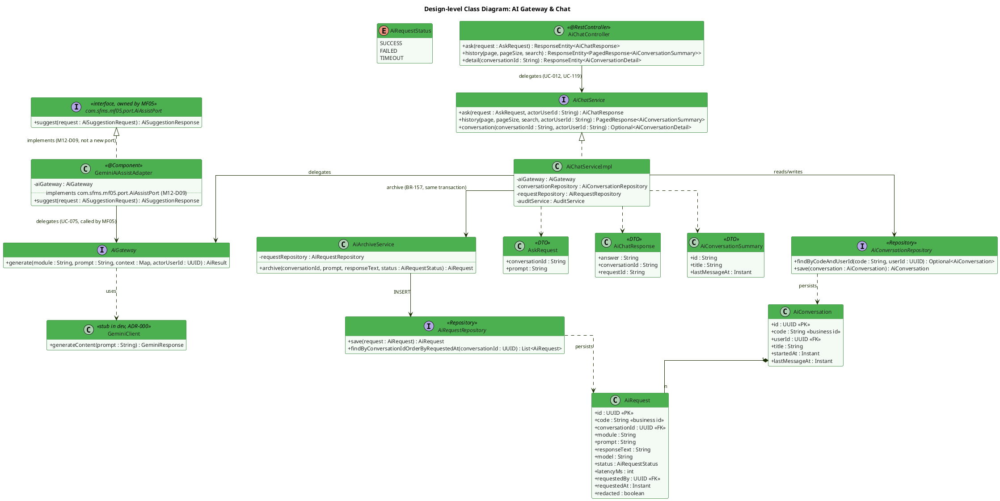

**Description:**
`AiGateway` is the single internal chokepoint through which both interactive chat (UC-012/UC-119) and MF05's menu recommendation (UC-075) reach Gemini — `AiChatServiceImpl` calls it directly, and `GeminiAiAssistAdapter` calls it on behalf of `com.sfms.mf05.port.AiAssistPort`, an interface **owned and declared by MF05** (`M12-D09`, ADR-M05-03). MF12 deliberately does **not** declare a second `AiAssistPort` of its own — it only implements the one MF05 already exposed, keeping the credential and the archive obligation in exactly one place (ADR-M12-01). `AiArchiveService` is invoked in the same transaction as every AI call: BR-157 requires that no response is ever returned without a persisted `AiRequest` row, so an archive failure rolls back the whole call rather than silently dropping the audit trail. `GeminiClient` is the outbound HTTP client, stubbed to return schema-valid mock JSON in the dev profile (ADR-000).

---

### 1.2 Sequence Diagram — Chat with AI, with mandatory archive (UC-012, BR-157)

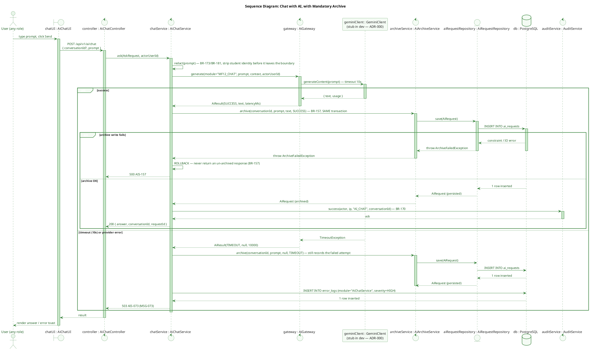

**Description:**
Every user message is redacted for student-identifying content before it leaves the module boundary (BR-173/BR-181), then dispatched through `AiGateway` to the stubbed `GeminiClient` (ADR-000). The defining constraint is BR-157: a chat response is only ever returned to the user after `AiArchiveService` has committed an `ai_requests` row in the *same* transaction — if the archive write itself fails, the whole operation rolls back and the user gets `500 AIS-157` rather than an unrecorded answer. The timeout branch (10s SLA) still archives the attempt (with `status=TIMEOUT`) and additionally writes an `error_logs` row, so UC-111 (View Error Logs) surfaces AI outages without a separate reporting path.

---

### 1.3 Sequence Diagram — AI Menu Recommendation called from MF05 (UC-075, cross-module)

```plantuml
@startuml MF12_AiSuggest_FromMF05
title Sequence Diagram: AI Menu Recommendation called from MF05 (cross-module)

skinparam linetype ortho
skinparam backgroundColor #FFFFFF

skinparam stereotype {
    CBackgroundColor #E8F5E9
    CBorderColor #2E7D32
    EBackgroundColor #E8F5E9
    EBorderColor #2E7D32
    ABackgroundColor #E8F5E9
    ABorderColor #2E7D32
    IBackgroundColor #E8F5E9
    IBorderColor #2E7D32
}

skinparam NoteBackgroundColor #E8F5E9
skinparam NoteBorderColor #2E7D32
skinparam NoteFontColor #212121
skinparam NoteFontName Arial

skinparam BoundaryBackgroundColor #F4FBF4
skinparam BoundaryBorderColor #2E7D32
skinparam BoundaryFontColor #212121
skinparam BoundaryFontName Arial
skinparam BoundaryFontSize 13

skinparam ControlBackgroundColor #F4FBF4
skinparam ControlBorderColor #2E7D32
skinparam ControlFontColor #212121
skinparam ControlFontName Arial
skinparam ControlFontSize 13

skinparam EntityBackgroundColor #F4FBF4
skinparam EntityBorderColor #2E7D32
skinparam EntityFontColor #212121
skinparam EntityFontName Arial
skinparam EntityFontSize 13

skinparam DatabaseBackgroundColor #F4FBF4
skinparam DatabaseBorderColor #2E7D32
skinparam DatabaseFontColor #212121
skinparam DatabaseFontName Arial
skinparam DatabaseFontSize 13

skinparam sequence {
    ActorBackgroundColor #E8F5E9
    ActorBorderColor #2E7D32
    ActorFontColor #1B5E20
    ActorFontName Arial
    ActorFontSize 13

    ParticipantBackgroundColor #F4FBF4
    ParticipantBorderColor #2E7D32
    ParticipantFontColor #212121
    ParticipantFontName Arial
    ParticipantFontSize 13

    ArrowColor #2E7D32
    ArrowFontColor #1B5E20
    ArrowFontName Arial
    ArrowFontSize 12

    LifeLineBackgroundColor #C8E6C9
    LifeLineBorderColor #2E7D32

    GroupBackgroundColor #F4FBF4
    GroupBorderColor #2E7D32
    GroupHeaderFontColor #FFFFFF
    GroupHeaderBackgroundColor #4CAF50
    GroupFontColor #212121
    GroupFontName Arial
}
skinparam sequenceMessageAlign center
skinparam responseMessageBelowArrow true

actor "Service Caterers" as SC
boundary "menuUI : MenuPlanningUI\n(MF05)" as UI
control "recommendationService : MenuRecommendationService\n(MF05)" as MF05
participant "aiAssistPort : AiAssistPort\n<<interface>> (owned by MF05)" as PORT
control "adapter : GeminiAiAssistAdapter\n(@Component, MF12)" as ADAPTER
control "gateway : AiGateway" as G
control "archiveService : AiArchiveService" as AR
entity "aiRequestRepository : AiRequestRepository" as REPO
database "db : PostgreSQL" as DB

SC -> UI : select meal type, kcal target, allergens, click "AI Suggest"
activate UI
UI -> MF05 : POST /api/v1/menus/{code}/ai-suggest\n{ mealType, targetKcal, excludeAllergens[], costCeiling }
activate MF05
MF05 -> PORT : suggest(AiSuggestionRequest)
activate PORT
note right of PORT: falls back to 503 MENU-073 if bean absent (M05-D16)
PORT -> ADAPTER : suggest(request)
activate ADAPTER

ADAPTER -> G : generate(module="MF05_MENU", prompt, context, actorUserId)
activate G
G --> ADAPTER : AiResult(status, text, latencyMs)
deactivate G

ADAPTER -> AR : archive(conversationId, prompt, text, status) — BR-157
activate AR
AR -> REPO : save(AiRequest)
activate REPO
REPO -> DB : INSERT INTO ai_requests (module='MF05_MENU')
activate DB
DB --> REPO : 1 row inserted
deactivate DB
REPO --> AR : AiRequest (persisted)
deactivate REPO
AR --> ADAPTER : archivedRequestId
deactivate AR

ADAPTER --> PORT : AiSuggestionResponse
deactivate ADAPTER
PORT --> MF05 : AiSuggestionResponse
deactivate PORT
MF05 --> UI : 200 AiSuggestionResponse\n{ suggestions[], nutritionBreakdown, archivedRequestId }
deactivate MF05
UI --> SC : render suggested menu items
deactivate UI
@enduml
```

**Description:**
This diagram documents the cross-module call path underlying `ADR-M12-01`. `AiAssistPort` is declared and owned by **MF05** (`M12-D09` — MF12 deliberately did not redeclare it), and MF12 supplies the only implementation, `GeminiAiAssistAdapter`, as a Spring bean. Internally the adapter routes through the same `AiGateway` and `AiArchiveService` used by interactive chat (§1.2), so every menu-suggestion request also produces exactly one `ai_requests` row (`module = "MF05_MENU"`), satisfying BR-157 without MF05 ever holding a Gemini credential or writing to `ai_requests` itself.

---

### 1.4 State Diagram — AI Request Status Lifecycle (BR-157)

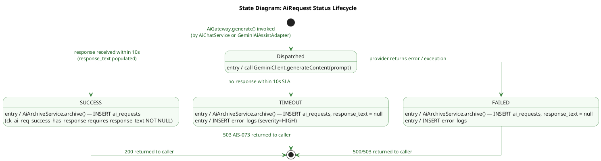

**Description:**
Every `AiRequest` transitions atomically from `Dispatched` to exactly one terminal state — `SUCCESS`, `TIMEOUT`, or `FAILED` — matching the `status` column checked by `ck_ai_req_success_has_response`. Because BR-157 requires the archive write to happen inside the same transaction as the outcome, the `Dispatched` state is a purely in-memory, non-persisted state: no row exists in `ai_requests` until a terminal state is reached, so there is no "pending" row a concurrent reader could ever observe.

---

## 2. External Integrations & Security Policies (UC-040, UC-184, BR-163, BR-164, BR-002/004/006)

### 2.1 Class Diagram

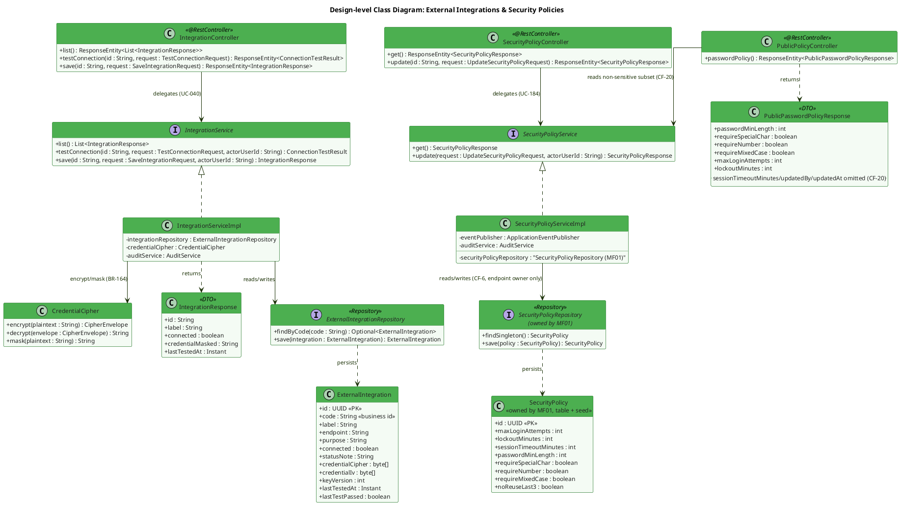

**Description:**
`ExternalIntegration` is owned end-to-end by MF12: `IntegrationServiceImpl` enforces BR-163 (a configuration can only be saved after its most recent connection test passed, within a 10-minute window) and delegates all credential handling to `CredentialCipher`, an AES-256-GCM envelope encryptor — plaintext credentials never reach the database or the HTTP response, only a masked form (`IntegrationResponse.credentialMasked`, BR-164). `SecurityPolicy`, by contrast, is a **table and seed owned by MF01** (`CF-6`); MF12 owns only the read/write **endpoint** (UC-184) through `SecurityPolicyServiceImpl`, which publishes `SecurityPolicyUpdated` so MF01 applies new limits on the very next login check without re-querying the table itself. `PublicPolicyController` exposes a deliberately reduced, unauthenticated subset (`PublicPasswordPolicyResponse`) so the login and reset-password screens can render password/lockout rules before a JWT exists (`CF-20`) — session and audit fields are structurally absent from that DTO, not merely filtered.

---

### 2.2 Sequence Diagram — Update External Integration (UC-040, BR-163/BR-164)

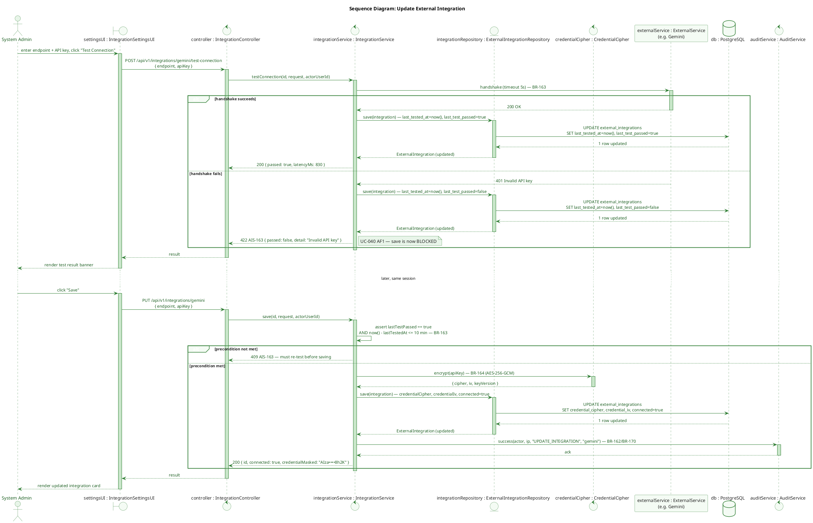

**Description:**
This is the two-step flow BR-163 mandates and the mock frontend never actually exercised (`CF-14` — the mock's "test" was a client-side `setTimeout`). The backend performs a real handshake with a 5-second timeout; only a `PASS` result within the last 10 minutes unblocks `save()` — an expired or missing test returns `409 AIS-163` before any write happens. Once unblocked, `save()` never trusts the `connected` flag the client might send; it derives connection state entirely from `lastTestPassed`, encrypts the credential through `CredentialCipher` (BR-164), and returns only a masked value. The update is recorded through `AuditService` per BR-170/BR-162, matching the immutable-audit guarantee documented for `audit_logs` in §3.

---

### 2.3 State Diagram — External Integration Connection Lifecycle (BR-163)

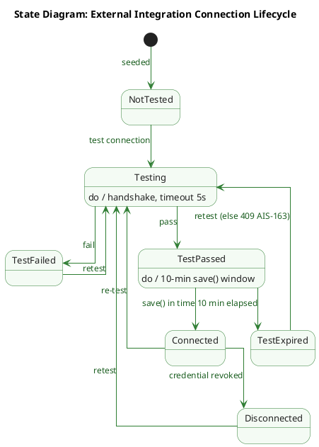

**Description:**
`ExternalIntegration.connected` is never set directly by a client request — it is a derived projection of this state machine, enforced entirely inside `IntegrationServiceImpl` (BR-163). A fresh test always starts from `Testing`; a pass only grants a **10-minute window** (`TestPassed`) during which `save()` is allowed, after which the state silently reverts to `TestExpired` and any save attempt is rejected with `409 AIS-163`. This closes the gap the original mock frontend left open (`CF-14`), where "testing" was a client-side `setTimeout` with no server-side expiry. Unlike the other two state machines in this document, this one intentionally has **no final state**: an `external_integrations` row is seeded, not user-created, and MF12 exposes no `DELETE` endpoint for it (TDS §16 — only `GET`, `PUT` and `test-connection`), so the configuration never leaves the machine. `Disconnected` is therefore a recoverable state, not a terminal one — a retest always brings it back to `Testing`.

---

## 3. Audit Log & Error Log Administration (UC-106, UC-111, BR-162, BR-170, BR-171, BR-172, BR-174)

### 3.1 Class Diagram

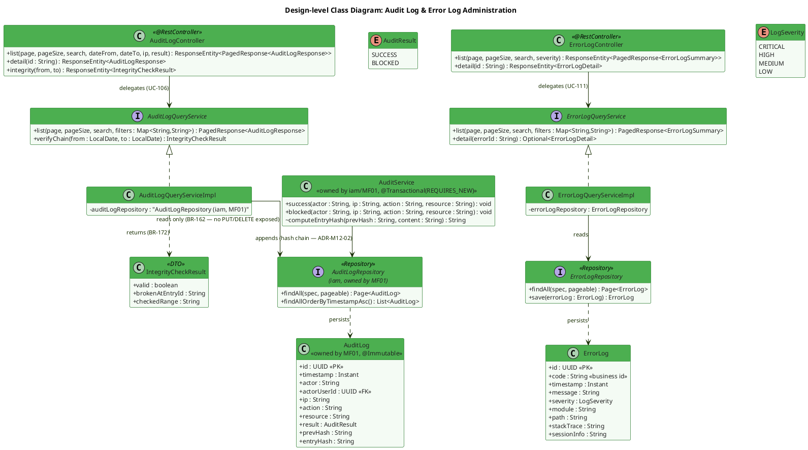

**Description:**
MF12 is the **business owner** of UC-106 (View Audit Logs) even though the `audit_logs` table and its write path (`AuditService`) belong to MF01 (`M12-D01`/`M12-D08`) — `AuditLogQueryServiceImpl` therefore reads MF01's repository directly rather than duplicating the entity, an explicitly documented exception to the usual cross-module port pattern. Immutability (BR-162) is enforced by three independent layers, not a single `REVOKE`: the `@Immutable` JPA annotation, the complete absence of `PUT`/`DELETE` handlers on `AuditLogController` (returning `405 IAM-162`), and the `prevHash → entryHash` hash chain computed inside `AuditService` (ADR-M12-02) — `verifyChain()` (BR-172) walks that chain and reports the first broken entry, if any. `ErrorLogQueryServiceImpl` is a conventional, fully MF12-owned read path: `list()` must return `stackTrace`/`sessionInfo` inline (not only on detail), because the frontend renders both directly from the list response (`CF-18`).

---

### 3.2 Sequence Diagram — View Audit Logs & Verify Integrity Chain (UC-106, BR-171, BR-172, BR-174)

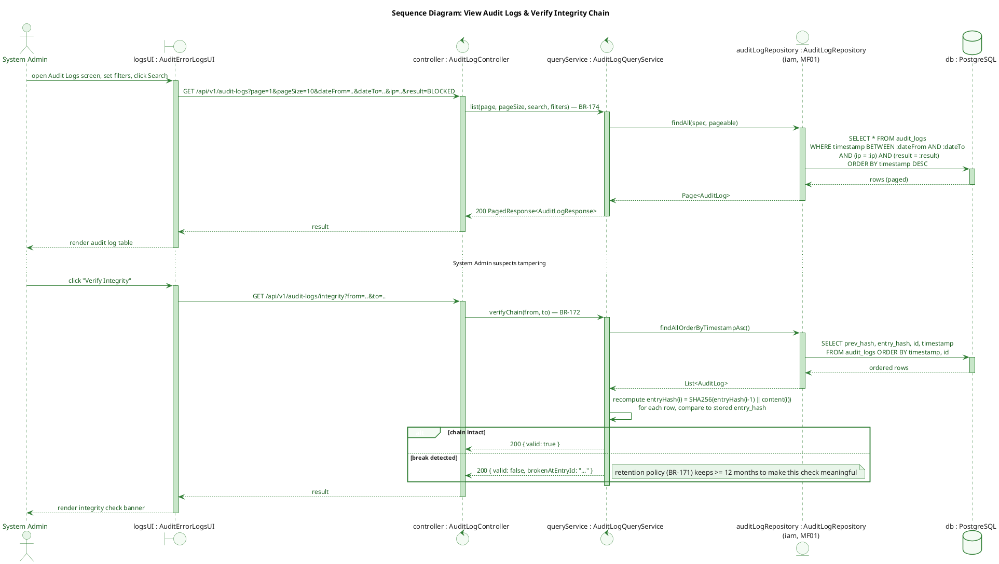

**Description:**
The list endpoint supports the four filters UC-106 step 4 actually calls for — actor, action, ip, and a date range (`dateFrom`/`dateTo`) — even though the mock frontend never wired the date inputs through to the request (`CF-17`); the backend contract does not follow that mock gap. The integrity endpoint is a `System Admin`-only, rate-limited (5/min) operation that recomputes the SHA-256 hash chain server-side and compares it against the stored `entry_hash` of every row in the requested window, returning the first row where the chain breaks. This is the concrete mechanism behind BR-172 ("tamper-protection"), independent of database-level permissions.

---

## 4. System Status, Activities & Usage (UC-057, UC-149, UC-150, BR-165)

### 4.1 Class Diagram

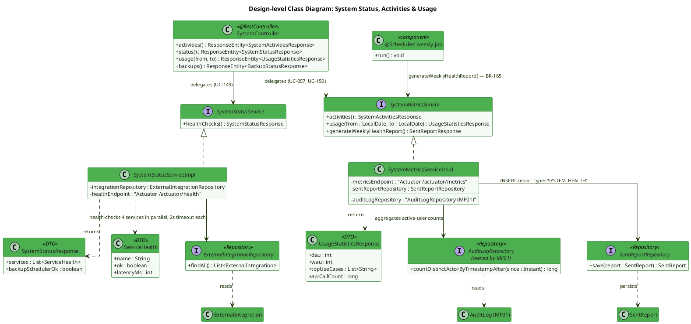

**Description:**
Per ADR-M12-04, MF12 deliberately does **not** introduce a dedicated metrics table for MVP: `SystemStatusServiceImpl` and `SystemMetricsServiceImpl` read realtime figures from Spring Boot Actuator (`/actuator/health`, `/actuator/metrics`) and aggregate active-user counts from `audit_logs`, rather than persisting a time series. The one place history *is* kept is the BR-165 weekly compilation — a `@Scheduled` job calls `generateWeeklyHealthReport()`, which writes a `sent_reports` row with `report_type = 'SYSTEM_HEALTH'`, reusing the same reporting table as the ATTP reports in §5 (ADR-M12-05) instead of a bespoke schema. All three read screens (UC-057, UC-149, UC-150) currently have **no** frontend call-site — the mock uses hardcoded constants (`CF-8`, `CF-19`) — so this class diagram defines the contract the frontend has yet to adopt.

---

### 4.2 Sequence Diagram — View System Status with Parallel Health Checks (UC-149)

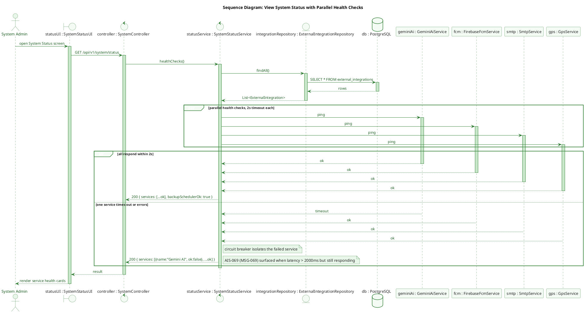

**Description:**
The four external dependencies (Gemini AI, Firebase FCM, SMTP, GPS) are health-checked concurrently, each with its own 2-second timeout and circuit breaker, so a single dead dependency cannot hang the whole UC-149 screen (§4.4 NFR). A response that arrives but exceeds 2000ms is reported as a soft warning (`AIS-069`/MSG-069) rather than a hard failure, distinct from a genuine timeout/error which is reported as `ok:false`.

---

## 5. ATTP Reports — Compliance & Violation Summary (UC-185, UC-189, UC-190, BR-177, BR-178, BR-181, BR-209, BR-214)

### 5.1 Class Diagram

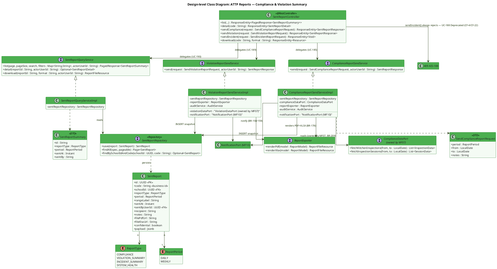

**Description:**
`SentReport` is deliberately a single table for three report types (ADR-M12-05, `CF-11`): common columns (`reportType`, `period`, `sentAt`, `filePdfUrl`…) live at the table level while type-specific figures (average hygiene score, violation counts, etc.) live in the `payload` JSONB column, matching the union-type shape the frontend already expects. `ComplianceReportSendServiceImpl` never computes hygiene data itself — it reads `kitchen_inspections`/`inspection_sessions` through `ComplianceDataPort`, a port **owned by MF07**, keeping the checklist/inspection domain (which MF07 owns per `M12-D02`/`CF-3`) out of MF12's persistence layer. Both send services share `ReportExporter` (PDFBox + Apache POI, BR-178) and `NotificationPort` (owned by MF10, BR-158/159 quiet-hours + retry). `sendIncident()` is wired but always returns `409 AIS-188`, since UC-188/BR-213 was deprecated on 2026-07-26 (`CF-4`/`CF-22`) — the endpoint exists only so the (still-present) frontend dialog fails predictably instead of 404ing.

---

### 5.2 Sequence Diagram — Send Compliance Report (UC-185, BR-209, BR-178)

```plantuml
@startuml MF12_SendComplianceReport
title Sequence Diagram: Send Compliance Report

skinparam linetype ortho
skinparam backgroundColor #FFFFFF

skinparam stereotype {
    CBackgroundColor #E8F5E9
    CBorderColor #2E7D32
    EBackgroundColor #E8F5E9
    EBorderColor #2E7D32
    ABackgroundColor #E8F5E9
    ABorderColor #2E7D32
    IBackgroundColor #E8F5E9
    IBorderColor #2E7D32
}

skinparam NoteBackgroundColor #E8F5E9
skinparam NoteBorderColor #2E7D32
skinparam NoteFontColor #212121
skinparam NoteFontName Arial

skinparam BoundaryBackgroundColor #F4FBF4
skinparam BoundaryBorderColor #2E7D32
skinparam BoundaryFontColor #212121
skinparam BoundaryFontName Arial
skinparam BoundaryFontSize 13

skinparam ControlBackgroundColor #F4FBF4
skinparam ControlBorderColor #2E7D32
skinparam ControlFontColor #212121
skinparam ControlFontName Arial
skinparam ControlFontSize 13

skinparam EntityBackgroundColor #F4FBF4
skinparam EntityBorderColor #2E7D32
skinparam EntityFontColor #212121
skinparam EntityFontName Arial
skinparam EntityFontSize 13

skinparam DatabaseBackgroundColor #F4FBF4
skinparam DatabaseBorderColor #2E7D32
skinparam DatabaseFontColor #212121
skinparam DatabaseFontName Arial
skinparam DatabaseFontSize 13

skinparam sequence {
    ActorBackgroundColor #E8F5E9
    ActorBorderColor #2E7D32
    ActorFontColor #1B5E20
    ActorFontName Arial
    ActorFontSize 13

    ParticipantBackgroundColor #F4FBF4
    ParticipantBorderColor #2E7D32
    ParticipantFontColor #212121
    ParticipantFontName Arial
    ParticipantFontSize 13

    ArrowColor #2E7D32
    ArrowFontColor #1B5E20
    ArrowFontName Arial
    ArrowFontSize 12

    LifeLineBackgroundColor #C8E6C9
    LifeLineBorderColor #2E7D32

    GroupBackgroundColor #F4FBF4
    GroupBorderColor #2E7D32
    GroupHeaderFontColor #FFFFFF
    GroupHeaderBackgroundColor #4CAF50
    GroupFontColor #212121
    GroupFontName Arial
}
skinparam sequenceMessageAlign center
skinparam responseMessageBelowArrow true

actor "Medical Staff" as MS
boundary "reportsUI : AttpReportsUI" as UI
control "controller : SentReportController" as C
control "complianceSendService : ComplianceReportSendService" as S
participant "complianceDataPort : ComplianceDataPort\n(owned by MF07)" as MF07
control "reportExporter : ReportExporter" as EX
entity "sentReportRepository : SentReportRepository" as REPO
database "db : PostgreSQL" as DB
participant "notificationPort : NotificationPort\n(MF10)" as N
control "auditService : AuditService" as AUD

MS -> UI : select period + date range, click "Send Compliance Report"
activate UI
UI -> C : POST /api/v1/sent-reports/compliance\n{ period: "WEEKLY", from, to, notes }
activate C
C -> S : send(SendComplianceReportRequest, actorUserId)
activate S

S -> MF07 : fetchKitchenInspections(from, to) + fetchInspectionSessions(from, to)
activate MF07
MF07 --> S : sessions[]
deactivate MF07

alt no inspection sessions in period
  S --> C : 422 AIS-092 (MSG-092)
  note right: BR-209 — "no sessions in period => sending is blocked", enforced server-side (CF-24)
else data available
  S -> S : compute avgScore (BR-104), failedSessions[], staffHealthValid (BR-103)
  S -> EX : renderPdf(model) + renderXlsx(model) — BR-178\n(title, date range, school name, export timestamp)
  activate EX
  EX --> S : { pdfUrl, xlsxUrl }
  deactivate EX
  S -> REPO : save(sentReport)
  activate REPO
  REPO -> DB : INSERT sent_reports\n(report_type='COMPLIANCE', payload=snapshot, confidential=true) — BR-177, BR-181
  activate DB
  DB --> REPO : 1 row inserted
  deactivate DB
  REPO --> S : SentReport (persisted)
  deactivate REPO
  S -> N : notify(SchoolAdministration) — BR-158 quiet hours, BR-159 retry+email fallback
  activate N
  N --> S : queued
  deactivate N
  S -> AUD : success(actor, ip, "SEND_COMPLIANCE_REPORT", reportId) — BR-170
  activate AUD
  AUD --> S : ack
  deactivate AUD
  S --> C : 200 SentReportResponse (MSG-091)
end
deactivate S
C --> UI : result
deactivate C
UI --> MS : render confirmation / error toast
deactivate UI
@enduml
```

**Description:**
This is the primary flow for UC-185. `ComplianceDataPort` insulates MF12 from MF07's inspection schema — MF12 only receives a data-transfer shape, never queries `kitchen_inspections` directly. The empty-period guard (BR-209 / `MSG-092`) is enforced **server-side** as a hard `422`, closing the gap the mock left open (`CF-24`, where only a disabled button on the frontend prevented an empty report — a direct API call could bypass it). A successful send performs, in order: PDF/XLSX rendering with the four mandatory BR-178 fields, an immutable snapshot insert into `sent_reports` (payload never recomputed later, per ADR-M12-05), a notification through MF10's `NotificationPort`, and an audit entry (BR-170) — all attributable to the same request.

---

### 5.3 Sequence Diagram — View Sent Reports History with Role-Scoped Access (UC-190, BR-175, BR-177)

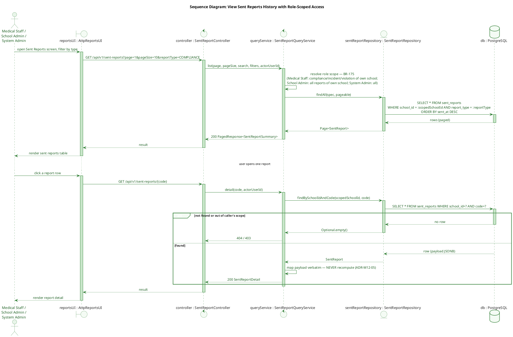

**Description:**
Access to sent-report history is filtered server-side by role, per BR-175: Medical Staff and School Administration are scoped to their own school, System Admin sees everything, and Service Caterers (not shown here) would only ever see their own reports were this endpoint extended to them. `detail()` demonstrates the immutability guarantee from ADR-M12-05 explicitly — the `payload` JSONB is returned exactly as it was written at send time, never recalculated against current data, so a report a Medical Staff member sent last month reads identically today even if the underlying inspection records have since changed. Retention (BR-177, ≥12 months) is enforced by a separate cleanup job (`findBySentAtBefore`) rather than by this read path.

---

### 5.4 State Diagram — Sent Report Lifecycle (BR-177, BR-178, BR-209)

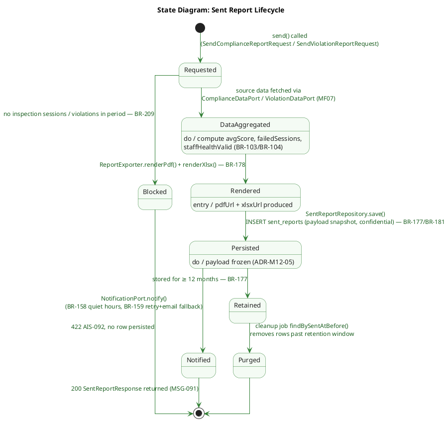

**Description:**
A send request either short-circuits at `Blocked` (BR-209 — no source data in the requested period, enforced server-side regardless of what the UI allows) or proceeds through `DataAggregated` → `Rendered` → `Persisted` → `Notified`. Once a report reaches `Persisted`, its `payload` snapshot is frozen for good (ADR-M12-05) — no later state ever mutates it, only the retention job (`Retained` → `Purged`) removes the row entirely after the BR-177 minimum retention window (≥12 months) has elapsed. This mirrors the transaction boundaries in the §5.2 sequence diagram: everything up to `Persisted` happens inside the same request/transaction, while `Notified` and the eventual `Purged` transition happen asynchronously.

---

*Document generated from TDS `SFMS-MF12-IMP-001 v1.2` (Approved 2026-08-04).*
