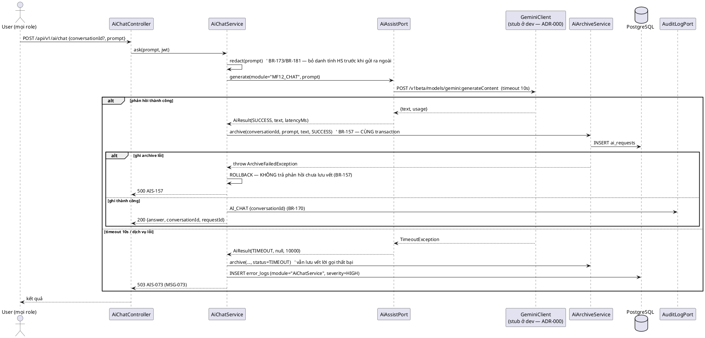
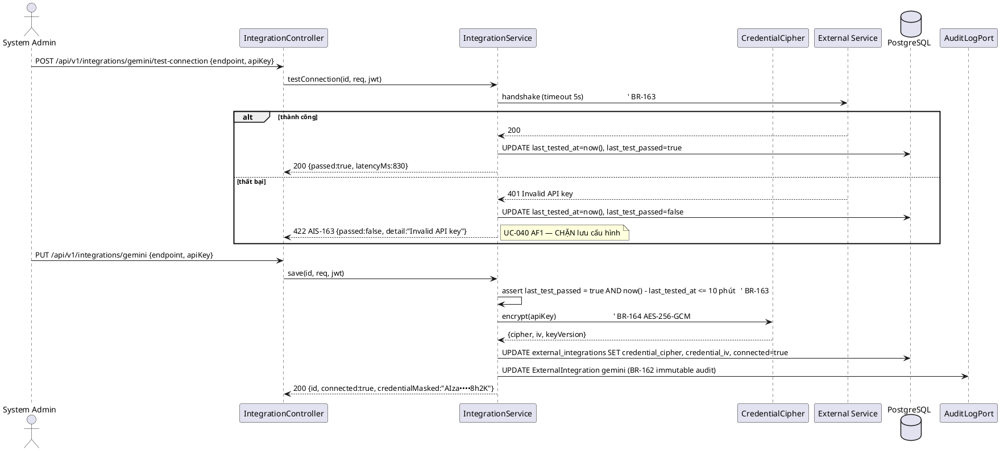
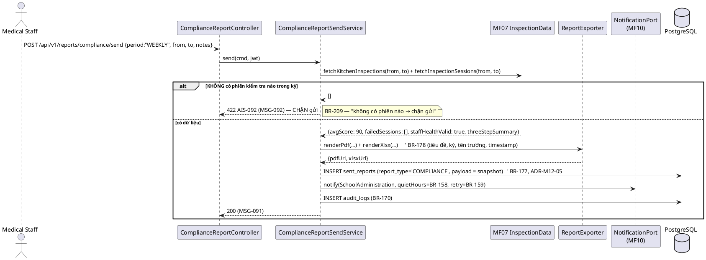
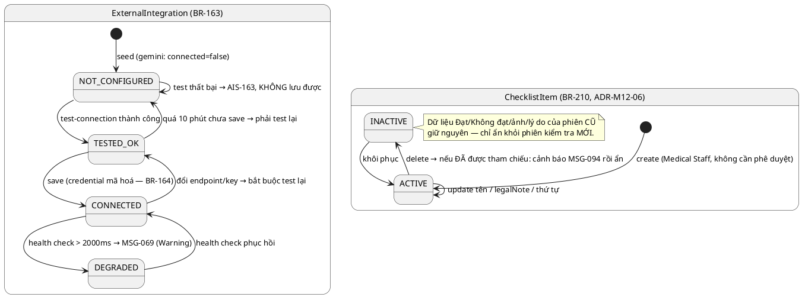

# ENGINEERING DOCUMENTATION STANDARD (EDS) v2.0 — TDS Backend
# MF12 — AI & Supporting Services

| Field | Value |
|-------|-------|
| **Document ID** | `SFMS-MF12-IMP-001` |
| **Version** | `1.2` |
| **Date** | `2026-08-04` |
| **Status** | `Approved` |
| **Document Owner** | Nguyễn Phương Thảo (ThaoNP) |
| **Author** | Nguyễn Phương Thảo — chủ module MF05/MF07/MF12, Lead Test/QA Reviewer |
| **Reviewed by** | `[Mạnh — §5/§9 Pending]` · `[Minh — §8/§9 JSON Pending]` · `[Huy — §2 Traceability Pending]` |
| **DPO Sign-off** | `[ ] Pending` *(audit log chứa actor/IP; hội thoại AI có thể chứa dữ liệu nghiệp vụ nhạy cảm; API key dịch vụ ngoài)* |
| **Approved by** | `[Nguyễn Văn Nam — Final Approval Pending]` |
| **Last Review** | `2026-08-04` |
| **Based on EDS** | `v2.0` |

> **Stack (ADR-000 / `01_MVP_Backend_Implementation_Plan.md` §3):** Spring Boot **4.1.x (Java 25 LTS)** · PostgreSQL 16 · **Flyway** (V1 = toàn bộ schema, do Nam giữ) · Spring Security + JWT · springdoc-OpenAPI (Swagger) · MapStruct · Spring Boot **Actuator** (metrics cho UC-057/149/150) · PDFBox/Apache POI (xuất PDF/XLSX theo BR-178).
>
> **External services — STUB ở dev (ADR-000 §Mock Strategy):** Gemini AI trả **mock JSON đúng schema**; Firebase FCM/SMTP/GPS/R2 stub. Hợp đồng JSON ở dev **giống production**.

---

## CHANGELOG

> **Policy 4.4 — Immutable History:** Không xóa thông tin cũ.

| Ngày | Người thực hiện | Nội dung thay đổi |
|------|-----------------|-------------------|
| 2026-08-04 | Nguyễn Phương Thảo | **v1.2 — Bước 0 + Bước 1 của `02_Module_Completion_Workflow.md`. Status `Draft` → `Approved`.** 14 quyết định `M12-D01`…`M12-D14`, đo bằng cách chạy 5 lệnh Bước 0 trên `04_Development/Backend` đã merge (V1–V21) — **không suy từ tài liệu**. Tóm tắt: **D01** gỡ `CREATE TABLE audit_logs` → `ALTER` (bảng của MF01, `V1:278`, PK **UUID**, cột `actor VARCHAR(180)` chứ không phải FK, `code VARCHAR(32)` Nam để sẵn cho MF12) · **D02** gỡ `CREATE TABLE IF NOT EXISTS checklist_groups/checklist_items` **và 4 endpoint `/checklist-groups`** — MF07 đã merge cả bảng (`V12:209/223`) lẫn controller (`mf07/web/ChecklistGroupController`, `M07-D10`) · **D03** 8 PK `VARCHAR(32)` → `UUID` + `code VARCHAR(32)` (D1) · **D04** 5 `REFERENCES users(id)` → `UUID REFERENCES user_accounts(id)` + 1 `REFERENCES schools(id)` `VARCHAR(32)` → `UUID` (C2) · **D05** `external_integrations.updated_at/updated_by` là cột reserved của `BaseEntity` (D9) → gỡ khỏi entity, DDL vẫn tạo đủ 4 cột · **D06** `POST /reports/{compliance,violations,incidents}/send` → `POST /sent-reports/{compliance,violations}` — MF13 sở hữu root `/api/v1/reports` · **D07** `sent_reports` **thuộc MF12** — `ADR-M13-2` của `TDS-MF13_Backend.md` đã tự gỡ, **CF-M11-20 khép lại** · **D08** không khai `AuditLogPort` — `iam/service/AuditService` đã làm việc đó · **D09** không khai lại `AiAssistPort` — MF05 đã khai hộ tại `com.sfms.mf05.port.AiAssistPort`, MF12 chỉ implement `@Component` · **D10** tiền tố mã lỗi `SYS-` → **`AIS-`** (chỗ ModuleCodeResolver để sẵn), riêng `/audit-logs` + `/security-policies` giữ **`IAM-`** (đã đăng ký, bảng của MF01) · **D11** package `com.sfms.platform.*` → `com.sfms.mf12.*` (§0-BIS) · **D12** migration `V16`/`V17` → **`V22`/`V23`** · **D13** bỏ `REVOKE UPDATE, DELETE … FROM sfms_app` (role đó không tồn tại trong dự án) — bất biến bảo đảm bằng `@Immutable` + không expose `PUT`/`DELETE` + `MF12-TC-SEC-019` · **D14** mã có năm dùng `scope = "mf12_<resource>:<năm>"` của `CodeGenerator` (C1, tiền lệ MF03/MF05/MF11), **không** đề xuất sửa bảng `code_sequences`. Bổ sung **TC-CON-007 (D11)** và **TC-CON-008 (D12)** vào TestSpec. |
| 2026-07-28 | Nguyễn Phương Thảo | **v1.1 — viết lại toàn bộ §9 API Specification theo Frontend.** Đọc `client.ts` + `hooks.ts` + `data-table.tsx` + `lib/notify.ts` + **33 call-site / 16 file**. Bổ sung: §9.0 hợp đồng hook→HTTP, §9.1 bản đồ Màn hình FE → Endpoint (3 nhóm role), §9.2 bảng 31 endpoint kèm cột "FE dùng?", §9.3 schema theo **từng thao tác thật**, **§9.4 — 4 màn KHÔNG có API** (`monitoring`, `usage-statistics`, `backup`, một nửa `system-status`) + resource ngoài module, §9.5 bảng khoảng cách FE↔BE (19 mục). Phát hiện thêm **16 mâu thuẫn CF-14…CF-29**, trong đó nặng nhất: **BR-163 chưa từng chạy** (test connection là `setTimeout` client) và **BR-164 không có gì để mã hoá** (`apiKey` không rời trình duyệt). |
| 2026-07-28 | Nguyễn Phương Thảo | Tạo bản đầu (v1.0). Nguồn: UC `MF12_AI_Supporting_Services.md`; traceability §1.12; `business_rules.md` §14 §15 §12 §16 (+ BR-002/004/006); `error_message.md`; mock `mock-server.ts` + `db.ts` (`audit-logs`, `error-logs`, `integrations`, `security-policies`, `checklist-groups`, `sent-reports`) + `mock-data.ts`; màn FE `system-admin/*` (13 route) + `medical-staff/{report-center,compliance,conduct-inspection/checklist,reports}`; `data_model.puml` (`AuditLog`, `SecurityPolicy`, `ExternalIntegration`, `UserNotification`); ADR-000. Ghi nhận **12 mâu thuẫn nguồn CF-1…CF-12** (§2.3) — **không tự chọn bên đúng**. |

---

## MỤC LỤC

1. [Tổng quan Module](#1-tổng-quan-module) · 2. [Ma trận Truy vết](#2-ma-trận-truy-vết) · 3. [Architecture Decisions](#3-architecture-decisions-inline-adr) · 4. [NFR & SLA](#4-non-functional-requirements--sla) · 5. [Static Modeling](#5-static-modeling) · 6. [Dynamic Modeling](#6-dynamic-modeling) · 7. [Domain Event Catalog](#7-domain-event-catalog) · 8. [Interface Specification](#8-interface-specification) · 9. [API Specification](#9-api-specification) · 10. [Error Codes](#10-bảng-mã-lỗi) · 11. [Triển khai](#11-quy-trình-triển-khai) · 12. [Rollback Runbook](#12-rollback--incident-runbook) · 13. [Kiểm thử](#13-kịch-bản-kiểm-thử) · 14. [Xác minh](#14-phương-pháp-xác-minh) · 15. [API Samples](#15-mẫu-thử-thực-tế) · 16. [Authorization Matrix](#16-authorization-matrix) · 17. [AI Prompt Constraints](#17-ai-prompt-constraints-case-20)

---

## 1. Tổng quan Module

> MF12 là **module hạ tầng dùng chung**, gom 4 nhóm nghiệp vụ mà `traceability_matrix.md` §1.12 xếp cùng nhau:
> **(A) Trợ lý AI** — chat với Gemini + lưu trữ hội thoại bắt buộc (UC-012, UC-119);
> **(B) Quản trị hệ thống** — tích hợp ngoài, audit log, error log, trạng thái/thống kê hệ thống, chính sách bảo mật (UC-040, UC-057, UC-106, UC-111, UC-149, UC-150, UC-184);
> **(C) Checklist kiểm tra bếp động** — Medical Staff tự CRUD (UC-186);
> **(D) Báo cáo ATTP chủ động** — Medical Staff soạn & gửi báo cáo định kỳ + lịch sử đã gửi (UC-185, UC-187, UC-188, UC-189, UC-190).
>
> ⚠️ Nhóm **(C)** và **(D)** thuộc **nghiệp vụ ATTP của MF07** nhưng traceability xếp ở §1.12 — xem **CF-3**, cần Nam chốt ranh giới.

| Field | Value |
|-------|-------|
| **Module Name** | AI & Supporting Services (MF12) |
| **Bounded Context** | Platform Services (AI Gateway · Observability · System Configuration) |
| **Data Classification** | `Internal` + `Secret` (API key/OAuth credential — BR-164) + `PII` (audit actor, IP — BR-173) |
| **Compliance Scope** | PDPD (BR-173) · BR-162/BR-171/BR-172 (audit bất biến, retention, toàn vẹn) |
| **Upstream Dependencies** | MF01 (JWT/RBAC, `users`), MF02 (`schools` — phạm vi checklist theo trường), Gemini AI (stub dev), Firebase FCM/SMTP (stub dev) |
| **Downstream Consumers** | **MF05** (gọi `com.sfms.mf05.port.AiAssistPort` cho UC-075 — MF12 implement adapter, `M12-D09`) · **MF01** (đọc `SecurityPolicy` cho BR-002/004/006) |
| **Upstream — MF12 gọi ra** | **MF07** (`ComplianceDataPort` — dữ liệu `kitchen_inspections`/`violation_records` cho BR-209/BR-214; **chưa có trong code**, xem §9.4b) · **MF10** (`com.sfms.mf10.port.NotificationPort` — đã merge) · **MF01** (`iam/service/AuditService` — đã merge, `M12-D08`) |
| **Ưu tiên** | **P2** — hạ tầng audit đã có sẵn ở MF01 (`AuditService`, `M12-D08`), nên MF12 không còn là nút cổ chai của module khác. Việc duy nhất module khác chờ: **bean adapter cho `AiAssistPort`** (MF05 đang trả `503 MENU-073` khi vắng) |

**Phạm vi 15 Use Case (đúng `traceability_matrix.md` §1.12 — bảng phân công `00_` §3 ghi 12 UC, xem CF-1):**
UC-012, UC-119, UC-040, UC-057, UC-106, UC-111, UC-149, UC-150, UC-184, UC-185, UC-186, UC-187, UC-188, UC-189, UC-190.

**Thư mục màn hình FE đã đọc (nguồn 6):**

| Role | Thư mục | Vai trò |
|---|---|---|
| System Admin | `(app)/system-admin/integrations` | UC-040 (tab Gemini/GPS/Gmail/FCM) |
| System Admin | `(app)/system-admin/audit-logs` | UC-106 |
| System Admin | `(app)/system-admin/error-logs` | UC-111 |
| System Admin | `(app)/system-admin/system-status`, `monitoring` | UC-149, UC-057 |
| System Admin | `(app)/system-admin/usage-statistics` | UC-150 |
| System Admin | `(app)/system-admin/security-policies` | UC-184 |
| System Admin | `(app)/system-admin/backup`, `dashboard` | BR-160/BR-161 (nền, không có UC riêng ở §1.12) |
| Medical Staff | `(app)/medical-staff/conduct-inspection/checklist` | UC-186 (BR-210) |
| Medical Staff | `(app)/medical-staff/report-center`, `report-center/compliance`, `report-center/history` | UC-187, UC-185, UC-190 |
| Medical Staff | `(app)/medical-staff/compliance/report`, `compliance/history` | UC-185 |
| Medical Staff | `(app)/medical-staff/violations/reports` | UC-189 (BR-214) |
| **(chưa có)** | *Không có route AI Chat nào trong mock* | **UC-012, UC-119 — phần MỚI (CF-2)** |

---

## 2. Ma trận Truy vết

> **Nguồn chuẩn:** cột Business Rules & System Messages lấy **nguyên văn** `traceability_matrix.md` **§1.12**; tên UC nguyên văn `02_Requirements/02_UseCases/MF12_AI_Supporting_Services.md` *(UC-185…UC-190 không có trong UC file — lấy tên từ §1.12, xem CF-1)*; nội dung BR tra `business_rules.md` §12, §14, §15, §16 (+ §1 cho BR-002/004/006).
> **Policy:** chỉ dùng mã có trong §1.12. Mã mà UC file/mock nêu thêm → ghi ở §2.3.

### 2.1. UC ↔ BR ↔ MSG ↔ Code

| UC ID | Tên UC | Actor | Business Rules (§1.12) | System Messages (§1.12) | Thành phần Code (Java) |
|-------|--------|-------|-------------------------|--------------------------|------------------------|
| UC-012 | Chat with AI | User (mọi role) | BR-157 | MSG-073 | `AiChatService.ask()`, `GeminiClient` (stub dev), `AiArchiveService.archive()` |
| UC-119 | View History Chat | User | BR-157 | MSG-004, MSG-005 | `AiChatService.history()` |
| UC-040 | Manage External Integrations | System Admin | BR-163, BR-164 | MSG-004, MSG-005 | `IntegrationService.testConnection()/save()`, `CredentialCipher` |
| UC-057 | Monitor System Activities | System Admin | BR-165, BR-170 | MSG-004, MSG-005 | `SystemMetricsService.activities()` (Actuator) |
| UC-106 | View Audit Logs | System Admin | BR-162, BR-170, BR-171, BR-172, BR-174 | MSG-004, MSG-005 | `AuditLogQueryService.list()` |
| UC-111 | View Error Logs | System Admin | BR-164 | MSG-004, MSG-005 | `ErrorLogQueryService.list()/detail()` |
| UC-149 | View System Status | System Admin | BR-165 | MSG-004, MSG-005 | `SystemStatusService.healthChecks()` |
| UC-150 | View Usage Statistics | System Admin | BR-165 | MSG-004, MSG-005 | `SystemMetricsService.usage()` |
| UC-184 | Configure Security Policies | System Admin | BR-002, BR-004, BR-006, BR-170 | MSG-004, MSG-005, MSG-029 | `SecurityPolicyService.update()` |
| UC-185 | Send Daily/Weekly Compliance Report | Medical Staff | BR-209, BR-178, BR-170 | MSG-091, MSG-092 | `ComplianceReportSendService.send()` |
| ~~UC-186~~ | ~~Manage Kitchen Inspection Checklist~~ | — | — | — | ⛔ **CHUYỂN SANG MF07 — `M12-D02`.** `mf07/web/ChecklistGroupController` + `V12:209/223` đã merge (`M07-D10`). UC-186 vẫn nằm ở traceability §1.12, nhưng **hiện thực** thuộc MF07; giữ dòng này để Huy đối chiếu, KHÔNG sinh code ở MF12 |
| UC-187 | ATTP Report Center (hub) | Medical Staff | BR-175 | MSG-004, MSG-005 | `ReportCenterService.hub()` — xem CF-4 |
| UC-188 | Send Incident Summary Report | Medical Staff | BR-213, BR-178, BR-158, BR-159, BR-170, BR-181 | MSG-096, MSG-098 | *(Deprecated 26/07/2026 — chỉ đọc lịch sử, xem CF-4)* |
| UC-189 | Send Violation Summary Report | Medical Staff | BR-214, BR-178, BR-158, BR-159, BR-170 | MSG-097, MSG-099 | `ViolationReportSendService.send()` |
| UC-190 | View Sent Reports History | Medical Staff | BR-177, BR-175 | MSG-004, MSG-005 | `SentReportQueryService.list()` |

### 2.2. Business Rules — nội dung (nguyên văn `business_rules.md`)

| BR | § | Tóm tắt nguyên văn | Điểm enforce trong backend |
|----|---|--------------------|-----------------------------|
| BR-157 | §14 | **Toàn bộ** hội thoại giữa người dùng và AI (gồm cả đề xuất thực đơn) phải được **lưu trữ (archive)** phục vụ tuân thủ & kiểm tra. | `AiArchiveService` — ghi **trong cùng transaction** với lời gọi AI |
| BR-163 | §14 | Khi cập nhật cấu hình tích hợp ngoài (GPS, Gmail, Firebase, Gemini AI) phải **kiểm tra kết nối thành công trước khi lưu**. | `IntegrationService.save()` chỉ nhận khi `lastTestPassed = true` |
| BR-164 | §14 | Mọi thông tin xác thực dịch vụ ngoài (API key, OAuth credential) phải được **mã hóa** khi lưu trữ. | `CredentialCipher` (AES-256-GCM), key từ ENV |
| BR-165 | §14 | Hệ thống **tự động biên soạn** báo cáo sức khỏe hệ thống và số liệu người dùng hoạt động **hàng tuần** cho System Admin. | `@Scheduled` weekly job → `SystemHealthReport` |
| BR-162 | §14 | Nhật ký audit phải **bất biến (immutable)** — không ai chỉnh sửa/xóa bản ghi audit. | Bảng `audit_logs` **append-only**: entity `@Immutable` + không expose `PUT`/`DELETE` (405 `IAM-162`) + chuỗi hash BR-172. **Không** dùng `REVOKE` — `M12-D13` |
| BR-170 | §15 | Mọi hành động quan trọng (tạo/cập nhật/xóa/phê duyệt/từ chối) phải ghi audit kèm: **người thực hiện, thời gian, đối tượng bị tác động**. | `iam/service/AuditService` — đã merge, 11 module đang gọi (`M12-D08`) |
| BR-171 | §15 | Phải có **chính sách lưu trữ nhật ký** xác định thời gian tối thiểu lưu giữ. | Cấu hình `audit.retention-months` (mặc định 12, khớp BR-177) |
| BR-172 | §15 | Phải có cơ chế **bảo vệ toàn vẹn** nhật ký, ngăn chỉnh sửa trái phép. | Hash chuỗi (`prev_hash` + `entry_hash`) — ADR-M12-02 |
| BR-174 | §15 | Hỗ trợ **truy vấn lịch sử vận hành** và theo dõi audit trail theo thời gian. | `AuditLogQueryService` — filter theo ngày/actor/action/IP (UC-106 bước 4) |
| BR-002 | §1 | Sau **5 lần** đăng nhập sai liên tiếp → **khóa tài khoản 15 phút**; ghi audit. | Giá trị lưu ở `security_policies`, **MF01 đọc** |
| BR-004 | §1 | **(v1.9)** Access token **30 phút** + refresh token sliding **14 ngày**. | `sessionTimeoutMinutes` ở `security_policies` |
| BR-006 | §1 | Chính sách độ mạnh mật khẩu; không trùng **3 mật khẩu gần nhất** (BR-015). | `passwordMinLength`, `requireSpecialChar/Number/MixedCase`, `noReuseLast3` |
| BR-209 | §12 | Medical Staff chủ động gửi **báo cáo tuân thủ ATTP** (kỳ Daily/Weekly) cho School Administration; nội dung tối thiểu: điểm vệ sinh trung bình (BR-104), danh sách phiên Failed, khám sức khỏe nhân viên bếp (BR-103), ghi chú tùy chọn. **Không có phiên nào trong kỳ → chặn gửi (MSG-092)**. Xuất PDF/Excel (BR-178), thông báo (BR-158/159), thành công báo MSG-091, ghi audit (BR-170). | `ComplianceReportSendService` |
| BR-210 | §12 | Medical Staff toàn quyền **thêm/sửa/xóa/sắp xếp lại** nhóm & hạng mục checklist UC-014 (kể cả chú thích pháp lý), **không cần phê duyệt**, phạm vi **theo từng trường**. Xóa mục **đang được tham chiếu** → **không xóa dữ liệu lịch sử**, chỉ ẩn khỏi phiên mới. Ghi audit (BR-170). | ⛔ **hiện thực ở MF07** — `mf07/service/ChecklistGroupService`, soft-delete `is_active=false` (`M12-D02`/`M07-D10`) |
| BR-175 | §16 | Quyền xem từng loại báo cáo kiểm soát bởi vai trò: School Administration (toàn bộ báo cáo vận hành), Medical Staff (kiểm tra thực phẩm, sự cố y tế, tuân thủ), Service Caterers (chỉ báo cáo của mình), System Admin (tất cả). | `@PreAuthorize` + scope theo `schoolId` |
| BR-177 | §16 | Báo cáo đã tạo lưu tối thiểu **12 tháng**; mỗi lần xuất (ai, khi nào, loại) ghi **audit trail**. | `sent_reports` + `audit_logs` |
| BR-178 | §16 | Xuất báo cáo 2 định dạng **PDF** và **Excel (XLSX)**; mỗi file gồm: tiêu đề, khoảng thời gian dữ liệu, tên trường, timestamp xuất. | `ReportExporter` (PDFBox + Apache POI) |
| BR-181 | §16 | Báo cáo **không tiết lộ thông tin nhận diện cá nhân học sinh**; báo cáo xuất ra ngoài chứa thông tin nhạy cảm phải đánh dấu **"Confidential"**. | `ReportExporter` — chỉ số liệu tổng hợp |
| BR-158 | §13 | **Giờ yên tĩnh** mặc định 22:00–06:00 cho push không khẩn cấp; cảnh báo khẩn cấp không bị ảnh hưởng. | `NotificationPort` (MF10 sở hữu, MF12 gọi khi gửi báo cáo) |
| BR-159 | §13 | Gửi push thất bại → **tự động thử lại**; hết số lần → **email dự phòng**. | `NotificationPort` |
| BR-213 | §16 | *(Deprecated 26/07/2026)* Báo cáo tổng hợp sự cố ATTP theo kỳ (UC-188). | **Không** sinh bản ghi mới — chỉ đọc lịch sử (CF-4) |
| BR-214 | §16 | Medical Staff gửi **báo cáo tổng hợp vi phạm** (kỳ Daily/Weekly); rollup số liệu + điều hướng, **không** lặp nội dung biên bản đã ký (BR-211). Không có vi phạm trong kỳ → **chặn gửi (MSG-097)**; thành công báo MSG-099. | `ViolationReportSendService` |

### 2.3. ⚠️ Mâu thuẫn giữa các nguồn (ghi rõ, KHÔNG tự chọn bên đúng)

| # | Mô tả mâu thuẫn | Nguồn A | Nguồn B | Xử lý trong TDS |
|---|-----------------|---------|---------|-----------------|
| **CF-1** | **Số lượng & danh sách UC lệch 3 nguồn.** `00_` §3 ghi MF12 = **12 UC**; §1.12 có **15 UC**; UC file `MF12_AI_Supporting_Services.md` có **13 UC** nhưng **không có** UC-185…UC-190, đồng thời **có thừa** UC-058, UC-079, UC-088, UC-136 (traceability xếp UC-058/088/136 ở §1.10/MF10 và UC-079 ở §1.9/MF09). | `00_` §3 + UC file | `traceability_matrix.md` §1.12 | §2.1 bám **§1.12** (15 UC). UC-058/079/088/136 **không** thuộc MF12 — ghi rõ ở §1 để MF09/MF10 không bỏ sót. Chờ **Huy** chốt và **Nam** cập nhật `00_` §3 (12 → 15). |
| **CF-2** | **UC-012 (Chat with AI) và UC-119 (View History Chat) KHÔNG có gì trong mock**: `db.ts` không có resource `ai-chats`/`ai-messages`/`ai-requests`; không route FE nào cho AI Chat. Nhưng `00_` §2b-3 lại gợi ý `SEARCH_FIELDS` cho *"MF12 AI → `AIRequest` → `prompt`, `module`"` — tức đã dự kiến entity mà mock chưa có. | mock FE (không có) | UC-012/119 + BR-157 + `00_` §2b-3 | Đây là **phần MỚI, tự thiết kế** theo BR-157 và tên entity `AIRequest` mà plan đã đặt. §5.2 khai bảng `ai_conversations` + `ai_requests`; §9 đánh dấu **❌ Mock**. Cần **Minh** bổ sung route + resource mock cùng lúc (`00_` §0 quy tắc chống lệch). |
| **CF-3** | **UC-185/186/187/188/189/190 là nghiệp vụ ATTP của Medical Staff** (checklist kiểm tra bếp UC-014, báo cáo tuân thủ từ `KitchenInspection`/`InspectionSession`, báo cáo vi phạm từ `ViolationRecord`) nhưng traceability xếp ở **§1.12 (MF12)**. `error_message.md` §4 lại xếp MSG-091/092/094/096/097/098/099 vào nhóm **"Food Safety Inspection"** (tức MF07). | `traceability_matrix.md` §1.12 | `error_message.md` §4 + bản chất nghiệp vụ (MF07) | ✅ **CHỐT 2026-08-04 bằng Bước 0, không cần họp** — và **ngược với đề xuất v1.1**. MF07 **đã merge** cả bảng (`V12:209/223`) lẫn controller `/api/v1/checklist-groups` (4 verb, `MEDICAL_STAFF`) từ `M07-D10`, nên ranh giới không còn là câu hỏi mở: **MF07 sở hữu checklist (UC-186), MF12 sở hữu `sent_reports` (UC-185/189/190)**. `M12-D02` gỡ 2 `CREATE TABLE` + 4 endpoint khỏi MF12; `M12-D07` giữ `sent_reports` ở MF12 (`ADR-M13-2` xác nhận). **Không cần Nam chốt nữa** — code đã trả lời. |
| **CF-4** | **UC-187 và UC-188 đã Deprecated 26/07/2026** (ghi trong BR-213: *"UC-187 'ATTP Report Center' … cũng Deprecated cùng đợt"*) nhưng §1.12 **vẫn liệt kê cả hai** như UC còn hiệu lực, và mock **vẫn còn route** `medical-staff/report-center` + type `IncidentSummarySentReport` (đánh dấu `@deprecated`). | `business_rules.md` BR-213 (26/07/2026) | `traceability_matrix.md` §1.12 + route mock | Backend: **UC-188 chỉ đọc lịch sử**, **không** cho tạo `reportType=INCIDENT_SUMMARY` mới (409). **UC-187** giữ endpoint hub (route mock còn sống) nhưng chỉ gom UC-185 + UC-189. Ghi rõ để **Huy** cập nhật §1.12. |
| **CF-5** | **BR-165 mô tả "báo cáo sức khỏe hệ thống HÀNG TUẦN tự động"** nhưng §1.12 gán BR-165 cho **UC-149 (View System Status)** và **UC-150 (View Usage Statistics)** — cả hai là **màn xem theo yêu cầu**, không phải job định kỳ. UC file cho UC-057/149/150 lại liệt kê BR-158…BR-164 + BR-177/178/179 (không khớp §1.12). | UC file MF12 | `traceability_matrix.md` §1.12 + BR-165 | §2.1 bám §1.12. Backend implement **cả hai**: endpoint xem theo yêu cầu (UC-149/150) **và** `@Scheduled` weekly (BR-165). Ghi rõ để Huy xác nhận. |
| **CF-6** | **UC-184 (Configure Security Policies) thuộc MF12 nhưng BR-002/004/006 là quy tắc của MF01**, và `TDS-MF01_Backend.md` §11.1 đã ghi *"`SecurityPolicy` seed mặc định (SEC-DEFAULT…)"* trong Prerequisites của MF01. | `traceability_matrix.md` §1.12 (UC-184) | `TDS-MF01_Backend.md` §11.1 + `business_rules.md` §1 | **Ranh giới:** MF01 **sở hữu bảng + seed** `security_policies` (V1/V2 do Nam giữ) và **đọc** giá trị lúc login/đổi MK; **MF12 sở hữu endpoint đọc/sửa** (UC-184). MF12 **không** tạo lại bảng trong migration của mình. Cần **Nam** xác nhận. |
| **CF-7** | **`ExternalIntegration` trong `data_model.puml` có quan hệ `n --> 1 SchoolRecord`** (cấu hình theo từng trường), nhưng mock `EXTERNAL_INTEGRATIONS` là **danh sách toàn hệ thống** (4 dịch vụ, không có `schoolId`) và actor là **System Admin** (toàn nền tảng). | `data_model.puml` | `mock-data.ts` + UC-040 (actor System Admin) | §5.2 theo **mock**: `external_integrations` **không** có `school_id` (cấu hình cấp nền tảng). Cần Mạnh cập nhật `data_model.puml`. |
| **CF-8** | **UC-057/149/150 không có resource mock nào**: `db.ts` không có `system-metrics`/`usage-statistics`/`backups`; các màn `system-admin/{monitoring,system-status,usage-statistics,backup,dashboard}` hiện dùng dữ liệu hardcode trong page (vd `{ name: "Gemini AI", ok: false }`). | màn FE có thật | `db.ts` không có resource | Backend lấy số liệu từ **Spring Boot Actuator** + aggregate `audit_logs`; **không** tạo bảng metric riêng ở MVP (ADR-M12-04). §9 đánh dấu ❌ Mock. Cần Minh bổ sung resource mock. |
| **CF-9** | **Mock cho phép `PUT`/`DELETE` trên MỌI resource** qua generic handler (`mock-server.ts` dòng 347–376), **bao gồm `audit-logs`** — trái BR-162 (audit bất biến) và BR-172 (toàn vẹn). | `mock-server.ts` generic handler | BR-162, BR-172 | Backend **KHÔNG** expose `PUT`/`DELETE` cho `/api/v1/audit-logs` → **405 `IAM-162`**. *(Vế `REVOKE` đã gỡ — `M12-D13`.)* Đây là **giới hạn có chủ đích của mock**, không phải hợp đồng — ghi rõ để Minh không kỳ vọng CRUD đầy đủ. |
| **CF-10** | **Nội dung 2 màn nói ngược nhau về Gemini** (mock đã ghi nhận và gộp về 1 nguồn `EXTERNAL_INTEGRATIONS`): "Tích hợp ngoài & AI" ghi *"Chưa kết nối"*, "Trạng thái hệ thống" từng ghi *"đang chạy, chậm 2.1s"*. | 2 màn FE (bản cũ) | `mock-data.ts` (đã gộp 22/07/2026) | Backend có **một nguồn duy nhất** `external_integrations` (`connected`, `statusNote`, `lastTestedAt`); mọi màn đọc cùng bảng. |
| **CF-11** | **`SENT_REPORTS` là bảng chung cho 3 loại báo cáo** (`COMPLIANCE`, `VIOLATION_SUMMARY`, `INCIDENT_SUMMARY`) nhưng mỗi loại có **shape field khác nhau** (union type trong mock). Trong SQL không có union type. | `mock-data.ts` `SentReport` union | PostgreSQL | §5.2 dùng **single-table + cột `JSONB payload`** cho phần đặc thù từng loại, giữ cột chung ở tầng bảng (ADR-M12-05). Shape JSON trả về FE **giữ nguyên** union của mock. |
| **CF-14** | **BR-163 (kiểm tra kết nối trước khi lưu) CHƯA TỪNG CHẠY.** `integrations/page.tsx:37` — hàm `testConnection()` là `setTimeout(600ms)` **thuần client**, quy tắc thành/bại là *"key chứa chuỗi `invalid` → fail"*. **Không có lệnh gọi API nào.** Đồng thời `save()` (dòng 54) set `connected: true` **vô điều kiện**, không phụ thuộc kết quả test. | mock FE | `business_rules.md` BR-163 + UC-040 bước 5–7 | Backend mở `POST /integrations/{id}/test-connection` (handshake thật, timeout 5s) và **chặn `PUT`** khi lần test gần nhất chưa PASS hoặc quá 10 phút → 409 `AIS-163`. Backend **bỏ qua** `connected` FE gửi, tự suy từ `last_test_passed`. Minh thay hàm giả. |
| **CF-15** | **`apiKey` KHÔNG BAO GIỜ rời khỏi trình duyệt.** FE giữ trong `useState` rồi vứt; payload `PUT /integrations/{id}` **không có** field credential nào. Nghĩa là **BR-164 (mã hoá credential) hiện không có gì để mã hoá** — chưa có credential nào tồn tại ở tầng lưu trữ. | mock FE (§9.3.4) | `business_rules.md` BR-164 + UC-040 bước 8 | Minh bổ sung `apiKey` vào payload; backend mã hoá AES-256-GCM (khoá từ ENV) và **chỉ trả `credentialMasked`**. **Ưu tiên cao** (§9.5 mục 3). |
| **CF-16** | **`requireMixedCase` không có ô nhập và không được gửi.** `security-policies/page.tsx:70` gửi 7/8 field của `SecurityPolicy`; `requireMixedCase` bị **đóng băng ở giá trị seed**, System Admin không bao giờ đổi được dù BR-006 quy định đây là một thành phần của chính sách độ mạnh mật khẩu. | mock FE | `business_rules.md` BR-006 + `mock-data.ts` interface `SecurityPolicy` | Minh bổ sung checkbox; backend giữ giá trị cũ khi field vắng (partial merge — C-constraint). |
| **CF-17** | **Bộ lọc khoảng ngày của Nhật ký kiểm toán không hoạt động.** `audit-logs/page.tsx:47–51` khai state `from`/`to` và render 2 ô `<input type="date">` có nhãn *"Từ ngày (BR-171)"*, nhưng object `filters` **chỉ nhận `ip` và `result`** — 2 giá trị ngày không bao giờ được truyền lên. | mock FE | UC-106 bước 4 (*"System Admin applies filters: Date range…"*) + BR-171, BR-174 | Backend hỗ trợ `dateFrom`/`dateTo` trên `timestamp` sẵn theo `00_` §2b; **Minh thêm 2 field vào `filters`**. Đây là lỗi FE, không phải thiếu backend. |
| **CF-18** | **`GET /error-logs` phải trả đủ `stackTrace` + `sessionInfo` ngay trong danh sách** — FE render 2 field nặng này trực tiếp ở bảng, **không** gọi endpoint detail (`error-logs/page.tsx:94`). Lược bớt để tối ưu payload sẽ làm trống màn chi tiết lỗi. | mock FE | UC-111 bước 5 | §9.2 giữ `GET /error-logs/{id}` là ⬜ (FE chưa gọi); `GET /error-logs` **không được** lược field. |
| **CF-19** | **UC-057, UC-149, UC-150 KHÔNG có một lệnh gọi API nào** — 3 màn dùng hằng số khai thẳng trong file `.tsx`: `monitoring/page.tsx:39–48` (`WEEK_PERIOD`, `WEEKLY_SUMMARY`, `WEEKLY_ROWS`), `usage-statistics/page.tsx:26–63` (`ROLE_KEYS`, `RANGES`), `backup/page.tsx:12` (`BACKUPS`). Màn `system-status` chỉ **một nửa** đọc `integrations` thật, nửa còn lại là `INTERNAL_SERVICES` hardcode. | mock FE | `traceability_matrix.md` §1.12 (3 UC còn hiệu lực) + BR-165 | Mở rộng CF-8. Backend mở `GET /system/{activities,status,usage,backups}` từ **Actuator** (ADR-M12-04); Minh thay hằng số. **3 UC này hiện chưa có gì để nghiệm thu** (§9.4a). |
| **CF-20** | **`GET /security-policies` bị gọi khi CHƯA đăng nhập.** `(auth)/login/page.tsx:38` và `(auth)/reset-password/page.tsx:28` đọc resource này để hiển thị quy tắc mật khẩu/khoá tài khoản — nhưng §16 và BR-175 xếp resource này **chỉ System Admin**. Hai điều này mâu thuẫn trực tiếp: hoặc endpoint quản trị phải để public, hoặc 2 màn đăng nhập gãy. | mock FE (2 call-site `(auth)`) | §16 + BR-175 | Backend mở **`GET /public/password-policy`** trả **tập con không nhạy cảm** (không có `sessionTimeoutMinutes`, `updatedBy`, `updatedAt`); Minh đổi 2 màn `(auth)` sang endpoint mới. **Ưu tiên cao** (§9.5 mục 5). |
| **CF-21** | **School Administration đọc `audit-logs`**: `school-admin/partnerships/page.tsx:189` dùng `<DataTable resource="audit-logs">`, trong khi §16 và UC-106 xếp nhật ký kiểm toán **chỉ System Admin**. | mock FE | §16 + UC-106 (actor: System Admin) | Hoặc cho School Admin đọc **scope trường mình** (BR-176), hoặc Minh đổi sang endpoint audit riêng của MF04. **Cần Nam chốt.** |
| **CF-22** | **Dialog gửi báo cáo sự cố vẫn tồn tại và vẫn `POST /sent-reports`** với `reportType: "INCIDENT_SUMMARY"` (`send-incident-summary-dialog.tsx:58`), dù **UC-188/BR-213 đã Deprecated 26/07/2026**. | mock FE | `business_rules.md` BR-213 (Deprecated) | Backend trả **409 `AIS-188`**; Minh **gỡ dialog** khỏi FE trong cùng đợt. Mở rộng CF-4. |
| **CF-23** | **BR-178 (xuất PDF + XLSX) chưa được hiện thực ở đâu.** Payload `POST /sent-reports` **không gửi** `filePdfUrl`/`fileXlsxUrl`, và không màn nào có nút tải file. Comment trong `send-compliance-report-dialog.tsx:158` ghi thẳng: *"Mock: bản thật xuất PDF/Excel (BR-178) + gửi thông báo in-app (BR-158/159)"*. | mock FE | BR-178, BR-209, BR-214 | Backend sinh file lúc gửi (PDFBox + Apache POI) và mở `GET /sent-reports/{id}/download?format=`; Minh thêm nút Tải về. |
| **CF-24** | **Chặn gửi khi kỳ rỗng chỉ có ở client.** FE tự kiểm dữ liệu trong kỳ rồi disable nút gửi; **gọi thẳng API là lách được**, tạo báo cáo rỗng. BR-209/BR-214 ghi rõ *"hệ thống chặn gửi"*. | mock FE | BR-209 (MSG-092), BR-214 (MSG-097) | Backend chặn **422** `AIS-092`/`AIS-097` server-side. |
| **CF-25** | **`schoolId` của checklist không được gửi**, dù BR-210 quy định phạm vi **theo từng trường** (*"mỗi trường có checklist riêng… không ảnh hưởng tới checklist của trường khác"*). | mock FE `checklist/page.tsx:183–187` | `business_rules.md` BR-210 | Backend **bắt buộc** gán `school_id` từ JWT. Thiếu bước này là checklist trường này lộ sang trường khác. **Ưu tiên cao.** |
| **CF-26** | **Ngày ở dạng chuỗi locale `vi-VN`**: `timestamp` (audit/error log), `sentAt`, `date` (sent-reports), `updatedAt` (security-policies), `lastTestedAt` (integrations) đều `dd/MM/yyyy [HH:mm[:ss]]`. Trái quy ước `01_MVP…` §3 (*"Ngày = ISO/Instant"*). | mock FE | `01_MVP…` §3 | Backend lưu `Instant`, **parse cả 2 dạng** khi nhận và **format ra `dd/MM/yyyy`** ở tầng response. |
| **CF-27** | **`period` viết hoa chữ đầu** — FE gửi `"Weekly"`/`"Daily"`, trong khi §5.2 khai enum `ReportPeriod {DAILY, WEEKLY}` (UPPER). | mock FE `send-*-dialog.tsx` | §5.2 | Backend **parse case-insensitive**, trả về đúng dạng FE đang đọc (`"Weekly"`). |
| **CF-28** | **`counts.partnerCount` là field ngoài interface.** `send-violation-summary-dialog.tsx:98` gửi `counts: {processCount, staffCount, partnerCount, bySeverity}` nhưng interface `ViolationSentReport` chỉ khai 3 khoá đầu (không có `partnerCount`). Ngoài ra `staffCount` là **tàn dư của BR-184 đã Deprecated**. | mock FE | `mock-data.ts` interface `ViolationSentReport` + BR-184 (Deprecated) | Cột `payload JSONB` (ADR-M12-05) dung nạp được; Minh đồng bộ interface. `staffCount` giữ `0` — không sinh dữ liệu cá nhân mới. |
| **CF-29** | **Thông báo được phát từ client**: `lib/notify.ts:31` gọi `POST /notifications` **ngay trong `onSuccess`** của thao tác nghiệp vụ. Client rớt mạng giữa 2 request ⇒ thao tác thành công nhưng **không ai được báo** — cùng loại vấn đề với CF-14 của `TDS-MF07`. | mock FE (`useNotify` dùng toàn hệ thống) | BR-158, BR-159 (`NotificationPort`) | Backend phát thông báo từ **sự kiện domain** (§7.1); Minh gỡ dần lệnh gọi client. Resource thuộc **MF10** — cần đồng bộ với chủ module (Mạnh). |
| **CF-13** | **BR-015 được BR-006 dẫn chiếu nguyên văn** (*"không được trùng với 3 mật khẩu gần nhất (BR-015)"*) và có trong bảng Phụ lục "BR theo Module" của `business_rules.md`, nhưng **không có mục `### BR-015` riêng** trong toàn tài liệu — tức không có nội dung canonical độc lập. Trùng với **CF-1 đã ghi ở `TDS-MF01_Backend.md`**. | `business_rules.md` §1 (BR-006 body) + Phụ lục | ``business_rules.md`` không có heading `### BR-015` | MF12 chỉ **trích lại nguyên văn** BR-006 (giữ cụm "(BR-015)"), **không** tự viết nội dung cho BR-015 và **không** dùng BR-015 làm nguồn ràng buộc riêng. Cột `noReuseLast3` là hiện thực của mệnh đề trong BR-006. Chờ **Huy** bổ sung mục BR-015 hoặc xác nhận nó chỉ là dẫn chiếu nội bộ. |
| **CF-12** | **BR-209 nội dung tối thiểu đã sửa 27/07/2026** (bỏ "tình trạng hiệu lực chứng nhận kiểm soát côn trùng") nhưng mock `ComplianceSentReport` vẫn giữ field `latestPestControl` (đánh dấu `@deprecated`). | `mock-data.ts` | `business_rules.md` BR-209 (27/07/2026) | Báo cáo **mới** không sinh `latestPestControl`; giữ khả năng **đọc lại** báo cáo cũ có field này (JSONB payload dung nạp). |

---

## 3. Architecture Decisions (inline ADR)

> ### ⚠️ Quy ước chung bắt buộc — `07_implement/00_Common_Conventions.md` (D1–D7)
>
> Áp dụng **D1–D7** của `00_Common_Conventions.md` cho toàn bộ tài liệu này. Các ADR bên dưới chỉ ghi phần **riêng của module**; khi xung đột, thứ tự ưu tiên là: **`00_Common_Conventions.md` > ADR module (§3) > hợp đồng mock FE**.
>
> | | Quy ước | Ảnh hưởng tới tài liệu này |
> |---|---|---|
> | **D1** | `id` trong JSON **và** path param = **mã nghiệp vụ**; UUID chỉ là PK nội bộ | §5.2 phải có `code VARCHAR(32)` + `UNIQUE(school_id, code)`; §9.2 path param dùng `{code}` |
> | **D2** | Envelope lỗi `{ "error": { "code", "message", "details" } }` ở `@RestControllerAdvice` | §10 — mã module là `error.code` |
> | **D3** | `baseURL` = `/api/v1` | §9 — mọi path |
> | **D4** | JSON ngày/giờ **luôn ISO-8601** (`LocalDate` / `Instant`) | §9.2 — **bỏ** mọi `@JsonFormat("dd/MM/yyyy")` |
> | **D5** | Nhận `body.id` client gửi → kiểm trùng → **409**; vắng thì server sinh | §9.2 — mọi `POST` |
> | **D6** | 8 enum dùng chung ở `common/enums/`, tất cả **SCREAMING_SNAKE** | §5.1, §5.2, §9.2 — không tự khai lại enum đã có ở D6 |
> | **D7** | Backend trả `code` + `message` **tiếng Anh** (nguyên văn `error_message.md`); FE tra bảng nhãn | §10 |
>
> *Bổ sung 2026-07-29 theo `review.md` mục A — 7 mismatch xuyên module, phần lớn là lệch **giữa các TDS với nhau** chứ không phải lệch FE↔BE.*


> Theo quy ước MF01: **KHÔNG tạo file `ADR-MF12_*.md` riêng**. Ngoại lệ: ranh giới MF12↔MF07 (CF-3) và MF12↔MF01 (CF-6) là quyết định **liên module** — nếu Nam chốt khác, cần tách ADR riêng.
> Trích ADR-000 §Mock Strategy: *"Gemini AI: trả mock JSON đúng schema"*, *"Mock external services PHẢI trả response đúng format contract."*

### ADR-M12-01 — `AiAssistPort` là cổng AI duy nhất của hệ thống

| Option | Mô tả | Ưu | Nhược |
|--------|-------|----|-------|
| A | Mỗi module tự gọi Gemini SDK | Ít lớp trung gian | API key nằm ở nhiều nơi (vi phạm BR-164); BR-157 archive rải rác, không kiểm toán được |
| **B (chọn)** | MF12 expose `AiAssistPort`; MF05 (UC-075) và các module khác gọi qua port; MF12 giữ credential + archive | Một chỗ giữ key (BR-164); BR-157 đảm bảo 100%; đổi provider chỉ sửa 1 nơi | MF05 phụ thuộc MF12 |

**Decision:** B. **Rationale:** BR-157 yêu cầu **toàn bộ** hội thoại (gồm cả gợi ý thực đơn của MF05) phải archive — chỉ đảm bảo được nếu mọi lời gọi đi qua một cổng. Dev profile trả mock JSON đúng schema (ADR-000).

### ADR-M12-02 — `audit_logs` append-only + hash chuỗi (BR-162, BR-172)

| Option | Mô tả | Ưu | Nhược |
|--------|-------|----|-------|
| A | Bảng thường + quy ước "không sửa" | Đơn giản | BR-162 nói *"không ai có thể chỉnh sửa hoặc xóa"* — quy ước không phải cơ chế |
| B | Chuyển audit sang WORM storage ngoài | Bất biến thật | Ngoài phạm vi MVP; ADR-000 không có hạ tầng này |
| **C (chọn)** | Bảng Postgres + entity `@Immutable` + **không expose `PUT`/`DELETE`** + **hash chuỗi** `entry_hash = SHA256(prev_hash ‖ nội dung)` | Phát hiện được mọi sửa đổi kể cả từ DBA; không cần hạ tầng mới | Ghi tuần tự (dùng advisory lock theo `school_id`) |

**Decision:** C. **Rationale:** BR-172 yêu cầu **cơ chế** bảo vệ toàn vẹn, không chỉ quyền. `§14.1` có query verify chuỗi hash.

> **Sửa 2026-08-04 (`M12-D13`) — bỏ vế `REVOKE UPDATE, DELETE … FROM sfms_app` khỏi Option C.**
> Role `sfms_app` **không tồn tại** trong dự án — kiểm `V1`/`V2` và `application.yml` thì ứng dụng kết nối bằng một role duy nhất, không tách role ghi/đọc. Lệnh `REVOKE` trỏ role không có ⇒ **Flyway đỏ ở lệnh đó**, tức là chính lớp lỗi mà Bước 0 tồn tại để chặn, chỉ khác là nó nằm trong `GRANT` chứ không trong `CREATE TABLE`.
>
> **Điều này KHÔNG làm yếu BR-162/BR-172, vì `REVOKE` chưa bao giờ là vế mạnh của Option C.** `REVOKE` chỉ chặn *ứng dụng*; **chuỗi hash chặn cả DBA** — đó mới là lý do Option C thắng Option A. Ba lớp còn lại giữ nguyên và **kiểm được bằng test**:
> | Lớp | Chặn ai | Nghiệm thu |
> |---|---|---|
> | `@Immutable` trên `iam/domain/AuditLog` | JPA không sinh `UPDATE` | `MF12-TC-INT-021` |
> | Không có handler `PUT`/`DELETE` | mọi client HTTP | `MF12-TC-SEC-019` → **405** `IAM-162` |
> | `prev_hash` → `entry_hash` | **cả người có quyền `UPDATE` trên DB** | `IT-12-03(b)` → `integrity.valid = false` |
>
> Nếu về sau hạ tầng tách role DB riêng cho ứng dụng, thêm `REVOKE` là **tăng cường**, không phải điều kiện — và khi đó nó thuộc script vận hành, không thuộc migration của một module.

### ADR-M12-03 — Credential dịch vụ ngoài mã hoá **envelope**, không lưu plaintext (BR-164)

Lưu `credential_cipher` (AES-256-GCM) + `credential_iv` + `key_version`; **khoá gốc đọc từ ENV**, không nằm trong DB/repo. API **không bao giờ** trả credential ra ngoài — chỉ trả `masked` (`sk-••••1234`). `BR-163`: `save()` chỉ chấp nhận khi lần `test-connection` gần nhất **thành công** và chưa quá 10 phút.

### ADR-M12-04 — Metric hệ thống lấy từ Actuator, **không** tạo bảng metric riêng

| Option | Mô tả | Ưu | Nhược |
|--------|-------|----|-------|
| A | Bảng `system_metrics` ghi mỗi phút | Truy vấn lịch sử dễ | Phình DB; trùng chức năng Actuator/Micrometer; không có UC nào yêu cầu lịch sử metric chi tiết |
| **B (chọn)** | Đọc realtime từ Actuator (`/actuator/health`, `/actuator/metrics`) + aggregate `audit_logs` cho số liệu người dùng | Không phình DB; đúng phạm vi UC-057/149/150 (xem hiện trạng) | Không có lịch sử metric dài hạn |

**Decision:** B — nhưng **báo cáo tuần BR-165 được lưu lại** dưới dạng `sent_reports` (`reportType = SYSTEM_HEALTH`) để có lịch sử theo tuần đúng yêu cầu BR-165.

### ADR-M12-05 — `sent_reports` single-table + `JSONB payload` (CF-11)

Cột chung ở tầng bảng (`report_type`, `period`, `range_label`, `sent_at`, `sent_by`, `recipient`, `notes`, `file_pdf_url`, `file_xlsx_url`); phần đặc thù từng loại (`avgScore`, `threeStepRows`, `counts`, `violationIds`…) lưu `payload JSONB`. **Snapshot bất biến:** số liệu chốt lúc gửi, màn Detail đọc lại **nguyên văn**, **không tính lại** (khớp chú thích mock và BR-182 của MF13).

### ~~ADR-M12-06~~ — Checklist xoá = **ẩn** (BR-210) · ⛔ **CHUYỂN SANG MF07 — `M12-D02`**

> **Giữ nguyên văn bên dưới, KHÔNG xoá (Policy 4.4).** Quyết định vẫn đúng — nhưng nó đã được MF07 hiện thực và merge (`mf07/service/ChecklistGroupService`, `M07-D10`), tới **cùng một kết luận** một cách độc lập. MF12 không sinh code cho ADR này.

`is_active = false` thay vì `DELETE`. Trước khi ẩn một nhóm/hạng mục **đang được tham chiếu** bởi ≥1 phiên đã lưu → trả cảnh báo xác nhận **MSG-094** (Warning, không chặn cứng). Bản ghi `checklist_item_results` của phiên cũ **giữ nguyên**.

---

## 4. Non-Functional Requirements & SLA

### 4.1. Performance & Availability

| Metric | Target | Ghi chú |
|---|---|---|
| `POST /api/v1/ai/chat` (UC-012) | p95 < 6s · **timeout 10s** → MSG-073 | Khớp `ERROR_LOGS` ERR-5521 (*"Gemini AI request timeout sau 10s"*) |
| `GET /api/v1/audit-logs` (UC-106) | p95 < 300ms · p99 < 500ms | Index `(timestamp DESC)`, `(actor)`, `(ip)`, `(resource)` |
| `GET /api/v1/error-logs` (UC-111) | p99 < 400ms | Index `(severity, timestamp DESC)` |
| `GET /api/v1/system-status` (UC-149) | p95 < 2s | 4 health check song song, timeout **2s/dịch vụ** |
| `POST /api/v1/integrations/{id}/test-connection` (BR-163) | timeout **5s** | MSG-069 khi > 2000ms (Warning) |
| `POST /api/v1/reports/compliance/send` (UC-185) | p95 < 4s (gồm render PDF) | Render async nếu > 4s |
| **`AuditService.success()/blocked()`** của MF01 (`M12-D08`) | **p99 < 20ms**, không chặn nghiệp vụ | Ghi đồng bộ trong transaction; lỗi ghi audit → **fail transaction** (BR-170) |
| Uptime | 99.9% | — |

### 4.2. Data Integrity & Retention

- `audit_logs`: **append-only**, hash chuỗi (ADR-M12-02); retention tối thiểu **12 tháng** (BR-171, đồng bộ BR-177).
- `ai_requests`: archive **bắt buộc** (BR-157) — nếu ghi archive lỗi thì **rollback** cả lời gọi AI (không được có hội thoại không lưu vết).
- `sent_reports`: snapshot bất biến, giữ **≥ 12 tháng** (BR-177).
- `external_integrations`: **không bao giờ** trả credential plaintext qua API (BR-164); rotate key có `key_version`.
- ~~`checklist_groups`/`checklist_items`~~: ngoài phạm vi MF12 kể từ `M12-D02` — ràng buộc BR-210 do MF07 giữ.
- **Không** lưu field dẫn xuất: số lượng log, tỉ lệ health — tính runtime.

### 4.3. Security

- Toàn bộ endpoint nhóm (B) chỉ **System Admin** (BR-175); nhóm (C)/(D) chỉ **Medical Staff** + đọc theo BR-175.
- Credential: AES-256-GCM, khoá gốc từ ENV; log **không** in credential (BR-164).
- PDPD (BR-173): `audit_logs.ip` là PII → chỉ System Admin xem; **không** log nội dung hội thoại AI ra file log ứng dụng (chỉ lưu DB có kiểm soát truy cập).
- BR-181: báo cáo xuất ra **không** chứa định danh học sinh; file nhạy cảm đánh dấu **"Confidential"**.
- Rate limit `POST /ai/chat`: **20 req/phút/user** — chống lạm dụng chi phí AI.

### 4.4. Scalability

- `audit_logs` là bảng lớn nhất hệ thống: ước tính ~2.000 dòng/ngày/trường → **~700K dòng/năm/trường**. Chuẩn bị **partition theo tháng** (`PARTITION BY RANGE (timestamp)`) khi > 5M dòng; MVP chưa cần.
- `ai_requests`: ~200 lượt/ngày → nhỏ; nhưng cột `response_text` có thể lớn → dùng `TEXT` + nén ở tầng storage.
- Health check gọi song song, có circuit breaker để 1 dịch vụ chết không làm treo màn UC-149.

---

## 5. Static Modeling

### 5.1. Class Diagram (PlantUML)

```plantuml
@startuml MF12_AI_Supporting
skinparam classAttributeIconSize 0
hide methods

package "MF12 — AI & Supporting Services" #EEF2FF {

  package "(A) AI Gateway" {
    class AiConversation {
      +id : String <<PK>>
      +userId : String <<FK>>
      +title : String
      +startedAt : Instant
      +lastMessageAt : Instant
    }
    class AiRequest {
      +id : String <<PK>>
      +conversationId : String <<FK>>
      +module : String
      +prompt : String
      +responseText : String
      +model : String
      +status : AiRequestStatus
      +latencyMs : int
      +requestedBy : String <<FK>>
      +requestedAt : Instant
    }
  }

  package "(B) System Administration" {
    class AuditLog {
      +id : String <<PK>>
      +timestamp : Instant
      +actorUserId : String <<FK>>
      +ip : String
      +action : String
      +resource : String
      +result : AuditResult
      +prevHash : String
      +entryHash : String
    }
    class ErrorLog {
      +id : String <<PK>>
      +timestamp : Instant
      +message : String
      +severity : LogSeverity
      +module : String
      +path : String
      +stackTrace : String
      +sessionInfo : String
    }
    class ExternalIntegration {
      +id : String <<PK>>
      +label : String
      +endpoint : String
      +connected : boolean
      +statusNote : String
      +purpose : String
      +credentialCipher : byte[]
      +credentialIv : byte[]
      +keyVersion : int
      +lastTestedAt : Instant
      +lastTestPassed : boolean
    }
    class SecurityPolicy {
      +id : String <<PK>>
      +maxLoginAttempts : int
      +lockoutMinutes : int
      +sessionTimeoutMinutes : int
      +passwordMinLength : int
      +requireSpecialChar : boolean
      +requireNumber : boolean
      +requireMixedCase : boolean
      +noReuseLast3 : boolean
      +updatedAt : Instant
      +updatedBy : String <<FK>>
    }
  }

  package "(C) Checklist động — BR-210" {
    class ChecklistGroup { +id <<PK>> · schoolId <<FK>> · name · displayOrder · isActive }
    class ChecklistItem  { +id <<PK>> · groupId <<FK>> · name · legalNote · displayOrder · isActive }
  }

  package "(D) Báo cáo ATTP chủ động" {
    class SentReport {
      +id : String <<PK>>
      +schoolId : String <<FK>>
      +reportType : ReportType
      +period : ReportPeriod
      +rangeLabel : String
      +sentAt : Instant
      +sentByUserId : String <<FK>>
      +recipient : String
      +notes : String
      +filePdfUrl : String
      +fileXlsxUrl : String
      +payload : Jsonb
    }
  }

  enum AiRequestStatus { SUCCESS · FAILED · TIMEOUT }
  enum AuditResult     { SUCCESS · BLOCKED }
  enum LogSeverity     { CRITICAL · HIGH · MEDIUM · LOW }
  enum ReportType      { COMPLIANCE · VIOLATION_SUMMARY · INCIDENT_SUMMARY · SYSTEM_HEALTH }
  enum ReportPeriod    { DAILY · WEEKLY }
}

AiConversation "1" *-- "n" AiRequest
ChecklistGroup "1" *-- "n" ChecklistItem
AuditLog "n" --> "1" UserAccount : ai thao tác (BR-170)
SecurityPolicy "1" -- "n" UserAccount : áp cho mọi tài khoản (MF01 đọc — CF-6)
SentReport "n" --> "1" UserAccount : người gửi

note as N1
  **BR-157 — archive bắt buộc**
  Mọi lời gọi AI của MỌI module (gồm UC-075 của MF05)
  đều đi qua AiAssistPort và sinh 1 dòng AiRequest.
  Ghi archive lỗi → rollback lời gọi.
end note
N1 .. AiRequest

note as N2
  **BR-162 / BR-172 — audit bất biến**
  @Immutable + không expose PUT/DELETE (M12-D13).
  entryHash = SHA256(prevHash ‖ nội dung) — ADR-M12-02.
end note
N2 .. AuditLog
@enduml
```

### 5.2. Data Structure — JPA Entity + Flyway migration (Java 25 / Spring Boot 4.1)

> ⚠️ **KHÔNG dùng Prisma / TypeScript.** Template `PHASE-3_TDS.md` §5.2 minh hoạ Prisma — đã dịch sang JPA + SQL.
> ⚠️ **`security_policies` do MF01 sở hữu bảng + seed (CF-6)** — MF12 chỉ đọc/ghi qua API, **không** khai lại bảng trong migration của mình.
>
> ### ⛔ Bốn bảng MF12 **KHÔNG** tạo — kết quả Bước 0 ngày 2026-08-04 *(đo trên code đã merge V1–V21, không suy từ tài liệu)*
>
> | Bảng | Ai sở hữu | Bằng chứng trong code | MF12 làm gì | Quyết định |
> |---|---|---|---|---|
> | `audit_logs` | **MF01** | `V1__init_schema.sql:278` — PK **`id UUID`**, `code VARCHAR(32)` *(Nam ghi sẵn "D1 (tùy chọn, **MF12 sẽ dùng**)")*, cột **`actor VARCHAR(180)`** (nhãn actor, **không** phải FK), `action VARCHAR(255)`. Entity `iam/domain/AuditLog extends BaseEntity`, `iam/service/AuditService` **đang ghi** | **`ALTER TABLE`** thêm 3 cột còn thiếu; **đọc** qua `GET /audit-logs` | `M12-D01` |
> | `checklist_groups` | **MF07** | `V12__mf07_inspection.sql:209` — PK `UUID` + `code`, `school_id UUID` | **không đọc trực tiếp** — nghiệp vụ đã nằm ở MF07 | `M12-D02` |
> | `checklist_items` | **MF07** | `V12__mf07_inspection.sql:223` | như trên | `M12-D02` |
> | `security_policies` | **MF01** | `V1__init_schema.sql:192` — PK `UUID` + `code UNIQUE` (`'SEC-DEFAULT'`), đủ 8 field BR-002/004/006 | **đọc/ghi qua endpoint UC-184** (chưa module nào mở controller) | `CF-6` ✅ chốt |
>
> **`M12-D02` — đây là ca nặng nhất của Bước 0, và nó rộng hơn `02_Module_Completion_Workflow.md` §2.2 mô tả.** §2.2 chỉ cảnh báo **bảng** `checklist_*` (`CREATE TABLE IF NOT EXISTS` làm schema phụ thuộc thứ tự merge). Thực tế **`/api/v1/checklist-groups` đã có controller đầy đủ** — `mf07/web/ChecklistGroupController` mở `GET` / `POST` / `PUT /{code}` / `DELETE /{code}`, cả 4 đều `@PreAuthorize("hasRole('MEDICAL_STAFF')")`, tức **trùng chính xác 4 endpoint** §9.2 hàng 17–20 của bản v1.1. Hai `@RequestMapping` cùng path ⇒ **ứng dụng không khởi động được**, nổ vào mặt người merge sau. `M07-D10` đã chốt MF07 sở hữu; MF12 gỡ cả 4 hàng (31 → 27 endpoint) và cả 2 khối `CREATE TABLE IF NOT EXISTS`. **CF-3 khép lại theo hướng ngược với đề xuất v1.1.**
>
> **Bài học ghi lại cho module sau:** bảng A-BIS của §2.1 liệt `checklist_groups`/`checklist_items` ở cột "bảng", nên khi đọc thì tưởng chỉ phải gỡ DDL. Lệnh grep path của Bước 0 mới là thứ bắt được vế endpoint — **chạy đủ cả 2 lệnh, đừng đọc bảng thay cho chạy lệnh.**

```java
package com.sfms.mf12.domain;

import jakarta.persistence.*;
import java.time.Instant;

@Entity
@Table(name = "ai_requests",
       indexes = {
         @Index(name = "ix_ai_req_conv",  columnList = "conversation_id"),
         @Index(name = "ix_ai_req_user",  columnList = "requested_by,requested_at"),
         @Index(name = "ix_ai_req_module",columnList = "module")
       })
public class AiRequest extends com.sfms.common.domain.BaseEntity {   // D9 — KHÔNG tự khai 4 cột audit

    /** D1 — UUID là PK **nội bộ**, không bao giờ lộ ra JSON. */
    @Id @GeneratedValue
    private java.util.UUID id;

    /** D1 — mã nghiệp vụ, `@JsonProperty("id")` ở DTO. `AIQ-2026-0042` (C1: scope `mf12_ai_requests:2026`). */
    @Column(name = "code", length = 32, nullable = false)
    private String code;

    @Column(name = "conversation_id", nullable = false)
    private java.util.UUID conversationId;

    /** Module gọi AI: "MF05_MENU" | "MF12_CHAT" — SEARCH_FIELDS theo `00_` §2b-3. */
    @Column(nullable = false, length = 32)
    private String module;

    /** BR-157: lưu nguyên văn prompt gửi đi. */
    @Column(nullable = false, columnDefinition = "TEXT")
    private String prompt;

    /** BR-157: lưu nguyên văn phản hồi AI (null khi TIMEOUT/FAILED). */
    @Column(name = "response_text", columnDefinition = "TEXT")
    private String responseText;

    @Column(nullable = false, length = 48)
    private String model;                     // "gemini-stub" ở dev (ADR-000)

    @Enumerated(EnumType.STRING)
    @Column(nullable = false, length = 12)
    private AiRequestStatus status;

    @Column(name = "latency_ms", nullable = false)
    private int latencyMs;

    /** C2 — FK tới **`user_accounts`** (PK `UUID`). Bảng `users` chưa bao giờ tồn tại. */
    @Column(name = "requested_by", nullable = false)
    private java.util.UUID requestedBy;

    @Column(name = "requested_at", nullable = false)
    private Instant requestedAt = Instant.now();

    /** Ẩn danh hoá: KHÔNG lưu danh tính học sinh trong prompt (BR-173/BR-181). */
    @Column(name = "redacted", nullable = false)
    private boolean redacted = true;
}
```

```java
package com.sfms.mf12.domain;

public enum AiRequestStatus { SUCCESS, FAILED, TIMEOUT }
public enum AuditResult     { SUCCESS, BLOCKED }
public enum LogSeverity     { CRITICAL, HIGH, MEDIUM, LOW }
public enum ReportType      { COMPLIANCE, VIOLATION_SUMMARY, INCIDENT_SUMMARY, SYSTEM_HEALTH }
public enum ReportPeriod    { DAILY, WEEKLY }
```

**`audit_logs` — `M12-D01`: MF12 KHÔNG khai entity này.**

Bảng đã tồn tại (`V1:278`) và entity `com.sfms.iam.domain.AuditLog extends BaseEntity` đang được `iam/service/AuditService` ghi vào. Khai một `@Entity` thứ hai trỏ cùng `@Table(name = "audit_logs")` là **hai `@Entity` một bảng** — Hibernate map được nhưng mọi thay đổi cột phải sửa hai nơi, và `@Immutable` ở bên này không ngăn bên kia ghi. MF12:

- **đọc** qua `AuditLogRepository` của `iam` *(read-only, không import entity — theo §0-BIS mọi tham chiếu chéo đi qua `common/`; ở đây là ngoại lệ được `M12-D08` ghi rõ: MF12 **là** chủ nghiệp vụ UC-106, nên nó đọc thẳng repository của `iam` thay vì nhân bản entity)*;
- **ghi** qua `iam/service/AuditService` sẵn có — **không khai `AuditLogPort`** (`M12-D08`, xem §8.1);
- **`ALTER TABLE`** thêm 3 cột mà `V1` chưa có, ở `V22`.

| Cột TDS v1.1 khai | Cột thật ở `V1:278` | Xử lý |
|---|---|---|
| `id VARCHAR(32)` `"AUD-99120"` | `id UUID` + **`code VARCHAR(32)`** *(Nam để sẵn cho MF12)* | Dùng `code`; DTO `@JsonProperty("id")` (D1) |
| `actor_label VARCHAR(160)` | **`actor VARCHAR(180)`** | Dùng `actor` — **đổi tên field trong DTO/JSON là việc của MF12, không đổi cột** |
| `actor_user_id VARCHAR(32) REFERENCES users(id)` | *(không có)* | `ALTER ADD actor_user_id UUID REFERENCES user_accounts(id)` — C2 |
| `action VARCHAR(500)` | `action VARCHAR(255)` | **Giữ 255.** Nới rộng cột đang có dữ liệu là sửa hợp đồng của MF01 — `action` thật dài nhất hiện tại là `CASCADE_SUSPEND` |
| `prev_hash` / `entry_hash` | *(không có)* | `ALTER ADD` — **nullable**, vì `V1`+`V2` đã sinh dòng audit trước khi có chuỗi hash (xem ADR-M12-02) |

**Flyway migration — `V22__mf12_platform_services.sql`** *(`M12-D12` — số V thật, đo bằng `ls db/migration/`: V1–V21 đã dùng, MF11 giữ V20/V21. Bản v1.1 ghi `V16`/`V17` là số cấp từ 28/07, đã bị MF09 lấy.)*

```sql
-- =========================================================
-- MF12 — AI & Supporting Services
-- Nguồn: mock-data.ts (AuditLog, ErrorLog, ExternalIntegration, SentReport)
--        + data_model.puml (AuditLog, ExternalIntegration)
--        + BR-157 (AI archive — phần MỚI, chưa có trong mock: CF-2)
--
-- BƯỚC 0 (2026-08-04) — 4 bảng MF12 KHÔNG tạo, xem bảng đầu §5.2:
--   audit_logs        → MF01 sở hữu (V1:278)     ⇒ ALTER ở cuối file này (M12-D01)
--   security_policies → MF01 sở hữu (V1:192)     ⇒ chỉ đọc/ghi qua API   (CF-6)
--   checklist_groups  → MF07 sở hữu (V12:209)    ⇒ ngoài phạm vi MF12    (M12-D02)
--   checklist_items   → MF07 sở hữu (V12:223)    ⇒ ngoài phạm vi MF12    (M12-D02)
--
-- D1: mọi PK là UUID; mã nghiệp vụ nằm ở cột `code`, UNIQUE theo phạm vi.
-- D9: 4 cột audit (created_at/updated_at/created_by/updated_by) do BaseEntity quản,
--     entity KHÔNG khai lại — nhưng DDL VẪN phải tạo đủ 4 cột.
-- C2: FK người dùng trỏ `user_accounts(id)` UUID. Bảng `users` chưa bao giờ tồn tại.
-- =========================================================

-- ---------- (A) AI Gateway — BR-156/BR-157 ----------
CREATE TABLE ai_conversations (
    id              UUID         PRIMARY KEY DEFAULT gen_random_uuid(),   -- D1
    code            VARCHAR(32)  NOT NULL,                                -- D1 — "AIC-2026-0007"
    user_id         UUID         NOT NULL REFERENCES user_accounts(id),   -- C2
    title           VARCHAR(200) NOT NULL,
    started_at      TIMESTAMPTZ  NOT NULL DEFAULT now(),
    last_message_at TIMESTAMPTZ  NOT NULL DEFAULT now(),
    created_at      TIMESTAMPTZ  NOT NULL DEFAULT now(),                  -- D9
    updated_at      TIMESTAMPTZ,
    created_by      VARCHAR(180),
    updated_by      VARCHAR(180)
);
-- CF-7 tinh thần: hội thoại AI là dữ liệu cấp nền tảng (không có school_id) ⇒ UNIQUE phẳng.
CREATE UNIQUE INDEX uq_ai_conv_code ON ai_conversations (code);
CREATE INDEX ix_ai_conv_user ON ai_conversations (user_id, last_message_at DESC);

CREATE TABLE ai_requests (
    id              UUID         PRIMARY KEY DEFAULT gen_random_uuid(),   -- D1
    code            VARCHAR(32)  NOT NULL,                                -- D1 — "AIQ-2026-0042"
    conversation_id UUID         NOT NULL REFERENCES ai_conversations(id) ON DELETE CASCADE,
    module          VARCHAR(32)  NOT NULL,          -- MF05_MENU | MF12_CHAT
    prompt          TEXT         NOT NULL,
    response_text   TEXT,
    model           VARCHAR(48)  NOT NULL,
    status          VARCHAR(12)  NOT NULL CHECK (status IN ('SUCCESS','FAILED','TIMEOUT')),
    latency_ms      INT          NOT NULL DEFAULT 0,
    requested_by    UUID         NOT NULL REFERENCES user_accounts(id),   -- C2
    requested_at    TIMESTAMPTZ  NOT NULL DEFAULT now(),
    redacted        BOOLEAN      NOT NULL DEFAULT TRUE,
    created_at      TIMESTAMPTZ  NOT NULL DEFAULT now(),                  -- D9
    updated_at      TIMESTAMPTZ,
    created_by      VARCHAR(180),
    updated_by      VARCHAR(180),
    -- BR-157: SUCCESS bắt buộc có nội dung phản hồi đã lưu
    CONSTRAINT ck_ai_req_success_has_response
      CHECK (status <> 'SUCCESS' OR response_text IS NOT NULL)
);
CREATE UNIQUE INDEX uq_ai_req_code ON ai_requests (code);
CREATE INDEX ix_ai_req_conv   ON ai_requests (conversation_id, requested_at);
CREATE INDEX ix_ai_req_user   ON ai_requests (requested_by, requested_at DESC);
CREATE INDEX ix_ai_req_module ON ai_requests (module);

-- ---------- (B) Error log — UC-111, BR-164 ----------
CREATE TABLE error_logs (
    id           UUID          PRIMARY KEY DEFAULT gen_random_uuid(),     -- D1
    code         VARCHAR(32)   NOT NULL,                                  -- D1 — "ERR-5521"
    timestamp    TIMESTAMPTZ   NOT NULL DEFAULT now(),
    message      VARCHAR(1000) NOT NULL,
    severity     VARCHAR(12)   NOT NULL CHECK (severity IN ('CRITICAL','HIGH','MEDIUM','LOW')),
    module       VARCHAR(120)  NOT NULL,
    path         VARCHAR(300)  NOT NULL,
    stack_trace  TEXT,                                                    -- CF-18: trả cả ở list
    session_info VARCHAR(500),                                            -- CF-18
    created_at   TIMESTAMPTZ   NOT NULL DEFAULT now(),                    -- D9
    updated_at   TIMESTAMPTZ,
    created_by   VARCHAR(180),
    updated_by   VARCHAR(180)
);
CREATE UNIQUE INDEX uq_error_code ON error_logs (code);
CREATE INDEX ix_error_sev_ts ON error_logs (severity, timestamp DESC);

-- ---------- (B) Tích hợp ngoài — UC-040, BR-163/BR-164 ----------
-- CF-7: KHÔNG có school_id — cấu hình cấp nền tảng, actor là System Admin.
CREATE TABLE external_integrations (
    id                   UUID         PRIMARY KEY DEFAULT gen_random_uuid(),  -- D1
    code                 VARCHAR(32)  NOT NULL,   -- D1 — gps | gmail | firebase | gemini
    label                VARCHAR(120) NOT NULL,
    endpoint             VARCHAR(300) NOT NULL,
    endpoint_placeholder VARCHAR(300),
    purpose              VARCHAR(300) NOT NULL,
    connected            BOOLEAN      NOT NULL DEFAULT FALSE,
    status_note          VARCHAR(300),
    -- BR-164: credential mã hoá envelope, KHÔNG lưu plaintext, KHÔNG trả ra API
    credential_cipher    BYTEA,
    credential_iv        BYTEA,
    key_version          INT          NOT NULL DEFAULT 1,
    last_tested_at       TIMESTAMPTZ,
    last_test_passed     BOOLEAN      NOT NULL DEFAULT FALSE,
    -- M12-D05: `updated_at`/`updated_by` là cột RESERVED của BaseEntity (D9). Entity KHÔNG
    -- khai lại chúng; `updatedBy` mà UC-040 hiển thị chính là `updated_by` do AuditorAware
    -- điền (email actor, VARCHAR(180)) — KHÔNG phải FK người dùng như bản v1.1 khai.
    created_at           TIMESTAMPTZ  NOT NULL DEFAULT now(),                 -- D9
    updated_at           TIMESTAMPTZ,
    created_by           VARCHAR(180),
    updated_by           VARCHAR(180),
    -- BR-163: chỉ được đánh dấu connected khi lần test gần nhất thành công
    CONSTRAINT ck_integration_connected_tested
      CHECK (connected = FALSE OR (last_test_passed = TRUE AND last_tested_at IS NOT NULL))
);
CREATE UNIQUE INDEX uq_integration_code ON external_integrations (code);

-- ---------- (D) Báo cáo đã gửi — UC-185/188/189/190, BR-177/BR-178 ----------
-- M12-D07: `sent_reports` THUỘC MF12. `TDS-MF13_Backend.md` ADR-M13-2 đã tự gỡ khỏi phạm vi
-- MF13 (MF13 sở hữu `report_exports` + `report_schedules`) ⇒ CF-M11-20 khép lại, không còn
-- hai module cùng gen một bảng.
CREATE TABLE sent_reports (
    id              UUID         PRIMARY KEY DEFAULT gen_random_uuid(),   -- D1
    code            VARCHAR(32)  NOT NULL,                                -- D1 — "RPTS-2026-001"
    school_id       UUID         NOT NULL REFERENCES schools(id),         -- C2: schools.id là UUID
    report_type     VARCHAR(24)  NOT NULL
                    CHECK (report_type IN ('COMPLIANCE','VIOLATION_SUMMARY','INCIDENT_SUMMARY','SYSTEM_HEALTH')),
    period          VARCHAR(12)  NOT NULL CHECK (period IN ('DAILY','WEEKLY')),
    range_label     VARCHAR(120) NOT NULL,          -- "Thứ 2 06/07/2026 – Chủ nhật 12/07/2026"
    range_from      DATE         NOT NULL,
    range_to        DATE         NOT NULL,
    sent_at         TIMESTAMPTZ  NOT NULL DEFAULT now(),
    sent_by_user_id UUID         NOT NULL REFERENCES user_accounts(id),   -- C2
    recipient       VARCHAR(120) NOT NULL DEFAULT 'School Administration',
    notes           VARCHAR(2000),
    file_pdf_url    VARCHAR(500),                   -- BR-178
    file_xlsx_url   VARCHAR(500),                   -- BR-178
    confidential    BOOLEAN      NOT NULL DEFAULT FALSE,   -- BR-181
    -- ADR-M12-05 / CF-11: phần đặc thù từng loại, snapshot BẤT BIẾN lúc gửi
    payload         JSONB        NOT NULL DEFAULT '{}'::jsonb,
    created_at      TIMESTAMPTZ  NOT NULL DEFAULT now(),                  -- D9
    updated_at      TIMESTAMPTZ,
    created_by      VARCHAR(180),
    updated_by      VARCHAR(180),
    CONSTRAINT ck_sent_report_range CHECK (range_to >= range_from)
);
CREATE UNIQUE INDEX uq_sent_report_code ON sent_reports (school_id, code);   -- D1
CREATE INDEX ix_sent_reports_school_type ON sent_reports (school_id, report_type, sent_at DESC);
CREATE INDEX ix_sent_reports_payload     ON sent_reports USING GIN (payload);

-- ---------- (B) audit_logs — ALTER, KHÔNG CREATE (M12-D01) ----------
-- Bảng đã tồn tại ở V1:278 (MF01). Ba cột dưới là phần MF12 thêm cho ADR-M12-02.
-- Cả ba NULLABLE: V1/V2 đã sinh dòng audit trước khi chuỗi hash tồn tại — đặt NOT NULL
-- là migration fail ngay trên máy đã chạy V1 (đúng lớp lỗi C2 mà module này suýt mắc).
ALTER TABLE audit_logs ADD COLUMN IF NOT EXISTS actor_user_id UUID REFERENCES user_accounts(id);
ALTER TABLE audit_logs ADD COLUMN IF NOT EXISTS prev_hash  CHAR(64);
ALTER TABLE audit_logs ADD COLUMN IF NOT EXISTS entry_hash CHAR(64);
CREATE INDEX IF NOT EXISTS ix_audit_actor_user ON audit_logs (actor_user_id, timestamp DESC);
CREATE INDEX IF NOT EXISTS ix_audit_resource   ON audit_logs (resource, timestamp DESC);
CREATE INDEX IF NOT EXISTS ix_audit_ip         ON audit_logs (ip);
-- M12-D13: KHÔNG `REVOKE UPDATE, DELETE ON audit_logs FROM sfms_app`.
-- Role `sfms_app` KHÔNG tồn tại trong dự án (kiểm V1/V2 + application.yml) ⇒ lệnh REVOKE
-- làm Flyway đỏ ngay trên máy cả nhóm. Bất biến BR-162/BR-172 bảo đảm bằng ba lớp khác:
--   (1) @org.hibernate.annotations.Immutable trên iam/domain/AuditLog — JPA không sinh UPDATE
--   (2) KHÔNG expose PUT/DELETE /api/v1/audit-logs — trả 405 IAM-162 (§9.2 hàng 3)
--   (3) chuỗi hash prev_hash → entry_hash — sửa 1 dòng làm gãy chuỗi, GET /audit-logs/integrity phát hiện
-- Nghiệm thu bằng MF12-TC-SEC-019 + MF12-TC-INT-021, KHÔNG bằng GRANT của Postgres.
```

**Seed (`V23__mf12_seed_integrations.sql`, `M12-D12`):** 4 dịch vụ ngoài từ `EXTERNAL_INTEGRATIONS` (`gps`, `gmail`, `firebase`, `gemini` — `gemini.connected = false`, `statusNote = 'Chưa kết nối — thiếu API key hợp lệ'`), **không** kèm credential (nạp qua ENV lúc vận hành, BR-164).

**D13 — tài khoản seed cho mọi role trong `@PreAuthorize`:** MF12 chỉ dùng **2 role** (`SYSTEM_ADMIN`, `MEDICAL_STAFF`) cộng nhóm "mọi role đã đăng nhập" cho `/ai/*`. Kiểm `V900__test_fixtures.sql` trước khi vào Bước 2 (`grep -n "role_key" V900__test_fixtures.sql`); mật khẩu chung của tài khoản seed ACTIVE là **`P@ssw0rd123`**, sai 4 lần là khoá tài khoản (BR-002).

**C1 — sinh mã có năm (`M12-D14`):** `code_sequences` thật là **counter phẳng theo `scope VARCHAR(64)`** (`V1:31`), **không** có `school_id`/`year`. Theo tiền lệ MF03/MF05/MF11, nhét năm vào chính chuỗi scope — **không** đề xuất sửa bảng dùng chung:

```java
codeGenerator.next("mf12_ai_conversations:" + Year.now().getValue(), "AIC-" + Year.now().getValue(), 4);
// → AIC-2026-0007 · AIQ-2026-0042 · RPTS-2026-001
// `error_logs` KHÔNG có năm trong mã ("ERR-5521") ⇒ scope phẳng "mf12_error_logs".
// `external_integrations.code` là mã cố định (gps|gmail|firebase|gemini) ⇒ KHÔNG qua CodeGenerator.
```

---

## 6. Dynamic Modeling

### 6.1. Sequence — Chat với AI + archive bắt buộc (UC-012, BR-157) — phần MỚI



### 6.2. Sequence — Cập nhật tích hợp ngoài (UC-040, BR-163/BR-164)



### 6.3. Sequence — Gửi báo cáo tuân thủ định kỳ (UC-185, BR-209)



### 6.4. State Machine — Tích hợp ngoài & Checklist item



---

## 7. Domain Event Catalog

### 7.1. Events Published

| Event | Trigger | Payload chính | Consumer | BR |
|---|---|---|---|---|
| `AiRequestArchived` | Mọi lời gọi AI (kể cả thất bại) | `requestId, module, status, latencyMs, requestedBy` | MF13 (thống kê chi phí/độ tin cậy) | BR-157 |
| `AiServiceUnavailable` | Timeout/lỗi Gemini | `module, latencyMs, errorCode` | MF10 (cảnh báo System Admin), `error_logs` | BR-163 |
| `IntegrationConfigChanged` | UC-040 lưu cấu hình | `integrationId, endpoint, connected, changedBy` | Mọi module dùng dịch vụ đó (reload config) | BR-163, BR-164 |
| `IntegrationHealthDegraded` | Health check > 2000ms | `integrationId, latencyMs` | MF10 (MSG-069) | BR-163 |
| `SecurityPolicyUpdated` | UC-184 | `maxLoginAttempts, lockoutMinutes, sessionTimeoutMinutes, passwordRules` | **MF01** (áp ngay lần kiểm tra kế tiếp) | BR-002, BR-004, BR-006 |
| `ChecklistGroupUpdated` | UC-186 CRUD | `groupId, itemIds[], action, schoolId` | **MF07** (nạp lại checklist cho phiên MỚI) | BR-210 |
| `ComplianceReportSent` | UC-185 | `reportId, period, rangeLabel, avgScore, sentBy` | MF10 (thông báo School Administration), MF13 | BR-209, BR-178 |
| `ViolationReportSent` | UC-189 | `reportId, period, counts, violationIds[]` | MF10, MF13 | BR-214 |
| `SystemHealthReportGenerated` | Job hàng tuần | `weekLabel, uptime, activeUsers, apiCalls` | MF10 (gửi System Admin) | BR-165 |
| `AuditLogAppended` | Mọi lần ghi audit | `auditId, actor, action, resource, entryHash` | (nội bộ — verify chuỗi hash) | BR-162, BR-170, BR-172 |

### 7.2. Events Consumed

| Event | Nguồn | Xử lý trong MF12 | BR |
|---|---|---|---|
| **Mọi `*Created/Updated/Deleted/Approved/Rejected`** | **13 module** | Ghi 1 dòng `audit_logs` kèm actor/time/resource + hash chuỗi | BR-170, BR-172 |
| `AiMenuSuggestionRequested` | **MF05 (UC-075)** | Ghi `ai_requests` với `module = "MF05_MENU"` | BR-156, BR-157 |
| `KitchenInspectionSubmitted` | MF07 | Cập nhật số liệu nguồn cho báo cáo tuân thủ (UC-185) | BR-209 |
| `ViolationRecordCreated` | MF07/MF11 | Cập nhật số liệu nguồn cho báo cáo vi phạm (UC-189) | BR-214 |
| `UnhandledException` (`@RestControllerAdvice`) | Toàn hệ thống | Ghi `error_logs` kèm stack trace + session info | UC-111, BR-164 |

### 7.3. Payload Schema (Java record — KHÔNG dùng TypeScript interface)

```java
package com.sfms.mf12.event;

import java.time.Instant;
import java.time.LocalDate;
import java.util.List;
import java.util.Optional;

public record AiRequestArchived(
        String  eventId,
        Instant occurredAt,
        String  requestId,
        String  conversationId,
        String  module,            // "MF05_MENU" | "MF12_CHAT"
        String  status,            // SUCCESS | FAILED | TIMEOUT
        int     latencyMs,
        String  requestedBy
) {}

public record SecurityPolicyUpdated(
        String  eventId,
        Instant occurredAt,
        int     maxLoginAttempts,       // BR-002
        int     lockoutMinutes,         // BR-002
        int     sessionTimeoutMinutes,  // BR-004
        int     passwordMinLength,      // BR-006
        boolean requireSpecialChar,
        boolean requireNumber,
        boolean requireMixedCase,
        boolean noReuseLast3,
        String  updatedBy
) {}

public record ChecklistGroupUpdated(
        String       eventId,
        Instant      occurredAt,
        String       schoolId,
        String       groupId,
        String       action,             // CREATE | UPDATE | REORDER | DEACTIVATE
        List<String> affectedItemIds,
        boolean      referencedByHistory // true → chỉ ẩn, KHÔNG xoá (BR-210)
) {}

public record ComplianceReportSent(
        String            eventId,
        Instant           occurredAt,
        String            reportId,
        String            schoolId,
        String            period,          // DAILY | WEEKLY
        LocalDate         rangeFrom,
        LocalDate         rangeTo,
        Optional<Double>  avgScore,        // BR-104; empty khi kỳ không có phiên
        int               failedSessionCount,
        String            sentBy
) {}
```

---

## 8. Interface Specification

### 8.1. Service Interfaces (Java)

> ### ⛔ Hai interface MF12 **KHÔNG** khai — kết quả Bước 0 việc 6 (`M12-D08`, `M12-D09`)
>
> Luật §7 Bước 0 việc 6: *"tra cứu thuần → THÊM DÒNG vào `ReferenceResolver`, KHÔNG khai Port. Chỉ khai Port khi cần HÀNH VI của module kia."* MF12 v1.1 khai **2 interface đã tồn tại trong code đã merge** — đúng lớp lỗi MF08 và MF11 đã mắc:
>
> | Interface v1.1 khai | Đã có ở đâu | MF12 phải làm |
> |---|---|---|
> | `AiAssistPort` | **`com.sfms.mf05.port.AiAssistPort`** — MF05 đã khai **hộ MF12** ở Bước 2 của mình (`M05-D16`/`ADR-M05-03`), kèm `record AiSuggestionRequest/AiSuggestionResponse` cụ thể cho UC-075. `MenuRecommendationServiceImpl` inject `Optional<AiAssistPort>`, rỗng thì trả `503 MENU-073` | **KHÔNG** tạo `mf12/port/AiAssistPort` mới. Viết `@Component class GeminiAiAssistAdapter implements com.sfms.mf05.port.AiAssistPort` trong `com.sfms.mf12.service`. Bean tồn tại là MF05 tự hết fallback — **MF05 không phải sửa một dòng nào** |
> | `AuditLogPort` | **`com.sfms.iam.service.AuditService`** — `@Transactional(REQUIRES_NEW)`, đã có hằng số `LOGIN`/`CREATE_USER`/… và 2 method `success(actor, ip, action, resource)` / `blocked(...)`. MF01+MF02+…+MF11 đang gọi | **KHÔNG** khai `AuditLogPort`. Mở rộng `AuditService` (chỉ **thêm dòng** — §5) nếu thiếu hằng số. ADR-M12-02 (chuỗi hash) hiện thực **bên trong** `AuditService`, không ở một cổng thứ hai |
>
> **Vì sao `AiAssistPort` không nằm ở `mf12/port/` cho "đúng chủ":** đảo vị trí interface bây giờ buộc MF05 (đã merge, 10/10 IT pass) sửa import + đổi kiểu — vi phạm quy tắc §5 *"chỉ được THÊM DÒNG, không refactor"*. Interface nằm ở package nào là chuyện thứ yếu; **ai implement nó mới là chủ sở hữu hành vi**. Ghi lại ở đây để reviewer không báo ngược.
>
> **Chênh lệch chữ ký cần biết:** `AiAssistPort` thật là `AiSuggestionResponse suggest(AiSuggestionRequest)` — **chuyên cho UC-075**, không phải `AiResult generate(module, prompt, context, actor)` tổng quát mà v1.1 hình dung. Hai điều này **không** mâu thuẫn: `suggest()` là một *ca sử dụng* của AI gateway; C1 (§17) vẫn giữ nguyên — cả `suggest()` lẫn `AiChatService.ask()` đều đi qua cùng một `GeminiAiAssistAdapter` nội bộ và **đều sinh 1 dòng `ai_requests`** (`module = "MF05_MENU"` / `"MF12_CHAT"`).

```java
package com.sfms.mf12.service;

import com.sfms.common.dto.PagedResponse;
import com.sfms.mf12.dto.*;
import java.time.LocalDate;
import java.util.List;
import java.util.Map;
import java.util.Optional;

/**
 * Cổng AI duy nhất của hệ thống (ADR-M12-01) — M12-D09: KHÔNG khai interface mới.
 * MF12 implement interface MF05 đã khai hộ; đây là adapter, không phải port.
 */
@org.springframework.stereotype.Component
public class GeminiAiAssistAdapter implements com.sfms.mf05.port.AiAssistPort {

    /**
     * BR-156/BR-157 — mọi lời gọi đều sinh 1 dòng `ai_requests` TRONG CÙNG TRANSACTION.
     * Ghi archive lỗi → ném ArchiveFailedException và ROLLBACK (không trả phản hồi không lưu vết).
     * Timeout 10s → ghi dòng `status=TIMEOUT` rồi ném lên để MF05 trả MSG-073 (MENU-073).
     */
    @Override
    public AiSuggestionResponse suggest(AiSuggestionRequest request) { /* … */ }
}

/** Dùng nội bộ MF12 cho UC-012 (chat) — cùng đường archive với adapter trên. */
public interface AiGateway {
    AiResult generate(String module, String prompt, Map<String, Object> context, java.util.UUID actorUserId);
}

public interface AiChatService {
    /** UC-012 — MSG-073 khi dịch vụ không khả dụng (UC-012 AF1). */
    AiChatResponse ask(AskRequest request, String actorUserId);

    /** UC-119 — BR-157; chỉ hội thoại CỦA CHÍNH người dùng. */
    PagedResponse<AiConversationSummary> history(int page, int pageSize, String search, String actorUserId);

    Optional<AiConversationDetail> conversation(String conversationId, String actorUserId);
}

public interface IntegrationService {
    /** UC-040 — danh sách 4 dịch vụ; credential trả về dạng masked (BR-164). */
    List<IntegrationResponse> list();

    /** BR-163 — handshake timeout 5s; kết quả lưu `last_test_passed`. */
    ConnectionTestResult testConnection(String integrationId, TestConnectionRequest request, String actorUserId);

    /** BR-163: chỉ lưu khi lần test gần nhất PASS và chưa quá 10 phút. BR-164: mã hoá credential. */
    IntegrationResponse save(String integrationId, SaveIntegrationRequest request, String actorUserId);
}

// M12-D08 — `AuditLogPort` ĐÃ BỊ GỠ. Hạ tầng ghi audit là `com.sfms.iam.service.AuditService`,
// đã merge từ V1 và 11 module đang gọi. MF12 mở rộng nó (chỉ THÊM dòng), không tạo cổng thứ hai:
//
//   iam/service/AuditService
//     + void success(String actor, String ip, String action, String resource)   // đã có
//     + void blocked(String actor, String ip, String action, String resource)   // đã có
//     ~ (MF12 thêm) tính prev_hash → entry_hash trước khi save — ADR-M12-02, BR-172
//     ~ (MF12 thêm) điền actor_user_id khi resolve được UUID từ `actor` (email)
//
// Ba thay đổi trên nằm TRONG AuditService, KHÔNG đổi chữ ký 2 method công khai
// ⇒ 11 module đang gọi không phải sửa dòng nào.

public interface AuditLogQueryService {
    /** UC-106 — filter: dateFrom/dateTo, actor, action, ip (bước 4 của UC). CHỈ đọc (BR-162). */
    PagedResponse<AuditLogResponse> list(int page, int pageSize, String search, Map<String, String> filters);

    /** BR-172 — verify chuỗi hash; trả vị trí dòng đầu tiên bị phá vỡ (nếu có). */
    IntegrityCheckResult verifyChain(LocalDate from, LocalDate to);
}

public interface ErrorLogQueryService {
    /** UC-111 — sort theo severity + timestamp. */
    PagedResponse<ErrorLogSummary> list(int page, int pageSize, String search, Map<String, String> filters);
    /** UC-111 bước 5 — stack trace, env, request metadata, session info (BR-164). */
    Optional<ErrorLogDetail> detail(String errorId);
}

public interface SystemStatusService {
    /** UC-149 — health check 4 dịch vụ song song, timeout 2s/dịch vụ + trạng thái backup scheduler (BR-160). */
    SystemStatusResponse healthChecks();
}

public interface SystemMetricsService {
    /** UC-057 — CPU/memory/disk IO/phiên hoạt động/DB pool (Actuator — ADR-M12-04). */
    SystemActivitiesResponse activities();

    /** UC-150 — DAU/WAU, top use case, dung lượng, số lượt gọi API (BR-165). */
    UsageStatisticsResponse usage(LocalDate from, LocalDate to);

    /** BR-165 — job hàng tuần, lưu `sent_reports(report_type='SYSTEM_HEALTH')`. */
    SentReportResponse generateWeeklyHealthReport();
}

public interface SecurityPolicyService {
    /** UC-184 — MF12 sở hữu endpoint, MF01 sở hữu bảng/seed (CF-6). */
    SecurityPolicyResponse get();

    /** UC-184 bước 4 — validate khoảng cho phép; MSG-029; phát SecurityPolicyUpdated cho MF01. */
    SecurityPolicyResponse update(UpdateSecurityPolicyRequest request, String actorUserId);
}

// M12-D02 — `ChecklistAdminService` ĐÃ BỊ GỠ khỏi phạm vi MF12.
// UC-186/BR-207/BR-210 đã hiện thực xong và merge ở MF07 (`M07-D10`):
//   mf07/web/ChecklistGroupController      GET · POST · PUT /{code} · DELETE /{code}
//   mf07/service/ChecklistGroupService     (soft-delete + MSG-094 theo ADR-M12-06 — cùng kết luận)
//   V12__mf07_inspection.sql:209/223       checklist_groups + checklist_items
// MF12 KHÔNG mở service, KHÔNG mở controller, KHÔNG đọc 2 bảng này. Nếu báo cáo tuân thủ
// (UC-185) cần dữ liệu chấm điểm checklist, lấy qua `ComplianceDataPort` của MF07 — xem §9.4(b).

public interface ComplianceReportSendService {
    /** UC-185 — BR-209; kỳ rỗng → NoDataInPeriodException (MSG-092); thành công → MSG-091. */
    SentReportResponse send(SendComplianceReportRequest request, String actorUserId);
}

public interface ViolationReportSendService {
    /** UC-189 — BR-214; kỳ rỗng → MSG-097; thành công → MSG-099. */
    SentReportResponse send(SendViolationReportRequest request, String actorUserId);
}

public interface SentReportQueryService {
    /** UC-190 — BR-177 (lưu ≥12 tháng) + BR-175 (phân quyền theo vai trò). */
    PagedResponse<SentReportSummary> list(int page, int pageSize, String search, Map<String, String> filters, String actorUserId);

    /** Đọc lại snapshot NGUYÊN VĂN, KHÔNG tính lại (ADR-M12-05). */
    Optional<SentReportDetail> detail(String reportId, String actorUserId);

    /** BR-178 — tải file PDF/XLSX đã sinh lúc gửi. */
    ReportFileResource download(String reportId, String format, String actorUserId);
}

public interface ReportExporter {
    /** BR-178 — mỗi file gồm: tiêu đề, khoảng thời gian, tên trường, timestamp xuất; BR-181 đánh dấu Confidential. */
    ReportFileResource renderPdf(ReportModel model);
    ReportFileResource renderXlsx(ReportModel model);
}
```

### 8.2. Repository Interfaces (Spring Data JPA)

> **D1 — mọi `JpaRepository<T, ID>` dùng `UUID` làm `ID`, không phải `String`.** Bản v1.1 dùng `String` vì PK khi đó là `VARCHAR(32)`; sau `M12-D03` mã nghiệp vụ nằm ở cột `code` nên mọi tra cứu theo mã là `findByCode…`, không phải `findById`.
> **`ChecklistItemRepository` đã bị gỡ** (`M12-D02`) — bảng và nghiệp vụ thuộc MF07.

```java
package com.sfms.mf12.repository;

import com.sfms.mf12.domain.*;
import org.springframework.data.jpa.repository.*;
import java.time.Instant;
import java.time.LocalDate;
import java.util.List;
import java.util.Optional;
import java.util.UUID;

public interface AiRequestRepository
        extends JpaRepository<AiRequest, UUID>, JpaSpecificationExecutor<AiRequest> {

    /** UC-119 — lịch sử của chính người dùng. SEARCH_FIELDS = {prompt, module} (`00_` §2b-3). */
    List<AiRequest> findByRequestedByOrderByRequestedAtDesc(UUID userId);

    List<AiRequest> findByConversationIdOrderByRequestedAtAsc(UUID conversationId);

    Optional<AiRequest> findByCode(String code);                       // D1

    /** Thống kê độ tin cậy AI cho UC-150. */
    long countByStatusAndRequestedAtBetween(AiRequestStatus status, Instant from, Instant to);
}

public interface AiConversationRepository extends JpaRepository<AiConversation, UUID> {
    List<AiConversation> findByUserIdOrderByLastMessageAtDesc(UUID userId);
    Optional<AiConversation> findByCode(String code);                  // D1
}

// M12-D01 / M12-D08 — MF12 KHÔNG khai `AuditLogRepository`.
// `com.sfms.iam.repository.AuditLogRepository` đã tồn tại và `AuditService` đang dùng.
// UC-106 (đọc) dùng lại repository đó; 3 truy vấn dưới là phần MF12 THÊM vào file có sẵn
// (chỉ thêm dòng — §5), không tạo repository thứ hai trỏ cùng bảng:
//
//   Page<AuditLog> findAll(Specification<AuditLog>, Pageable)   // UC-106, đã có qua JpaSpecificationExecutor
//   @Query("SELECT a.entryHash FROM AuditLog a ORDER BY a.timestamp DESC, a.id DESC LIMIT 1")
//   Optional<String> findLastEntryHash();                       // BR-172 — nối chuỗi hash
//   List<AuditLog> findByTimestampBetweenOrderByTimestampDesc(Instant from, Instant to);  // BR-174

public interface ErrorLogRepository
        extends JpaRepository<ErrorLog, UUID>, JpaSpecificationExecutor<ErrorLog> {
    Optional<ErrorLog> findByCode(String code);                        // D1
}

public interface ExternalIntegrationRepository extends JpaRepository<ExternalIntegration, UUID> {
    List<ExternalIntegration> findAllByOrderByLabelAsc();
    Optional<ExternalIntegration> findByCode(String code);             // D1 — gps|gmail|firebase|gemini
}

public interface SentReportRepository
        extends JpaRepository<SentReport, UUID>, JpaSpecificationExecutor<SentReport> {

    /** UC-190 — lịch sử báo cáo đã gửi của trường. */
    List<SentReport> findBySchoolIdOrderBySentAtDesc(UUID schoolId);

    /** D1 — tra theo mã trong phạm vi trường (khớp `UNIQUE(school_id, code)`). */
    Optional<SentReport> findBySchoolIdAndCode(UUID schoolId, String code);

    /** BR-177 — dọn báo cáo quá hạn lưu trữ (job, mặc định giữ 12 tháng). */
    List<SentReport> findBySentAtBefore(Instant cutoff);

    boolean existsBySchoolIdAndReportTypeAndRangeFromAndRangeTo(
            UUID schoolId, ReportType type, LocalDate from, LocalDate to);
}
```

---
## 9. API Specification

> **Nguồn của mục này:** đọc trực tiếp Frontend mock — `src/lib/api/client.ts`, `src/lib/api/hooks.ts`, `src/components/app/data-table.tsx`, `src/lib/notify.ts`, và **toàn bộ 31 call-site** chạm 6 resource mà v1.1 gán cho MF12 (`audit-logs`, `error-logs`, `integrations`, `security-policies`, `sent-reports`, ~~`checklist-groups`~~ → **MF07 kể từ `M12-D02`, còn 5 resource / 28 call-site**) + 2 call-site `notifications` dùng chung.
> **Nguyên tắc:** liệt kê **đúng những gì FE đang gọi**; endpoint chưa có ở FE tách riêng ở §9.3.10 và đánh dấu **MỚI (lộ trình)**.
> ⚠️ **MF12 là module có khoảng cách FE↔BE lớn nhất trong 3 module của Thảo**: 4 trong 15 UC (**UC-012, UC-057, UC-149, UC-150**) **không có một lệnh gọi API nào** — dữ liệu hoàn toàn là hằng số trong file `.tsx`. Xem §9.4 và CF-19.

### 9.0. Hợp đồng gọi API của Frontend (bất biến — không được đổi một phía)

**`client.ts`:** `axios.create({ baseURL: "/api", timeout: 10000 })`.

| Hook / Component | HTTP sinh ra | Ghi chú hợp đồng bắt buộc |
|---|---|---|
| `usePagedList<T>(resource, params)` | `GET /{resource}?<params>` | Trả `{items,total,page,pageSize,pageCount}` — không wrapper. |
| `useDetail<T>(resource, id)` | `GET /{resource}/{id}` | Trả **thẳng object T**. |
| `useCreate<TInput>(resource)` | `POST /{resource}` | MF12: `sent-reports` **không gửi `id`** (server cấp) · `notifications` **có gửi `id`** do client sinh. |
| `useUpdate<{id}>(resource)` | `PUT /{resource}/{code}` | ⚠️ **Partial merge**. MF12 dùng ở `integrations`, `security-policies`; `notifications` là của MF10, ~~`checklist-groups`~~ của MF07 (`M12-D02`). |
| `useDelete(resource)` | `DELETE /{resource}/{id}` | MF12 dùng ở **đúng 1 chỗ**: xoá nhóm checklist (CF-15 của `TDS-MF07`). |
| **`<DataTable resource=… filters=… />`** | `GET /{resource}?page&pageSize&search&<filters>` | **search + phân trang server-side thật** ở 4 màn MF12 (#2, #4, #7, #23) → `SEARCH_FIELDS` phải chạy từ ngày đầu. |
| `useNotify()` (`lib/notify.ts`) | `POST /notifications` | Helper dùng chung **toàn hệ thống** — mọi module gọi để phát thông báo. Resource thuộc **MF10** (§1.10), MF12 chỉ dùng lại. |

> **Không có call-site nào gọi `POST`/`PUT`/`DELETE` trên `/audit-logs`** — FE chỉ đọc. Đây là hành vi đúng BR-162; backend phải **khoá cứng** để giữ nguyên (xem CF-9).

### 9.1. Bản đồ Màn hình FE → Endpoint (đầy đủ 33 call-site / 16 file)

**Nhóm A — System Admin (quản trị nền tảng · UC-040, UC-106, UC-111, UC-184)**

| # | Màn hình | File (`src/…`) | Hook | HTTP + Path | Query / Payload thực tế | UC |
|---|---|---|---|---|---|---|
| 1 | **Nhật ký kiểm toán** | `app/(app)/system-admin/audit-logs/page.tsx:84` | `DataTable` | `GET /audit-logs` | `page`, **`pageSize=10`**, `search`, **`ip`**, **`result`** | UC-106 |
| 2 | ↳ *(UI có ô "Từ ngày/Đến ngày" nhưng **không** truyền lên)* | `…/audit-logs/page.tsx:47–51` | — | — | ⚠️ `from`/`to` khai state nhưng **không đưa vào `filters`** — CF-17 | UC-106 |
| 3 | **Nhật ký lỗi** | `app/(app)/system-admin/error-logs/page.tsx:94` | `DataTable` | `GET /error-logs` | `page`, `pageSize`, `search`, **`severity`** | UC-111 |
| 4 | **Tích hợp ngoài & AI** | `app/(app)/system-admin/integrations/page.tsx:126` | `usePagedList` | `GET /integrations` | `pageSize=20` | UC-040 |
| 5 | ↳ **Kiểm tra kết nối** | `…/integrations/page.tsx:37` | **không có** | — | ⚠️ `setTimeout` 600ms **thuần client** — CF-14 | UC-040 |
| 6 | ↳ **Lưu cấu hình** | `…/integrations/page.tsx:54` | `useUpdate` | `PUT /integrations/{id}` | §9.3.4 — ⚠️ **không gửi `apiKey`** (CF-15) | UC-040 |
| 7 | **Trạng thái hệ thống** | `app/(app)/system-admin/system-status/page.tsx:34` | `usePagedList` | `GET /integrations` | `pageSize=20` (+ `INTERNAL_SERVICES` hardcode) | UC-149 |
| 8 | **Chính sách bảo mật** | `app/(app)/system-admin/security-policies/page.tsx:24` | `usePagedList` | `GET /security-policies` | `pageSize=5` | UC-184 |
| 9 | ↳ **Lưu chính sách** | `…/security-policies/page.tsx:70` | `useUpdate` | `PUT /security-policies/{id}` | §9.3.5 — ⚠️ **thiếu `requireMixedCase`** (CF-16) | UC-184 |
| 10 | Dashboard System Admin | `app/(app)/system-admin/dashboard/page.tsx:53` | `usePagedList` | `GET /error-logs` | `pageSize=100` | UC-111 |
| 11 | ↳ danh sách trường | `…/dashboard/page.tsx:51` | `usePagedList` | `GET /schools` | `pageSize=100` *(MF02)* | — |
| 12 | **Giám sát hoạt động** | `app/(app)/system-admin/monitoring/page.tsx:39–48` | **không có** | — | ⚠️ `WEEK_PERIOD`, `WEEKLY_SUMMARY`, `WEEKLY_ROWS` **hằng số trong file** — CF-19 | UC-057 |
| 13 | **Thống kê sử dụng** | `app/(app)/system-admin/usage-statistics/page.tsx:26–63` | **không có** | — | ⚠️ `ROLE_KEYS`, `RANGES` hardcode — CF-19 | UC-150 |
| 14 | **Sao lưu** | `app/(app)/system-admin/backup/page.tsx:12` | **không có** | — | ⚠️ `BACKUPS` hardcode — CF-19 | *(BR-160/161, không có UC ở §1.12)* |

**Nhóm B — Medical Staff (báo cáo ATTP chủ động · UC-185, UC-189, UC-190; checklist · UC-186)**

| # | Màn hình / Component | File | Hook | HTTP + Path | Query / Payload | UC |
|---|---|---|---|---|---|---|
| 15 | **Trung tâm báo cáo ATTP** | `app/(app)/medical-staff/compliance/page.tsx:156` | `usePagedList` | `GET /sent-reports` | `pageSize=20` | UC-187, UC-190 |
| 16 | Soạn báo cáo tuân thủ | `app/(app)/medical-staff/compliance/report/page.tsx:65` | `usePagedList` | `GET /inspections` | `pageSize=100` *(MF07)* | UC-185 |
| 17 | ↳ **Gửi báo cáo tuân thủ** | `…/compliance/report/page.tsx:75` | `useCreate` | `POST /sent-reports` | §9.3.6-A | UC-185 |
| 18 | **Dialog gửi báo cáo tuân thủ** | `components/app/send-compliance-report-dialog.tsx:91, 144` | `useCreate` | `POST /sent-reports` | §9.3.6-A | UC-185 |
| 19 | ↳ dữ liệu nguồn trong kỳ | `send-compliance-report-dialog.tsx:84` | `usePagedList` | `GET /inspections` | *(MF07)* | BR-209 |
| 20 | **Dialog gửi báo cáo vi phạm** | `components/app/send-violation-summary-dialog.tsx:63, 89` | `useCreate` | `POST /sent-reports` | §9.3.6-B | UC-189 |
| 21 | ↳ dữ liệu nguồn trong kỳ | `send-violation-summary-dialog.tsx:60` | `usePagedList` | `GET /violations` | *(MF07)* | BR-214 |
| 22 | **Dialog gửi báo cáo sự cố** | `components/app/send-incident-summary-dialog.tsx:58` | `useCreate` | `POST /sent-reports` | ⚠️ **UC-188/BR-213 đã Deprecated** — CF-22 | UC-188 |
| 23 | **Lịch sử báo cáo đã gửi** | `app/(app)/medical-staff/reports/page.tsx:96` | `DataTable` | `GET /sent-reports` | `page`, `pageSize`, `search`, **`reportType`**, **`dateFrom`**, **`dateTo`** | UC-190 |
| 24 | Chi tiết báo cáo đã gửi | `app/(app)/medical-staff/reports/[id]/page.tsx:43` | `useDetail` | `GET /sent-reports/{id}` | — | UC-190 |
| 25 | Báo cáo vi phạm (danh sách + gửi) | `app/(app)/medical-staff/violations/reports/page.tsx:47, 48` | `usePagedList` + `useCreate` | `GET`/`POST /sent-reports` | `pageSize=50` | UC-189 |
| ~~26~~ | **Quản lý checklist động** | `app/(app)/medical-staff/conduct-inspection/checklist/page.tsx:40` | `usePagedList` | `GET /checklist-groups` | ⛔ **nối vào MF07** — `M12-D02` | UC-186 *(MF07)* |
| ~~27~~ | ↳ **Thêm nhóm** | `…/checklist/page.tsx:185` | `useCreate` | `POST /checklist-groups` | ⛔ **MF07** | UC-186 *(MF07)* |
| ~~28~~ | ↳ **Sửa nhóm** (items lồng) | `…/checklist/page.tsx:187` | `useUpdate` | `PUT /checklist-groups/{code}` | ⛔ **MF07** | UC-186 *(MF07)* |
| ~~29~~ | ↳ **Xoá nhóm** | `…/checklist/page.tsx:179` | `useDelete` | `DELETE /checklist-groups/{code}` | ⛔ **MF07** (đã soft-delete) | UC-186 *(MF07)* |
| ~~30~~ | ↳ nạp checklist khi kiểm tra | `app/(app)/medical-staff/conduct-inspection/page.tsx:87` | `usePagedList` | `GET /checklist-groups` | ⛔ **MF07** | UC-014 *(MF07)* |

> **`M12-D02` — 5 call-site #26–#30 KHÔNG còn thuộc đợt nối FE của MF12.** Chúng nối vào `mf07/web/ChecklistGroupController` đã merge. **33 → 28 call-site** trong phạm vi MF12. Khi tới Bước 3, đừng thêm `checklist-groups` vào `real-resources.ts` dưới danh nghĩa MF12 — `TestSpec-MF07` đã phủ.

**Nhóm C — Mọi role (chính sách bảo mật ở màn đăng nhập · thông báo)**

| # | Màn hình / Component | File | Hook | HTTP + Path | Query / Payload | Ghi chú |
|---|---|---|---|---|---|---|
| 31 | **Đăng nhập** | `app/(auth)/login/page.tsx:38` | `usePagedList` | `GET /security-policies` | `pageSize=5` | ⚠️ **Gọi khi CHƯA đăng nhập** — CF-24 |
| 32 | **Đặt lại mật khẩu** | `app/(auth)/reset-password/page.tsx:28` | `usePagedList` | `GET /security-policies` | `pageSize=5` | ⚠️ như trên — CF-24 |
| 33 | **Chuông thông báo** | `components/app/notification-bell.tsx:39, 62` | `usePagedList` + `useUpdate` | `GET /notifications`, `PUT /notifications/{id}` | `pageSize=50` · `{read:true}` | Resource của **MF10** |
| — | Helper phát thông báo | `lib/notify.ts:31` | `useCreate` | `POST /notifications` | §9.4 | Dùng chung toàn hệ thống |
| — | Nhật ký đối tác | `app/(app)/school-admin/partnerships/page.tsx:189` | `DataTable` | `GET /audit-logs` | — | School Admin **cũng đọc** audit-logs — CF-25 |

> **Bốn quan sát quan trọng:**
> **(1)** **UC-012 (Chat with AI) và UC-119 (View History Chat) — 0 call-site, 0 route, 0 resource.** Toàn bộ nhóm (A) "Trợ lý AI" của module chưa tồn tại ở FE (CF-2).
> **(2)** **UC-057, UC-149, UC-150 — 3 màn dùng hằng số hardcode trong file `.tsx`** (`WEEKLY_SUMMARY`, `ROLE_KEYS`, `BACKUPS`). Không có API nào để đổi baseURL sang (CF-19).
> **(3)** **BR-163 và BR-164 chưa từng chạy**: "Test connection" là `setTimeout` thuần client (CF-14) và `apiKey` **không bao giờ rời khỏi trình duyệt** (CF-15) — nghĩa là chưa có credential nào để mã hoá.
> **(4)** **`GET /security-policies` bị gọi ở màn đăng nhập, khi chưa có JWT** (#31, #32) — nhưng §16 xếp resource này chỉ System Admin. Cần endpoint public read-only riêng (CF-24).

### 9.2. Endpoints Table (tổng hợp)

> **`SEARCH_FIELDS`:** `audit-logs` = `{actor, action, resource, ip}` *(`actor` — tên cột thật ở `V1:282`, không phải `actorLabel`; xem `M12-D01`)* · `error-logs` = `{message, module, path}` · `sent-reports` = `{rangeLabel, sentBy, notes}` · `integrations` = `{label, purpose}` · `ai-requests` = `{prompt, module}` *(theo `00_` §2b-3)*. **`checklist-groups` đã bị gỡ** — `M12-D02`.
> **Cột "FE dùng?"**: ✅ có call-site §9.1 · ⬜ theo hợp đồng chung, FE chưa gọi · 🆕 đề xuất mới (§9.3.10).
> **D1 — path param là `{code}`**, không phải `{id}` UUID. Bản v1.1 viết `{id}`; nghĩa không đổi (mã nghiệp vụ) nhưng tên tham số phải khớp khuôn của 4 controller MF03/MF07/MF09/MF11 đang chạy.
>
> ### ⛔ Thay đổi phạm vi sau Bước 0 — **31 → 27 endpoint**
>
> | Đã gỡ | Vì sao | Quyết định |
> |---|---|---|
> | `GET` / `POST` / `PUT /{code}` / `DELETE /{code}` `/api/v1/checklist-groups` *(hàng 17–20 của v1.1)* | **`mf07/web/ChecklistGroupController` đã merge** với đúng 4 verb đó, cùng `@PreAuthorize("hasRole('MEDICAL_STAFF')")`. Hai `@RequestMapping` cùng path ⇒ **ứng dụng không khởi động** | `M12-D02` |
>
> | Đã đổi path | Từ | Sang | Vì sao |
> |---|---|---|---|
> | Gửi báo cáo tuân thủ | `POST /api/v1/reports/compliance/send` | **`POST /api/v1/sent-reports/compliance`** | `M12-D06` |
> | Gửi báo cáo vi phạm | `POST /api/v1/reports/violations/send` | **`POST /api/v1/sent-reports/violations`** | `M12-D06` |
> | Gửi báo cáo sự cố *(Deprecated)* | `POST /api/v1/reports/incidents/send` | **`POST /api/v1/sent-reports/incidents`** | `M12-D06` |
>
> **`M12-D06` — vì sao đổi dù Spring vẫn chạy được.** `TDS-MF13_Backend.md` sở hữu root `/api/v1/reports` với 10 path (`/reports/{slug}/rows`, `/reports/{slug}/export`, `/reports/hygiene/export`…). Ba path v1.1 của MF12 **không** trùng chính xác path nào của MF13 (`send` ≠ `export`) nên Spring khởi động được — đây là ca **nhóm B** kiểu MF09↔MF03, *không phải lỗi*. Nhưng nó chia quyền sở hữu một root cho hai module, và `{slug}` của MF13 là **biến** — ngày MF13 thêm slug `compliance` thì `POST /reports/compliance/send` và `POST /reports/{slug}/…` bắt đầu tranh nhau, lúc đó cả hai bên đều đã code xong. Cả 3 endpoint đều 🆕 **chưa có call-site FE nào**, nên đổi bây giờ tốn **0 công sửa màn**; đổi sau tốn một đợt nối FE. Gom về `/sent-reports/*` cũng đúng nghiệp vụ hơn: chúng tạo bản ghi `sent_reports`, không xuất file như `/reports/*` của MF13.
>
> **Ba path còn lại giữ nguyên root dùng chung, có chủ đích:** `/api/v1/audit-logs` và `/api/v1/security-policies` — bảng thuộc MF01, **chưa module nào mở controller**, MF12 là chủ nghiệp vụ (UC-106/UC-184) nên mở ở đây. `ModuleCodeResolver` đã gán cả hai → `IAM`, xem `M12-D10` ở §10.

| # | Method | Path | UC / BR | Auth | Roles | Rate limit | Mock? | FE dùng? |
|---|--------|------|---------|------|-------|-----------|-------|----------|
| 1 | `GET` | `/api/v1/audit-logs` | UC-106 | JWT | System Admin · **School Admin (scope trường)** — CF-25 | 300/60min | ✅ | ✅ (#1, partnerships) |
| 2 | `GET` | `/api/v1/audit-logs/{id}` | UC-106 | JWT | như trên | 300/60min | ✅ | ⬜ |
| 3 | `POST`/`PUT`/`DELETE` | `/api/v1/audit-logs*` | BR-162 | — | **KHÔNG AI** | — | ✅ *(mock generic cho phép)* | ⬜ **CẤM** — backend trả 405 `IAM-162` (CF-9) |
| 4 | `GET` | `/api/v1/audit-logs/integrity` | BR-172 | JWT | System Admin | 5/min | ❌ | 🆕 §9.3.10 |
| 5 | `GET` | `/api/v1/error-logs` | UC-111 | JWT | System Admin | 300/60min | ✅ | ✅ (#3, #10) |
| 6 | `GET` | `/api/v1/error-logs/{id}` | UC-111 | JWT | System Admin | 300/60min | ✅ | ⬜ *(FE render detail từ list)* |
| 7 | `GET` | `/api/v1/integrations` | UC-040, UC-149 | JWT | System Admin | 300/60min | ✅ | ✅ (#4, #7) |
| 8 | `PUT` | `/api/v1/integrations/{id}` | UC-040, BR-163/164 | JWT | System Admin | 30/min | ✅ | ✅ (#6) |
| 9 | `POST` | `/api/v1/integrations/{id}/test-connection` | BR-163 | JWT | System Admin | 10/min | ❌ | 🆕 — **FE hiện fake client-side** (CF-14) |
| 10 | `GET` | `/api/v1/security-policies` | UC-184 | JWT | System Admin | 300/60min | ✅ | ✅ (#8) |
| 11 | `PUT` | `/api/v1/security-policies/{id}` | UC-184 | JWT | System Admin | 10/min | ✅ | ✅ (#9) |
| 12 | `GET` | **`/api/v1/public/password-policy`** | BR-006, BR-002 | **Public** | — | 60/min/IP | ❌ | 🆕 — **thay #31/#32** (CF-24) |
| 13 | `GET` | `/api/v1/sent-reports` | UC-190, BR-175/177 | JWT | Medical, SchoolAdmin, SysAdmin | 300/60min | ✅ | ✅ (#15, #23, #25) |
| 14 | `GET` | `/api/v1/sent-reports/{id}` | UC-190 | JWT | như trên | 300/60min | ✅ | ✅ (#24) |
| 15 | `POST` | `/api/v1/sent-reports` | UC-185, UC-189 | JWT | Medical Staff | 10/min | ✅ | ✅ (#17, #18, #20, #22, #25) |
| 16 | `GET` | `/api/v1/sent-reports/{id}/download?format=pdf\|xlsx` | BR-178 | JWT | như #13 | 60/min | ❌ | 🆕 — **BR-178 chưa hiện thực** (CF-23) |
| ~~17–20~~ | ~~`GET`/`POST`/`PUT`/`DELETE`~~ | ~~`/api/v1/checklist-groups`~~ | ~~UC-186, BR-210~~ | — | — | — | ✅ | ⛔ **GỠ KHỎI MF12 — `M12-D02`.** Đã merge ở `mf07/web/ChecklistGroupController` (cùng 4 verb, cùng role `MEDICAL_STAFF`). Call-site #26–#30 nối vào **MF07**, không phải MF12 |
| 21 | `POST` | `/api/v1/ai/chat` | UC-012, BR-157 | JWT | mọi role | **20/min/user** | ❌ | 🆕 — **UC-012 chưa có gì ở FE** (CF-2) |
| 22 | `GET` | `/api/v1/ai/conversations` | UC-119, BR-157 | JWT | mọi role (own) | 300/60min | ❌ | 🆕 (CF-2) |
| 23 | `GET` | `/api/v1/ai/conversations/{id}` | UC-119 | JWT | mọi role (own) | 300/60min | ❌ | 🆕 (CF-2) |
| 24 | `GET` | `/api/v1/system/activities` | UC-057, BR-165/170 | JWT | System Admin | 60/min | ❌ | 🆕 — **màn hardcode** (CF-19) |
| 25 | `GET` | `/api/v1/system/status` | UC-149, BR-165 | JWT | System Admin | 60/min | ❌ | 🆕 — **một phần hardcode** (CF-19) |
| 26 | `GET` | `/api/v1/system/usage` | UC-150, BR-165 | JWT | System Admin | 60/min | ❌ | 🆕 — **màn hardcode** (CF-19) |
| 27 | `GET` | `/api/v1/system/backups` | BR-160, BR-161 | JWT | System Admin | 60/min | ❌ | 🆕 — **màn hardcode** (CF-19) |
| 28 | `GET` | `/api/v1/report-center` | UC-187 | JWT | Medical Staff | 300/60min | ❌ | 🆕 — FE gom client-side (#15) |
| 29 | `POST` | **`/api/v1/sent-reports/compliance`** | UC-185, BR-209 | JWT | Medical Staff | 10/min | ❌ | 🆕 — thay `POST /sent-reports`. **Đổi path — `M12-D06`** |
| 30 | `POST` | **`/api/v1/sent-reports/violations`** | UC-189, BR-214 | JWT | Medical Staff | 10/min | ❌ | 🆕 — thay `POST /sent-reports`. **Đổi path — `M12-D06`** |
| 31 | `POST` | **`/api/v1/sent-reports/incidents`** | UC-188, BR-213 | JWT | — | — | ❌ | 🆕 **409 Deprecated** (CF-4, CF-22). **Đổi path — `M12-D06`** |

> **Đếm lại sau Bước 0:** 31 hàng − 4 hàng checklist = **27 endpoint**. Ba hàng 29–31 đổi path, **không** đổi số lượng.

### 9.3. Request / Response Schemas — theo từng thao tác của Frontend

#### 9.3.1 · `GET /api/v1/audit-logs` — nhật ký kiểm toán (call-site #1, UC-106)

**Query FE thực dùng:** `page`, `pageSize=10`, `search`, `ip`, `result`. *(`dateFrom`/`dateTo` **có UI nhưng chưa truyền** — CF-17.)*

```jsonc
// GET /api/v1/audit-logs?page=1&pageSize=10&search=LOGIN&ip=203.113.99.87&result=BLOCKED
{
  "items": [
    { "id": "AUD-99087",
      "timestamp": "01/07/2026 22:14:37",          // ⚠️ dd/MM/yyyy HH:mm:ss — CF-26
      "actor": "unknown@mail.com",                  // nhãn; DB: actor_label + actor_user_id
      "ip": "203.113.99.87",                        // UC-106 cột bắt buộc · PII (BR-173)
      "action": "LOGIN (5 lần thất bại — khóa 15 phút, BR-002)",
      "resource": "Authentication",
      "result": "BLOCKED" }
  ],
  "total": 17, "page": 1, "pageSize": 10, "pageCount": 2
}
```
> `prevHash`/`entryHash` (ADR-M12-02) **không** trả ra endpoint thường — chỉ ở `/audit-logs/integrity`.
> **Ghi audit là việc của backend, không của FE:** mock tự ghi qua hàm `audit()` (`mock-server.ts:125`) ở mọi handler POST/PUT/DELETE. Backend thay bằng `AuditService.success()/blocked()` của MF01 (§8.1, `M12-D08`) — FE **không** và **không được** gọi `POST /audit-logs`.

#### 9.3.2 · `GET /api/v1/error-logs` — nhật ký lỗi (call-site #3, #10 · UC-111)

**Query FE thực dùng:** `page`, `pageSize` (8 · 100), `search`, `severity`.

```json
{
  "items": [
    { "id": "ERR-5521", "timestamp": "02/07/2026 09:41:12",
      "message": "Gemini AI request timeout sau 10s",
      "severity": "HIGH",
      "module": "MenuRecommendationService",
      "path": "/api/menus/recommendations",
      "stackTrace": "TimeoutException: upstream deadline exceeded\n  at GeminiClient.generate(gemini_client.ts:88)",
      "sessionInfo": "1 phiên Service Caterers bị ảnh hưởng (hungtv@anbinhcatering.vn)" }
  ],
  "total": 5, "page": 1, "pageSize": 8, "pageCount": 1
}
```
> FE render `stackTrace` + `sessionInfo` **ngay trong danh sách** (không gọi endpoint detail) → `GET /error-logs` **phải trả đủ cả 2 field nặng này**, không được lược bớt để tối ưu.
> ⚠️ `stackTrace` seed đang là stack **TypeScript** (`gemini_client.ts:88`) — backend Java sẽ sinh stack Java; đây là dữ liệu mock, không phải hợp đồng.

#### 9.3.3 · `GET /api/v1/integrations` — tích hợp ngoài (call-site #4, #7 · UC-040, UC-149)

```json
{
  "items": [
    { "id": "gemini", "label": "Gemini AI Service",
      "endpoint": "https://generativelanguage.googleapis.com/v1beta",
      "endpointPlaceholder": "https://generativelanguage.googleapis.com/...",
      "connected": false,
      "statusNote": "Chưa kết nối — thiếu API key hợp lệ",
      "purpose": "Gợi ý thực đơn — pipeline RAG (ADR-003)",
      "lastTestedAt": null }
  ],
  "total": 4, "page": 1, "pageSize": 20, "pageCount": 1
}
```
> **Backend BỔ SUNG `credentialMasked`** (`"AIza••••8h2K"`) và **TUYỆT ĐỐI KHÔNG** trả `apiKey`/`credentialCipher` (BR-164, C3). FE hiện không đọc field này nên thêm vào là an toàn.
> **Một nguồn duy nhất** cho cả 2 màn (#4 và #7) — CF-10 đã gộp; backend giữ nguyên nguyên tắc này.

#### 9.3.4 · `PUT /api/v1/integrations/{id}` — lưu cấu hình (call-site #6 · UC-040)

**Payload FE thực gửi** (`integrations/page.tsx:54`):

```json
{ "endpoint": "https://generativelanguage.googleapis.com/v1beta",
  "connected": true,
  "statusNote": undefined,
  "lastTestedAt": "28/07/2026, 09:12:00" }
```

> ⚠️ **`apiKey` KHÔNG có trong payload.** FE giữ `apiKey` trong `useState` rồi **vứt đi** — credential chưa bao giờ rời trình duyệt. Nghĩa là **BR-164 (mã hoá credential) hiện không có gì để mã hoá**. **CF-15**.
> ⚠️ **`connected: true` được set vô điều kiện**, không phụ thuộc kết quả test thật. **BR-163 chưa được enforce ở bất kỳ đâu.** **CF-14**.

**Backend theo TDS phải nhận:**

```json
{ "endpoint": "…", "apiKey": "AIza…8h2K" }
```
→ **200:** `{ "id":"gemini", "connected": true, "credentialMasked": "AIza••••8h2K", "lastTestedAt": "28/07/2026 09:12" }`
→ **409 `AIS-163`** nếu lần `test-connection` gần nhất chưa PASS hoặc đã quá 10 phút (BR-163).
> Backend **bỏ qua** `connected` FE gửi — tự suy từ `last_test_passed` (ADR-M12-03).

#### 9.3.5 · `security-policies` — chính sách bảo mật (call-site #8, #9, #31, #32 · UC-184)

**`GET /api/v1/security-policies?pageSize=5`** → `Paged<SecurityPolicy>`, FE lấy `items[0]`:

```json
{ "items": [ { "id": "SEC-DEFAULT",
    "maxLoginAttempts": 5, "lockoutMinutes": 15, "sessionTimeoutMinutes": 30,
    "passwordMinLength": 8, "requireSpecialChar": true, "requireNumber": true,
    "requireMixedCase": true, "noReuseLast3": true,
    "updatedAt": "01/07/2026 08:15", "updatedBy": "Nguyễn Hải Đăng (System Admin)" } ],
  "total": 1, "page": 1, "pageSize": 5, "pageCount": 1 }
```

**`PUT /api/v1/security-policies/{id}`** — payload thật (`security-policies/page.tsx:70`):

```json
{ "maxLoginAttempts": 5, "lockoutMinutes": 15, "sessionTimeoutMinutes": 30,
  "passwordMinLength": 8, "requireSpecialChar": true, "requireNumber": true,
  "noReuseLast3": true,
  "updatedAt": "28/07/2026, 09:15:00", "updatedBy": "Nguyễn Hải Đăng (System Admin)" }
```

> ⚠️ **`requireMixedCase` không có trong payload** — FE không có ô nhập cho nó, nên giá trị bị **đóng băng ở seed** và System Admin không bao giờ đổi được. **CF-16**.
> **Khoảng hợp lệ mà FE đang validate** (`security-policies/page.tsx:52–67`) — backend **phải kiểm lại y hệt**:
>
> | Field | Khoảng | BR |
> |---|---|---|
> | `maxLoginAttempts` | **3 – 10** | BR-002 |
> | `lockoutMinutes` | **5 – 60** | BR-002 |
> | `sessionTimeoutMinutes` | **10 – 120** | BR-004 |
> | `passwordMinLength` | **8 – 32** | BR-006 |
>
> Ngoài khoảng → **422 `IAM-184`** kèm `violations[]` (§9.3 bản v1.0). *(UC-184 "Other Information" ghi team cần xác nhận phạm vi — đây là khoảng FE đang dùng, ghi rõ nguồn.)*
> **Phát `SecurityPolicyUpdated`** để MF01 áp ở lần kiểm tra kế tiếp (§7.1).

**⚠️ `GET /security-policies` bị gọi ở `(auth)/login` và `(auth)/reset-password` — khi CHƯA có JWT.** §16 xếp resource này **chỉ System Admin**. Hai điều này mâu thuẫn trực tiếp. **CF-24** → giải pháp: endpoint public read-only chỉ trả **tập con không nhạy cảm**:

```jsonc
// GET /api/v1/public/password-policy   (không cần JWT)
{ "passwordMinLength": 8, "requireSpecialChar": true, "requireNumber": true,
  "requireMixedCase": true, "noReuseLast3": true,
  "maxLoginAttempts": 5, "lockoutMinutes": 15 }
  // KHÔNG trả: sessionTimeoutMinutes, updatedBy, updatedAt (lộ thông tin vận hành)
```

#### 9.3.6 · `POST /api/v1/sent-reports` — gửi báo cáo (call-site #17, #18, #20, #22, #25)

**(A) Báo cáo tuân thủ — UC-185/BR-209** (`send-compliance-report-dialog.tsx:144`)

```jsonc
{
  "reportType": "COMPLIANCE",
  "period": "Weekly",                    // ⚠️ "Weekly"/"Daily" viết hoa chữ đầu, không phải enum UPPER — CF-27
  "rangeLabel": "Thứ 2 06/07/2026 – Chủ nhật 12/07/2026",
  "date": "28/07/2026",
  "sentAt": "28/07/2026 16:40",
  "avgScore": 90,
  "failedSessions": [ { "id": "INSP-20260630-L", "date": "30/06/2026", "reason": "Bước 2 không đạt (68°C)" } ],
  "staffHealthValid": true,
  "notes": "Điểm vệ sinh ổn định.",
  "sentBy": "Ngô Thị Hà",
  "recipient": "School Administration"
}
```
> ✅ **Đã khớp BR-209 bản 27/07/2026** — `latestPestControl` **không còn** trong payload (CF-12 chỉ còn là dữ liệu lịch sử).
> ⚠️ **Không gửi `schoolId`** (backend lấy từ JWT) · **không gửi `filePdfUrl`/`fileXlsxUrl`** — **BR-178 (xuất PDF + XLSX) chưa được hiện thực ở đâu**. **CF-23**.
> **Backend phải chặn** khi kỳ không có phiên kiểm tra nào → **422 `AIS-092`** (MSG-092). Hiện FE tự kiểm và disable nút.

**(B) Báo cáo tổng hợp vi phạm — UC-189/BR-214** (`send-violation-summary-dialog.tsx:89`)

```jsonc
{
  "reportType": "VIOLATION_SUMMARY",
  "period": "Weekly",
  "rangeLabel": "…",
  "date": "…", "sentAt": "…",
  "sentBy": "Ngô Thị Hà (Y tế)",
  "recipient": "School Administration",
  "notes": "…",
  "counts": { "processCount": 3, "staffCount": 0, "partnerCount": 1, "bySeverity": { "LOW": 1, "MEDIUM": 2, "HIGH": 0 } },
  "violationIds": ["VIO-2026-008", "VIO-2026-009", "VIO-2026-006"]
}
```
> ⚠️ **`counts.partnerCount` không có trong interface `ViolationSentReport`** của mock (chỉ khai `processCount`, `staffCount`, `bySeverity`). Ngoài ra `staffCount` là tàn dư của BR-184 đã Deprecated. **CF-28** → cột `payload JSONB` (ADR-M12-05) dung nạp được, nhưng cần Minh đồng bộ interface.
> Kỳ không có vi phạm → **422 `AIS-097`** (MSG-097).

**(C) Báo cáo tổng hợp sự cố — UC-188/BR-213 ĐÃ DEPRECATED** (`send-incident-summary-dialog.tsx:58`)
> ⚠️ Dialog **vẫn tồn tại và vẫn `POST /sent-reports`** với `reportType: "INCIDENT_SUMMARY"`, dù BR-213 đã Deprecated 26/07/2026. **CF-22**.
> **Backend trả 409 `AIS-188`**; Minh gỡ dialog khỏi FE trong cùng đợt.

#### ~~9.3.7~~ · `checklist-groups` — ⛔ **KHÔNG THUỘC MF12 (`M12-D02`)**

> **Giữ nguyên văn để đối chiếu (Policy 4.4) — nhưng KHÔNG sinh code từ mục này.**
> Nghiệp vụ đã merge ở MF07: `mf07/web/ChecklistGroupController` (`GET` · `POST` · `PUT /{code}` · `DELETE /{code}`, cả 4 `@PreAuthorize("hasRole('MEDICAL_STAFF')")`) + `V12__mf07_inspection.sql:209/223`. Hợp đồng JSON thật ở **`TDS-MF07_Backend.md` §9.3.7**; nếu hai bản mô tả lệch nhau thì **MF07 đúng** (nó đã chạy).
> Ba khác biệt đã biết giữa mô tả dưới đây và code MF07 đã merge: path param là **`{code}`** không phải `{id}`; `DELETE` **đã** là soft-delete; `school_id` **đã** lấy từ JWT (CF-29 đã được MF07 xử lý).

**`POST /api/v1/checklist-groups`** — body **cố ý bỏ `id`** (`checklist/page.tsx:183–185`):
```json
{ "name": "Nhóm 7 — Khu vực rửa & khử trùng", "order": 7,
  "items": [ { "id": "CLI-7-1", "name": "Bồn rửa 3 ngăn hoạt động tốt",
               "legalNote": "Luật ATTP 55/2010/QH12 Điều 28.5." } ] }
```
**`PUT /api/v1/checklist-groups/{id}`** — gửi **cả nhóm kèm mảng `items` lồng** (không có endpoint riêng cho item).
**`DELETE /api/v1/checklist-groups/{id}`** — ⚠️ FE xoá cứng → backend **đổi thành soft-delete** + **409 + MSG-094** khi đã được tham chiếu, chờ `?confirmed=true`.

> **`schoolId` không được FE gửi** dù BR-210 quy định checklist theo **từng trường** — backend lấy từ JWT và **bắt buộc** gán, nếu không checklist trường này lộ sang trường khác. **CF-29**.
> ~~**Ranh giới:** MF12 sở hữu CRUD (UC-186/§1.12); MF07 chỉ đọc (#30).~~ ⛔ **ĐẢO NGƯỢC 2026-08-04 (`M12-D02`):** MF07 sở hữu CRUD **và** đọc; MF12 không chạm. Xem CF-3 (đã chốt) và `M07-D10`.

#### 9.3.8 · `GET /api/v1/sent-reports` — lịch sử báo cáo (call-site #23 · UC-190)

**Query FE thực dùng:** `page`, `pageSize` (20 · 50), `search`, `reportType`, `dateFrom`, `dateTo` — `dateFrom`/`dateTo` so trên **`sentAt`** (§2b-5).

```json
{ "items": [ { "id": "RPTS-2026-001", "reportType": "COMPLIANCE", "period": "Weekly",
    "rangeLabel": "Thứ 2 06/07/2026 – Chủ nhật 12/07/2026",
    "date": "12/07/2026", "sentAt": "12/07/2026 16:40",
    "sentBy": "Ngô Thị Hà (Y tế)", "recipient": "School Administration",
    "notes": "…", "avgScore": 90, "threeStepSummary": { "done": 5, "total": 5 },
    "failedSessions": [], "staffHealthValid": true, "assessment": "…" } ],
  "total": 1, "page": 1, "pageSize": 20, "pageCount": 1 }
```
> **Snapshot bất biến** (ADR-M12-05): `GET /sent-reports/{id}` (#24) đọc lại **nguyên văn** giá trị lúc gửi, **không tính lại** từ dữ liệu hiện tại — kể cả khi `inspections` nguồn đã đổi.
> Backend trả **phẳng** các field trong `payload JSONB` ra cùng cấp với field chung, đúng shape union của mock — FE đọc `report.avgScore` trực tiếp.

#### 9.3.9 · `notifications` — thông báo dùng chung *(resource của MF10)*

**`POST /api/v1/notifications`** (`lib/notify.ts:31`) — MF12 và **mọi module** gọi qua `useNotify()`:
```json
{ "id": "NTF-482913", "sentAt": "28/07/2026, 16:40:12", "read": false,
  "audience": "ROLES", "recipientRoles": ["school-admin"],
  "type": "NEWS", "title": "…", "content": "…",
  "link": "/school-admin/compliance", "linkLabel": "Xem báo cáo" }
```
**`PUT /api/v1/notifications/{id}`** (`notification-bell.tsx:62`): `{ "read": true }`

> **Ranh giới:** UC-058/UC-088/UC-136 thuộc **§1.10/MF10** (CF-5) — MF12 **không** sở hữu resource này, chỉ gọi khi gửi báo cáo (BR-158/159). Backend đặt `NotificationPort` ở MF10; MF12 gọi qua interface.
> ⚠️ FE gửi thông báo **trực tiếp từ client** sau mỗi thao tác. Backend thật nên phát từ **sự kiện domain** (§7.1) để không mất thông báo khi client rớt mạng — cùng loại vấn đề với CF-14 của MF07.

#### 9.3.10 · Endpoint MỚI (lộ trình) — **chưa có ở Frontend**

> **Quy tắc chống lệch (`00_` §0):** backend mở endpoint nào thì **Minh sửa mock FE trong cùng thay đổi**.

| Endpoint | Thay thế cho | Payload | Kết quả |
|---|---|---|---|
| `POST /ai/chat` | **không có gì** (CF-2) | `{conversationId?, prompt}` | 200 §9.3.11 · **503 `AIS-073`** (MSG-073) · 500 `AIS-157` nếu archive lỗi |
| `GET /ai/conversations` · `/{id}` | **không có gì** (CF-2) | `?page&pageSize&search` | `Paged<AiConversationSummary>` — chỉ hội thoại **của chính người dùng** |
| `POST /integrations/{id}/test-connection` | `setTimeout` client (CF-14) | `{endpoint, apiKey}` | `{passed:true, latencyMs:830}` · **422 `AIS-163`** khi FAIL |
| `GET /public/password-policy` | `GET /security-policies` ở màn login (CF-24) | — | tập con không nhạy cảm, **không cần JWT** |
| `GET /system/activities` · `/status` · `/usage` · `/backups` | 3 màn **hardcode** (CF-19) | `?from&to` | Đọc từ **Actuator** + aggregate `audit_logs` (ADR-M12-04) |
| `GET /sent-reports/{id}/download?format=` | **không có gì** (CF-23) | — | File PDF/XLSX theo BR-178 (tiêu đề, kỳ, tên trường, timestamp) |
| `POST /reports/compliance/send` · `/violations/send` | `POST /sent-reports` | §9.3.6 | Kỳ rỗng → **422** MSG-092 / MSG-097 |
| `POST /reports/incidents/send` | dialog vẫn còn (CF-22) | — | **409 `AIS-188`** — Deprecated |
| `GET /audit-logs/integrity` | **không có gì** | `?from&to` | `{checked, valid, brokenAt}` (BR-172) |

#### 9.3.11 · `POST /api/v1/ai/chat` (UC-012 — MỚI, CF-2)

**Request:** `{ "conversationId": "AIC-2026-0007", "prompt": "Món nào phù hợp cho học sinh dị ứng đậu phộng?" }`

```json
{ "conversationId": "AIC-2026-0007", "requestId": "AIQ-2026-0042",
  "model": "gemini-stub", "answer": "Với học sinh dị ứng đậu phộng, ưu tiên…",
  "latencyMs": 830, "archived": true }
```
**503 (MSG-073, UC-012 AF1):** `{ "error": { "code": "AIS-073", "message": "Gemini AI Service is currently unavailable. Please try again later." } }`
**500 (BR-157):** `{ "error": { "code": "AIS-157", "message": "Không thể lưu trữ hội thoại AI — thao tác đã được hủy (BR-157)." } }`

> **Ràng buộc C1:** archive `ai_requests` **trong cùng transaction**; ghi archive lỗi ⇒ **rollback**, không trả phản hồi chưa lưu vết. Timeout **10s** → MSG-073 **và vẫn ghi** dòng `status=TIMEOUT`.
> **Cùng cổng này phục vụ UC-075 của MF05** (`module = "MF05_MENU"`) — xem `TDS-MF05_Backend.md` §9.3.10 và ADR-M12-01.

### 9.4. Màn hình MF12 **không có API** và resource ngoài module

**(a) Ba màn dùng hằng số hardcode — không call-site nào (CF-19):**

| Màn hình | Hằng số trong file | UC | Nguồn dữ liệu backend đề xuất |
|---|---|---|---|
| `system-admin/monitoring` | `WEEK_PERIOD`, `WEEKLY_SUMMARY`, `WEEKLY_ROWS` (`page.tsx:39–48`) | **UC-057** | `GET /system/activities` — Actuator `metrics` + aggregate `audit_logs` |
| `system-admin/usage-statistics` | `ROLE_KEYS`, `ROLES_FILTER`, `RANGES` (`page.tsx:26–63`) | **UC-150** | `GET /system/usage` — DAU/WAU, top use case, API count (BR-165) |
| `system-admin/backup` | `BACKUPS` (`page.tsx:12`) | *(BR-160/161)* | `GET /system/backups` — lịch sử job sao lưu |
| `system-admin/system-status` | `INTERNAL_SERVICES` (`page.tsx:29`) — **một nửa**; nửa kia đọc `integrations` thật | **UC-149** | `GET /system/status` — health check 4 dịch vụ ngoài + service nội bộ |

**(b) Resource ngoài MF12 mà màn MF12 gọi kèm:**

| Resource | Endpoint | Gọi ở đâu | Dùng để làm gì | Module sở hữu |
|---|---|---|---|---|
| `inspections` | `GET /inspections?pageSize=100` | #16, #19 | Dữ liệu nguồn báo cáo tuân thủ (BR-209) | **MF07** |
| `violations` | `GET /violations?pageSize=100` | #21 | Dữ liệu nguồn báo cáo vi phạm (BR-214) | **MF07** |
| `checklist-groups` | `GET /checklist-groups` | #26–#30 | CRUD checklist UC-186 | **MF07** — `M12-D02`, đã merge |

> ### ⚠️ Một việc treo, và nó là việc của chính Thảo — `ComplianceDataPort`
>
> Hai dòng `inspections`/`violations` ở trên là **dữ liệu nguồn của BR-209/BR-214**: MF12 phải đọc `kitchen_inspections` và `violation_records` để dựng snapshot báo cáo, và để chặn gửi khi kỳ rỗng (`AIS-092`/`AIS-097`).
>
> `02_Module_Completion_Workflow.md` §2.1 A-BIS ghi `M07-D09`: *"MF07 gỡ `/compliance-report`, expose `ComplianceDataPort`"*. **Port đó chưa tồn tại trong code** — `ls mf07/` ra `domain dto error repository service web`, **không có `port/`**, và grep `ComplianceDataPort` toàn backend ra **0 kết quả**. Kiểm cả 12 file `*Port.java` đã merge: không có cái nào của MF07.
>
> **Không phải việc phải chốt với ai** — MF07 và MF12 cùng một chủ (Thảo). Xử lý ở **Bước 2 của MF12**: thêm `mf07/port/ComplianceDataPort` (chỉ **thêm file mới** vào module đã merge, không refactor — hợp §5) với 2 method đọc thuần, rồi `mf12` inject. **Không** đọc thẳng repository của `mf07`, và **không** gọi qua HTTP nội bộ:
>
> ```java
> package com.sfms.mf07.port;   // MF07 sở hữu — MF12 chỉ inject
> public interface ComplianceDataPort {
>     /** BR-209 — UC-185: dữ liệu kiểm tra bếp trong kỳ. Rỗng ⇒ MF12 trả 422 AIS-092. */
>     CompliancePeriodData kitchenInspectionsIn(UUID schoolId, LocalDate from, LocalDate to);
>     /** BR-214 — UC-189: vi phạm trong kỳ. Rỗng ⇒ MF12 trả 422 AIS-097. */
>     ViolationPeriodData  violationsIn(UUID schoolId, LocalDate from, LocalDate to);
> }
> ```
>
> **Đây là HÀNH VI, không phải tra cứu thuần** (tổng hợp theo kỳ + áp BR-099 lọc row-level của MF07) ⇒ đúng là Port, **không** phải thêm dòng vào `ReferenceResolver` — theo luật §7 Bước 0 việc 6.
| `schools` | `GET /schools?pageSize=100` | #11 | Dashboard System Admin | **MF02** |
| `notifications` | `GET`/`POST`/`PUT /notifications` | #33, `notify.ts` | Gửi & đọc thông báo (BR-158/159) | **MF10** |
| `users` · `roles` · `permissions` | — | `system-admin/{users,roles,permissions}` | Quản lý tài khoản | **MF01** |

### 9.5. Khoảng cách hợp đồng: Frontend hiện tại ↔ Backend theo TDS

| # | Hạng mục | Frontend hiện tại | Backend theo TDS | Hành động |
|---|---|---|---|---|
| 1 | **Trợ lý AI** (CF-2) | **Không có gì** — 0 route, 0 resource, 0 call-site | `POST /ai/chat`, `GET /ai/conversations` + bảng `ai_requests` (BR-157) | Minh dựng route `/ai/chat` + `/ai/history` và resource mock **cùng lúc** backend mở endpoint. **Toàn bộ nhóm (A) của module đang trống.** |
| 2 | **Test connection** (CF-14) | `setTimeout(600ms)` thuần client; key chứa `"invalid"` → fail | `POST /integrations/{id}/test-connection` handshake thật, timeout 5s | Backend mở endpoint; Minh thay hàm giả. **BR-163 hiện chưa từng chạy.** |
| 3 | **Credential không rời browser** (CF-15) | `apiKey` giữ trong `useState`, **không gửi lên** | Mã hoá AES-256-GCM, khoá từ ENV (BR-164) | Minh bổ sung `apiKey` vào payload `PUT`; backend mã hoá + chỉ trả `credentialMasked`. **Ưu tiên cao** — hiện BR-164 không có gì để bảo vệ. |
| 4 | **`connected` set vô điều kiện** (CF-14) | FE gửi `connected:true` bất kể test | Backend suy từ `last_test_passed` | Backend **bỏ qua** `connected` FE gửi; chặn `PUT` khi chưa test → 409 `AIS-163`. |
| 5 | **Chính sách bảo mật ở màn login** (CF-24) | `GET /security-policies` khi **chưa có JWT** | §16 xếp chỉ System Admin | Backend mở `GET /public/password-policy` (tập con, không JWT); Minh đổi 2 màn `(auth)` sang endpoint mới. **Ưu tiên cao** — hiện endpoint quản trị đang phải để public. |
| 6 | **`requireMixedCase`** (CF-16) | Không có ô nhập, không gửi | Field có trong entity + BR-006 | Minh bổ sung checkbox; backend giữ giá trị cũ khi vắng (partial merge). |
| 7 | **Lọc ngày nhật ký kiểm toán** (CF-17) | UI có "Từ ngày/Đến ngày" nhưng **không truyền lên** | `dateFrom`/`dateTo` trên `timestamp` (BR-171, BR-174) | Minh thêm 2 field vào `filters`; backend hỗ trợ sẵn theo `00_` §2b. |
| 8 | **Màn quản trị hardcode** (CF-19) | `monitoring`, `usage-statistics`, `backup` là hằng số trong `.tsx` | `GET /system/{activities,usage,backups,status}` từ Actuator | Backend mở 4 endpoint; Minh thay hằng số. **UC-057/149/150 hiện chưa có gì để nghiệm thu.** |
| 9 | **Báo cáo sự cố Deprecated** (CF-22) | `send-incident-summary-dialog` **vẫn POST** `INCIDENT_SUMMARY` | BR-213 Deprecated 26/07/2026 | Backend **409 `AIS-188`**; Minh gỡ dialog. |
| 10 | **BR-178 xuất PDF/XLSX** (CF-23) | Không gửi và không nhận file nào | `filePdfUrl`/`fileXlsxUrl` + `GET /{id}/download` | Backend sinh file lúc gửi (PDFBox + POI); Minh thêm nút Tải về. |
| 11 | **Chặn gửi khi kỳ rỗng** | FE tự kiểm và disable nút | MSG-092 / MSG-097 chặn server-side (BR-209, BR-214) | Backend chặn 422 — gọi thẳng API hiện lách được. |
| 12 | **`schoolId` của checklist** (CF-29) | Không gửi | BR-210: phạm vi **theo từng trường** | Backend **bắt buộc** gán từ JWT; thiếu là checklist lộ chéo trường. **Ưu tiên cao.** |
| 13 | **Xoá checklist cứng** | `DELETE` xoá thật | BR-210: ẩn + MSG-094 | Backend soft-delete + 409/MSG-094; Minh thêm hộp thoại xác nhận. |
| 14 | **`period` viết hoa chữ đầu** (CF-27) | `"Weekly"` / `"Daily"` | Enum `ReportPeriod {DAILY, WEEKLY}` | Backend **parse case-insensitive**, trả về đúng dạng FE đang đọc (`"Weekly"`). |
| 15 | **`counts.partnerCount`** (CF-28) | FE gửi field ngoài interface | `payload JSONB` dung nạp | Backend lưu nguyên; Minh đồng bộ interface `ViolationSentReport`. `staffCount` là tàn dư BR-184 — giữ 0. |
| 16 | **Ngày dạng `dd/MM/yyyy`** (CF-26) | `timestamp`, `sentAt`, `date`, `updatedAt`, `lastTestedAt` | ISO/Instant (`01_MVP…` §3) | Backend lưu `Instant`, format ra `dd/MM/yyyy [HH:mm[:ss]]` khi trả, parse cả 2 dạng. |
| 17 | **Thông báo phát từ client** | `useNotify()` gọi `POST /notifications` sau mỗi thao tác | Phát từ **sự kiện domain** (§7.1) | Backend phát khi xử lý nghiệp vụ; Minh gỡ dần lệnh gọi client. Cùng loại vấn đề với CF-14 của MF07. |
| 18 | **`stackTrace`/`sessionInfo` trong list** | FE render ngay ở danh sách | — | `GET /error-logs` **phải trả đủ** 2 field nặng; không lược bớt để tối ưu. |
| 19 | **Audit-logs cho School Admin** (CF-25) | `school-admin/partnerships` đọc `audit-logs` | §16 xếp chỉ System Admin | Cho School Admin đọc **scope trường mình** (BR-176), hoặc Minh đổi sang endpoint audit riêng của MF04. Cần Nam chốt. |

---

## 10. Bảng mã lỗi

> **`M12-D10` — tiền tố `SYS-` → `AIS-`, và **hai resource giữ `IAM-`**.
>
> Bản v1.1 tự đặt tiền tố `SYS-`. Đọc `common/error/ModuleCodeResolver` đã merge thì thấy hai điều mà tài liệu không nói:
>
> 1. **Tiền tố dành cho MF12 là `AIS`, không phải `SYS`.** Comment trong khối `static` ghi thẳng: *"2 module còn lại đăng ký ở đây khi implement (**AIS**, RPT)"* — Nam đã đặt chỗ sẵn cho MF12 (`AIS`) và MF13 (`RPT`).
> 2. **`audit-logs` và `security-policies` ĐÃ được đăng ký → `IAM`** (dòng 32–33), vì bảng thuộc MF01. Resolver tra theo **segment đầu của path**, nên `GET /api/v1/audit-logs/…` trả `IAM-404` bất kể controller nằm ở module nào. Ghi `IAM-162` vào tài liệu là mô tả một hành vi **không xảy ra được**.
>
> Đây là câu trả lời cho mục 2 của `02_Module_Completion_Workflow.md` §2.2 (*"prefix lỗi là `IAM-` hay `AIS-`? Một trong hai, không được cả hai"*): **`IAM-` cho 2 resource của MF01, `AIS-` cho 5 resource của MF12.** Không sửa dòng nào đang có trong `ModuleCodeResolver` — chỉ **thêm** 5 dòng (§5 *"chỉ được THÊM DÒNG"*):
>
> ```java
> // MF12 — AIS (TDS-MF12 §10). `audit-logs`/`security-policies` KHÔNG thêm: đã → IAM.
> PREFIX_BY_RESOURCE.put("error-logs",    "AIS");
> PREFIX_BY_RESOURCE.put("integrations",  "AIS");
> PREFIX_BY_RESOURCE.put("sent-reports",  "AIS");
> PREFIX_BY_RESOURCE.put("ai",            "AIS");
> PREFIX_BY_RESOURCE.put("system",        "AIS");
> // `public` (GET /public/password-policy) KHÔNG thêm — endpoint public, lỗi duy nhất là 404,
> // rơi về DEFAULT_PREFIX = "IAM", đúng chủ sở hữu bảng security_policies.
> ```
>
> Ánh xạ về `error_message.md` — **không đổi nội dung MSG gốc**.

| Code | HTTP | MSG nguồn | Message (nguyên văn) | Trigger | BR |
|------|------|-----------|----------------------|---------|-----|
| `AIS-004` | 401 | MSG-004 | Session expired. Please log in again. | JWT hết hạn | BR-004 |
| `AIS-005` | 403 | MSG-005 | Access denied: You do not have permission to access this resource. | Sai role (BR-175); user xem hội thoại AI của người khác | BR-175 |
| `AIS-073` | 503 | MSG-073 | Gemini AI Service is currently unavailable. Please try again later. | AI timeout 10s / lỗi kết nối (UC-012 AF1, UC-075 AF1) | BR-156, BR-163 |
| `AIS-157` | 500 | *(không có MSG riêng)* | Không thể lưu trữ hội thoại AI — thao tác đã được hủy (BR-157). | Ghi `ai_requests` thất bại → rollback | BR-157 |
| `AIS-163` | 422/409 | *(không có MSG riêng)* | Kiểm tra kết nối thất bại / Phải kiểm tra kết nối thành công trước khi lưu cấu hình (BR-163). | Test connection FAIL, hoặc save khi chưa test | BR-163 |
| `AIS-164` | 500 | *(không có MSG riêng)* | Không giải mã được thông tin xác thực dịch vụ ngoài (BR-164). | Sai `key_version`/khoá ENV | BR-164 |
| `IAM-184` | 422 | *(không có MSG riêng)* | Giá trị chính sách bảo mật ngoài khoảng cho phép. | UC-184 bước 4 validate | BR-002, BR-004, BR-006 |
| `AIS-092` | 422 | MSG-092 | No kitchen inspection data available for the selected period. Cannot generate compliance report. | UC-185 kỳ rỗng — **chặn gửi** | BR-209 |
| `AIS-097` | 422 | MSG-097 | No violations recorded for the selected period. Cannot generate violation summary report. | UC-189 kỳ rỗng — **chặn gửi** | BR-214 |
| `AIS-096` | 422 | MSG-096 | No incidents recorded for the selected period. Cannot generate incident summary report. | UC-188 kỳ rỗng — *(chỉ còn giá trị lịch sử, CF-4)* | BR-213 *(deprecated)* |
| `AIS-188` | 409 | *(không có MSG riêng)* | UC-188/BR-213 đã Deprecated 26/07/2026 — không tạo báo cáo tổng hợp sự cố mới. | Gọi `POST /reports/incidents/send` | BR-213 *(deprecated)* |
| `AIS-094` | 409 | MSG-094 | This checklist item/group has been used in saved inspection records. Deleting it will not remove historical data — it will only be hidden from new inspections. Continue? | Xoá hạng mục đã được tham chiếu, chưa `confirmed=true` — **cảnh báo xác nhận, không phải chặn cứng** | BR-210 |
| `IAM-162` | 405 | *(không có MSG riêng)* | Nhật ký audit là bất biến — không hỗ trợ chỉnh sửa hoặc xóa (BR-162). | Gọi `PUT`/`DELETE /audit-logs/*` | BR-162, BR-172 |
| `AIS-025` | 500 | MSG-025 | Database transaction failed. Rollback executed. | Lỗi giao dịch DB | — |
| `AIS-069` | 200/warn | MSG-069 | External API response latency is high (exceeds 2000ms). | Health check chậm (UC-149) | BR-163 |
| `AIS-061` | 200/warn | MSG-061 | System load threshold reached. Auto-scaling initiated. | Ngưỡng tải (UC-057) | — |
| `AIS-070` | 200/warn | MSG-070 | Backup space alert: Backup storage utilization is at 92% capacity. | Dung lượng backup (BR-160/161) | BR-160, BR-161 |
| `AIS-068` | 200/warn | MSG-068 | Push notification delivery queue is backed up. Retrying failed targets. | Hàng đợi push tắc (BR-159) | BR-159 |

**Success MSG liên quan:** MSG-029 (cập nhật thành công — UC-184), MSG-043 (lưu cấu hình thành công — UC-040 bước 8 theo UC file), MSG-050 (backup thành công — BR-160), MSG-091 (đã gửi báo cáo tuân thủ — UC-185), MSG-098 (đã gửi báo cáo tổng hợp sự cố — UC-188, chỉ lịch sử), MSG-099 (đã gửi báo cáo tổng hợp vi phạm — UC-189).

> **Ghi chú cho reviewer (Huy):** 7 mã (`AIS-157`, `AIS-163`, `AIS-164`, `IAM-184`, `AIS-188`, `IAM-162`) **không có MSG tương ứng trong `error_message.md`** — TDS **không tự cấp MSG mới**. Ngoài ra §1.12 gán **MSG-043** cho UC-040 qua UC file (bước 8) nhưng §1.12 chỉ ghi MSG-004/MSG-005 — chênh lệch nhỏ, ghi lại để Huy đối chiếu.

---

## 11. Quy trình Triển khai

### 11.1. Prerequisites

- [ ] MF01 đã tạo bảng + seed `security_policies` (`SEC-DEFAULT`) trong Flyway V1/V2 (CF-6) — MF12 **không** tạo lại.
- [x] ~~Ranh giới **MF12 ↔ MF07** cho `checklist_groups`/`checklist_items` và `sent_reports` (CF-3) đã được **Nam chốt**.~~ ✅ **Chốt bằng Bước 0 2026-08-04** — MF07 đã merge checklist (`M12-D02`), MF13 đã tự gỡ `sent_reports` (`M12-D07`/`ADR-M13-2`). Không còn hạng mục chờ người khác.
- [ ] Biến môi trường sẵn sàng: `SFMS_CRED_MASTER_KEY` (AES-256), `GEMINI_API_KEY` (dev để trống → dùng stub), `FCM_*`, `SMTP_*`.
- [ ] ~~Role DB `sfms_app` đã tồn tại (để `REVOKE UPDATE, DELETE ON audit_logs`).~~ ⛔ **GỠ — `M12-D13`.** Role `sfms_app` **không tồn tại** trong dự án (kiểm `V1`/`V2` + `application.yml`); dòng này là giả định của v1.1. Bất biến `audit_logs` nghiệm thu bằng `MF12-TC-SEC-019` (405 khi `PUT`/`DELETE`) + `MF12-TC-INT-021` (chuỗi hash gãy ⇒ `integrity.valid = false`), không bằng `GRANT` của Postgres.
- [ ] Spring Boot Actuator bật `health`, `metrics` và **giới hạn truy cập chỉ System Admin**.
- [ ] Minh đã bổ sung resource mock cho AI Chat (CF-2) và system metrics (CF-8) — hoặc chấp nhận đánh dấu ❌ trong §9.

### 11.2. Pre-Migration Checklist

- [ ] Backup DB: `pg_dump -h [host] -U sfms sfms > backup_mf12_20260804.sql`
- [ ] **Không** sửa `V1__init_schema.sql` — MF12 chỉ `ALTER` bảng `audit_logs` ở `V22` (`M12-D01`).
- [ ] **Chạy lại `ls db/migration/` ngay trước khi đặt file** — số V trống hiện tại là **V22/V23** (V1–V21 đã dùng). Đây là ô mà v1.1 ghi sai (`V16`/`V17`) vì bản đó viết 28/07, trước khi MF09–MF11 merge; **đừng tin số trong tài liệu, kể cả tài liệu này**.
- [ ] ~~Nếu MF07 (V11) đã tạo `checklist_groups`/`checklist_items` → bỏ 2 khối `CREATE TABLE IF NOT EXISTS`.~~ ✅ **Đã làm, `M12-D02`** — MF07 tạo ở **`V12`** (không phải V11), cả 2 khối đã gỡ khỏi §5.2 **cùng 4 endpoint** ở §9.2.
- [ ] Chuẩn bị dữ liệu seed `external_integrations` **không kèm credential**.
- [ ] **D13** — `grep -n "role_key" V900__test_fixtures.sql` xác nhận có tài khoản seed cho `SYSTEM_ADMIN` **và** `MEDICAL_STAFF` (2 role duy nhất trong `@PreAuthorize` của MF12). Mật khẩu chung: **`P@ssw0rd123`**.

### 11.3. Implementation Steps (Flyway — KHÔNG dùng `npx prisma migrate`)

```bash
# 1) Đặt file migration (M12-D12 — V1..V21 đã dùng, MF11 giữ V20/V21)
#    src/main/resources/db/migration/V22__mf12_platform_services.sql
#    src/main/resources/db/migration/V23__mf12_seed_integrations.sql

# 2) Chạy migration
./mvnw flyway:migrate -Dflyway.configFiles=flyway.dev.conf

# 3) Kiểm tra schema
psql -h localhost -U sfms -d sfms -c "\dt ai_conversations ai_requests audit_logs error_logs external_integrations sent_reports"

# 4) XÁC NHẬN audit_logs bất biến (BR-162) — bước BẮT BUỘC, M12-D13 đổi cách kiểm
#    KHÔNG kiểm bằng \dp / GRANT: role `sfms_app` không tồn tại trong dự án này.
#    Kiểm 3 lớp thật:
psql -h localhost -U sfms -d sfms -c "\d audit_logs" | grep -E "actor_user_id|prev_hash|entry_hash"
# Expected: đủ 3 cột do V22 ALTER thêm (M12-D01)

curl -s -o /dev/null -w "%{http_code}\n" -X DELETE \
  -H "Authorization: Bearer $JWT_SYSADMIN" localhost:8080/api/v1/audit-logs/AUD-99120
# Expected: 405 — không có handler DELETE (§9.2 hàng 3, mã lỗi IAM-162)

psql -h localhost -U sfms -d sfms -c "UPDATE audit_logs SET action='x' WHERE code='AUD-99120';" \
  && curl -s -H "Authorization: Bearer $JWT_SYSADMIN" localhost:8080/api/v1/audit-logs/integrity | jq '.valid'
# Expected: false — sửa thẳng bằng SQL vẫn làm gãy chuỗi hash và BỊ PHÁT HIỆN (BR-172).
# Đây là điều REVOKE không làm được: REVOKE chặn app, chuỗi hash chặn cả DBA.

# 5) Kiểm tra biến môi trường credential (BR-164) — KHÔNG hardcode
grep -RniE "apiKey\s*=\s*[\"']AIza|GEMINI_API_KEY\s*=" src/main/resources/ && echo "FAIL: credential hardcode" || echo "OK"

# 6) Build & chạy
./mvnw clean verify && docker compose -f docker-compose.dev.yml up -d

# 7) Smoke test
curl -s -H "Authorization: Bearer $JWT_SYSADMIN" "localhost:8080/api/v1/audit-logs?page=1&pageSize=8" \
  | jq '{total, page, pageSize, pageCount, n:(.items|length)}'

curl -s -H "Authorization: Bearer $JWT_SYSADMIN" "localhost:8080/api/v1/audit-logs/integrity" | jq '.valid'
# Expected: true

# 8) Swagger
open http://localhost:8080/swagger-ui/index.html
```

### 11.4. Deployment Checklist

- [ ] **14 endpoint FE đang gọi** (§9.2, cột "FE dùng?" = ✅) hiện đủ trên Swagger, shape khớp bảng.
- [ ] **Đổi `baseURL` FE sang backend thật** → chạy lại **33 call-site** §9.1: 14 màn System Admin, 16 màn Medical Staff, 3 điểm dùng chung (login/reset-password/chuông thông báo) đều render đúng (Minh xác nhận).
- [ ] `PUT` **merge partial** — gửi `{connected, endpoint}` không được xoá `statusNote`/`purpose`; gửi 7 field chính sách không được null hoá `requireMixedCase` (CF-16).
- [ ] `search` server-side chạy đúng ở 4 màn dùng `<DataTable>` (`audit-logs`, `error-logs`, `sent-reports` ×2).
- [ ] **`GET /public/password-policy` hoạt động không cần JWT**, và `GET /security-policies` **vẫn 403** với role khác System Admin (CF-20).
- [ ] `POST /integrations/{id}/test-connection` thực hiện handshake **thật**; `PUT` bị chặn 409 khi chưa test (CF-14).
- [ ] `apiKey` gửi lên được mã hoá, và **không response nào** chứa plaintext — chỉ `credentialMasked` (CF-15).
- [ ] `checklist_groups.school_id` **luôn** lấy từ JWT; tài khoản trường A **không** thấy checklist trường B (CF-25).
- [ ] `POST /sent-reports` với kỳ rỗng → **422** MSG-092/MSG-097, **không** tạo bản ghi (CF-24).
- [ ] `POST /sent-reports` với `reportType=INCIDENT_SUMMARY` → **409 `AIS-188`** (CF-22).
- [ ] `period` nhận cả `"Weekly"` và `"WEEKLY"`; trả về đúng dạng FE đang đọc (CF-27).
- [ ] `PUT`/`DELETE /api/v1/audit-logs/*` **không tồn tại** (405/404) — BR-162.
- [ ] `GET /api/v1/audit-logs/integrity` trả `valid: true` trên dữ liệu seed.
- [ ] `PUT /integrations/{id}` bị chặn khi chưa test-connection (BR-163).
- [ ] Không response nào chứa `apiKey` plaintext (BR-164) — grep log + response.
- [ ] `POST /ai/chat` timeout 10s trả MSG-073, và **vẫn ghi** dòng `ai_requests(status=TIMEOUT)` (BR-157).
- [ ] `POST /reports/compliance/send` kỳ rỗng trả MSG-092 và **không** tạo `sent_reports`.
- [ ] `DELETE /checklist-items/{id}` đã dùng → MSG-094; sau `confirmed=true` chỉ ẩn, **dữ liệu lịch sử còn nguyên**.
- [ ] `SecurityPolicyUpdated` được MF01 nhận và áp ở lần kiểm tra kế tiếp (test liên module).
- [ ] File PDF/XLSX xuất ra có đủ 4 thành phần BR-178 và đánh dấu "Confidential" khi cần (BR-181).

---

## 12. Rollback & Incident Runbook

### 12.1. Trigger Conditions

| Điều kiện | Ngưỡng | Hành động |
|---|---|---|
| **`audit_logs` sửa/xoá được** | ≥ 1 ca | **Rollback ngay** — vi phạm BR-162/BR-172, mất giá trị pháp lý toàn hệ thống |
| **Credential trả ra plaintext qua API/log** | ≥ 1 ca | **Rollback ngay + rotate toàn bộ key** (BR-164) |
| `AuditLogPort.write()` lỗi làm fail nghiệp vụ | > 1% transaction | Rollback — audit không được làm sập nghiệp vụ ngoài chủ đích |
| Hội thoại AI trả về nhưng **không** ghi `ai_requests` | ≥ 1 ca | **Rollback** — vi phạm BR-157 |
| `POST /ai/chat` p95 > 15s | 15 phút liên tục | Tắt cờ tính năng AI (`ai.enabled=false`) — **không** rollback toàn module |
| Health check treo làm màn UC-149 timeout | > 5% request | Bật circuit breaker, giảm timeout xuống 1s |
| Migration V22/V23 fail giữa chừng | 1 ca | Khôi phục backup §11.2 |

### 12.2. Rollback Procedure (Flyway)

```bash
# Flyway community KHÔNG auto-undo.

# Bước 1: dừng traffic
kubectl scale deploy sfms-api --replicas=0

# Bước 2: migration bù — ⚠️ TUYỆT ĐỐI KHÔNG DROP audit_logs nếu đã có dữ liệu thật
#   src/main/resources/db/migration/V18__mf12_rollback.sql
#   DROP TABLE IF EXISTS ai_requests, ai_conversations, error_logs,
#                        external_integrations, sent_reports CASCADE;
#   -- audit_logs: GIỮ NGUYÊN (BR-162 — nhật ký bất biến là bằng chứng vận hành)
./mvnw flyway:migrate

# Bước 3: nếu phải khôi phục toàn bộ
psql -h [host] -U sfms -d sfms < backup_mf12_20260728.sql

# Bước 4: rotate credential nếu nghi lộ (BR-164)
#   - Đổi GEMINI_API_KEY/FCM/SMTP ở nhà cung cấp
#   - Tăng SFMS_CRED_MASTER_KEY key_version, mã hoá lại toàn bộ external_integrations

# Bước 5: re-deploy + verify toàn vẹn audit
docker compose -f docker-compose.dev.yml up -d --force-recreate api
curl -s -H "Authorization: Bearer $JWT_SYSADMIN" localhost:8080/api/v1/audit-logs/integrity | jq
```

### 12.3. Notification Protocol

| Vai | Khi nào báo | Kênh |
|---|---|---|
| Nam (Leader/Architect) | Mọi rollback; đặc biệt sự cố `audit_logs` | Nhóm chat + log `07_implement` |
| Mạnh (Lead Backend/DB) | Rollback đụng migration hoặc quyền DB | Nhóm chat |
| Minh (FE↔BE) | Đổi shape §9 (đặc biệt `audit-logs`, `sent-reports`) | Nhóm chat — sửa mock FE **cùng lúc** |
| **System Admin (vận hành)** | Lộ credential, mất toàn vẹn audit | Điện thoại + email ngay |
| Medical Staff | Không gửi được báo cáo (UC-185/189) | Thông báo trong hệ thống |

### 12.4. Post-Incident Review

Trong 48h: chạy `GET /audit-logs/integrity` cho toàn kỳ; dựng timeline từ `audit_logs` + `error_logs`; xác định BR nào không được enforce; bổ sung test §13. Nếu là sự cố credential → ghi lại thời điểm rotate và phạm vi ảnh hưởng cho từng dịch vụ.

---

## 13. Kịch bản Kiểm thử

> **Nguồn oracle:** mọi expected value trích từ BR/UC/MSG — **không dùng giả định**.

### 13.1. Unit Tests

| ID | Test | Input | Expected | Nguồn |
|----|------|-------|----------|-------|
| UT-12-01 | Chat thành công có archive | prompt hợp lệ, stub trả 200 | 1 dòng `ai_requests(status=SUCCESS)`, `response_text` khác null | BR-157 |
| UT-12-02 | Archive lỗi → rollback | mock repo ném lỗi khi INSERT | `AIS-157`, **không** trả `answer` cho client | BR-157 |
| UT-12-03 | AI timeout 10s | stub delay 11s | `AIS-073` (MSG-073) **và** vẫn có dòng `ai_requests(status=TIMEOUT)` | BR-157, MSG-073 |
| UT-12-04 | Redact prompt | prompt chứa "HS-3A-001 Nguyễn Minh Khang" | prompt gửi đi **không** chứa mã/tên HS | BR-173, BR-181 |
| UT-12-05 | Xem hội thoại người khác | JWT user B, conversation của A | `AIS-005` | BR-175 |
| UT-12-06 | Save integration chưa test | `last_test_passed = false` | `AIS-163` (409) | BR-163 |
| UT-12-07 | Save integration test quá 10 phút | `last_tested_at = now-11m` | `AIS-163` | BR-163 |
| UT-12-08 | Test connection thất bại | stub trả 401 | `AIS-163` (422), `last_test_passed=false`, **không** lưu credential | UC-040 AF1 |
| UT-12-09 | Credential không lộ | `GET /integrations` | response chỉ có `credentialMasked`, **không** field `apiKey` | BR-164 |
| UT-12-10 | Mã hoá/giải mã round-trip | key hợp lệ | plaintext khôi phục đúng; cipher khác plaintext | BR-164 |
| UT-12-11 | Audit hash chuỗi | ghi 3 dòng liên tiếp | `entryHash(n) = SHA256(entryHash(n-1) ‖ nội dung)` | BR-172 |
| UT-12-12 | Phát hiện phá vỡ chuỗi | sửa 1 dòng ở tầng DBA | `verifyChain` trả `valid=false`, `brokenAt` đúng id | BR-172 |
| UT-12-13 | Không sửa được audit | gọi repo `save()` với id đã tồn tại | `@Immutable` → không sinh UPDATE; DB từ chối | BR-162 |
| UT-12-14 | Ghi audit lỗi → fail transaction | mock lỗi ghi audit | nghiệp vụ rollback | BR-170 |
| UT-12-15 | Security policy ngoài khoảng | `maxLoginAttempts = 20` | `IAM-184` (422), liệt kê `allowed: "3–10"` | UC-184 bước 4 |
| UT-12-16 | Security policy hợp lệ | 5/15/30/8 | MSG-029, phát `SecurityPolicyUpdated` | BR-002/004/006 |
| UT-12-17 | Xoá checklist chưa dùng | item mới | `isActive=false`, không cảnh báo | BR-210 |
| UT-12-18 | Xoá checklist đã dùng | item có `checklist_item_results` | `AIS-094` (MSG-094) khi chưa `confirmed` | BR-210 |
| UT-12-19 | Xoá checklist đã xác nhận | `confirmed=true` | ẩn mục, **`checklist_item_results` còn nguyên** | BR-210, ADR-M12-06 |
| UT-12-20 | Báo cáo tuân thủ kỳ rỗng | không phiên nào trong kỳ | `AIS-092` (MSG-092), **không** tạo `sent_reports` | BR-209 |
| UT-12-21 | Báo cáo tuân thủ có dữ liệu | 5 phiên, avg 90 | MSG-091, `payload.avgScore = 90`, có `filePdfUrl` + `fileXlsxUrl` | BR-209, BR-178 |
| UT-12-22 | Báo cáo vi phạm kỳ rỗng | không vi phạm | `AIS-097` (MSG-097) | BR-214 |
| UT-12-23 | Báo cáo sự cố (deprecated) | `POST /reports/incidents/send` | `AIS-188` (409) | BR-213, CF-4 |
| UT-12-24 | Snapshot bất biến | đổi dữ liệu nguồn sau khi gửi | `GET /sent-reports/{id}` trả **số cũ** | ADR-M12-05, BR-182 |
| UT-12-25 | Báo cáo không lộ danh tính HS | payload báo cáo | không chứa `studentId`/tên HS; `confidential=true` khi nhạy cảm | BR-181 |

### 13.2. Integration Tests (API → DB, Testcontainers PostgreSQL 16)

| ID | Kịch bản | Bước | Expected |
|----|----------|------|----------|
| IT-12-01 | Chat trọn vòng | `POST /ai/chat` ×2 cùng `conversationId` | 200 ×2; `ai_requests` 2 dòng; `ai_conversations.last_message_at` cập nhật |
| IT-12-02 | MF05 gọi qua port | MF05 `POST /menus/{id}/ai-suggest` | `ai_requests` có dòng `module='MF05_MENU'` (BR-157) |
| IT-12-03 | Audit bất biến — **3 lớp thật, `M12-D13`** | (a) `DELETE /api/v1/audit-logs/{code}` · (b) `UPDATE audit_logs` thẳng bằng SQL | (a) **405** `IAM-162` · (b) SQL chạy được nhưng `GET /audit-logs/integrity` trả `valid=false` (chuỗi hash gãy — BR-172) |
| IT-12-04 | Không có route sửa audit | `PUT /api/v1/audit-logs/AUD-99120` | 405/404 (`IAM-162`) |
| IT-12-05 | Hợp đồng phân trang | `GET /audit-logs?page=999` | `page = pageCount`, 200 |
| IT-12-06 | Tập rỗng | `GET /error-logs?severity=CRITICAL&dateFrom=2099-01-01` | `200 {items:[],total:0,page:1,pageSize:8,pageCount:1}` |
| IT-12-07 | Search chỉ trên SEARCH_FIELDS | `GET /audit-logs?search=LOGIN` | khớp cột `action`; không full scan cột lạ |
| IT-12-08 | Lọc theo IP | `GET /audit-logs?ip=203.113.99.87` | trả đúng dòng BLOCKED (UC-106 bước 4) |
| IT-12-09 | Integrity endpoint | Ghi 50 dòng rồi verify | `{valid:true, checked:50}` |
| IT-12-10 | Luồng UC-040 | `test-connection` PASS → `PUT` | 200 → 200 `connected:true`; DB có cipher, không có plaintext |
| IT-12-11 | Liên module MF01 | `PUT /security-policies` `maxLoginAttempts=3` → MF01 login sai 3 lần | Tài khoản bị khoá ở lần thứ 3 (BR-002) |
| IT-12-12 | Liên module MF07 — **đổi hướng sau `M12-D02`** | MF12 gọi `ComplianceDataPort` của MF07 lấy dữ liệu kỳ báo cáo → `POST /sent-reports/compliance` | Kỳ có dữ liệu ⇒ 201 + snapshot `payload`; kỳ rỗng ⇒ **422 `AIS-092`** (BR-209) |
| IT-12-13 | Gửi báo cáo + thông báo | `POST /reports/compliance/send` | 200 MSG-091; `sent_reports` 1 dòng; sự kiện tới MF10 |
| IT-12-14 | Lịch sử báo cáo | `GET /sent-reports?reportType=COMPLIANCE` | trả đúng loại, sort `sentAt DESC` |
| IT-12-15 | Tải file báo cáo | `GET /sent-reports/{id}/download?format=xlsx` | 200 `application/vnd.openxmlformats-...`; có tiêu đề/kỳ/tên trường/timestamp (BR-178) |
| IT-12-16 | Audit ghi đủ | Chuỗi IT-12-10 + IT-12-13 | `audit_logs` có dòng cho cả 2 thao tác kèm actor + IP |

### 13.3. E2E / Security Tests

| ID | Kịch bản | Expected |
|----|----------|----------|
| SEC-12-01 | Không JWT | 401 `AIS-004` |
| SEC-12-02 | Non-SystemAdmin gọi `/audit-logs`, `/error-logs`, `/integrations`, `/security-policies`, `/system/*` | 403 `AIS-005` (BR-175) |
| SEC-12-03 | Non-MedicalStaff gọi `POST /sent-reports/compliance`, `/sent-reports/violations` | 403 `AIS-005` |
| SEC-12-04 | Parent gọi `POST /ai/chat` | ✅ 200 — UC-012 actor là **User (mọi role)** |
| SEC-12-05 | User A đọc conversation của B | 403 `AIS-005` |
| SEC-12-06 | Grep response + log tìm credential | không xuất hiện `AIza`/`sk-`/password (BR-164) |
| SEC-12-07 | Grep log tìm nội dung hội thoại AI | không có prompt/response trong file log (BR-173) |
| SEC-12-08 | Rate limit AI | 21 request/phút | request thứ 21 → 429 |
| SEC-12-09 | Actuator không lộ ra ngoài | `GET /actuator/env` với JWT thường | 403 |
| SEC-12-10 | Ma trận 7 role × 24 endpoint | Khớp §16 100% |
| E2E-12-01 | Vòng đời AI | Caterer dùng AI Assist ở MF05 → System Admin mở `/audit-logs` thấy dòng tương ứng → người dùng mở UC-119 thấy lịch sử hội thoại của mình |
| E2E-12-02 | Vòng đời checklist → báo cáo | Medical Staff sửa checklist (UC-186) → chấm điểm bếp (UC-014, MF07) → gửi báo cáo tuần (UC-185) → School Admin nhận thông báo → xem lại ở UC-190 |

---

## 14. Phương pháp Xác minh

### 14.1. Database Inspection

```sql
-- BR-162: role ứng dụng KHÔNG có quyền UPDATE/DELETE trên audit_logs
SELECT grantee, privilege_type FROM information_schema.role_table_grants
WHERE table_name = 'audit_logs';   -- M12-D13: KHÔNG lọc theo role `sfms_app` (không tồn tại)
-- Expected: chỉ SELECT và INSERT

-- BR-172: verify chuỗi hash audit (phát hiện mọi sửa đổi kể cả từ DBA)
WITH chained AS (
  SELECT id, timestamp, entry_hash, prev_hash,
         LAG(entry_hash) OVER (ORDER BY timestamp, id) AS expected_prev
  FROM audit_logs
)
SELECT id, timestamp FROM chained
WHERE prev_hash IS DISTINCT FROM expected_prev AND expected_prev IS NOT NULL;
-- Expected: 0 rows

-- BR-157: không lời gọi AI nào SUCCESS mà thiếu nội dung phản hồi đã lưu
SELECT id, status FROM ai_requests WHERE status = 'SUCCESS' AND response_text IS NULL;
-- Expected: 0 rows

-- BR-164: không bản ghi tích hợp nào lưu credential dạng chữ thường đọc được
SELECT id FROM external_integrations
WHERE credential_cipher IS NOT NULL
  AND encode(credential_cipher, 'escape') ~ '^(AIza|sk-|Bearer )';
-- Expected: 0 rows

-- BR-163: không tích hợp nào connected mà chưa từng test thành công
SELECT id, connected, last_test_passed FROM external_integrations
WHERE connected = TRUE AND last_test_passed = FALSE;
-- Expected: 0 rows

-- BR-210: không hạng mục nào bị XOÁ CỨNG khi đã có kết quả lịch sử
SELECT r.item_id FROM checklist_item_results r
LEFT JOIN checklist_items i ON i.id = r.item_id
WHERE i.id IS NULL;
-- Expected: 0 rows

-- BR-177: báo cáo lưu tối thiểu 12 tháng — không bản ghi nào bị xoá sớm
SELECT count(*) FROM sent_reports WHERE sent_at >= now() - INTERVAL '12 months';
-- So sánh với số lần gửi trong audit_logs cùng kỳ (phải bằng nhau)
SELECT count(*) FROM audit_logs
WHERE action LIKE 'SEND %Report%' AND timestamp >= now() - INTERVAL '12 months';
```

### 14.2. Log / Audit Verification

```bash
# BR-164: credential KHÔNG xuất hiện trong log
grep -REn "AIza[0-9A-Za-z_-]{10,}|sk-[0-9A-Za-z]{16,}|SFMS_CRED_MASTER_KEY=" logs/
# Expected: No output

# BR-173: nội dung hội thoại AI KHÔNG ghi ra file log (chỉ lưu DB có kiểm soát)
grep -REn "\"prompt\"\s*:|\"responseText\"\s*:" logs/app.log
# Expected: No output

# BR-181: file báo cáo xuất ra không chứa mã học sinh
pdftotext /data/uploads/reports/RPTS-2026-002.pdf - | grep -E "HS-[0-9A-Z]{2,}"
# Expected: No output

# BR-170: audit có đủ actor/time/resource + IP
psql -U sfms -d sfms -c \
 "SELECT count(*) FROM audit_logs WHERE actor_label IS NULL OR resource IS NULL OR timestamp IS NULL;"
# Expected: 0
```

### 14.3. Tool-based

```bash
# Đối chiếu contract §9 với Swagger
curl -s localhost:8080/v3/api-docs | jq '.paths | keys[] | select(startswith("/api/v1/ai") or startswith("/api/v1/audit-logs") or startswith("/api/v1/integrations"))'

# Xác nhận KHÔNG có PUT/DELETE cho audit-logs (BR-162)
curl -s localhost:8080/v3/api-docs | jq '.paths["/api/v1/audit-logs/{id}"] // "not-exposed"'
# Expected: "not-exposed"

# Kiểm hợp đồng phân trang
curl -s -H "Authorization: Bearer $JWT_SYSADMIN" "localhost:8080/api/v1/audit-logs?page=1" | jq -S 'keys'
# Expected: ["items","page","pageCount","pageSize","total"]

# Kiểm toàn vẹn chuỗi audit
curl -s -H "Authorization: Bearer $JWT_SYSADMIN" localhost:8080/api/v1/audit-logs/integrity | jq
# Expected: {"checked": N, "valid": true, "brokenAt": null}

# Kiểm health check 4 dịch vụ (UC-149)
curl -s -H "Authorization: Bearer $JWT_SYSADMIN" localhost:8080/api/v1/system/status | jq '[.services[] | {id, ok, latencyMs}]'
```

---

## 15. Mẫu thử thực tế

### 15.1. Happy Path

```bash
# Chat với AI (UC-012)
curl -X POST localhost:8080/api/v1/ai/chat \
  -H "Authorization: Bearer $JWT_CATERER" -H "Content-Type: application/json" \
  -d '{"prompt":"Gợi ý món thay thế cho học sinh dị ứng đậu phộng."}'
# 200 {"conversationId":"AIC-...","requestId":"AIQ-...","answer":"...","archived":true}

# Lịch sử hội thoại (UC-119)
curl -s "localhost:8080/api/v1/ai/conversations?page=1&pageSize=8" \
  -H "Authorization: Bearer $JWT_CATERER" | jq '.items[0]'

# Test & lưu cấu hình Gemini (UC-040, BR-163/164)
curl -X POST localhost:8080/api/v1/integrations/gemini/test-connection \
  -H "Authorization: Bearer $JWT_SYSADMIN" -H "Content-Type: application/json" \
  -d '{"endpoint":"https://generativelanguage.googleapis.com/v1beta","apiKey":"'"$GEMINI_API_KEY"'"}'
curl -X PUT localhost:8080/api/v1/integrations/gemini \
  -H "Authorization: Bearer $JWT_SYSADMIN" -H "Content-Type: application/json" \
  -d '{"endpoint":"https://generativelanguage.googleapis.com/v1beta","apiKey":"'"$GEMINI_API_KEY"'"}'

# Xem audit log + kiểm toàn vẹn (UC-106, BR-172)
curl -s "localhost:8080/api/v1/audit-logs?page=1&pageSize=8&dateFrom=2026-07-01" \
  -H "Authorization: Bearer $JWT_SYSADMIN" | jq '.items[0]'
curl -s localhost:8080/api/v1/audit-logs/integrity -H "Authorization: Bearer $JWT_SYSADMIN" | jq

# Cập nhật chính sách bảo mật (UC-184)
curl -X PUT localhost:8080/api/v1/security-policies \
  -H "Authorization: Bearer $JWT_SYSADMIN" -H "Content-Type: application/json" \
  -d '{"maxLoginAttempts":5,"lockoutMinutes":15,"sessionTimeoutMinutes":30,
       "passwordMinLength":8,"requireSpecialChar":true,"requireNumber":true,
       "requireMixedCase":true,"noReuseLast3":true}'

# Gửi báo cáo tuân thủ tuần (UC-185, MSG-091)
curl -X POST localhost:8080/api/v1/reports/compliance/send \
  -H "Authorization: Bearer $JWT_MEDICAL" -H "Content-Type: application/json" \
  -d '{"period":"WEEKLY","from":"2026-07-06","to":"2026-07-12","notes":"Điểm vệ sinh ổn định."}'

# Xem lại lịch sử báo cáo (UC-190)
curl -s "localhost:8080/api/v1/sent-reports?page=1&reportType=COMPLIANCE" \
  -H "Authorization: Bearer $JWT_MEDICAL" | jq '.items[0]'
```

### 15.2. Error Paths

```bash
# AI không khả dụng → 503 AIS-073 (MSG-073)
curl -i -X POST localhost:8080/api/v1/ai/chat \
  -H "Authorization: Bearer $JWT_CATERER" -H "Content-Type: application/json" \
  -d '{"prompt":"test"}'

# Lưu cấu hình khi chưa test kết nối → 409 AIS-163 (BR-163)
curl -i -X PUT localhost:8080/api/v1/integrations/firebase \
  -H "Authorization: Bearer $JWT_SYSADMIN" -H "Content-Type: application/json" \
  -d '{"endpoint":"https://fcm.googleapis.com/v1","apiKey":"x"}'

# Sửa audit log → 405 IAM-162 (BR-162)
curl -i -X PUT localhost:8080/api/v1/audit-logs/AUD-99120 \
  -H "Authorization: Bearer $JWT_SYSADMIN" -H "Content-Type: application/json" -d '{"action":"x"}'

# Chính sách ngoài khoảng → 422 IAM-184
curl -i -X PUT localhost:8080/api/v1/security-policies \
  -H "Authorization: Bearer $JWT_SYSADMIN" -H "Content-Type: application/json" \
  -d '{"maxLoginAttempts":20,"lockoutMinutes":15,"sessionTimeoutMinutes":5,"passwordMinLength":4,
       "requireSpecialChar":false,"requireNumber":false,"requireMixedCase":false,"noReuseLast3":false}'

# Xoá hạng mục checklist đã dùng → 409 AIS-094 (MSG-094)
curl -i -X DELETE localhost:8080/api/v1/checklist-items/CLI-3-8 -H "Authorization: Bearer $JWT_MEDICAL"
# Xác nhận → 200, chỉ ẩn
curl -X DELETE "localhost:8080/api/v1/checklist-items/CLI-3-8?confirmed=true" -H "Authorization: Bearer $JWT_MEDICAL"

# Gửi báo cáo kỳ không có dữ liệu → 422 AIS-092 (MSG-092)
curl -i -X POST localhost:8080/api/v1/reports/compliance/send \
  -H "Authorization: Bearer $JWT_MEDICAL" -H "Content-Type: application/json" \
  -d '{"period":"DAILY","from":"2099-01-01","to":"2099-01-01"}'

# Báo cáo sự cố đã Deprecated → 409 AIS-188 (CF-4)
curl -i -X POST localhost:8080/api/v1/reports/incidents/send \
  -H "Authorization: Bearer $JWT_MEDICAL" -H "Content-Type: application/json" \
  -d '{"period":"WEEKLY","from":"2026-07-06","to":"2026-07-12"}'

# Teacher gọi endpoint System Admin → 403 AIS-005
curl -i localhost:8080/api/v1/audit-logs -H "Authorization: Bearer $JWT_TEACHER"

# Không JWT → 401 AIS-004
curl -i localhost:8080/api/v1/integrations
```

---

## 16. Authorization Matrix

> Least Privilege — 7 role (BR-007), phân quyền báo cáo theo **BR-175**. `Own` = tài nguyên của chính người dùng · `School` = trong trường (schoolId từ JWT).

| Endpoint | SYS ADMIN | SCHOOL ADMIN | MEDICAL STAFF | SERVICE CATERERS | TEACHER | PARENT | SUPPLIER |
|---|---|---|---|---|---|---|---|
| `POST /ai/chat` (UC-012) | ✅ | ✅ | ✅ | ✅ | ✅ | ✅ | ✅ |
| `GET /ai/conversations` · `/{id}` (UC-119) | ✅ Own | ✅ Own | ✅ Own | ✅ Own | ✅ Own | ✅ Own | ✅ Own |
| `GET /integrations` · `PUT /integrations/{id}` · `test-connection` (UC-040) | ✅ | ❌ | ❌ | ❌ | ❌ | ❌ | ❌ |
| `GET /audit-logs` (UC-106) | ✅ All | ❌ | ❌ | ❌ | ❌ | ❌ | ❌ |
| `GET /audit-logs/integrity` (BR-172) | ✅ | ❌ | ❌ | ❌ | ❌ | ❌ | ❌ |
| `GET /error-logs` · `/{id}` (UC-111) | ✅ | ❌ | ❌ | ❌ | ❌ | ❌ | ❌ |
| `GET /system/activities` (UC-057) · `/status` (UC-149) · `/usage` (UC-150) | ✅ | ❌ | ❌ | ❌ | ❌ | ❌ | ❌ |
| `GET`/`PUT` `/security-policies` (UC-184) | ✅ | ❌ | ❌ | ❌ | ❌ | ❌ | ❌ |
| ~~`GET /checklist-groups`~~ | — | — | — | — | — | — | ⛔ **ngoài MF12 — `M12-D02`**; ma trận quyền do `TDS-MF07` §16 giữ |
| `POST`/`PUT`/`DELETE` checklist (UC-186, BR-210) | ❌ | ❌ | ✅ School (**không cần phê duyệt**) | ❌ | ❌ | ❌ | ❌ |
| `GET /report-center` (UC-187) | ❌ | ❌ | ✅ School | ❌ | ❌ | ❌ | ❌ |
| `POST /reports/compliance/send` (UC-185) | ❌ | ❌ | ✅ School | ❌ | ❌ | ❌ | ❌ |
| `POST /reports/violations/send` (UC-189) | ❌ | ❌ | ✅ School | ❌ | ❌ | ❌ | ❌ |
| `POST /reports/incidents/send` (UC-188) | ❌ | ❌ | ❌ **(409 Deprecated)** | ❌ | ❌ | ❌ | ❌ |
| `GET /sent-reports` · `/{id}` · `/download` (UC-190, BR-175/177) | ✅ All | ✅ School | ✅ School | ❌ | ❌ | ❌ | ❌ |

| **`GET /public/password-policy`** *(MỚI — CF-20)* | 🌐 **Public** | 🌐 | 🌐 | 🌐 | 🌐 | 🌐 | 🌐 |

> **BR-175:** System Admin xem tất cả báo cáo toàn hệ thống; School Administration xem toàn bộ báo cáo vận hành của trường; Medical Staff xem báo cáo kiểm tra thực phẩm/sự cố y tế/tuân thủ; Service Caterers chỉ báo cáo liên quan hoạt động của mình (**hiện chưa có endpoint MF12 nào cấp cho Caterer** — báo cáo của Caterer thuộc MF07/MF13).
> **BR-162:** **không role nào** — kể cả System Admin — có endpoint sửa/xoá `audit_logs`.
> **BR-210:** Medical Staff CRUD checklist **không cần** phê duyệt của School Administration hay System Admin.
>
> ⚠️ **Hai điểm ma trận trên KHÔNG khớp Frontend hiện tại — phải xử lý trước khi đổi `baseURL`:**
>
> | Vấn đề | Frontend | Ma trận §16 | Xử lý |
> |---|---|---|---|
> | **CF-20** | `(auth)/login` và `(auth)/reset-password` gọi `GET /security-policies` **khi chưa có JWT** | Chỉ System Admin | Mở `GET /public/password-policy` (tập con không nhạy cảm); **không** hạ quyền resource gốc |
> | **CF-21** | `school-admin/partnerships` đọc `GET /audit-logs` | Chỉ System Admin | Cho School Admin đọc **scope trường mình** (BR-176), hoặc đổi sang endpoint audit của MF04 — **cần Nam chốt** |
>
> **Phân quyền theo FIELD** (giai đoạn 1, khi FE còn đổi trạng thái bằng `PUT`):
> · `integrations`: `endpoint`/`apiKey`/`connected` → **System Admin**; backend **bỏ qua** `connected` client gửi.
> · `security-policies`: mọi field → **System Admin**; `GET` công khai chỉ qua endpoint public riêng.
> · ~~`checklist-groups`~~: chuyển sang MF07 (`M12-D02`). Ràng buộc `school_id` từ JWT vẫn áp cho **`sent-reports`** (BR-176).
> · `sent-reports`: `sentByUserId`/`schoolId` lấy từ JWT, không tin `sentBy` client gửi.

---

## 17. AI Prompt Constraints (CASE 2.0)

### 17.1 Constraint Summary Table

| # | Constraint | Source | Last Verified |
|---|-----------|--------|---------------|
| C1 | **Mọi** lời gọi AI của **mọi** module đi qua `AiAssistPort` và **PHẢI** sinh 1 dòng `ai_requests` **trong cùng transaction**. Ghi archive lỗi → **rollback**, không trả phản hồi chưa lưu vết. Timeout **10s** → MSG-073, vẫn ghi dòng `status=TIMEOUT`. | BR-156, BR-157, ADR-M12-01, ADR-000 | 2026-07-28 |
| C2 | `audit_logs` **append-only**: entity `@Immutable`, **không** expose `PUT`/`DELETE` (405 `IAM-162`). ~~DB `REVOKE`~~ đã gỡ — `M12-D13`. Mỗi dòng có `entry_hash = SHA256(prev_hash ‖ nội dung)` (BR-172). Ghi audit lỗi ⇒ **fail transaction nghiệp vụ** (BR-170). | BR-162, BR-170, BR-172, ADR-M12-02 | 2026-07-28 |
| C3 | Credential dịch vụ ngoài **PHẢI** mã hoá AES-256-GCM, khoá gốc từ **ENV**; **KHÔNG BAO GIỜ** trả plaintext qua API hoặc ghi ra log — chỉ trả `credentialMasked`. | BR-164, ADR-M12-03 | 2026-07-28 |
| C4 | `save()` cấu hình tích hợp **chỉ** được chấp nhận khi lần `test-connection` gần nhất **PASS** và **chưa quá 10 phút**; test FAIL → chặn lưu (UC-040 AF1). | BR-163 | 2026-07-28 |
| C5 | Checklist: xoá = **ẩn** (`is_active=false`). Nếu đã được tham chiếu bởi phiên đã lưu → trả **MSG-094** (cảnh báo xác nhận, **không** chặn cứng); dữ liệu lịch sử **giữ nguyên**. Medical Staff CRUD **không cần phê duyệt**, phạm vi **theo từng trường**. | BR-207, BR-210, ADR-M12-06 | 2026-07-28 |
| C6 | Gửi báo cáo: kỳ **không có dữ liệu** → **chặn gửi** (UC-185 → MSG-092; UC-189 → MSG-097). Xuất **cả PDF và XLSX** kèm tiêu đề/kỳ/tên trường/timestamp (BR-178); **không** lộ danh tính học sinh, đánh dấu "Confidential" khi nhạy cảm (BR-181). Snapshot **bất biến** — Detail đọc lại nguyên văn, **không tính lại**. | BR-209, BR-214, BR-178, BR-181, ADR-M12-05 | 2026-07-28 |
| C7 | **UC-188/BR-213 đã Deprecated 26/07/2026**: `POST /reports/incidents/send` trả **409**, chỉ cho **đọc lịch sử**. **KHÔNG** sinh bản ghi `reportType='INCIDENT_SUMMARY'` mới. | BR-213 *(deprecated)*, CF-4 | 2026-07-28 |
| C8 | `security_policies` **do MF01 sở hữu bảng + seed**; MF12 chỉ đọc/ghi qua UC-184, **không** khai lại bảng trong migration. Cập nhật phải phát `SecurityPolicyUpdated` để MF01 áp ở lần kiểm tra kế tiếp. | BR-002, BR-004, BR-006, CF-6 | 2026-07-28 |
| C9 | Metric hệ thống đọc từ **Actuator** + aggregate `audit_logs`; **KHÔNG** tạo bảng `system_metrics`. Báo cáo tuần BR-165 lưu vào `sent_reports(report_type='SYSTEM_HEALTH')`. | BR-165, ADR-M12-04 | 2026-07-28 |
| C10 | `PUT /{resource}/{id}` là **merge một phần (PATCH-semantics)** — hook `useUpdate` chỉ gửi tập field con. Field vắng ⇒ **giữ nguyên giá trị cũ** (vd `requireMixedCase`, CF-16), **không** set null. | §9.0, `hooks.ts`, `mock-server.ts:354` | 2026-07-28 |
| C11 | **KHÔNG tin dữ liệu client quyết định**: `connected` (BR-163), `sentBy`/`schoolId` (BR-176), `period` case — backend tự suy từ `last_test_passed` / JWT / parse chuẩn hoá. `apiKey` **bắt buộc** đi qua backend để mã hoá (BR-164) — hiện FE chưa gửi (CF-15). | CF-14, CF-15, CF-25, BR-163/164/176 | 2026-07-28 |
| C12 | `school_id` của **`sent_reports`** **luôn lấy từ JWT**, không nhận từ body (BR-176 giới hạn báo cáo trong phạm vi trường). ~~`checklist_groups`~~ ngoài phạm vi MF12 — `M12-D02`. | BR-176, CF-25 | 2026-07-28 · sửa 2026-08-04 |
| C13 | Giữ **nguyên xi tên field JSON** của mock: `actor`, `ip`, `action`, `resource`, `result`, `timestamp`, `severity`, `module`, `path`, `stackTrace`, `sessionInfo`, `endpoint`, `endpointPlaceholder`, `connected`, `statusNote`, `purpose`, `lastTestedAt`, `reportType`, `period` (**`"Weekly"`/`"Daily"`**), `rangeLabel`, `sentAt`, `sentBy`, `avgScore`, `threeStepSummary`, `counts`. Ngày format **`dd/MM/yyyy [HH:mm[:ss]]`**. | §9.3, CF-26, CF-27 | 2026-07-28 |
| C14 | `GET /error-logs` **phải trả đủ `stackTrace` + `sessionInfo`** ngay trong danh sách — FE render trực tiếp ở bảng, không gọi endpoint detail. **Không** lược field để tối ưu payload. | CF-18, UC-111 | 2026-07-28 |

### 17.2 Constraint Injection Block (Copy-Paste)

```
[CONSTRAINT BLOCK — Module: MF12 AI & Supporting Services]
Stack: Java 25 / Spring Boot 4.1.x / PostgreSQL 16 / Flyway (V so ke tiep con trong — xem 00_Common_Conventions.md §0-BIS) /
       Spring Security + JWT / Spring Boot Actuator / MapStruct / springdoc-OpenAPI /
       PDFBox + Apache POI (BR-178).
Theo TDS SFMS-MF12-IMP-001 + ADR-000:

1. Mọi lời gọi AI (kể cả UC-075 của MF05) đi qua AiAssistPort và PHẢI sinh 1 dòng ai_requests
   trong CÙNG transaction (BR-157). Archive lỗi → rollback, không trả phản hồi. Timeout 10s →
   MSG-073 và vẫn ghi dòng status=TIMEOUT.
2. audit_logs append-only: entity @Immutable + KHONG expose PUT/DELETE (405 IAM-162). KHONG dung REVOKE
   (role sfms_app khong ton tai — M12-D13). Bang audit_logs LA CUA MF01 (V1:278): ALTER, khong CREATE.
   entry_hash = SHA256(prev_hash ‖ nội dung) (BR-162/BR-172). Ghi audit lỗi ⇒ fail transaction
   nghiệp vụ (BR-170).
3. Credential dịch vụ ngoài mã hoá AES-256-GCM, khoá gốc từ ENV; KHÔNG trả plaintext qua API,
   KHÔNG ghi ra log — chỉ credentialMasked (BR-164).
4. save() cấu hình chỉ khi test-connection gần nhất PASS và chưa quá 10 phút (BR-163).
5. Checklist: xoá = ẩn (is_active=false); đã được tham chiếu → MSG-094 cảnh báo xác nhận, dữ liệu
   lịch sử giữ nguyên; Medical Staff CRUD không cần phê duyệt, phạm vi theo từng trường (BR-210).
6. Gửi báo cáo: kỳ rỗng → chặn gửi (MSG-092 cho UC-185, MSG-097 cho UC-189). Xuất PDF + XLSX kèm
   tiêu đề/kỳ/tên trường/timestamp (BR-178); không lộ danh tính HS, đánh dấu Confidential (BR-181).
   Snapshot bất biến — không tính lại khi xem Detail.
7. UC-188/BR-213 Deprecated 26/07/2026: POST /reports/incidents/send trả 409, chỉ đọc lịch sử.
8. security_policies do MF01 sở hữu bảng/seed; MF12 chỉ đọc/ghi qua UC-184 và phát
   SecurityPolicyUpdated cho MF01.
9. Metric đọc từ Actuator + aggregate audit_logs; KHÔNG tạo bảng system_metrics.
10. GET danh sách trả {items,total,page,pageSize,pageCount}; search chỉ trên SEARCH_FIELDS
    (ai-requests: prompt, module · audit-logs: actorLabel, action, resource, ip ·
     error-logs: message, module, path · sent-reports: rangeLabel, sentBy, notes).
11. PUT /{resource}/{id} là MERGE MỘT PHẦN — field vắng GIỮ NGUYÊN giá trị cũ, không set null.
12. KHÔNG tin dữ liệu client quyết định: bỏ qua `connected` FE gửi (tự suy từ last_test_passed),
    lấy schoolId/sentByUserId TỪ JWT. apiKey bắt buộc đi qua backend để mã hoá (BR-164).
13. school_id cua sent_reports LUON lay tu JWT, khong nhan tu body (BR-176). checklist_* thuoc MF07.
14. Giữ nguyên tên field JSON mock; `period` là "Weekly"/"Daily" (parse case-insensitive, trả đúng
    dạng FE đọc); ngày format dd/MM/yyyy [HH:mm[:ss]].
15. GET /error-logs phải trả đủ stackTrace + sessionInfo ngay trong danh sách — FE render trực tiếp.
16. Chính sách mật khẩu cho màn đăng nhập đi qua GET /public/password-policy (tập con, không JWT) —
    KHÔNG hạ quyền GET /security-policies xuống public.

[CONTEXT BLOCK]
- Bounded Context: Platform Services · Data Classification: Internal + Secret (credential) + PII (IP)
- Interfaces: §8 (Java) · Error codes: §10 (SYS-) · Auth matrix: §16
- Migration: Flyway V{n}__<mo_ta>.sql (KHÔNG npx prisma)
- Giữ NGUYÊN tên field JSON của mock: actor, ip, action, resource, result, timestamp,
  reportType, period, rangeLabel, sentAt, sentBy, avgScore, threeStepSummary, counts.

[TASK BLOCK]
Implement {feature} thỏa constraints trên. Output Java theo §8. Test JUnit5 + Testcontainers cover §13.
```

### 17.3 Constraint Quality Checklist

- [x] Mỗi constraint traceable tới BR/ADR cụ thể.
- [x] Không constraint generic.
- [x] Last Verified ≤ 2 sprint (2026-07-28).
- [x] ≥ 3 constraint cụ thể; tham chiếu §8 + §16.
- [x] Ràng buộc stack (Java/JPA/Flyway/Actuator) nêu tường minh — không TypeScript/Prisma.

### 17.4 Anti-Pattern Detection

| AP-ID | Anti-Pattern | Dấu hiệu | Hành động |
|-------|-------------|----------|-----------|
| AP-AI-001 | Unconstrained Gen | Code không match C1–C10 | Reject — inject lại |
| AP-AI-003 | Implicit Decision | Tự tạo bảng `system_metrics` hoặc tự thiết kế lại `security_policies` | Reject — vi phạm C8/C9 |
| AP-AI-005 | Hallucinated Contract | Đổi tên field JSON mock (`actor` → `actorLabel` ở response) | Reject — vỡ hợp đồng FE |
| AP-AI-006 | Trust FE identity | Đọc `userId` từ body khi truy vấn hội thoại AI | Reject |
| AP-AI-007 | Wrong stack | Sinh Prisma `model {}` / TS `export interface` / `npx prisma migrate` | Reject |
| AP-AI-013 | **Mutable audit** | Sinh `AuditLogRepository extends JpaRepository` (có `deleteById`/`saveAll` update), hoặc endpoint `PUT /audit-logs` | **Reject — vi phạm C2**, phá giá trị pháp lý của toàn hệ thống |
| AP-AI-014 | **Credential leak** | Trả `apiKey` trong response, log `config.apiKey`, hardcode key trong `application.yml` | **Reject — vi phạm C3/BR-164** |
| AP-AI-015 | Silent AI call | Gọi Gemini không qua `AiAssistPort`, hoặc archive async "best-effort" | Reject — vi phạm C1/BR-157 |
| AP-AI-016 | Sinh lại checklist ở MF12 | `@RequestMapping("/api/v1/checklist-groups")` hoặc `CREATE TABLE checklist_*` trong `V22` | Reject — **app không khởi động / Flyway đỏ**. MF07 đã sở hữu (`M12-D02`) |
| AP-AI-017 | Recompute snapshot | Detail báo cáo tính lại số liệu từ dữ liệu hiện tại | Reject — vi phạm C6/ADR-M12-05 |
| AP-AI-018 | Resurrect deprecated | Sinh luồng tạo mới `INCIDENT_SUMMARY` (UC-188) | Reject — vi phạm C7/CF-4 |
| AP-AI-019 | **Full-replace on PUT** | `PUT` map body vào entity mới → `requireMixedCase`/`statusNote` bị null | **Reject — vi phạm C10** (CF-16) |
| AP-AI-020 | **Client-decided state** | Lưu thẳng `connected: true` FE gửi; hoặc tin `sentBy`/`schoolId` từ body | **Reject — vi phạm C11/C12**, BR-163/BR-176 mất hiệu lực |
| AP-AI-021 | **Public admin endpoint** | Hạ quyền `GET /security-policies` xuống public để màn login chạy được | **Reject — vi phạm C16**, phải dùng `GET /public/password-policy` (CF-20) |
| AP-AI-022 | Cross-tenant checklist | Nhận `schoolId` từ body thay vì JWT | Reject — vi phạm C12, checklist lộ chéo trường (CF-25) |
| AP-AI-023 | Trimmed error payload | `GET /error-logs` bỏ `stackTrace`/`sessionInfo` "cho nhẹ" | Reject — vi phạm C14, màn UC-111 trống (CF-18) |

### 17.5 ⚠️ Ghi chú mâu thuẫn cho reviewer (nhắc lại từ §2.3)

- **CF-1:** Số UC lệch 3 nguồn (`00_` §3 = 12 · §1.12 = 15 · UC file = 13 nhưng khác danh sách) — **chờ Huy chốt**, **Nam** cập nhật `00_` §3.
- **CF-2:** UC-012/UC-119 **không có gì trong mock** — phần MỚI, cần **Minh** bổ sung route + resource mock cùng lúc.
- **CF-3:** UC-185/186/187/188/189/190 là nghiệp vụ ATTP (MF07) nhưng traceability xếp §1.12 — **cần Nam chốt ranh giới** trước khi 2 module cùng gen entity (đối chiếu TDS-MF07 §2.3 CF-9).
- **CF-4:** UC-187/UC-188 đã Deprecated theo BR-213 nhưng §1.12 vẫn liệt kê — **chờ Huy cập nhật**.
- **CF-5:** BR-165 là job hàng tuần nhưng §1.12 gán cho 2 màn xem theo yêu cầu.
- **CF-6:** UC-184 thuộc MF12 nhưng BR-002/004/006 và bảng `security_policies` thuộc MF01 — **cần Nam xác nhận ranh giới**.
- **CF-7/CF-8/CF-10:** `ExternalIntegration` lệch puml↔mock; UC-057/149/150 không có resource mock; 2 màn từng nói ngược nhau về Gemini.
- **CF-9:** Mock cho phép `PUT`/`DELETE` mọi resource kể cả `audit-logs` — backend **không** làm theo (BR-162).
- **CF-11/CF-12:** `SentReport` là union type (chuyển sang JSONB); `latestPestControl` deprecated theo BR-209 bản 27/07/2026.
- **CF-13:** BR-015 chỉ tồn tại dưới dạng dẫn chiếu trong BR-006, **không có mục canonical riêng** — trùng CF-1 của `TDS-MF01_Backend.md`, chờ Huy xử lý một lần cho cả 2 module.

**Nhóm CF-14…CF-29 (phát hiện khi đối chiếu Frontend — xem §9.5):**

- **Quy tắc bảo mật chưa từng chạy:** **CF-14** (BR-163 — "test connection" là `setTimeout` thuần client, `connected:true` set vô điều kiện) · **CF-15** (BR-164 — `apiKey` không rời trình duyệt, **chưa có credential nào để mã hoá**) · **CF-20** (endpoint quản trị `security-policies` đang bị gọi khi chưa đăng nhập) · **CF-25** (`schoolId` checklist không gửi ⇒ lộ chéo trường) · **CF-24** (chặn gửi báo cáo kỳ rỗng chỉ ở client).
- **UC chưa có gì để nghiệm thu:** **CF-2** (UC-012/UC-119 — 0 route, 0 resource) · **CF-19** (UC-057/UC-149/UC-150 — 3 màn dùng hằng số hardcode trong `.tsx`). **Bốn trong 15 UC của module hiện không có một lệnh gọi API nào.**
- **Lệch phạm vi / vòng đời:** **CF-21** (School Admin đọc `audit-logs`) · **CF-22** (dialog UC-188 vẫn POST dù BR-213 Deprecated) · **CF-23** (BR-178 xuất PDF/XLSX chưa hiện thực) · **CF-29** (thông báo phát từ client, rớt mạng là mất).
- **Lệch dữ liệu / hợp đồng:** **CF-16** (`requireMixedCase` không có ô nhập) · **CF-17** (bộ lọc ngày audit-log khai state nhưng không truyền lên — lỗi FE) · **CF-18** (`GET /error-logs` phải trả đủ `stackTrace`/`sessionInfo`) · **CF-26** (ngày locale) · **CF-27** (`period` = `"Weekly"`) · **CF-28** (`counts.partnerCount` ngoài interface).

> **Lưu ý cho reviewer §9:** mục §9 đã viết lại theo **đúng Frontend đang gọi** (33 call-site / 16 file). Đọc kèm **§9.4 — 4 màn không có API** và **§9.5 — bảng khoảng cách FE↔BE (19 mục)**: mỗi dòng ghi rõ ai sửa và sửa ở đâu.
- **`00_` §2b-3** gán `SentReport` cho MF13 với `SEARCH_FIELDS = {title, recipient, createdBy}` — entity thật không có `title`/`createdBy`; đề nghị Minh/Mạnh sửa bảng plan.

---

## PHỤ LỤC A. Danh sách mã đã trích dẫn (đối chiếu nhanh khi review)

**Use Cases (15 — nguồn `traceability_matrix.md` §1.12):**
UC-012, UC-040, UC-057, UC-106, UC-111, UC-119, UC-149, UC-150, UC-184, UC-185, UC-186, UC-187 *(Deprecated theo BR-213 — CF-4)*, UC-188 *(Deprecated 26/07/2026)*, UC-189, UC-190.

**UC có trong UC file MF12 nhưng traceability xếp module KHÁC (KHÔNG thuộc MF12 — CF-1):**
UC-058 *(§1.10/MF10)*, UC-088 *(§1.10/MF10)*, UC-136 *(§1.10/MF10)*, UC-079 *(§1.9/MF09)*.

**UC tham chiếu chéo:** UC-075 *(§1.6/MF05 — gọi `AiAssistPort`)*, UC-014 *(§1.7/MF07 — dùng checklist của UC-186)*, UC-027 *(§1.7/MF07)*.

**Business Rules dùng trong §2.1 (đúng cột BR của §1.12):**
BR-002, BR-004, BR-006, BR-157, BR-158, BR-159, BR-162, BR-163, BR-164, BR-165, BR-170, BR-171, BR-172, BR-174, BR-175, BR-177, BR-178, BR-181, BR-209, BR-210, BR-213 *(deprecated)*, BR-214.

**Business Rules chỉ nêu ở §2.2/§2.3/§3 để ghi ranh giới hoặc mâu thuẫn:**
BR-007, BR-015 *(chỉ là dẫn chiếu bên trong BR-006 — không có mục canonical riêng, xem CF-13)*, BR-103, BR-104, BR-156, BR-160, BR-161, BR-173, BR-176, BR-179, BR-182, BR-207, BR-211.

**System Messages (nguồn `error_message.md`):**
MSG-004, MSG-005, MSG-025, MSG-029, MSG-043, MSG-050, MSG-061, MSG-068, MSG-069, MSG-070, MSG-073, MSG-091, MSG-092, MSG-094, MSG-096, MSG-097, MSG-098, MSG-099.

**Nguồn mock đã đọc:** `mock-server.ts` (`paginate`, generic REST, hàm `audit()` — mẫu cho `AuditLogPort`), `db.ts` (`audit-logs`, `error-logs`, `integrations`, `security-policies`, `checklist-groups`, `sent-reports`, `notifications`), `mock-data.ts` (`AuditLog`, `AUDIT_LOGS`, `ErrorLog`, `ERROR_LOGS`, `ExternalIntegration`, `EXTERNAL_INTEGRATIONS`, `SecurityPolicy`, `SECURITY_POLICIES`, `ChecklistGroup`, `ChecklistItem`, `CHECKLIST_GROUPS_SEED`, `SentReport` union, `SENT_REPORTS`, `UserNotification`).

**Nguồn kiến trúc:** `ADR-000.md` (§Mock Strategy — Gemini stub trả JSON đúng schema, Redis tắt/caffeine, R2 → `./data/uploads`), `01_MVP_Backend_Implementation_Plan.md` §3 (stack, nền chung, nguyên tắc dữ liệu).

---

## PHỤ LỤC B. Chỉ mục call-site Frontend của §9 (dùng khi tích hợp FE↔BE)

**Hạ tầng gọi API:** `src/lib/api/client.ts` (baseURL `/api`, timeout 10s) · `src/lib/api/hooks.ts` · `src/components/app/data-table.tsx` (search + phân trang **server-side thật**) · **`src/lib/notify.ts`** (`useNotify()` — helper phát thông báo dùng chung toàn hệ thống).

**File chứa call-site (16 file, 33 điểm gọi):**

| File | Số call-site | Resource chạm |
|---|---|---|
| `app/(app)/system-admin/audit-logs/page.tsx` | 1 | `audit-logs` (GET) |
| `app/(app)/system-admin/error-logs/page.tsx` | 1 | `error-logs` (GET) |
| `app/(app)/system-admin/integrations/page.tsx` | 2 | `integrations` (GET/PUT) |
| `app/(app)/system-admin/system-status/page.tsx` | 1 | `integrations` (GET) |
| `app/(app)/system-admin/security-policies/page.tsx` | 2 | `security-policies` (GET/PUT) |
| `app/(app)/system-admin/dashboard/page.tsx` | 2 | `error-logs`, `schools` |
| `app/(app)/system-admin/{monitoring,usage-statistics,backup}/page.tsx` | **0** | ⚠️ **hằng số hardcode** — CF-19 |
| `app/(app)/medical-staff/compliance/{page,report/page}.tsx` | 3 | `sent-reports`, `inspections` |
| `app/(app)/medical-staff/reports/{page,[id]/page}.tsx` | 2 | `sent-reports` (GET) |
| `app/(app)/medical-staff/violations/reports/page.tsx` | 2 | `sent-reports` (GET/POST) |
| `app/(app)/medical-staff/conduct-inspection/{checklist,page}.tsx` | 5 | `checklist-groups` (GET/POST/PUT/DELETE), `kitchen-inspections` |
| `components/app/send-{compliance-report,violation-summary,incident-summary}-dialog.tsx` | 5 | `sent-reports` (POST), `inspections`, `violations` |
| `components/app/notification-bell.tsx` + `lib/notify.ts` | 3 | `notifications` (GET/POST/PUT) — *(MF10)* |
| `app/(auth)/{login,reset-password}/page.tsx` | 2 | `security-policies` (GET) — ⚠️ **chưa đăng nhập**, CF-20 |
| `app/(app)/school-admin/partnerships/page.tsx` | 1 | `audit-logs` (GET) — ⚠️ CF-21 |

**6 resource MF12 + 1 resource dùng chung (`notifications`) · 14 endpoint FE đang gọi · 17 endpoint đề xuất mới** — chi tiết §9.2.

> **Cảnh báo nghiệm thu:** **4/15 UC của module (UC-012, UC-057, UC-149, UC-150) hiện KHÔNG có call-site nào.** Không thể "đổi baseURL rồi kiểm thử" cho 4 UC này — phải dựng FE mới song song với backend (§9.4a, §9.5 mục 1 và 8).

---

*Tài liệu này là Backend-TDS của module MF12 theo `06_Document/Templates/PHASE-3_TDS.md` (17 mục, EDS v2.0), viết theo hướng đã chốt tại `07_implement/00_Team_Work_Assignment_Plan.md` §0/§2a/§2c. Mọi mã UC/BR/MSG trích từ `02_Requirements/` — không dùng số từ `Report 3.md` phụ lục.*
