# MF13 — Reporting & Analytics
## Design Diagrams (Database, Class, Sequence, State)

> **Stack:** Spring Boot 4.1.x (Java 25) · PostgreSQL 16 · Flyway · Spring Security + JWT · Spring Cache (Caffeine dev / Redis prod)
> **Bounded Context:** Reporting & Analytics (read-side + export)
> **Based on:** TDS `SFMS-MF13-IMP-001 v1.1` (Approved 2026-08-04)
> **Notation:** class diagrams use standard UML with Rational-Rose stereotype icons (`+` public / `-` private, `<<interface>>`, `<<enumeration>>`, `<<control>>`, `<<entity>>`, `<<repository>>`, `<<DTO>>`, multiplicities `1`, `0..1`, `n`). Sequence diagrams use ICONIX robustness lifelines — `actor` (người dùng) → `boundary` (màn hình UI) → `control` (controller/service) → `entity` (repository) → `database` (PostgreSQL) — with object naming `:ClassName`, explicit `activate`/`deactivate` bars, an explicit return message for every call, and `alt`/`else`/`opt`/`loop` combined fragments. State diagrams show the full lifecycle of each stateful artifact.

---

## Database Architecture (DBML)

> Reflects Flyway `V29__mf13_reporting_analytics.sql` (3 tables + append-only trigger) and `V30__mf13_report_views.sql` (7 read-only views). Unlike most modules, MF13 owns **no business data** — only export snapshots and schedule configuration (ADR-M13-2). `school_id` and the `*_user_id` columns carry **real** foreign keys to `schools`/`user_accounts` (MF02/MF01), unlike the UUID-only cross-module pattern used elsewhere, because MF13 never imports entity classes from those modules (ADR-M13-1).

```dbml
// Use DBML to define your database structure
// Docs: https://dbml.dbdiagram.io/docs
// Module: MF13 — Reporting & Analytics
// Source: TDS SFMS-MF13-IMP-001 v1.1 | Flyway V29__mf13_reporting_analytics.sql, V30__mf13_report_views.sql

Table report_exports {
  id                    uuid         [pk, default: `gen_random_uuid()`, note: "Internal PK"]
  code                  varchar(32)  [not null, note: "D1: business code, e.g. RPX-2026-001"]
  school_id             uuid         [not null, ref: > schools.id, note: "BR-176: scope filter, always derived from JWT, never from request"]
  report_slug           varchar(40)  [not null, note: "ADR-M13-5: kebab-case; CHECK one of 7 slugs"]
  report_title          varchar(160) [not null, note: "BR-178 mandatory header field #1"]
  period_from           date         [not null, note: "BR-178 #2 / BR-182: data period start"]
  period_to             date         [not null, note: "BR-178 #2 / BR-182: data period end"]
  period_label          varchar(120) [null, note: "Display label, kept for FE compatibility"]
  format                varchar(8)   [not null, note: "CHECK: PDF | XLSX — BR-178"]
  filters               jsonb        [not null, default: '{}', note: "Snapshot of applied filters (ADR-M13-3)"]
  row_count             int          [not null, default: 0, note: "0 allowed — empty period is not an error (M13-D10)"]
  confidential          boolean      [not null, default: true, note: "BR-181: watermark flag"]
  file_uri              varchar(512) [not null, note: "StorageService key/URL"]
  file_size_bytes       bigint       [not null]
  checksum_sha256       char(64)    [not null, note: "ADR-M13-3: verified again on re-download"]
  generated_at          timestamptz  [not null, default: `now()`, note: "BR-178 #4 — moment of CALCULATION, not row insert (ADR-M13-6)"]
  generated_by_user_id  uuid         [not null, ref: > user_accounts.id, note: "Actor who triggered the export"]
  expires_at            timestamptz  [not null, note: "BR-177: >= generated_at + 12 months (default 24)"]
  created_at            timestamptz  [not null, default: `now()`, note: "D9 audit column (BaseEntity)"]
  updated_at            timestamptz  [null, note: "D9 audit column — never set in practice, see trigger below"]
  created_by            varchar(180) [null, note: "D9 audit column"]
  updated_by            varchar(180) [null, note: "D9 audit column"]

  indexes {
    (school_id, report_slug, generated_at) [name: "ix_rpx_school_slug_time"]
    expires_at [name: "ix_rpx_expires"]
    (school_id, code) [unique, name: "uq_rpx_school_code"]
  }

  Note: "One row per file export (PDF/XLSX). APPEND-ONLY — DB trigger report_exports_no_update raises on any UPDATE (BR-182, ADR-M13-3). Purged only after expires_at by a scheduled job."
}

Table report_schedules {
  id                  uuid         [pk, default: `gen_random_uuid()`]
  code                varchar(32)  [not null, note: "D1/D5: business code, e.g. RSC-2026-001"]
  school_id           uuid         [not null, ref: > schools.id]
  report_slug         varchar(40)  [not null, note: "CHECK one of 7 slugs"]
  frequency           varchar(8)   [not null, note: "CHECK: DAILY | WEEKLY | MONTHLY — BR-179"]
  format               varchar(8)   [not null, note: "CHECK: PDF | XLSX"]
  time_of_day         time         [not null]
  day_of_week         smallint     [null, note: "1..7, required when frequency = WEEKLY"]
  day_of_month        smallint     [null, note: "1..28, required when frequency = MONTHLY"]
  zone_id             varchar(40)  [not null, default: 'Asia/Ho_Chi_Minh']
  active               boolean      [not null, default: true]
  next_run_at         timestamptz  [not null, note: "Polled by ReportScheduleRunner via SELECT ... FOR UPDATE SKIP LOCKED"]
  created_by_user_id  uuid         [not null, ref: > user_accounts.id, note: "Business FK — who created the schedule (D9 exemption, same pattern as M11-D04)"]
  created_at          timestamptz  [not null, default: `now()`]
  updated_at          timestamptz  [null]
  created_by          varchar(180) [null]
  updated_by          varchar(180) [null]

  indexes {
    (active, next_run_at) [name: "ix_rsc_due"]
    (school_id, code) [unique, name: "uq_rsc_school_code"]
  }

  Note: "Recurring export + email configuration (BR-179, UC-173). Recipients are NOT stored here — resolved at run time from school_config.report_emails (MF02) via ReferenceResolver, so a schedule can never be used to exfiltrate data to an external address."
}

Table report_schedule_runs {
  id                uuid         [pk, default: `gen_random_uuid()`]
  schedule_id       uuid         [not null, ref: > report_schedules.id, note: "ON DELETE CASCADE"]
  scheduled_for     timestamptz  [not null]
  attempt           smallint     [not null, note: "1..3 — CHECK ck_rsr_attempt (BR-179 retry cap)"]
  status             varchar(12)  [not null, note: "CHECK: PENDING | SUCCESS | FAILED"]
  report_export_id  uuid         [null, ref: > report_exports.id, note: "Set only when status = SUCCESS"]
  recipient_count   int          [not null, default: 0]
  error_message     varchar(1000) [null]
  started_at        timestamptz  [not null, default: `now()`]
  finished_at       timestamptz  [null]
  created_at        timestamptz  [not null, default: `now()`]
  updated_at        timestamptz  [null]
  created_by        varchar(180) [null]
  updated_by        varchar(180) [null]

  indexes {
    (schedule_id, scheduled_for, attempt) [unique, name: "uq_rsr_schedule_slot_attempt"]
  }

  Note: "One row per delivery attempt (max 3, backoff 5'/15'/45'). The 3rd consecutive failure sets status = FAILED and raises ReportScheduleRunFailed for System Admin notification (BR-179)."
}

// ============================================================
// External tables — owned by other modules, referenced by id only
// ============================================================

Table schools {
  id uuid [pk]
  Note: "Owned by MF02. Tenant/school scoping for report_exports and report_schedules."
}

Table user_accounts {
  id uuid [pk]
  Note: "Owned by MF01. generated_by_user_id / created_by_user_id resolve here."
}

// ── Read-only views (ADR-M13-1) — MF13 owns no business table for these; each view SELECTs
//    directly from the owning module's tables so BR-182 ("computed from source, never a
//    hardcoded constant") is enforced by construction, and a source schema change breaks the
//    view at migration/CI time rather than silently at runtime. ─────────────────────────────
// v_rpt_three_step        ← inspection_sessions (MF07) JOIN user_accounts, dishes
// v_rpt_sample_retention  ← food_samples (MF08)
// v_rpt_receiving         ← receiving_sessions, receiving_lines (MF06) JOIN partners
// v_rpt_supplier_cert     ← partners JOIN supplier_partnerships (MF04, school scope, M13-D13) JOIN partner_documents
// v_rpt_hygiene           ← kitchen_inspections (MF07) JOIN user_accounts
// v_rpt_traceability      ← inventory_batches (MF06) JOIN partners
// v_rpt_system_usage      ← user_accounts (MF01) JOIN roles

// ── Relationships summary ──────────────────────────────────────────────────
// report_exports.school_id              → schools.id (MF02, real FK)
// report_exports.generated_by_user_id   → user_accounts.id (MF01, real FK)
// report_schedules.school_id            → schools.id (MF02, real FK)
// report_schedules.created_by_user_id   → user_accounts.id (MF01, real FK)
// report_schedule_runs.schedule_id      → report_schedules.id (ON DELETE CASCADE)
// report_schedule_runs.report_export_id → report_exports.id (nullable, set on SUCCESS)
```

---

## 1. Analytics Dashboard (UC-171)

### 1.1 Class Diagram

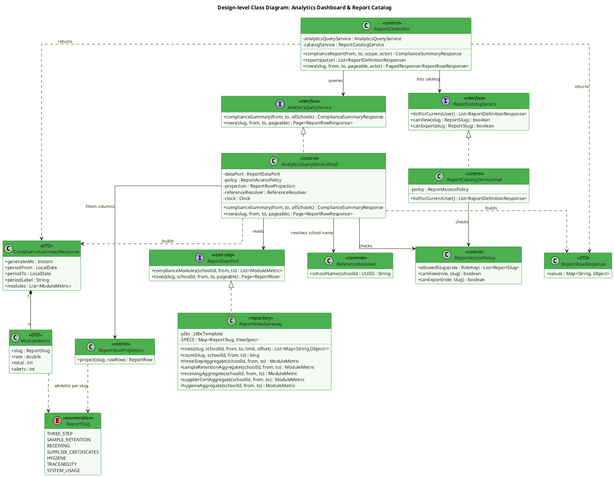

**Description:**
`AnalyticsQueryService` is the single read entry point behind both the dashboard summary and the per-report detail table. It never touches another module's entity classes — all reads go through `ReportDataPort`, whose only implementation `ReportViewGateway` issues native queries over the 7 `v_rpt_*` views (ADR-M13-1); this keeps BR-182 ("figures computed directly from source data") true by construction rather than by convention, and makes `ReportViewGateway` the single repository in MF13 allowed to read another module's data. `ReportController` resolves `schoolId`/`role` exclusively from `@CurrentUser` (JWT), so a query parameter can narrow the period but never widen the scope (BR-176). `ReportAccessPolicy` centralizes BR-175 (per-report-type RBAC) — its `SERVICE_CATERERS` branch (3 slugs, `partner_id` filter) exists but stays disabled by configuration until traceability confirms it (CF-M13-3) — and `ReportRowProjection` enforces BR-181 by whitelisting columns per slug (fail-closed), so a newly added source column never leaks into a report automatically. `ReportSlug` is the one exception to D6's SCREAMING_SNAKE enum rule: `@JsonValue` renders it kebab-case (`three-step`, ...) to match the API contract (ADR-M13-5). The summary result is cached under `schoolId:from:to` for 240s (ADR-M13-6) with `generatedAt` fixed at calculation time, which is what lets BR-180's "refresh within 5 minutes" be asserted as `now - generatedAt <= 300s` instead of just described in prose.

---

### 1.2 Sequence Diagram — View Compliance Dashboard (UC-171)

```plantuml
@startuml MF13_ViewDashboard
title Sequence Diagram: View Compliance Dashboard

' Bật chế độ liên kết vuông góc (Orthogonal lines)
skinparam linetype ortho

' ==========================================
' CẤU HÌNH MÀU SẮC TÔNG XANH LÁ
' ==========================================
skinparam backgroundColor #FFFFFF

' Định dạng chung cho Stereotype
skinparam stereotype {
    CBackgroundColor #E8F5E9
    CBorderColor #2E7D32
    EBackgroundColor #E8F5E9
    EBorderColor #2E7D32
    ABackgroundColor #E8F5E9
    ABorderColor #2E7D32
    IBackgroundColor #E8F5E9
    IBorderColor #2E7D32
}

' ==========================================
' Note
' ==========================================
skinparam NoteBackgroundColor #E8F5E9
skinparam NoteBorderColor #2E7D32
skinparam NoteFontColor #212121
skinparam NoteFontName Arial

' ==========================================
' Lifeline theo stereotype robustness UML
' (boundary / control / entity / database)
' ==========================================
skinparam BoundaryBackgroundColor #F4FBF4
skinparam BoundaryBorderColor #2E7D32
skinparam BoundaryFontColor #212121
skinparam BoundaryFontName Arial
skinparam BoundaryFontSize 13

skinparam ControlBackgroundColor #F4FBF4
skinparam ControlBorderColor #2E7D32
skinparam ControlFontColor #212121
skinparam ControlFontName Arial
skinparam ControlFontSize 13

skinparam EntityBackgroundColor #F4FBF4
skinparam EntityBorderColor #2E7D32
skinparam EntityFontColor #212121
skinparam EntityFontName Arial
skinparam EntityFontSize 13

skinparam CollectionsBackgroundColor #F4FBF4
skinparam CollectionsBorderColor #2E7D32
skinparam CollectionsFontColor #212121

skinparam DatabaseBackgroundColor #F4FBF4
skinparam DatabaseBorderColor #2E7D32
skinparam DatabaseFontColor #212121
skinparam DatabaseFontName Arial
skinparam DatabaseFontSize 13

skinparam sequence {

    ' ==========================================
    ' Actor & Participant
    ' ==========================================
    ActorBackgroundColor #E8F5E9
    ActorBorderColor #2E7D32
    ActorFontColor #1B5E20
    ActorFontName Arial
    ActorFontSize 13

    ParticipantBackgroundColor #F4FBF4
    ParticipantBorderColor #2E7D32
    ParticipantFontColor #212121
    ParticipantFontName Arial
    ParticipantFontSize 13

    ' ==========================================
    ' Message
    ' ==========================================
    ArrowColor #2E7D32
    ArrowFontColor #1B5E20
    ArrowFontName Arial
    ArrowFontSize 12

    ' ==========================================
    ' Activation (Execution)
    ' ==========================================
    LifeLineBackgroundColor #C8E6C9
    LifeLineBorderColor #2E7D32

    ' ==========================================
    ' Group (alt / opt / loop / par...)
    ' ==========================================
    GroupBackgroundColor #F4FBF4
    GroupBorderColor #2E7D32
    GroupHeaderFontColor #FFFFFF
    GroupHeaderBackgroundColor #4CAF50
    GroupFontColor #212121
    GroupFontName Arial

}

autonumber

actor "School Administration" as SA
boundary ":ComplianceDashboardUI" as UI
control ":ReportController" as C
control ":ReportAccessPolicy" as P
control ":AnalyticsQueryServiceImpl" as S
entity ":ReportViewGateway" as GW
control ":ReferenceResolver" as REF
database ":PostgreSQL\n(7 VIEW v_rpt_*)" as DB

SA -> UI : chọn khoảng thời gian, mở màn hình\n"Báo cáo tuân thủ"
activate UI
UI -> C : GET /api/v1/compliance-report?dateFrom=&dateTo=\nAuthorization: Bearer <JWT>
activate C
C -> C : AuthUser{userId, role, schoolId} <- JWT\n(query params never trusted for scope)
C -> P : allowedSlugs(role)
activate P
P --> C : List<ReportSlug> [three-step, sample-retention, receiving,\n supplier-certificates, hygiene, traceability, system-usage]
deactivate P

C -> S : complianceSummary(actor, from, to, allSchools)
activate S
S -> P : assertCanView(role, slug) for each allowed slug
activate P
P --> S : boolean = true
deactivate P

alt cache hit (age <= 240s — BR-180 / ADR-M13-6)
  S -> S : cache.get(schoolId:from:to)
  S --> C : ComplianceSummaryResponse\n{ generatedAt(cached), modules[] }
else cache miss
  loop for each of the 5 compliance modules
    S -> GW : xxxAggregate(schoolId, from, to)
    activate GW
    GW -> DB : SELECT count(*), avg(...) FROM v_rpt_xxx\nWHERE school_id = :schoolId AND date BETWEEN :from AND :to
    activate DB
    DB --> GW : ResultSet { total, passed, alerts }
    deactivate DB
    GW --> S : ModuleMetric { slug, rate, total, alerts }\n(computed from source rows — BR-182)
    deactivate GW
  end
  S -> REF : schoolName(schoolId)
  activate REF
  REF --> S : String schoolName
  deactivate REF
  S -> S : generatedAt = clock.instant()\ncache.put(key, result, ttl = 240s)
  S --> C : ComplianceSummaryResponse\n{ generatedAt, periodFrom, periodTo, periodLabel, modules[] }
end
deactivate S

C --> UI : 200 { generatedAt(ISO-8601), periodFrom,\n  periodTo, periodLabel, modules[] }
deactivate C
UI --> SA : hiển thị 5 thẻ tỉ lệ tuân thủ + nhãn "Cập nhật lúc <generatedAt>"
deactivate UI

@enduml
```

**Description:**
The controller resolves `schoolId` and `role` strictly from the JWT — the request's query string can only narrow the period, never widen the scope (BR-176). `ReportAccessPolicy` determines which of the 7 report slugs the caller's role may see (BR-175) before any query runs. `AnalyticsQueryService` then either serves a cached `ComplianceSummary` (fresh within the 240-second TTL, ADR-M13-6) or recomputes all 7 aggregates directly from the `v_rpt_*` views and re-caches the result. `generatedAt` always reflects the moment the numbers were calculated, not the moment of the HTTP request, which is what allows BR-180's "refresh within 5 minutes" guarantee to be tested automatically: the FE polls every 5 minutes, reads the ISO-8601 `generatedAt` and asserts `now - generatedAt <= 300s`.

---

### 1.3 Sequence Diagram — Browse Report Detail Rows (UC-171, `GET /reports/{slug}/rows`)

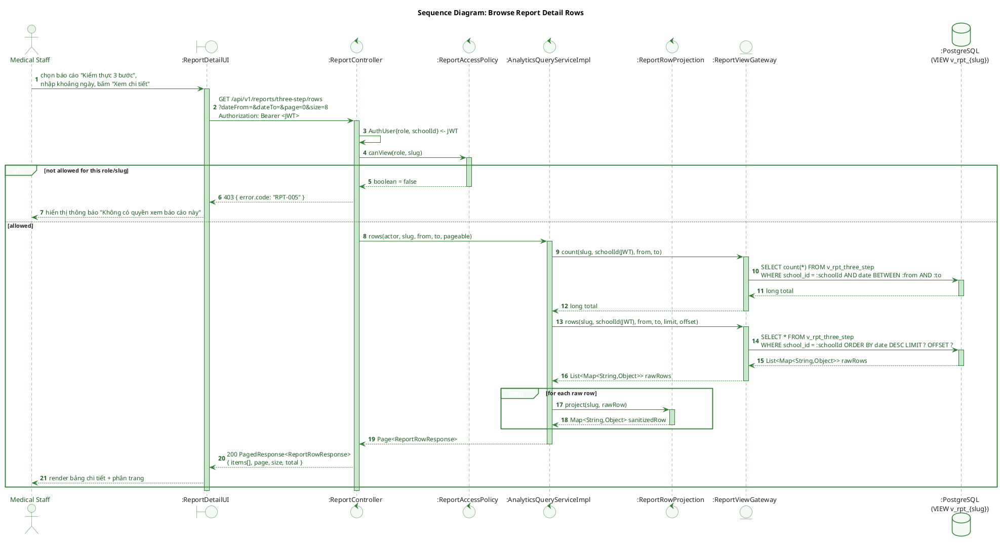

**Description:**
This endpoint replaces the mock-era pattern where the FE's report-detail screen read straight from another module's resource (`samples`, `inventory`, `partners`, ...) with no BR-176/BR-181 enforcement in between. Every row returned here has already passed through `ReportRowProjection`, whose per-slug whitelist means no `studentId`/`studentName`/`phone`/`diagnosis` value ever leaves that layer — column leakage of student PII is structurally impossible rather than dependent on each caller remembering to filter it (BR-181). The school scope is taken from the JWT rather than from a client-supplied filter (BR-176), closing the hardcoded-school-name gap noted in the source dashboard. `count()` and `rows()` are two separate gateway calls so the paged response can report a total without materializing the whole period.

---

## 2. Report Export (UC-172)

### 2.1 Class Diagram

```plantuml
@startuml MF13_Export_ClassDiagram
title Design-level Class Diagram: Report Export & Download

' ==========================================
' CẤU HÌNH BỐ CỤC VÀ MÀU SẮC RATIONAL ROSE
' ==========================================
skinparam classAttributeIconSize 0
skinparam linetype ortho
skinparam nodesep 60
skinparam ranksep 60
skinparam backgroundColor #FFFFFF

' Định dạng cho Class / Interface / Abstract Class
skinparam class {
    BackgroundColor #F4FBF4
    BorderColor #2E7D32
    FontColor #212121
    FontName Arial
    FontSize 13

    HeaderBackgroundColor #4CAF50
    HeaderFontColor #FFFFFF

    AttributeFontColor #212121
    AttributeFontName Arial
    AttributeFontSize 12
}

skinparam interface {
    BackgroundColor #f7ed93ff
    BorderColor #000000ff
    FontColor #000000ff
    FontName Arial
}

' Định dạng Mũi tên & Liên kết (Relationships & Arrows)
skinparam arrow {
    Color #162c00ff
    FontColor #162c00ff
    FontName Arial
    FontSize 11
}

' Định dạng Icon Stereotype (C, I, A, E)
skinparam stereotype {
    CBackgroundColor #f6eedcff
    CBorderColor #000000ff
    EBackgroundColor #f6eedcff
    EBorderColor #000000ff
    ABackgroundColor #f6eedcff
    ABorderColor #000000ff
    IBackgroundColor #f6eedcff
    IBorderColor #000000ff
}

hide empty members

enum ReportFormat <<enumeration>> {
  PDF
  XLSX
}

class ReportExportController <<control>> {
  -reportExportService : ReportExportService
  +export(slug, request, actor) : ReportExportResponse
  +history(params, pageable, actor) : PagedResponse<ReportExportResponse>
  +detail(code, actor) : ReportExportResponse
  +download(code, actor) : ResponseEntity<byte[]>
}

class ReportExport <<entity>> {
  -id : UUID <<PK>>
  -code : String <<business code, D1>>
  -schoolId : UUID <<FK>>
  -reportSlug : ReportSlug
  -reportTitle : String
  -periodFrom : LocalDate
  -periodTo : LocalDate
  -periodLabel : String
  -format : ReportFormat
  -filters : JsonNode
  -rowCount : int
  -confidential : boolean
  -fileUri : String
  -fileSizeBytes : long
  -checksumSha256 : String
  -generatedAt : Instant
  -generatedByUserId : UUID <<FK>>
  -expiresAt : Instant
  +getPublicId() : String
}

interface ReportExportService <<interface>> {
  +export(actor, slug, format, from, to, filters) : ReportExportResponse
  +history(actor, slugOrNull, allSchools, pageable) : Page<ReportExportResponse>
  +findByCode(actor, code) : Optional<ReportExportResponse>
  +download(actor, code) : DownloadedFile
}

class ReportExportServiceImpl <<control>> {
  -viewGateway : ReportViewGateway
  -projection : ReportRowProjection
  -accessPolicy : ReportAccessPolicy
  -renderers : Map<String, ReportRenderer>
  -storageService : StorageService
  -repository : ReportExportRepository
  -referenceResolver : ReferenceResolver
  -auditService : AuditService
  -codeGenerator : CodeGenerator
  -clock : Clock
  +export(actor, slug, format, from, to, filters) : ReportExportResponse
  +exportForSchedule(schoolId, byUserId, slug, format, from, to, label) : ScheduledExportResult
  +download(actor, code) : DownloadedFile
  -doExport(...) : ScheduledExportResult
  -lookup(actor, code) : ReportExport
  -sha256(bytes) : String
}

interface ReportExportRepository <<repository>> {
  +save(entity : ReportExport) : ReportExport
  +findByCode(code : String) : Optional<ReportExport>
  +findByCodeAndSchoolId(code, schoolId) : Optional<ReportExport>
  +existsByCodeAndSchoolId(code, schoolId) : boolean
  +findBySchoolIdOrderByGeneratedAtDesc(schoolId, pageable) : Page<ReportExport>
  +findBySchoolIdAndReportSlugOrderByGeneratedAtDesc(schoolId, slug, pageable) : Page<ReportExport>
  +findAllByOrderByGeneratedAtDesc(pageable) : Page<ReportExport>
  +findByExpiresAtBefore(now, batch) : List<ReportExport>
}

interface ReportRenderer <<interface>> {
  +render(title, periodLabel, schoolName, generatedAt, rows) : byte[]
  +fileExtension() : String
  +contentType() : String
}
class PdfReportRenderer <<PDFBox>>
class XlsxReportRenderer <<Apache POI>>

class ReportExportResponse <<DTO>> {
  +id : String
  +reportSlug : ReportSlug
  +format : ReportFormat
  +rowCount : int
  +generatedAt : Instant
  +expiresAt : Instant
  +downloadUrl : String
}

class DownloadedFile <<DTO>> {
  +filename : String
  +contentType : String
  +bytes : byte[]
}

interface StorageService <<common>> {
  +store(key : String, file : MultipartFile) : String
  +load(key : String) : Resource
}

interface ReportDataPort <<read-only>>

class ReportViewGateway <<repository>> {
  +rows(slug, schoolId, from, to, limit, offset) : List<Map<String,Object>>
}

class ReportRowProjection <<control>> {
  +project(slug, rawRow) : Map<String,Object>
}

class AuditService <<common>> {
  +success(actorEmail, ip, action, resource) : void
}

class CodeGenerator <<common>> {
  +next(sequence, prefix, padding) : String
}

interface ReportExportPort <<interface>> {
  +renderAndStore(cmd : ReportRenderCommand) : ReportExportResponse
}

ReportExportService <|.. ReportExportServiceImpl
ReportExportPort <|.. ReportExportServiceImpl
ReportDataPort <|.. ReportViewGateway

ReportRenderer <|.. PdfReportRenderer
ReportRenderer <|.. XlsxReportRenderer

ReportExportController --> ReportExportService : invokes
ReportExportController ..> ReportExportResponse : returns
ReportExportController ..> DownloadedFile : streams

ReportExportServiceImpl --> ReportViewGateway : reads rows
ReportExportServiceImpl --> ReportRowProjection : whitelists columns
ReportExportServiceImpl --> ReportRenderer : renders file
ReportExportServiceImpl --> StorageService : stores / loads file
ReportExportServiceImpl --> ReportExportRepository : persists snapshot
ReportExportServiceImpl --> CodeGenerator : allocates RPX code
ReportExportServiceImpl --> AuditService : appends audit
ReportExportServiceImpl ..> ReportExportResponse : builds
ReportExportServiceImpl ..> DownloadedFile : builds
ReportExportRepository "1" --> "n" ReportExport : manages
ReportExport --> ReportFormat
@enduml
```

**Description:**
`ReportExportServiceImpl` is the only writer of `ReportExport`. It reads rows through the same `ReportDataPort` used by the dashboard (one source of truth, ADR-M13-1), delegates byte generation to a format-specific `ReportRenderer` that is contractually required to stamp the four BR-178 header fields plus the BR-181 "Confidential" watermark, stores the resulting file via the shared `StorageService` (not a module-specific port — D10/M13-D07; `LocalDiskStorageService` in dev per ADR-000, `R2StorageService` in prod per ADR-001), and finally persists an immutable `ReportExport` row whose `checksumSha256` lets a later download verify the file hasn't drifted. Immutability is enforced twice: `ReportExportRepository` exposes no update operation at all, and the DB trigger `report_exports_no_update` blocks any `UPDATE` as a second line of defense (BR-182, ADR-M13-3). `ReportExportPort` is exposed so MF12's `sent_reports` flow can optionally reuse this renderer instead of maintaining its own (ADR-M13-2) — an open integration point, not a required call.

---

### 2.2 Sequence Diagram — Export Report (UC-172, BR-177/178/181/182)

```plantuml
@startuml MF13_ExportReport
title Sequence Diagram: Export Report (PDF / XLSX)

' Bật chế độ liên kết vuông góc (Orthogonal lines)
skinparam linetype ortho

' ==========================================
' CẤU HÌNH MÀU SẮC TÔNG XANH LÁ
' ==========================================
skinparam backgroundColor #FFFFFF

' Định dạng chung cho Stereotype
skinparam stereotype {
    CBackgroundColor #E8F5E9
    CBorderColor #2E7D32
    EBackgroundColor #E8F5E9
    EBorderColor #2E7D32
    ABackgroundColor #E8F5E9
    ABorderColor #2E7D32
    IBackgroundColor #E8F5E9
    IBorderColor #2E7D32
}

' ==========================================
' Note
' ==========================================
skinparam NoteBackgroundColor #E8F5E9
skinparam NoteBorderColor #2E7D32
skinparam NoteFontColor #212121
skinparam NoteFontName Arial

' ==========================================
' Lifeline theo stereotype robustness UML
' (boundary / control / entity / database)
' ==========================================
skinparam BoundaryBackgroundColor #F4FBF4
skinparam BoundaryBorderColor #2E7D32
skinparam BoundaryFontColor #212121
skinparam BoundaryFontName Arial
skinparam BoundaryFontSize 13

skinparam ControlBackgroundColor #F4FBF4
skinparam ControlBorderColor #2E7D32
skinparam ControlFontColor #212121
skinparam ControlFontName Arial
skinparam ControlFontSize 13

skinparam EntityBackgroundColor #F4FBF4
skinparam EntityBorderColor #2E7D32
skinparam EntityFontColor #212121
skinparam EntityFontName Arial
skinparam EntityFontSize 13

skinparam CollectionsBackgroundColor #F4FBF4
skinparam CollectionsBorderColor #2E7D32
skinparam CollectionsFontColor #212121

skinparam DatabaseBackgroundColor #F4FBF4
skinparam DatabaseBorderColor #2E7D32
skinparam DatabaseFontColor #212121
skinparam DatabaseFontName Arial
skinparam DatabaseFontSize 13

skinparam sequence {

    ' ==========================================
    ' Actor & Participant
    ' ==========================================
    ActorBackgroundColor #E8F5E9
    ActorBorderColor #2E7D32
    ActorFontColor #1B5E20
    ActorFontName Arial
    ActorFontSize 13

    ParticipantBackgroundColor #F4FBF4
    ParticipantBorderColor #2E7D32
    ParticipantFontColor #212121
    ParticipantFontName Arial
    ParticipantFontSize 13

    ' ==========================================
    ' Message
    ' ==========================================
    ArrowColor #2E7D32
    ArrowFontColor #1B5E20
    ArrowFontName Arial
    ArrowFontSize 12

    ' ==========================================
    ' Activation (Execution)
    ' ==========================================
    LifeLineBackgroundColor #C8E6C9
    LifeLineBorderColor #2E7D32

    ' ==========================================
    ' Group (alt / opt / loop / par...)
    ' ==========================================
    GroupBackgroundColor #F4FBF4
    GroupBorderColor #2E7D32
    GroupHeaderFontColor #FFFFFF
    GroupHeaderBackgroundColor #4CAF50
    GroupFontColor #212121
    GroupFontName Arial

}

autonumber

actor "School Administration" as SA
boundary ":ReportExportUI" as UI
control ":ReportExportController" as C
control ":ReportAccessPolicy" as P
control ":ReportExportServiceImpl" as S
entity ":ReportViewGateway" as GW
control ":ReportRowProjection" as PR
control ":ReferenceResolver" as REF
control ":PdfReportRenderer\n/ :XlsxReportRenderer" as R
control ":CodeGenerator" as CG
control ":StorageService" as F
entity ":ReportExportRepository" as REPO
database ":PostgreSQL" as DB
control ":AuditService" as A

SA -> UI : chọn định dạng PDF/XLSX, khoảng ngày,\nbấm "Xuất báo cáo"
activate UI
UI -> C : POST /api/v1/reports/three-step/export\n{ format:"PDF", dateFrom, dateTo, filters }
activate C
C -> C : AuthUser{role, schoolId} <- JWT
C -> P : canExport(role, slug)
activate P

alt not allowed
  P --> C : boolean = false
  deactivate P
  C --> UI : 403 { error.code: "RPT-005" }
  UI --> SA : hiển thị "Không có quyền xuất báo cáo này"
else allowed
  C -> S : export(actor, slug, format, from, to, filters)
  activate S
  S -> S : validate format != null,\ndateFrom <= dateTo

  S -> GW : rows(slug, schoolId(JWT), from, to, MAX_VALUE, 0)
  activate GW
  GW -> DB : SELECT * FROM v_rpt_three_step\nWHERE school_id = :schoolId AND date BETWEEN :from AND :to
  activate DB
  DB --> GW : List<Map<String,Object>> rawRows
  deactivate DB
  GW --> S : List<Map<String,Object>> rawRows
  deactivate GW

  loop for each raw row
    S -> PR : project(slug, rawRow)
    activate PR
    PR --> S : Map<String,Object> sanitizedRow (BR-181)
    deactivate PR
  end

  S -> REF : schoolName(schoolId)
  activate REF
  REF --> S : String schoolName
  deactivate REF

  S -> R : render(title, periodLabel, schoolName, generatedAt, rows)
  activate R
  R --> S : byte[] bytes
  deactivate R
  S -> S : checksum = sha256(bytes)

  S -> CG : next("report_exports_2026", "RPX-2026", 3)
  activate CG
  CG --> S : String code = "RPX-2026-001"
  deactivate CG

  S -> F : store("report-exports/RPX-2026-001.pdf", file)
  activate F
  F --> S : String storageKey
  deactivate F

  S -> REPO : save(new ReportExport(code, schoolId, slug, ...,\n  checksum, generatedAt, expiresAt))
  activate REPO
  REPO -> DB : INSERT INTO report_exports (...)
  activate DB
  DB --> REPO : 1 row inserted (id uuid)
  deactivate DB
  REPO --> S : ReportExport entity
  deactivate REPO

  S -> A : success(actor.email, null, "EXPORT_REPORT", "report-exports")
  activate A
  A --> S : void
  deactivate A

  S --> C : ReportExportResponse
  deactivate S
  C --> UI : 201 { id:"RPX-2026-001", rowCount,\n  downloadUrl:"/api/v1/report-exports/RPX-2026-001/download" }
  UI --> SA : hiển thị thẻ bản xuất mới + nút "Tải xuống"
end
deactivate C
deactivate UI
@enduml
```

**Description:**
Export is a synchronous write path guarded twice: `ReportAccessPolicy.canExport` (BR-175) before any work starts, and the school scope taken from the JWT rather than the request body when reading rows (BR-176). An empty result set is treated as a valid, non-error export (M13-D10) — the renderer still stamps the four mandatory BR-178 header fields (title, data period, school name, export timestamp) and the BR-181 "Confidential" watermark, so downstream automation never has to special-case a zero-row report. The `report_exports` row is inserted once and never updated afterward (append-only, BR-182); `expires_at` is fixed at `generated_at + 12 months` (BR-177) at insert time, and the whole operation ends with an audit entry.

---

### 2.3 Sequence Diagram — Download a Previously Exported Report

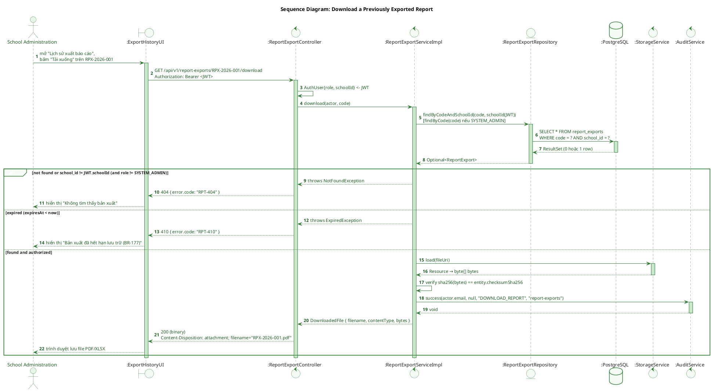

**Description:**
Every download re-checks ownership against the JWT's `school_id` (System Admin excepted, BR-176), and cross-school access is deliberately a 404 rather than a 403 so the existence of another school's report is never disclosed (M13-D04, aligned with MF02's chosen convention). A row that is past `expires_at` answers `410 RPT-410` instead of streaming bytes, since BR-177 caps retention at the configured window. Before returning bytes, the service recomputes the SHA-256 checksum stored at export time so a re-download always yields the exact original file (ADR-M13-3) — since `report_exports` is append-only, a checksum mismatch would indicate storage corruption rather than an edited report, and the download is itself audited (BR-177).

---

## 3. Scheduled Automated Report (UC-173)

### 3.1 Class Diagram

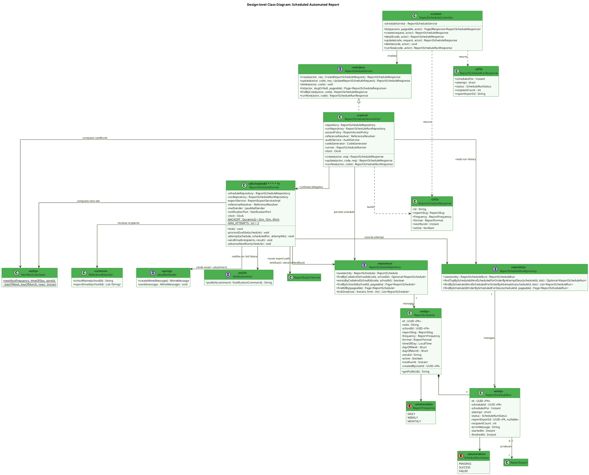

**Description:**
`ReportSchedule` intentionally stores no recipient list — email addresses are always resolved at send time from `school_config.report_emails` through `ReferenceResolver`, so a schedule can never be repurposed to leak reports to an address outside the school's configuration (ADR-M13-7). `ReportScheduleRunner` is the only writer of `ReportScheduleRun`; it polls once a minute through `ReportScheduleRepository.lockDue(...)`, a native query using `SELECT ... FOR UPDATE SKIP LOCKED` so several application instances can run concurrently without sending duplicate emails (no ShedLock needed at MVP). It is also the single caller of MF10's `NotificationPort.publish(...)`, the only interface MF10 exposes (M13-D07c) — no parallel notification interface is declared inside `com.sfms.mf13`, avoiding the duplicate-port pitfall already hit once by MF12. `NextRunCalculator` is a pure static utility shared by the service (on create/update) and the runner (after each run), so a schedule's next slot is computed by exactly one algorithm.

---

### 3.2 Sequence Diagram — Create Schedule (UC-173, BR-179, D5)

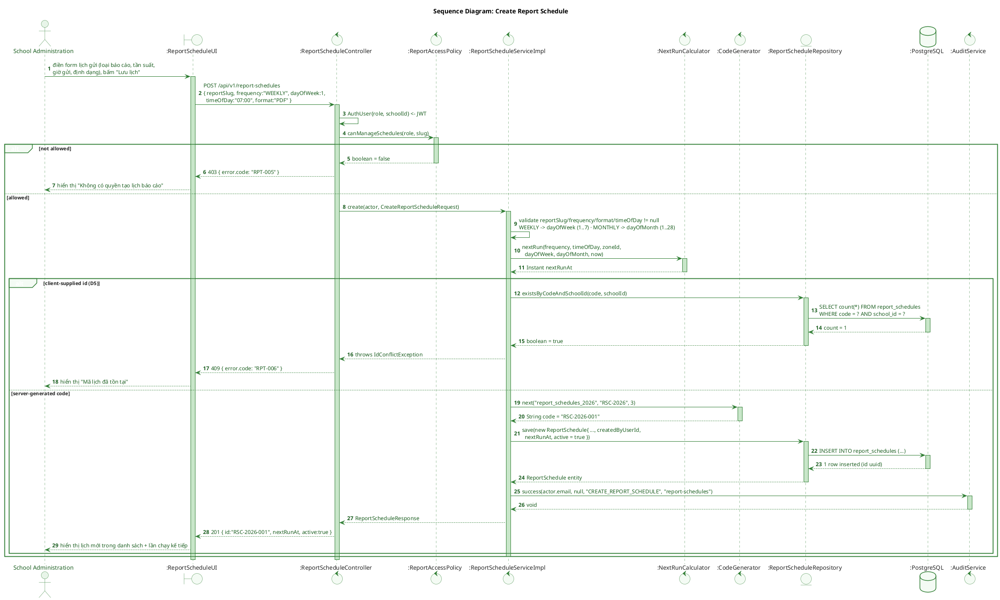

**Description:**
Schedule creation validates the frequency-specific fields (`dayOfWeek` for `WEEKLY`, `dayOfMonth` for `MONTHLY`) before computing the first `next_run_at` in the school's configured `zoneId`. Following D5, a client-supplied `code` that already exists under the same school returns `409`; if omitted, the server generates one. `code`, `nextRunAt`, and `createdBy` remain server-derived, read-only fields even on subsequent `PATCH` calls (M13-D12), and the request body carries no recipient list at all — BR-179 resolves recipients at send time from `school_config.report_emails`.

---

### 3.3 Sequence Diagram — Scheduled Run with Retry (UC-173, BR-179)

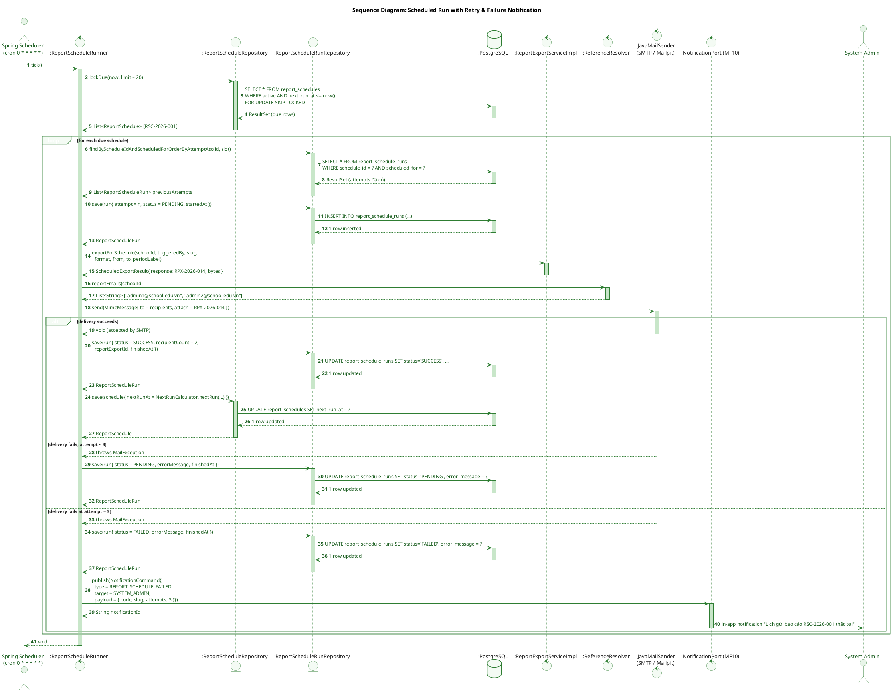

**Description:**
The runner claims due schedules with `SELECT ... FOR UPDATE SKIP LOCKED`, safe for multiple concurrent instances. Before creating a new attempt it reads the attempts already recorded for that slot: if the previous one is still inside its backoff window (5' / 15' / 45'), the slot is skipped and retried on a later tick, which is why a one-minute cron does not translate into a one-minute retry rate. It reuses `ReportExportServiceImpl.exportForSchedule(...)` — the exact same rendering path as a manual export — so a scheduled PDF/XLSX is byte-for-byte identical in structure to one a user triggers by hand. Recipients are resolved fresh on every run from `school_config.report_emails` via `ReferenceResolver`, never persisted on the schedule itself (BR-179). Failed deliveries retry up to three times; only the third consecutive failure marks the run `FAILED` and publishes a `REPORT_SCHEDULE_FAILED` notification to System Admin through MF10's `NotificationPort` — deliberately modeled as a domain event rather than an API error code, since no HTTP caller is waiting on a background job's outcome (M13-D08).

---

## 4. Lifecycles (State Machines)

### 4.1 State Machine — `ReportExport` (BR-177/182)

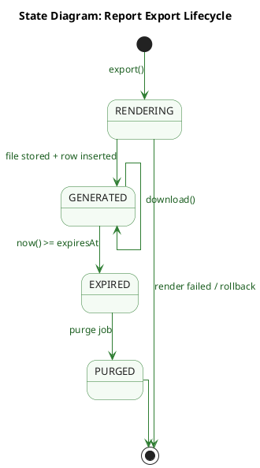

### 4.2 State Machine — `ReportScheduleRun` (BR-179)

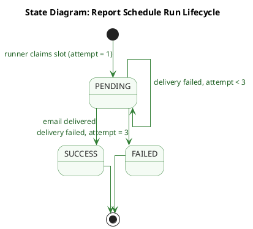

### 4.3 State Machine — `ReportSchedule` (BR-179, UC-173)

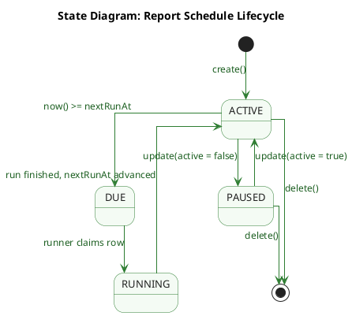

### 4.4 State Machine — Compliance Summary Cache (BR-180, ADR-M13-6)

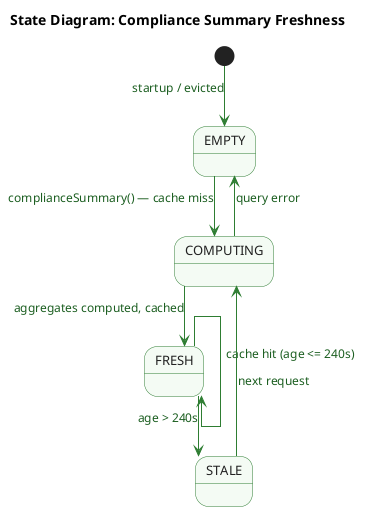

**Description:**
**4.1 — `ReportExport`.** `RENDERING` is a transient in-transaction state: rows are read, the renderer produces bytes and the SHA-256 checksum is computed. A failure there rolls back and persists nothing (`RPT-500`); an empty period is *not* a failure (M13-D10) and still reaches `GENERATED` with all four mandatory BR-178 header fields. From `GENERATED` the row can be downloaded any number of times, its checksum re-verified on each call, and there is deliberately no `EDITED`/`UPDATED` state — BR-182 forbids manual correction, enforced by the DB trigger `report_exports_no_update`. Once `now() >= expires_at` the row becomes `EXPIRED` and `download()` answers `RPT-410`, even though the row still physically exists until the purge job removes file and row (`PURGED`, retention >= 12 months, BR-177).

**4.2 — `ReportScheduleRun`.** Each retry is a **new row** keyed by `(schedule_id, scheduled_for, attempt)` (unique index `uq_rsr_schedule_slot_attempt`), never an overwrite, so the full attempt history survives; the backoff between attempts is 5' / 15' / 45' and `attempt <= 3` is enforced at the database level by `CHECK ck_rsr_attempt`. `SUCCESS` sets `report_export_id` and advances the schedule; the third consecutive failure sets `FAILED` and notifies System Admin. `FAILED` is terminal and does **not** auto-retry — an admin must fix the configuration and call `POST /report-schedules/{code}/run-now`, so a persistently misconfigured schedule cannot retry forever unnoticed.

**4.3 — `ReportSchedule`.** `DUE` is not a stored column: it is the predicate `active AND next_run_at <= now()` evaluated by `ReportScheduleRepository.lockDue()`. The schedule never dies from a failed run — whether the run succeeds or exhausts its 3 attempts, it returns to `ACTIVE` with an advanced `next_run_at`. Only an explicit `active:false` (`PAUSED`) or a `DELETE` takes it out of the runner's window; a paused schedule is invisible to `lockDue()` so it never sends and never accumulates attempts, while `run-now` still works for manual testing. Deleting a schedule cascades to its runs (`ON DELETE CASCADE`).

**4.4 — Compliance summary cache.** Modeled as a state machine because BR-180's "refreshed within 5 minutes" guarantee depends on timing: `generatedAt` is the **calculation** timestamp, not the request timestamp (ADR-M13-6), which makes the rule machine-checkable as `now - generatedAt <= 300s`. The 240-second TTL is deliberately shorter than that 300-second window, so an entry always expires (`STALE`) before it could violate BR-180 and a client polling every 5 minutes can never observe a stale figure. A query error leaves the cache `EMPTY` rather than caching a partial result.

---

*Document generated from TDS `SFMS-MF13-IMP-001 v1.1` (Approved 2026-08-04).*
