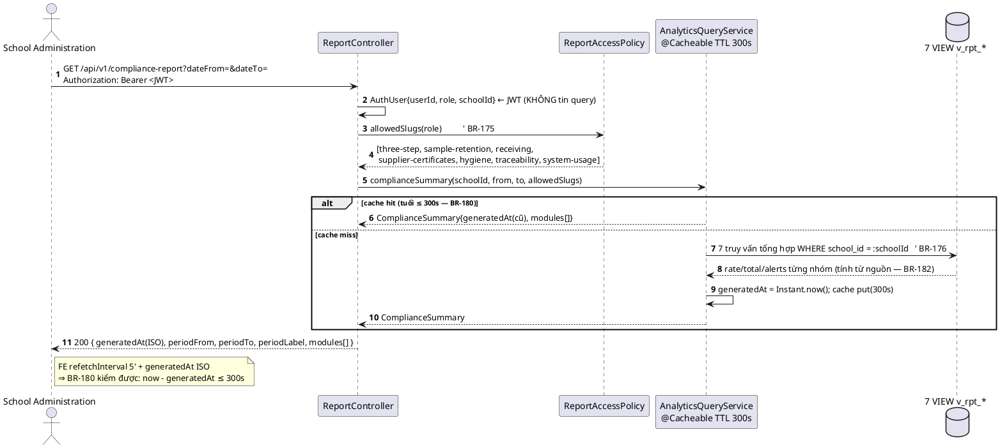
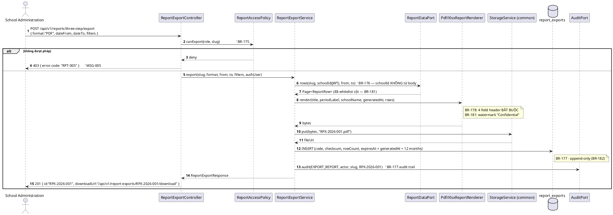
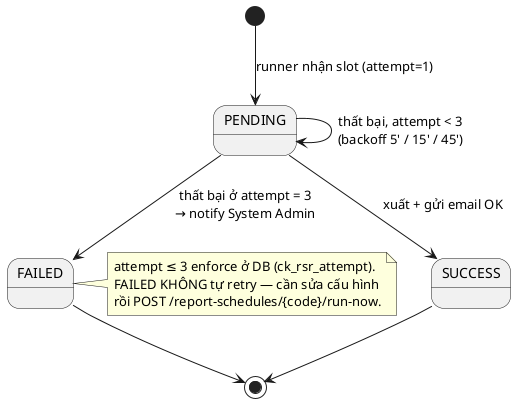
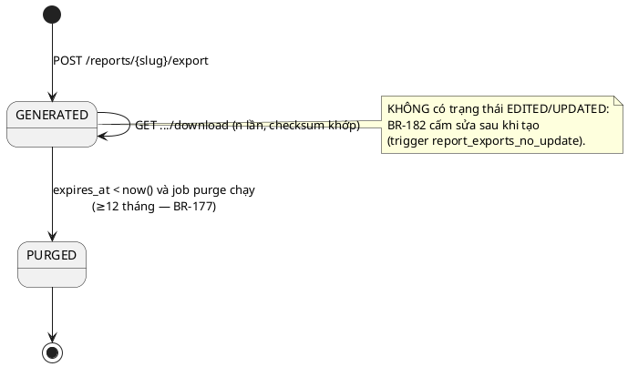

# ENGINEERING DOCUMENTATION STANDARD (EDS) v2.0 — TDS Backend
# MF13 — Reporting & Analytics

| Field | Value |
|-------|-------|
| **Document ID** | `SFMS-MF13-IMP-001` |
| **Version** | `1.1` |
| **Date** | `2026-07-30` (v1.0) · `2026-08-04` (v1.1 — Bước 0 + Bước 1) |
| **Status** | `Approved` |
| **Document Owner** | Nguyễn Văn Nam (NamNVHE180863) |
| **Author** | Nguyễn Văn Nam — Backend Dev (phụ trách School Admin & System Admin, giữ nền chung `common/`) |
| **Reviewed by** | `[Tech Lead — Pending]` |
| **DPO Sign-off** | `[ ] Pending` *(báo cáo tổng hợp — BR-181 bắt buộc ẩn danh HS; file xuất đánh dấu `Confidential`)* |
| **Approved by** | Nguyễn Văn Nam — `2026-08-04` (chủ module + Final Approver, `00_` §1) |
| **Last Review** | `2026-08-04` |
| **Based on EDS** | `v2.0` |

> **Stack (ADR-000 / `01_MVP_Backend_Implementation_Plan.md` §Stack):** Spring Boot **4.1.x (Java 25 LTS)** · PostgreSQL 16 · **Flyway** (một file V mỗi module — **KHÔNG** còn mô hình "V1 = toàn schema", xem `M13-D01`) · **Spring Security + JWT** (RBAC 7 role) · springdoc-OpenAPI (Swagger) · MapStruct. Xuất file: **PDFBox** (PDF) + **Apache POI** (XLSX) — ADR-000 §Mock Strategy ghi *"PDF: JSON thô / PDFBox khi có nhu cầu thật"*; BR-178 **là** nhu cầu thật đó.
>
> ⚠️ **MF13 là module có bề mặt mock nhỏ nhất trong 13 module:** chỉ **1** endpoint tồn tại trong `mock-server.ts` (`GET /compliance-report`). 3 UC của module (UC-171/172/173) cần **8 endpoint mới**. Xem §9.1 và §2.3 (CF-M13-6, CF-M13-7).

---

## CHANGELOG

> **Policy 4.4 — Immutable History:** Không xóa thông tin cũ.

| Ngày | Người thực hiện | Nội dung thay đổi |
|------|-----------------|-------------------|
| 2026-07-30 | Nguyễn Văn Nam | Tạo bản đầu (v1.0). Nguồn: `00_Common_Conventions.md` (D1–D8), UC file `MF13_Reporting_Analytics.md`, traceability **§1.13**, `business_rules.md` §16 (BR-175..182), `error_message.md` **v1.5**, mock (`mock-server.ts` `GET /compliance-report` + `paginate()`, `db.ts`, `mock-data.ts` `SchoolConfig.reportEmails`), màn FE `school-admin/reports` + `school-admin/reports/[slug]` + `school-admin/dashboard`, `data_model.puml`, `semantic-audit.ts`, ADR-000/ADR-001, MVP plan §Stack. Ghi nhận **9 mâu thuẫn nguồn CF-M13-1…CF-M13-9** (§2.3) — **không tự chọn bên đúng**. Toàn bộ ví dụ code viết bằng **Java + JPA + Flyway SQL** (không TypeScript/Prisma). |
| 2026-08-04 | Nguyễn Văn Nam | **v1.1 — chạy Bước 0 + Bước 1** của `02_Module_Completion_Workflow.md` §7. MF13 là **module cuối cùng** (13/13). Nguồn quyết định: **code đã merge** trong `04_Development/Backend` (V1–V24, 13 package `com.sfms.*`), **cao hơn tài liệu** (`00_` §0-BIS). **13 quyết định `M13-D01`…`M13-D13`** — xem §2.4 (mục mới). Tóm tắt: **(A) Bước 0 sạch về quyền sở hữu** — 3 bảng + 9 path của MF13 đều chưa ai chiếm; **(B) 3 lỗi làm Flyway/build đỏ ngay** đã sửa: mô hình Flyway "thêm vào V1" đã bị bỏ từ MF02 (`M13-D01`), thiếu cột audit D9 ở cả 3 bảng (`M13-D02`), **7/7 view `v_rpt_*` đọc cột KHÔNG TỒN TẠI** (`M13-D05` — ca đắt nhất, xem §2.4); **(C) 3 mâu thuẫn treo từ 30/07 đã tự khép bằng code, không cần họp**: `CF-M13-1`/`CF-M11-20` (`M13-D03`), cross-school 403↔404 (`M13-D04`), `SchoolConfigPort`/`NotificationPort`/`FileStoragePort` (`M13-D07`). Status → **Approved**. |

---

## MỤC LỤC

1. [Tổng quan Module](#1-tổng-quan-module) · 2. [Ma trận Truy vết](#2-ma-trận-truy-vết) · 3. [Architecture Decisions](#3-architecture-decisions-inline-adr) · 4. [NFR & SLA](#4-non-functional-requirements--sla) · 5. [Static Modeling](#5-static-modeling) · 6. [Dynamic Modeling](#6-dynamic-modeling) · 7. [Domain Event Catalog](#7-domain-event-catalog) · 8. [Interface Specification](#8-interface-specification) · 9. [API Specification](#9-api-specification) · 10. [Error Codes](#10-bảng-mã-lỗi) · 11. [Triển khai](#11-quy-trình-triển-khai) · 12. [Rollback Runbook](#12-rollback--incident-runbook) · 13. [Kiểm thử](#13-kịch-bản-kiểm-thử) · 14. [Xác minh](#14-phương-pháp-xác-minh) · 15. [API Samples](#15-mẫu-thử-thực-tế) · 16. [Authorization Matrix](#16-authorization-matrix) · 17. [AI Prompt Constraints](#17-ai-prompt-constraints-case-20)

---

## 1. Tổng quan Module

> MF13 là **tầng đọc (read model) + tầng xuất bản** của toàn hệ thống: tổng hợp chỉ số vận hành từ dữ liệu gốc của 12 module nghiệp vụ (kiểm thực ba bước, lưu mẫu, nhận nguyên liệu, chứng nhận NCC, vệ sinh bếp, truy xuất lô, mức độ sử dụng hệ thống), xuất **PDF/XLSX** kèm metadata bắt buộc, lưu lịch sử xuất **≥12 tháng**, và lên lịch gửi báo cáo định kỳ. **MF13 không sở hữu dữ liệu nghiệp vụ nào** — nó chỉ sở hữu *bản ghi việc xuất* và *cấu hình lịch*.

| Field | Value |
|-------|-------|
| **Module Name** | Reporting & Analytics (MF13) |
| **Bounded Context** | Reporting & Analytics (read-side) |
| **Data Classification** | `Confidential` — báo cáo tổng hợp vận hành/sự cố; **BR-181** bắt buộc ẩn danh, không chứa PII học sinh |
| **Compliance Scope** | PDPD (ẩn danh BR-181) · lưu trữ 12 tháng (BR-177) — theo ADR-000/ADR-001 |
| **Upstream Dependencies** | **MF01** (JWT: `userId`/`role`/`schoolId`; danh mục tài khoản cho báo cáo `system-usage`) · **MF02** (`schools`, `school_config.report_emails` — người nhận báo cáo định kỳ BR-179; `academic_years` làm chiều thời gian) · **MF04** (`partners.cert_status` — BR-046/047) · **MF06** (`inventory` — chuỗi truy xuất lô, BR-151) · **MF07** (`inspections`, `kitchen_inspections`) · **MF08** (`food_samples`) · **MF09** (`student_distributions`) · **MF10** (kênh thông báo — báo lỗi lịch gửi) · **MF11** (`violations`, `incidents`) |
| **Downstream Consumers** | **Người dùng cuối** (file PDF/XLSX) · **MF10** (thông báo khi lịch gửi thất bại) · không module nào đọc bảng của MF13 |

**Phạm vi 3 Use Case (đúng traceability §1.13):**
- **UC-171 — View Analytics Dashboard** (School Administration / Medical Staff / System Admin): dashboard tổng hợp theo phạm vi quyền, làm mới ≤5 phút (BR-180), có bộ lọc khoảng ngày/danh mục.
- **UC-172 — Export Report** (School Administration / System Admin): xuất PDF/XLSX theo bộ lọc đang áp, ghi audit, lưu ≥12 tháng.
- **UC-173 — Schedule Automated Report** (School Administration / System Admin): lên lịch daily/weekly/monthly gửi email, retry ≤3 lần, thất bại → báo System Admin.

> ⚠️ `00_Team_Work_Assignment_Plan.md` §3 ghi MF13 = **3 UC** — khớp traceability §1.13. Đây là module **P2**.
>
> ⚠️ **UC-173 hiện là stub:** traceability §1.13 tự ghi chú *"UC-173 vẫn chỉ là stub — chưa có màn hình nào trong Screen Specifications cần đến"*; UC file `MF13_Reporting_Analytics.md` cũng chỉ đặc tả UC-171/172. TDS này **vẫn đặc tả backend cho UC-173** vì BR-179 là rule đã Approved và §1.13 liệt UC-173 như UC còn hiệu lực — xem **CF-M13-2**.

**Vai trò liên quan (BR-007 + BR-175):** School Administration (toàn bộ báo cáo vận hành của trường mình), Medical Staff (báo cáo kiểm tra thực phẩm/sự cố y tế/tuân thủ ATTP), System Admin (mọi báo cáo, **duy nhất** được xem đa trường — BR-176), Service Caterers (chỉ báo cáo hoạt động của mình — BR-175, nhưng **không** có trong cột Actor của §1.13, xem **CF-M13-3**).

**Thư mục màn hình đã đọc (nguồn 6 — `src/app/(app)/`):**
- `school-admin/reports/page.tsx` — 18_ComplianceDashboard: gọi `GET /compliance-report`, `refetchInterval = 5 * 60_000` (BR-180), hiển thị `generatedAt`/`period` (BR-182), nút "Xuất báo cáo (BR-178)" hiện **chỉ là `toast.info`**.
- `school-admin/reports/[slug]/page.tsx` — 13/14/15/16/35/36_Reports: 7 slug (`three-step`, `sample-retention`, `receiving`, `supplier-certificates`, `hygiene`, `traceability`, `system-usage`); mỗi slug render `DataTable` trỏ **thẳng resource của module khác**; 2 badge cứng "Confidential" + "Dữ liệu tổng hợp ẩn danh" (BR-181).
- `school-admin/dashboard/page.tsx` — tổng hợp **phía client** bằng 5 lần `usePagedList(..., {pageSize: 100})` (`menus`, `partners`, `incidents`, `violations`, `kitchen-inspections`).
- `school-admin/config/page.tsx` — `reportEmails` (nguồn người nhận của BR-179).
- *(Không thuộc MF13 — đã kiểm và loại:* `medical-staff/reports`, `medical-staff/reports/[id]`, `medical-staff/compliance/report`, `medical-staff/violations/reports`, `medical-staff/report-center/*` → resource `sent-reports`, UC-185/187/188/189/190, **traceability §1.12 = MF12**; `system-admin/usage-statistics` → UC-150, **§1.12 = MF12**. Xem **CF-M13-1**.*)*

---

## 2. Ma trận Truy vết

> **Nguồn:** cột BR/MSG lấy **nguyên văn** `traceability_matrix.md` **§1.13**; tên UC nguyên văn UC file `02_Requirements/02_UseCases/MF13_Reporting_Analytics.md`; nội dung BR tra `business_rules.md` **§16** (BR-175..182). **Policy:** chỉ dùng mã có trong §1.13 — không bịa mã mới, không mượn mã của §1.12.

### 2.1. UC ↔ BR ↔ MSG ↔ Code

| UC ID | Tên UC (nguyên văn) | Actor (§1.13) | Business Rules (§1.13) | System Messages (§1.13) | Thành phần Code (Java) |
|-------|---------------------|---------------|------------------------|-------------------------|------------------------|
| UC-171 | View Analytics Dashboard | School Administration / Medical Staff / System Admin | BR-175, BR-176, BR-180, BR-181, BR-182 | MSG-004, MSG-005 | `AnalyticsQueryService.complianceSummary()`, `AnalyticsQueryService.reportRows()`, `ReportCatalogService.list()`, `ReportController` |
| UC-172 | Export Report | School Administration / System Admin | BR-175, BR-176, BR-177, BR-178, BR-181, BR-182 | MSG-004, MSG-005 | `ReportExportService.export()`, `ReportExportService.download()`, `ReportExportController` |
| UC-173 | Schedule Automated Report | School Administration / System Admin | BR-175, BR-176, BR-179 | MSG-004, MSG-005 | `ReportScheduleService.create()/update()/delete()`, `ReportScheduleRunner` (`@Scheduled`), `ReportScheduleController` |

> **Ghi chú độ phủ MSG:** §1.13 chỉ gán **MSG-004 + MSG-005** cho cả 3 UC (không có MSG nghiệp vụ riêng). §10 vì vậy chỉ dùng **MSG có thật**: MSG-004, MSG-005 + 2 mã dùng chung v1.5 là **MSG-137** (Resource not found) và **MSG-138** (Validation failed). **Không** cấp "mã cục bộ TDS" — xem **CF-M13-4** cho 2 tình huống hiện chưa có MSG.

### 2.2. Business Rules — nội dung (nguyên văn `business_rules.md` §16)

| BR | Nội dung (rút gọn nguyên văn) | Áp ở |
|----|-------------------------------|------|
| **BR-175** | Quyền truy cập **từng loại** báo cáo do vai trò kiểm soát (RBAC): School Administration xem toàn bộ báo cáo vận hành của trường; Medical Staff xem báo cáo kiểm tra thực phẩm, sự cố y tế, tuân thủ an toàn; Service Caterers **chỉ** xem báo cáo liên quan hoạt động của mình (nhận hàng, kiểm tra, sự cố); System Admin xem tất cả báo cáo trên toàn hệ thống. | `ReportCatalogService`, `@PreAuthorize` + `ReportAccessPolicy` |
| **BR-176** | Dữ liệu báo cáo **giới hạn trong phạm vi trường** người dùng đang thuộc về. **Chỉ System Admin** được xem báo cáo tổng hợp **đa trường**. | mọi query (bộ lọc `school_id` từ JWT) |
| **BR-177** | Báo cáo đã tạo lưu trong hệ thống **tối thiểu 12 tháng**; **mỗi lần xuất** (ai xuất, khi nào, loại báo cáo) ghi vào **audit trail**. | `report_exports` + `expires_at` + `ReportExportPurgeJob` |
| **BR-178** | Xuất **PDF** và **Excel (XLSX)**. Mỗi file xuất **phải** gồm: tiêu đề báo cáo, khoảng thời gian dữ liệu, tên trường, timestamp xuất. | `PdfReportRenderer`, `XlsxReportRenderer` (4 field header bắt buộc) |
| **BR-179** | Hỗ trợ **lên lịch tạo & gửi** báo cáo định kỳ (hàng ngày / hàng tuần / hàng tháng); gửi tới danh sách email do School Administration cấu hình; gửi thất bại → **retry tối đa 3 lần**, vẫn thất bại → ghi nhận lỗi và **thông báo System Admin**. | `report_schedules`, `ReportScheduleRunner`, `report_schedule_runs.attempt ≤ 3` |
| **BR-180** | Dashboard hiển thị dữ liệu **làm mới trong vòng 5 phút** kể từ khi có thay đổi vận hành. Nội dung: chỉ số rủi ro ATTP, tỷ lệ tuân thủ kiểm tra, tóm tắt bữa ăn hàng ngày. | cache TTL ≤ 5 phút (ADR-M13-6), `generatedAt` trả về |
| **BR-181** | Báo cáo **không được tiết lộ thông tin nhận diện cá nhân** học sinh trong dữ liệu tổng hợp; báo cáo xuất ra ngoài phải đánh dấu **"Confidential"** nếu chứa thông tin nhạy cảm về vận hành/sự cố. | `ReportRowProjection` (loại PII) + watermark `Confidential` |
| **BR-182** | Dữ liệu báo cáo phải tính **trực tiếp từ nguồn dữ liệu gốc**; **không cho phép chỉnh sửa thủ công** sau khi tạo báo cáo. Báo cáo phải hiển thị rõ **ngày giờ tạo** và **khoảng thời gian** dữ liệu tổng hợp. | read-only view (ADR-M13-1), `report_exports` immutable + checksum (ADR-M13-3) |

### 2.3. ⚠️ Mâu thuẫn giữa các nguồn (ghi rõ, KHÔNG tự chọn bên đúng)

| # | Mô tả mâu thuẫn | Nguồn A | Nguồn B | Xử lý trong TDS |
|---|-----------------|---------|---------|-----------------|
| **CF-M13-1** | **Ai sở hữu `sent-reports`?** `00_Team_Work_Assignment_Plan.md` §2c-0 ghi *"cần chốt **CF-M11-20**: MF11 đã kết luận `sent-reports` thuộc **MF13**"*. Nhưng: (a) traceability **§1.12** liệt UC-185/187/188/189/190 (soạn/gửi/lịch sử báo cáo ATTP) — tức **MF12**; (b) `TDS-MF12_Backend.md` **đã đặc tả bảng `sent_reports`** (§5.2 dòng 227: cột chung + `payload JSONB`) và endpoint `POST /api/v1/reports/compliance/send`; (c) `error_message.md` §4 xếp MSG-091/092/096..099 vào nhóm **"Food Safety Inspection"** (MF07); (d) `TDS-MF07_Backend.md` dòng 1650 gán resource `sent-reports` cho **MF12**. Bốn nguồn, ba chủ sở hữu khác nhau. | `CF-M11-20` (MF11 → "thuộc MF13") | `traceability_matrix.md` §1.12 + TDS-MF12 §5.2 + TDS-MF07 §9 | Theo quy tắc §2c (**traceability là nguồn chuẩn**): **MF13 KHÔNG sở hữu `sent_reports`**, không khai lại bảng đó, không cấp endpoint `/sent-reports`. MF13 chỉ sở hữu `report_exports` (BR-177/178 — *xuất & tải*) và `report_schedules` (BR-179 — *lịch gửi*), là hai khái niệm **khác** `sent_reports` (*báo cáo Medical Staff chủ động gửi School Administration*). **Cần Huy** chốt dứt điểm trong traceability và **Nam** cập nhật CF-M11-20 + `00_` §2c-0 dòng 427. Rủi ro nếu không chốt: MF12 và MF13 cùng gen một bảng. |
| **CF-M13-2** | **UC-173 là stub nhưng BR-179 đã Approved.** §1.13 liệt UC-173 (BR-175/176/179) như UC còn hiệu lực; nhưng cùng mục đó ghi *"UC-173 vẫn chỉ là stub — chưa có màn hình nào cần đến"*; UC file MF13 chỉ có Functional Spec cho UC-171/172 và ghi *"UC-173 giữ nguyên dạng stub"*; FE có **0 màn**, mock có **0 resource** cho lịch báo cáo. | `traceability_matrix.md` §1.13 + BR-179 | UC file MF13 + FE/mock (0 màn, 0 resource) | TDS đặc tả **đầy đủ backend** UC-173 (§5.2 `report_schedules`/`report_schedule_runs`, §9 4 endpoint, §6.3 sequence) vì BR-179 là rule Approved và có nguồn cấu hình thật (`school_config.report_emails`). Nhưng đánh dấu **🆕 chưa nghiệm thu được qua FE** ở §9.1 và §11.4. **Cần Huy** viết Functional Spec UC-173; **cần Minh** dựng màn hoặc xác nhận descope. **Không** tự descope BR-179. |
| **CF-M13-3** | **BR-175 cho Service Caterers quyền xem báo cáo** (*"chỉ xem báo cáo liên quan đến hoạt động của mình — nhận hàng, kiểm tra, sự cố"*) nhưng cột Actor của §1.13 cho UC-171 chỉ có *School Administration / Medical Staff / System Admin*, UC-172 chỉ có *School Administration / System Admin*. UC file cũng vậy. Service Caterers vì thế có **rule** nhưng không có **UC**. | `business_rules.md` BR-175 | `traceability_matrix.md` §1.13 (cột Actor) | §16 bám **Actor của §1.13** (Service Caterers = ❌ ở mọi endpoint MF13) và ghi rõ dòng này để **Huy** đối chiếu. `ReportAccessPolicy` **được thiết kế sẵn** nhánh `SERVICE_CATERERS → chỉ 3 slug (receiving, three-step, hygiene) + lọc theo `partner_id`` nhưng **tắt bằng cấu hình** ở MVP — bật khi Huy bổ sung Actor. Không tự cấp quyền. |
| **CF-M13-4** | **Hai tình huống lỗi của MF13 chưa có MSG nào.** (1) UC-172 xuất báo cáo cho kỳ **không có dữ liệu**: các module khác có MSG tương ứng (MSG-092 kiểm tra bếp, MSG-096 sự cố, MSG-097 vi phạm) nhưng **cả ba đều thuộc §1.12/MF07**, dùng ở MF13 là mượn mã sai module. (2) BR-179 **gửi thất bại sau 3 lần retry → "ghi nhận lỗi và thông báo cho System Admin"**: không có MSG nào cho thông báo này. | BR-178/BR-179 (yêu cầu hành vi) | `error_message.md` v1.5 (không có mã) | **Không tự đặt mã.** Xử lý: (1) kỳ rỗng **không** phải lỗi — trả **200** với `rowCount: 0` và file vẫn sinh đủ 4 field header của BR-178 (BR-178 không đòi chặn; chặn là quy định riêng của BR-209/213/214 thuộc module khác). (2) Thất bại lịch gửi **không** phải lỗi API — là **domain event** `ReportScheduleRunFailed` → thông báo in-app qua MF10 + audit (BR-170 tinh thần), §7.1. **Đề nghị Huy/Nam cấp 1 MSG** cho (2) ở `error_message.md` v1.6 nếu muốn thông báo có mã chuẩn. Ghi lại ở §17.5. |
| **CF-M13-5** | **`data_model.puml` (57 thực thể) không có thực thể báo cáo nào.** Grep `report\|analytic\|metric` chỉ ra `SchoolConfig.reportEmails`, `IncidentSourceReport` (MF11), `Incident.reportExported`. 3 bảng của MF13 hoàn toàn chưa có trong ER. | `data_model.puml` | BR-177/178/179 (đòi lưu trữ 12 tháng + lịch) | Theo hướng dẫn prompt §2c-2 nguồn 7 (*"nếu ADR module mâu thuẫn puml, theo ADR và ghi rõ để Huy/Mạnh sync puml"*): §5 khai **3 bảng mới** `report_exports`, `report_schedules`, `report_schedule_runs`. **Cần Mạnh/Huy** thêm vào `data_model.puml` (tiền lệ: `IssueSlip` của ADR-M06-6 cũng chưa có trong puml). |
| **CF-M13-6** | **Màn báo cáo chi tiết đọc thẳng resource module khác — BR-181/BR-176 không có nơi nào thi hành.** `school-admin/reports/[slug]/page.tsx` render `DataTable resource="samples" / "inventory" / "users" / "inspections" / "receiving" / "partners" / "kitchen-inspections"`. Nghiêm trọng nhất: slug `system-usage` lọc bằng **tên trường dạng chuỗi cứng** `filters={{ school: "TH Đoàn Thị Điểm" }}` thay vì `schoolId` từ JWT. Hai badge "Confidential"/"ẩn danh" là **nhãn trang trí**, không có logic ẩn danh nào phía sau. | mock FE (hợp đồng path/field) | BR-176, BR-181 | Backend mở `GET /api/v1/reports/{slug}/rows` (§9.1 #3) — **cùng shape `PagedResponse<T>`** để FE chỉ đổi `resource` thành `reports/{slug}/rows`, giữ nguyên `DataTable`. Lọc `school_id` từ **JWT** (không nhận từ query), và đi qua `ReportRowProjection` loại PII (ADR-M13-4). **Cần Minh** đổi 7 `DataTable` sang endpoint mới + xoá chuỗi tên trường cứng. Cho tới khi đổi: các module nguồn **vẫn phải** tự enforce BR-176 ở endpoint của mình (đã có ở TDS từng module). |
| **CF-M13-7** | **`GET /compliance-report` của mock vi phạm chính BR-182 và D4.** (a) `rate: 100` của slug `sample-retention` là **hằng số viết cứng** (`mock-server.ts` dòng 288) — không tính từ nguồn gốc, trái BR-182; (b) `generatedAt` = `nowStamp()` → `"30/07/2026 14:05"` (`dd/MM/yyyy HH:mm`), trái **D4**; (c) `period: "30 ngày gần nhất"` là **chuỗi tiếng Việt cứng**, không có `from`/`to` máy đọc được, nên UC-172 AF1 *"export dùng bộ lọc hiện tại"* không có gì để truyền; (d) 2 báo cáo `traceability` + `system-usage` **hardcode trong FE** (`page.tsx` dòng 119–122), không do API trả. | mock FE | **D4** + BR-182 + UC-172 AF1 | Theo **D1–D8 > mock** (§0 kế hoạch): backend trả `generatedAt` **ISO-8601 `Instant`**, thêm `periodFrom`/`periodTo` (`LocalDate`) bên cạnh `periodLabel` (giữ để FE khỏi vỡ), tính **mọi** `rate` từ nguồn gốc (không hằng số), và trả **đủ 7 báo cáo** qua `GET /api/v1/reports` (§9.1 #2) để FE bỏ 2 dòng hardcode. Ghi vào §17 như lệch mock có chủ đích. |
| **CF-M13-8** | **BR-180 "làm mới ≤5 phút" hiện chỉ là `refetchInterval` phía client.** `school-admin/reports/page.tsx:38` đặt `refetchInterval: 5 * 60_000`; mock tính lại toàn bộ mỗi request nên "5 phút" chưa từng bị kiểm. Với PostgreSQL thật, tổng hợp 7 nhóm mỗi request là chi phí không nhỏ. | mock FE (tính realtime) | BR-180 (≤5 phút) | ADR-M13-6: cache TTL **≤ 5 phút** (Caffeine ở dev theo ADR-000, Redis ở prod theo ADR-001); `generatedAt` trả về là **thời điểm tính số liệu**, **không** phải thời điểm request — nhờ vậy BR-180 kiểm được bằng `now - generatedAt ≤ 5min` (§14.3). |
| **CF-M13-9** | **`school-admin/dashboard` tổng hợp phía client.** 5 lần `usePagedList(..., {pageSize:100})` rồi `.filter().length` trong browser. Với trường thật (>100 bản ghi/loại) số liệu dashboard **sai âm thầm** vì chỉ đếm trên trang đầu 100 bản ghi. | mock FE | BR-182 (tính từ nguồn gốc) | Không thuộc 3 UC của §1.13 (dashboard này là màn tổng quan, không phải "Analytics Dashboard" 18_ComplianceDashboard). Ghi nhận để **Minh** chuyển sang `GET /compliance-report` hoặc endpoint tổng hợp riêng; MF13 **không** mở endpoint mới cho nó ở v1.0. |

---

### 2.4. Bước 0 + Bước 1 — kết quả rà trên CODE ĐÃ MERGE (2026-08-04)

> Chạy theo `02_Module_Completion_Workflow.md` §7. **MF13 là module thứ 13/13** — mọi module nguồn của 7 view đã merge, nên lần rà này đo được thứ mà 12 module trước không đo được.
>
> **Ảnh chụp code lúc rà:** 96 bảng qua `V1`…`V24` · 59 path `/api/v1/*` có controller · 13 package `com.sfms.{common,iam,mf02..mf12}`.

#### A. Quyền sở hữu — **SẠCH** (2 lệnh grep của §2.1)

| Thứ MF13 khai | Đã có trong code? | Kết luận |
|---|---|---|
| `report_exports`, `report_schedules`, `report_schedule_runs` | ❌ không bảng nào tồn tại | ✅ MF13 `CREATE`, không `ALTER` |
| 9 path §9.1 (`/compliance-report`, `/reports/**`, `/report-exports/**`, `/report-schedules/**`) | ❌ không path nào có controller | ✅ MF13 mở mới |
| FK `schools(id)`, `user_accounts(id)` | ✅ cả hai tồn tại, PK **UUID** | ✅ đúng tên **và** đúng kiểu (bẫy C2 không dính) |
| Package `com.sfms.mf13` | — | ✅ đúng khuôn §0-BIS |
| PK `UUID` + `code VARCHAR(32)` + `UNIQUE(school_id, code)` | — | ✅ đúng D1 |

> **Bảng D của §2.1 ghi MF13 `—` ở cả 3 cột và lần này ĐÚNG** — nhưng đúng vì lý do hẹp: 3 cột đó chỉ đo PK/package/cột audit. Ghi chú của bảng (*"3/3 module gần nhất đều có ô sai, tự grep lại"*) vẫn nên giữ: **cột audit thực tế CÓ sai** (`M13-D02`) và bảng D không bắt được, vì MF13 khai `created_at`/`updated_at` ở **tầng Entity** — đúng lớp lỗi mà MF07/MF09 đã mắc.

#### B. Ba lỗi làm Flyway/build đỏ ngay — bảng D **không** đo được cái nào

| # | Lỗi | Hậu quả nếu để nguyên | Quyết định |
|---|---|---|---|
| **B1** | §5.2 ghi *"thêm 3 bảng vào `V1__init_schema.sql`, Nam giữ"* | **Flyway checksum mismatch trên máy cả nhóm** — `V1` đã merge từ 31/07 và 12 module sau đó đã chạy qua nó | **`M13-D01`** |
| **B2** | Cả 3 bảng thiếu cột audit D9; 2 entity tự khai `@Column("created_at"/"updated_at")` | **Build đỏ ngay** (duplicate column với `BaseEntity`) + `AuditorAware` không có cột để điền | **`M13-D02`** |
| **B3** | **7/7 view `v_rpt_*` đọc cột KHÔNG TỒN TẠI** — kể cả một **bảng** không tồn tại (`inspections`) và một **cột lọc trường** không tồn tại (`partners.school_id`) | `flyway:migrate` **đỏ ở view đầu tiên**; toàn bộ 12 IT phía sau vô nghĩa | **`M13-D05`** |

#### C. Ba mâu thuẫn treo từ 30/07 — **cả ba tự khép bằng code, không cần họp**

| Treo từ 30/07 | Ai được giao chốt | Câu trả lời đã nằm sẵn ở đâu | |
|---|---|---|---|
| `CF-M13-1` — ai sở hữu `sent_reports`? (`CF-M11-20` nói MF13) | Huy + Nam | `V23__mf12_platform_services.sql:115` **đã `CREATE TABLE sent_reports`**, `mf12/web/SentReportController` + `mf12/domain/SentReport` **đã merge** | ✅ `M13-D03` |
| `L4` (TestSpec) — cross-school **403 hay 404**, "chốt một lần cho 13 module" | Nam + Huy | `mf02/error/SchExceptions.java:73` — **chốt 2026-07-31, đóng L7 của MF02**: cross-school ⇒ **404** `<PREFIX>-404` MSG-137; 403 chỉ cho **sai vai trò trong cùng trường** | ✅ `M13-D04` |
| `SchoolConfigPort` / `NotificationPort` / `FileStoragePort` — 3 interface MF13 định khai | — | `ReferenceResolver` đã có `schoolName()`; `mf10/port/NotificationPort` đã merge (chữ ký **khác** cái TDS đoán); `common/storage/StorageService` đã merge | ✅ `M13-D07` |

> **Bài học chốt lại cho `02_Module_Completion_Workflow.md` §2.2** *(mục đó dự báo cho MF13: "cần chốt CF-M11-20 với Huy trước")*: **cả ba mục treo đều không cần một cuộc họp nào.** Hai mục được trả lời bởi code merge **sau** ngày viết TDS (03–04/08), một mục bởi code merge **trước** đó (31/07) mà TDS-MF13 không đọc. Đây là lần thứ **ba** liên tiếp (MF11, MF12, nay MF13) một mục "chờ hai người ngồi lại" tan ra khi chạy Bước 0 — **quy tắc: chạy Bước 0 trước khi lên lịch họp**, không phải ngược lại.

#### D. 13 quyết định `M13-D01` … `M13-D13`

| # | Quyết định | Căn cứ |
|---|---|---|
| **M13-D01** | **Flyway: `V29__mf13_reporting_analytics.sql` (3 bảng + trigger) + `V30__mf13_report_views.sql` (7 view + seed `report_schedules`).** **KHÔNG** sửa `V1`. Mô hình *"V1 = toàn schema, Nam giữ"* đã bị bỏ từ khi MF02 dùng `V3` — `00_Team_Work_Assignment_Plan.md` changelog 02/08 mục 3 đã sửa ở 14 file, TDS-MF13 viết 30/07 nên còn sót. Sinh code Bước 2 ngày 04/08 chạy khi `V24` là số cao nhất, đặt `V25`/`V26`/`V27`. **Đúng dự đoán ở §11 dưới** — lúc merge `dev` về (05/08) phát hiện `V25__seed_system_admin.sql` (Thảo, nhánh khác) đã lên `dev` trước, cùng lúc `V26__mf03_*` bị chính MF03 tự đổi thành `V28` để nhường chỗ. Đã đổi 3 file MF13 thành `V29`/`V30`/`V31` (số cao nhất `V28` lúc merge) — bài học: `ls db/migration/` phải chạy lại NGAY TRƯỚC LÚC MERGE, không chỉ lúc Bước 2, vì khoảng cách giữa 2 lần đó là lúc va chạm thật xảy ra. | `00_` §0-BIS · `ls db/migration/` |
| **M13-D02** | **D9 — 3 entity `extends BaseEntity`, KHÔNG tự khai `created_at`/`updated_at`; DDL VẪN tạo đủ 4 cột** `created_at`/`updated_at`/`created_by`/`updated_by`. `created_by_user_id` (FK nghiệp vụ "ai bấm xuất/ai tạo lịch") **giữ nguyên** — tên riêng, không đụng cột reserved, đúng tiền lệ `M11-D04`. | D9 · `common/domain/BaseEntity.java:39-57` |
| **M13-D03** | **`CF-M13-1` ĐÓNG — MF13 không sở hữu `sent_reports`, và không còn gì để chốt.** Bảng + 6 endpoint + entity của MF12 **đã merge**. `CF-M11-20` đóng theo. Nam cập nhật `00_Team_Work_Assignment_Plan.md` §2c-0 dòng 427 (đang ghi ngược). ADR-M13-2 giữ nguyên, đổi trạng thái từ *"đề xuất"* sang *"đã được code xác nhận"*. | `V23:115` · `mf12/web/SentReportController` |
| **M13-D04** | **Cross-school ⇒ 404 `RPT-404` (MSG-137). 403 `RPT-005` CHỈ cho `allSchools=true` sai quyền.** Không phải quyết định mới của MF13 — là **áp lại** quyết định MF02 đã chốt 31/07 và đang chạy. §16/§10 của TDS-MF13 **vốn đã đúng**; việc cần làm là siết `MF13-TC-SEC-003` từ *tham số hoá 2 nhánh* về **một nhánh 404**. | `mf02/error/SchExceptions.java:67,73` |
| **M13-D05** | **Viết lại toàn bộ 7 view theo schema thật** — xem bảng §2.4-E. | 6 file `V*.sql` đã merge |
| **M13-D06** | **Đăng ký prefix `RPT` vào `ModuleCodeResolver` — THÊM 4 dòng**, không sửa dòng nào: `reports`, `report-exports`, `report-schedules`, `compliance-report` → `RPT`. Comment `// 1 module còn lại đăng ký ở đây khi implement (RPT).` (dòng 99) là chỗ Nam đã để sẵn. ⚠️ Slug `traceability` của MF13 **không** cần đăng ký — nó nằm dưới `/reports/traceability/rows` nên segment đầu là `reports`; `PREFIX_BY_RESOURCE.put("traceability","ING")` (dòng 65) là resource **riêng của MF06** ở `/api/v1/traceability`, không đụng. | `common/error/ModuleCodeResolver.java` |
| **M13-D07** | **Bỏ 2 trong 3 interface MF13 định khai; interface thứ 3 dùng chữ ký thật của MF10.** (a) `SchoolConfigPort` → **bỏ**: `schoolName(UUID)` đã có ở `ReferenceResolver:45`; `reportEmails(UUID)` là **tra cứu thuần** (đọc 1 cột `school_config.report_emails JSONB`) ⇒ **THÊM DÒNG vào `ReferenceResolver`**, không khai Port (§7 Bước 0 việc 6, tiền lệ `M08-D08`). (b) `FileStoragePort` → **bỏ**: dùng `common/storage/StorageService` (D10). (c) `NotificationPort` → dùng `com.sfms.mf10.port.NotificationPort` **đã merge**, chữ ký thật là **`String publish(NotificationCommand)`** — **không** phải `void notifySystemAdmins(type, payload)` như TDS đoán. Mọi chỗ trong §6.3/§7/§8/§13 phải đổi theo. | `ReferenceResolver` · `mf10/port/NotificationPort` · `common/storage/` |
| **M13-D08** | **BR-179 thất bại 3/3: KHÔNG cần MSG mới, gỡ `__PENDING__`.** Nam chốt với tư cách chủ `error_message.md`: đây **không** phải lỗi API (không có ai đang chờ response) mà là **thông báo in-app** qua `NotificationPort` + một dòng `report_schedule_runs.error_message` + audit. `error_message.md` đánh mã cho **thông điệp trả về người dùng qua API**; cấp mã cho một notification nền là mở rộng phạm vi file đó không có lý do. `TestSpec` `L3` đóng. | BR-179 · `error_message.md` phạm vi |
| **M13-D09** | **Cache TTL 300s → 240s** (ADR-M13-6). BR-180 nói *"làm mới **trong vòng** 5 phút"* — 300s là **trần**, chạm đúng trần cộng thời gian truy vấn là **vượt**. 240s cho biên an toàn 60s. Chấp nhận `L9` của TestSpec. | BR-180 · TestSpec `L9` |
| **M13-D10** | **Kỳ rỗng KHÔNG chặn — `201` + `rowCount: 0`, file vẫn đủ 4 field header BR-178.** Giữ nguyên kết luận v1.0. **Không** mượn MSG-092/096/097 (thuộc §1.12/MF07 — `AP-AI-016`). Vẫn ghi **cần Huy đối chiếu UC-172** xem có yêu cầu chặn ẩn; không chặn Approved vì BR-178 nguyên văn không có điều khoản chặn. | BR-178 nguyên văn |
| **M13-D11** | **Service Caterers = ❌ ở mọi endpoint MF13 ở MVP** (`CF-M13-3`). Giữ nguyên: §16 bám cột Actor của traceability §1.13; `ReportAccessPolicy` giữ nhánh `SERVICE_CATERERS → 3 slug` nhưng **tắt bằng cấu hình**. Vẫn treo **Huy** bổ sung Actor — **không chặn Approved** vì bật nhánh đã có sẵn là một dòng config, không phải sửa thiết kế. | `CF-M13-3` |
| **M13-D12** | **Thêm 2 TC bắt buộc D11/D12 vào TestSpec** (§7 Bước 1 việc 3 — cả 13 TestSpec viết trước khi D11–D13 tồn tại). **D11:** `GET /reports/{slug}/rows` trả shape khác nhau theo vai trò ⇒ **áp dụng**, phải khai `oneOf` + tên schema giữ tiền tố `PagedResponse`. **D12:** `POST /report-schedules` — `code`/`nextRunAt`/`createdBy` là **field dẫn xuất read-only**. → `MF13-TC-CON-005`, `MF13-TC-INT-013`, `MF13-TC-INT-014`. ⚠️ đánh số **-013/-014** vì `-011`/`-012` đã dùng. | §6 D11/D12 |
| **M13-D13** | **`v_rpt_supplier_cert` lọc trường qua `supplier_partnerships`, KHÔNG qua `partners`.** `partners` là bảng **cấp nền tảng, không có `school_id`** (`V6`) — view v1.0 `SELECT p.school_id FROM partners p` là ca *"cột lọc trường không tồn tại"*, nguy hiểm hơn lỗi tên cột thường vì nếu ai đó "sửa cho chạy" bằng cách bỏ `school_id` thì **BR-176 mất chỗ thi hành** và mọi trường thấy nhà cung cấp của nhau. Đường đúng: `partners → supplier_partnerships(partner_id, school_id, status='APPROVED') → partner_documents(document_type='FOOD_SAFETY_CERT')`. | `V6__mf04_supplier_partner.sql` · BR-176 |

#### E. `M13-D05` chi tiết — 7 view, **7/7 sai**, 23 cột không tồn tại

> Vì sao đáng một bảng riêng: `L11` của TestSpec dự đoán đúng *rủi ro* (*"view phụ thuộc tên cột 7 module khác"*) nhưng xếp nó là **"phụ thuộc lịch của 5 chủ module, Mạnh điều phối"**. Thực tế 04/08 là **cả 5 module nguồn đã merge xong** ⇒ không còn gì để điều phối, chỉ còn việc **đọc file và sửa**. Và mức lệch lớn hơn "tên cột": **1 bảng sai tên**, **1 cột lọc trường không tồn tại**, **3 cột phải đổi thành JOIN**, **2 cột phải tính dẫn xuất**.

| View (slug) | Sai gì trong v1.0 | Sự thật trong schema đã merge |
|---|---|---|
| `v_rpt_three_step` | `FROM inspections` — **bảng không tồn tại** · `i.meal` · `i.inspector` · `i.dish` | Bảng thật là **`inspection_sessions`** (`V12`). `meal` → **`meal_type`** · `inspector` → `inspector_user_id` **JOIN `user_accounts`** · `dish` → `dish_id` **JOIN `dishes`** |
| `v_rpt_sample_retention` | `s.dish` · `s.meal` · `s.weight` | `dish` → **`dish_name`** · `meal` → **`meal_type`** (+`meal_shift`) · `weight` → **`sample_amount`** + **`sample_unit`** (2 cột, `G`/`ML`) |
| `v_rpt_receiving` | `r.supplier_name` · `r.delivery_date` · `r.items` | `supplier_name` **không tồn tại** → `supplier_id` **JOIN `partners.name`** · `delivery_date` → **`received_at`** (`TIMESTAMPTZ`, cast `::date`) · `items` **không tồn tại** → **`COUNT` trên `receiving_lines`** |
| `v_rpt_supplier_cert` | `p.school_id` · `p.type` · `p.cert_expiry` · `p.cert_status` | **`partners` KHÔNG có `school_id`** → qua `supplier_partnerships` (`M13-D13`) · `type` → **`partner_type`** · `cert_expiry`/`cert_status` **không tồn tại** → **JOIN `partner_documents`** (`document_type='FOOD_SAFETY_CERT'`, `expiry_date`), trạng thái là **dẫn xuất** từ `expiry_date` vs `CURRENT_DATE` |
| `v_rpt_hygiene` | `k.inspector` | → `inspector_user_id` **JOIN `user_accounts`**. 5 cột còn lại (`date`,`score`,`staff_health_valid`,`result`,`code`) **đúng** — view duy nhất chỉ sai 1 chỗ |
| `v_rpt_traceability` | `b.ingredient` · `b.supplier_name` · `b.status` | `ingredient` → **`ingredient_label`** · `supplier_name` → `supplier_id` **JOIN `partners.name`** · **`status` không tồn tại** → **dẫn xuất**: `quarantine_at IS NOT NULL → 'QUARANTINED'`, `expiry_date < CURRENT_DATE → 'EXPIRED'`, còn lại `'ACTIVE'` |
| `v_rpt_system_usage` | `u.role_key` · `u.last_login_at` | `role_key` nằm ở bảng **`roles`**, không ở `user_accounts` → **JOIN `roles`** qua `role_id` · `last_login_at` → **`last_login`** |

---

## 3. Architecture Decisions (inline ADR)


> ### ⚠️ Quy ước chung bắt buộc — `07_implement/00_Common_Conventions.md` (D1–D7)
>
> Áp dụng **D1–D7** của `00_Common_Conventions.md` cho toàn bộ tài liệu này. Các ADR bên dưới chỉ ghi phần **riêng của module**; khi xung đột, thứ tự ưu tiên là: **`00_Common_Conventions.md` > ADR module (§3) > hợp đồng mock FE**.
>
> | | Quy ước | Ảnh hưởng tới tài liệu này |
> |---|---|---|
> | **D1** | `id` trong JSON **và** path param = **mã nghiệp vụ**; UUID chỉ là PK nội bộ | §5.2 `report_exports`/`report_schedules` có `code VARCHAR(32)` + `UNIQUE(school_id, code)`; §9.2 path param là `{code}` (`RPX-2026-001`, `RSC-2026-001`) |
> | **D2** | Envelope lỗi `{ "error": { "code", "message", "details" } }` ở `@RestControllerAdvice` | §10 — mã module `RPT-` là `error.code` |
> | **D3** | `baseURL` = `/api/v1` | §9 — mọi path, kể cả `/api/v1/compliance-report` (mock là `/compliance-report`) |
> | **D4** | JSON ngày/giờ **luôn ISO-8601** (`LocalDate` / `Instant`) | §9.2 — `generatedAt`/`exportedAt` là `Instant`; `periodFrom`/`periodTo` là `LocalDate`; **bỏ** `nowStamp()` kiểu `dd/MM/yyyy HH:mm` của mock (CF-M13-7) |
> | **D5** | Nhận `body.id` client gửi → kiểm trùng → **409**; vắng thì server sinh | §9.2 `POST /report-schedules` (mã `RSC-…`); `report_exports` **luôn** do server sinh (không nhận `id` từ client — xuất bản là hành vi server) |
> | **D6** | 8 enum dùng chung ở `common/enums/`, tất cả **SCREAMING_SNAKE** | §5.2 — MF13 **không** khai lại 8 enum đó; 3 enum riêng của module (`ReportFormat`, `ReportFrequency`, `ScheduleRunStatus`) là **khái niệm mới**, không nằm trong bảng D6. `ReportSlug` là ngoại lệ kebab-case — xem ADR-M13-5 |
> | **D7** | Backend trả `code` + `message` **tiếng Anh** (nguyên văn `error_message.md`); FE tra bảng nhãn | §10 |
> | **D8** *(⏳ chờ Nam approve)* | Annotation springdoc S1–S8 | §9.2 mỗi endpoint có `@Tag`/`@Operation`(UC+BR)/`@ApiResponse` → `ErrorResponse`; §10 có cột HTTP; §11.4 tải `/v3/api-docs` |
>
> *Bổ sung 2026-07-29 theo `review.md` mục A — 7 mismatch xuyên module, phần lớn là lệch **giữa các TDS với nhau** chứ không phải lệch FE↔BE.*

> Áp dụng nguyên **ADR-000** (stack, dev/stub external services: SMTP=Mailpit, file=`./data/uploads`, PDF=PDFBox khi có nhu cầu thật) và **ADR-001** (prod: Cloudflare R2, SMTP thật, Redis). Các quyết định dưới đây **inline** (chỉ ảnh hưởng MF13) — không tách file `ADR-MF13_*.md` (quy ước §2c-5: chỉ tách khi quyết định ảnh hưởng >1 module).

### ADR-M13-1 — Tổng hợp qua **read-only view + query port**, không import entity module khác
- **Bối cảnh:** BR-182 đòi số liệu tính **trực tiếp từ nguồn gốc**; `00_` §4b cấm *"import class entity module khác"*, chỉ cho tham chiếu bằng ID.
- **Quyết định:** MF13 đọc dữ liệu qua **SQL view read-only do MF13 sở hữu** (`v_rpt_three_step`, `v_rpt_sample_retention`, `v_rpt_receiving`, `v_rpt_supplier_cert`, `v_rpt_hygiene`, `v_rpt_traceability`, `v_rpt_system_usage`) + `@Query(nativeQuery)` trên các view đó. **Không** `@Entity` nào của MF13 trỏ vào bảng module khác; **không** `import com.sfms.mf07.domain.*`.
- **Hệ quả:** đổi schema module nguồn → view vỡ ở **migration/CI**, không vỡ ở runtime người dùng. Mỗi view là một hợp đồng đọc tường minh, review được. **Không** materialized view ở MVP (BR-180 chỉ đòi ≤5 phút, cache ở tầng app đủ — ADR-M13-6).

### ADR-M13-2 — MF13 **không** sở hữu `sent_reports`; sở hữu `report_exports` + `report_schedules`
- **Quyết định:** theo traceability §1.12/§1.13 (CF-M13-1). Ba khái niệm **khác nhau**, không gộp:
  | Khái niệm | Nghĩa | Chủ | UC |
  |---|---|---|---|
  | `sent_reports` | Medical Staff **chủ động gửi** báo cáo ATTP cho School Administration, có snapshot nội dung | **MF12** | UC-185/189/190 |
  | `report_exports` | **một lần xuất file** PDF/XLSX từ một báo cáo + bộ lọc, để tải về / lưu 12 tháng | **MF13** | UC-172 |
  | `report_schedules` | **cấu hình lịch** sinh & gửi email định kỳ | **MF13** | UC-173 |
- **Hệ quả:** khi MF12 gửi báo cáo (UC-185/189) nó có thể **gọi lại** `ReportExportPort` của MF13 để sinh file PDF/XLSX theo BR-178 thay vì tự render — cùng một bộ renderer, một chỗ bảo đảm 4 field header bắt buộc. Đây là điểm tích hợp duy nhất giữa hai module; MF13 **không** đọc/ghi `sent_reports`.

### ADR-M13-3 — Bản xuất là **snapshot bất biến**, có checksum; retention 12 tháng bằng `expires_at` + job purge
- **Quyết định:** `report_exports` là **append-only**: không `UPDATE`, không `DELETE` bởi API (BR-182 *"không cho phép chỉnh sửa thủ công sau khi tạo"*). Mỗi bản ghi lưu `checksum_sha256` của file + `filters JSONB` (bộ lọc đã dùng) + `row_count`. `expires_at = generated_at + 12 tháng` (BR-177 là **tối thiểu**, nên purge job dùng ngưỡng cấu hình `report.retention-months` **≥ 12**, mặc định 24).
- **Hệ quả:** tải lại một `RPX-…` cũ luôn ra **đúng file cũ** (đối chiếu checksum), không tính lại — khớp tinh thần snapshot mà MF12 dùng cho `sent_reports`. Job purge ghi audit + event `ReportExportPurged`; **không** xoá trước `expires_at` kể cả khi hết dung lượng.

### ADR-M13-4 — Ẩn danh ở **tầng projection**, không ở tầng nguồn (BR-181)
- **Quyết định:** mọi hàng dữ liệu ra khỏi MF13 (JSON `/rows`, PDF, XLSX) đi qua `ReportRowProjection`: **không** cột nào là PII học sinh (`studentId`, `studentCode`, `studentName`, `parentName`, `phone`, `address`, chẩn đoán y tế). Số liệu về học sinh chỉ ở dạng **đếm** (`affectedStudents: 12`). Danh sách cột cho phép khai **tường minh** (whitelist) theo từng slug — không dùng blacklist.
- **Hệ quả:** thêm cột mới ở module nguồn **không** tự động lọt vào báo cáo (fail-closed). File xuất mang watermark `Confidential` + dòng *"Aggregated data — no personally identifiable student information (BR-181)"*. Slug `system-usage` chứa **tên tài khoản nhân sự** (không phải HS) → hợp BR-181, nhưng vẫn `Confidential`.

### ADR-M13-5 — `report_slug` giữ **kebab-case** (ngoại lệ có chủ đích của D6)
- **Bối cảnh:** 7 slug hiện là URL segment thật của FE (`/school-admin/reports/three-step`). D6 chốt mọi enum là SCREAMING_SNAKE, **nhưng** cùng D6 đã chốt `RoleKey` = kebab-case *"đồng thời là URL segment, nên chốt kebab-case"*.
- **Quyết định:** `enum ReportSlug` trong `com.sfms.mf13.domain` với `@JsonValue` trả kebab-case (`THREE_STEP → "three-step"`); cột DB `report_slug VARCHAR(40)` + `CHECK` 7 giá trị kebab. Lý do giữ nguyên **cùng lý do RoleKey**, không phải ngoại lệ tuỳ tiện.
- **Hệ quả:** `ReportSlug` **không** vào `common/enums/` (không dùng chung ngoài MF13). Ghi rõ ở §17 để reviewer không báo là vi phạm D6.

### ADR-M13-6 — BR-180: cache TTL ≤5 phút, `generatedAt` = thời điểm **tính**, không phải thời điểm request
- **Quyết định:** `AnalyticsQueryService.complianceSummary()` được `@Cacheable(cacheNames="complianceSummary", key="#schoolId + ':' + #from + ':' + #to")`, TTL ~~**300 giây**~~ → **240 giây** (`M13-D09`, sửa 2026-08-04). Response luôn mang `generatedAt` (Instant của lần tính) — không đặt lại theo request. Invalidate sớm khi nhận domain event của module nguồn (§7.2) nếu có; TTL là chốt chặn cuối.
- **Vì sao 240s chứ không 300s:** BR-180 nguyên văn là *"làm mới **trong vòng** 5 phút kể từ khi có thay đổi vận hành"* ⇒ 300s là **trần**, không phải mục tiêu. Một thay đổi xảy ra ngay sau lần tính sẽ hiển thị sau `TTL + thời gian truy vấn`; đặt TTL đúng bằng trần là **chắc chắn vượt** ở biên. 240s để lại 60s biên an toàn. `TestSpec` `L9` nêu đúng chỗ này.
- **Hệ quả:** BR-180 trở thành ràng buộc **kiểm được bằng máy** (`now - generatedAt ≤ 300s`, §13/§14), thay vì một dòng mô tả. Dev dùng Caffeine (ADR-000 *"tắt cache Redis, caffeine in-memory"*), prod dùng Redis (ADR-001).

### ADR-M13-7 — Lịch báo cáo: `@Scheduled` quét `next_run_at`, retry ≤3, thất bại → thông báo System Admin
- **Quyết định:** `ReportScheduleRunner` chạy `@Scheduled(cron = "0 * * * * *")` (mỗi phút), `SELECT ... FOR UPDATE SKIP LOCKED` các `report_schedules` có `active = true AND next_run_at <= now()` → sinh `report_exports` → gửi email tới `school_config.report_emails` (nguồn người nhận, BR-179) → ghi `report_schedule_runs`. Thất bại: retry **tối đa 3 lần** (`attempt ≤ 3`, backoff 5/15/45 phút); hết 3 lần → `status=FAILED` + event `ReportScheduleRunFailed` → thông báo System Admin qua **`com.sfms.mf10.port.NotificationPort.publish(NotificationCommand)`** — cửa DUY NHẤT MF10 expose (`M10-D06`), **không** khai interface trùng tên trong `com.sfms.mf13` (`M13-D07`).
- **Hệ quả:** `SKIP LOCKED` cho phép chạy nhiều instance mà không gửi trùng (không cần thêm ShedLock ở MVP). Email qua SMTP stub Mailpit ở dev (ADR-000). Người nhận **không** lấy từ request → không thể dùng lịch báo cáo để phát tán dữ liệu ra email ngoài trường.

---

## 4. Non-Functional Requirements & SLA

### 4.1. Performance & Availability
| Category | Requirement | Target | Đo |
|----------|-------------|--------|-----|
| Latency | `GET /compliance-report` (cache hit) p99 | `< 300ms` | k6 |
| Latency | `GET /compliance-report` (cache miss, 7 nhóm) p95 | `< 2s` | k6 |
| Latency | `GET /reports/{slug}/rows` (paged, pageSize=8) p99 | `< 300ms` | k6 |
| Latency | `POST /reports/{slug}/export` p95 (render PDF/XLSX ≤5.000 dòng) | `< 4s`; vượt → chuyển **async** (202 + poll `report_exports`) | k6 |
| Freshness | Tuổi dữ liệu dashboard (`now - generatedAt`) | `≤ 300s` (**BR-180**) | assert §14.3 |
| Availability | Uptime tháng | `99.9%` | Uptime monitor |

### 4.2. Data Integrity & Retention
| Category | Requirement | Target | Compliance |
|----------|-------------|--------|------------|
| Invariant | `report_exports` **append-only** (0 UPDATE/DELETE qua API) | 100% | BR-182 |
| Invariant | Mọi số liệu tính từ view nguồn — **0 hằng số** trong tầng service | 100% | BR-182 |
| Invariant | `report_schedule_runs.attempt` ≤ 3 | 100% | BR-179 |
| Retention | `report_exports` + file giữ **≥12 tháng** (cấu hình mặc định 24) | 100% | BR-177 |
| Audit | Mỗi lần xuất/tải/tạo-sửa-xoá lịch ghi audit (actor, thời điểm, loại báo cáo) | 100% | BR-177 |
| Integrity | `checksum_sha256` khớp file khi tải lại | 100% | BR-182, ADR-M13-3 |

### 4.3. Security
| Category | Requirement | Compliance |
|----------|-------------|------------|
| Access control | RBAC `@PreAuthorize` + `ReportAccessPolicy` theo **loại báo cáo** (không chỉ theo endpoint) | BR-175 |
| Cross-school isolation | `school_id` lấy từ **JWT**; chỉ System Admin được `?scope=all` | BR-176 |
| Anonymization | Whitelist cột theo slug; 0 cột PII học sinh trong JSON/PDF/XLSX | BR-181 |
| Confidentiality | Watermark `Confidential` trên mọi file xuất | BR-181 |
| File access | `GET /report-exports/{code}/download` kiểm quyền + `school_id` **mỗi lần tải**; URL không đoán được (`code` + kiểm chủ sở hữu), không public link | BR-175, BR-176 |
| Email egress | Người nhận lịch báo cáo **chỉ** từ `school_config.report_emails`, không nhận từ request | BR-179 |

### 4.4. Scalability
> 12 tháng: ~100 trường × ~7 báo cáo × (1 lịch/tuần + xuất tay ~10/tháng) ≈ **~12k `report_exports`/năm**, dung lượng file ~200KB/bản → ~2.4GB/năm. Index `(school_id, report_slug, generated_at DESC)`, `(expires_at)` cho job purge, `(active, next_run_at)` cho runner. Truy vấn tổng hợp dựa vào index của **module nguồn** (`inspections(date)`, `food_samples(collected_at)`, `receiving(delivery_date)`) — MF13 **không** tạo bảng số liệu riêng.

---

## 5. Static Modeling

### 5.1. Class Diagram (PlantUML)

```plantuml
@startuml
skinparam classAttributeIconSize 0
title MF13 — Reporting & Analytics (read-side + export)

enum ReportSlug <<mf13>> {
  THREE_STEP           : "three-step"
  SAMPLE_RETENTION     : "sample-retention"
  RECEIVING            : "receiving"
  SUPPLIER_CERTIFICATES: "supplier-certificates"
  HYGIENE              : "hygiene"
  TRACEABILITY         : "traceability"
  SYSTEM_USAGE         : "system-usage"
}
note right of ReportSlug
  7 slug = 7 route thật của FE
  (school-admin/reports/[slug]).
  kebab-case ở JSON — ADR-M13-5,
  cùng lý do RoleKey của D6.
end note

enum ReportFormat <<mf13>>     { PDF \n XLSX }
enum ReportFrequency <<mf13>>  { DAILY \n WEEKLY \n MONTHLY }
enum ScheduleRunStatus <<mf13>>{ PENDING \n SUCCESS \n FAILED }

class ReportExport <<entity>> {
  - id : UUID <<PK, nội bộ>>
  - code : String <<mã nghiệp vụ, D1>>   ' RPX-2026-001
  - schoolId : UUID <<FK>>
  - reportSlug : ReportSlug
  - reportTitle : String
  - periodFrom : LocalDate
  - periodTo : LocalDate
  - periodLabel : String
  - format : ReportFormat
  - filters : JsonNode
  - rowCount : int
  - confidential : boolean
  - fileUri : String
  - fileSizeBytes : long
  - checksumSha256 : String
  - generatedAt : Instant
  - generatedByUserId : UUID <<FK>>
  - expiresAt : Instant
  + getPublicId() : String <<@JsonProperty("id")>>
}
note right of ReportExport
  BR-177 lưu ≥12 tháng · BR-178 4 field header
  · BR-182 append-only, có checksum (ADR-M13-3)
end note

class ReportSchedule <<entity>> {
  - id : UUID <<PK>>
  - code : String        ' RSC-2026-001
  - schoolId : UUID <<FK>>
  - reportSlug : ReportSlug
  - frequency : ReportFrequency
  - format : ReportFormat
  - timeOfDay : LocalTime
  - dayOfWeek : Short   ' WEEKLY
  - dayOfMonth : Short  ' MONTHLY
  - zoneId : String     ' Asia/Ho_Chi_Minh
  - active : boolean
  - nextRunAt : Instant
  - createdByUserId : UUID <<FK>>
  - createdAt : Instant
  - updatedAt : Instant
  + getPublicId() : String <<@JsonProperty("id")>>
}
note right of ReportSchedule
  BR-179 · người nhận KHÔNG lưu ở đây:
  đọc school_config.report_emails (MF02)
end note

class ReportScheduleRun <<entity>> {
  - id : UUID <<PK>>
  - scheduleId : UUID <<FK>>
  - scheduledFor : Instant
  - attempt : short   ' 1..3 — BR-179
  - status : ScheduleRunStatus
  - reportExportId : UUID <<FK, nullable>>
  - recipientCount : int
  - errorMessage : String
  - startedAt : Instant
  - finishedAt : Instant
}

interface ReportDataPort <<read-only>> {
  + complianceModules(schoolId, from, to) : List<ModuleMetric>
  + rows(slug, schoolId, from, to, pageable) : Page<ReportRow>
}
note bottom of ReportDataPort
  Hiện thực bằng native query trên
  7 SQL VIEW do MF13 sở hữu (ADR-M13-1).
  KHÔNG import entity MF04/06/07/08/11.
end note

' M13-D07 — 3 interface dưới đây đã sửa theo hạ tầng ĐÃ MERGE (2026-08-04):
'   SchoolConfigPort/FileStoragePort GỠ (viết lại hạ tầng đã có); NotificationPort dùng
'   chữ ký thật của MF10, không phải notifySystemAdmins(type, payload) như v1.0 đoán.
interface NotificationPort <<mf10 — đã merge>> { + publish(NotificationCommand) : String }
class ReferenceResolver <<common — đã merge>> { + schoolName(schoolId) \n + reportEmails(schoolId) : List<String> }
interface StorageService <<common — đã merge>> { + put(bytes, name) : String \n + get(uri) : byte[] }

ReportSchedule "1" *-- "n" ReportScheduleRun
ReportScheduleRun "0..1" --> "1" ReportExport : sinh ra
ReportExport ..> ReportSlug
ReportSchedule ..> ReportSlug
ReportExport ..> StorageService
ReportSchedule ..> ReferenceResolver
ReportScheduleRun ..> NotificationPort : thất bại 3/3 (BR-179)
ReportExport ..> ReportDataPort
@enduml
```

> **Không** thực thể nào của MF13 chứa dữ liệu nghiệp vụ gốc — chỉ *bản ghi việc xuất* và *cấu hình lịch* (ADR-M13-2). Ba bảng này **chưa có** trong `data_model.puml` — **CF-M13-5**.

### 5.2. Data Structure — JPA Entity + Flyway migration (Java 25 / Spring Boot 4.1)

```java
package com.sfms.mf13.domain;

import com.fasterxml.jackson.annotation.JsonProperty;
import com.fasterxml.jackson.annotation.JsonValue;
import io.swagger.v3.oas.annotations.media.Schema;
import jakarta.persistence.*;
import java.time.*;
import java.util.UUID;

/** 7 báo cáo = 7 route thật của FE. kebab-case ở JSON — ADR-M13-5 (ngoại lệ D6 cùng lý do RoleKey). */
public enum ReportSlug {
    THREE_STEP("three-step"),
    SAMPLE_RETENTION("sample-retention"),
    RECEIVING("receiving"),
    SUPPLIER_CERTIFICATES("supplier-certificates"),
    HYGIENE("hygiene"),
    TRACEABILITY("traceability"),
    SYSTEM_USAGE("system-usage");

    private final String slug;
    ReportSlug(String slug) { this.slug = slug; }
    @JsonValue public String slug() { return slug; }
}

/** BR-178 — hai định dạng bắt buộc, không hơn. */
public enum ReportFormat { PDF, XLSX }

/** BR-179 — hàng ngày / hàng tuần / hàng tháng. */
public enum ReportFrequency { DAILY, WEEKLY, MONTHLY }

public enum ScheduleRunStatus { PENDING, SUCCESS, FAILED }

@Entity
@Table(
    name = "report_exports",
    uniqueConstraints = @UniqueConstraint(name = "uq_rpx_school_code",
                                          columnNames = {"school_id", "code"}),   // D1
    indexes = {
        @Index(name = "ix_rpx_school_slug_time", columnList = "school_id, report_slug, generated_at"),
        @Index(name = "ix_rpx_expires", columnList = "expires_at")
    })
// M13-D02 / D9: extends BaseEntity ⇒ id + 4 cột audit đến từ lớp cha. KHÔNG khai lại
// created_at/updated_at ở đây (duplicate column ⇒ build đỏ ngay — lỗi số 1 của §0-BIS).
// ⚠️ `generated_at` là cột NGHIỆP VỤ của BR-178 #4 (thời điểm TÍNH số liệu, ADR-M13-6),
//    KHÁC `created_at` của BaseEntity (thời điểm ghi dòng) — giữ cả hai, không gộp.
public class ReportExport extends BaseEntity {

    @Column(nullable = false, length = 32)
    private String code;                   // RPX-2026-001 — mã nghiệp vụ (D1)

    @Column(name = "school_id", nullable = false)
    private UUID schoolId;                 // BR-176 — tham chiếu bằng ID, không import entity MF02

    @Enumerated(EnumType.STRING)
    @Column(name = "report_slug", nullable = false, length = 40)
    private ReportSlug reportSlug;

    @Column(name = "report_title", nullable = false, length = 160)
    private String reportTitle;            // BR-178 field #1

    @Column(name = "period_from", nullable = false) private LocalDate periodFrom;  // BR-178 #2 + BR-182
    @Column(name = "period_to",   nullable = false) private LocalDate periodTo;
    @Column(name = "period_label", length = 120)    private String   periodLabel;  // nhãn hiển thị

    @Enumerated(EnumType.STRING)
    @Column(nullable = false, length = 8)
    private ReportFormat format;

    @Column(columnDefinition = "jsonb")
    private String filters;                // bộ lọc đã áp (UC-172 bước 3) — snapshot, ADR-M13-3

    @Column(name = "row_count", nullable = false) private int  rowCount;
    @Column(nullable = false)                     private boolean confidential = true; // BR-181

    @Column(name = "file_uri", nullable = false, length = 512)  private String fileUri;
    @Column(name = "file_size_bytes", nullable = false)          private long  fileSizeBytes;
    @Column(name = "checksum_sha256", nullable = false, length = 64) private String checksumSha256;

    @Column(name = "generated_at", nullable = false)  private Instant generatedAt;  // BR-178 #4, D4
    @Column(name = "generated_by_user_id", nullable = false) private UUID generatedByUserId;
    @Column(name = "expires_at", nullable = false)    private Instant expiresAt;    // BR-177

    /** D1 — JSON trả `code` dưới tên `id`; API KHÔNG bao giờ trả UUID. */
    @JsonProperty("id")
    @Schema(example = "RPX-2026-001")      // D8/S6 — example là mã nghiệp vụ, không UUID
    public String getPublicId() { return code; }

    // getters/setters — KHÔNG setter công khai cho các cột đã ghi (append-only, BR-182/ADR-M13-3)
}

@Entity
@Table(
    name = "report_schedules",
    uniqueConstraints = @UniqueConstraint(name = "uq_rsc_school_code",
                                          columnNames = {"school_id", "code"}),
    indexes = @Index(name = "ix_rsc_due", columnList = "active, next_run_at"))
public class ReportSchedule extends BaseEntity {          // M13-D02 / D9

    @Column(nullable = false, length = 32) private String code;    // RSC-2026-001 (D1, D5)

    @Column(name = "school_id", nullable = false) private UUID schoolId;

    @Enumerated(EnumType.STRING)
    @Column(name = "report_slug", nullable = false, length = 40) private ReportSlug reportSlug;

    @Enumerated(EnumType.STRING)
    @Column(nullable = false, length = 8)  private ReportFrequency frequency;   // BR-179

    @Enumerated(EnumType.STRING)
    @Column(nullable = false, length = 8)  private ReportFormat format;

    @Column(name = "time_of_day", nullable = false) private LocalTime timeOfDay;
    @Column(name = "day_of_week")  private Short dayOfWeek;   // 1..7, bắt buộc khi WEEKLY
    @Column(name = "day_of_month") private Short dayOfMonth;  // 1..28, bắt buộc khi MONTHLY

    @Column(name = "zone_id", nullable = false, length = 40) private String zoneId = "Asia/Ho_Chi_Minh";

    @Column(nullable = false) private boolean active = true;

    @Column(name = "next_run_at", nullable = false) private Instant nextRunAt;

    // M13-D02 / D9: FK nghiệp vụ "ai tạo lịch" — tên RIÊNG, không đụng cột reserved của
    // BaseEntity. 4 cột audit (created_at/updated_at/created_by/updated_by) do BaseEntity
    // khai + AuditorAware điền; entity KHÔNG khai lại, DDL VẪN tạo đủ.
    @Column(name = "created_by_user_id", nullable = false) private UUID createdByUserId;

    @JsonProperty("id")
    @Schema(example = "RSC-2026-001")
    public String getPublicId() { return code; }
}

@Entity
@Table(
    name = "report_schedule_runs",
    uniqueConstraints = @UniqueConstraint(name = "uq_rsr_schedule_slot_attempt",
                        columnNames = {"schedule_id", "scheduled_for", "attempt"}))
public class ReportScheduleRun extends BaseEntity {       // M13-D02 / D9

    @Column(name = "schedule_id", nullable = false) private UUID scheduleId;
    @Column(name = "scheduled_for", nullable = false) private Instant scheduledFor;

    @Column(nullable = false) private short attempt;            // 1..3 — BR-179

    @Enumerated(EnumType.STRING)
    @Column(nullable = false, length = 12) private ScheduleRunStatus status;

    @Column(name = "report_export_id") private UUID reportExportId;   // null khi thất bại
    @Column(name = "recipient_count", nullable = false) private int recipientCount;
    @Column(name = "error_message", length = 1000) private String errorMessage;

    @Column(name = "started_at", nullable = false) private Instant startedAt;
    @Column(name = "finished_at") private Instant finishedAt;
}
```

**Flyway migration** (`M13-D01`, sửa 2026-08-04) — **hai file mới**, **KHÔNG** sửa `V1__init_schema.sql`:

| File | Nội dung |
|---|---|
| `V29__mf13_reporting_analytics.sql` | 3 bảng + trigger append-only + index |
| `V30__mf13_report_views.sql` | 7 view `v_rpt_*` + seed `report_schedules` (FX-042) |

> ⚠️ **Bản v1.0 ghi *"thêm 3 bảng vào `V1__init_schema.sql`, Nam giữ"* — SAI và là lỗi làm hỏng máy cả nhóm.** Mô hình *"V1 = toàn schema"* đã bị bỏ từ khi MF02 dùng `V3`; `00_Team_Work_Assignment_Plan.md` changelog 02/08 mục 3 đã sửa điều này ở 14 file, TDS-MF13 (viết 30/07) là chỗ còn sót. `V1` đã merge và 12 module sau đó đã chạy qua nó ⇒ sửa `V1` = **Flyway checksum mismatch** cho mọi người đã migrate. `V24__mf12_seed_integrations.sql` là số cao nhất hiện có.

```sql
-- ============ V29__mf13_reporting_analytics.sql — MF13 Reporting & Analytics ============
-- M13-D02 / D9: mỗi bảng có ĐỦ 4 cột audit created_at/updated_at/created_by/updated_by.
-- Entity extends BaseEntity và KHÔNG khai lại 4 cột đó; DDL thì VẪN phải tạo.

CREATE TABLE report_exports (
    id                   UUID         PRIMARY KEY DEFAULT gen_random_uuid(),
    code                 VARCHAR(32)  NOT NULL,                     -- D1: RPX-2026-001
    school_id            UUID         NOT NULL REFERENCES schools(id),
    report_slug          VARCHAR(40)  NOT NULL,
    report_title         VARCHAR(160) NOT NULL,                     -- BR-178 #1
    period_from          DATE         NOT NULL,                     -- BR-178 #2 / BR-182
    period_to            DATE         NOT NULL,
    period_label         VARCHAR(120),
    format               VARCHAR(8)   NOT NULL,
    filters              JSONB        NOT NULL DEFAULT '{}'::jsonb,
    row_count            INTEGER      NOT NULL DEFAULT 0,
    confidential         BOOLEAN      NOT NULL DEFAULT TRUE,        -- BR-181
    file_uri             VARCHAR(512) NOT NULL,
    file_size_bytes      BIGINT       NOT NULL,
    checksum_sha256      CHAR(64)     NOT NULL,
    generated_at         TIMESTAMPTZ  NOT NULL DEFAULT now(),       -- BR-178 #4 (ISO — D4)
                                                                    -- ⚠️ NGHIỆP VỤ, khác created_at
    generated_by_user_id UUID         NOT NULL REFERENCES user_accounts(id),
    expires_at           TIMESTAMPTZ  NOT NULL,                     -- BR-177 ≥ 12 tháng
    -- D9 / M13-D02: 4 cột audit — DDL tạo, BaseEntity điền, Entity KHÔNG khai lại
    created_at           TIMESTAMPTZ  NOT NULL DEFAULT now(),
    updated_at           TIMESTAMPTZ,
    created_by           VARCHAR(180),
    updated_by           VARCHAR(180),
    CONSTRAINT uq_rpx_school_code UNIQUE (school_id, code),         -- D1
    CONSTRAINT ck_rpx_slug   CHECK (report_slug IN ('three-step','sample-retention','receiving',
                                    'supplier-certificates','hygiene','traceability','system-usage')),
    CONSTRAINT ck_rpx_format CHECK (format IN ('PDF','XLSX')),      -- BR-178
    CONSTRAINT ck_rpx_period CHECK (period_from <= period_to),      -- BR-182
    CONSTRAINT ck_rpx_retention CHECK (expires_at >= generated_at + INTERVAL '12 months') -- BR-177
);
CREATE INDEX ix_rpx_school_slug_time ON report_exports (school_id, report_slug, generated_at DESC);
CREATE INDEX ix_rpx_expires          ON report_exports (expires_at);

-- BR-182: bản xuất là snapshot bất biến — chặn UPDATE ở tầng DB, không chỉ ở service.
CREATE OR REPLACE FUNCTION trg_report_exports_immutable() RETURNS TRIGGER AS $$
BEGIN
    RAISE EXCEPTION 'report_exports is append-only (BR-182)';
END; $$ LANGUAGE plpgsql;

CREATE TRIGGER report_exports_no_update
    BEFORE UPDATE ON report_exports
    FOR EACH ROW EXECUTE FUNCTION trg_report_exports_immutable();

CREATE TABLE report_schedules (
    id                 UUID        PRIMARY KEY DEFAULT gen_random_uuid(),
    code               VARCHAR(32) NOT NULL,                        -- D1/D5: RSC-2026-001
    school_id          UUID        NOT NULL REFERENCES schools(id),
    report_slug        VARCHAR(40) NOT NULL,
    frequency          VARCHAR(8)  NOT NULL,
    format             VARCHAR(8)  NOT NULL,
    time_of_day        TIME        NOT NULL,
    day_of_week        SMALLINT,
    day_of_month       SMALLINT,
    zone_id            VARCHAR(40) NOT NULL DEFAULT 'Asia/Ho_Chi_Minh',
    active             BOOLEAN     NOT NULL DEFAULT TRUE,
    next_run_at        TIMESTAMPTZ NOT NULL,
    created_by_user_id UUID        NOT NULL REFERENCES user_accounts(id),  -- FK nghiệp vụ (D9 OK)
    -- D9 / M13-D02: 4 cột audit. ⚠️ `updated_at` KHÔNG `NOT NULL DEFAULT now()` như bản v1.0 —
    -- BaseEntity để NULL cho tới lần sửa đầu tiên (khuôn của user_accounts/partners/dishes).
    created_at         TIMESTAMPTZ NOT NULL DEFAULT now(),
    updated_at         TIMESTAMPTZ,
    created_by         VARCHAR(180),
    updated_by         VARCHAR(180),
    CONSTRAINT uq_rsc_school_code UNIQUE (school_id, code),
    CONSTRAINT ck_rsc_freq   CHECK (frequency IN ('DAILY','WEEKLY','MONTHLY')),   -- BR-179
    CONSTRAINT ck_rsc_format CHECK (format IN ('PDF','XLSX')),
    CONSTRAINT ck_rsc_slug   CHECK (report_slug IN ('three-step','sample-retention','receiving',
                                    'supplier-certificates','hygiene','traceability','system-usage')),
    -- BR-179: WEEKLY phải có thứ, MONTHLY phải có ngày (1..28 để tháng nào cũng chạy được)
    CONSTRAINT ck_rsc_weekly  CHECK (frequency <> 'WEEKLY'  OR day_of_week  BETWEEN 1 AND 7),
    CONSTRAINT ck_rsc_monthly CHECK (frequency <> 'MONTHLY' OR day_of_month BETWEEN 1 AND 28)
);
CREATE INDEX ix_rsc_due ON report_schedules (active, next_run_at);

CREATE TABLE report_schedule_runs (
    id               UUID        PRIMARY KEY DEFAULT gen_random_uuid(),
    schedule_id      UUID        NOT NULL REFERENCES report_schedules(id) ON DELETE CASCADE,
    scheduled_for    TIMESTAMPTZ NOT NULL,
    attempt          SMALLINT    NOT NULL,
    status           VARCHAR(12) NOT NULL,
    report_export_id UUID        REFERENCES report_exports(id),
    recipient_count  INTEGER     NOT NULL DEFAULT 0,
    error_message    VARCHAR(1000),
    started_at       TIMESTAMPTZ NOT NULL DEFAULT now(),
    finished_at      TIMESTAMPTZ,
    -- D9 / M13-D02
    created_at       TIMESTAMPTZ NOT NULL DEFAULT now(),
    updated_at       TIMESTAMPTZ,
    created_by       VARCHAR(180),
    updated_by       VARCHAR(180),
    CONSTRAINT uq_rsr_schedule_slot_attempt UNIQUE (schedule_id, scheduled_for, attempt),
    CONSTRAINT ck_rsr_attempt CHECK (attempt BETWEEN 1 AND 3),      -- BR-179 retry ≤ 3
    CONSTRAINT ck_rsr_status  CHECK (status IN ('PENDING','SUCCESS','FAILED'))
);

-- ============ V30__mf13_report_views.sql — 7 view read-only (ADR-M13-1) ============
-- BR-182: mọi số liệu tính TRỰC TIẾP từ bảng nguồn. BR-181: view KHÔNG chọn cột PII học sinh.
--
-- ⚠️ M13-D05 (2026-08-04) — bản v1.0 của 7 view này SAI CẢ 7, tổng 23 cột không tồn tại.
--    Bản dưới đây đối chiếu trực tiếp với DDL đã merge: V1 (user_accounts, roles),
--    V6 (partners, partner_documents, supplier_partnerships), V10 (receiving_sessions,
--    receiving_lines, inventory_batches), V12 (inspection_sessions, kitchen_inspections),
--    V14 (food_samples), V8 (dishes). Xem bảng §2.4-E cho từng chỗ lệch.

-- slug three-step (MF07) — ⚠️ bảng thật là inspection_sessions, KHÔNG phải "inspections"
CREATE OR REPLACE VIEW v_rpt_three_step AS
SELECT i.school_id,
       i.code            AS id,
       i.date,
       i.meal_type,                                      -- v1.0 ghi "meal"
       i.step1, i.step2, i.step3,
       i.core_temp, i.holding_temp,
       i.overall,
       u.name            AS inspector,                   -- v1.0 ghi cột "inspector"
       d.name            AS dish                         -- v1.0 ghi cột "dish"
FROM   inspection_sessions i
JOIN   user_accounts u ON u.id = i.inspector_user_id
LEFT   JOIN dishes  d  ON d.id = i.dish_id;

-- slug sample-retention (MF08)
CREATE OR REPLACE VIEW v_rpt_sample_retention AS
SELECT s.school_id,
       s.code              AS id,
       s.dish_name         AS dish,                      -- v1.0 ghi "dish"
       s.meal_type, s.meal_shift,                        -- v1.0 ghi "meal"
       s.sample_amount, s.sample_unit,                   -- v1.0 ghi "weight" (1 cột, sai)
       s.retention_deadline, s.fridge_temp, s.status, s.collected_at
FROM   food_samples s;

-- slug receiving (MF06)
CREATE OR REPLACE VIEW v_rpt_receiving AS
SELECT r.school_id,
       r.code                     AS id,
       p.name                     AS supplier,           -- v1.0 ghi "supplier_name" (không có)
       r.received_at::date        AS delivery_date,      -- v1.0 ghi "delivery_date" (không có)
       COUNT(l.id)                AS items,              -- v1.0 ghi "items" (không có)
       r.gps_verified, r.photos_count, r.status
FROM   receiving_sessions r
JOIN   partners p        ON p.id = r.supplier_id
LEFT   JOIN receiving_lines l ON l.session_id = r.id
GROUP  BY r.school_id, r.code, p.name, r.received_at,
          r.gps_verified, r.photos_count, r.status;

-- slug supplier-certificates (MF04) — M13-D13
-- ⚠️ partners KHÔNG có school_id (bảng cấp nền tảng). Phạm vi trường đến từ
--    supplier_partnerships; bỏ nó đi là BR-176 mất chỗ thi hành.
CREATE OR REPLACE VIEW v_rpt_supplier_cert AS
SELECT sp.school_id,                                     -- KHÔNG phải p.school_id
       p.code           AS id,
       p.name,
       p.partner_type,                                   -- v1.0 ghi "type"
       doc.expiry_date  AS cert_expiry,                  -- v1.0 ghi cột "cert_expiry"
       CASE                                              -- v1.0 ghi cột "cert_status"
         WHEN doc.expiry_date IS NULL                              THEN 'MISSING'
         WHEN doc.expiry_date <  CURRENT_DATE                      THEN 'EXPIRED'
         WHEN doc.expiry_date <= CURRENT_DATE + INTERVAL '30 days' THEN 'EXPIRING_SOON'
         ELSE 'VALID'
       END              AS cert_status,
       p.status
FROM   partners p
JOIN   supplier_partnerships sp
         ON sp.partner_id = p.id AND sp.status = 'APPROVED'
LEFT   JOIN LATERAL (
         SELECT d.expiry_date
         FROM   partner_documents d
         WHERE  d.partner_id = p.id
           AND  d.document_type = 'FOOD_SAFETY_CERT'
           AND  d.superseded_by_document_id IS NULL
         ORDER  BY d.expiry_date DESC NULLS LAST
         LIMIT  1
       ) doc ON TRUE;

-- slug hygiene (MF07 UC-014)
CREATE OR REPLACE VIEW v_rpt_hygiene AS
SELECT k.school_id,
       k.code   AS id,
       k.date, k.score, k.staff_health_valid, k.pest_control_valid,
       u.name   AS inspector,                            -- v1.0 ghi cột "inspector"
       k.result
FROM   kitchen_inspections k
JOIN   user_accounts u ON u.id = k.inspector_user_id;

-- slug traceability (MF06, BR-151)
CREATE OR REPLACE VIEW v_rpt_traceability AS
SELECT b.school_id,
       b.code               AS id,
       b.ingredient_label   AS ingredient,               -- v1.0 ghi "ingredient"
       p.name               AS supplier,                 -- v1.0 ghi "supplier_name"
       b.received_date, b.expiry_date, b.storage_zone,
       CASE                                              -- v1.0 ghi cột "status" (không có)
         WHEN b.quarantine_at IS NOT NULL   THEN 'QUARANTINED'
         WHEN b.expiry_date < CURRENT_DATE  THEN 'EXPIRED'
         ELSE 'ACTIVE'
       END                  AS status
FROM   inventory_batches b
JOIN   partners p ON p.id = b.supplier_id;

-- slug system-usage (MF01, BR-176) — nhân sự, KHÔNG phải HS → hợp BR-181
CREATE OR REPLACE VIEW v_rpt_system_usage AS
SELECT u.school_id,
       u.code       AS id,
       u.name,
       r.role_key   AS role,                             -- role_key ở bảng roles, không ở user_accounts
       u.status,
       u.last_login                                      -- v1.0 ghi "last_login_at"
FROM   user_accounts u
JOIN   roles r ON r.id = u.role_id;
```

> ⚠️ **Ràng buộc bắt buộc, KHÔNG bỏ:** trigger `report_exports_no_update` (BR-182) và `ck_rsr_attempt` (BR-179) là hai chốt chặn ở tầng DB. Nếu seed/migration vi phạm → migration fail; đó là mục đích.
>
> ⚠️ **`report_exports` là append-only ở tầng DB nhưng `BaseEntity` có `@LastModifiedDate updated_at`** — không xung đột **miễn là** service không bao giờ `save()` lại một `ReportExport` đã persist. Nếu lỡ làm, trigger raise và transaction rollback — đúng ý đồ, nhưng lỗi sẽ hiện ra dưới dạng `DataIntegrityViolationException` khó đọc. `MF13-TC-INT-014` đo trực tiếp việc này.
>
> ⚠️ **7 view phụ thuộc schema module nguồn** (MF01/04/06/07/08). Nếu chủ module đổi tên cột, view vỡ ở `flyway:migrate` trong CI — cố ý (ADR-M13-1). Khác với bản v1.0: **5 module nguồn nay đã merge xong**, nên đây không còn là *"phụ thuộc lịch người khác"* mà là **đối chiếu file có sẵn** — làm ở §11.2 trước mỗi lần chạy.

---

## 6. Dynamic Modeling

### 6.1. Sequence — Xem Analytics Dashboard (UC-171, BR-176/180/181/182)



### 6.2. Sequence — Xuất báo cáo (UC-172, BR-177/178/181/182)



### 6.3. Sequence — Lịch báo cáo tự động, retry ≤3 (UC-173, BR-179)

```plantuml
@startuml
autonumber
participant "ReportScheduleRunner\n@Scheduled(0 * * * * *)" as K
database "report_schedules" as SCH
participant "ReportExportService" as S
participant "ReferenceResolver (common)" as CFG
participant "MailSender (SMTP/Mailpit)" as M
database "report_schedule_runs" as RUN
participant "NotificationPort (MF10)" as N

K -> SCH : SELECT ... WHERE active AND next_run_at <= now()\nFOR UPDATE SKIP LOCKED
SCH --> K : [RSC-2026-001]
K -> RUN : INSERT (attempt=1, status=PENDING)
K -> S : export(slug, format, kỳ theo frequency)
S --> K : RPX-2026-014
K -> CFG : reportEmails(schoolId)         ' BR-179 — người nhận CHỈ từ school_config
CFG --> K : ["toanpq@dtd.edu.vn", "hant@dtd.edu.vn"]
K -> M : send(to=..., attach=RPX-2026-014)
alt gửi thành công
  M --> K : ok
  K -> RUN : UPDATE status=SUCCESS, recipient_count=2, report_export_id
  K -> SCH : next_run_at = tính theo frequency + zoneId
else thất bại (attempt < 3 → backoff 5'/15'/45')
  M --> K : error
  K -> RUN : INSERT (attempt+1, status=PENDING)
else thất bại lần thứ 3 (BR-179)
  K -> RUN : UPDATE status=FAILED, error_message
  K -> N : publish(NotificationCommand{type=REPORT_SCHEDULE_FAILED,
            target=SYSTEM_ADMIN, payload={code, slug, attempts:3}})   ' M13-D07(c)
  note right of N
    BR-179 "ghi nhận lỗi và thông báo System Admin".
    Chưa có MSG chuẩn cho thông báo này — CF-M13-4.
  end note
end
@enduml
```

### 6.4. State Machine — `ReportScheduleRun` (BR-179)



### 6.5. State Machine — `ReportExport` (BR-177/182)



---

## 7. Domain Event Catalog

### 7.1. Events Published

| Event | Trigger | Payload | Consumer | BR |
|-------|---------|---------|----------|-----|
| `ReportExported` | `POST /reports/{slug}/export` thành công (UC-172) | `exportCode, schoolId, reportSlug, format, periodFrom, periodTo, rowCount, generatedBy, generatedAt` | Audit (BR-177), MF12 (khi gọi qua `ReportExportPort`) | BR-177, BR-178 |
| `ReportDownloaded` | `GET /report-exports/{code}/download` | `exportCode, schoolId, downloadedBy, downloadedAt` | Audit | BR-177 |
| `ReportScheduleChanged` | Tạo/sửa/xoá/bật-tắt lịch (UC-173) | `scheduleCode, schoolId, reportSlug, frequency, active, changedBy` | Audit | BR-179 |
| `ReportScheduleRunFailed` | Thất bại **lần thứ 3** (BR-179) | `scheduleCode, schoolId, reportSlug, scheduledFor, attempts: 3, errorMessage` | **MF10** (thông báo System Admin), Audit | BR-179 |
| `ReportExportPurged` | Job purge xoá bản xuất hết hạn | `exportCode, schoolId, generatedAt, expiresAt, purgedAt` | Audit | BR-177 |

### 7.2. Events Consumed

> MF13 **không** bắt buộc phụ thuộc event để đúng số liệu (nguồn sự thật là view — ADR-M13-1). Các event dưới đây chỉ dùng để **invalidate cache sớm**, giúp BR-180 tốt hơn mức 5 phút; mất event ⇒ vẫn đúng sau TTL.

| Event | Nguồn | Xử lý ở MF13 | BR |
|-------|-------|--------------|-----|
| `InspectionStepSubmitted` · `ReinspectionScheduled` | MF07 | evict `complianceSummary` + slug `three-step` | BR-180 |
| `KitchenInspectionSubmitted` | MF07 | evict slug `hygiene` | BR-180, BR-104 |
| `ViolationRecordCreated` | MF07/MF11 | evict `complianceSummary` | BR-180 |
| `FoodSampleRetained` / `Disposed` | MF08 | evict slug `sample-retention` | BR-180 |
| `ReceivingSessionCompleted` | MF06 | evict slug `receiving`, `traceability` | BR-180 |
| `PartnerCertificateStatusChanged` | MF04 | evict slug `supplier-certificates` | BR-180, BR-047 |
| `SchoolConfigUpdated` | MF02 | nạp lại `report_emails` cho lần gửi kế tiếp | BR-179 |

### 7.3. Payload Schema (Java record)

```java
package com.sfms.mf13.event;

import com.sfms.mf13.domain.*;
import java.time.*;
import java.util.UUID;

/** BR-177/BR-178 — mọi lần xuất được ghi nhận (audit trail). */
public record ReportExported(
    String       exportCode,      // "RPX-2026-001" — mã nghiệp vụ (D1)
    UUID         schoolId,
    ReportSlug   reportSlug,
    ReportFormat format,
    LocalDate    periodFrom,      // ISO (D4)
    LocalDate    periodTo,
    int          rowCount,
    UUID         generatedByUserId,
    Instant      generatedAt      // ISO (D4)
) {}

/** BR-179 — hết 3 lần retry: ghi nhận lỗi + thông báo System Admin. */
public record ReportScheduleRunFailed(
    String     scheduleCode,      // "RSC-2026-001"
    UUID       schoolId,
    ReportSlug reportSlug,
    Instant    scheduledFor,
    short      attempts,          // luôn = 3
    String     errorMessage
) {}

/** BR-177 — xoá sau khi vượt hạn lưu trữ (≥12 tháng). */
public record ReportExportPurged(
    String  exportCode,
    UUID    schoolId,
    Instant generatedAt,
    Instant expiresAt,
    Instant purgedAt
) {}
```

---

## 8. Interface Specification

### 8.1. Service Interfaces

```java
package com.sfms.mf13.service;

import com.sfms.mf13.domain.*;
import com.sfms.mf13.dto.*;
import java.time.LocalDate;
import java.util.List;
import java.util.Optional;
import org.springframework.data.domain.*;

public interface ReportCatalogService {

    /** UC-171 — danh mục báo cáo NGƯỜI GỌI được xem (BR-175); thay 2 dòng hardcode ở FE (CF-M13-7d). */
    List<ReportDefinitionResponse> listForCurrentUser();

    /** BR-175 — kiểm quyền theo LOẠI báo cáo, không chỉ theo endpoint. */
    boolean canView(ReportSlug slug);
    boolean canExport(ReportSlug slug);
}

public interface AnalyticsQueryService {

    /**
     * UC-171 — tổng hợp 7 nhóm (khớp `GET /compliance-report` của mock).
     * BR-176: schoolId LUÔN từ JWT; `allSchools = true` chỉ System Admin.
     * BR-180: @Cacheable TTL 300s; `generatedAt` là thời điểm TÍNH (ADR-M13-6).
     * BR-182: mọi rate tính từ view nguồn — KHÔNG hằng số (khác mock, CF-M13-7a).
     */
    ComplianceSummaryResponse complianceSummary(LocalDate from, LocalDate to, boolean allSchools);

    /**
     * UC-171 — bảng chi tiết từng báo cáo, shape `PagedResponse<T>` (§2b kế hoạch).
     * BR-181: hàng đã đi qua whitelist cột theo slug (ADR-M13-4).
     */
    Page<ReportRowResponse> rows(ReportSlug slug, LocalDate from, LocalDate to, Pageable pageable);
}

public interface ReportExportService {

    /**
     * UC-172 — sinh file PDF/XLSX theo bộ lọc đang áp.
     * BR-178: file có 4 field header (tiêu đề, khoảng thời gian, tên trường, timestamp).
     * BR-181: watermark "Confidential"; không cột PII HS.
     * BR-177: ghi `report_exports` + audit; `expiresAt = generatedAt + ≥12 tháng`.
     * Kỳ rỗng KHÔNG chặn — trả rowCount = 0 (CF-M13-4).
     */
    ReportExportResponse export(ReportSlug slug, ReportFormat format,
                                LocalDate from, LocalDate to, ExportFilters filters);

    /** BR-177 — lịch sử xuất của trường (mặc định) hoặc toàn hệ thống (System Admin, BR-176). */
    Page<ReportExportResponse> history(ReportSlug slugOrNull, Pageable pageable);

    Optional<ReportExportResponse> findByCode(String code);

    /** Tải lại đúng file đã sinh; đối chiếu checksum trước khi trả (BR-182, ADR-M13-3). */
    DownloadedFile download(String code);
}

public interface ReportScheduleService {

    /** UC-173/BR-179 — D5: nhận `id` client gửi → trùng thì 409. */
    ReportScheduleResponse create(CreateReportScheduleRequest req);

    ReportScheduleResponse update(String code, UpdateReportScheduleRequest req);
    void delete(String code);
    Page<ReportScheduleResponse> list(Pageable pageable);

    /** Chạy ngay 1 lần (không đổi `next_run_at`) — dùng để kiểm sau khi sửa lịch FAILED. */
    ReportScheduleRunResponse runNow(String code);
}
```

```java
package com.sfms.mf13.port;

import com.sfms.mf13.domain.ReportSlug;
import com.sfms.mf13.dto.*;
import java.time.LocalDate;
import java.util.*;
import org.springframework.data.domain.*;

/** ADR-M13-1 — đường đọc DUY NHẤT tới dữ liệu module khác (native query trên 7 view). */
public interface ReportDataPort {
    List<ModuleMetric> complianceModules(UUID schoolId, LocalDate from, LocalDate to);
    Page<ReportRow>    rows(ReportSlug slug, UUID schoolId, LocalDate from, LocalDate to, Pageable p);
}

/** MF02 — nguồn người nhận email của BR-179. */
// ⚠️ M13-D07 (2026-08-04) — BA interface dưới đây của bản v1.0 đã bị GỠ hoặc SỬA sau Bước 0.
// Cả ba đều là "viết lại hạ tầng đã merge" — đúng lớp lỗi mà §7 Bước 0 việc 6 mô tả.

// (a) ~~SchoolConfigPort~~ — GỠ. Cả hai method là TRA CỨU THUẦN ⇒ ReferenceResolver, không Port.
//     · schoolName(UUID)   → ĐÃ CÓ: common/reference/ReferenceResolver:45
//     · reportEmails(UUID) → THÊM DÒNG vào ReferenceResolver (đọc school_config.report_emails
//                            JSONB, V3:62). §5 "chỉ thêm dòng, không refactor".

// (b) ~~FileStoragePort~~ — GỠ. Dùng common/storage/StorageService đã merge (D10):
//     LocalDiskStorageService (dev, ADR-000) · R2StorageService (prod, ADR-001).

// (c) NotificationPort — DÙNG CỦA MF10, chữ ký THẬT khác cái v1.0 đoán:
//         package com.sfms.mf10.port;
//         public interface NotificationPort { String publish(NotificationCommand command); }
//     KHÔNG có notifySystemAdmins(type, payload). MF13 dựng NotificationCommand nhắm
//     role SYSTEM_ADMIN. Đây là cửa DUY NHẤT MF10 expose (M10-D06) — không khai interface
//     trùng tên trong com.sfms.mf13 (bẫy AiAssistPort mà MF12 vừa dính, M12-D09).

/** ADR-M13-2 — MF12 gọi lại để dùng CHUNG bộ renderer BR-178 khi gửi UC-185/189.
 *  ⚠️ MF12 ĐÃ MERGE (V23) và tự render — port này là điểm tích hợp CÒN MỞ, không phải
 *  ràng buộc. MF13 expose; MF12 chuyển sang dùng khi nào Thảo thấy đáng, không chặn ai. */
public interface ReportExportPort { ReportExportResponse renderAndStore(ReportRenderCommand cmd); }
```

### 8.2. Repository Interfaces (Spring Data JPA)

```java
package com.sfms.mf13.repository;

import com.sfms.mf13.domain.*;
import java.time.Instant;
import java.util.*;
import org.springframework.data.domain.*;
import org.springframework.data.jpa.repository.*;
import org.springframework.data.repository.query.Param;

public interface ReportExportRepository extends JpaRepository<ReportExport, UUID>,
                                                JpaSpecificationExecutor<ReportExport> {

    Optional<ReportExport> findByCodeAndSchoolId(String code, UUID schoolId);   // D1 + BR-176
    boolean existsByCodeAndSchoolId(String code, UUID schoolId);                // D5

    Page<ReportExport> findBySchoolIdOrderByGeneratedAtDesc(UUID schoolId, Pageable pageable);

    /** BR-177 — chỉ chọn bản đã quá hạn lưu trữ; job purge KHÔNG được xoá sớm hơn. */
    List<ReportExport> findByExpiresAtBefore(Instant now, Pageable batch);
}

public interface ReportScheduleRepository extends JpaRepository<ReportSchedule, UUID> {

    Optional<ReportSchedule> findByCodeAndSchoolId(String code, UUID schoolId);
    boolean existsByCodeAndSchoolId(String code, UUID schoolId);                // D5 → 409
    Page<ReportSchedule> findBySchoolId(UUID schoolId, Pageable pageable);

    /** ADR-M13-7 — nhiều instance chạy song song không gửi trùng. */
    @Query(value = """
        SELECT * FROM report_schedules
        WHERE active = TRUE AND next_run_at <= :now
        ORDER BY next_run_at
        LIMIT :limit
        FOR UPDATE SKIP LOCKED
        """, nativeQuery = true)
    List<ReportSchedule> lockDue(@Param("now") Instant now, @Param("limit") int limit);
}

public interface ReportScheduleRunRepository extends JpaRepository<ReportScheduleRun, UUID> {

    Optional<ReportScheduleRun> findTopByScheduleIdAndScheduledForOrderByAttemptDesc(
        UUID scheduleId, Instant scheduledFor);

    Page<ReportScheduleRun> findByScheduleIdOrderByScheduledForDesc(UUID scheduleId, Pageable p);
}
```

---

## 9. API Specification

### 9.1. Endpoints Table

> Cột **Mock?**: `mock-server.ts` chỉ có **1** endpoint của MF13 (`GET /compliance-report`, dòng 264). 8 endpoint còn lại là **🆕** — nút xuất báo cáo ở FE hiện là `toast.info` (`school-admin/reports/page.tsx:61`, `[slug]/page.tsx:171`), lịch báo cáo chưa có màn nào (CF-M13-2). Path thật thêm tiền tố `/api/v1` (**D3**).

| # | Method | Path | Auth | Roles | Rate Limit | Mock? | UC / BR |
|---|--------|------|------|-------|------------|-------|---------|
| 1 | `GET` | `/api/v1/compliance-report` | JWT | School Administration, Medical Staff, System Admin | 300/min | ✅ `/compliance-report` | UC-171 · BR-175/176/180/182 |
| 2 | `GET` | `/api/v1/reports` | JWT | như #1 | 300/min | 🆕 — FE hardcode 2 dòng (CF-M13-7d) | UC-171 · BR-175 |
| 3 | `GET` | `/api/v1/reports/{slug}/rows` | JWT | như #1 (theo slug — BR-175) | 300/min | 🆕 — FE đọc thẳng resource module khác (CF-M13-6) | UC-171 · BR-176/181 |
| 4 | `POST` | `/api/v1/reports/{slug}/export` | JWT | School Administration, System Admin | 20/min | 🆕 — FE chỉ `toast.info` | UC-172 · BR-177/178/181/182 |
| 5 | `GET` | `/api/v1/report-exports` | JWT | School Administration, System Admin | 120/min | 🆕 | UC-172 · BR-177 |
| 6 | `GET` | `/api/v1/report-exports/{code}` | JWT | School Administration, System Admin | 120/min | 🆕 | UC-172 · BR-177 |
| 7 | `GET` | `/api/v1/report-exports/{code}/download` | JWT | School Administration, System Admin | 60/min | 🆕 | UC-172 · BR-177/178/181 |
| 8 | `GET`/`POST` | `/api/v1/report-schedules` | JWT | School Administration, System Admin | 60/min | 🆕 — **chưa có màn FE** (CF-M13-2) | UC-173 · BR-179 |
| 9 | `PATCH`/`DELETE` | `/api/v1/report-schedules/{code}` · `POST .../run-now` | JWT | School Administration, System Admin | 30/min | 🆕 — chưa có màn FE | UC-173 · BR-179 |

> **Response list bất biến (§2b kế hoạch):** #3, #5, #8 (`GET`) trả `{ items, total, page, pageSize, pageCount }` — đủ 5 field, không wrapper, `pageCount ≥ 1` kể cả khi rỗng, `page` đã clamp. `SEARCH_FIELDS` của `sent-reports` ở bảng §2b **không** thuộc MF13 (CF-M13-1); `SEARCH_FIELDS` của MF13 là **`report_exports`: `code`, `report_title`, `period_label`**.
>
> **Query params chuẩn (§2b-2):** `page`, `pageSize`, `search`, `dateFrom`, `dateTo` (lọc trên `generated_at` với `report_exports`; trên field ngày của từng view với `/rows`), `<field>=<value>` exact, `not:<field>=<value>`. **`scope=all`** là param **riêng của MF13**, chỉ System Admin dùng được (BR-176) — role khác gửi → **403**.

**Annotation springdoc (D8 — S1/S2/S3/S7/S8), khai một lần ở controller:**

```java
@Tag(name = "MF13 — Reporting & Analytics")                       // S1
@RestController
@RequestMapping("/api/v1")                                        // D3
@SecurityRequirement(name = "bearerAuth")                         // S8
public class ReportController {

    @Operation(
        summary     = "Xem dashboard tổng hợp tuân thủ",
        description = "UC-171 · BR-175, BR-176, BR-180, BR-181, BR-182")   // S2 — UC + BR
    @ApiResponse(responseCode = "200", description = "Số liệu tổng hợp, tuổi ≤ 5 phút (BR-180)")
    @ApiResponse(responseCode = "401", description = "RPT-004 — MSG-004",
                 content = @Content(schema = @Schema(implementation = ErrorResponse.class)))  // S3
    @ApiResponse(responseCode = "403", description = "RPT-005 — MSG-005",
                 content = @Content(schema = @Schema(implementation = ErrorResponse.class)))
    @GetMapping("/compliance-report")
    public ComplianceSummaryResponse complianceReport(
        @RequestParam(required = false) LocalDate dateFrom,
        @RequestParam(required = false) LocalDate dateTo,
        @RequestParam(defaultValue = "false") boolean allSchools) { … }     // BR-176

    @Operation(summary = "Bảng chi tiết một báo cáo",
               description = "UC-171 · BR-175, BR-176, BR-181")
    @ApiResponse(responseCode = "200", description = "PagedResponse<ReportRowResponse>")       // S7
    @GetMapping("/reports/{slug}/rows")
    public PagedResponse<ReportRowResponse> rows(@PathVariable ReportSlug slug, …) { … }       // S5
}
```

### 9.2. Request / Response Schemas

#### `GET /api/v1/compliance-report` (UC-171) — khớp handler mock, **sửa 4 điểm theo D4/BR-182**

**200:**
```json
{
  "generatedAt": "2026-07-30T07:05:00Z",
  "periodFrom":  "2026-06-30",
  "periodTo":    "2026-07-30",
  "periodLabel": "30 ngày gần nhất",
  "schoolId":    "SCH-HN-0042",
  "modules": [
    { "slug": "three-step",            "title": "Kiểm thực ba bước",         "rate": 92, "total": 25, "alerts": 2 },
    { "slug": "sample-retention",       "title": "Lưu mẫu thực phẩm",         "rate": 96, "total": 48, "alerts": 2 },
    { "slug": "receiving",              "title": "Nhận nguyên liệu",          "rate": 88, "total": 17, "alerts": 2 },
    { "slug": "supplier-certificates",  "title": "Chứng nhận nhà cung cấp",   "rate": 80, "total": 10, "alerts": 1 },
    { "slug": "hygiene",                "title": "Vệ sinh bếp (UC-014)",      "rate": 90, "total": 10, "alerts": 1 }
  ]
}
```
> **Lệch mock có chủ đích (ghi lại ở §17):** (a) `generatedAt` là **ISO-8601** thay cho `"30/07/2026 14:05"` của `nowStamp()` — **D4**; (b) thêm `periodFrom`/`periodTo` máy đọc được để UC-172 AF1 truyền được bộ lọc; (c) `rate` của `sample-retention` **tính từ `v_rpt_sample_retention`**, không phải hằng số `100` như mock dòng 288 — **BR-182**; (d) `modules[]` chỉ chứa nhóm mà role được xem — **BR-175**.

#### `GET /api/v1/reports` (UC-171 — danh mục, 🆕 thay 2 dòng hardcode FE)

**200:**
```json
{ "items": [
    { "slug": "three-step",           "title": "Báo cáo Kiểm thực ba bước",        "group": "COMPLIANCE",  "exportable": true },
    { "slug": "sample-retention",      "title": "Báo cáo Lưu mẫu thực phẩm",        "group": "COMPLIANCE",  "exportable": true },
    { "slug": "receiving",             "title": "Báo cáo Nhận nguyên liệu",         "group": "COMPLIANCE",  "exportable": true },
    { "slug": "supplier-certificates", "title": "Báo cáo Chứng nhận nhà cung cấp",  "group": "COMPLIANCE",  "exportable": true },
    { "slug": "hygiene",               "title": "Báo cáo Vệ sinh bếp",              "group": "COMPLIANCE",  "exportable": true },
    { "slug": "traceability",          "title": "Báo cáo Truy xuất nguồn gốc",      "group": "ADDITIONAL",  "exportable": true },
    { "slug": "system-usage",          "title": "Mức độ sử dụng hệ thống",          "group": "ADDITIONAL",  "exportable": true }
  ],
  "total": 7, "page": 1, "pageSize": 8, "pageCount": 1 }
```

#### `GET /api/v1/reports/{slug}/rows?page=1&pageSize=8&dateFrom=&dateTo=` (UC-171)

**200 — `slug = sample-retention`** *(cột đúng như `[slug]/page.tsx` đang render, đã qua whitelist BR-181):*
```json
{ "items": [
    { "id": "SMP-20260706-01", "dish": "Canh bí đỏ", "meal": "Trưa 06/07",
      "weight": "150g", "retentionDeadline": "2026-07-07T10:30:00Z",
      "fridgeTemp": 4, "status": "RETAINED" }
  ],
  "total": 48, "page": 1, "pageSize": 8, "pageCount": 6 }
```
**403 (MSG-005, BR-175/176):** `{ "error": { "code": "RPT-005", "message": "Access denied: You do not have permission to access this resource." } }`

#### `POST /api/v1/reports/{slug}/export` (UC-172)

**Request:**
```json
{ "format": "PDF", "dateFrom": "2026-07-01", "dateTo": "2026-07-30",
  "periodLabel": "Tháng 7/2026", "filters": { "status": "RETAINED" } }
```
**201:**
```json
{ "id": "RPX-2026-001", "reportSlug": "sample-retention",
  "reportTitle": "Báo cáo Lưu mẫu thực phẩm", "format": "PDF",
  "periodFrom": "2026-07-01", "periodTo": "2026-07-30", "periodLabel": "Tháng 7/2026",
  "rowCount": 48, "confidential": true,
  "fileSizeBytes": 214_233, "checksumSha256": "9f2c…",
  "generatedAt": "2026-07-30T07:12:03Z", "generatedBy": "toanpq@dtd.edu.vn",
  "expiresAt": "2028-07-30T07:12:03Z",
  "downloadUrl": "/api/v1/report-exports/RPX-2026-001/download" }
```
**200 với `rowCount: 0`** khi kỳ không có dữ liệu — **không** chặn (BR-178 không đòi chặn; các MSG-092/096/097 thuộc module khác, xem **CF-M13-4**).
**422 (MSG-138):** `{ "error": { "code": "RPT-138", "message": "Validation failed: one or more required fields are missing or invalid.", "details": [{ "field": "format", "message": "must be PDF or XLSX" }] } }`
**404 (MSG-137):** slug không thuộc 7 giá trị hợp lệ → `{ "error": { "code": "RPT-404", "message": "Resource not found." } }`

#### `GET /api/v1/report-exports/{code}/download` (UC-172, BR-177/178/181)

**200:** `Content-Type: application/pdf` · `Content-Disposition: attachment; filename="RPX-2026-001.pdf"` · header nghiệp vụ trong file: tiêu đề · `01/07/2026 – 30/07/2026` · `TH Đoàn Thị Điểm` · `2026-07-30T07:12:03Z` (**4 field BR-178**) + watermark `Confidential` (BR-181).
**404 (MSG-137):** mã không tồn tại **hoặc** thuộc trường khác (BR-176 — không phân biệt 403/404 để không rò tồn tại bản ghi trường khác).
**410:** bản xuất đã bị purge sau hạn lưu trữ (BR-177) → `{ "error": { "code": "RPT-410", "message": "Resource not found." } }` *(dùng lại MSG-137; xem §10)*

#### `POST /api/v1/report-schedules` (UC-173, BR-179)

**Request:**
```json
{ "id": "RSC-2026-001", "reportSlug": "hygiene", "frequency": "WEEKLY",
  "format": "XLSX", "dayOfWeek": 1, "timeOfDay": "07:30", "zoneId": "Asia/Ho_Chi_Minh" }
```
**201:**
```json
{ "id": "RSC-2026-001", "reportSlug": "hygiene", "frequency": "WEEKLY", "format": "XLSX",
  "dayOfWeek": 1, "timeOfDay": "07:30", "zoneId": "Asia/Ho_Chi_Minh", "active": true,
  "nextRunAt": "2026-08-03T00:30:00Z",
  "recipients": ["toanpq@dtd.edu.vn", "hant@dtd.edu.vn"],
  "createdAt": "2026-07-30T07:20:00Z" }
```
> `recipients` là **read-only**, đọc từ `school_config.report_emails` (BR-179) — **không** nhận từ request (§4.3 Email egress).

**409 (D5 — `id` client gửi bị trùng):** `{ "error": { "code": "RPT-409", "message": "Validation failed: one or more required fields are missing or invalid.", "details": [{ "field": "id", "value": "RSC-2026-001", "message": "already exists" }] } }`
**422 (MSG-138, BR-179):** `frequency=WEEKLY` mà thiếu `dayOfWeek` → `RPT-138`.

---

## 10. Bảng mã lỗi

> Tiền tố **`RPT-`**; envelope **D2** `{ "error": { code, message, details } }`; `message` **tiếng Anh nguyên văn** `error_message.md` (**D7**). Cột HTTP khớp 1-1 với `@ApiResponse` ở §9.2 (**D8/S3**).

| Code | HTTP | MSG nguồn | Message (nguyên văn) | Trigger | UC / BR |
|------|------|-----------|----------------------|---------|---------|
| `RPT-004` | 401 | **MSG-004** | Session expired. Please log in again. | Access token hết hạn / thiếu JWT | UC-171/172/173 · BR-004 |
| `RPT-005` | 403 | **MSG-005** | Access denied: You do not have permission to access this resource. | Sai vai trò cho **loại báo cáo** (BR-175); `scope=all` mà không phải System Admin (BR-176); truy cập báo cáo trường khác | UC-171/172/173 · BR-175, BR-176 |
| `RPT-404` | 404 | **MSG-137** | Resource not found. | `slug` ngoài 7 giá trị; `RPX-…`/`RSC-…` không tồn tại **hoặc thuộc trường khác** (BR-176 — trả 404 thay 403 để không rò tồn tại) | UC-171/172/173 · BR-176 |
| `RPT-410` | 410 | **MSG-137** | Resource not found. | Bản xuất đã purge sau hạn lưu trữ ≥12 tháng | UC-172 · BR-177 |
| `RPT-138` | 422 | **MSG-138** | Validation failed: one or more required fields are missing or invalid. | `format` ∉ {PDF, XLSX} (BR-178); `dateFrom > dateTo` (BR-182); `frequency=WEEKLY` thiếu `dayOfWeek` / `MONTHLY` thiếu `dayOfMonth` (BR-179); `pageSize` ≤ 0 | UC-172/173 · BR-178, BR-179, BR-182 |
| `RPT-409` | 409 | **MSG-138** | Validation failed: one or more required fields are missing or invalid. | **D5** — `body.id` (`RSC-…`) client gửi đã tồn tại trong trường | UC-173 · D5 |

**Success MSG liên quan:** §1.13 **không gán MSG Success nào** cho UC-171/172/173 — thao tác trả 200/201 kèm payload, không kèm mã thông báo. Không tự cấp mã.

> **⚠️ Hai chỗ CỐ Ý KHÔNG có mã lỗi (CF-M13-4) — không phải bỏ sót:**
> 1. **Kỳ dữ liệu rỗng khi xuất (UC-172):** trả **200** với `rowCount: 0`, file vẫn đủ 4 field header của BR-178. Ba mã "kỳ rỗng" đang tồn tại (MSG-092 kiểm tra bếp / MSG-096 sự cố / MSG-097 vi phạm) đều thuộc **§1.12 (MF07/MF12)** và gắn với BR-209/213/214 — dùng ở MF13 là **mượn mã sai module**, đúng loại lỗi mà `review.md` mục A đã phải gom lại ở v1.5.
> 2. **Lịch gửi thất bại 3/3 (BR-179):** không phải lỗi của một request API nào — là **domain event** `ReportScheduleRunFailed` → thông báo in-app cho System Admin (MF10) + `report_schedule_runs.error_message` + audit. **Đề nghị Huy/Nam cấp 1 MSG** ở `error_message.md` v1.6 nếu muốn thông báo này có mã chuẩn.

---

## 11. Quy trình Triển khai

### 11.1. Prerequisites
- [x] Quyết định §3 (ADR-M13-1..7) đã chốt. ~~**CF-M13-1 đã được Huy/Nam chốt**~~ → ✅ **`M13-D03` đóng bằng code**: `sent_reports` + 6 endpoint của MF12 đã merge ở `V23`; không còn gì để chốt, không phải sửa §5.2/§9.
- [ ] Nền chung của Nam sẵn sàng: JWT filter phát `AuthUser{userId, role, schoolId}`; `PagedResponse<T>`; `@RestControllerAdvice` + `ErrorResponse` (D2); `OpenApiConfig` (D8). *(cả 4 đã merge — kiểm lại chứ không dựng lại)*
- [x] **Module nguồn đã migrate** — ✅ **tất cả đã merge tính tới 2026-08-04**: MF01 (`V1`), MF02 (`V3`), MF04 (`V6`), MF06 (`V10`), MF07 (`V12`), MF08 (`V14`). MF11 (`V20`–`V22`) không nằm trong 7 view.
- [ ] `school_config.report_emails` có dữ liệu (BR-179) — cột **đã tồn tại** (`V3:62`, `JSONB NOT NULL DEFAULT '[]'`); cần seed giá trị thật cho trường test.
- [ ] Thư viện: `pdfbox` (PDF), `poi-ooxml` (XLSX), `spring-boot-starter-mail` (SMTP → Mailpit ở dev, ADR-000).
- [ ] **Đăng ký prefix `RPT`** vào `common/error/ModuleCodeResolver.java` — thêm 4 dòng (`M13-D06`).

### 11.2. Pre-Migration Checklist
- [ ] Backup DB: `pg_dump -h [host] -U sfms sfms > backup_20260804.sql`
- [ ] **`V29__mf13_reporting_analytics.sql` + `V30__mf13_report_views.sql`** (`M13-D01`). ⛔ **KHÔNG sửa `V1__init_schema.sql`** — nó đã merge và 12 module đã chạy qua; sửa = Flyway checksum mismatch trên máy cả nhóm. Trước khi đặt tên file, chạy lại `ls db/migration/` — nếu có ai merge trước thì lùi sang `V27`/`V28`.
- [x] **Đối chiếu tên cột 7 view với schema thật** — ✅ **đã làm 2026-08-04**, kết quả: **7/7 view sai, 23 cột không tồn tại**. Bản §5.2 hiện tại đã sửa theo `M13-D05`; bảng đối chiếu từng chỗ ở **§2.4-E**. Chạy lại nếu module nguồn có commit mới:
      ```bash
      psql -c "\d inspection_sessions" -c "\d food_samples" -c "\d receiving_sessions" \
           -c "\d partners" -c "\d kitchen_inspections" -c "\d inventory_batches" -c "\d user_accounts"
      ```
- [ ] Xác nhận `gen_random_uuid()` khả dụng (`pgcrypto` / PG13+).
- [ ] Không seed `report_exports` bằng dữ liệu giả: bản ghi phải có file thật + checksum thật (ADR-M13-3). Seed **chỉ** `report_schedules` (1 lịch weekly mẫu cho `hygiene`).

### 11.3. Implementation Steps (Flyway — KHÔNG dùng `npx prisma`)

**Chặng 1 — Schema, view & seed:**
```bash
./mvnw -pl app flyway:migrate
# V29__mf13_reporting_analytics.sql  (3 bảng + trigger report_exports_no_update + index)
# V30__mf13_report_views.sql         (7 view v_rpt_* + seed 1 report_schedules mẫu:
#                                     hygiene / WEEKLY / XLSX / thứ 2 07:30)
```
> ⚠️ **Bất biến DB bắt buộc:** trigger `report_exports_no_update` (BR-182), `ck_rpx_retention` ≥12 tháng (BR-177), `ck_rsr_attempt` ≤3 (BR-179), `ck_rpx_format`/`ck_rsc_format` ∈ {PDF, XLSX} (BR-178). Nếu seed vi phạm → migration fail; đó là mục đích.

**Chặng 2 — Service + validate (port từ BR):**
```
- BR-175: ReportAccessPolicy — bảng (role × slug); kiểm ở CẢ view và export; Service Caterers TẮT ở MVP (CF-M13-3)
- BR-176: schoolId LUÔN từ JWT; scope=all chỉ System Admin (role khác → 403 RPT-005)
- BR-177: expiresAt = generatedAt + retention (cấu hình ≥12 tháng); audit mỗi lần export/download
- BR-178: renderer bắt buộc 4 field header; chỉ PDF + XLSX
- BR-179: runner @Scheduled + lockDue(FOR UPDATE SKIP LOCKED); retry ≤3 backoff 5/15/45'; 3/3 →
          mf10.port.NotificationPort.publish(NotificationCommand → SYSTEM_ADMIN)   ← M13-D07(c)
- BR-180: @Cacheable TTL 240s (M13-D09 — 300s chạm đúng trần 5 phút là VƯỢT);
          generatedAt = thời điểm tính, không phải thời điểm request
- BR-181: whitelist cột theo slug (fail-closed); watermark Confidential
- BR-182: 0 hằng số trong tầng tổng hợp (đối lập mock dòng 288); report_exports append-only
```

**Chặng 3 — Verification sau deploy:**
```bash
# Tuổi dữ liệu ≤ 5 phút (BR-180)
curl -s "$H/api/v1/compliance-report" -H "Authorization: Bearer $JWT" | jq '.generatedAt'
# Tải spec OpenAPI lưu kèm tài liệu nộp (D8 — bằng chứng nghiệm thu)
curl -s "$H/v3/api-docs" -o docs/openapi-mf13-$(date +%F).json
```

### 11.4. Deployment Checklist
- [ ] Migration OK; 7 view `SELECT` được; trigger chặn `UPDATE report_exports` (thử 1 lần, kỳ vọng lỗi).
- [ ] `GET /compliance-report` trả `generatedAt` **ISO-8601** và `now - generatedAt ≤ 300s` (BR-180, D4).
- [ ] `POST /reports/three-step/export` sinh file có **đủ 4 field header** BR-178 + watermark Confidential; `report_exports` có 1 dòng + audit log có 1 dòng (BR-177).
- [ ] Tải lại `RPX-…` → checksum khớp (BR-182).
- [ ] School Admin trường A **không** đọc được `/reports/*/rows` hay `RPX-…` của trường B (BR-176 → 404 `RPT-404`).
- [ ] `scope=all` với JWT School Admin → **403** `RPT-005` (BR-176).
- [ ] Lịch WEEKLY chạy: `report_schedule_runs` có `SUCCESS`, email tới Mailpit `:8025`, `next_run_at` đã dịch (BR-179).
- [ ] Chặn SMTP → sau 3 attempt có 1 dòng `FAILED` + 1 thông báo System Admin (BR-179).
- [ ] **`/v3/api-docs` đã tải và lưu kèm tài liệu nộp** (D8) — grep spec: 0 `format: uuid` ở field `id`, mọi 4xx/5xx `$ref` `ErrorResponse`.
- [ ] ⚠️ **Chưa nghiệm thu được qua FE:** endpoint #2–#9 (nút xuất là `toast.info`, lịch báo cáo chưa có màn) — cần Minh nối (CF-M13-2, CF-M13-6, CF-M13-7d).

---

## 12. Rollback & Incident Runbook

### 12.1. Trigger Conditions
| Điều kiện | Ngưỡng | Người quyết định |
|-----------|--------|------------------|
| File xuất chứa **cột PII học sinh** (vi phạm BR-181) | bất kỳ 1 file | **Tech Lead + DPO** (dừng endpoint export ngay) |
| Báo cáo trả dữ liệu **trường khác** (vi phạm BR-176) | bất kỳ | Tech Lead + DPO |
| `report_exports` bị `UPDATE` thành công (trigger mất) | bất kỳ | Tech Lead |
| Lịch báo cáo gửi **trùng** (>1 email/slot) | bất kỳ | On-call |
| Error rate `/reports/*` | > 5% / 5 phút | On-call |
| `now - generatedAt` > 15 phút (BR-180 trượt xa) | 3 lần liên tiếp | On-call |

### 12.2. Rollback Procedure (Flyway)
```bash
# 1) Chặn ngay bề mặt nguy hiểm (BR-181/176) — tắt export, giữ dashboard read-only:
kubectl set env deployment/sfms-api REPORT_EXPORT_ENABLED=false REPORT_SCHEDULE_ENABLED=false

# 2) Nếu V{n} MF13 lỗi (Flyway community không auto-undo → migration bù):
#    V{n+2}__mf13_rollback.sql : DROP VIEW v_rpt_*; DROP TABLE report_schedule_runs, report_schedules;
#    KHÔNG drop report_exports nếu đã có bản xuất thật — BR-177 đòi giữ ≥12 tháng.
./mvnw -pl app flyway:migrate

# 3) Revert ứng dụng
kubectl rollout undo deployment/sfms-api

# 4) Smoke test
curl -s "$H/api/v1/compliance-report" -H "Authorization: Bearer $JWT" | jq '{generatedAt, n: (.modules|length)}'
```
> ⚠️ **Không** rollback bằng cách xoá `report_exports`: BR-177 là ràng buộc lưu trữ tối thiểu 12 tháng. Nếu bản xuất bị lỗi nội dung, sinh bản mới (append-only) và ghi rõ trong PIR — **không** sửa bản cũ (BR-182).

### 12.3. Notification Protocol
| Thời điểm | Người nhận | Kênh |
|-----------|------------|------|
| Ngay khi phát hiện | On-call | Slack `#incident` |
| Nếu rò PII HS (BR-181) hoặc rò dữ liệu cross-school (BR-176) | **DPO + Tech Lead** | Email + gọi điện (sự cố dữ liệu cá nhân, PDPD) |
| Lịch báo cáo gửi sai người nhận | School Administration của trường liên quan | Thông báo in-app (MF10) |

### 12.4. Post-Incident Review
PIR trong 48h: Timeline · Root Cause (5 Whys) · Impact (**số file đã tải + số email đã gửi + có PII hay không**) · Remediation · Prevention. Với sự cố BR-181, PIR **bắt buộc** liệt kê danh sách `RPX-…` bị ảnh hưởng (truy được nhờ `report_exports` + event `ReportDownloaded`).

---

## 13. Kịch bản Kiểm thử

> Test Data Classification: **SYNTHETIC** (seed từ `mock-data.ts`). Oracle mọi expected lấy từ BR/UC/MSG — không giả định.
>
> **Nguồn `semantic-audit.ts`:** rà **54 tên luật** đăng ký qua `check()` → **0 luật thuộc MF13** (không luật nào kiểm báo cáo/xuất bản/lịch gửi). Các luật hiện có bảo vệ **dữ liệu nguồn** mà MF13 đọc (VD `HAN_LUU_KHONG_DU_24H`, `PHAT_SUAT_DU_KIEM_THUC_TRUOT`) — nếu chúng vi phạm thì báo cáo của MF13 phản ánh đúng dữ liệu sai, không phải lỗi MF13. Oracle chính của module này là **BR-175..182**.

### 13.1. Unit Tests

#### TC-UNIT-001 — BR-181 whitelist cột, fail-closed (UC-171/172)
```gherkin
Feature: Anonymization projection
  Scenario: hàng dữ liệu nguồn có cột PII học sinh
    Given test data classification: SYNTHETIC
    And view trả thêm cột "studentName", "studentId" (giả lập module nguồn thêm cột)
    When ReportRowProjection.project(slug=SAMPLE_RETENTION, row)
    Then kết quả KHÔNG chứa key "studentName" và "studentId"      # BR-181
    And chỉ chứa đúng whitelist của slug (id, dish, meal, weight, retentionDeadline, fridgeTemp, status)
```
**Hàm test:** `ReportRowProjection.project()` · **Invariant:** whitelist, không blacklist.

#### TC-UNIT-002 — BR-182 không hằng số; rate tính từ nguồn (UC-171)
```gherkin
  Scenario: tỷ lệ lưu mẫu tính từ dữ liệu, không phải 100 cứng
    Given 48 mẫu trong kỳ, 2 mẫu status = OVERDUE
    When AnalyticsQueryService.complianceSummary(from, to, allSchools=false)
    Then modules[slug=sample-retention].rate = 96 AND .alerts = 2   # BR-182
    # Mock (mock-server.ts:288) trả cứng rate=100/alerts=0 — CF-M13-7a
```

#### TC-UNIT-003 — BR-178 file có đủ 4 field header (UC-172)
```gherkin
  Scenario Outline: renderer bắt buộc 4 field
    When <renderer>.render(title, periodLabel, schoolName, generatedAt, rows)
    Then văn bản trích ra chứa title AND periodLabel AND schoolName AND generatedAt(ISO)
    And chứa chuỗi "Confidential"                                  # BR-181
    Examples: | renderer            |
              | PdfReportRenderer   |
              | XlsxReportRenderer  |
  Scenario: thiếu schoolName
    When PdfReportRenderer.render(title, periodLabel, null, generatedAt, rows)
    Then throw IllegalArgumentException                             # BR-178 fail-closed
```

#### TC-UNIT-004 — BR-179 tính `nextRunAt` theo frequency + zoneId (UC-173)
```gherkin
  Scenario Outline: mốc chạy kế tiếp
    Given schedule frequency=<freq>, timeOfDay=07:30, zoneId=Asia/Ho_Chi_Minh, dayOfWeek=1, dayOfMonth=5
    When ReportScheduleService.computeNextRun(now=2026-07-30T10:00+07:00)
    Then nextRunAt = <expected>
    Examples: | freq    | expected                  |
              | DAILY   | 2026-07-31T07:30+07:00    |
              | WEEKLY  | 2026-08-03T07:30+07:00    |  # thứ 2 kế tiếp
              | MONTHLY | 2026-08-05T07:30+07:00    |
  Scenario: WEEKLY thiếu dayOfWeek
    When create(frequency=WEEKLY, dayOfWeek=null)
    Then throw ValidationException code RPT-138                     # BR-179, MSG-138
```

#### TC-UNIT-005 — BR-177 hạn lưu trữ ≥12 tháng (UC-172)
```gherkin
  Scenario: expiresAt không bao giờ dưới 12 tháng
    Given cấu hình report.retention-months = 6 (cấu hình sai)
    When ReportExportService.export(...)
    Then expiresAt - generatedAt >= 12 tháng                        # BR-177 là mức TỐI THIỂU
```

#### TC-UNIT-006 — BR-175 ma trận quyền theo LOẠI báo cáo
```gherkin
  Scenario Outline: canView theo role
    When ReportAccessPolicy.canView(<role>, <slug>)
    Then kết quả = <allowed>
    Examples: | role            | slug              | allowed |
              | SCHOOL_ADMIN    | three-step        | true    |
              | SCHOOL_ADMIN    | system-usage      | true    |
              | MEDICAL_STAFF   | hygiene           | true    |
              | MEDICAL_STAFF   | system-usage      | false   |  # BR-175: không thuộc phạm vi Y tế
              | SYSTEM_ADMIN    | system-usage      | true    |
              | SERVICE_CATERERS| receiving         | false   |  # CF-M13-3 — tắt ở MVP
              | PARENT          | three-step        | false   |
```

### 13.2. Integration Tests

#### TC-INT-001 — BR-176 cách ly cross-school (UC-171/172)
```gherkin
  Scenario: School Admin trường A đọc báo cáo trường B
    Given database seed: SCH-HN-0042 và SCH-HN-0051, mỗi trường 10 phiên kiểm thực
    And JWT School Admin schoolId = SCH-HN-0042
    When GET /api/v1/reports/three-step/rows?pageSize=100
    Then response 200 AND mọi item thuộc SCH-HN-0042 AND total = 10
  Scenario: gửi kèm schoolId của trường khác qua query (bypass UI)
    When GET /api/v1/reports/three-step/rows?schoolId=SCH-HN-0051
    Then response 200 AND dữ liệu VẪN của SCH-HN-0042        # schoolId từ JWT, query bị bỏ qua
  Scenario: xin tổng hợp đa trường mà không phải System Admin
    When GET /api/v1/compliance-report?allSchools=true
    Then response 403 code RPT-005 message MSG-005            # BR-176
```
**Mock strategy:** Testcontainers PostgreSQL 16 (7 view + trigger thật).

#### TC-INT-002 — BR-177/178/182 luồng xuất đầy đủ (UC-172)
```gherkin
  Scenario: xuất PDF rồi tải lại
    When POST /api/v1/reports/sample-retention/export {format:"PDF", dateFrom, dateTo}
    Then response 201 AND id khớp ^RPX-\d{4}-\d{3}$           # D1
    And report_exports có 1 dòng với rowCount = 48, confidential = true
    And audit_logs có 1 dòng action chứa "EXPORT_REPORT"       # BR-177 audit trail
    When GET /api/v1/report-exports/RPX-2026-001/download
    Then 200 AND Content-Type = application/pdf
    And sha256(body) = report_exports.checksum_sha256          # BR-182
  Scenario: không sửa được bản xuất
    When UPDATE report_exports SET row_count = 0 (SQL trực tiếp)
    Then DB raise exception 'report_exports is append-only (BR-182)'
  Scenario: kỳ không có dữ liệu
    Given không phiên nào trong 01/01/2026–02/01/2026
    When POST /api/v1/reports/three-step/export {dateFrom:"2026-01-01", dateTo:"2026-01-02"}
    Then response 201 AND rowCount = 0 AND file vẫn có 4 field header  # CF-M13-4, BR-178
```

#### TC-INT-003 — BR-180 tuổi dữ liệu ≤5 phút (UC-171)
```gherkin
  Scenario: cache trả generatedAt cũ nhưng trong hạn
    When GET /api/v1/compliance-report (lần 1)
    And  GET /api/v1/compliance-report (lần 2, sau 10 giây)
    Then generatedAt của 2 lần GIỐNG nhau                     # cache hit
    And now - generatedAt <= 300 giây                         # BR-180
  Scenario: quá TTL thì tính lại
    Given cache đã hết hạn (TTL 300s)
    When GET /api/v1/compliance-report
    Then generatedAt mới hơn lần trước
  Scenario: định dạng ngày
    Then generatedAt khớp ^\d{4}-\d{2}-\d{2}T.*Z$             # D4 — không phải dd/MM/yyyy
```

#### TC-INT-004 — BR-179 lịch chạy, retry ≤3, thông báo System Admin (UC-173)
```gherkin
  Scenario: chạy thành công
    Given report_schedules RSC-2026-001 (hygiene, WEEKLY, next_run_at <= now)
    And school_config.report_emails = ["toanpq@dtd.edu.vn","hant@dtd.edu.vn"]
    When ReportScheduleRunner.tick()
    Then report_schedule_runs có 1 dòng SUCCESS, attempt = 1, recipient_count = 2
    And report_exports có 1 dòng mới liên kết qua report_export_id
    And next_run_at đã dịch sang thứ 2 kế tiếp
  Scenario: SMTP lỗi liên tục
    Given MailSender luôn ném MailSendException
    When runner chạy 3 lượt (kể cả backoff)
    Then có đúng 3 dòng attempt = 1,2,3 AND dòng cuối status = FAILED
    And KHÔNG có attempt = 4 (ck_rsr_attempt chặn)            # BR-179
    And mf10.NotificationPort.publish(NotificationCommand{type="REPORT_SCHEDULE_FAILED"}) được gọi đúng 1 lần   # M13-D07(c)
  Scenario: hai instance chạy song song
    When 2 runner tick() đồng thời trên cùng slot
    Then chỉ 1 email được gửi (FOR UPDATE SKIP LOCKED)        # ADR-M13-7
  Scenario: người nhận không lấy từ request
    When POST /api/v1/report-schedules {recipients:["attacker@evil.com"], ...}
    Then response 201 AND recipients trả về = school_config.report_emails
    And email KHÔNG gửi tới attacker@evil.com                 # §4.3 Email egress, BR-179
```

#### TC-INT-005 — D5 `id` client gửi bị trùng (UC-173)
```gherkin
  Scenario: POST lần 2 cùng id
    Given đã tồn tại RSC-2026-001 của SCH-HN-0042
    When POST /api/v1/report-schedules {id:"RSC-2026-001", ...}
    Then response 409 code RPT-409                            # D5
  Scenario: vắng id
    When POST /api/v1/report-schedules {reportSlug:"hygiene", frequency:"DAILY", ...}
    Then response 201 AND id do server sinh, khớp ^RSC-\d{4}-\d{3}$
```

### 13.3. E2E / Security Tests

#### TC-E2E-001 — BR-181 không rò PII học sinh qua bất kỳ đường nào
```gherkin
  Scenario Outline: quét PII trên mọi bề mặt
    When <surface>
    Then payload/file KHÔNG chứa: mã HS (^HS-), tên HS trong seed STUDENTS,
         "parentName", "phone", "address", "diagnosis"          # BR-181
    Examples: | surface                                             |
              | GET /api/v1/reports/sample-retention/rows           |
              | GET /api/v1/reports/traceability/rows               |
              | GET /api/v1/compliance-report                       |
              | nội dung text của PDF vừa xuất                      |
              | nội dung sheet của XLSX vừa xuất                    |
```

#### TC-E2E-002 — RBAC 7 role × endpoint (BR-175, §16)
```gherkin
  Scenario Outline: gọi API trực tiếp bỏ qua UI
    Given JWT role = <role>
    When <method> <path>
    Then response = <expected>
    Examples: | role             | method | path                                        | expected |
              | SYSTEM_ADMIN     | GET    | /api/v1/compliance-report?allSchools=true   | 200      |
              | SCHOOL_ADMIN     | GET    | /api/v1/compliance-report                   | 200      |
              | SCHOOL_ADMIN     | GET    | /api/v1/compliance-report?allSchools=true   | 403      |
              | MEDICAL_STAFF    | GET    | /api/v1/reports/hygiene/rows                | 200      |
              | MEDICAL_STAFF    | GET    | /api/v1/reports/system-usage/rows           | 403      |
              | MEDICAL_STAFF    | POST   | /api/v1/reports/hygiene/export              | 403      |
              | SERVICE_CATERERS | GET    | /api/v1/reports/receiving/rows              | 403      |
              | TEACHER          | GET    | /api/v1/compliance-report                   | 403      |
              | PARENT           | GET    | /api/v1/reports                             | 403      |
              | SUPPLIER         | GET    | /api/v1/report-exports                      | 403      |
              | (không JWT)      | GET    | /api/v1/compliance-report                   | 401      |
```
> ⚠️ MEDICAL_STAFF được **xem** dashboard (UC-171 Actor) nhưng **không** xuất (UC-172 Actor chỉ School Administration / System Admin) — đúng theo §1.13, xem §16.

#### TC-E2E-003 — Tải file của trường khác (BR-176)
```gherkin
  Scenario: đoán mã bản xuất
    Given RPX-2026-001 thuộc SCH-HN-0051
    And JWT School Admin schoolId = SCH-HN-0042
    When GET /api/v1/report-exports/RPX-2026-001/download
    Then response 404 code RPT-404                            # 404 chứ không 403 — không rò tồn tại
```

#### TC-E2E-004 — Contract test OpenAPI (D8)
```gherkin
  Scenario: /v3/api-docs thoả D1/D2/D4/D6
    When GET /v3/api-docs
    Then không schema nào có field tên "id" với format = "uuid"          # D1 / S6
    And mọi response 4xx/5xx đều $ref tới ErrorResponse                  # D2 / S3
    And mọi field ngày/giờ có format = "date" hoặc "date-time"           # D4 / S4
    And mọi enum khai bằng kiểu enum thật (0 chỗ dùng allowableValues)   # D6 / S5
    And mọi GET danh sách khai response schema PagedResponse             # S7
    And mọi @Operation.description của MF13 chứa ít nhất 1 mã UC-1xx và 1 mã BR-xxx  # S2
```

---

## 14. Phương pháp Xác minh

### 14.1. Database Inspection
```sql
-- BR-177: không bản xuất nào có hạn lưu trữ dưới 12 tháng
SELECT code FROM report_exports
WHERE expires_at < generated_at + INTERVAL '12 months';        -- Expected: 0 rows

-- BR-179: không lượt chạy nào vượt 3 lần thử
SELECT schedule_id, scheduled_for, MAX(attempt) FROM report_schedule_runs
GROUP BY 1,2 HAVING MAX(attempt) > 3;                          -- Expected: 0 rows

-- BR-178: chỉ 2 định dạng
SELECT DISTINCT format FROM report_exports;                    -- Expected: PDF, XLSX

-- BR-182: bản xuất không bị sửa (thử — phải LỖI)
UPDATE report_exports SET row_count = 0 WHERE code = 'RPX-2026-001';
-- Expected: ERROR  report_exports is append-only (BR-182)

-- BR-176: mọi bản xuất đều gắn đúng 1 trường và trường đó tồn tại
SELECT r.code FROM report_exports r LEFT JOIN schools s ON s.id = r.school_id
WHERE s.id IS NULL;                                            -- Expected: 0 rows

-- BR-181: view báo cáo không chứa cột PII học sinh
SELECT table_name, column_name FROM information_schema.columns
WHERE table_name LIKE 'v_rpt_%'
  AND column_name ~* 'student|parent|phone|address|diagnos';    -- Expected: 0 rows
```

### 14.2. Log / Audit Verification
```bash
# BR-177: mỗi lần xuất / tải có audit
kubectl logs -l app=sfms-api | grep -E 'EXPORT_REPORT|DOWNLOAD_REPORT|SCHEDULE_(CREATED|UPDATED|DELETED)'

# BR-179: thất bại 3/3 có thông báo System Admin
kubectl logs -l app=sfms-api | grep 'REPORT_SCHEDULE_FAILED'

# BR-181: log KHÔNG chứa PII học sinh (PDPD)
kubectl logs -l app=sfms-api | grep -E 'HS-[0-9A-Z]|studentName' # kỳ vọng: No output
```

### 14.3. Tool-based
```bash
# BR-180: tuổi dữ liệu dashboard ≤ 300 giây
curl -s "$H/api/v1/compliance-report" -H "Authorization: Bearer $JWT" \
 | jq --arg now "$(date -u +%FT%TZ)" '
     .generatedAt as $g | { generatedAt: $g,
       ageSeconds: (($now|fromdateiso8601) - ($g|fromdateiso8601)) }'
# Expected: ageSeconds <= 300

# §2b: shape paged response đủ 5 field + page đã clamp
curl -s "$H/api/v1/reports/three-step/rows?page=99&pageSize=8" -H "Authorization: Bearer $JWT" \
 | jq 'keys'   # Expected: ["items","page","pageCount","pageSize","total"]

# BR-178: 4 field header trong PDF vừa xuất
pdftotext RPX-2026-001.pdf - | head -5
# Expected: có tiêu đề báo cáo · khoảng thời gian · tên trường · timestamp ISO · "Confidential"

# BR-182: checksum khớp
sha256sum RPX-2026-001.pdf   # so với report_exports.checksum_sha256

# D8: contract test spec
curl -s "$H/v3/api-docs" | jq '[.. | objects | select(.format=="uuid")] | length'  # Expected: 0
```

---

## 15. Mẫu thử thực tế

### 15.1. Happy Path
```bash
# Dashboard (UC-171)
curl -s "$H/api/v1/compliance-report?dateFrom=2026-07-01&dateTo=2026-07-30" \
  -H "Authorization: Bearer $JWT"
```
**200:** `{ "generatedAt":"2026-07-30T07:05:00Z", "periodFrom":"2026-07-01", "periodTo":"2026-07-30", "modules":[ { "slug":"three-step","title":"Kiểm thực ba bước","rate":92,"total":25,"alerts":2 }, … ] }`

```bash
# Xuất báo cáo (UC-172)
curl -X POST "$H/api/v1/reports/sample-retention/export" -H "Authorization: Bearer $JWT" \
  -H "Content-Type: application/json" \
  -d '{"format":"PDF","dateFrom":"2026-07-01","dateTo":"2026-07-30","periodLabel":"Tháng 7/2026"}'
```
**201:** `{ "id":"RPX-2026-001","rowCount":48,"confidential":true,"generatedAt":"2026-07-30T07:12:03Z","expiresAt":"2028-07-30T07:12:03Z","downloadUrl":"/api/v1/report-exports/RPX-2026-001/download" }`

```bash
# Tải file (BR-178/181)
curl -s -D - "$H/api/v1/report-exports/RPX-2026-001/download" -H "Authorization: Bearer $JWT" \
  -o RPX-2026-001.pdf | grep -i 'content-'
```
**200:** `content-type: application/pdf` · `content-disposition: attachment; filename="RPX-2026-001.pdf"`

```bash
# Lên lịch tuần (UC-173, BR-179)
curl -X POST "$H/api/v1/report-schedules" -H "Authorization: Bearer $JWT" \
  -H "Content-Type: application/json" \
  -d '{"reportSlug":"hygiene","frequency":"WEEKLY","format":"XLSX","dayOfWeek":1,"timeOfDay":"07:30"}'
```
**201:** `{ "id":"RSC-2026-001","active":true,"nextRunAt":"2026-08-03T00:30:00Z","recipients":["toanpq@dtd.edu.vn","hant@dtd.edu.vn"] }`

### 15.2. Error Paths
```bash
# School Admin xin tổng hợp đa trường → 403 (BR-176)
curl -s "$H/api/v1/compliance-report?allSchools=true" -H "Authorization: Bearer $JWT_SCHOOL_ADMIN"
```
**403:** `{ "error": { "code":"RPT-005", "message":"Access denied: You do not have permission to access this resource." } }`

```bash
# Medical Staff xuất báo cáo → 403 (UC-172 Actor không có Medical Staff — §1.13)
curl -X POST "$H/api/v1/reports/hygiene/export" -H "Authorization: Bearer $JWT_MEDICAL" \
  -H "Content-Type: application/json" -d '{"format":"PDF","dateFrom":"2026-07-01","dateTo":"2026-07-30"}'
```
**403:** `{ "error": { "code":"RPT-005", "message":"Access denied: You do not have permission to access this resource." } }`

```bash
# format sai → 422 (BR-178)
curl -X POST "$H/api/v1/reports/hygiene/export" -H "Authorization: Bearer $JWT" \
  -H "Content-Type: application/json" -d '{"format":"CSV","dateFrom":"2026-07-01","dateTo":"2026-07-30"}'
```
**422:** `{ "error": { "code":"RPT-138", "message":"Validation failed: one or more required fields are missing or invalid.", "details":[{"field":"format","value":"CSV","message":"must be PDF or XLSX"}] } }`

```bash
# Tải bản xuất của trường khác → 404 (BR-176, không rò tồn tại)
curl -s "$H/api/v1/report-exports/RPX-2026-999/download" -H "Authorization: Bearer $JWT"
```
**404:** `{ "error": { "code":"RPT-404", "message":"Resource not found." } }`

```bash
# Không JWT → 401
curl -s "$H/api/v1/compliance-report"
```
**401:** `{ "error": { "code":"RPT-004", "message":"Session expired. Please log in again." } }`

---

## 16. Authorization Matrix

> Least Privilege — 7 role (BR-007). `School` = chỉ trong trường mình (`schoolId` trong JWT — BR-176). `All` = toàn nền tảng (**chỉ System Admin** — BR-176). Cột role bám **Actor của traceability §1.13**; sai khác với BR-175 xem **CF-M13-3**.

| Endpoint | SYS ADMIN | SCHOOL ADMIN | MEDICAL STAFF | SERVICE CATERERS | TEACHER | SUPPLIER | PARENT |
|----------|-----------|--------------|---------------|------------------|---------|----------|--------|
| `GET /compliance-report` (UC-171) | ✅ All | ✅ School | ✅ School *(nhóm ATTP)* | ❌ *(CF-M13-3)* | ❌ | ❌ | ❌ |
| `GET /compliance-report?allSchools=true` (BR-176) | ✅ | ❌ 403 | ❌ 403 | ❌ | ❌ | ❌ | ❌ |
| `GET /reports` (UC-171) | ✅ All | ✅ School | ✅ *(chỉ slug ATTP)* | ❌ | ❌ | ❌ | ❌ |
| `GET /reports/{slug}/rows` — `three-step`, `sample-retention`, `hygiene`, `receiving` | ✅ All | ✅ School | ✅ School | ❌ *(CF-M13-3)* | ❌ | ❌ | ❌ |
| `GET /reports/{slug}/rows` — `supplier-certificates`, `traceability` | ✅ All | ✅ School | ✅ School *(điều tra ATTP)* | ❌ | ❌ | ❌ | ❌ |
| `GET /reports/system-usage/rows` (35_SystemUsageMetrics) | ✅ All | ✅ School | ❌ *(ngoài phạm vi BR-175)* | ❌ | ❌ | ❌ | ❌ |
| `POST /reports/{slug}/export` (UC-172) | ✅ All | ✅ School | ❌ *(Actor §1.13)* | ❌ | ❌ | ❌ | ❌ |
| `GET /report-exports` · `/{code}` · `/{code}/download` (UC-172, BR-177) | ✅ All | ✅ School | ❌ | ❌ | ❌ | ❌ | ❌ |
| `GET`/`POST` `/report-schedules` · `PATCH`/`DELETE`/`run-now` (UC-173) | ✅ All | ✅ School | ❌ | ❌ | ❌ | ❌ | ❌ |

> **BR-175:** quyền kiểm theo **loại báo cáo**, không chỉ theo endpoint — một `GET /reports/{slug}/rows` có thể 200 với slug này và 403 với slug khác cùng một role (`ReportAccessPolicy`). **BR-176:** mọi truy cập cross-school → **404** `RPT-404` (không 403, để không rò tồn tại bản ghi trường khác); `allSchools=true` sai quyền → **403** `RPT-005`. **CF-M13-3:** BR-175 cho Service Caterers quyền xem báo cáo hoạt động của mình, nhưng §1.13 không liệt họ là Actor → cột này **❌ ở MVP**, `ReportAccessPolicy` đã có nhánh sẵn, bật khi Huy bổ sung Actor.

---

## 17. AI Prompt Constraints (CASE 2.0)

> MF13 là **module read-side**: rủi ro lớn nhất không phải sai nghiệp vụ mà là **rò dữ liệu** (PII học sinh — BR-181; dữ liệu trường khác — BR-176) và **số liệu bịa** (hằng số thay cho tính từ nguồn — BR-182). Stack = Java 25 / Spring Boot 4.1.x / Flyway / Spring Security + JWT / PDFBox + Apache POI.

### 17.1 Constraint Summary Table

| # | Constraint | Source | Last Verified |
|---|-----------|--------|---------------|
| C1 | Mọi `GET` danh sách **PHẢI** trả `PagedResponse<T> {items,total,page,pageSize,pageCount}` (đủ 5 field, không wrapper, `pageCount≥1`, `page` clamp). `SEARCH_FIELDS` của `report_exports` = `code, report_title, period_label` — KHÔNG OR mọi cột. Lọc exact/`not:`/`dateFrom`/`dateTo` theo §2b. | `00_` §2b, ADR-M02-1 (bản mẫu) | 2026-07-30 |
| C2 | `schoolId`/`role`/`userId` **PHẢI** đọc từ JWT (`AuthUser`) — **KHÔNG** tin body/query (kể cả `?schoolId=`). `scope`/`allSchools=true` **chỉ** System Admin; role khác → 403 `RPT-005`. Truy cập tài nguyên trường khác → **404** `RPT-404`. | BR-176, §4.3 | 2026-07-30 |
| C3 | Quyền kiểm theo **loại báo cáo** qua `ReportAccessPolicy` (bảng role × slug), **không** chỉ `@PreAuthorize` ở endpoint. Service Caterers **tắt** ở MVP (CF-M13-3) — KHÔNG tự bật. | BR-175, §16 | 2026-07-30 |
| C4 | Mọi hàng ra khỏi module đi qua `ReportRowProjection` **whitelist cột theo slug** (fail-closed) — **KHÔNG** blacklist, **KHÔNG** `SELECT *`. 0 cột PII học sinh trong JSON/PDF/XLSX/log. File xuất có watermark `Confidential`. | BR-181, ADR-M13-4 | 2026-07-30 |
| C5 | **KHÔNG hằng số trong tầng tổng hợp** — mọi `rate/total/alerts` tính từ 7 view `v_rpt_*` (mock trả cứng `rate:100` cho `sample-retention`, **KHÔNG copy**). `report_exports` **append-only** (không setter, không `UPDATE`, trigger DB chặn). `generatedAt` + `periodFrom/periodTo` luôn có trong response. | BR-182, CF-M13-7a, ADR-M13-3 | 2026-07-30 |
| C6 | Đọc dữ liệu module khác **chỉ** qua `ReportDataPort` → native query trên 7 view. **KHÔNG** `import com.sfms.mf0x.domain.*`, KHÔNG `@ManyToOne` sang bảng module khác (chỉ `UUID schoolId`). | `00_` §4b, ADR-M13-1 | 2026-07-30 |
| C7 | Xuất bản: **chỉ** `PDF` + `XLSX`; renderer bắt buộc 4 field header (tiêu đề, khoảng thời gian, tên trường, timestamp ISO) — thiếu thì **ném lỗi**, không render. `expiresAt ≥ generatedAt + 12 tháng`; mỗi lần xuất/tải ghi audit. | BR-177, BR-178 | 2026-07-30 |
| C8 | Lịch báo cáo: `@Scheduled` + `FOR UPDATE SKIP LOCKED`; retry **≤3** (`ck_rsr_attempt`), backoff 5/15/45'; 3/3 → `ReportScheduleRunFailed` + **`mf10.port.NotificationPort.publish(...)`** (chữ ký thật, `M13-D07`). Người nhận **chỉ** từ `school_config.report_emails`, **KHÔNG** nhận từ request. | BR-179, ADR-M13-7 | 2026-07-30 |
| C9 | Ngày/giờ JSON **luôn ISO-8601** (`Instant`/`LocalDate`) — **KHÔNG** `@JsonFormat("dd/MM/yyyy")`, không copy `nowStamp()` của mock. Path param dùng **mã nghiệp vụ** (`RPX-…`, `RSC-…`), JSON `id` = `code` qua `@JsonProperty("id")`; `example` trong `@Schema` **không bao giờ** là UUID. | D1, D4, D8/S6 | 2026-07-30 |

### 17.2 Constraint Injection Block (Copy-Paste)

```
[CONSTRAINT BLOCK — Module: MF13 Reporting & Analytics]
Stack: Java 25 / Spring Boot 4.1.x / PostgreSQL 16 / Flyway (V so ke tiep con trong — xem 00_Common_Conventions.md §0-BIS) /
       Spring Security + JWT / MapStruct / springdoc-OpenAPI / PDFBox + Apache POI.
Theo TDS SFMS-MF13-IMP-001 + 00_Common_Conventions.md (D1–D8) + ADR-000:

1. GET danh sách trả PagedResponse{items,total,page,pageSize,pageCount}; SEARCH_FIELDS của
   report_exports = code, report_title, period_label; lọc exact/not:/dateFrom/dateTo theo §2b.
2. schoolId/role/userId LẤY TỪ JWT, không tin body/query. allSchools=true chỉ System Admin
   (khác → 403 RPT-005). Tài nguyên trường khác → 404 RPT-404 (không 403).
3. Quyền theo LOẠI báo cáo qua ReportAccessPolicy (role × slug), không chỉ ở endpoint.
   Service Caterers tắt ở MVP (CF-M13-3).
4. Mọi hàng đi qua ReportRowProjection whitelist cột theo slug (fail-closed). 0 cột PII học sinh
   ở JSON/PDF/XLSX/log. File xuất có watermark "Confidential" (BR-181).
5. KHÔNG hằng số ở tầng tổng hợp — tính từ 7 view v_rpt_* (BR-182). report_exports append-only
   (trigger DB chặn UPDATE). Response luôn có generatedAt + periodFrom + periodTo.
6. Đọc module khác CHỈ qua ReportDataPort (native query trên view). Không import entity module
   khác, không @ManyToOne cross-module — chỉ UUID schoolId.
7. Xuất chỉ PDF + XLSX; renderer bắt buộc 4 field header (tiêu đề, khoảng thời gian, tên trường,
   timestamp ISO) — thiếu thì ném lỗi. expiresAt >= generatedAt + 12 tháng. Audit mỗi lần xuất/tải.
8. Lịch: @Scheduled + FOR UPDATE SKIP LOCKED; retry <= 3 (attempt 1..3), backoff 5/15/45';
   3/3 → event ReportScheduleRunFailed + thông báo System Admin. Người nhận CHỈ từ
   school_config.report_emails, không nhận từ request.
9. Ngày/giờ ISO-8601 (không @JsonFormat, không nowStamp dd/MM/yyyy). Path param + JSON id là mã
   nghiệp vụ (RPX-/RSC-) qua @JsonProperty("id"); @Schema example KHÔNG phải UUID.
10. Annotation springdoc (D8): @Tag("MF13 — Reporting & Analytics"), @Operation.description chứa
    UC ID + BR ID, một @ApiResponse cho mỗi mã ở §10 trỏ ErrorResponse dùng chung.

[CONTEXT BLOCK]
- Bounded Context: Reporting & Analytics (read-side) · Data Classification: Confidential · Compliance: PDPD
- Interfaces: §8 (Java) · Error codes: §10 (RPT-) · Auth matrix: §16
- KHÔNG sở hữu sent_reports (thuộc MF12 — CF-M13-1); sở hữu report_exports + report_schedules(+_runs)
- Migration: Flyway V{n}__<mo_ta>.sql (KHÔNG npx prisma)

[TASK BLOCK]
Implement {feature} thỏa constraints trên. Output Java theo §8. Test JUnit5 + Testcontainers cover §13.
```

### 17.3 Constraint Quality Checklist
- [x] Mỗi constraint traceable BR/ADR cụ thể.
- [x] Không constraint generic.
- [x] Last Verified ≤ 2 sprints (2026-07-30).
- [x] ≥ 3 constraint cụ thể; reference §8 + §16.
- [x] Ràng buộc stack (Java/Flyway/PDFBox/POI) nêu tường minh; cấm Prisma/TypeScript.

### 17.4 Anti-Pattern Detection
| AP-ID | Anti-Pattern | Dấu hiệu | Hành động |
|-------|-------------|----------|-----------|
| AP-AI-001 | Unconstrained Gen | Code không match C1–C9 | Reject — inject lại |
| AP-AI-003 | Implicit Decision | Tự chọn cách tổng hợp/ẩn danh ngoài §3 | Reject — bổ sung decision §3 |
| AP-AI-005 | Hallucinated Contract | Import service/type ngoài §8 | Reject — verify contract |
| AP-AI-006 | Trust FE identity | Đọc `schoolId` từ query/body thay vì JWT | Reject — vi phạm C2/BR-176 |
| AP-AI-007 | Wrong stack | Sinh Prisma/TS; tự viết PDF bằng thư viện Node | Reject — sai stack |
| AP-AI-011 | **Hardcoded metric** | `rate = 100`, `alerts = 0` viết cứng (copy `mock-server.ts:288`) | Reject — vi phạm C5/BR-182 |
| AP-AI-012 | **`SELECT *` vào báo cáo** | Trả nguyên hàng nguồn, không qua whitelist | Reject — vi phạm C4/BR-181 |
| AP-AI-013 | **Cross-module entity import** | `import com.sfms.mf07.domain.InspectionSession` | Reject — vi phạm C6/`00_` §4b |
| AP-AI-014 | **Mutable export** | Thêm setter / `UPDATE report_exports` | Reject — vi phạm C5/BR-182 |
| AP-AI-015 | **Recipient từ request** | `POST /report-schedules {recipients:[…]}` được dùng để gửi | Reject — vi phạm C8/BR-179 |
| AP-AI-016 | **Mượn MSG sai module** | Dùng MSG-092/096/097 cho "kỳ rỗng" của MF13 | Reject — vi phạm §10/CF-M13-4 |

### 17.5 ⚠️ Ghi chú mâu thuẫn cho reviewer (nhắc lại từ §2.3)
- ~~**CF-M13-1 (⛔ chặn gen code):** `sent-reports` — CF-M11-20 nói thuộc MF13… **Cần Huy chốt + Nam cập nhật `00_` §2c-0 dòng 427.**~~ ✅ **ĐÓNG 2026-08-04 (`M13-D03`) — bằng code, không cần họp.** MF12 **đã merge**: `V23__mf12_platform_services.sql:115` `CREATE TABLE sent_reports`, `mf12/domain/SentReport`, `mf12/web/SentReportController` (6 endpoint trên `/api/v1/sent-reports`). Kết luận v1.0 của TDS này (theo traceability §1.12) là **đúng**; MF13 không sở hữu, không khai lại, không cấp endpoint. **`CF-M11-20` đóng theo.** Việc còn lại của Nam là **sửa `00_Team_Work_Assignment_Plan.md` §2c-0 dòng 427** — dòng đó vẫn đang ghi ngược và sẽ dạy sai cho người đọc sau.
- **CF-M13-2:** UC-173 là stub (0 màn FE, 0 resource mock) nhưng BR-179 đã Approved và §1.13 vẫn liệt kê → TDS đặc tả đủ backend, đánh dấu chưa nghiệm thu được qua FE. Cần Huy viết UC spec; Minh dựng màn hoặc xác nhận descope.
- **CF-M13-3:** BR-175 cho Service Caterers quyền xem báo cáo hoạt động của mình, §1.13 không liệt họ là Actor → §16 để ❌, `ReportAccessPolicy` có nhánh sẵn nhưng tắt.
- **CF-M13-4:** 2 tình huống chưa có MSG (kỳ rỗng khi xuất; lịch gửi thất bại 3/3). **Không** mượn MSG-092/096/097 của module khác. Đề nghị cấp 1 MSG cho thông báo BR-179 ở `error_message.md` v1.6.
- **CF-M13-5:** `data_model.puml` không có thực thể báo cáo nào → cần Mạnh/Huy thêm 3 bảng.
- **CF-M13-6:** 7 màn báo cáo chi tiết đọc thẳng resource module khác, `system-usage` lọc bằng **tên trường dạng chuỗi cứng** → cần Minh chuyển sang `GET /reports/{slug}/rows`.
- **CF-M13-7 (lệch mock có chủ đích, theo D1–D8):** `generatedAt` ISO thay `dd/MM/yyyy HH:mm` (**D4**); thêm `periodFrom`/`periodTo`; `rate` tính từ nguồn thay hằng số `100` (**BR-182**); danh mục 7 báo cáo do API trả thay 2 dòng hardcode FE.
- **CF-M13-8:** BR-180 hiện chỉ là `refetchInterval` phía client → chốt bằng cache TTL **240s** (M13-D09) + `generatedAt` kiểm được bằng máy.
- **CF-M13-9:** `school-admin/dashboard` tổng hợp phía client trên 100 bản ghi đầu → số liệu sai âm thầm với trường thật; ngoài phạm vi 3 UC, ghi để Minh xử lý.

---

## PHỤ LỤC

### A. Glossary
| Thuật ngữ | Định nghĩa |
|-----------|------------|
| Report slug | Mã định danh 1 trong 7 báo cáo, kebab-case, đồng thời là URL segment của FE (ADR-M13-5) |
| `report_exports` (RPX) | Bản ghi **một lần xuất** file PDF/XLSX + checksum + bộ lọc; append-only, lưu ≥12 tháng (BR-177/182) |
| `report_schedules` (RSC) | Cấu hình lịch sinh & gửi báo cáo định kỳ; người nhận đọc từ `school_config.report_emails` (BR-179) |
| `sent_reports` | **Không thuộc MF13** — báo cáo ATTP Medical Staff chủ động gửi School Administration (UC-185/189/190, **MF12** — CF-M13-1) |
| Row projection | Tầng whitelist cột theo slug, loại mọi PII học sinh trước khi dữ liệu rời module (BR-181, ADR-M13-4) |
| Freshness (tuổi dữ liệu) | `now - generatedAt`; BR-180 đòi ≤ 5 phút, chốt bằng cache TTL **240s** (ADR-M13-6 / M13-D09) |
| Confidential watermark | Nhãn bắt buộc trên file xuất chứa dữ liệu vận hành/sự cố (BR-181) |
| `v_rpt_*` | 7 SQL view read-only do MF13 sở hữu — đường đọc duy nhất tới dữ liệu module khác (ADR-M13-1) |
| Retention purge | Job xoá bản xuất **sau** `expires_at` (≥12 tháng), có audit + event (BR-177, ADR-M13-3) |

### B. Tài liệu tham chiếu
| Document | Path |
|----------|------|
| **Quy ước chung D1–D8** | `07_implement/00_Common_Conventions.md` |
| UC MF13 | `02_Requirements/02_UseCases/MF13_Reporting_Analytics.md` (UC-171, UC-172; UC-173 stub) |
| Traceability §1.13 | `02_Requirements/03_TraceabilityMatrix/traceability_matrix.md` |
| Business Rules §16 (BR-175..182) | `02_Requirements/00_BusinessRules/business_rules.md` |
| Error/System Messages **v1.5** | `02_Requirements/00_BusinessRules/error_message.md` |
| Mock API + seed | `03_Design/08_FrontEnd/Web/src/lib/api/mock-server.ts` (`GET /compliance-report` dòng 264, `paginate()` dòng 27), `db.ts`, `mock-data.ts` (`SchoolConfig.reportEmails`) |
| Màn FE đã đọc | `src/app/(app)/school-admin/reports/page.tsx`, `reports/[slug]/page.tsx`, `dashboard/page.tsx`, `config/page.tsx` |
| Data Model | `03_Design/01_Diagrams/01_Class_Diagram/data_model.puml` *(chưa có thực thể báo cáo — CF-M13-5)* |
| Test rule (0 luật MF13) | `03_Design/08_FrontEnd/Web/scripts/semantic-audit.ts` |
| Hợp đồng phân trang/search/filter | `07_implement/00_Team_Work_Assignment_Plan.md` §2b |
| Ranh giới với MF12 / MF11 | `07_implement/MF12_AI_Supporting_Services/TDS-MF12_Backend.md` (§2.3 CF-3/CF-4/CF-23), `MF11_.../TDS-MF11_Backend.md` (CF-M11-20) |
| ADR nền (stack, stub) | `03_Design/02_ADR/ADR-000.md` · `ADR-001.md` |
| Stack & Flyway V1 | `07_implement/01_MVP_Backend_Implementation_Plan.md` §Stack |

---

## ✅ DANH SÁCH MÃ ĐÃ TRÍCH DẪN (đối chiếu nhanh khi review)

**Use Cases (3) — nguồn UC file `MF13_Reporting_Analytics.md` + traceability §1.13:**
**UC-171** (View Analytics Dashboard), **UC-172** (Export Report), **UC-173** (Schedule Automated Report).
*(UC-173 chỉ là stub trong cả hai nguồn — xem CF-M13-2. UC-185/187/188/189/190 và UC-150 **KHÔNG** thuộc MF13: traceability xếp ở §1.12 — xem CF-M13-1.)*

**Business Rules (8) — nguồn `business_rules.md` §16, đúng theo traceability §1.13:**
BR-175, BR-176, BR-177, BR-178, BR-179, BR-180, BR-181, BR-182.
*(BR-209/BR-213/BR-214 **KHÔNG** dùng — thuộc UC-185/188/189 ở §1.12. BR-151 chỉ được nhắc như mô tả nội dung slug `traceability` trong màn FE, **không** có trong cột BR của §1.13 nên không tính là BR của module. BR-004 (phiên đăng nhập) và BR-007 (RBAC 7 role) là rule nền chung, dùng ở §10/§16 như 12 TDS khác.)*

**System Messages — nguồn `error_message.md` v1.5, đúng theo traceability §1.13:**
Error/Blocking: **MSG-004**, **MSG-005** *(hai mã duy nhất §1.13 gán cho MF13)* + **MSG-137** (Resource not found), **MSG-138** (Validation failed) — hai mã **dùng chung mọi module** theo v1.5.
Success: **không có** — §1.13 không gán MSG Success cho UC-171/172/173.
*(**Không** mượn MSG-091/092/096/097/098/099 — `error_message.md` §4 xếp chúng vào nhóm "Food Safety Inspection", gắn BR-209/213/214 ở §1.12. Xem CF-M13-4.)*

**Quyết định kiến trúc (inline §3, KHÔNG tách file):** ADR-M13-1 (view read-only + port, không import entity), ADR-M13-2 (không sở hữu `sent_reports`; sở hữu `report_exports`/`report_schedules`), ADR-M13-3 (snapshot bất biến + checksum + retention 12 tháng), ADR-M13-4 (ẩn danh ở tầng projection, whitelist), ADR-M13-5 (`report_slug` kebab-case — ngoại lệ D6 cùng lý do `RoleKey`), ADR-M13-6 (cache TTL 300s, `generatedAt` = thời điểm tính), ADR-M13-7 (`@Scheduled` + `SKIP LOCKED`, retry ≤3, notify System Admin). Trích stack nền từ **ADR-000**; quy ước chung từ **`00_Common_Conventions.md` D1–D8**.

**Luật `semantic-audit.ts` đã port:** **0** — rà 54 tên luật `check()`, không luật nào thuộc phạm vi báo cáo/xuất bản/lịch gửi. Oracle của module là BR-175..182.
